# MathBank Platform

A competition-math corpus (AMC/AIME/HMMT/SMT/PUMaC/CHMMC/CMM/Math Prize for
Girls) with hybrid (semantic + lexical) RAG search, a knowledge graph, an
agentic tutor, and a student-profile web UI — built from independent services,
each with its own README, Makefile, tests, and `.github/skills/<name>/SKILL.md`
quick-reference. **This section is the map** — start here, then follow a
service's own README for its architecture/data-model diagrams, deployment
notes, roadmap and gotchas.

📖 **Explaining this to a non-technical stakeholder?** Skip the engineering map and
start with [MathBank in action](documentation/BLOG_USE_CASES.md) — a business-audience
walkthrough of what students and admins actually do, use case by use case.

📚 **Unfamiliar term or acronym?** Check the
[Domain and Technical Glossary](documentation/requirements/17_DOMAIN_AND_TECHNICAL_GLOSSARY.md)
— every acronym (AIME, MCP, BKT, TTL, RAG, C4, ...) defined with its exact database
representation, kept current with this README.

🙏 **Where does the corpus come from?** See
[Data sources and credits](documentation/CREDITS.md) — AoPS, MAA, Purple Comet, SUMO, the
Advantage Testing Foundation (Math Prize for Girls), Caltech Math Meet/CHMMC, HMMT and
PUMaC, with live-counted problems attributed to each.

## Repository map

```text
knowledge-bank-ingestion/
├── README.md                    you are here — start here, then follow a service's own README
├── mathbank-rest/                FastAPI — the only direct Postgres/Neo4j boundary       :8000
├── mathbank-web/                 Next.js — student/admin UI, proxies to rest/agent       :5173
├── mathbank-live/                Next.js + Socket.IO — separately deployable live class  :5174
├── mathbank-agent/                Google ADK + OpenAI tutoring agent, calls rest only     :8001
├── mathbank-widgets/              shared React package (WidgetHost, MathComposer) — not a service
├── mathbank-db/                   Postgres 16 + pgvector schema migrations + ETL
├── mathbank-graph/                Neo4j projection ETL (derived, rebuildable graph)
├── mathbank-data-ingestion/       crawl/classify/export corpus pipeline
├── mathbank-geometry-engine/      deterministic geometry scene engine (Frame/solver/SVG)
├── mathbank-neural-geometry/      neural-symbolic construction-program compiler
│   └── mathbank-prasolov-dataset-audit/   nested dataset-audit tool (not the compiler itself)
├── mathbank-mcp-competitions/      standalone FastMCP server — competition corpus for any MCP agent
├── mathbank-manim-studio/          research + video-render agents over the SceneSpec contract   :8020
├── mathbank-ml-training/           offline ML/RL feature/label/model notebooks (scaffolded)
├── mathbank-ml-inference/          ML prediction/recommendation FastAPI service (scaffolded)     :8010
├── mathbank-ml-frontend/           ML-ops dashboard, separate from the student/admin UI (scaffolded) :5175
├── mathbank-scripts/              shared root-level dev/ops tooling (credential sync, start/stop)
├── documentation/                 every markdown document in the repo, in one place
│   ├── requirements/              the living, numbered specs (00_INDEX.md is the index) + reference/
│   ├── copilot-instructions/      historical/scratch planning packs, preserved not deleted
│   ├── presentation/              static HTML walkthrough for a mixed technical/business audience
│   ├── GOTCHAS.md                 exhaustive environment/operational pitfall catalog
│   └── DATABASES.md               local-vs-remote database picture + full corpus pipeline
├── archive/                        old artifacts, kept but not actively maintained
└── scripts tests, CI (.github/workflows/, .github/skills/) ...
```

| Service | What it is | Port | README |
|---|---|---|---|
| `mathbank-db` | Postgres 16 + pgvector — `core.*`/`knowledge.*`/`search.*`/`learner.*`/`pipeline.*` schema + ETL/embedding pipelines | 5433 (local, **optional** — see below) | [mathbank-db/README.md](mathbank-db/README.md) |
| `mathbank-graph` | Neo4j — knowledge graph projection (`TESTS`, `USES_TECHNIQUE`, `MASTERED`, ...) | 7474/7687 (local, **optional** — see below) | [mathbank-graph/README.md](mathbank-graph/README.md) |
| `mathbank-rest` | FastAPI — the only service that talks to Postgres/Neo4j directly; hybrid search, learner auth/mastery, admin pipeline endpoints | 8000 | [mathbank-rest/README.md](mathbank-rest/README.md) |
| `mathbank-agent` | Google ADK agent (OpenAI via LiteLLM) — calls `mathbank-rest` as tools, never touches the DBs directly | 8001 | [mathbank-agent/README.md](mathbank-agent/README.md) |
| `mathbank-web` | Next.js — student chat/login/profile UI + admin ingestion UI, proxies to `mathbank-rest`/`mathbank-agent`/Neo4j server-side | 5173 | [mathbank-web/README.md](mathbank-web/README.md) |
| `mathbank-live` | Next.js + Socket.IO — **separately deployable** realtime live classroom (instructor console + student classroom); relays the `mathbank-rest` live event log | 5174 | [mathbank-live/README.md](mathbank-live/README.md) |
| `mathbank-widgets` | Shared React package (not a service) — WidgetHost renderer, MathComposer (LaTeX), ElevenLabs voice controls; copied into web and live | — | [mathbank-widgets/README.md](mathbank-widgets/README.md) |
| `mathbank-data-ingestion` | Crawl/classify/export corpus pipeline feeding `mathbank-db` | — | [mathbank-data-ingestion/README.md](mathbank-data-ingestion/README.md) |
| `mathbank-geometry-engine` | Independent deterministic geometry scene engine | — | [mathbank-geometry-engine/README.md](mathbank-geometry-engine/README.md) |
| `mathbank-neural-geometry` | Independent neural-symbolic construction-program compiler (depends on `mathbank-geometry-engine`) | — | [mathbank-neural-geometry/README.md](mathbank-neural-geometry/README.md) |
| `mathbank-mcp-competitions` | Standalone **FastMCP server** exposing the competition/problem/concept/technique corpus to any MCP-capable agent (not just `mathbank-agent`), plus admin-scoped scene-promotion tools | stdio (no fixed port) | [mathbank-mcp-competitions/README.md](mathbank-mcp-competitions/README.md) |
| `mathbank-manim-studio` | Two long-running agents over the SceneSpec contract — a research agent (topic → grounded SceneSpec + explanation) and a video-render agent (SceneSpec → real `.mp4` via a deterministic Manim compiler); 1-day-TTL ephemeral job queue, with an admin workflow to promote a video into the permanent course catalog | 8020 | [mathbank-manim-studio/README.md](mathbank-manim-studio/README.md) |
| `mathbank-ml-training` | **Scaffolded.** Offline feature/label/dataset building and model training notebooks (mastery BKT/EWMA, recommendation ranking) for the IntelliTutor ML/RL platform | — | [mathbank-ml-training/README.md](mathbank-ml-training/README.md) |
| `mathbank-ml-inference` | **Scaffolded.** FastAPI service for every student/admin ML prediction/recommendation endpoint, each with a mandatory `Explanation` field; currently returns structured `501`s until real models are trained | 8010 | [mathbank-ml-inference/README.md](mathbank-ml-inference/README.md) |
| `mathbank-ml-frontend` | **Scaffolded.** A separate, minimal ML-ops dashboard (model status, cohorts, data readiness) — intentionally not merged into `mathbank-web` | 5175 | [mathbank-ml-frontend/README.md](mathbank-ml-frontend/README.md) |
| `mathbank-scripts` | Shared root-level dev/ops tooling (not a service) | — | [mathbank-scripts/README.md](mathbank-scripts/README.md) |
| `mathbank-infra-aws` | AWS CDK deployment project — hosts the app layer on Lambda/Amplify/Fargate while keeping Neon Postgres/AuraDB unchanged (not a running service; a deployment tool) | — | [mathbank-infra-aws/README.md](mathbank-infra-aws/README.md) |

Production/demo data lives on managed cloud services (Neon Postgres + Neo4j
AuraDB) — see [documentation/DATABASES.md](documentation/DATABASES.md) for the full local-vs-remote
picture and the end-to-end corpus pipeline (crawl → classify → ETL → graph →
vector embeddings). See [documentation/GOTCHAS.md](documentation/GOTCHAS.md) for environment
troubleshooting accumulated across this project's history.

For the source-derived implementation reference, see
[documentation/requirements/reference/](documentation/requirements/reference/): PostgreSQL DDL/DML,
Neo4j projection schema, FastAPI/Swagger OpenAPI, web proxy routes and
agent-session ownership. The living, numbered requirements specs are indexed at
[documentation/requirements/00_INDEX.md](documentation/requirements/00_INDEX.md); historical/scratch
planning packs (preserved, not actively maintained) live under
[documentation/copilot-instructions/](documentation/copilot-instructions/).

## Architecture

This section is the fast path to "what talks to what" for a developer who has never
opened this repository before. Every diagram below is real **Mermaid** (renders directly
on GitHub and in VS Code's Markdown preview — no extra plugin). Mermaid's `C4Context`/
`C4Container` diagram types use the same element/relationship vocabulary as
[C4-PlantUML](https://github.com/plantuml-stdlib/C4-PlantUML) (`Person`, `System`,
`Container`, `Rel`, ...), so the C1/C2 diagrams below read the same way whether you know
the C4 model from PlantUML or from Mermaid. Each sub-project's own README has a deeper,
component-level diagram for its internals — this page stops at the container level.

### At a glance (flowchart)

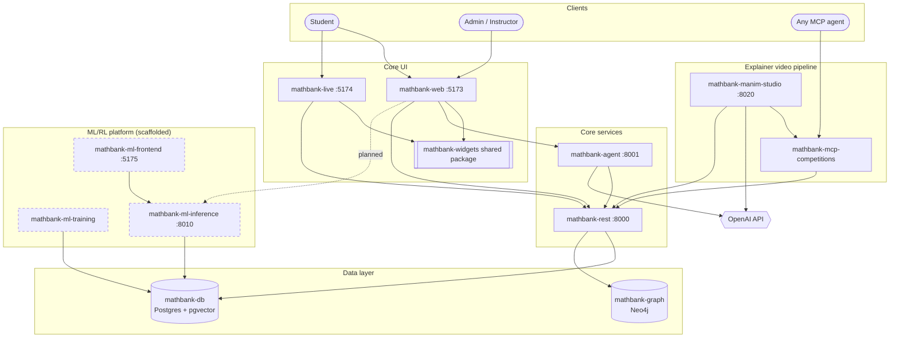

Dashed boxes = the ML/RL platform (docs 54–58), **scaffolded only**: every endpoint
exists and responds correctly, but no model has been trained yet (see
[Machine Learning](#machine-learning-intellitutor-mlrl-platform) below).

### C1 — System context

Who uses MathBank, and which external systems does it depend on.

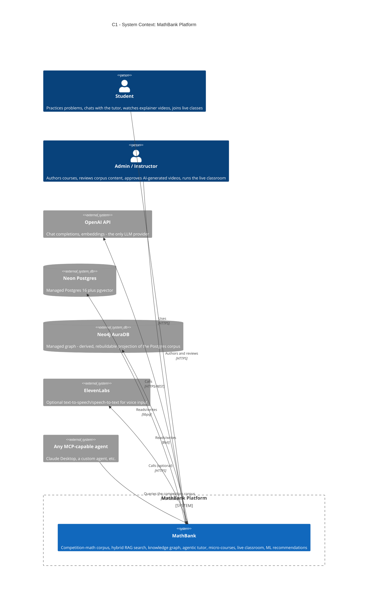

### C2 — Containers

Every independently-runnable piece, grouped by the product area it belongs to.

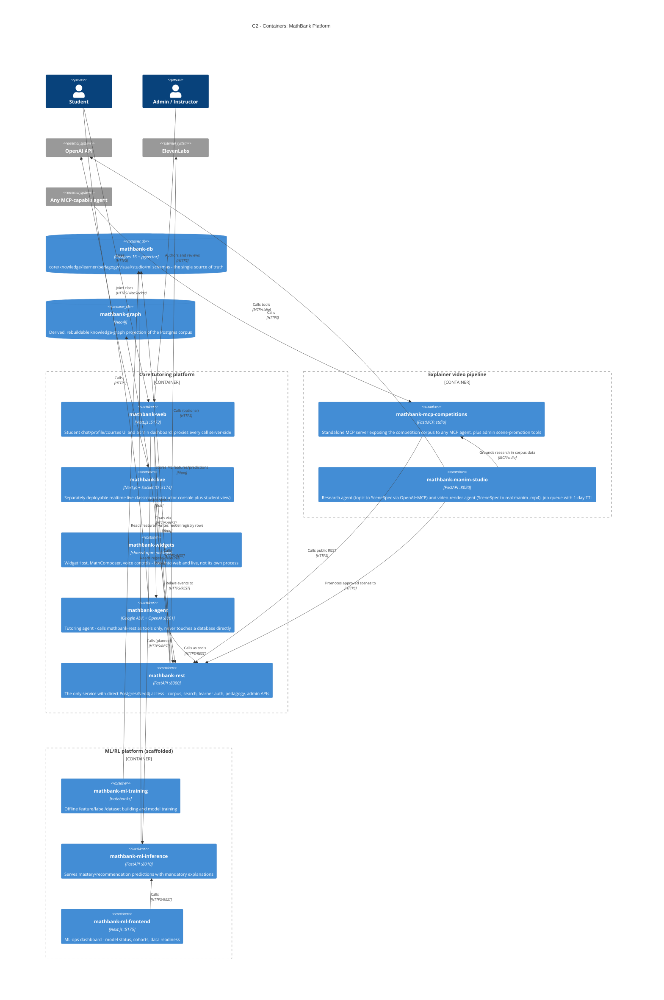

### Key flows (sequence diagrams)

Five flows that between them touch every container above.

**1. Student asks the tutor a question** — the core RAG + agent loop.

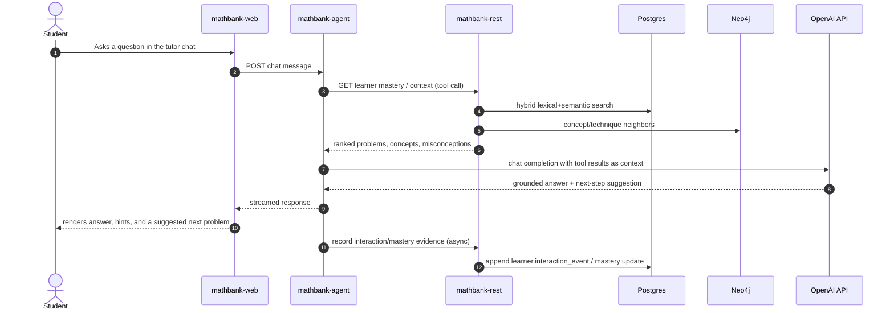

**2. Admin generates and publishes an explainer video** — the full
`mathbank-manim-studio` → canonical-catalog → published-course pipeline (requirements/60).

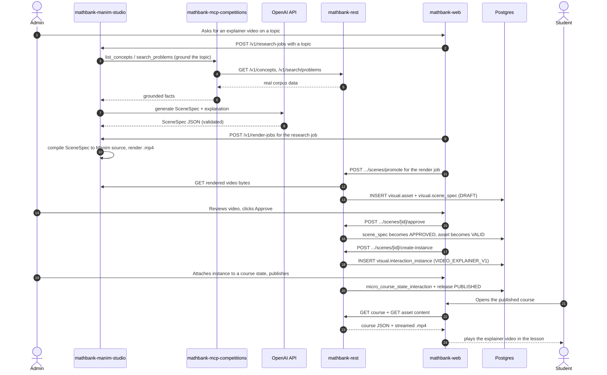

**3. An external agent queries the competition corpus** — proof `mathbank-mcp-competitions`
works for *any* MCP client, not just this repo's own agent.

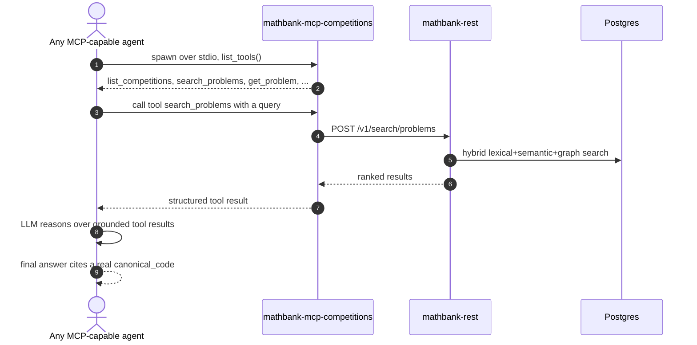

**4. Live classroom session** — `mathbank-live`'s realtime relay.

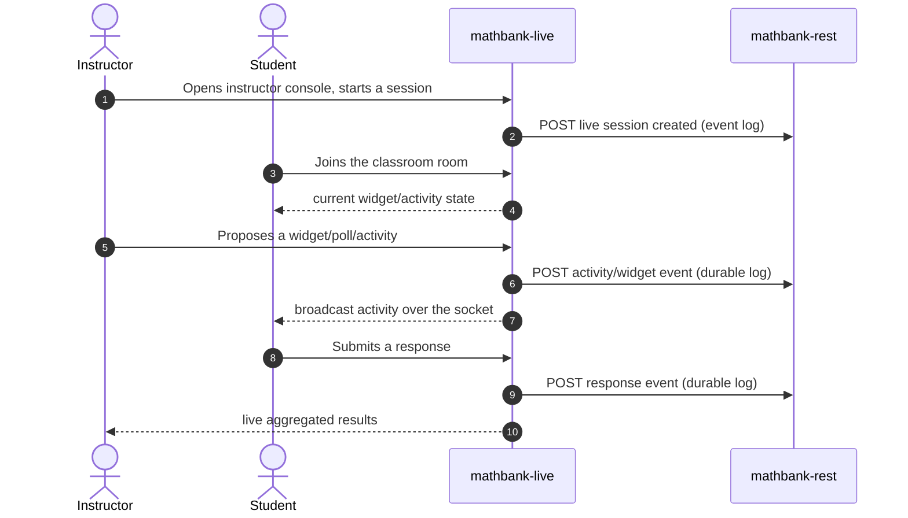

**5. ML training → inference → dashboard** — the intended flow once the ML/RL platform
is implemented (currently scaffolded; see below).

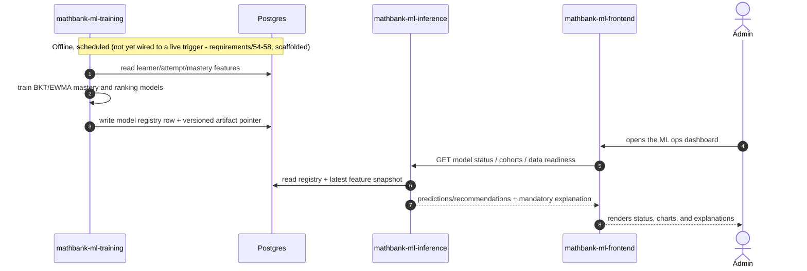

## Data model

Everything below was pulled live from the running databases (`information_schema` in
Postgres, `CALL db.schema.visualization()`/`db.labels()`/`db.relationshipTypes()` in
Neo4j), not copied from a migration file or a stale doc — the same "verify against the
live system" standard the rest of this README holds itself to. For exhaustive DDL/DML
(every column, type, index and constraint) see
[`documentation/requirements/reference/POSTGRES_SCHEMA.md`](documentation/requirements/reference/POSTGRES_SCHEMA.md),
[`POSTGRES_DML.md`](documentation/requirements/reference/POSTGRES_DML.md) and
[`GRAPH_SCHEMA.md`](documentation/requirements/reference/GRAPH_SCHEMA.md) — this section
is the orientation map, not the reference.

### Postgres — 20 schemas, 207 tables

One Postgres 16 + pgvector database (`mathbank-db`), owned exclusively by
`mathbank-rest` — every other service reaches it only through the REST API.

| Schema | Purpose | Tables |
|---|---|---|
| `core` | Competition corpus of record — competitions, papers, problems, solutions | 7 |
| `knowledge` | Taxonomy — concepts, skills, techniques, misconceptions, and their relations | 21 |
| `learner` | Student profiles, attempts, concept/technique mastery, course enrollment, event log | 15 |
| `pedagogy` | By far the largest — micro-courses, solution routes/steps, feedback policies, knowledge-gap diagnosis, recovery plans, video transcripts/segments | 62 |
| `visual` | Interaction-template/scene/asset catalog (the "Interaction Template Library") | 14 |
| `studio` | `mathbank-manim-studio` job queue — scene-research and video-render jobs, 1-day TTL | 2 |
| `search` | Hybrid retrieval — chunks, embeddings, embedding jobs/models, retrieval profiles | 7 |
| `pipeline` | Background-job orchestration, including the Postgres→Neo4j graph projector | 7 |
| `quiz` | AIME/HMMT-style question-paper generation — papers, questions, responses, solutions | 7 |
| `artifact_runtime` | Compiled/runtime artifacts for solution routes and rendered widgets | 11 |
| `attempt_media` | Photographed/handwritten attempt submissions — media, transcription, step assessment | 9 |
| `agent_sessions` | `mathbank-agent` (Google ADK) session/event state | 5 |
| `ingest` | Raw PDF/crawl ingestion staging — draft corpus rows awaiting admin review | 8 |
| `live` | `mathbank-live` realtime classroom — sessions, participants, recommendations | 7 |
| `neon_auth` | Neon-managed auth schema (not application-owned) | 9 |
| `authoring` | Admin content-authoring chat/plan workflow | 5 |
| `geometry_scene` | Deterministic geometry scene engine — scenes, versions, runs, receipts | 4 |
| `activity` | Generic poll/activity definitions, instances and responses (used by `live`) | 3 |
| `tutor` | Micro-course runtime/session state consumed by the tutoring agent | 2 |
| `analytics` | Aggregate learner-activity reporting | 1 |
| `audit` | Cross-schema action log | 1 |

### Core entity model

A deliberately curated subset — the ~23 tables that tell the "corpus → taxonomy →
learner → course → interaction → video" story end to end. The `schema` row in each box
is this diagram's own annotation (which Postgres schema the table lives in), not a real
column.

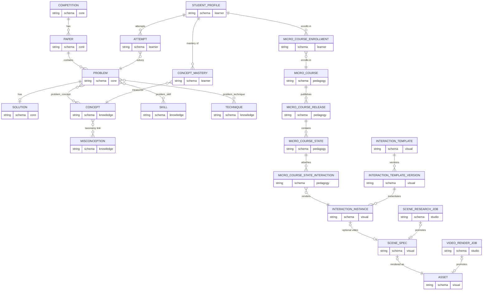

### Neo4j — 25 node labels, 34 relationship types

`mathbank-graph` projects a derived, rebuildable copy of the `core`/`knowledge`/
`pedagogy` schemas into Neo4j AuraDB; Neo4j is never written to directly by any other
service. Live counts (sorted, most populous first):

| Node label | Count | Node label | Count |
|---|---|---|---|
| `LearningItem` | 91,354 | `Skill` | 6,208 |
| `RouteStep` | 80,168 | `Concept` | 2,936 |
| `TheoryItem` | 80,168 | `SolutionPart` | 2,001 |
| `Claim` | 80,168 | `Technique` | 1,484 |
| `Misconception` | 69,954 | `Paper` | 1,391 |
| `Solution` | 18,749 | `Subconcept` | 214 |
| `RouteRelease` | 18,589 | `AnimationTemplate` | 29 |
| `Problem` | 12,542 | `IconToken` | 25 |
| `SolutionStep` | 7,814 | `InteractionTemplate` | 20 |
| | | `Competition` | 15 |
| | | `ControlTemplate` | 11 |

`InteractionTemplateVersion`, `SceneSpec`, `InteractionInstance`, `FeedbackTemplate`,
`FeedbackPolicy` and `EvidenceRule` are **seeded labels with zero nodes today** — the
Interaction Template Library's catalog has been wired into Postgres/REST/the web app
(see the Architecture section above) but its Neo4j projection is still a tracked gap,
not yet a live graph. The 34 relationship types fall into three groups:

| Group | Relationship types |
|---|---|
| Corpus structure | `HAS_PAPER`, `HAS_PROBLEM`, `HAS_SOLUTION`, `HAS_PART`, `HAS_STEP`, `HAS_ROUTE`, `NEXT` |
| Taxonomy enrichment (densely many-to-many) | `CONCEPT_RELATION`, `PART_OF`, `PREREQUISITE_OF`, `SIMILAR_TO`, `BUILDS_ON`, `RELATES_TO` |
| Diagnosis & pedagogy | `REQUIRES`, `TESTS`, `TESTS_MISCONCEPTION`, `USES_TECHNIQUE`, `USES_CONCEPT`, `USES_SKILL`, `USES_SUBCONCEPT`, `USES_CLAIM`, `PRODUCES`, `DEPENDS_ON`, `CAN_TRIGGER`, `CHECKED_BY`, `DIAGNOSED_BY`, `REMEDIATED_BY`, `EXPLAINED_BY`, `EXPLAINS`, `ANCHORED_AT`, `ASSESSES`, `DERIVED_FROM`, `PRACTICES`, `TARGETS_CONCEPT`, `TARGETS_SUBCONCEPT` |

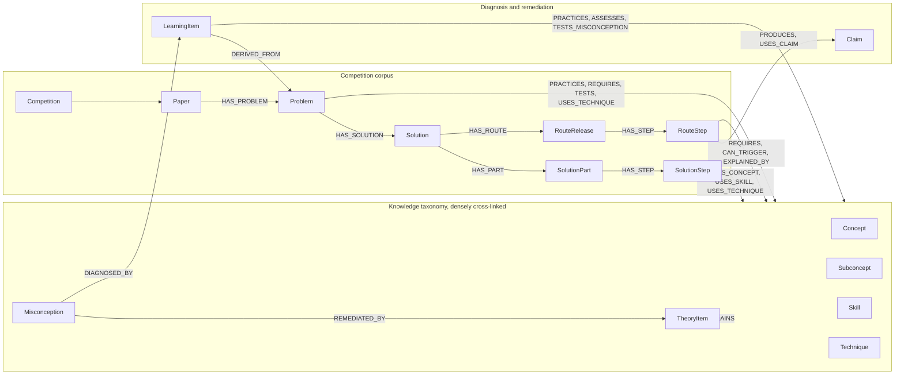

### How Postgres and Neo4j are wired together

Postgres is the single source of truth; Neo4j is a derived, disposable, rebuildable
projection used for graph traversal (prerequisites, similar problems, misconception
links) that `mathbank-rest` blends with Postgres full-text/pgvector search into one
hybrid-RAG result set for the tutoring agent.

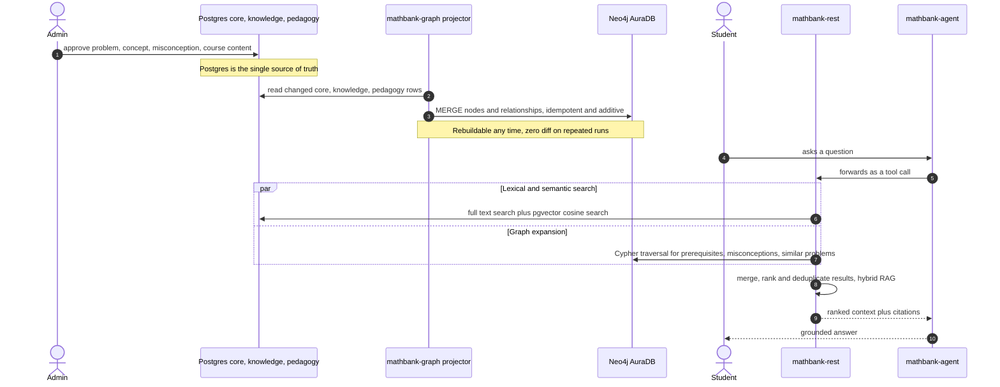

Want literal motion instead of a sequence diagram? `mathbank-manim-studio` (see
[Architecture](#architecture) above) can render any `SceneSpec` — including one
describing this exact pipeline — into a real explainer video.

## Machine Learning (IntelliTutor ML/RL platform)

A deliberately **separate** product area from the core tutor above — three independent
sub-projects, scaffolded from the 16-document `intellitutor-ml-rl` design pack
(requirements/54–58). "Scaffolded" means: every endpoint, page, and pipeline stage
exists, is wired together, and has been live-verified to boot/route/render correctly —
but no model has been trained on real data yet, so predictions are not yet real.

| Project | Role | Status |
|---|---|---|
| [mathbank-ml-training](mathbank-ml-training/README.md) | SageMaker-style offline notebooks: extract features/labels from the existing Postgres corpus, build datasets, train mastery (BKT/EWMA) and recommendation-ranking models, register versioned artifacts | Scaffolded — every function is a typed stub citing its design-doc section |
| [mathbank-ml-inference](mathbank-ml-inference/README.md) | FastAPI service serving every student/admin prediction/recommendation endpoint from the design pack, each with a **mandatory `Explanation` field** (no black-box answers) | Scaffolded — endpoints return structured `501 MLUnavailable`, live-verified end to end |
| [mathbank-ml-frontend](mathbank-ml-frontend/README.md) | A separate, minimal ML-ops dashboard — model status, cohort views, data-readiness checks — intentionally **not** merged into `mathbank-web`'s student/admin UI | Scaffolded — live-verified rendering through its proxy to `mathbank-ml-inference` in a real browser |

Why separate from `mathbank-web`/`mathbank-rest` rather than folded in: the ML/RL
platform has its own deployment cadence (model retraining, not every API change), its own
operator audience (ML engineers, not students/teachers), and — per
requirements/54 §2 — is explicitly **not** where event-driven, non-ML infrastructure
belongs (see `documentation/requirements/59_STUDENT_ADMIN_NOTIFICATIONS_PLATFORM.md`,
which lives inside `mathbank-rest` instead, for exactly that reason).

```bash
make ml-training-install && make ml-training-notebook   # Jupyter Lab over the notebooks
make ml-inference-install && make ml-inference-start     # FastAPI service on :8010
make ml-frontend-install && make ml-frontend-start       # dashboard on :5175
make status-extra                                        # are they running?
```

See each project's own README for its full endpoint/notebook inventory and the design
pack's own architecture rationale.

## Do I need local Postgres/Neo4j at all?

**Usually no.** `mathbank-db` and `mathbank-graph` are literally the names
of the *schema/ETL* projects, not something the other three services talk
to at runtime — `mathbank-rest` and `mathbank-web` each read their own
`.env` and connect **directly** to whatever `POSTGRES_HOST`/`NEO4J_URI`
point at. After `make sync-env` (the common path — see below), those point
at the shared remote **Neon Postgres + Neo4j AuraDB**, so a local Postgres
16 / Neo4j install is not required to run the app at all.

Local Postgres/Neo4j (via Homebrew, on the external APFS drive) are only
needed if you're doing **local-only** corpus pipeline work (ingestion
scripts without `-remote`, schema changes before pushing them to Neon,
etc.) — see `mathbank-db/README.md` / `mathbank-graph/README.md`.

Because of this, `make up`, `make status` and `make down` cover only
rest/agent/web/live and never touch local Postgres/Neo4j. `make up` is the
same as `make up-app`. For a fully local stack, run
`make -C mathbank-db install && make -C mathbank-graph install` (then
`make -C mathbank-db init start create-db` / `make -C mathbank-graph setup`),
and use `make up-local-db`, `make access-local` and `make down-local-db`.

## Quick start

### Local Ollama tutoring ingestion: one or multiple machines

This offline pipeline reads stored solutions from the PostgreSQL configured in
`mathbank-rest/.env`. It writes new versioned routes to that same database.
**Claims, misconceptions, theory recaps and diagnostic quizzes are mandatory
for every step**, in addition to instructions, hints and canonical taxonomy.

An **independent different-model critic is optional**, controlled by
`ROUTE_CRITIC` (default `0`/off). When enabled (`ROUTE_CRITIC=1`), a second,
different Ollama model (`ROUTE_CRITIC_MODEL`, default `llama3.2:3b`) scores
each step 0–4 for source faithfulness, mathematical consistency,
current-step-only disclosure, instructional quality, misconception
correctness, quiz correctness and taxonomy alignment. Acceptance requires
PASS, every score at least 3, and no reported issues; FAIL/ABSTAIN triggers
up to two feedback-guided regenerations before the task fails. This is an
independent-model quality signal, **not mathematical certification**, and is
off by default to avoid the extra memory/time cost of a second resident model.
Incomplete mandatory-enrichment output is never inserted regardless of the
critic setting. There is **no OpenAI fallback**. Publication and graph refresh
remain separate.

On each macOS or Linux machine:

1. Install the REST project and its dev dependencies using its existing
   installation instructions; install the Ollama application/CLI.
   **The pipeline automatically pulls the generator model (and the critic
   model, if enabled) when missing**, before any inference or queue seeding.
   An interrupted/failed download aborts.
2. Securely configure `mathbank-rest/.env` to point to the **same remote
   PostgreSQL** on both machines. Do not copy credentials into commands or logs.
   No local PostgreSQL, web server or Tutor-agent is required.
3. Choose a writable log directory on your machine's external drive. The root
   `requirements.txt` is the execution plan, **not** a pip dependency manifest.
4. Apply migrations 026/027 if absent using the existing route compiler migration
   command, then apply 028/029 **once**, before starting either worker machine:

```bash
make routes-migrate ROUTE_LOG_ROOT=/your/external-drive/mathbank-logs
make routes-prepare ROUTE_LOG_ROOT=/your/external-drive/mathbank-logs
make routes-plan ROUTE_LOG_ROOT=/your/external-drive/mathbank-logs
# Small real acceptance run first (this generates locally and writes to PostgreSQL):
make routes-ingest ROUTE_LIMIT=2 ROUTE_LOG_ROOT=/your/external-drive/mathbank-logs
# After inspecting acceptance, run on BOTH machines concurrently:
make routes-ingest ROUTE_LOG_ROOT=/your/external-drive/mathbank-logs
# Optionally enable the independent critic (uses more memory/time):
make routes-ingest ROUTE_CRITIC=1 ROUTE_CRITIC_MODEL=llama3.2:3b \
  ROUTE_LOG_ROOT=/your/external-drive/mathbank-logs
# Only if you authorize structural bulk review (not proof certification):
make routes-ingest ROUTE_APPROVE_BY=operator-your-name \
  ROUTE_LOG_ROOT=/your/external-drive/mathbank-logs
make routes-progress ROUTE_LOG_ROOT=/your/external-drive/mathbank-logs
# Detail for one machine's run (UUID printed at startup):
make routes-progress ROUTE_RUN_ID=your-run-uuid \
  ROUTE_LOG_ROOT=/your/external-drive/mathbank-logs
```

Each invocation runs in the foreground; Ctrl-C stops new claims and waits for
in-flight tasks to settle (local calls have a 900-second timeout). A crashed
worker's lease expires after 180 seconds; another invocation can reclaim it.
Use your own service supervisor if execution must survive logout. Do not launch
the older globally locked `route_compiler compile` command alongside this pipeline.

**Before inference**, the orchestrator probes OS, available RAM, logical CPU
affinity/count, installed model size and (Linux with NVIDIA) minimum free
per-device VRAM. It reserves the greater of 3 GiB or 20% of RAM, budgets 1.25x
the larger of the generator/critic model disk sizes (just the generator when
the critic is disabled) plus at least 1 GiB per slot (1.5 GiB at 16K context),
and chooses the largest concurrency within those estimated limits and CPU
count, without a fixed eight-worker cap. Insufficient memory aborts explicitly.
These are conservative estimates, not an OOM guarantee; other workloads can
change RAM after preflight. Close competing model servers if needed. CPU
threads are `min(10, max(1, CPUs / workers))`; this does not multiply GPU
throughput. The pipeline starts/stops only its **own** loopback Ollama server
on a free port with matching parallel slots; shared Ollama servers are not
modified. Only one model is resident at a time; generator/critic switching may
reduce throughput but avoids budgeting two resident models on a small Mac.
Windows automatic sizing is currently rejected rather than guessed.

Overrides:

| Make variable | Default / behavior |
|---|---|
| `ROUTE_MODEL` | `qwen2.5:7b`; auto-installed by prepare/ingest if missing |
| `ROUTE_CRITIC` | `0`/off by default; set `1`/`true`/`yes` to enable the independent critic |
| `ROUTE_CRITIC_MODEL` | `llama3.2:3b`; only used/installed when `ROUTE_CRITIC` is enabled, must differ by name and digest from `ROUTE_MODEL` |
| `ROUTE_CONTEXT` | `16384`, supported 2048–32768 |
| `ROUTE_WORKERS` | Auto; optional lower override, unsafe increases rejected |
| `ROUTE_LIMIT` | All; limits **new queue seeding**, not already shared queued work |
| `ROUTE_APPROVE_BY` | Unset: DRAFT only; explicit identity enables validated REVIEWED |
| `ROUTE_RETRY_FAILED=1` | Explicitly requeue failed selected tasks; never automatic infinite retry |
| `ROUTE_LOG_ROOT` | This Mac's external-drive path; **override on other machines** |
| `ROUTE_LOG_DIR` | Optional exact invocation directory; default host + UTC timestamp |
| `ROUTE_PYTHON` | REST `.venv/bin/python`; override for your installed interpreter |
| `ROUTE_RUN_ID` | Optional per-machine run UUID for `routes-progress` |

**Multi-machine safety:** migration 028 creates a shared queue uniquely keyed
by compiler version, solution and source hash. Workers atomically claim rows
with `FOR UPDATE SKIP LOCKED`; there is **no global run/advisory lock** in this
pipeline. Each task has an ownership token and a renewable 180-second lease
(heartbeat every 30 seconds). Persistence checks ownership in the same
transaction that inserts the route and completes the task. A stale worker
cannot write after another worker reclaims it. Short per-task/per-solution
transaction locks and uniqueness constraints remain necessary to prevent
duplicate writes; inference never holds them. Each machine has its own run
and model/hardware provenance, even when models differ, and each can
independently enable or disable the critic.

**Validation and retries:** decomposition and each step's enrichment get an
initial attempt plus **two error-guided repairs**. Repairs include safe
validation diagnostics; relationship IDs are constructed deterministically,
not invented by the model. All source-excerpt, canonical-ID, DAG and enrichment
checks must pass before insertion. Database failures roll back the entire
route; transient connection/serialization/deadlock failures get two bounded
transaction retries, not regenerated mathematics. Permanent SQL errors fail
explicitly. Transport failures stop new work on that machine. Oversized input
and truncated output fail, without silent clipping or paid fallback.


`routes-plan` is read-only and requires the generator model (and the critic
model, if `ROUTE_CRITIC` is enabled) already installed; `routes-prepare`
downloads missing models but makes no inference/SQL calls. Model downloads
need internet access to the Ollama registry and sufficient disk space; this
transfers model artifacts only, not corpus data or credentials. Ollama itself
must be installed and on PATH; the pipeline does not install system software
silently.

Logs are private and per invocation: `infrastructure.json`, `resources.json`, `server.log`,
`ingestion.log`, `progress.json`. PostgreSQL persists run/model configuration,
per-job diagnostics and per-step model name, digest, options, token usage,
timing, source hashes and taxonomy snapshots. Every stored record includes
**when generation started** (`generation_started_at`) and **which generator
model** produced it (`model`); `critic_model` is an explicit JSON `null`
unless an operator enabled the critic for that run, in which case it holds
the critic's model name alongside its nested per-step evaluation. Shared queue
totals and this machine's results are reported separately: local completion is
not corpus completion. Missing-model download progress is in `model-install.log`.
`routes-progress` includes completion percentage, failures by code, expired
reclaimable leases, latest machine runs and a generator/critic-model summary
by job status. The mandatory-enrichment compiler version creates enriched
replacements for old step-only routes without deleting or modifying reviewed
snapshots or local backups. Historical unenriched routes cannot newly pass the
updated review/publication gates; existing published/attempt-pinned content is
not silently swapped.

```bash
make routes-test                         # no model calls; rollback DB tests skipped
ROUTE_DB_TESTS=1 make routes-test         # opt-in configured DB, see cleanup boundary below
```

Route fixtures roll back. The two-connection SKIP LOCKED test briefly commits
uniquely test-prefixed queue/run records so both connections can see them, then
deletes only those exact records in `finally`; it makes no model calls and
does not insert canonical routes.

### New collaborator with a shared `.env`

If someone on the team sent you a consolidated `.env` over a **secure
channel** (it contains live database/API credentials — never over email or
chat that isn't end-to-end secured), set up with:

```bash
# 1. Save the file they sent you as .env at this repo's root (same folder as
#    this README — it's gitignored, never commit it).
# 2. Distribute it into every service's own .env (mathbank-db/.env,
#    mathbank-rest/.env, etc.):
make sync-env            # or: ./sync-env.sh
# 3. Set OPENAI_API_KEY in the gitignored root .env. Shell keys are ignored.
#    Never share it through an unsecured channel.
#    make sync-openai-key copies it without printing it.
#    Also set ELEVEN_API_KEY (ElevenLabs voice) and the live-classroom keys
#    MATHBANK_REST_BASE_URL, MATHBANK_ADMIN_API_KEY, ADMIN_LOGIN_USERNAME,
#    ADMIN_LOGIN_PASSWORD, ADMIN_SESSION_SECRET (optional LIVE_PORT=5174).
#    sync-env/make up stop with "Missing in root .env: ..." if any are absent.
# 4. Install whatever isn't already installed, and see what (if anything) is
#    still missing:
make setup
# 5. Start rest/agent/web/live against the remote Neon/AuraDB:
make up
```

For a machine using Neon/AuraDB, prefer `make up-app`: it starts only
REST, agent, web and the live classroom, without trying to start local
Postgres/Neo4j.

**Prefer a separate terminal window per service?** `make up-windows` (macOS only)
opens one real Terminal.app window per core service, each running its foreground
dev command (`make run`/`make dev`, with hot-reload) — no PID files, no daemon, no
background log file to tail; Ctrl-C in any one window stops only that service.
`make up-windows-all` does the same plus `mathbank-manim-studio`/`mathbank-ml-inference`/
`mathbank-ml-frontend`. This is a genuine alternative to `make up`/`make down`, not a
wrapper around them — don't mix the two for the same service at the same time (starting
one window's service while its daemon-mode twin is already bound to the same port will
fail with "port already occupied", exactly like running `make up` twice).

### Bringing up the new pieces (live classroom, widgets, voice)

The fluid widgets, the separately deployable Socket.IO live classroom
(`mathbank-live`, :5174), the shared `mathbank-widgets` package and the
ElevenLabs voice add-on need this one-time sequence on each machine:

```bash
# 1. Root .env: OPENAI_API_KEY, ELEVEN_API_KEY and the live keys listed above.
make sync-env                    # writes every service .env incl. mathbank-live/.env
make setup                       # venvs + node_modules for web AND live
# 2. Database objects for live sessions/widgets/authoring (migration 020).
#    Idempotent; already applied on the shared Neon database.
make migrate-live-fluid-remote
# 3. Start and print every URL (web, Swagger, REST, agent, live, graph, Postgres).
make up-app                      # or: make up
make access
# 4. Verify (none of these spend money).
make test-unit                   # web + mathbank-widgets + live unit tests
make smoke                       # two-socket live-classroom smoke (needs REST + live)
make -C mathbank-web e2e-install # once: Playwright Chromium
make e2e                         # Playwright regression incl. add-ons and live
make check-eleven                # ElevenLabs key check, no audio generated
```

`make check-eleven TTS=1` and `make e2e-llm` make small **paid** calls; run
them only deliberately. After editing `mathbank-widgets/`, run
`make widgets-sync` (start/install also copy it) and restart web/live.
Live-only lifecycle: `make live-install | live-run | live-start | live-stop |
live-restart | live-status`. Requirements: [27 fluid widgets](documentation/requirements/27_FLUID_WIDGET_LAYER.md),
[28 distributed live platform](documentation/requirements/28_DISTRIBUTED_LIVE_PLATFORM.md),
[29 student input add-ons](documentation/requirements/29_STUDENT_INPUT_ADDONS.md).
These service start targets now wait for HTTP readiness (up to 60 seconds,
override with `START_TIMEOUT=120`) and fail if the process exits or never
responds with HTTP 200. They do not kill an unrelated process holding a port.
An access summary confirms startup HTTP readiness, not database connectivity,
model credentials, or successful tutoring.

#### Another developer Mac: startup troubleshooting

`pg_ctl` / `neo4j` missing only means local database software is absent.
It does not explain why Swagger or the web server cannot be reached when
the service configuration uses Neon/AuraDB. The older start targets printed
"started" after one second even if the process had already crashed.

On the affected Mac, use the current code, configure per-service environment
files securely, and install dependencies **on that machine**. Never copy
`.venv`, `node_modules`, `.next`, PID files or runtime logs from another Mac;
Python entrypoints contain absolute interpreter paths.

```sh
make setup
# If environments/dependencies were copied or are broken, rebuild only those:
make rest-install agent-install web-install live-install
make up-app

# Diagnose crashes locally. Redact credentials before sharing log excerpts.
tail -n 80 mathbank-rest/.server.log
tail -n 80 mathbank-agent/.server.log
tail -n 80 mathbank-web/.server.log
tail -n 80 mathbank-live/.server.log

# Foreground commands expose import/configuration/dependency errors directly.
# Run each in its own terminal after stopping the corresponding owned service.
make rest-run
make agent-run
make web-run
make live-run
```

Check access from a terminal **on that same Mac**:

```sh
curl --noproxy '*' -I http://127.0.0.1:8000/docs
curl --noproxy '*' http://127.0.0.1:8000/health
curl --noproxy '*' http://127.0.0.1:8001/list-apps
curl --noproxy '*' -I http://127.0.0.1:5173/login
curl --noproxy '*' -I http://127.0.0.1:5174/login
```

If these fail, inspect the relevant log rather than treating the startup PID
as proof of success. If they succeed but the browser fails, try `127.0.0.1`
instead of `localhost` and check proxy/VPN settings and the exact browser error.
`localhost` always means the machine running the browser, not a teammate's
Mac. Do not expose the development services to the network just to troubleshoot.
After HTTP works, run `make test-connectivity` to verify the configured
Postgres and Neo4j backends separately. Do not paste environment files,
API keys or passwords into an issue or chat.

#### Purple Comet archive

`make -C mathbank-db purple-comet-discover-remote` discovers both English divisions
from the official [archive](https://purplecomet.org/answers), downloads valid PDFs
and answer keys, registers Postgres sources and extracts numbered questions.
Use `YEAR=2026` for a bounded pilot. Original PDFs, page renders, answer HTML/JSON
and source manifests are retained under `mathbank-data-ingestion/data/crawl_pdf/purple_ms`
and `purple_hs`. Student diagrams are tight figure crops inside verified spatial
question boundaries, including continuation pages. Whole-page renders are audit
evidence only, never question diagrams. Problem and solution assets have separate
provenance; ambiguous numbering/layouts are left unverified, not guessed.

`make -C mathbank-db purple-comet-batches-remote` waits for the existing exclusive
paper runner, then processes batches of two through paid classification,
Postgres and verified Neo4j publication. It supports `BATCH_SIZE=`, `LIMIT=` and
`RESUME=`. Purple Comet classification uses `gpt-4.1` and sends the actual
question-specific figure/region crops as vision inputs, along with the official answer key.
New metadata follows the existing automatic-approval policy; protected human
corrections/rejections are not overwritten.

Do not equate an answer key with a worked solution or HTTP 200 with a PDF.
Some PDF endpoints return HTML rather than documents; these are explicit
failed sources, never successful parses. Valid legacy PDFs may have whitespace
before their `%PDF-` signature; rejecting those was a parser bug, now corrected.
Both official bare and `www` hosts are accepted. Missing worked-solution PDFs
are distinct from missing problem PDFs. The recovered archive inventory was
verified at 44 valid problem PDFs and 1,050 official answers (2005-2026, both
divisions), with four available worked-solution PDFs for 2025-2026. Historical
worked solutions are reported as unavailable, not fabricated. Completion requires
all available numbered solutions and verified question-specific figures, exact question/answer
coverage and graph inventory agreement. Source copyright remains with Purple
Comet; this workflow does not grant redistribution rights.

#### Repair existing source diagrams (no paid model calls)

```sh
make -C mathbank-data-ingestion repair-diagrams       # local audit; no writes
make -C mathbank-data-ingestion repair-diagrams-apply # artifacts + existing staging rows
# Optional PAPER=PAPER_SMT_2010_GEOM or COMPETITION=smt
# Optional DOWNLOAD_MISSING=1 explicitly fetches missing cached AoPS image URLs.

PG_ENV_FILE=mathbank-graph/remote.env mathbank-db/.venv/bin/python \
  mathbank-db/etl/backfill_question_figures.py         # Postgres audit
# Add --apply after reviewing the source manifests.
```

The repair refreshes manifests, source-side image lists, trailing Markdown figures
and staging visual provenance without changing statements, answers or enrichment.
It does not create missing staging questions. Per-question `diagram_status.json`
distinguishes extraction, verified absence of graphics, unverified PDFs, missing
sources and missing AoPS downloads. Student routes reject solution/answer images,
whole-page references and legacy assets with unknown provenance. See
[requirements 31](documentation/requirements/31_QUESTION_SPECIFIC_DIAGRAMS.md) for results and gaps.

#### Automatic teaching metadata

The admin jobs console at `/admin` now reports each paper's download, parse,
Postgres import, classification, vectors, corpus graph, generated pedagogy,
pedagogy publication and taxonomy graph independently. Filter by competition
or paper, expand inventory/errors/job history, and inspect UTC timestamps and
live counts. A completed paper batch alone is not an end-to-end success.
Graph outages and missing historical timestamps are reported explicitly.

Tutor search uses reviewed Neo4j graph evidence plus pgvector similarity and
Postgres lexical retrieval, fused by distinct problem with per-source ranks.
Retrieval warnings disclose unavailable graph evidence. For contracts see
[requirements 16](documentation/requirements/16_PIPELINE_JOB_CONSOLE_AND_HYBRID_RAG.md).

Existing PENDING and future generated corpus metadata are automatically
approved, with `approval_method=automatic` to distinguish machine estimates
from human review. Admin corrections and rejections are protected. Learning
context enriches missing skills/prerequisites/difficulty automatically; this
uses paid model requests and does not create learner mastery records.

Apply `mathbank-db/sql/008_automatic_metadata.sql` after migrations 006/007.
From `mathbank-rest`, `make enrich-corpus WATCH=1 WORKERS=4` backfills all questions
and watches newly ingested ones. Per-question status, attempts and failures
are recorded in `knowledge.enrichment_job`; invalid output is not approved.
For catalog relationships, also apply `mathbank-db/sql/009_relationship_enrichment.sql`
(`make -C mathbank-db migrate-relationship-enrichment-remote` for the configured
remote database), then run the **same watcher**, not a second publisher:
`make -C mathbank-rest enrich-corpus WATCH=1 WORKERS=4 RELATIONSHIPS=1`.
At most one slot generates skill PART_OF/BUILDS_ON or concept PREREQUISITE_OF
edges; other slots enrich questions. Generation and independent semantic review
default to `gpt-4.1`, configurable with `RELATIONSHIP_MODEL` and
`RELATIONSHIP_VERIFIER_MODEL`. Both incur paid calls. Zero-edge proposals are valid;
bounded candidates do not guarantee exhaustive relationships. Jobs, evidence,
errors and publication state are recorded in `knowledge.relationship_enrichment_job`.
Admins can inspect and correct concept relations alongside skill relations.
See the [relationship plan](documentation/requirements/15_RELATIONSHIP_ENRICHMENT.md).
The worker reselects work between every problem and prioritizes failed jobs
whose five-minute cooldown has elapsed, up to three job attempts. Non-watch
`LIMIT=...` bounds generation attempts; watch mode continues without a total cap.
Graph publication uses batches of at most 25, scheduled every 60 seconds or when
a full batch is ready (checked between jobs). Completed-but-unpublished jobs
are replayed without paying for regeneration. Transient graph failures use
three attempts with 2/4-second backoff, then watch mode retries after 60 seconds.
Generation and publication errors are logged separately.
`WORKERS` defaults to 1 and accepts 1-8. Four concurrent model jobs are currently
authorized. Imports retain their table locks for global cycle safety; only the
coordinator publishes graph batches, draining in-flight imports first so its
own jobs do not invalidate the publication fingerprint. In-flight codes are excluded from dispatch
and Postgres claims remain authoritative. SIGTERM/SIGINT stops dispatch, drains
active jobs, and flushes publication work before exit. Do not launch multiple
independent coordinators to increase concurrency. Provider rate limits and
serialized imports mean throughput will not necessarily scale linearly.
Watch mode also retries temporary Postgres read failures. Each generation can
request up to three structured model responses with exact catalog enums and
validation feedback, including existing-graph cycle conflicts. Metadata and its
COMPLETED publication job are saved in the same transaction. The admin UI lists
failed generation errors and offers reclassification.
The admin pedagogy UI supports attribute corrections, tag decisions and
reclassification; explicitly publish corrections to update Neo4j.

The running background backfill logs to
`mathbank-rest/logs/automatic-enrichment.log`. Full corpus completion is not
claimed until the remaining job count is zero and graph publication succeeds.
See the [recovery plan](documentation/requirements/14_AUTOMATIC_ENRICHMENT_RECOVERY.md)
for acceptance criteria and operational gotchas.

#### Model-key synchronization details

`make sync-openai-key` copies `OPENAI_API_KEY` from the root `.env` only
into REST, agent and ingestion
`.env` files, creating those files if absent. It also updates existing database,
graph and web `.env` files. It preserves unrelated settings, removes duplicate
key assignments, writes atomically with owner-only permissions (`0600`), and
never prints the value. The key is server-side only, never `NEXT_PUBLIC_*`.

`make sync-env`, `make up`, `make up-app` and `make up-local-db` include this
sync. Existing running services must be restarted to load changed values;
syncing alone does not restart them. REST, ADK/LiteLLM, classifiers, reviewers
and vector backfills use the shared file-only credential loader, even when run
directly or from a different working directory. A root `.env` is authoritative:
an empty/missing key there is an error, not a fallback to an inherited shell key
or a stale service key. A service `.env` key is supported only if no root `.env`
exists. Provider URL/organization/project settings also come from files, not
inherited shell values. Other variables such as worker database destinations
retain their existing precedence. No shell profile needs changing.

#### OpenAI / LiteLLM troubleshooting on either developer's machine

> **Note:** After saving or updating `OPENAI_API_KEY` in the root `.env`,
> run these commands from the repository root on each developer's machine.
> The `CHAT=1` check makes a small paid LiteLLM model request.

```sh
make sync-openai-key
make check-openai          # authenticate without a paid chat completion
make check-openai CHAT=1   # small paid LiteLLM model check
```

These checks read project files, never print the key, and do not source or modify
`.zshrc`. Chat uses `MATHBANK_AGENT_MODEL` from the agent `.env`, for example
`openai/gpt-4o-mini` (the `openai/` provider prefix matters). Authentication success
does not imply billing/model access: HTTP 401 means authentication failure,
403/404 can mean model permissions/name, and 429 means quota or rate limiting.
A valid key on this Mac does not prove the other Mac has the same saved file.
Run these checks there too. Do not paste full provider exception bodies into chat;
some include a partial key. Restart REST/agent after changing credentials, and
restart ingestion workers at a safe checkpoint rather than duplicating a live run.

#### ElevenLabs voice key and live-app environment

> **Note:** After saving or updating `ELEVEN_API_KEY` in the root `.env`, run these
> from the repository root. `TTS=1` makes one tiny paid ElevenLabs text-to-speech call.

```sh
make sync-eleven-key       # copy ELEVEN_API_KEY into mathbank-web/.env and mathbank-live/.env (never printed)
make check-eleven          # authenticate (lists voices) — no paid synthesis
make check-eleven TTS=1    # tiny paid text-to-speech check
make sync-live-env         # write mathbank-live/.env (REST URL, admin key/login, session secret, Eleven key, LIVE_PORT)
make sync-keys             # OpenAI + ElevenLabs + live + Neon private-storage configuration
```

The Eleven key stays server-side: the browser only calls the same-origin
`/api/voice/{tts,stt,health}` routes of web/live. Without a key, the 🔊/🎤
buttons show a brief "!" (voice unavailable) and typing keeps working; there is
no browser speech fallback. `make sync-env`
also runs the Eleven and live syncs, so it no longer drops `ELEVEN_API_KEY`.
Restart web/live after changing the key.

#### Multimodal attempts and instructional artifacts

Student work is reviewed at `/learn/attempt-media`; instructor overrides are at
`/admin/attempt-media`, and reusable instructional SVG/LaTeX bundles are at
`/artifacts`. Uploads stay private. Machine transcription must be explicitly
approved by the student before entering learner history; pending work is not
scored as incorrect.

The tutor includes ten real Google ADK specialists using **Agent-as-Tool**
communication: Subject Planning, Geometry, Algebra, Combinatorics, Number Theory,
LaTeX, SVG, Overlay/Frame, Annotation and Validation. The tutor delegates to a
planner or subject agent; subjects can delegate to refinement/validation agents.
Requested illustrations render as private, validated previews directly in chat.
This uses the existing OpenAI model and requires ADK 2.11 or newer, not a remote
A2A server. See [agent topology and limits](mathbank-agent/README.md#artifact-specialist-agents).

Set these **server-only** settings in the root `.env`:

```dotenv
AWS_ENDPOINT_URL_S3=https://<branch-storage-endpoint>
AWS_REGION=<storage-region>
AWS_ACCESS_KEY_ID=<storage-access-key>
AWS_SECRET_ACCESS_KEY=<storage-secret>
MATHBANK_OBJECT_BUCKET=mathbank-runtime
NEON_AI_GATEWAY_BASE_URL=https://<gateway-endpoint>
NEON_AI_GATEWAY_TOKEN=<gateway-token>
MATHBANK_RUNTIME_AI_PROVIDER=openai
```

The S3 endpoint is not a Neon Auth URL. The bucket must be private; media bytes
are served through authenticated, owner-scoped REST/Next.js endpoints rather
than public storage URLs. Agent tools use REST and do not receive S3 master keys.

```sh
make sync-openai-key        # existing root-file-only OpenAI credential setup
make sync-neon-env          # private S3/Gateway settings; mode 0600; values hidden
make migrate-multimodal-remote  # additive migrations 021 + 022 on configured remote Postgres
make up                    # starts the existing separately deployable services
```

Check the configured remote target before running migrations. Python REST
dependencies include `boto3`; audio/video normalization additionally requires
`ffmpeg` and `ffprobe`. Install service dependencies through the existing setup
targets after pulling these manifest changes.

New agentic stages use the same OpenAI credential loader and
`OPENAI_API_BASE` / `OPENAI_BASE_URL` settings as `mathbank-agent`, not a silent
Gateway fallback. The model follows `MATHBANK_AGENT_MODEL` (default
`openai/gpt-4o-mini`); `MATHBANK_RUNTIME_AI_MODEL` can explicitly override it.
Timestamped speech uses `whisper-1`; artifact embeddings explicitly use
`text-embedding-3-small`, 1536 dimensions, unless a different verified embedding
profile is configured. Switching `MATHBANK_RUNTIME_AI_PROVIDER=neon` is an
explicit opt-in; Gateway artifact embeddings additionally require a verified
model/dimension configuration.

Processing, analysis, and embedding are explicit actions, never triggered by
opening a page. Authentication/model-list success does not establish paid
inference access. Initial provider smoke checks were blocked by Gateway
billing permissions and direct OpenAI `insufficient_quota`. After the user
increased the balance, some synthetic vision/segmentation requests succeeded,
but a subsequent `credit_balance_exhausted` response stopped further checks.
Full live AI quality and specialist tool selection remain unverified; manual
transcription, review, approval and deterministic artifacts remain available.
Restart the intended service after configuration
changes; do not interrupt ingestion/enrichment workers.

See [implementation and acceptance progress](documentation/requirements/32_MULTIMODAL_ATTEMPTS_AND_ARTIFACTS.md)
and [architecture references](documentation/requirements/reference/README.md).

Terminology and exact score semantics are in the
[domain and technical glossary](documentation/requirements/17_DOMAIN_AND_TECHNICAL_GLOSSARY.md).

`sync-env.sh` backs up any existing per-service `.env` to
`<file>.bak.<timestamp>` before overwriting it, and clearly flags any key
that's missing/empty in the root `.env` (writes the rest anyway, exits
non-zero so you notice). Re-run it any time the shared `.env` changes.

### Everyone else (`.env` files already in place)

```bash
make setup    # check/create .env files, flag missing secrets, install every
              # venv/node_modules not already present — safe to re-run anytime
make up       # start rest/agent/web/live against remote Neon/AuraDB
make status   # confirm everything is running
make down     # stop rest/agent/web/live
```

After starting the services, `make up` (and `make up-local-db`) prints a
labeled access summary. Run `make access` to display it again without
restarting anything. Default addresses:

| Access | URL or command |
|---|---|
| Student web UI | http://localhost:5173/login |
| Admin web UI | http://localhost:5173/admin/login |
| Live classroom (join / instructor console) | http://localhost:5174 (sign in at `/login`) |
| Live socket | `ws://localhost:5174/socket.io` |
| REST API base | http://localhost:8000 |
| REST Swagger UI | http://localhost:8000/docs |
| Agent API base | http://localhost:8001 |
| Agent Swagger UI | http://localhost:8001/docs |
| Remote Postgres (Neon) | host / database / user from `mathbank-graph/remote.env` |
| Remote Postgres shell | `make psql-remote` |
| Remote graph (Neo4j AuraDB) | `neo4j+s://…` URI / database / user from `mathbank-graph/remote.env` |
| Neon / Aura consoles | https://console.neon.tech · https://console.neo4j.io |

The remote rows are read from `mathbank-graph/remote.env` (`make access-remote`
prints only these). Passwords are never shown. Local Postgres/Neo4j details are
printed only by `make access-local`, which `make up-local-db` uses.
The summary does not check readiness; use `make status` for that.

If a port is busy when a service starts: when the process holding it is the
one that service's `start` recorded in its `.server.pid` but it no longer
answers HTTP 200 (for example, a live server returning 500 after its `.next`
build folder was removed), `start` stops it and starts a fresh one. A
process the script did not start is never killed; you get an error with the
PID to check instead.

Graph relationship views at `/graph` default to 1,000 relationships.
Use the relationship-limit selector to show up to 5,000; each view displays
the number of sampled nodes and relationships alongside the total available
relationships. Snapshots are cached for five minutes per view and limit.

The live app uses locally bundled Bootstrap styling and a responsive,
full-width workspace. Graph views provide
zoom/fit controls, a node legend, and node inspection.

Tutor responses stream through the same-origin `/api/agent/run` proxy to
ADK's `/run_sse` endpoint. The activity panel shows tool calls, completion
status, and progress updates, not private reasoning or raw tool payloads.
Use **Stop** to cancel an active response; failures are displayed explicitly.
The non-streaming API response remains available for existing callers.
Streaming parser and event-mapping tests run with
`node --test mathbank-web/tests/*.test.mjs`.

Browser regression (Playwright) runs against the running stack:
`make -C mathbank-web e2e` (no paid calls) or `make -C mathbank-web e2e-llm`
(includes small paid tutor/grader calls). First run `make -C mathbank-web e2e-install`.
See [requirements/23_E2E_REGRESSION_SUITE.md](documentation/requirements/23_E2E_REGRESSION_SUITE.md).
Agent conversations are rebuilt per student at `/learn/conversations` and for
admins at `/admin/conversations` ([requirements/22](documentation/requirements/22_AGENT_SESSION_TRANSCRIPTS.md)).

### Student input add-ons and the live classroom

- **Math composer** (chat, Solve workspace, live classroom): symbol palette, live
  KaTeX preview, `$x$` quick-format (deterministic, free) and ✨ agentic format
  (small paid model, falls back to deterministic if it would change meaning),
  🎤 dictation via ElevenLabs speech-to-text. Tutor replies have a 🔊 speak button.
- **Widgets**: the tutor can attach validated, declarative widgets (geometry
  diagram, formula card, step progress, table, poll results) as fenced
  ```` ```widget ```` blocks; nothing is executed. Gallery: http://localhost:5173/admin/widgets.
- **Live classroom** (`mathbank-live`, :5174): instructors create a session from
  topics, share the join code, pace topics, put widgets on the board, run polls with
  reveal, message the class (LaTeX), and take over from the AI tutor; students
  join by code, answer polls, ask the AI tutor or the instructor, and mark
  confusion. Reconnects replay missed events by sequence. Sign-in cookies are
  shared with the web app on the same host.

```sh
make -C mathbank-live install && make -C mathbank-live start
make -C mathbank-live test     # gateway unit tests (no services)
make -C mathbank-live smoke    # two-socket realtime smoke against the running stack (no paid calls)
make -C mathbank-web sync-widgets   # after editing ../mathbank-widgets (also run for live)
```

See [requirements/27](documentation/requirements/27_FLUID_WIDGET_LAYER.md),
[28](documentation/requirements/28_DISTRIBUTED_LIVE_PLATFORM.md) and
[29](documentation/requirements/29_STUDENT_INPUT_ADDONS.md).

### Guided pedagogical practice

Open http://localhost:5173/learn, or choose **Learn with diagnosis and hints**
from a corpus problem. The anonymous workspace loads an answer-free learning
context, asks where you are stuck, and offers one provisional hint at a time.
Update your attempt before requesting the next level (up to three). These
requests do not record learner attempts or mastery.

The teaching graph adds measurable `Skill` nodes, reviewed prerequisite and
hierarchy edges, problem-skill roles/levels, and multidimensional difficulty.
Graph views show metadata and relationship evidence; pedagogical views
default to reviewed-only data. Before metadata is reviewed and projected,
the UI explicitly reports missing enrichment instead of inventing skills,
prerequisites, or lower-level same-skill practice. Lower required levels on a
shared skill are not a guarantee of lower overall problem difficulty.

### Step-by-step solving (Prasolov problems)

Log in as a student (or use a demo account), then open
`http://localhost:5173/learn/solve/{code}`, for example
http://localhost:5173/learn/solve/PRASOLOV_PGV1_CH01_P001, or click **Solve
step by step** on a Prasolov problem. Each step is graded on the server, hints
come one level at a time, and progress is saved: reloading the page resumes
where you left off. The grader and hint writer use `STEP_TUTOR_MODEL` (default
`gpt-4.1-mini`) through the project `.env` key. When a step keeps failing
(two wrong tries or three hints), the **What's tripping you up?** card names
the skill most likely missing and links quick practice checks; students can
also ask for it with **Diagnose where I'm stuck**. From that card the student can
start a **short detour**: a few staged practice items on the missing skill (theory,
multiple choice, a short subproblem, then a transfer check). Afterwards **Return**
brings them back to the exact step they were stuck on. Admins can review gaps and
detours at http://localhost:5173/admin/knowledge-gaps. Optional AI re-ranking of
the diagnosis is off by default; set `DIAGNOSIS_LLM_RERANK=1` (model
`DIAGNOSIS_RERANK_MODEL`, falling back to `STEP_TUTOR_MODEL`) to turn it on.
Details and evidence are in
[tracker 18](documentation/requirements/18_PRASOLOV_IMPORT_AND_V2_RUNTIME_TRACKER.md).

The explicitly authorized 2026-10-04 Neon/Aura rollout is complete: migration
006, 6 starter skills, 18 skill-related edges, 65 additional concept-hierarchy
projections, and 3 problem-difficulty assessments. After explicit operator
authorization, the 27 starter assertions were bulk-approved in Postgres and
published to Neo4j: 6 reviewed skills, 18 reviewed skill-related edges and
3 reviewed assessments. The 65 legacy hierarchy assertions remain PENDING.
Uncheck **Reviewed only** in teaching graph views to inspect pending inventory.
The starter set covers three counting problems, not the entire corpus.

Use [the admin approval workspace](http://localhost:5173/admin/pedagogy) to
inspect and approve/reject individual or selected batches of metadata, view
immutable review history, and explicitly publish decisions to Neo4j. Review
requires admin login and a rationale; stale changes and reviewed cycles are
rejected. Approval and graph publication are separate operations.

See [the pedagogical requirements and phased plan](documentation/requirements/13_PEDAGOGICAL_GRAPH_AND_TUTOR_REQUIREMENTS.md)
for the implemented P0 scope and planned P1 solution steps, hint ladders,
misconceptions, and versioned courses. The additive migration, validated
metadata import, and opt-in graph projection are explicit rollout steps
described in [mathbank-db/README.md](mathbank-db/README.md) and
[mathbank-graph/README.md](mathbank-graph/README.md); they are not automatically
applied to shared databases by app startup.

The [pedagogical presentation](documentation/presentation/pedagogy.html) explains the
diagnostic/micro-lesson/hint/return-to-problem flow and distinguishes deployed
P0 metadata from P1/P2 plans. Runtime validation includes real model coaching,
streamed ADK tool selection, browser hint gating, idempotent writes, and
rolled-back SQL/Neo4j failure tests; see the requirements' live-rollout section.

`make setup` is the first thing to run on a new machine (or after pulling
changes that touch dependencies) — it never reinstalls something that's
already present, it just reports what's missing. Typical first-run output on
a machine that's only partially configured:

```
Environment files
  ✓ mathbank-db/.env present, no placeholder values left
  ⚠ mathbank-agent/.env did not exist — created from .env.example. Edit it before running this service.
  ⚠ mathbank-web/.env present but still has placeholder value(s): ADMIN_LOGIN_PASSWORD

Shell environment
  OPENAI_API_KEY synchronization failed; set it in root .env before startup.
  ELEVEN_API_KEY synchronization failed; set it in root .env (make up runs this sync and stops if it fails).

Python virtual environments
  ✓ mathbank-rest/.venv already present
  ...

Summary
Some configuration needs attention (see ⚠ above) before running: make up
```

For a genuinely fresh clone with no `.venv`/`node_modules` anywhere yet,
`make setup` creates every `.env` from its `.env.example`, builds every
Python venv (`mathbank-data-ingestion`, `mathbank-db`, `mathbank-graph`,
`mathbank-rest`, `mathbank-agent`), runs `npm install` for
`mathbank-web` and `mathbank-live` (both copy the local `mathbank-widgets`
package; it needs no install of its own), syncs the OpenAI/ElevenLabs keys
and writes `mathbank-live/.env` — then tells you exactly which `.env` files still need real
secrets filled in before `make up` will work.

### Individual services

Every service also has its own lifecycle targets from the root:

```bash
make <svc>-start | <svc>-stop | <svc>-restart | <svc>-status   # svc = db | graph | rest | agent | web | live
make rest-run | agent-run | web-run | live-run                  # foreground, for debugging
```

See each service's own `Makefile`/`README.md` for the full command
reference (`mathbank-db/README.md`, `mathbank-agent/README.md`,
`mathbank-graph/README.md`, `mathbank-web/README.md`; `mathbank-live/Makefile`).

**Extra/parallel services** (see [Architecture](#architecture) and
[Machine Learning](#machine-learning-intellitutor-mlrl-platform) above for what each one is)
follow the same per-service pattern, aggregated under `make up-extra | down-extra |
status-extra | access-extra`:

```bash
make mcp-install | mcp-test | mcp-demo                                    # mathbank-mcp-competitions (stdio, no daemon)
make manim-install | manim-start | manim-stop | manim-restart | manim-status | manim-test
make ml-training-install | ml-training-notebook                            # mathbank-ml-training (notebooks, no daemon)
make ml-inference-install | ml-inference-start | ml-inference-stop | ml-inference-restart | ml-inference-status
make ml-frontend-install | ml-frontend-start | ml-frontend-stop | ml-frontend-restart | ml-frontend-status
make geometry-install | geometry-test                                      # mathbank-geometry-engine (library only)
make neural-geom-install | neural-geom-test                                # mathbank-neural-geometry (library only)
make ingestion-install | ingestion-test                                    # mathbank-data-ingestion (CLI pipeline only)
```

### Tests from the root

```bash
make test-unit   # Node unit tests: mathbank-web + mathbank-widgets + mathbank-live
make smoke       # live-classroom two-socket smoke against running REST + live
make e2e         # Playwright regression (needs the stack up; skips live if :5174 is down or E2E_SKIP_LIVE=1)
make e2e-llm     # adds @llm specs — small PAID OpenAI calls
make -C mathbank-rest test   # REST pytest suite
make mcp-test manim-test geometry-test neural-geom-test ingestion-test   # extra/parallel services
```

See [requirements/23_E2E_REGRESSION_SUITE.md](documentation/requirements/23_E2E_REGRESSION_SUITE.md) for coverage and baselines.

### Full corpus pipeline (new competition papers → searchable + graphed)

```bash
cd mathbank-data-ingestion && make crawl-unmapped LIMIT=3200 && make classify LIMIT=3200 && make export-classifications
cd ../mathbank-db          && make etl-remote
cd ../mathbank-graph       && make project-remote
cd ../mathbank-db          && make vector-backfill-remote   # needs OPENAI_API_KEY
```

Full detail, idempotency guarantees, and the performance caveat on the
embedding-backfill step: [DATABASES.md § Full corpus pipeline](documentation/DATABASES.md#full-corpus-pipeline-crawl--classify--export--etl--graph--vector).

## Requirements & design docs

- [requirements/00_INDEX.md](documentation/requirements/00_INDEX.md) — product/data-model/ingestion/RAG/API/infra/agentic-tutor/student-UI requirements, numbered and cross-referenced.
- [requirements/17_DOMAIN_AND_TECHNICAL_GLOSSARY.md](documentation/requirements/17_DOMAIN_AND_TECHNICAL_GLOSSARY.md) — the domain and technical glossary: every acronym and term (math/corpus, taxonomy, learner mastery, ingestion, hybrid RAG, services, ITL/micro-courses, the video studio, MCP, ML/RL, quiz generation, diagramming conventions) with its exact database/code representation.
- [requirements/reference/](documentation/requirements/reference/) — canonical source-derived PostgreSQL, graph, DML and REST/OpenAPI reference for the current implementation.
- [documentation/copilot-instructions/mathematics-tutor-db-plan/](documentation/copilot-instructions/mathematics-tutor-db-plan/) — the detailed Postgres/Neo4j/vector/agent architecture these requirements are built from.
- [presentation/](documentation/presentation/) — a static HTML walkthrough of the whole system (`index.html`) for a mixed technical/business audience, including real screenshots and live-captured data.
- [BLOG_USE_CASES.md](documentation/BLOG_USE_CASES.md) — "MathBank in action," a business-audience, use-case-by-use-case blog with storyboard diagrams and mock screens.
- [CREDITS.md](documentation/CREDITS.md) — data sources and credits: every competition archive/organizer the corpus is built from, with live-counted problems attributed to each.
