# MathBank in action — what it actually does, for people who don't read code

*A plain-English walkthrough of the platform, written for a business audience: what the
student or admin **intends** to do, what **happens** behind the scenes, what they
**see** on screen, and the **benefit** it creates. Every diagram is a storyboard, not a
pixel-accurate screenshot — icons, sample data and mock "screens" stand in for the real
UI so this page stays readable without a running demo. For the engineering map, start at
the [root README](../README.md); for real screenshots, see the
[static presentation](presentation/index.html).*

## The one-minute version

MathBank turns a huge pile of competition-math PDFs (AMC, AIME, HMMT, SMT, PUMaC,
CHMMC, CMM, Math Prize for Girls) into something a student can actually *talk to*, and
something an instructor can *publish from* — without either of them touching a
database, a prompt, or a line of code.

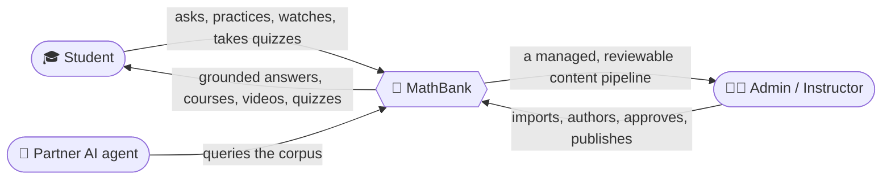

| What's underneath (live-counted, not estimated) | Count |
|---|---|
| Competitions covered | 15 |
| Past papers | 1,391 |
| Individual problems | 12,542 |
| Worked solutions | 18,749 |
| Taxonomy: concepts / skills / techniques | 885 / 2,997 / 279 |
| Known misconceptions tracked | 70,018 |
| Interactive course templates ready to use | 21 |
| Published micro-courses | 6 |

## For students

### 1. 💬 Ask the tutor anything, get a cited answer — not a guess

**Intent:** "Why is the answer 17?" — a student is stuck mid-problem and wants a real
explanation, not just the final number.

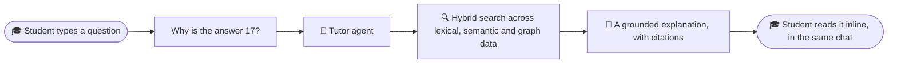

**What the student sees** (mock-up, not a real screenshot):

```
┌─────────────────────────────────────────────────────────┐
│ 💬 Tutor                                                 │
│ You: why is the answer 17?                               │
│ Tutor: This is an AM-GM minimization. Setting x = 4      │
│        makes both terms equal, which is where the        │
│        minimum occurs — that gives 17. [AIME 2007 #9]    │
│        [see similar problem ↗] [see concept: AM-GM ↗]     │
└─────────────────────────────────────────────────────────┘
```

**Why it matters:** the student never leaves the conversation to "go look it up" — the
answer always points back at the exact problem, concept and technique it came from, so
trust is earned, not assumed.

### 2. 🔍 Find exactly the right practice problems, instantly

**Intent:** "Give me combinatorics problems from AIME, medium difficulty."

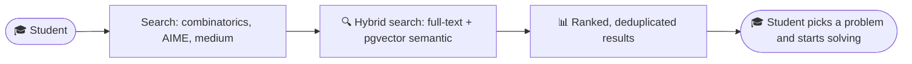

| Search signal blended | Role |
|---|---|
| Full-text (Postgres) | Exact terms, competition/year filters |
| Semantic (pgvector) | "Problems *like* this one," even with different wording |
| Graph (Neo4j) | Prerequisite and similar-problem traversal |

**Why it matters:** no more scrolling through a whole past paper to find the one problem
that matches what a student is actually struggling with.

### 3. 🩺 Get unstuck without being handed the answer

**Intent:** a student submits a wrong step and wants a nudge, not a spoiler.

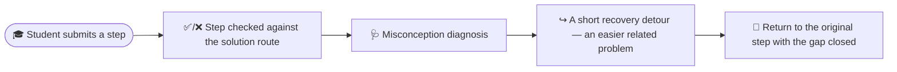

**What the student sees:**

```
┌─────────────────────────────────────────────────────────┐
│ Step 3: ❌ Not quite.                                     │
│ 🩺 Looks like the mix-up is with "sign error when         │
│    squaring a negative term."                             │
│ 💡 Try this 2-minute warm-up first: [recovery problem ↗]  │
│    then come back and try step 3 again.                   │
└─────────────────────────────────────────────────────────┘
```

**Why it matters:** struggling students get a *specific*, evidence-based reason for the
mistake and a fast way to fix the underlying gap, instead of a demotivating red X.

### 4. 🧩 Learn a concept visually with an interactive micro-course

**Intent:** "Show me how a Markov chain actually converges" — as something to click and
watch, not just read.

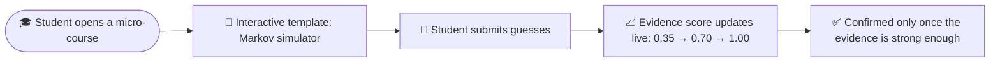

**Why it matters:** some ideas (convergence, symmetry, a geometric transformation) are
genuinely easier to *see* than to read — these courses were built from a reusable
template catalog (20+ templates, 11 control types, 25 icons, 29 animations) so new ones
publish in hours, not a new engineering project each time.

### 5. 🎬 Watch an AI-made explainer video, on demand

**Intent:** "Explain AM-GM to me like a short video, not a wall of text."

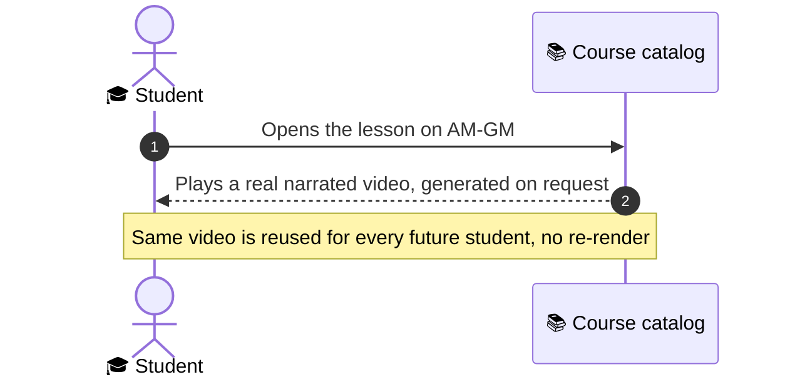

**Why it matters:** instead of a static diagram or a wall of LaTeX, the student gets a
narrated, diagram-rich video — generated once by an AI pipeline (see use case 10 below)
and reused for everyone after that.

### 6. 📝 Take a personalized AIME/HMMT-style quiz

**Intent:** "Quiz me on number theory, AIME difficulty, show me the solutions after."

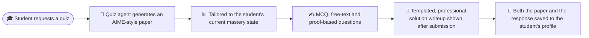

**Why it matters:** every quiz is generated for *that* student's current gaps, not a
generic worksheet — and every attempt becomes part of their permanent, reviewable
learning record.

### 7. 🔴 Join a live, instructor-led class

**Intent:** a student joins a scheduled session where the instructor is teaching live.

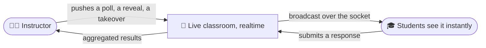

**Why it matters:** the same corpus and tutor infrastructure powers a real synchronous
classroom, not just solo practice — one platform, two modes of learning.

## For admins and instructors

### 8. 📥 Bring a brand-new competition's problems online in days

**Intent:** "We just got PDFs for this year's HMMT — get them into the platform."

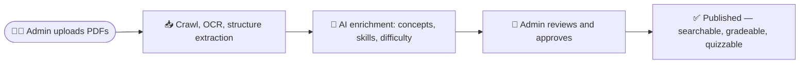

**Why it matters:** the slow part (reading hundreds of pages, tagging every problem by
concept and difficulty) is AI-assisted and admin-reviewed, not fully manual and not
fully automatic — nothing reaches a student unreviewed.

### 9. 🧩 Publish an interactive course without writing any code

**Intent:** an instructor wants a hands-on lesson on "Power of a Point," built from
pieces that already exist.

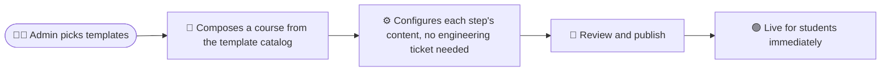

**Why it matters:** the same ~20 reusable interaction templates (built once, by
engineering) let instructors assemble new lessons themselves, over and over.

### 10. 🎬 Turn "explain concept X" into a published video with one request

**Intent:** "I want a 90-second video explaining why AM-GM works" — without hiring an
animator.

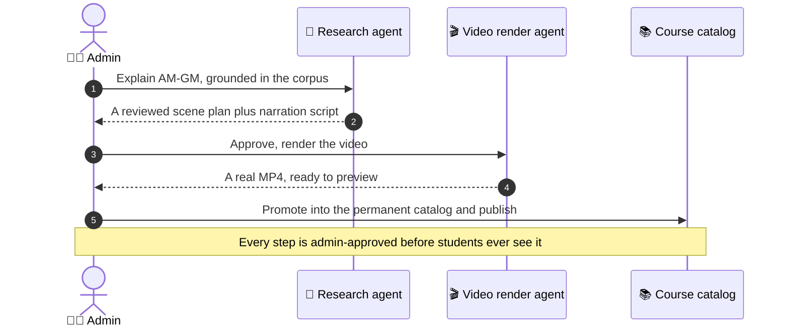

**Why it matters:** a request that used to mean "file a ticket with a video team" now
takes one admin approval click, grounded in the same reviewed corpus the tutor uses —
not a hallucinated script.

## For the business

### 11. 🔌 Any AI agent can plug into the corpus safely

**Intent:** a partner builds their own study app and wants access to problems,
solutions and taxonomy — without being given a database password.

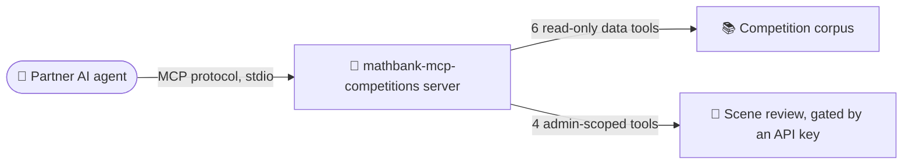

**Why it matters:** the corpus becomes a reusable asset other products can build on,
with a clean, audited boundary — not a one-off integration per partner.

### 12. 📈 A tutor that keeps getting better, not a static one

**Intent:** over time, recommend the right next problem to each student, automatically.

| Today | Tomorrow (model trained) |
|---|---|
| Every mastery/recommendation endpoint exists and is wired end to end | Same endpoints return real, trained predictions |
| Every prediction ships with a mandatory, human-readable explanation | No black-box answers, even once models are live |
| A separate ops dashboard for model status and data readiness | Instructors can see *why* a recommendation was made |

**Why it matters:** the plumbing for a continuously-improving recommender is already
built and tested — turning it on is a model-training exercise, not a new six-month
engineering project.

## Where to go next

- Technical architecture, diagrams and the full data model: [root README](../README.md)
- Real screenshots and a click-through walkthrough: [documentation/presentation/index.html](presentation/index.html)
- Full requirements and design history: [documentation/requirements/00_INDEX.md](requirements/00_INDEX.md)
