# MathBank Studio platform — architecture, sequences and deployment (done vs pending)

**Evidence mode:** source-derived from Git `fbd44ed` **plus uncommitted worktree changes** (ledger 67
steps 01–03 and the UI rebuild), and one read-only AWS observation:
`cloudformation list-stacks` on **2026-10-26 00:29 UTC** (account 848941468793, `us-east-2`).
No live database schema was queried for this document. Planned items come from
[requirement 65](../requirements/65_ADAPTIVE_SOCRATIC_ADMIN_AND_AGENTCORE.md),
[ledger 67](../requirements/67_SOCRATIC_IMPLEMENTATION_HANDOFF.md) and the
[unified portal plan 68](../requirements/68_UNIFIED_STUDIO_PORTAL_PLAN.md) (still under review).
Platform-wide C1/C2 and the original six flows remain in the [root README](../../README.md#architecture).

## Status legend

| Mark | Meaning |
|---|---|
| 🟩 **Done** (solid green) | Implemented and tested; deployed where noted |
| 🟨 **Partial** (solid amber) | Implemented locally/offline, or works but not yet integrated, deployed or reviewed |
| ⬜ **Pending** (dashed grey) | Planned in requirement 65/67/68; not implemented |
| 🟥 **Retire** (dashed red) | Existing surface to be replaced by the Studio after parity (plan 68 P10) |

In sequence diagrams, **green bands are done**, **amber bands are partial** and **grey bands are
pending**.

Clickable navigation prototype (static, fake data, shows the API each action calls):
[prototype/studio-unified-navigation.html](prototype/studio-unified-navigation.html). The screen-by-screen
API contract and the iframe/sidecar preview design are in [plan 68 §7](../requirements/68_UNIFIED_STUDIO_PORTAL_PLAN.md).

## 1. Full architecture

```mermaid
flowchart TB
    subgraph People
        Staff([Staff author / reviewer / publisher])
        Student([Student])
    end

    subgraph StudioUI["Socratic Studio (mathbank-socratic-admin)"]
        Shell[Rail + searchable sidebar + canvas + drawer]
        Designer[Designer: flow / natural language / JSON]
        RulesV[Rules by topic]
        LibraryV[Library: strategies / sources / steps]
        Sim[Student simulator]
        AskAI[Ask AI drawer]
        QuizLib[Library: quizzes by topic]
        QBank[Step content: search and attach, add existing, create from template]
        VideoLib[Library: videos]
        ExamsV[Exams: templates / pool / assignments]
        AccessV[Students and groups: exclusions + features]
        SearchK[Finder: full-width vector search, inspector, wire link or fork]
        Assistant[AI assistant with tools]
        MicroChat[Micro chat scoped to a step or quiz item]
    end

    subgraph LegacyUI["Existing student and admin apps"]
        Web[mathbank-web student UI]
        WebAdmin[mathbank-web admin: courses, quizzes tab, media tab, manim review]
        ExamWeb[mathbank-exam-web]
        Live[mathbank-live]
    end

    subgraph REST["mathbank-rest (only database boundary)"]
        StaffAuth[Staff session: Cognito or local, CSRF, capabilities]
        Drafts[Socratic drafts + validation]
        Preview[Synthetic preview runtime]
        Scorer[Shared activity scorer]
        LegacyAdmin[Legacy admin routes: shared admin key]
        StudioAPI[Studio adapters /v1/admin/studio]
        Catalog[Artifact catalog + topic tags]
        QuizAuthor[Quiz authoring, review, revisions]
        VideoOrch[Video register + manim orchestration]
        ExamAuthor[Exam templates, pool review, assignments]
        Access[Audience and exclusion module: groups, EXCLUDE rules, feature policies]
        StaffSearch[Finder service: hybrid + graph fusion, families, find-similar, usage, lineage]
        Proposals[Proposal jobs + acceptance]
        MicroChatSvc[micro_chat threads + proposals]
        Hybrid[Problem/concept hybrid search]
        QuizRuntime[Quiz/exam runtime + grading]
    end

    subgraph Agents["Agent and job services"]
        Tutor[mathbank-agent tutor]
        ExamAgent[mathbank-exam-agent]
        Manim[mathbank-manim-studio]
        MCP[mathbank-mcp-competitions]
        AgentCore[Socratic AgentCore agent DeepSeek V3.2]
        SFN[Step Functions proposal workflow]
    end

    subgraph Data["Data"]
        PGd[(Postgres orchestration.socratic_* drafts 053)]
        PGp[(Postgres socratic_preview* 054)]
        PGc[(Postgres corpus, knowledge, pedagogy, activity, quiz, visual, learner)]
        PGn[(Postgres new: studio, exam templates, audience groups, exclusions, feature policy)]
        Vec[(pgvector search.* problems, solutions, steps, learning items)]
        VecN[(studio.unit_embedding HNSW: quiz items, quizzes, Socratic steps, step sequences, courses, video segments, exams)]
        Neo[(Neo4j AuraDB graph)]
        Obj[(Object storage videos)]
    end

    Cognito{{Amazon Cognito}}
    OpenAI{{OpenAI}}

    Staff --> Shell
    Shell --> Designer & RulesV & LibraryV & Sim & AskAI
    Designer -.-> QBank
    QBank -.-> StaffSearch
    Designer -.-> MicroChat
    MicroChat -.-> MicroChatSvc
    MicroChatSvc -.-> AgentCore
    Shell -.-> QuizLib & VideoLib & ExamsV & AccessV & SearchK & Assistant
    Designer --> Drafts
    RulesV --> Drafts
    LibraryV --> Drafts
    Sim --> Preview
    AskAI -.-> Proposals
    QuizLib & VideoLib & ExamsV & AccessV & SearchK & Assistant -.-> StudioAPI
    Shell --> StaffAuth
    StaffAuth --> Cognito
    Drafts --> PGd
    Preview --> Scorer
    Preview --> PGp
    Preview --> PGc
    StudioAPI -.-> Catalog & QuizAuthor & VideoOrch & ExamAuthor & Access & StaffSearch
    Catalog -.-> PGn
    QuizAuthor -.-> PGc
    ExamAuthor -.-> PGn
    Access -.-> PGn
    StaffSearch -.-> VecN
    StaffSearch -.-> Neo
    VideoOrch -.-> Manim
    ExamAuthor -.-> ExamAgent
    QuizAuthor -.-> ExamAgent
    Proposals -.-> SFN
    SFN -.-> AgentCore

    Student --> Web & ExamWeb & Live
    Web --> Tutor
    Web --> Hybrid
    Web -.->|"filtered content + feature checks"| Access
    ExamAuthor -.->|"apply exclusions"| Access
    Preview -.->|"preview as group"| Access
    ExamWeb --> ExamAgent
    ExamAgent --> QuizRuntime
    ExamAgent --> MCP
    ExamAgent --> OpenAI
    Tutor --> OpenAI
    Manim --> OpenAI
    Manim --> MCP
    Manim --> Obj
    Hybrid --> Vec
    Hybrid --> Neo
    QuizRuntime --> PGc
    WebAdmin --> LegacyAdmin
    LegacyAdmin --> PGc
    Live --> PGc

    classDef done fill:#dcfce7,stroke:#16a34a,color:#14532d
    classDef partial fill:#fef3c7,stroke:#d97706,color:#78350f
    classDef pending fill:#f8fafc,stroke:#94a3b8,color:#475569,stroke-dasharray:5 5
    classDef retire fill:#fff1f2,stroke:#e11d48,color:#881337,stroke-dasharray:5 5
    class Shell,Designer,RulesV,LibraryV,StaffAuth,Drafts,PGd,Web,ExamWeb,Live,Hybrid,QuizRuntime,Tutor,ExamAgent,Manim,MCP,PGc,Vec,Neo,Obj done
    class Sim,AskAI,Preview,Scorer,PGp,LegacyAdmin partial
    class MicroChat,MicroChatSvc,QBank,QuizLib,VideoLib,ExamsV,AccessV,SearchK,Assistant,StudioAPI,Catalog,QuizAuthor,VideoOrch,ExamAuthor,Access,StaffSearch,Proposals,AgentCore,SFN,PGn,VecN pending
    class WebAdmin retire
```

Why some items are **partial**: the simulator, preview runtime, shared scorer and migration 054 are
done locally and on Neon but **not deployed to the hosted Studio**; *Ask AI* has a finished UI with
no proposal backend; legacy admin routes work but use the shared admin key, so the Studio cannot
call them until adapters exist.

## 2. Studio internals (frontend → REST → tables)

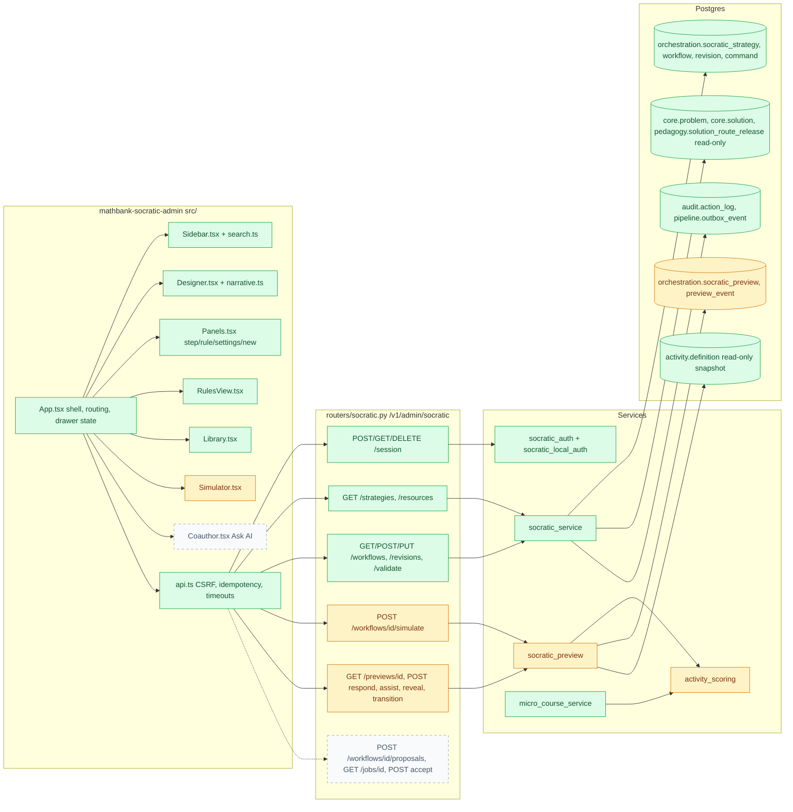

## 3. Deployment

```mermaid
flowchart TB
    subgraph Local["Local development (operator workstation)"]
        L1["Studio UI Vite :5186 (make socratic-start)"]
        L2["Local staff API :8019 loopback, local login (DRAFTS=1 real Neon)"]
        L3["Full REST :8000 (Cognito mode)"]
        L4["web :5173 · live :5174 · agent :8001 · exam-web :5176 · exam-agent :8030 · manim :8020 · ml :8010/:5175"]
        L5["Colima Docker build runtime"]
    end

    subgraph AWS["AWS account 848941468793 · us-east-2 · CDK mathbank-infra-aws"]
        subgraph Iso["Isolated Studio app socratic_app.py"]
            A1["MathBankSocraticStack: Lambda Function URL, API + SPA same origin (step 02 build)"]
            A1b["Redeploy with step 03 + new UI"]
        end
        subgraph Shared["Shared app app.py"]
            A2[MathBankRestStack Lambda URL]
            A3[MathBankAgentStack Lambda URL]
            A4[MathBankExamAgentStack Lambda URL]
            A5[MathBankManimStudioStack Lambda URL]
            A6[MathBankMcpCompetitionsStack Lambda URL]
            A7[MathBankMlInferenceStack Lambda URL]
            A8[MathBankExamWebStack S3 + CloudFront]
            A9[MathBankFargateWebStack web, live, ml-frontend desired_count 0]
        end
        S1[(SSM SecureString parameters)]
        S2{{Cognito user pool}}
        S3[(ECR images via CDK bootstrap)]
        P1["Bedrock AgentCore runtime DeepSeek V3.2"]
        P2["Step Functions + proposal Lambda, budget and pause switch"]
        P3["Studio adapters, catalog, exams, access, search, assistant routes"]
    end

    subgraph Managed["Managed data services (public TLS, no NAT)"]
        D1[(Neon Postgres + pgvector: migrations through 054 applied)]
        D2[(Neo4j AuraDB)]
        D3[(Neon S3-compatible object storage)]
        D4{{OpenAI API}}
    end

    L1 --> L2
    L1 -.->|optional| L3
    L2 --> D1
    L3 --> D1 & D2
    L5 --> S3
    A1 --> S1 & S2 & D1
    A1b -.-> A1
    A2 --> D1 & D2
    A4 --> A2
    A5 --> D1 & D3
    A3 --> A2
    A2 --> D4
    P3 -.-> A1
    A1 -.-> P2
    P2 -.-> P1

    classDef done fill:#dcfce7,stroke:#16a34a,color:#14532d
    classDef partial fill:#fef3c7,stroke:#d97706,color:#78350f
    classDef pending fill:#f8fafc,stroke:#94a3b8,color:#475569,stroke-dasharray:5 5
    class L1,L2,L3,L4,L5,A2,A3,A4,A5,A6,A7,A8,A9,S1,S2,S3,D1,D2,D3,D4 done
    class A1 partial
    class A1b,P1,P2,P3 pending
```

Observed 2026-10-26 00:29 UTC: all nine `MathBank*` stacks are in `CREATE_COMPLETE`/`UPDATE_COMPLETE`.
`MathBankSocraticStack` was last updated 2026-10-25 18:18 UTC (step 02 + CSP fix), i.e. **before**
step 03 and the UI rebuild, which is why it is marked partial. Fargate apps are deployed with
`desired_count=0` by design (started on demand). The Studio stack has no reserved concurrency
(account limit 10). The low-cost component view remains in
[low-cost-scalable-deployment.svg](low-cost-scalable-deployment.svg).

## 4. Sequence diagrams

### 4.1 Staff sign-in — done (Cognito path deployed; successful real-staff login not yet observed)

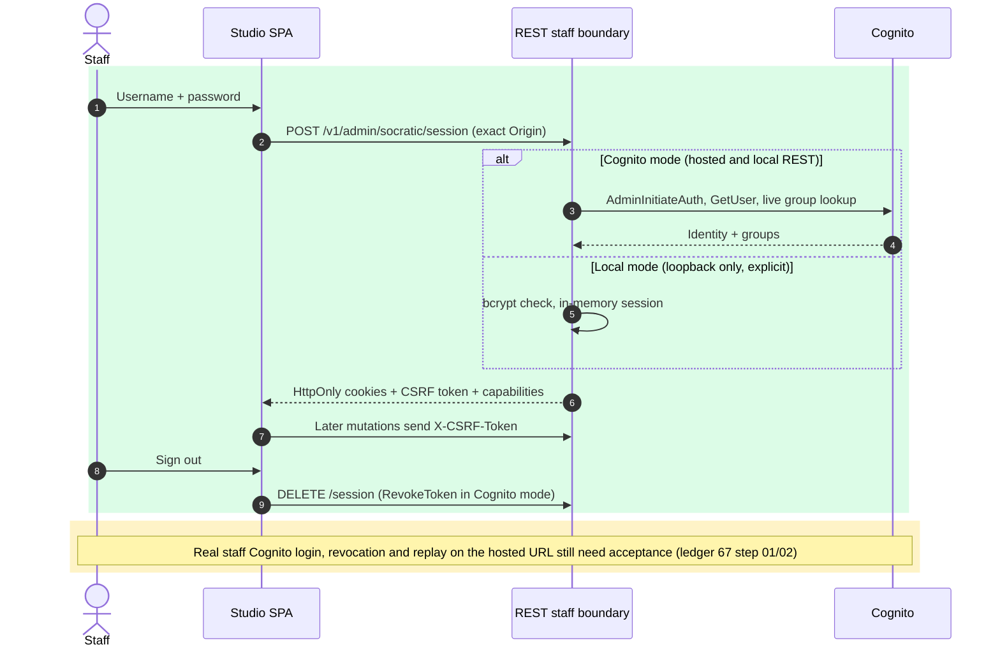

### 4.2 Draft authoring — done (local and hosted step 02)

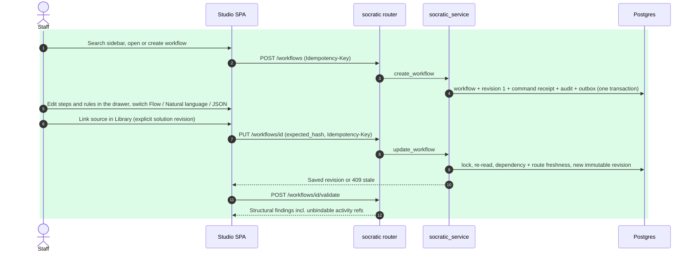

### 4.3 Synthetic student preview — partial (done locally on Neon, not yet deployed)

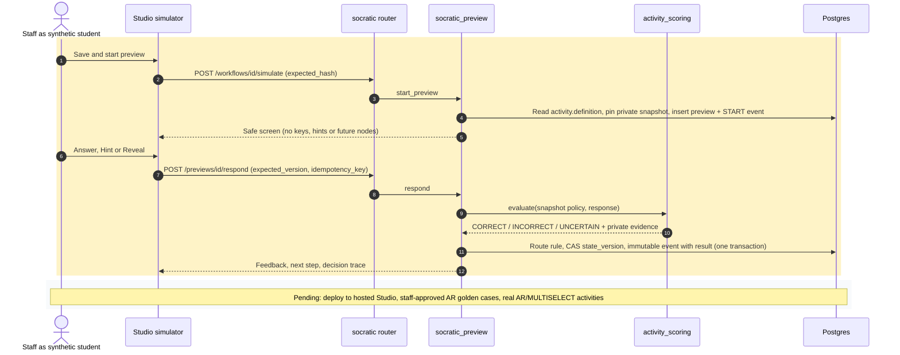

### 4.4 AI rule proposal via AgentCore — pending (ledger steps 04–05)

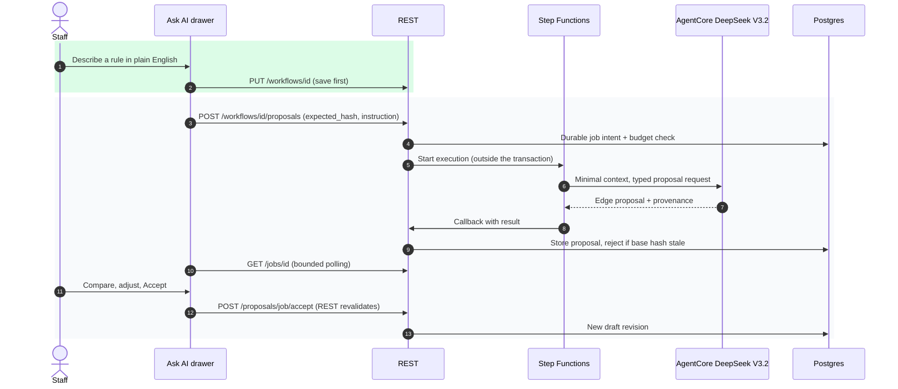

### 4.5 Quizzes by topic and link to a step — pending (plan 68 P2–P3)

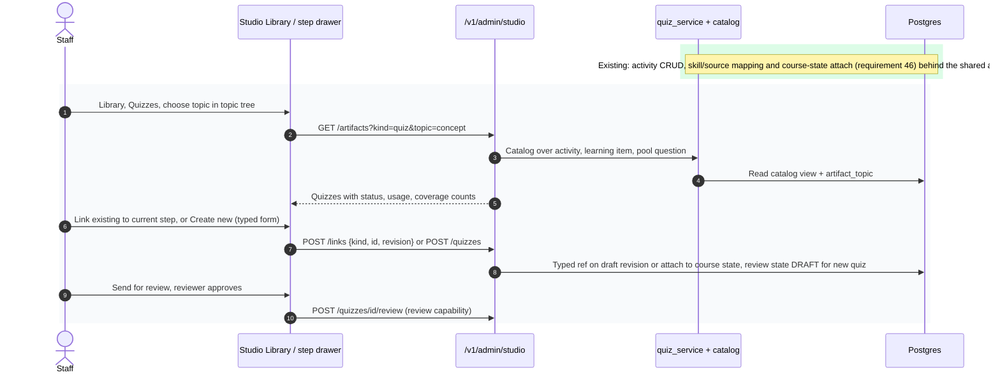

### 4.5b Step content: search and attach, add existing, create new from template — pending (plan 68 §4.5a–4.5b, P2–P3, semantic via the Finder in P2b)

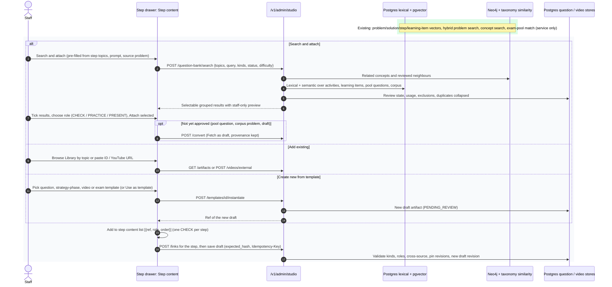

### 4.6 AI quiz drafts (semi-automatic and gap filling) — pending (plan 68 P4)

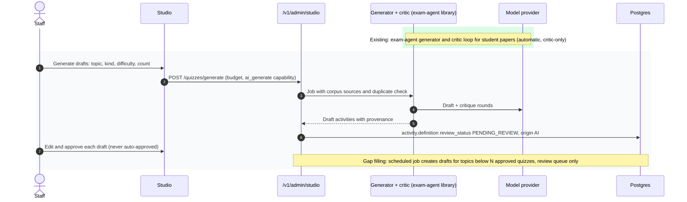

### 4.7 Videos: generate or add existing — partial (pipeline done, Studio orchestration pending)

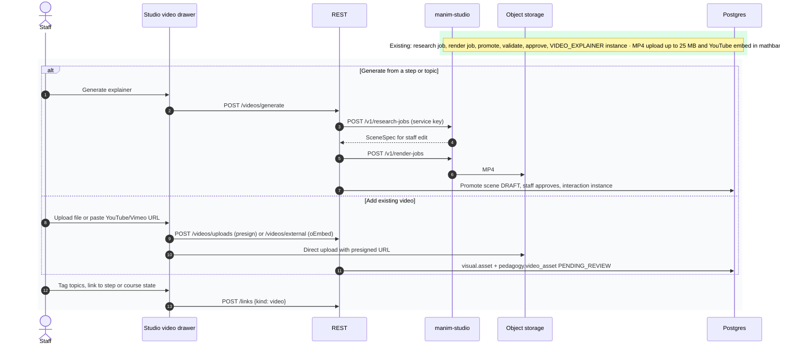

### 4.8 Exam from the content, attached to a student or group — pending (plan 68 P6, D-3 decided)

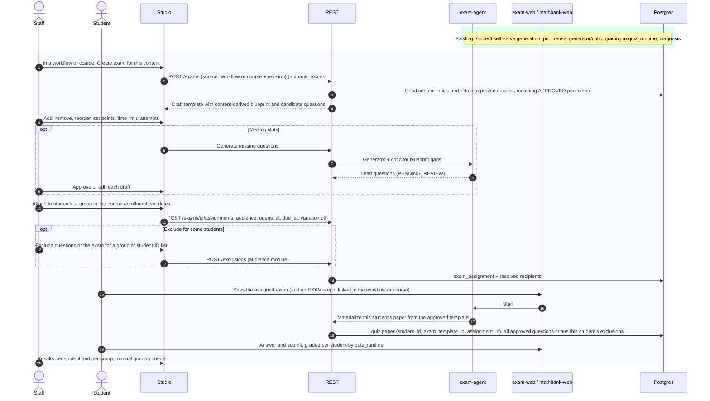

### 4.9 Audience module: groups, EXCLUDE content and features — pending (plan 68 P7, decided 2026-10-25)

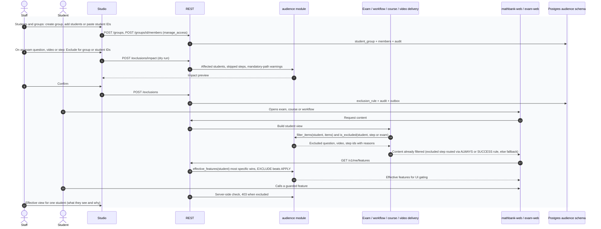

### 4.10 Search everything and the AI assistant — pending (plan 68 P8–P9)

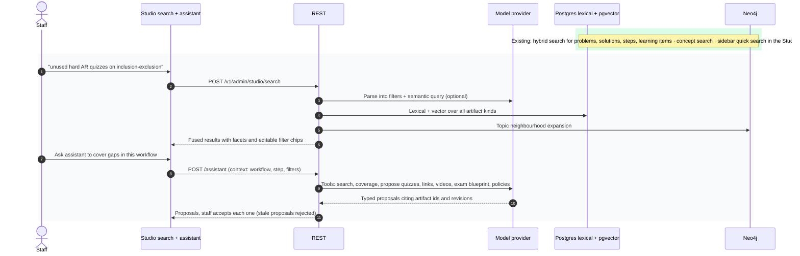

### 4.11 Finder: reuse-first vector search and wiring — pending (plan 68 §4.13, P2b)

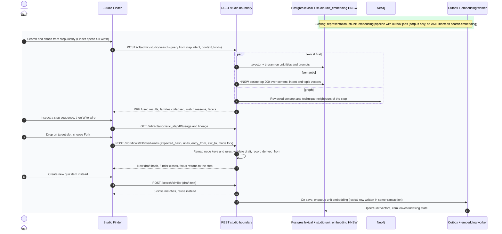

## 5. Status matrix

| Component | Status | Evidence / next action |
|---|---|---|
| Staff sessions (Cognito + explicit local) | 🟩 Done | Ledger 67 step 01; hosted Cognito login acceptance pending |
| Draft persistence, migration 053 | 🟩 Done, deployed | Ledger 67 step 02; `MathBankSocraticStack` |
| Studio UI rebuild (rail, search, drawer, flow/NL/JSON) | 🟨 Partial | 34 unit + 10 e2e passing locally; not deployed |
| Synthetic preview, migration 054, shared scorer | 🟨 Partial | Ledger 67 step 03; 872 REST tests; deploy + AR approval pending |
| Local operator tooling (`make socratic-*`, password) | 🟩 Done | Root Makefile, `mathbank-socratic` skill |
| Ask AI proposals (AgentCore, Step Functions) | ⬜ Pending | Ledger 67 steps 04–05 |
| Live Neon/AWS vertical acceptance | ⬜ Pending | Ledger 67 step 06 |
| Full inspector, review cockpit, visuals, pilot | ⬜ Pending | Ledger 67 steps 07–10 |
| Studio adapters + capabilities | ⬜ Pending | Plan 68 P1 |
| Quizzes by topic, link existing, authoring + review | ⬜ Pending | Plan 68 P2–P3 (activity CRUD exists behind admin key) |
| Step content: search and attach (multi-select), add existing, create new from template | ⬜ Pending | Plan 68 §4.5a–4.5b: P2 search/attach + add existing, P3 templates, P8 semantic + concept similarity |
| AI quiz drafts and gap filling | ⬜ Pending | Plan 68 P4 |
| Videos from Studio (generate / register existing) | ⬜ Pending (pipeline 🟩) | Plan 68 P5 |
| Staff exams from content, attached to student/group (D-3, D-3a decided) | ⬜ Pending (student exams 🟩) | Plan 68 P6, uses audience module |
| Audience module: student groups, content EXCLUDE (exam, question, video, step, course item), feature APPLY/EXCLUDE | ⬜ Pending | Plan 68 P7 (before P6) |
| Finder: unit vector index (incl. Socratic steps, sequences, video segments), hybrid + graph fusion, find-similar/dedupe, where-used, lineage, link/fork/insert-sequence, full-width UI with wire mode | ⬜ Pending (corpus hybrid search 🟩; `search.embedding` has no ANN index) | Plan 68 §4.13, P2b |
| AI query understanding + rerank on the Finder | ⬜ Pending | Plan 68 P8, D-16 |
| Studio AI assistant with tools | ⬜ Pending | Plan 68 P9 |
| Micro chat scoped to one step / quiz item (separate module) | ⬜ Pending | Plan 68 §4.11, P9b |
| Workspace look consistent across all modules | 🟨 Partial (Studio done) | modern-ui-design `WORKSPACE_SHELL.md`; requirement 30 UI-23–UI-27 |
| mathbank-web admin quiz/media tabs, `/admin/manim-studio` | 🟥 Retire after parity | Plan 68 P10 |

## 6. Maintenance

Update this file whenever a ledger 67 step or plan 68 phase changes status: move the component's
class in the diagrams, the band colour in its sequence diagram and its row in §5. Re-run the
read-only stack listing to refresh §3 rather than assuming a deployment happened.
