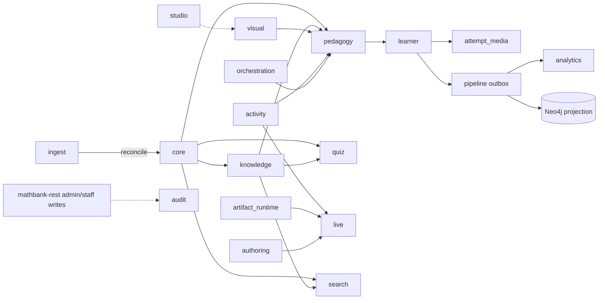

# MathBank PostgreSQL schema documentation

Per-schema reference for the Neon/PostgreSQL database behind MathBank. It covers
**21 schemas and 219 tables/views**: 215 created by migrations
[mathbank-db/sql/001–054](../../mathbank-db/sql/), plus the 4 `geometry_scene` tables created by
[mathbank-rest/src/mathbank_rest/migrations/026_geometry_scenes.sql](../../mathbank-rest/src/mathbank_rest/migrations/026_geometry_scenes.sql). Each table has its columns,
constraints, writers and readers, and the REST operations that touch it today.
Each schema file then says how the schema should evolve. How to build new
endpoints is in the companion
[REST_CRUD_DESIGN_GUIDE.md](./REST_CRUD_DESIGN_GUIDE.md).

## 1. How to read a schema file

Every file in [schemas/](./schemas/) has the same five sections:

1. **Purpose, ownership and data flow:** the domain, who writes, who reads, and which events and jobs connect it to other schemas.
2. **Entity diagram (as-is):** a Mermaid ER diagram. Tables in other schemas appear as stubs.
3. **Tables:** one `### schema.table` section per table:
   - its table type (see guide §4)
   - every column, with type, nullability, default and meaning
   - keys, constraints and indexes
   - **REST operations today**: verified routes plus non-REST writers
4. **CRUD coverage (as-is):** a table × C/R/U/D matrix and the gaps and risks found.
5. **Target state:** 5.1 schema improvements, 5.2 target diagram, 5.3 endpoints to build, with priorities.

## 2. Schema map

| Schema | File | Tables | What it holds |
|---|---|---:|---|
| `core` | [core.md](./schemas/core.md) | 7 | Canonical competition corpus: competitions, papers, problems, solutions, figures |
| `ingest` | [ingest.md](./schemas/ingest.md) | 8 | Content-package import, staging, reconciliation, corpus review |
| `knowledge` | [knowledge-catalogue.md](./schemas/knowledge-catalogue.md) | 20 | Concepts, techniques, skills, misconceptions, theorems, links, similarity |
| | [knowledge-problems.md](./schemas/knowledge-problems.md) | 9 | Problem tagging, enrichment jobs, review/publication governance |
| `pedagogy` (1/5) | [pedagogy-taxonomy-sources.md](./schemas/pedagogy-taxonomy-sources.md) | 11 | Textbook provenance, package taxonomy, Q&A grounding |
| `pedagogy` (2/5) | [pedagogy-solutions-feedback.md](./schemas/pedagogy-solutions-feedback.md) | 13 | Solution DAGs, hints, feedback catalogues, interventions |
| `pedagogy` (3/5) | [pedagogy-routes-diagnosis.md](./schemas/pedagogy-routes-diagnosis.md) | 14 | Compiled tutoring routes, gap diagnosis, recovery plans |
| `pedagogy` (4/5) | [pedagogy-micro-courses.md](./schemas/pedagogy-micro-courses.md) | 17 | Micro-course releases, modules, states, learning items |
| `pedagogy` (5/5) | [pedagogy-video.md](./schemas/pedagogy-video.md) | 8 | Curated videos, transcripts, segment tags, timeline markers |
| `learner` | [learner.md](./schemas/learner.md) | 15 | Student identity, attempts, runtime sessions, mastery, evidence |
| `quiz` | [quiz.md](./schemas/quiz.md) | 13 | AI-generated quizzes and mock exams |
| `attempt_media` | [attempt_media.md](./schemas/attempt_media.md) | 13 | Uploaded learner work, transcription, approval, assessment (9 tables + 4 views) |
| `activity` | [activity.md](./schemas/activity.md) | 3 | Gradable activities and live-classroom polls |
| `artifact_runtime` | [artifact_runtime.md](./schemas/artifact_runtime.md) | 11 | Declarative teaching artifacts, assets, embeddings |
| `visual` | [visual.md](./schemas/visual.md) | 14 | Widgets, assets, interaction templates, geometry scenes |
| `geometry_scene` | [geometry_scene.md](./schemas/geometry_scene.md) | 4 | Geometry engine scenes, versions, idempotency receipts, interpretation runs (DDL lives in mathbank-rest) |
| `live` | [live.md](./schemas/live.md) | 7 | Realtime classroom sessions (via mathbank-live → REST) |
| `tutor` | [tutor.md](./schemas/tutor.md) | 2 | Live tutoring runtime pointers |
| `authoring` | [authoring.md](./schemas/authoring.md) | 5 | Live-lesson presentation plans, admin authoring chat |
| `orchestration` | [orchestration.md](./schemas/orchestration.md) | 6 | Adaptive Socratic Studio drafts and previews |
| `studio` | [studio.md](./schemas/studio.md) | 2 | Manim Video Studio job queues (owned by mathbank-manim-studio) |
| `search` | [search.md](./schemas/search.md) | 7 | Retrieval chunks and pgvector embeddings |
| `pipeline` | [pipeline.md](./schemas/pipeline.md) | 7 | Ingestion runs, graph projections, transactional outbox |
| `analytics` | [analytics.md](./schemas/analytics.md) | 1 | Learner daily activity rollups (outbox consumer) |
| `audit` | [audit.md](./schemas/audit.md) | 1 | Admin/staff action trail |
| `notification` | [notification.md](./schemas/notification.md) | 1 | Notification inbox (scaffolded) |

## 3. Cross-schema data flow



## 4. Who may touch the database

`mathbank-rest` is the only runtime reader/writer. Batch ETL may write bulk loads.
The known exceptions are `studio.*` (mathbank-manim-studio) and the direct reads by
ml-training/ml-inference. Details are in
[REST_CRUD_DESIGN_GUIDE.md §1](./REST_CRUD_DESIGN_GUIDE.md#1-the-boundary-rule).
The static route → table matrix is
[generated/ENDPOINT_TABLE_MATRIX.md](./generated/ENDPOINT_TABLE_MATRIX.md). It is an
index only, and the "REST operations today" sections in each schema file are the verified version.

## 5. Cross-cutting findings (as-is)

These issues recur across several schemas. Each schema file's §4 has the specifics.

- **Answer keys reach learners or anonymous callers.** This affects micro-course pages and the runtime ([pedagogy-micro-courses.md](./schemas/pedagogy-micro-courses.md), [activity.md](./schemas/activity.md)), the learner event feed ([learner.md](./schemas/learner.md)), level-4 hints that are never leak-checked ([pedagogy-solutions-feedback.md](./schemas/pedagogy-solutions-feedback.md)) and live poll results ([visual.md](./schemas/visual.md)).
- **GET or anonymous endpoints with side effects or paid calls.** Examples:
  - tutor learning-context enrichment ([knowledge-problems.md](./schemas/knowledge-problems.md))
  - on-demand hint generation ([pedagogy-solutions-feedback.md](./schemas/pedagogy-solutions-feedback.md))
  - semantic search embedding calls ([search.md](./schemas/search.md), [artifact_runtime.md](./schemas/artifact_runtime.md))
- **Learner trust and identity.**
  - Clients send `is_correct` themselves ([learner.md](./schemas/learner.md)), and required-quiz gating is client-side only.
  - Cognito onboarding links accounts by email alone.
  - Live sessions treat the shared admin key as any instructor ([live.md](./schemas/live.md)).
- **Tables with no production writer.** These cannot be populated through the API:
  - `state_qa_context`, all video tables, feedback catalogues, misconception evidence rules
  - intervention authoring, theorem embeddings, several `visual` link tables
- **Published content is not fully immutable.** Activities, videos and transcripts, deprecated template versions and draft-route asset IDs can still change ([activity.md](./schemas/activity.md), [pedagogy-video.md](./schemas/pedagogy-video.md), [visual.md](./schemas/visual.md), [pedagogy-routes-diagnosis.md](./schemas/pedagogy-routes-diagnosis.md)).
- **Missing audit rows and actors.** Approvals and publications in `visual`, `artifact_runtime` and route publishing write no `audit.action_log` row and record no real actor.
- **Vocabulary drift.** Status and enum values lack `CHECK` constraints or disagree with the Pydantic models. Examples: `THEOREM` taxonomy nodes, `PRIMARY`/`primary` roles, `RUNNING`/`IN_PROGRESS`, and answer-key formats that differ between live classes and micro-courses.
- **Operational gaps.** `outbox_worker` is not deployed and several outbox event types have no consumer ([pipeline.md](./schemas/pipeline.md)). The HNSW index exists only after a script runs, and some foreign keys have no index.

## 6. Target state — how it should be

1. **One runtime boundary.** All application reads and writes go through `mathbank-rest` service modules. Inline router SQL moves into services (guide §2), and no new direct-SQL services are added.
2. **Separate learner and admin response models** for anything with answer keys, solutions, teacher evidence or confidence scores. Grading happens server-side.
3. **Side-effecting work behind authenticated `POST` or queued jobs** (guide §3 rule 3, §5 "Bulk and jobs"). GET stays pure, and paid model calls need authentication and a rate limit.
4. **Every catalogue and authoring table gets a governed write path:**
   - create, PATCH with `expected_revision`, and lifecycle actions
   - an audit row recording the real actor
   - for content tables that today have none (see §5): authoring endpoints or an import job
5. **Release immutability enforced in the database** with triggers, for every table that a published release references.
6. **Database `CHECK` constraints match the Pydantic `Literal` values** for every status or enum column, with foreign-key indexes and vector indexes created by migrations.
7. **Outbox consumers deployed and covering every produced event type**, with retention cleanup.

Each schema file's §5.3 lists the concrete endpoints, with priorities.

## 7. Related documents

- [REST_CRUD_DESIGN_GUIDE.md](./REST_CRUD_DESIGN_GUIDE.md): rules for new endpoints
- [../DATABASES.md](../DATABASES.md): environments and connection setup
- [doc 45 – REST documentation and admin CRUD gaps](../requirements/45_REST_API_DOCUMENTATION_AND_ADMIN_CRUD_GAPS.md) · [doc 46 – quiz authoring API gaps](../requirements/46_MICRO_COURSE_QUIZ_AUTHORING_API_GAPS.md)

## 8. Regenerating this documentation

The `generated/*.json` files are not committed (see [generated/.gitignore](./generated/.gitignore)). Rebuild them from the migrations against a throwaway local cluster. Never run this against Neon.

```bash
cd documentation/database
tools/scratch_db.sh up                                   # PostgreSQL 18 in /tmp, applies mathbank-db/sql/0*.sql
MBDOC_DSN='host=/tmp/mbdoc_pg port=55439 user=postgres dbname=mbdoc' \
  ../../mathbank-rest/.venv/bin/python tools/extract_catalog.py   # → generated/catalog.json
(cd ../../mathbank-rest && .venv/bin/python ../documentation/database/tools/trace_crud.py)  # → endpoints.json, other_writers.json
python3 tools/render_matrix.py                           # → generated/ENDPOINT_TABLE_MATRIX.md
tools/scratch_db.sh down
python3 tools/build_skill_index.py                       # → .github/skills/mathbank-db/references/*.md (committed)
```

`python3 tools/db_lookup.py table|column|refs|search|schema <arg>` answers raw-DDL questions
(constraints, indexes, triggers, incoming FKs) from `generated/catalog.json`.

After adding a migration or endpoint:

1. Regenerate the files above.
2. Update the affected `### schema.table` sections, including "REST operations today".
3. Update that schema's §4 matrix.

The static trace misses dynamic SQL such as `f"knowledge.{table}"`, so check routes by hand.
