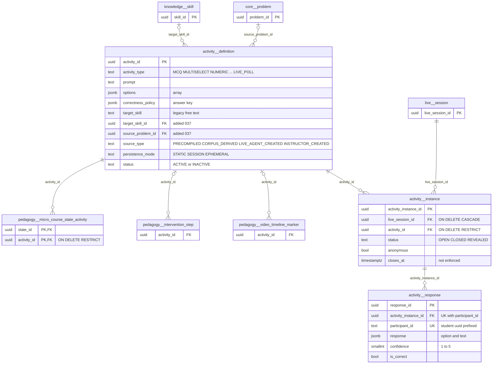
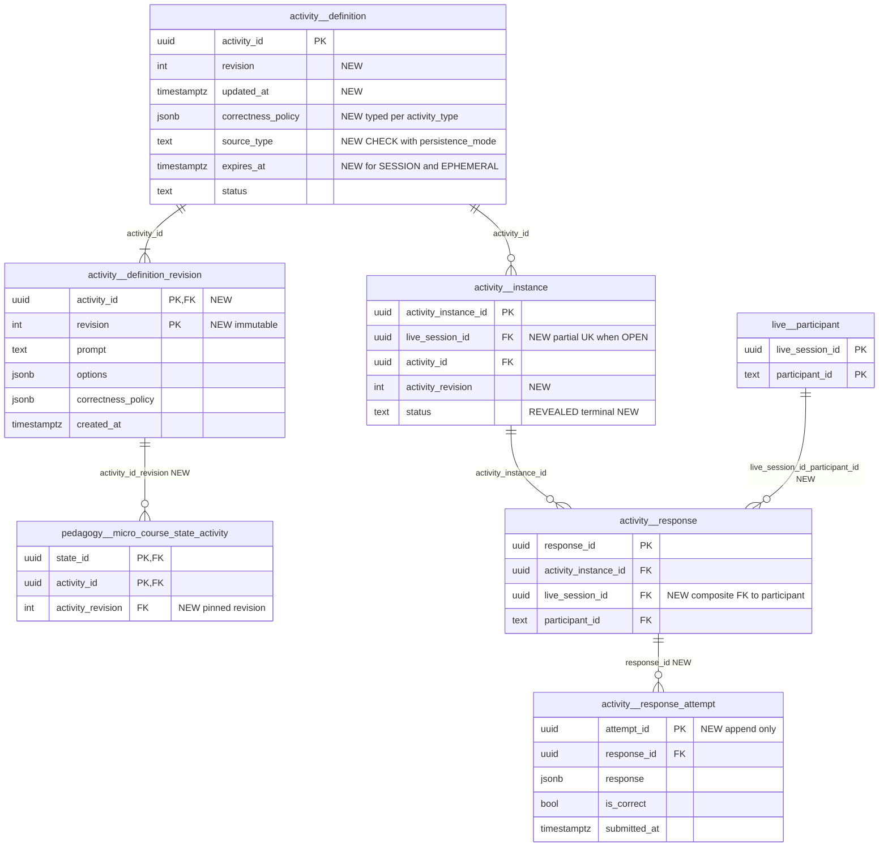

# `activity` schema — gradable activities and live-classroom polls

The `activity` schema holds MathBank's reusable **gradable activity bank** and its **live-classroom runtime**. `activity.definition` is a single shared table of short assessable items (MCQ, multiselect, numeric, short response, polls, and others) with a private `correctness_policy`. Four runtimes read it: the live/fluid classroom ([live_runtime.py](../../../mathbank-rest/src/mathbank_rest/live_runtime.py)), micro-course quizzes ([micro_course_service.py](../../../mathbank-rest/src/mathbank_rest/micro_course_service.py)), the Socratic Studio preview ([socratic_preview.py](../../../mathbank-rest/src/mathbank_rest/socratic_preview.py)), and the admin quiz-authoring bank ([quiz_service.py](../../../mathbank-rest/src/mathbank_rest/quiz_service.py)). `activity.instance` and `activity.response` exist only for live sessions: one row per activity opened in a `live.session`, and one current answer per participant. Micro-course quiz answers are not stored here; they go to `learner.micro_course_state_event`. The AI-generated quiz subsystem (`quiz.*`) deliberately does not reuse these tables (migration 042 header).

Source of truth: migrations [020](../../../mathbank-db/sql/020_live_fluid_platform.sql), [037](../../../mathbank-db/sql/037_quiz_authoring.sql) (plus inbound FKs from [032](../../../mathbank-db/sql/032_micro_course_platform.sql)). Catalog extracted 2026-11-01 from migrations 001–054; endpoint mapping traced from mathbank-rest source and manually verified.

## 1. Purpose, ownership and data flow

**Domain.** Formative checks: quick questions an instructor or AI tutor pushes to a live class ("poll → reveal → branch"), and the static quiz items authored into micro-course states and Socratic workflows.

**Write ownership.** All runtime writes go through mathbank-rest.

| Path family | Router | Service | Caller | Auth | Tables written |
|---|---|---|---|---|---|
| `/v1/admin/activities/*` | [routers/admin_activities.py](../../../mathbank-rest/src/mathbank_rest/routers/admin_activities.py) | [quiz_service.py](../../../mathbank-rest/src/mathbank_rest/quiz_service.py) | mathbank-web admin micro-course authoring | Admin key (router-level `require_admin_api_key`) | `definition` C/U (always `INSTRUCTOR_CREATED`/`STATIC`) and `audit.action_log` |
| `/v1/activities/definitions`, `/v1/live/sessions/{sid}/activities/*`, `/v1/live/sessions/{sid}/commands` | [routers/live.py](../../../mathbank-rest/src/mathbank_rest/routers/live.py) | [live_runtime.py](../../../mathbank-rest/src/mathbank_rest/live_runtime.py) | mathbank-live Socket.IO gateway ([lib/gateway.mjs](../../../mathbank-live/lib/gateway.mjs) `open_activity`/`respond`/`close_activity`/`reveal_activity`) and instructor UI | `live_actor`: admin key = INSTRUCTOR, learner JWT = STUDENT. `staff_actor` requires INSTRUCTOR. | `definition` C, `instance` C/U, `response` C/U |
| `/v1/tutor/sessions/{sid}/actions`, `/v1/instructor/live/{sid}/commands`, `/v1/instructor/live/{sid}/recommendations/{rid}` | routers/live.py | `propose_ai_action` / `instructor_nl` / `decide_recommendation` | mathbank-agent tutor and instructor | Admin key / `staff_actor` | Same as above: AI recommendations in `AUTO_APPLY` (`OPEN_ACTIVITY`, `CLOSE_ACTIVITY`, `REVEAL_ACTIVITY`) run as `auto:<source>` INSTRUCTOR commands ([live_runtime.py:946-949](../../../mathbank-rest/src/mathbank_rest/live_runtime.py)). |

Every live write goes through `execute_command`. It is idempotent per `client_command_id` (via `live.command_receipt`), version-checked for staff and AI, and emits a `live.session_event` plus an outbox row in the same transaction.

**Non-REST writer.** [scripts/seed_reference_course_extras.py](../../../mathbank-rest/scripts/seed_reference_course_extras.py) (`ensure_activity`, L83–120) inserts `INSTRUCTOR_CREATED`/`STATIC` definitions for the reference micro-courses. It deduplicates on `prompt` + `source_lineage->>'content_hash'`. [scripts/migrate_quiz_authoring.py](../../../mathbank-rest/scripts/migrate_quiz_authoring.py) only applies migration 037 (DDL).

**Readers of `activity.definition` outside this schema.**
- **Micro-courses.** `attach_activity` ([micro_course_service.py:2334](../../../mathbank-rest/src/mathbank_rest/micro_course_service.py)) accepts only `PRECOMPILED`/`INSTRUCTOR_CREATED`, `STATIC` and `ACTIVE` rows.
  - Several flows read the definition: the course reader `_assemble_course_reader_payload` (anonymous `GET /v1/micro-courses/{code}`), the enrollment runtime, `submit_activity_response` (grades and writes `learner.micro_course_state_event`), the admin preview and activity pages, and the release `_content_hash` snapshot.
  - [micro_course_assist.py](../../../mathbank-rest/src/mathbank_rest/micro_course_assist.py) `_ground_activity` serves `item-help`.
- **Socratic Studio.** `bind_activity` ([socratic_preview.py:62](../../../mathbank-rest/src/mathbank_rest/socratic_preview.py)) snapshots ACTIVE, scoreable rows into `orchestration.socratic_preview.activity_snapshot`.
- **Scoring.** [activity_scoring.py](../../../mathbank-rest/src/mathbank_rest/activity_scoring.py) is the shared deterministic scorer for micro-course and Socratic runtimes. It is *not* used by the live runtime.

**Inbound FKs** to `activity.definition`:
- `pedagogy.micro_course_state_activity.activity_id` (ON DELETE RESTRICT);
- `pedagogy.intervention_step.activity_id` (NO ACTION);
- `pedagogy.video_timeline_marker.activity_id` (NO ACTION).

**Lifecycle.**
1. **Definition.**
   - Created by admin authoring (`INSTRUCTOR_CREATED`/`STATIC`), the seed script, `POST /v1/activities/definitions`, or inline when an instructor or AI opens an activity with a `definition` payload. The live paths let the caller choose `source_type`/`persistence_mode`, defaulting to `INSTRUCTOR_CREATED`/`SESSION`.
   - `status` `ACTIVE` ↔ `INACTIVE` changes only through admin deactivate/reactivate. Deactivation is refused while the row is bound to a PUBLISHED micro-course release.
   - Rows are never deleted.
2. **Live run.**
   - `OPEN_ACTIVITY` closes any instance currently on stage, inserts an `instance` (`OPEN`, `closes_at = now() + seconds`) and puts a public copy (no `correctness_policy`) on `live.session.stage`.
   - `RESPONSE_SUBMIT` upserts `response`. It is allowed only while the instance is `OPEN`; a re-submission replaces the earlier answer.
   - `CLOSE_ACTIVITY` → `CLOSED` and may create a `POLL_BRANCH` recommendation from the correct rate.
   - `REVEAL_ACTIVITY` → `REVEALED`, writes a poll-result widget to `visual.widget_state`, and makes the aggregate visible to students.
   - Instances and responses are deleted only by cascade from `live.session`.

**Privacy class.**
- `definition.correctness_policy` is an **answer key**: the live runtime keeps it server-side until reveal (`aggregate.correct_option`). The micro-course reader currently returns it to anonymous callers; see §4.
- `response` is **learner-private**: `participant_id` embeds the student UUID (`student:<uuid>`) and `response.text` is free text.
- `instance` is **session-operational** data.

## 2. Entity diagram — as-is

## 3. Tables

### `activity.definition`

**Role.** One row is one reusable, gradable activity: a prompt, display options, a private correctness policy, provenance, and a persistence hint. The live classroom, micro-course states, Socratic workflows and pedagogy intervention steps all point at it. Migration 037 added a real FK to `knowledge.skill` and to `core.problem` and the `ACTIVE`/`INACTIVE` lifecycle. The free-text `target_skill` column from 020 is kept for live callers.

**Table type (§4).** Catalogue entity: governed reference data with deactivate/reactivate. Unlike a revisioned authoring object, it is edited in place with no revision column.

**Lifecycle.**
- Insert from four writers (§1).
- `PATCH` edits `prompt`, `options`, `correctness_policy` and `estimated_seconds`, but only for `INSTRUCTOR_CREATED` rows, and with **no check for published bindings**.
- The skill and source mappings can be changed on any row.
- Deactivate/reactivate set or clear `deactivated_at`/`deactivated_by`.
- Never deleted. `SESSION`/`EPHEMERAL` rows created inline by live sessions are never cleaned up.

**Columns**

| Column | Type | Null | Default | Meaning |
|---|---|---|---|---|
| activity_id | uuid | NO | gen_random_uuid() | Activity identity. Admin authoring supplies a `uuid4()`; the live and seed paths use the default. |
| activity_type | text | NO | | CHECK `MCQ`, `MULTISELECT`, `NUMERIC`, `SHORT_RESPONSE`, `SUBPROBLEM`, `STEP_ORDERING`, `ERROR_DIAGNOSIS`, `CONFIDENCE_CHECK`, `LIVE_POLL`. Mirrored as `ACTIVITY_TYPES` in live_runtime.py and quiz_service.py and as a `Literal` in admin_activities.py. The live path defaults to `LIVE_POLL` and requires ≥ 2 options for `MCQ`/`MULTISELECT`/`LIVE_POLL`/`CONFIDENCE_CHECK`. `activity_scoring` can score only `MCQ`, `MULTISELECT`, `NUMERIC` and `SHORT_RESPONSE`. |
| prompt | text | NO | | Question stem (admin API: 1–4000 chars; live API: non-empty, no length limit). |
| options | jsonb | NO | '[]' | Display options. CHECK `jsonb_typeof(options) = 'array'`. The shape depends on the writer. Live polls use objects keyed by `key`/`id`/`label` (`_option_key`). The admin API accepts `list[dict]`. The seed script writes plain strings. Live writes are walked by the widget safety validator (`widgets._walk`). |
| correctness_policy | jsonb | NO | '{}' | **Private answer key**, schema-less. There are two incompatible vocabularies. The live runtime reads `correct_option` (string compare) or `numeric_answer` + `tolerance`. `activity_scoring` (micro-course and Socratic) reads `correct_index`, `correct_indices`, `correct_value` and `assertion_reason {assertion_true, reason_true, explains}`. The admin API accepts any dict. |
| target_skill | text | yes | | Legacy free-text skill label (020), written only by the live and seed paths. Superseded by `target_skill_id`. |
| estimated_seconds | integer | NO | 60 | Expected time. CHECK > 0. Used as the live instance duration when the open command omits `seconds`. |
| source_type | text | NO | | Provenance. CHECK `PRECOMPILED`, `CORPUS_DERIVED`, `LIVE_AGENT_CREATED`, `INSTRUCTOR_CREATED`. Admin authoring and the seed script always write `INSTRUCTOR_CREATED`; the live endpoint lets the caller choose (default `INSTRUCTOR_CREATED`). Only `INSTRUCTOR_CREATED` rows are editable via PATCH, and only `PRECOMPILED`/`INSTRUCTOR_CREATED` rows can be attached to micro-courses. |
| source_lineage | jsonb | NO | '{}' | Free-form provenance bag. The seed script writes `{content_hash, source}`; the live endpoint stores any caller-supplied object. Never validated. |
| persistence_mode | text | NO | 'SESSION' | CHECK `STATIC` (reusable bank item), `SESSION` (made for one live session), `EPHEMERAL`. Only `STATIC` can be attached to micro-courses. Nothing enforces expiry for `SESSION`/`EPHEMERAL`. |
| created_by | text | NO | | Author label: the admin API's `created_by` body field, the live actor ID (for example `instructor:<x-actor-id>` or `auto:ai_tutor`), or the seed author constant. |
| created_at | timestamptz | NO | now() | Insert time. The admin list sorts by it. |
| target_skill_id | uuid | yes | | Added by 037. Skill the activity measures → `knowledge.skill.skill_id` (NO ACTION). Set on create or via `PATCH …/skill-mapping`; existence is checked (404). |
| source_problem_id | uuid | yes | | Added by 037. Originating corpus problem → `core.problem.problem_id` (NO ACTION). Set on create or via `PATCH …/source-mapping`. The Socratic Studio requires it to match the workflow's problem. |
| status | text | NO | 'ACTIVE' | Added by 037. CHECK `ACTIVE`, `INACTIVE`. `INACTIVE` rows cannot be newly attached to micro-courses or bound by the Socratic Studio, but the live runtime **can still open them**. |
| deactivated_at | timestamptz | yes | | Added by 037. Set on deactivate; cleared on reactivate. |
| deactivated_by | text | yes | | Added by 037. Admin `actor` string from the request body. |

**Keys, constraints, indexes.**
- PK `activity_id`.
- FKs `target_skill_id` → `knowledge.skill` and `source_problem_id` → `core.problem` (both NO ACTION).
- CHECKs on `activity_type`, `estimated_seconds > 0`, the `options` array type, `persistence_mode`, `source_type` and `status`.
- No secondary indexes. The admin list runs `prompt ILIKE '%q%'` with `ORDER BY created_at DESC` as a sequential scan, and there is no index on `status`, `source_type`, `target_skill_id` or `source_problem_id`.
- No triggers, no `updated_at` and no revision column.

**REST operations today.**

| Op | Method & path | Auth | Handler | Notes |
|---|---|---|---|---|
| C | POST /v1/admin/activities | Admin key (X-Admin-Api-Key) | `admin_activities.create_activity` → `quiz_service.create_activity` | 201. Forces `INSTRUCTOR_CREATED`/`STATIC`. Validates skill/problem FKs (404). Writes audit `ACTIVITY_CREATED`. |
| R | GET /v1/admin/activities?q=&activity_type=&source_type=&status=&limit=&offset= | Admin key (X-Admin-Api-Key) | `list_activities` | `limit` ≤ 200. Returns `{items}` **without `total`**. Omits `options`/`correctness_policy`. |
| R | GET /v1/admin/activities/{activity_id} | Admin key (X-Admin-Api-Key) | `get_activity` | Full row including `correctness_policy`, plus `skill_slug` and `source_problem_code`. |
| U | PATCH /v1/admin/activities/{activity_id} | Admin key (X-Admin-Api-Key) | `update_activity` | 409 unless `INSTRUCTOR_CREATED`. No `expected_revision`. **No published-binding guard.** Audit `ACTIVITY_UPDATED` (no before/after state). |
| U | POST /v1/admin/activities/{activity_id}/deactivate | Admin key (X-Admin-Api-Key) | `deactivate_activity` | `FOR UPDATE`. 409 if already inactive or bound to a PUBLISHED micro-course release (`_guard_published_binding`). Audit row. Does not check Socratic or intervention-step references. |
| U | POST /v1/admin/activities/{activity_id}/reactivate | Admin key (X-Admin-Api-Key) | `reactivate_activity` | Audit row. |
| U | PATCH /v1/admin/activities/{activity_id}/skill-mapping | Admin key (X-Admin-Api-Key) | `set_skill_mapping` | Any `source_type`; no published-binding guard. Audit row. |
| U | PATCH /v1/admin/activities/{activity_id}/source-mapping | Admin key (X-Admin-Api-Key) | `set_source_mapping` | Same guards as skill-mapping. Audit row. |
| C | POST /v1/activities/definitions | Admin key as instructor (`staff_actor`) | `live.activity_definition` → `create_activity_definition` | Untyped `body: dict`. The caller chooses `source_type`, `persistence_mode` and `source_lineage`, so it can create `PRECOMPILED`/`STATIC` rows that micro-courses accept. No audit row. |
| C,R | POST /v1/live/sessions/{sid}/activities; POST /v1/live/sessions/{sid}/commands (`OPEN_ACTIVITY`); POST /v1/instructor/live/{sid}/commands; POST /v1/instructor/live/{sid}/recommendations/{rid}; POST /v1/tutor/sessions/{sid}/actions | `staff_actor` / admin key | `_open_activity` | Inserts an inline `definition` when no `activity_id` is given. Reads the definition **without checking `status`**. |
| R | GET /v1/live/sessions/{sid}/state, GET …/activities/{aid}/aggregate, GET /v1/instructor/live/{sid}/handoff, GET /v1/tutor/sessions/{sid}/context, POST …/activities/{aid}/responses, …/close, …/reveal | as in `activity.instance` | `aggregate`, `_submit_response`, `snapshot` | Join for prompt, options and policy. `correct_option` is exposed only to instructors or after reveal. |
| R | POST /v1/admin/micro-courses/states/{state_id}/activities | Admin key (X-Admin-Api-Key) | `courses.attach_activity` | Checks `source_type`, `persistence_mode` and `status`. |
| R | GET /v1/micro-courses/{canonical_code} | Anonymous | `get_published_course` → `_assemble_course_reader_payload` | **Returns `correctness_policy`** for every bound activity ([micro_course_service.py:591-603](../../../mathbank-rest/src/mathbank_rest/micro_course_service.py)). |
| R | GET /v1/micro-courses/enrollments/{enrollment_id}; POST /v1/micro-courses/{canonical_code}/enroll; POST …/enrollments/{id}/advance; POST …/enrollments/{id}/activity-responses; POST …/enrollments/{id}/item-help | Learner JWT | runtime / `submit_activity_response` / `micro_course_assist` | `activity-responses` grades with `correctness_policy` and writes `learner.micro_course_state_event` (not `activity.response`). |
| R | GET /v1/admin/micro-courses/{canonical_code}/activity, /preview; GET/POST /v1/admin/micro-courses/releases/{release_id}[/validate, /review, /publish] | Admin key (X-Admin-Api-Key) | micro-course admin reads, `_content_hash` | The release hash snapshots activity content at publish time. |
| R | POST /v1/admin/socratic/workflows/{workflow_id}/simulate, /validate | Staff cookie + CSRF | `socratic_preview.bind_activity`, `activity_findings` | Snapshots the policy privately, pinned by a SHA-256 revision because rows are mutable. |

### `activity.instance`

**Role.** One row is one run of a definition inside a live classroom session, from "poll opened" to "results revealed". The live runtime keeps at most one instance on stage per session (`live.session.stage.activity`): opening a new one closes the current `OPEN` instance first. The table holds the run's status and timing; aggregates are computed on read from `activity.response`.

**Table type (§4).** Queue / job / run: a short-lived run with an `OPEN → CLOSED → REVEALED` state machine driven by commands.

**Lifecycle.**

| From | To | Trigger |
|---|---|---|
| — | `OPEN` | `OPEN_ACTIVITY` (`_open_activity`) |
| `OPEN` | `CLOSED` | `CLOSE_ACTIVITY`, or another `OPEN_ACTIVITY` in the same session |
| `OPEN`, `CLOSED` | `REVEALED` | `REVEAL_ACTIVITY` |
| `REVEALED` | `CLOSED` | `CLOSE_ACTIVITY`: the UPDATE has no status guard, so a revealed instance can be set back to `CLOSED` |

`closed_at` is set once (`COALESCE`). Rows are cascade-deleted with `live.session`; there is no other delete path.

**Columns**

| Column | Type | Null | Default | Meaning |
|---|---|---|---|---|
| activity_instance_id | uuid | NO | gen_random_uuid() | Run identity. Exposed to clients as `activity_instance_id` and used as `{aid}` in routes. |
| live_session_id | uuid | NO | | Owning classroom → `live.session.live_session_id` (ON DELETE CASCADE). |
| activity_id | uuid | NO | | Definition being run → `activity.definition` (ON DELETE RESTRICT). |
| status | text | NO | 'OPEN' | CHECK `OPEN`, `CLOSED`, `REVEALED`. Responses are accepted only while `OPEN`. Students may read the aggregate only when `REVEALED`. |
| anonymous | boolean | NO | true | Instructor's intent to show results without names (`ActivityIn.anonymous`). Stored but **never read**; aggregates never include participant IDs anyway. |
| opened_by | text | NO | | Actor ID that opened the run, for example `instructor:admin` or `auto:ai_tutor` for auto-applied AI recommendations. |
| opened_at | timestamptz | NO | now() | Open time. |
| closes_at | timestamptz | yes | | Planned close time: `now() + seconds`, where `seconds` (1–3600) defaults to `definition.estimated_seconds`. **Not enforced**: `_submit_response` selects it but checks only `status`, and no job auto-closes the run. |
| closed_at | timestamptz | yes | | First time the run left `OPEN`. |

**Keys, constraints, indexes.**
- PK `activity_instance_id`.
- FKs `live_session_id` → `live.session` (CASCADE) and `activity_id` → `definition` (RESTRICT).
- CHECK `status`.
- Index `activity_instance_session_idx (live_session_id, opened_at DESC)`.
- No partial unique index enforcing "one `OPEN` instance per session"; only the stage logic does that.

**REST operations today.**

| Op | Method & path | Auth | Handler | Notes |
|---|---|---|---|---|
| C,U | POST /v1/live/sessions/{sid}/activities | `staff_actor` (admin key) | `live.open_activity` → `execute_command('OPEN_ACTIVITY')` → `_open_activity` | Body `{activity_id? \| definition?, seconds?, anonymous?, client_command_id, expected_session_version}`. Closes the previous on-stage instance. |
| U | POST /v1/live/sessions/{sid}/activities/{aid}/close | `staff_actor` | `_close_activity(reveal=False)` | May add a `POLL_BRANCH` recommendation (`CONTINUE` ≥ 80 %, `REINFORCE` ≥ 50 %, else `PREREQUISITE`). |
| U | POST /v1/live/sessions/{sid}/activities/{aid}/reveal | `staff_actor` | `_close_activity(reveal=True)` | Also writes `visual.widget_spec`/`visual.widget_state` (poll-result widget). |
| C,U | POST /v1/live/sessions/{sid}/commands (`OPEN_ACTIVITY`/`CLOSE_ACTIVITY`/`REVEAL_ACTIVITY`) | `live_actor`; `_authorise` restricts these commands to staff | `execute_command` | Generic command endpoint used by the gateway. |
| C,U | POST /v1/instructor/live/{sid}/commands; POST /v1/instructor/live/{sid}/recommendations/{rid}; POST /v1/tutor/sessions/{sid}/actions | `staff_actor` / admin key | `instructor_nl` / `decide_recommendation` / `propose_ai_action` | Run the same commands. The AI tutor's `OPEN/CLOSE/REVEAL_ACTIVITY` auto-apply while the AI is in control. |
| R | GET /v1/live/sessions/{sid}/activities/{aid}/aggregate | `live_actor` | `live.activity_aggregate` → `aggregate` | Students get 403 until `REVEALED`. **`sid` is ignored and participation is not checked**, so any signed-in learner can read any revealed instance's aggregate by its UUID. |
| R | GET /v1/live/sessions/{sid}/state; GET /v1/instructor/live/{sid}/handoff; GET /v1/tutor/sessions/{sid}/context | `live_actor` (participant check) / `staff_actor` / admin key | `snapshot` / `handoff_packet` / `tutor_context` | Include `activity_aggregate` for staff, or for students after reveal. |

### `activity.response`

**Role.** The single current answer of one live participant to one activity instance (UNIQUE `(activity_instance_id, participant_id)`), auto-graded on submit when the policy uses the live vocabulary. Aggregates (option counts and percentages, average confidence, correct rate, recommended branch) are computed from these rows on every read.

**Table type (§4).** Learner event / evidence. In practice it is *working state* while the instance is `OPEN`, because re-submission overwrites the row, and frozen evidence afterwards.

**Lifecycle.** Upserted by `RESPONSE_SUBMIT` while the instance is `OPEN`: `ON CONFLICT DO UPDATE` replaces `response`, `confidence`, `is_correct` and `client_command_id`, and resets `submitted_at`. After the instance closes, submissions return 409 `ACTIVITY_CLOSED`. Cascade-deleted with the instance or session. No history of earlier answers is kept, apart from the `activity.response.accepted` row in `live.session_event`, whose payload has only `{activity_instance_id, accepted}`.

**Columns**

| Column | Type | Null | Default | Meaning |
|---|---|---|---|---|
| response_id | uuid | NO | gen_random_uuid() | Row identity. Kept across re-submissions, because the upsert updates in place. |
| activity_instance_id | uuid | NO | | Instance answered → `activity.instance` (ON DELETE CASCADE). |
| participant_id | text | NO | | Live actor ID of the responder, `student:<student_uuid>` from the learner JWT. No FK to `live.participant` or `learner.student_profile`, and it embeds learner identity. `_authorise` checks that the student has joined the session and that the session is `ACTIVE`/`PAUSED`. |
| response | jsonb | NO | | `{"option": <string \| string[] \| null>, "text": <string ≤4000 \| null>}` from `ResponseIn`. No CHECK on shape. |
| confidence | smallint | yes | | Self-reported confidence. CHECK NULL or 1–5 (also validated by the API). Feeds `average_confidence`. |
| is_correct | boolean | yes | | Live auto-grade. `option == policy.correct_option` (string compare), or `abs(text − policy.numeric_answer) ≤ policy.tolerance` (default 1e-6). NULL when the policy has neither key, which includes every bank item authored with the `correct_index` vocabulary. For `MULTISELECT`, the list answer is string-compared with `correct_option`, so it is effectively never graded correct. |
| client_command_id | text | yes | | Idempotency key of the submitting command (6–120 chars), also stored in `live.command_receipt`. |
| submitted_at | timestamptz | NO | now() | Latest submission time (reset on each re-submission). |

**Keys, constraints, indexes.**
- PK `response_id`; UNIQUE `(activity_instance_id, participant_id)`, which is also the upsert target and serves `aggregate`'s filter on `activity_instance_id`.
- FK `activity_instance_id` → `instance` (CASCADE).
- CHECK `confidence`.

**REST operations today.**

| Op | Method & path | Auth | Handler | Notes |
|---|---|---|---|---|
| C,U | POST /v1/live/sessions/{sid}/activities/{aid}/responses | `live_actor`; `_authorise` allows `RESPONSE_SUBMIT` for joined STUDENTs only | `live.respond` → `_submit_response` | Body `{option?, text?, confidence?, client_command_id}`. Not version-bound. 404 if the instance is not in this session; 409 if not `OPEN`. |
| C,U | POST /v1/live/sessions/{sid}/commands (`RESPONSE_SUBMIT`) | `live_actor` (student) | `_submit_response` | Generic path used by the mathbank-live gateway (`respond`). |
| R | GET …/activities/{aid}/aggregate; POST …/activities/{aid}/close, …/reveal; GET /v1/live/sessions/{sid}/state; GET /v1/instructor/live/{sid}/handoff; GET /v1/tutor/sessions/{sid}/context | as in `activity.instance` | `aggregate` | Aggregates only. Raw rows (and `participant_id`) are never returned. |

No endpoint lists individual responses, not even to the instructor, and no learner can read their own response history.

## 4. CRUD coverage — as-is

| Table | Type | Create | Read | Update | Delete | List | Notes |
|---|---|---|---|---|---|---|---|
| activity.definition | Catalogue entity | `POST /v1/admin/activities`; `POST /v1/activities/definitions`; inline `OPEN_ACTIVITY` | `GET /v1/admin/activities/{id}` | `PATCH /v1/admin/activities/{id}`, `/skill-mapping`, `/source-mapping`, `/deactivate`, `/reactivate` | — (correct: catalogue) | `GET /v1/admin/activities` (no `total`) | Three create paths with different rules; no revision. |
| activity.instance | Run | `POST /v1/live/sessions/{sid}/activities` (+ commands) | aggregate / state / handoff (computed) | `/close`, `/reveal` | — (session cascade) | — | No list of past runs in a session; `closes_at` not enforced. |
| activity.response | Learner evidence | `POST …/activities/{aid}/responses` | aggregate only | upsert while `OPEN` | — (cascade) | — | No instructor or learner raw-response view. |

**Findings.**
1. **P1: Answer keys leak to anonymous callers.** `GET /v1/micro-courses/{canonical_code}` has no auth dependency and returns each bound activity's `correctness_policy` ([micro_course_service.py:591-603](../../../mathbank-rest/src/mathbank_rest/micro_course_service.py)). This breaks guide §3 rule 4. The web client grades MCQs locally from `policy.correct_index` ([page.jsx:99-105](../../../mathbank-web/app/learn/courses/%5Bcode%5D/page.jsx)). The same finding is recorded in [pedagogy-micro-courses.md](./pedagogy-micro-courses.md).
2. **P1: Published content can change silently.** `PATCH /v1/admin/activities/{id}` and the skill/source mappings have no published-binding guard, although deactivate has one. Editing a bound activity changes the prompt and answer key of a PUBLISHED micro-course release in place and drifts its `_content_hash`. The Socratic preview works around this by snapshotting.
3. **P2: Two incompatible `correctness_policy` vocabularies.** The live runtime uses `correct_option`/`numeric_answer`; `activity_scoring` uses `correct_index`/`correct_indices`/`correct_value`. The DB and the admin API accept any dict. Bank items opened in a live session are never graded (`is_correct` NULL, no correct rate, no branch recommendation).
4. **P2: Ungoverned live create path.** `POST /v1/activities/definitions` takes an untyped `dict`. The caller chooses `source_type` and `persistence_mode`, so it can mint `PRECOMPILED`/`STATIC` rows that micro-courses accept. It writes no audit row. `INACTIVE` definitions can still be opened live.
5. **P2: Aggregate endpoint ignores its session.** `GET /v1/live/sessions/{sid}/activities/{aid}/aggregate` never checks that `aid` belongs to `sid` or that a student caller is a participant.
6. **P3: State-machine gaps.** `closes_at` and `anonymous` are not enforced or used. `CLOSE_ACTIVITY` can move `REVEALED` back to `CLOSED`. "One OPEN instance per session" is enforced only in application code.
7. **P3: Contract drift from the guide.** The admin list has no `total` and does an unindexed `ILIKE` scan. PATCH has no `expected_revision`. Audit rows for updates carry no before/after state. `SESSION`/`EPHEMERAL` definitions accumulate forever.

## 5. Target state — how it should be

### 5.1 Schema improvements

1. **P1: Learner-safe projections (service, no DDL).** Never select `correctness_policy` into reader or runtime payloads. Grade on the server (the micro-course runtime already does this in `submit_activity_response`) and return a `public_options` projection, as [activity_scoring.py](../../../mathbank-rest/src/mathbank_rest/activity_scoring.py) documents ("Policies never leave REST").

2. **P1: Version definitions instead of editing them in place.**
   - Add `revision integer NOT NULL DEFAULT 1` and `updated_at timestamptz NOT NULL DEFAULT now()`. PATCH then requires `expected_revision` and bumps `revision`.
   - Either refuse PATCH and mapping changes while the row is bound to a PUBLISHED release (reuse `_guard_published_binding`), or add an immutable `activity.definition_revision (activity_id, revision, prompt, options, correctness_policy, …)` table. Bindings in `pedagogy.micro_course_state_activity` would then pin `(activity_id, revision)`.

3. **P2: One `correctness_policy` contract.**
   - Define per-type JSON shapes. MCQ: `{correct_index}`; MULTISELECT: `{correct_indices}`; NUMERIC: `{correct_value, tolerance?}`; LIVE_POLL/CONFIDENCE_CHECK: `{}`.
   - Validate them in one Pydantic model shared by the admin and live paths, plus a CHECK on `jsonb_typeof(correctness_policy) = 'object'`.
   - Make the live runtime call `activity_scoring.evaluate`, migrating `correct_option` → `correct_index`.

4. **P2: Constrain provenance.** Add CHECK `(persistence_mode = 'STATIC') OR (source_type IN ('LIVE_AGENT_CREATED','INSTRUCTOR_CREATED'))` and make the live endpoint ignore caller-supplied `PRECOMPILED`/`CORPUS_DERIVED`. Add `created_by_actor_type` if the instructor/AI distinction matters. Drop `target_skill` after backfilling `target_skill_id` where a slug resolves.

5. **P2: Instance integrity.**
   - Add a partial UNIQUE index on `activity.instance (live_session_id) WHERE status = 'OPEN'`.
   - Add a trigger or CHECK-backed transition guard, `REVEALED` being terminal.
   - Either enforce `closes_at` in `_submit_response` (`now() <= closes_at`) or drop the column.
   - Use `anonymous` or drop it.

6. **P3: Response history and identity.** Keep superseded answers in an append-only `activity.response_attempt` so that changed answers are visible to analytics. Add a composite FK `(live_session_id, participant_id)` → `live.participant` by storing `live_session_id` on `response`. Add a retention policy for `participant_id` and `response.text`.

7. **P3: Indexes for the bank.** Add `(status, created_at DESC)`, `(source_type)`, `(target_skill_id)` and `(source_problem_id)`, plus a `pg_trgm` GIN index on `prompt` for `q`.

8. **P3: Clean up session-scoped definitions.** Add `expires_at` for `SESSION`/`EPHEMERAL` rows and a purge job that deletes unreferenced expired rows. RESTRICT FKs make that safe.

### 5.2 Entity diagram — target

The diagram shows only the changed columns and relationships.

### 5.3 Endpoints to build

| Priority | Method & path | Auth | Table(s) / op | Table type | Purpose | Notes (validation, concurrency, audit) |
|---|---|---|---|---|---|---|
| P1 | *(change)* `GET /v1/micro-courses/{canonical_code}` and the learner enrollment runtime | Anonymous / Learner JWT | definition R | Catalogue entity | Stop returning `correctness_policy`. | Separate learner and admin response models; grading stays server-side (§5.1 #1). |
| P1 | *(change)* `PATCH /v1/admin/activities/{activity_id}`, `/skill-mapping`, `/source-mapping` | Admin key (X-Admin-Api-Key) | definition U | Catalogue entity | Guard published bindings and add optimistic concurrency. | Require `expected_revision` and return 409 `revision_conflict`. 409 listing blocking releases. Audit with before/after state. |
| P2 | *(change)* `POST /v1/activities/definitions` | Admin key as instructor (`staff_actor`) | definition C | Catalogue entity | Typed request model. | Same `ActivityCreateRequest` and policy validation as the admin API. Server-chosen `source_type` (`INSTRUCTOR_CREATED`/`LIVE_AGENT_CREATED`) and `persistence_mode='SESSION'`. Audit row. |
| P2 | *(change)* `GET /v1/admin/activities` | Admin key (X-Admin-Api-Key) | definition R | Catalogue entity | Guide list contract. | Return `{items,total,limit,offset}` via `count(*) OVER ()`. Add `skill_id`, `source_problem_id`, `persistence_mode` filters and `sort`. Trigram index for `q`. |
| P2 | GET /v1/admin/activities/{activity_id}/usages | Admin key (X-Admin-Api-Key) | definition, pedagogy.micro_course_state_activity, pedagogy.intervention_step, pedagogy.video_timeline_marker, orchestration.socratic_workflow R | Catalogue entity | "Where is this used" before editing or deactivating. | Read-only; lists releases with their status. |
| P2 | *(change)* `GET /v1/live/sessions/{sid}/activities/{aid}/aggregate` | `live_actor` | instance, response R | Run | Scope to the session and check participation. | `WHERE activity_instance_id = :aid AND live_session_id = :sid`. Students must be participants (`_participant_view`). |
| P2 | GET /v1/live/sessions/{sid}/activities | `staff_actor` | instance R (+ aggregate) | Run | Instructor history of the polls run in a session, for review and export. | Ordered by `opened_at DESC` (existing index). `{items,total,limit,offset}`. |
| P3 | GET /v1/live/sessions/{sid}/activities/{aid}/responses | `staff_actor` | response R | Learner evidence | Non-anonymous per-student answers for follow-up. | Allowed only when `instance.anonymous = false`. Detail endpoint only (guide §6). |
| P3 | GET /v1/learner/live-activities?limit=&offset= | Learner JWT | response, instance, definition R | Learner evidence | "My live answers" history. | Owner-scoped in SQL (`participant_id = 'student:' \|\| :sid`). Policy and correct option only for `REVEALED` instances. |
| P3 | POST /v1/admin/activities/purge-expired | Admin key (X-Admin-Api-Key) | definition D via job | Catalogue entity | Remove unreferenced `SESSION`/`EPHEMERAL` definitions. | 202 + job id; respects RESTRICT FKs; audit row. Needs §5.1 #8. |
