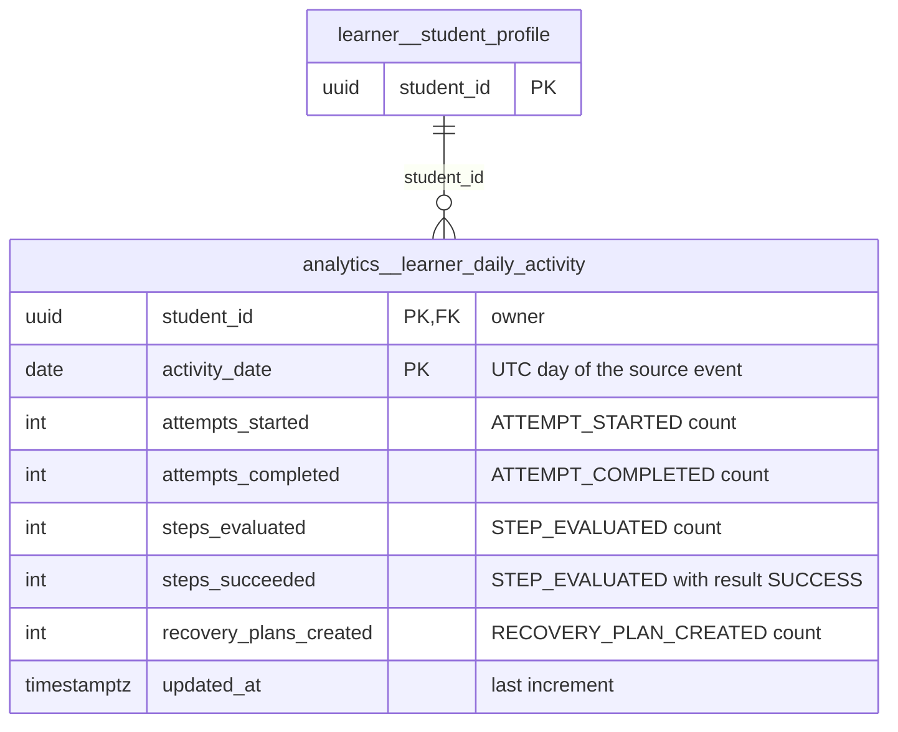

# `analytics` schema — learner activity rollups

The `analytics` schema holds derived, rebuildable reporting aggregates. Today it contains a single table, `analytics.learner_daily_activity`: one counter row per student per UTC day, maintained by the transactional-outbox consumer `learner_analytics` in [outbox_worker.py](../../../mathbank-rest/src/mathbank_rest/outbox_worker.py). There is no REST read surface yet.

Source of truth: migrations [018](../../../mathbank-db/sql/018_outbox_consumers.sql). Catalog extracted 2026-11-01 from migrations 001–054; endpoint mapping traced from mathbank-rest source and manually verified.

## 1. Purpose, ownership and data flow

- **Domain:** per-learner engagement analytics for the step-by-step solving runtime (attempts, step evaluations, gap diagnoses, recovery plans).
- **Writer:** only the outbox consumer `learner_analytics` (`_analytics`, [outbox_worker.py:59-75](../../../mathbank-rest/src/mathbank_rest/outbox_worker.py)). It runs as a CLI (`python -m mathbank_rest.outbox_worker --once | --watch N`, Makefile targets in [mathbank-rest/Makefile](../../../mathbank-rest/Makefile)), not inside a request. Each `pipeline.outbox_event` is applied once per consumer because `pipeline.outbox_consumption` is written in the same transaction.
- **Producers of the source events:** [step_runtime.py](../../../mathbank-rest/src/mathbank_rest/step_runtime.py) (`ATTEMPT_STARTED`, `STEP_EVALUATED`, `ATTEMPT_COMPLETED`, `ATTEMPT_ABANDONED`), [step_diagnosis.py](../../../mathbank-rest/src/mathbank_rest/step_diagnosis.py) (`GAP_DIAGNOSED`, `KNOWLEDGE_GAP_CREATED`), [step_recovery.py](../../../mathbank-rest/src/mathbank_rest/step_recovery.py) (`RECOVERY_PLAN_CREATED`, `RECOVERY_PLAN_COMPLETED`).
- **Readers:** none in mathbank-rest, mathbank-web or any other service (grep for `learner_daily_activity` finds only the writer).
- **Lifecycle:** upsert-only counters (`ON CONFLICT … DO UPDATE SET col = col + 1`). Rows are rebuildable by replaying `pipeline.outbox_event` (resetting the consumer's `outbox_consumption` rows). Deleted with the student (`ON DELETE CASCADE`).
- **Privacy class:** learner-private (keyed by `student_id`; no free text).

## 2. Entity diagram — as-is

## 3. Tables

### `analytics.learner_daily_activity`

**Role.** One row = the activity counters of one student on one UTC calendar day. It exists so dashboards can show engagement without scanning the append-only `learner.event` log. Rows are created lazily by the outbox consumer the first time a counted event for that student/day is processed; the `INSERT … SELECT … WHERE EXISTS (student_profile)` guard silently skips events for students that no longer exist. Nothing reads it yet.

**Lifecycle.** Counters only ever increase; no status column. Not append-only-guarded (no trigger) because the consumer must update in place. Retention: kept until the student row is deleted (cascade).

**Columns**

| Column | Type | Null | Default | Description |
|---|---|---|---|---|
| `student_id` | uuid | NO | — | Learner the counters belong to → `learner.student_profile.student_id` (ON DELETE CASCADE). Taken from the outbox event payload key `student_id`; events without it are ignored. |
| `activity_date` | date | NO | — | UTC date of the source outbox event's `created_at` (`(created_at AT TIME ZONE 'UTC')::date`), not the learner's local day. |
| `attempts_started` | integer | NO | `0` | Number of `ATTEMPT_STARTED` outbox events (new `learner.solve_attempt` sessions). |
| `attempts_completed` | integer | NO | `0` | Number of `ATTEMPT_COMPLETED` events (solve sessions finished and converted into a `learner.attempt` outcome row). |
| `attempts_abandoned` | integer | NO | `0` | Number of `ATTEMPT_ABANDONED` events, emitted by the stale-attempt job (`outbox_worker --abandon-idle-days`). |
| `steps_evaluated` | integer | NO | `0` | Number of `STEP_EVALUATED` events (one per evaluator verdict on a solution step). |
| `steps_succeeded` | integer | NO | `0` | Subset of `steps_evaluated` whose payload `result` was `SUCCESS` (incremented in the same upsert). |
| `gaps_diagnosed` | integer | NO | `0` | Number of `GAP_DIAGNOSED` events (a `pedagogy.gap_diagnosis` run for a failed step). |
| `knowledge_gaps_created` | integer | NO | `0` | Number of `KNOWLEDGE_GAP_CREATED` events (new `pedagogy.knowledge_gap` hypotheses). |
| `recovery_plans_created` | integer | NO | `0` | Number of `RECOVERY_PLAN_CREATED` events (detours opened). |
| `recovery_plans_completed` | integer | NO | `0` | Number of `RECOVERY_PLAN_COMPLETED` events (detours finished successfully; `EXHAUSTED`/`ABORTED` are not counted). |
| `updated_at` | timestamptz | NO | `now()` | Time of the last increment. |

**Keys, constraints, indexes.**
- PK `(student_id, activity_date)` — also the upsert conflict target.
- FK `student_id` → `learner.student_profile` ON DELETE CASCADE.
- No CHECKs (counters could in principle go negative only through manual SQL).
- No triggers; no secondary indexes.

**REST operations today.** None — written by the `learner_analytics` consumer in [outbox_worker.py](../../../mathbank-rest/src/mathbank_rest/outbox_worker.py) (C/U); read by nobody yet.

## 4. CRUD coverage — as-is

| Table | Create | Read | Update | Delete | Notes |
|---|---|---|---|---|---|
| `analytics.learner_daily_activity` | ⚙️ | ❌ | ⚙️ | — | Outbox consumer only; no learner or admin read endpoint; delete happens via student cascade. |

## 5. Target state — how it should be

### 5.1 Schema improvements

1. **P2 — Add non-negative CHECKs on all counters** (`CHECK (attempts_started >= 0 AND …)` or one per column). Values are only ever incremented ([outbox_worker.py:67-75](../../../mathbank-rest/src/mathbank_rest/outbox_worker.py)), so a negative number can only come from a bad backfill; the constraint documents the invariant.
2. **P2 — Add `CHECK (steps_succeeded <= steps_evaluated)`.** Both are incremented together in one statement; the inequality is the only cross-column invariant.
3. **P3 — Document the UTC-day semantics or store a learner time zone.** `activity_date` is computed in UTC ([outbox_worker.py:69](../../../mathbank-rest/src/mathbank_rest/outbox_worker.py)); a "streak" UI for learners outside UTC would mis-bucket evening activity.
4. **P3 — Provide a rebuild path.** The table is derived, yet no script resets `pipeline.outbox_consumption` for consumer `learner_analytics` and truncates the table. A `--rebuild learner_analytics` flag on the worker would make it a true cache ([66A](../../requirements/66A_POSTGRES_TABLE_MIGRATION_ASSESSMENT.md) classifies it as "D — rebuildable").

### 5.2 Entity diagram — target

Structure unchanged; see 5.1.

### 5.3 Endpoints to build

| Priority | Method & path | Auth | Table(s) / op | Purpose | Notes (validation, concurrency, audit) |
|---|---|---|---|---|---|
| P2 | `GET /v1/learner/activity?from=&to=` | Learner JWT | `analytics.learner_daily_activity` / R | Learner streak/heat-map on the profile page. | Owner-scoped in SQL (`WHERE student_id = :sid`); `from`/`to` ISO dates, max range 366 days; response `{items,total,limit,offset}`. |
| P2 | `GET /v1/admin/analytics/learner-daily-activity?student_id=&from=&to=` | Admin key (X-Admin-Api-Key) | `analytics.learner_daily_activity` / R | Ops/teacher dashboard of engagement across students. | Filters optional; limit ≤ 200; optionally `group_by=day` to return cohort sums without per-student rows. |
| P3 | `POST /v1/admin/analytics/learner-daily-activity/rebuild` | Admin key (X-Admin-Api-Key) | `analytics.learner_daily_activity` / D+C via job | Recompute from `pipeline.outbox_event` after a consumer bug. | Returns 202 + job id; writes `audit.action_log`; never runs inline in the request. |
