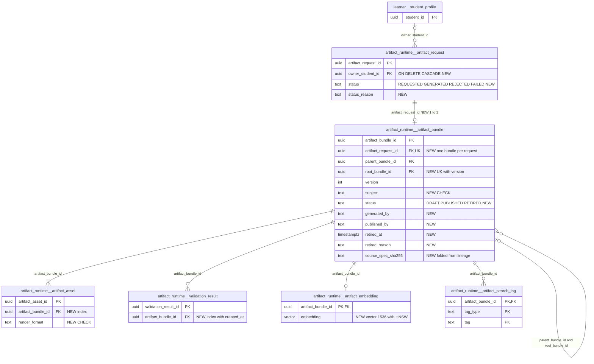

# `artifact_runtime` schema — reusable declarative teaching artifacts

The `artifact_runtime` schema stores reusable instructional artifacts: SVG diagrams, LaTeX derivation cards, step-by-step overlay frame sequences and Manim export specs. They are generated deterministically, without an LLM, from a declarative `ArtifactPlan` (points, segments, circles, angles, nodes, cells and equations, plus overlays and frames). A plan enters as an `artifact_request`. Staff then generate it into a versioned `artifact_bundle` whose rendered bytes go to the private object store. The bundle can be published for learners, searched lexically, and indexed with an embedding for semantic search. Only metadata is kept in Postgres; asset bytes live in the object store, keyed by `object_key`. The schema is independent of `attempt_media` (learner uploads) and of `studio.*` (Manim rendering jobs).

Source of truth: migrations [022](../../../mathbank-db/sql/022_artifact_runtime.sql). Catalog extracted 2026-11-01 from migrations 001–054; endpoint mapping traced from mathbank-rest source and manually verified.

## 1. Purpose, ownership and data flow

**Domain.** The schema holds reusable "show, don't tell" visuals for four subjects (`GEOMETRY`, `ALGEBRA`, `COMBINATORICS`, `NUMBER_THEORY`). Each artifact is a base diagram plus ordered, reset-to-base overlay frames with step captions and explanations, so a tutor or lesson can walk a learner through a construction one step at a time.

**Write ownership.** All writes go through mathbank-rest. The service module is [artifact_runtime.py](../../../mathbank-rest/src/mathbank_rest/artifact_runtime.py), exposed by [routers/artifacts.py](../../../mathbank-rest/src/mathbank_rest/routers/artifacts.py) under `/v1/artifacts`. The router holds no SQL: it calls the service inside `engine.begin()` through `_run`, which also deletes any object-store files the failed command wrote ([artifacts.py:151-170](../../../mathbank-rest/src/mathbank_rest/routers/artifacts.py)).

| Caller | Path used | Credential |
|---|---|---|
| mathbank-web learner/instructor UI ([app/artifacts/ArtifactLibrary.jsx](../../../mathbank-web/app/artifacts/ArtifactLibrary.jsx), [GeometryArtifact.jsx](../../../mathbank-web/app/_components/GeometryArtifact.jsx)) | Same-origin proxy `/api/rest/artifacts/*` ([lib/privateRuntimeProxy.mjs](../../../mathbank-web/lib/privateRuntimeProxy.mjs)), which allow-lists routes and blocks `/generate` and `/index` for non-instructors | Learner JWT, or the admin key for an instructor session |
| mathbank-agent tutor tools ([artifact_tools.py](../../../mathbank-agent/agents/mathbank_tutor/tools/artifact_tools.py)) | `search`, `bundles/{id}` (+ assets, frames), `requests`, `geometry-preview`, `validate`, `preview` | The learner's bearer token (never generation or indexing) |

No ETL script, worker or other service writes these tables. [quiz_runtime.py](../../../mathbank-rest/src/mathbank_rest/quiz_runtime.py) (L205–212) calls `artifact_runtime.generate`/`render_generated_frame` to draw quiz diagrams in memory, and [scripts/generate_similarity_embeddings.py](../../../mathbank-rest/scripts/generate_similarity_embeddings.py) reuses `embedding_profile()`. Neither touches the `artifact_runtime` tables.

**Lifecycle.**
1. **Request.** `POST /v1/artifacts/requests` validates the plan (`validate_plan`), checks `linked_problem_id` against `core.problem`, and inserts an `artifact_request` with status `REQUESTED`. The full plan JSON goes into `spec`. A learner becomes the owner (`owner_student_id`); with the admin key the owner is NULL and `created_by='admin'`.
2. **Generate (staff only).** `POST /requests/{id}/generate` locks the request (`FOR UPDATE`). If it is already `GENERATED`, the call returns, or publishes, the existing bundle. Otherwise it renders the plan and, in one transaction, writes:
   - one `artifact_bundle` (`DRAFT`/`VALIDATED`, or `PUBLISHED`/`APPROVED` if `publish=true`);
   - 3–4 `artifact_asset` rows, each with one `artifact_metadata` row (bytes go to `object_store.put_bytes`);
   - one `overlay_state` and one `artifact_annotation` per overlay;
   - one `frame_sequence`, one `artifact_lineage` and one `validation_result`;
   - the `artifact_search_tag` rows.

   It then sets the request to `GENERATED` ([artifact_runtime.py:998-1098](../../../mathbank-rest/src/mathbank_rest/artifact_runtime.py)). Asset, overlay and frame-sequence IDs are `uuid5(bundle_id, …)`, so the bundle can be regenerated byte-for-byte later.
3. **Validate / publish.** `validate_bundle` regenerates the plan from `artifact_request.spec` and compares every stored object byte-for-byte. Admin calls append a `validation_result`. `publish_bundle` (admin) re-validates and sets `PUBLISHED`/`APPROVED`/`published_at`.
4. **Index (staff only).** `POST /bundles/{id}/index` upserts one `artifact_embedding` row. The vector is either supplied by the caller or generated explicitly (OpenAI `text-embedding-3-small`, 1536 dimensions by default, or the gateway). The request must carry the SHA-256 of the bundle's current `search_text`.
5. **Read / search.** Learners see only `PUBLISHED` bundles. Asset bytes are streamed through REST after a SHA-256 and size integrity check, and never exposed as store keys. Frame SVGs are re-rendered on every request from `spec` and checked against the stored manifest and base SVG. Search is lexical (`to_tsvector('simple', search_text)`) or semantic (cosine distance on `artifact_embedding`). Semantic search returns `UNAVAILABLE` and never silently falls back to lexical.

Nothing is ever updated after generation except `artifact_request.status`, `artifact_bundle.status`/`review_state`/`published_at`, and the `artifact_embedding` upsert. There is no delete, unpublish or retire path, and no code removes object-store files for existing bundles.

**Privacy class.** Requests are **learner-owned**: `GET /requests/{id}` checks `owner_student_id`. Bundles and assets are **shared catalogue content** once published, and drafts are **staff-only**. `object_key` is never returned (`list_assets` strips it). `validation_result`, `artifact_lineage`, `artifact_metadata`, `artifact_annotation` and `overlay_state` are **operational/derived** and have no read path.

## 2. Entity diagram — as-is

```mermaid
erDiagram
    learner__student_profile {
        uuid student_id PK
    }
    core__problem {
        uuid problem_id PK
    }
    artifact_runtime__artifact_request {
        uuid artifact_request_id PK
        uuid owner_student_id FK "NULL for staff requests"
        text subject "GEOMETRY ALGEBRA COMBINATORICS NUMBER_THEORY"
        uuid linked_problem_id FK
        jsonb spec "full ArtifactPlan"
        text status "REQUESTED or GENERATED"
    }
    artifact_runtime__artifact_bundle {
        uuid artifact_bundle_id PK
        uuid artifact_request_id FK "UK with version"
        uuid parent_bundle_id FK "self reference"
        int version UK
        text status "DRAFT or PUBLISHED"
        text review_state "VALIDATED or APPROVED"
        text search_text "GIN tsvector"
        jsonb metadata
    }
    artifact_runtime__artifact_asset {
        uuid artifact_asset_id PK "uuid5 of bundle"
        uuid artifact_bundle_id FK
        text asset_type "SVG_DIAGRAM LATEX_CARD FRAME_SEQUENCE MANIM_EXPORT_SPEC"
        text object_key UK "private store key"
        text sha256
        int size_bytes
    }
    artifact_runtime__artifact_metadata {
        uuid artifact_asset_id PK, FK
        text subject
        text_arr concept_ids
        text_arr step_labels
        text search_text
    }
    artifact_runtime__overlay_state {
        uuid overlay_state_id PK
        uuid artifact_bundle_id FK "UK with ordinal"
        uuid base_asset_id FK
        int ordinal UK
        jsonb actions "declarative actions"
    }
    artifact_runtime__frame_sequence {
        uuid frame_sequence_id PK
        uuid artifact_bundle_id FK, UK "one per bundle"
        uuid manifest_asset_id FK
        uuid_arr ordered_overlay_state_ids "no FK"
    }
    artifact_runtime__artifact_annotation {
        uuid artifact_annotation_id PK
        uuid artifact_bundle_id FK "UK with ordinal"
        int ordinal UK
        int step_number
        text explanation_text
    }
    artifact_runtime__validation_result {
        uuid validation_result_id PK
        uuid artifact_bundle_id FK
        bool valid
        jsonb report
    }
    artifact_runtime__artifact_lineage {
        uuid artifact_bundle_id PK, FK
        uuid artifact_request_id FK
        uuid parent_bundle_id FK
        text source_spec_sha256
    }
    artifact_runtime__artifact_search_tag {
        uuid artifact_bundle_id PK, FK
        text tag_type PK "concept skill theorem"
        text tag PK
    }
    artifact_runtime__artifact_embedding {
        uuid artifact_bundle_id PK, FK
        text model
        int dimensions
        text search_text_sha256 "staleness check"
        vector embedding
    }

    learner__student_profile |o--o{ artifact_runtime__artifact_request : "owner_student_id"
    core__problem |o--o{ artifact_runtime__artifact_request : "linked_problem_id"
    artifact_runtime__artifact_request ||--o{ artifact_runtime__artifact_bundle : "artifact_request_id"
    artifact_runtime__artifact_bundle |o--o{ artifact_runtime__artifact_bundle : "parent_bundle_id"
    artifact_runtime__artifact_bundle ||--|{ artifact_runtime__artifact_asset : "artifact_bundle_id"
    artifact_runtime__artifact_asset ||--o| artifact_runtime__artifact_metadata : "artifact_asset_id"
    artifact_runtime__artifact_bundle ||--o{ artifact_runtime__overlay_state : "artifact_bundle_id"
    artifact_runtime__artifact_asset ||--o{ artifact_runtime__overlay_state : "base_asset_id"
    artifact_runtime__artifact_bundle ||--o| artifact_runtime__frame_sequence : "artifact_bundle_id"
    artifact_runtime__artifact_asset ||--o{ artifact_runtime__frame_sequence : "manifest_asset_id"
    artifact_runtime__artifact_bundle ||--o{ artifact_runtime__artifact_annotation : "artifact_bundle_id"
    artifact_runtime__artifact_bundle ||--o{ artifact_runtime__validation_result : "artifact_bundle_id"
    artifact_runtime__artifact_bundle ||--o| artifact_runtime__artifact_lineage : "artifact_bundle_id"
    artifact_runtime__artifact_request ||--o{ artifact_runtime__artifact_lineage : "artifact_request_id"
    artifact_runtime__artifact_bundle |o--o{ artifact_runtime__artifact_lineage : "parent_bundle_id"
    artifact_runtime__artifact_bundle ||--o{ artifact_runtime__artifact_search_tag : "artifact_bundle_id"
    artifact_runtime__artifact_bundle ||--o| artifact_runtime__artifact_embedding : "artifact_bundle_id"
```

## 3. Tables

### `artifact_runtime.artifact_request`

**Role.** One row is one request to build an artifact from a declarative `ArtifactPlan`. It is the immutable source of truth for everything generated from it: the generator, `validate_bundle` and `frame_svg` all re-parse `spec` and regenerate deterministically. Learners can create requests for themselves; only staff can turn a request into a bundle.

**Table type (§4).** Queue / job / run: a submitted request with a `REQUESTED → GENERATED` status that a privileged action consumes.

**Lifecycle.** `REQUESTED` on insert, then `GENERATED` after a successful `generate_request`. There is no failed, rejected or cancelled state: a request that can never be generated stays `REQUESTED` forever. Rows are never deleted. The FK to `learner.student_profile` is NO ACTION, so a learner who ever made a request cannot be deleted.

**Columns**

| Column | Type | Null | Default | Meaning |
|---|---|---|---|---|
| artifact_request_id | uuid | NO | gen_random_uuid() | Request identity. The service supplies a `uuid4()` explicitly. |
| owner_student_id | uuid | yes | | Learner who owns the request → `learner.student_profile.student_id` (NO ACTION). Set from the learner JWT; NULL when the admin key is used. `get_request` returns 404 to anyone other than the owner or an admin. |
| created_by | text | NO | | Creator label: the learner's UUID as text, or the literal `'admin'`. There is no individual staff identity. |
| request_source | text | NO | | Free-text origin label from the plan (`ArtifactPlan.request_source`, default `AUTHORING`, ≤200 chars). No CHECK. |
| subject | text | NO | | CHECK `GEOMETRY`, `ALGEBRA`, `COMBINATORICS`, `NUMBER_THEORY`. Also decides which element kinds the validator allows (for example, `ALGEBRA` allows only `EQUATION`). |
| topic | text | NO | | Topic label from the plan (≤200 chars). |
| subtopic | text | yes | | Optional subtopic label. |
| goal_type | text | NO | | Free-text pedagogical goal (`ArtifactPlan.goal_type`, default `DEMONSTRATE`). No CHECK. |
| linked_problem_id | uuid | yes | | Optional corpus problem the artifact illustrates → `core.problem.problem_id` (NO ACTION). Existence is checked before insert (`INVALID_PROBLEM_REFERENCE`). |
| linked_solution_step_id | text | yes | | Optional free-text step identifier within that problem's solution. No FK. |
| spec | jsonb | NO | | Full `ArtifactPlan` JSON: `subject`, `topic`, `title`, `summary`, `difficulty_band`, `grade_band`, `concept_ids`/`skill_ids`/`theorem_ids` (string tags), `width`/`height` (240–2000), `elements[]` (discriminated by `kind`: `POINT`, `SEGMENT`/`EDGE`, `CIRCLE`, `ANGLE`, `NODE`, `CELL`, `EQUATION` with `terms`), `overlays[]` (`id`, `caption`, `actions[]` such as `HIGHLIGHT`/`MARK_EQUAL`/`FOCUS_REGION`, `explanation_text`, `concept_tag`, `hint_tag`, `linked_step_id`), `frames[]` (`overlay_id`, `duration_ms`, `transition`), optional `parent_bundle_id`, `modulus` and `number_theory_mode`. CHECK `jsonb_typeof(spec) = 'object'`. |
| status | text | NO | 'REQUESTED' | CHECK `REQUESTED`, `GENERATED`. |
| created_at | timestamptz | NO | now() | Insert time. |

**Keys, constraints, indexes.**
- PK `artifact_request_id`.
- FKs `owner_student_id` → `learner.student_profile` and `linked_problem_id` → `core.problem`, both NO ACTION.
- CHECKs on `subject`, `status` and the `spec` type.
- No index on `owner_student_id` or `status`, so there is nothing to support a "my requests" list or a staff queue.

**REST operations today.**

| Op | Method & path | Auth | Handler | Notes |
|---|---|---|---|---|
| C | POST /v1/artifacts/requests | Learner JWT or admin key (`staff_or_student`) | `artifacts.request_artifact` → `create_request` | 201. Validates the plan first and returns 422 `INVALID_ARTIFACT_PLAN`. No rate limit or `Idempotency-Key`, so each call inserts a new row. |
| R | GET /v1/artifacts/requests/{request_id} | Learner JWT (owner) or admin key | `artifacts.get_request` → `get_request` | Returns the whole row, including `spec`. |
| R,U | POST /v1/artifacts/requests/{request_id}/generate | Admin key (X-Admin-Api-Key) | `artifacts.generate` → `generate_request` | `FOR UPDATE`; idempotent once `GENERATED`; sets `status='GENERATED'`. Body `{publish: bool}`. |
| R | GET /v1/artifacts/bundles/{id}/frames/{ordinal}/content, POST /v1/artifacts/bundles/{id}/validate, POST /v1/artifacts/bundles/{id}/publish | as listed under `artifact_bundle` | `frame_svg`, `validate_bundle` | Internally re-read `spec` with an ADMIN pseudo-actor to regenerate the artifact. |

No list endpoint exists for either learners or staff.

### `artifact_runtime.artifact_bundle`

**Role.** One row is one generated, versioned artifact: the unit learners browse, the agent cites and search returns. It carries the display fields copied from the plan, the publication state, the lexical `search_text`, and a `metadata` summary. Every other generated table hangs off it.

**Table type (§4).** Release / snapshot: an immutable generated version that is published, never edited.

**Lifecycle.**

| From | To | Trigger |
|---|---|---|
| — | `DRAFT` / `VALIDATED` | `generate_request` with `publish=false` |
| — | `PUBLISHED` / `APPROVED` | `generate_request` with `publish=true`; `published_at = now()` |
| `DRAFT` | `PUBLISHED` / `APPROVED` | `publish_bundle`, after `validate_bundle` passes. `published_at = COALESCE(published_at, now())` |

There is no unpublish, retire or delete. Re-publishing an already published bundle re-runs validation and leaves `published_at` unchanged.

**Columns**

| Column | Type | Null | Default | Meaning |
|---|---|---|---|---|
| artifact_bundle_id | uuid | NO | gen_random_uuid() | Bundle identity. The service supplies a `uuid4()`, and it is the namespace for every `uuid5` child ID. |
| artifact_request_id | uuid | NO | | Source request → `artifact_request` (NO ACTION). In practice there is one bundle per request, because generation is idempotent once the request is `GENERATED`. |
| parent_bundle_id | uuid | yes | | Bundle this one revises → `artifact_bundle` (self, NO ACTION). Taken from `spec.parent_bundle_id`; the parent must be visible to the caller and have the same `subject` (`INVALID_LINEAGE`). |
| subject | text | NO | | Copied from the plan. **No CHECK** (the request has one). |
| topic | text | NO | | Copied from the plan. |
| subtopic | text | yes | | Copied from the plan. |
| title | text | NO | | Display title (≤200 chars). |
| summary | text | NO | | Display summary (≤2000 chars; may be `''`). |
| difficulty_band | text | NO | | Free text from the plan, default `UNSPECIFIED`. Used as an exact-match search filter. |
| grade_band | text | NO | | Free text from the plan, default `UNSPECIFIED`. |
| status | text | NO | 'DRAFT' | CHECK `DRAFT`, `PUBLISHED`. Learners and lexical/semantic search see only `PUBLISHED` rows. |
| review_state | text | NO | 'VALIDATED' | CHECK `VALIDATED`, `APPROVED`. Always moves together with `status` (`DRAFT`↔`VALIDATED`, `PUBLISHED`↔`APPROVED`), so it adds no information today. |
| version | integer | NO | 1 | `1`, or `parent.version + 1` when `parent_bundle_id` is set. CHECK > 0. |
| created_by_agent | text | NO | | Generator version string, currently `declarative-artifacts-v1` (`VERSION`). |
| rule_profile_id | text | NO | | Validation rule profile, `<subject lower>_v1` (for example `geometry_v1`). |
| annotation_profile_id | text | NO | | Annotation profile, always `step_annotations_v1`. |
| search_text | text | NO | | Space-joined title, summary, topic, subtopic, tag IDs, element labels, equation LaTeX and reasons, and overlay captions and explanations. Indexed for lexical search. Its SHA-256 is returned by `get_bundle` as `search_text_sha256` and must match on `index`. |
| metadata | jsonb | NO | | Summary object: `concept_ids`, `skill_ids`, `theorem_ids`, `linked_problem_ids`, `linked_solution_step_ids`, `step_count`, `overlay_count`, `frame_count`, `has_latex`, `has_svg` (always true), `has_animation_manifest` (always true), `generator_version`. No CHECK. |
| created_at | timestamptz | NO | now() | Generation time. |
| published_at | timestamptz | yes | | First publication time. |

**Keys, constraints, indexes.**
- PK `artifact_bundle_id`.
- UNIQUE `(artifact_request_id, version)`. Because a child revision is always a *new* request, this does not stop two revisions of the same parent from both being `version = 2`.
- FKs `artifact_request_id` → `artifact_request` and `parent_bundle_id` → `artifact_bundle`, both NO ACTION.
- CHECKs on `status`, `review_state` and `version > 0`.
- Indexes `artifact_bundle_subject_status (subject, status)` and GIN `artifact_lexical_search (to_tsvector('simple', search_text))`.

**REST operations today.**

| Op | Method & path | Auth | Handler | Notes |
|---|---|---|---|---|
| C | POST /v1/artifacts/requests/{request_id}/generate | Admin key (X-Admin-Api-Key) | `generate_request` | Inserts the bundle and all children in one transaction. |
| R | GET /v1/artifacts/bundles/{bundle_id} | Learner JWT or admin key | `artifacts.get_bundle` → `get_bundle` | `PUBLISHED` only for learners (404 otherwise). Adds `search_text_sha256`. A learner cannot see the DRAFT bundle generated from their own request. |
| R | POST /v1/artifacts/bundles/{bundle_id}/validate | Learner JWT or admin key | `artifacts.validate_bundle` → `validate_bundle` | CPU-heavy re-render and byte comparison. Writes a `validation_result` only for admins. |
| R,U | POST /v1/artifacts/bundles/{bundle_id}/publish | Admin key (X-Admin-Api-Key) | `artifacts.publish` → `publish_bundle` | `FOR UPDATE`, validate, then set `PUBLISHED`/`APPROVED`. No audit row. |
| R | POST /v1/artifacts/search | Learner JWT or admin key | `artifacts.search` → `search` | Lexical `ts_rank_cd`. Filters `subject`, `difficulty_band`, `concept_id`/`skill_id`/`theorem_id` (via `artifact_search_tag`) and `asset_type` (via `artifact_asset`). `limit` ≤ 100. No `total`. |
| R | POST /v1/artifacts/search/semantic | Learner JWT or admin key | `artifacts.semantic_search` → `search(semantic=True)` | Joins `artifact_embedding`. Requires `query_embedding` or `generate_embedding=true`. |
| R | POST /v1/artifacts/bundles/{bundle_id}/similar | Learner JWT or admin key | `artifacts.similar` → `similar` | Uses the bundle's own stored embedding as the query. |
| R | GET …/assets, …/assets/{asset_id}/content, …/frames, …/frames/{ordinal}/content, POST …/index | as listed under child tables | `get_bundle` visibility gate | Every bundle sub-resource first calls `get_bundle`, so learners are limited to `PUBLISHED` bundles. |

`POST /v1/artifacts/preview`, `/preview/content`, `/geometry-preview`, `/geometry-preview/content`, `/validate` and `GET /v1/artifacts/embedding-profile` render or validate in memory and touch **no** table. The generated matrix's `artifact_embedding CU` attribution for `geometry-preview` is a static-trace over-attribution.

### `artifact_runtime.artifact_asset`

**Role.** One row is one rendered file of a bundle, stored in the private object store. Every bundle gets:
- `SVG_DIAGRAM`: the base drawing, `image/svg+xml`, `SVG`;
- `LATEX_CARD`: an aligned derivation, `text/plain`, `LATEX`, only when the plan contains equations;
- `FRAME_SEQUENCE`: the frame manifest, `application/json`, `JSON`;
- `MANIM_EXPORT_SPEC`: a deferred-render spec for a Manim pipeline, `application/json`, `JSON`.

IDs are `uuid5(bundle_id, 'base_svg' | 'latex' | 'manifest' | 'manim')`.

**Table type (§4).** Release / snapshot child: immutable and created with the bundle.

**Lifecycle.** Insert-only during generation. Removed by cascade if the bundle is deleted, which no code does. The object-store file is never deleted except when the generating transaction fails.

**Columns**

| Column | Type | Null | Default | Meaning |
|---|---|---|---|---|
| artifact_asset_id | uuid | NO | | Deterministic `uuid5` (see Role). No DB default. |
| artifact_bundle_id | uuid | NO | | Owning bundle → `artifact_bundle` (ON DELETE CASCADE). |
| asset_type | text | NO | | CHECK `SVG_DIAGRAM`, `LATEX_CARD`, `FRAME_SEQUENCE`, `MANIM_EXPORT_SPEC`. |
| object_key | text | NO | | Private object-store key `<uuid4 hex>.<suffix>` produced by `object_store.put_bytes` (local filesystem or S3). UNIQUE, CHECK `^[0-9a-f]{32}\.[a-z0-9]{1,10}$`. Never returned by the API (`list_assets` strips it). |
| sha256 | text | NO | | SHA-256 hex of the bytes. CHECK `^[0-9a-f]{64}$`. Verified on every content read (`ASSET_INTEGRITY_FAILED` → 503). |
| size_bytes | integer | NO | | Byte length. CHECK 1–26,214,400 (25 MiB, same as the store limit). Also verified on read. |
| mime_type | text | NO | | `image/svg+xml`, `text/plain` or `application/json`. Sent as the response `Content-Type`. No CHECK. |
| render_format | text | NO | | `SVG`, `LATEX` or `JSON`. Selects validator checks and the download filename extension. No CHECK. |
| width | integer | yes | | Canvas width in px (SVG only; 240–2000 from the plan). |
| height | integer | yes | | Canvas height in px (SVG only). |
| element_ids | jsonb | NO | '[]' | Semantic element IDs rendered in the asset. For SVG: every plan element ID plus equation term IDs. For LaTeX: equation IDs. Otherwise `[]`. Compared during validation. |
| created_at | timestamptz | NO | now() | Insert time. |

**Keys, constraints, indexes.**
- PK `artifact_asset_id`; UNIQUE `object_key`.
- FK `artifact_bundle_id` → `artifact_bundle` (CASCADE).
- CHECKs on `asset_type`, `object_key`, `sha256` and `size_bytes`.
- No index on `artifact_bundle_id`, which `list_assets` and the search `asset_type` filter use.

**REST operations today.**

| Op | Method & path | Auth | Handler | Notes |
|---|---|---|---|---|
| C | POST /v1/artifacts/requests/{request_id}/generate | Admin key (X-Admin-Api-Key) | `generate_request` | One `put_bytes` plus one INSERT per asset. |
| R | GET /v1/artifacts/bundles/{bundle_id}/assets | Learner JWT or admin key | `artifacts.assets` → `list_assets` | Without `object_key`; adds a `content_path`. |
| R | GET /v1/artifacts/bundles/{bundle_id}/assets/{asset_id}/content | Learner JWT or admin key | `artifacts.asset_content` → `asset_bytes` | Streams the bytes with `Cache-Control: private, no-store`, `nosniff` and a sandbox CSP. |
| R | GET /v1/artifacts/bundles/{bundle_id}/frames, …/frames/{ordinal}/content; POST …/validate, …/publish; POST /v1/artifacts/search (asset_type filter) | as listed | `get_frames`, `frame_svg`, `validate_bundle`, `search` | Indirect reads. |

### `artifact_runtime.artifact_metadata`

**Role.** One row per asset (1:1, PK = FK) that repeats the bundle's subject, tag arrays, profiles and `search_text` at asset level, apparently so that assets could be searched independently. The generator writes the same values for every asset of a bundle. `step_labels` holds the overlay captions in order.

**Table type (§4).** Derived / cache: a denormalised copy of plan data.

**Lifecycle.** Insert-only during generation. Cascade-deleted with the asset. **Never read** by any code.

**Columns**

| Column | Type | Null | Default | Meaning |
|---|---|---|---|---|
| artifact_asset_id | uuid | NO | | Asset described → `artifact_asset` (ON DELETE CASCADE). |
| subject | text | NO | | Plan subject (no CHECK). |
| concept_ids | text[] | NO | '{}' | Plan `concept_ids`: free-text tags, not FKs to `knowledge.concept`. |
| skill_ids | text[] | NO | '{}' | Plan `skill_ids` (free text). |
| theorem_ids | text[] | NO | '{}' | Plan `theorem_ids` (free text). |
| step_labels | text[] | NO | '{}' | Overlay captions in overlay order. |
| rule_profile_id | text | NO | | Same value as `artifact_bundle.rule_profile_id`. |
| annotation_profile_id | text | NO | | Always `step_annotations_v1`. |
| search_text | text | NO | | Same value as `artifact_bundle.search_text`. |

**Keys, constraints, indexes.** PK and FK `artifact_asset_id` → `artifact_asset` (CASCADE). No other constraints or indexes.

**REST operations today.**

| Op | Method & path | Auth | Handler | Notes |
|---|---|---|---|---|
| C | POST /v1/artifacts/requests/{request_id}/generate | Admin key (X-Admin-Api-Key) | `generate_request` | One row per asset. |

No read endpoint.

### `artifact_runtime.overlay_state`

**Role.** One row per plan overlay: a named, declarative set of actions applied to the base SVG for one instructional step. Examples are `HIGHLIGHT`, `DIM`, `SHOW`/`HIDE`, `LABEL`/`RELABEL`, `MARK_EQUAL`/`MARK_PARALLEL`/`MARK_PERPENDICULAR`, `SHOW_RATIO`, `FOCUS_REGION` and `EMPHASIZE_EQUATION_LINE`/`EMPHASIZE_TERM`. Frames reference overlays and are rendered in "reset to base each frame" mode. The ID is `uuid5(bundle_id, 'overlay_' + overlay.id)`.

**Table type (§4).** Release / snapshot child.

**Lifecycle.** Insert-only during generation; cascade-deleted with the bundle. Not read from the table: frame rendering re-derives overlays from `artifact_request.spec` and checks them against the manifest asset.

**Columns**

| Column | Type | Null | Default | Meaning |
|---|---|---|---|---|
| overlay_state_id | uuid | NO | | Deterministic `uuid5`. No DB default. |
| artifact_bundle_id | uuid | NO | | Owning bundle → `artifact_bundle` (ON DELETE CASCADE). |
| base_asset_id | uuid | NO | | The `SVG_DIAGRAM` asset the actions apply to → `artifact_asset` (NO ACTION). |
| ordinal | integer | NO | | 0-based overlay position in the plan. CHECK ≥ 0. |
| actions | jsonb | NO | | Array of `{action, targets[1..16], label?, latex?, region?[x,y,w,h]}`. CHECK `jsonb_typeof(actions) = 'array'`. |
| caption | text | NO | | Step caption (≤200 chars). |
| linked_step_id | text | yes | | Optional free-text link to a solution step. |

**Keys, constraints, indexes.** PK `overlay_state_id`. UNIQUE `(artifact_bundle_id, ordinal)`. FKs `artifact_bundle_id` (CASCADE) and `base_asset_id` (NO ACTION). CHECKs on `ordinal` and the `actions` type.

**REST operations today.**

| Op | Method & path | Auth | Handler | Notes |
|---|---|---|---|---|
| C | POST /v1/artifacts/requests/{request_id}/generate | Admin key (X-Admin-Api-Key) | `generate_request` | One row per overlay. |

No read endpoint. Overlay data reaches clients only inside the `FRAME_SEQUENCE` manifest (`GET …/frames`).

### `artifact_runtime.frame_sequence`

**Role.** One row per bundle (UNIQUE `artifact_bundle_id`) that points at the `FRAME_SEQUENCE` manifest asset and records the ordered overlay IDs the frames play. The ID is `uuid5(bundle_id, 'frames')`. When the plan has no explicit frames, one frame per overlay is generated.

**Table type (§4).** Release / snapshot child.

**Lifecycle.** Insert-only during generation; cascade-deleted with the bundle. `get_frames` reads only `manifest_asset_id`.

**Columns**

| Column | Type | Null | Default | Meaning |
|---|---|---|---|---|
| frame_sequence_id | uuid | NO | | Deterministic `uuid5`. No DB default. |
| artifact_bundle_id | uuid | NO | | Owning bundle → `artifact_bundle` (ON DELETE CASCADE). UNIQUE, so there is one sequence per bundle. |
| manifest_asset_id | uuid | NO | | The `FRAME_SEQUENCE` JSON asset → `artifact_asset` (NO ACTION). The manifest holds `state_mode='RESET_TO_BASE_EACH_FRAME'`, `element_id_map`, `latex_lines[]` and `frames[]` (ordinal, step_number, overlay_state_id, caption, actions, explanation_text, concept_tag, hint_tag, duration_ms, transition). |
| ordered_overlay_state_ids | uuid[] | NO | | Overlay IDs in frame order (one overlay may appear more than once). Elements are **not** FK-checked against `overlay_state`. |
| transition_notes | text | NO | '' | Never written; always `''`. |

**Keys, constraints, indexes.** PK `frame_sequence_id`. UNIQUE `artifact_bundle_id`. FKs `artifact_bundle_id` (CASCADE) and `manifest_asset_id` (NO ACTION).

**REST operations today.**

| Op | Method & path | Auth | Handler | Notes |
|---|---|---|---|---|
| C | POST /v1/artifacts/requests/{request_id}/generate | Admin key (X-Admin-Api-Key) | `generate_request` | |
| R | GET /v1/artifacts/bundles/{bundle_id}/frames | Learner JWT or admin key | `artifacts.frames` → `get_frames` | Returns the parsed manifest plus a `content_path` per frame. |
| R | GET /v1/artifacts/bundles/{bundle_id}/frames/{ordinal}/content | Learner JWT or admin key | `artifacts.frame_content` → `frame_svg` | `ordinal` 0–127. Re-renders from `spec`; 503 `FRAME_INTEGRITY_FAILED` if the stored manifest or SVG drifted. |

### `artifact_runtime.artifact_annotation`

**Role.** One row per overlay holding its teaching text: a 1-based `step_number`, caption, `concept_tag`, optional `hint_tag`, `explanation_text` and solution-step link. It mirrors the overlay's `ordinal`, apparently as a queryable store of step explanations.

**Table type (§4).** Release / snapshot child.

**Lifecycle.** Insert-only during generation; cascade-deleted with the bundle. **Never read**: the same text is served from the manifest asset.

**Columns**

| Column | Type | Null | Default | Meaning |
|---|---|---|---|---|
| artifact_annotation_id | uuid | NO | gen_random_uuid() | Annotation identity (DB default used). |
| artifact_bundle_id | uuid | NO | | Owning bundle → `artifact_bundle` (ON DELETE CASCADE). |
| ordinal | integer | NO | | 0-based overlay position. Same value as `overlay_state.ordinal`, but with no FK or CHECK linking the two. |
| step_number | integer | NO | | `ordinal + 1`. CHECK > 0. |
| caption | text | NO | | Overlay caption. |
| concept_tag | text | NO | | Overlay `concept_tag` (default `instruction`). Free text. |
| hint_tag | text | yes | | Optional hint tag. |
| explanation_text | text | NO | | Overlay explanation (≤2000 chars; may be `''`). |
| linked_step_id | text | yes | | Optional free-text solution-step link. |

**Keys, constraints, indexes.** PK `artifact_annotation_id`. UNIQUE `(artifact_bundle_id, ordinal)`. FK `artifact_bundle_id` (CASCADE). CHECK `step_number > 0`.

**REST operations today.**

| Op | Method & path | Auth | Handler | Notes |
|---|---|---|---|---|
| C | POST /v1/artifacts/requests/{request_id}/generate | Admin key (X-Admin-Api-Key) | `generate_request` | One row per overlay. |

No read endpoint.

### `artifact_runtime.validation_result`

**Role.** An append-only log of validation runs for a bundle. One row is written at generation, and one on every admin `validate_bundle` call, including the call made inside `publish_bundle`. It records whether the stored objects still match a deterministic regeneration from `spec` and pass the SVG/LaTeX safety checks.

**Table type (§4).** Audit: an append-only, system-written log.

**Lifecycle.** Append-only. Learner calls to `POST …/validate` run the checks but do **not** write a row. Cascade-deleted with the bundle.

**Columns**

| Column | Type | Null | Default | Meaning |
|---|---|---|---|---|
| validation_result_id | uuid | NO | gen_random_uuid() | Run identity. |
| artifact_bundle_id | uuid | NO | | Bundle validated → `artifact_bundle` (ON DELETE CASCADE). |
| valid | boolean | NO | | `true` when `report.errors` is empty. |
| validator_version | text | NO | | Generator/validator version (`declarative-artifacts-v1`). |
| report | jsonb | NO | | `{valid, errors[], warnings[] (always empty), validator_version, checks: ["STRUCTURAL","SAFETY","LAYOUT","SUBJECT_RULES"]}`. Errors are human-readable strings such as `stored artifact differs from validated declarative source`. |
| created_at | timestamptz | NO | now() | Run time. |

**Keys, constraints, indexes.** PK `validation_result_id`. FK `artifact_bundle_id` (CASCADE). No index on `artifact_bundle_id`.

**REST operations today.**

| Op | Method & path | Auth | Handler | Notes |
|---|---|---|---|---|
| C | POST /v1/artifacts/requests/{request_id}/generate | Admin key (X-Admin-Api-Key) | `_record_validation` | Generation-time report. |
| C | POST /v1/artifacts/bundles/{bundle_id}/validate | Admin key only (learners: no write) | `validate_bundle` → `_record_validation` | The route accepts learners too; the write is gated on `role == 'ADMIN'`. |
| C | POST /v1/artifacts/bundles/{bundle_id}/publish | Admin key (X-Admin-Api-Key) | `publish_bundle` → `validate_bundle` | |

No read endpoint: the history is write-only.

### `artifact_runtime.artifact_lineage`

**Role.** One row per bundle (PK = FK) recording provenance: the source request, the parent bundle, the generator version, and the SHA-256 of the canonical JSON of the plan (`source_spec_sha256`). This makes "which spec produced this bundle" checkable.

**Table type (§4).** Release / snapshot child (provenance).

**Lifecycle.** Insert-only during generation; cascade-deleted with the bundle. **Never read.** `artifact_request_id` and `parent_bundle_id` duplicate the bundle's own columns.

**Columns**

| Column | Type | Null | Default | Meaning |
|---|---|---|---|---|
| artifact_bundle_id | uuid | NO | | Bundle → `artifact_bundle` (ON DELETE CASCADE). |
| artifact_request_id | uuid | NO | | Source request → `artifact_request` (NO ACTION). Same value as `artifact_bundle.artifact_request_id`. |
| parent_bundle_id | uuid | yes | | Parent revision → `artifact_bundle` (NO ACTION). Same value as `artifact_bundle.parent_bundle_id`. |
| generator_version | text | NO | | `declarative-artifacts-v1`. |
| source_spec_sha256 | text | NO | | SHA-256 hex of `json.dumps(plan, sort_keys=True, separators=(",",":"))`. No format CHECK. |

**Keys, constraints, indexes.** PK and FK `artifact_bundle_id` (CASCADE). FKs `artifact_request_id` and `parent_bundle_id` (NO ACTION).

**REST operations today.**

| Op | Method & path | Auth | Handler | Notes |
|---|---|---|---|---|
| C | POST /v1/artifacts/requests/{request_id}/generate | Admin key (X-Admin-Api-Key) | `generate_request` | |

No read endpoint.

### `artifact_runtime.artifact_search_tag`

**Role.** A normalised tag index for search filters. It holds one row per distinct concept, skill or theorem tag in the plan. Tags are free-text strings chosen by the plan author, not FKs to `knowledge.*`. `search` filters through it with `EXISTS (… tag_type = 'concept' AND tag = :concept_id)`.

**Table type (§4).** Derived / cache: a search index derived from the plan.

**Lifecycle.** Insert-only during generation (deduplicated with `set(tags)`); cascade-deleted with the bundle.

**Columns**

| Column | Type | Null | Default | Meaning |
|---|---|---|---|---|
| artifact_bundle_id | uuid | NO | | Tagged bundle → `artifact_bundle` (ON DELETE CASCADE). |
| tag_type | text | NO | | CHECK `concept`, `skill`, `theorem` (lower case, unlike every other enum in the schema). |
| tag | text | NO | | Tag string (≤200 chars) from `concept_ids`/`skill_ids`/`theorem_ids`. Matched exactly. |

**Keys, constraints, indexes.** PK `(artifact_bundle_id, tag_type, tag)`. FK `artifact_bundle_id` (CASCADE). CHECK `tag_type`. Index `artifact_search_tags (tag_type, tag)` serves the filter lookups.

**REST operations today.**

| Op | Method & path | Auth | Handler | Notes |
|---|---|---|---|---|
| C | POST /v1/artifacts/requests/{request_id}/generate | Admin key (X-Admin-Api-Key) | `generate_request` | |
| R | POST /v1/artifacts/search, /search/semantic, /bundles/{bundle_id}/similar | Learner JWT or admin key | `search` | Used only when `concept_id`/`skill_id`/`theorem_id` filters are set. |

### `artifact_runtime.artifact_embedding`

**Role.** At most one embedding per bundle, used for semantic search and "similar artifacts". Each row records the model, its dimensions and the SHA-256 of the `search_text` that was embedded. Search uses only rows whose hash still matches the bundle's current text (`e.search_text_sha256 = encode(sha256(convert_to(b.search_text,'UTF8')),'hex')`) and whose model and dimensions match the configured profile (`ARTIFACT_EMBEDDING_PROVIDER`/`_MODEL`/`_DIMENSIONS`).

**Table type (§4).** Derived / cache / embedding.

**Lifecycle.** Upserted by `index_bundle` (`ON CONFLICT (artifact_bundle_id) DO UPDATE`, `indexed_at = now()`). Cascade-deleted with the bundle. Drafts can be indexed as well, because `index_bundle` uses the admin view of `get_bundle`.

**Columns**

| Column | Type | Null | Default | Meaning |
|---|---|---|---|---|
| artifact_bundle_id | uuid | NO | | Bundle → `artifact_bundle` (ON DELETE CASCADE). PK, so there is one vector per bundle and only one model at a time. |
| model | text | NO | | Embedding model, for example `text-embedding-3-small`. Must equal the configured profile model. |
| dimensions | integer | NO | 1536 | Vector length. CHECK 1–8192 and `vector_dims(embedding) = dimensions`. |
| search_text_sha256 | text | NO | | SHA-256 of the `search_text` that was embedded. The caller must send the current value (409 `STALE_SEARCH_TEXT`). No format CHECK. |
| embedding | vector | NO | | pgvector value **without a fixed dimension** (`vector`, not `vector(1536)`), either caller-supplied or generated by the provider. |
| indexed_at | timestamptz | NO | now() | Last (re)index time. |

**Keys, constraints, indexes.**
- PK and FK `artifact_bundle_id` (CASCADE).
- CHECKs on `dimensions` and on `vector_dims`.
- **No ANN index** (HNSW/IVFFlat cannot be built on an untyped `vector` column), so every semantic query is a sequential scan with a cosine-distance sort.

**REST operations today.**

| Op | Method & path | Auth | Handler | Notes |
|---|---|---|---|---|
| C,U | POST /v1/artifacts/bundles/{bundle_id}/index | Admin key (X-Admin-Api-Key) | `artifacts.index` → `index_bundle` | Body: `embedding` *or* `generate_embedding=true`, plus `model`, `dimensions` and `search_text_sha256`. Provider input is limited to 8000 UTF-8 bytes. No audit row. |
| R | POST /v1/artifacts/search/semantic | Learner JWT or admin key | `search(semantic=True)` | Returns `UNAVAILABLE` with a reason instead of lexical results. `generate_embedding=true` makes a paid provider call per search. |
| R | POST /v1/artifacts/bundles/{bundle_id}/similar | Learner JWT or admin key | `similar` | Uses the stored vector as the query; `SOURCE_NOT_INDEXED` if missing or stale. |

## 4. CRUD coverage — as-is

| Table | Type | Create | Read | Update | Delete | List | Notes |
|---|---|---|---|---|---|---|---|
| artifact_runtime.artifact_request | Queue / job | `POST /v1/artifacts/requests` | `GET /v1/artifacts/requests/{id}` | `…/generate` (status only) | — | — | No "my requests" list or staff queue; no failed/rejected state. |
| artifact_runtime.artifact_bundle | Release / snapshot | `…/requests/{id}/generate` | `GET /v1/artifacts/bundles/{id}` | `…/publish` | — | `POST /search` (published only for learners; no `total`) | No unpublish/retire; no admin draft list. |
| artifact_runtime.artifact_asset | Release child | generate | `GET …/assets`, `…/assets/{id}/content` | — | — | `GET …/assets` | Bytes are integrity-checked on every read. |
| artifact_runtime.artifact_metadata | Derived | generate | — | — | — | — | Write-only; duplicates bundle data per asset. |
| artifact_runtime.overlay_state | Release child | generate | — (served via manifest) | — | — | — | Write-only table. |
| artifact_runtime.frame_sequence | Release child | generate | `GET …/frames`, `…/frames/{n}/content` | — | — | — | `transition_notes` never written. |
| artifact_runtime.artifact_annotation | Release child | generate | — | — | — | — | Write-only; duplicates manifest text. |
| artifact_runtime.validation_result | Audit | generate, admin validate/publish | — | — | — | — | History never readable. |
| artifact_runtime.artifact_lineage | Release child | generate | — | — | — | — | Write-only; duplicates bundle FKs. |
| artifact_runtime.artifact_search_tag | Derived | generate | via `search` filters | — | — | — | Tags are free text, not taxonomy FKs. |
| artifact_runtime.artifact_embedding | Derived / embedding | `…/index` | via semantic search / `similar` | `…/index` (upsert) | — | — | No ANN index; no bulk (re)index job. |

**Findings.**
1. **Five of the eleven tables are write-only.** `artifact_metadata`, `overlay_state`, `artifact_annotation`, `artifact_lineage` and `validation_result` are populated on every generation but nothing reads them. The runtime treats `artifact_request.spec` plus the object-store manifest as the source of truth and re-derives everything else.
2. **No lifecycle exit.** Bundles cannot be unpublished, retired or deleted, and object-store files are never garbage-collected. A wrong published diagram stays visible to learners and the tutor agent.
3. **Staff mutations are anonymous and unaudited.** `generate`, `publish` and `index` act as `{"role": "ADMIN"}` with no actor identity, write no `audit.action_log` row, and set `created_by='admin'` (§5 "Create" requires audit rows).
4. **Learners cannot see their own drafts or list their requests.** A learner can create a request but cannot list requests, and cannot see the resulting DRAFT bundle (404 until staff publish it).
5. **Weak search contract and scale.** `search` returns no `total`, `limit` ≤ 100 (the guide says 200), semantic queries scan every embedding (no ANN index), and `generate_embedding=true` lets any learner trigger a paid provider call on each search. Mislabelled OpenAPI tag: `main.py` describes `artifacts` as "Learner JWT", but every route accepts the admin key and several require it.
6. **CPU-heavy POSTs open to learners.** `POST …/validate`, `/similar` and every `…/frames/{n}/content` GET re-render the whole plan; there is no caching or rate limit.

## 5. Target state — how it should be

### 5.1 Schema improvements

1. **P1: Add a retire/unpublish lifecycle to `artifact_bundle`.**
   - **Evidence.** The `status` CHECK allows only `DRAFT`/`PUBLISHED` and no code can withdraw a bundle ([artifact_runtime.py:1135-1146](../../../mathbank-rest/src/mathbank_rest/artifact_runtime.py)).
   - **Fix.** Extend the CHECK to `DRAFT`, `PUBLISHED`, `RETIRED`, and add `retired_at`, `retired_by` and `retired_reason`. Filter learner reads and search on `status = 'PUBLISHED'` (already the case).

2. **P1: Record actor identity and audit.**
   - **Evidence.** `created_by` is `'admin'` or a student UUID string, and bundles have no `created_by`/`published_by` at all.
   - **Fix.** Add `published_by text` to `artifact_bundle` and a `generated_by text`, and write `audit.action_log` rows for generate, publish, retire and index via `record_audit_event`.

3. **P2: Drop or use the write-only tables.**
   - **Evidence.** Five tables are never read (§4 finding 1).
   - **Fix.** Either drop `artifact_metadata` and `artifact_lineage` (fold `source_spec_sha256` and `generator_version` into `artifact_bundle`), or expose them through the admin detail endpoint in §5.3. Keep `overlay_state` and `artifact_annotation` only if a staff editor or analytics will read them. Otherwise the manifest asset is sufficient.

4. **P2: Make request → bundle 1:1 explicit and fix versioning.**
   - **Evidence.** UNIQUE `(artifact_request_id, version)` does not prevent sibling revisions that share a version number, because every revision is a new request.
   - **Fix.** Add UNIQUE `artifact_bundle(artifact_request_id)`, plus a `root_bundle_id` (the first ancestor) with UNIQUE `(root_bundle_id, version)`.

5. **P2: Add request failure states and owner indexes.**
   - **Fix.** Extend the `artifact_request.status` CHECK with `REJECTED` and `FAILED`, adding `status_reason` and `decided_at`.
   - Add the index `(owner_student_id, created_at DESC)` for learner lists and `(status, created_at)` for the staff queue.
   - Make `owner_student_id` ON DELETE CASCADE (or SET NULL) so that learner erasure is possible.

6. **P2: Fixed-dimension embeddings with an ANN index.**
   - **Evidence.** `embedding vector` has no dimension, so HNSW cannot be created. Migration 041 resolved the same issue for `search.*` similarity tables.
   - **Fix.** Change to `vector(1536)`, or a partial expression index per model, and add `CREATE INDEX … USING hnsw (embedding vector_cosine_ops)`.

7. **P3: Constrain vocabularies.**
   - Add the same `subject` CHECK to `artifact_bundle` and `artifact_metadata` as on `artifact_request`.
   - Add CHECKs for `render_format` (`SVG`, `LATEX`, `JSON`) and `mime_type`.
   - Add a `^[0-9a-f]{64}$` CHECK on `artifact_embedding.search_text_sha256` and `artifact_lineage.source_spec_sha256`.
   - Consider resolving tag strings to `knowledge.concept`/`skill`/`theorem` IDs (FK junctions) so that artifact search composes with the taxonomy.

8. **P3: Housekeeping.**
   - Drop `frame_sequence.transition_notes` (never written) and `artifact_bundle.review_state` (always mirrors `status`), or give them real semantics.
   - Add indexes on `artifact_asset(artifact_bundle_id)` and `validation_result(artifact_bundle_id, created_at DESC)`.

### 5.2 Entity diagram — target

The diagram shows only the changed columns and relationships.

`artifact_metadata` and `artifact_lineage` are dropped. `overlay_state`, `frame_sequence` and `artifact_annotation` stay unchanged if they are kept (§5.1 #3).

### 5.3 Endpoints to build

| Priority | Method & path | Auth | Table(s) / op | Table type | Purpose | Notes (validation, concurrency, audit) |
|---|---|---|---|---|---|---|
| P1 | POST /v1/admin/artifacts/bundles/{bundle_id}/retire · /reactivate | Admin key (X-Admin-Api-Key) | artifact_bundle U | Release / snapshot | Withdraw a wrong published artifact from learners, search and the agent. | Requires `reason`. `SELECT … FOR UPDATE`. Writes `audit.action_log`. Needs §5.1 #1. |
| P1 | GET /v1/admin/artifacts/requests?status=&subject=&owner_student_id=&limit=&offset= | Admin key (X-Admin-Api-Key) | artifact_request R | Queue / job | Staff queue of learner requests waiting for generation. | `{items,total,limit,offset}`, `limit ≤ 200`. Needs the `(status, created_at)` index. |
| P2 | POST /v1/admin/artifacts/requests/{request_id}/reject | Admin key (X-Admin-Api-Key) | artifact_request U | Queue / job | Close out requests that should never be generated. | Only from `REQUESTED`. `reason` required. Audit row. Needs §5.1 #5. |
| P2 | GET /v1/admin/artifacts/bundles?status=&subject=&q=&limit=&offset= | Admin key (X-Admin-Api-Key) | artifact_bundle R | Release / snapshot | List drafts and published bundles (today only search exists, ranked by relevance). | `{items,total,…}` with `count(*) OVER ()`. Sort `-created_at`. |
| P2 | GET /v1/admin/artifacts/bundles/{bundle_id} | Admin key (X-Admin-Api-Key) | artifact_bundle, artifact_asset, validation_result, artifact_lineage, artifact_embedding R | Release / snapshot | Staff detail view: request spec, validation history, lineage and index state (model, `indexed_at`, stale or fresh). | Read-only. `object_key` still hidden. |
| P2 | GET /v1/artifacts/requests?limit=&offset= | Learner JWT | artifact_request R (+ bundle id/status) | Queue / job | "My artifact requests" with their generation status. | Owner-scoped in SQL (`WHERE owner_student_id = :sid`). |
| P2 | POST /v1/admin/artifacts/bundles/reindex | Admin key (X-Admin-Api-Key) | artifact_embedding C/U via job | Derived / embedding | Bulk (re)index stale or missing embeddings after a model change. | Returns 202 + `pipeline.job` id. Never inline. Audit row. |
| P3 | Rate-limit / staff-only `generate_embedding=true` on POST /v1/artifacts/search/semantic | Learner JWT | artifact_embedding R | Derived / embedding | Stop learners triggering paid embedding calls on every search. | Either allow it for the admin key only or apply a per-student quota. Cache query vectors by hash. |
| P3 | DELETE /v1/admin/artifacts/bundles/{bundle_id} | Admin key (X-Admin-Api-Key) | artifact_bundle D (cascade) + object store | Release / snapshot | Purge a never-published draft and its object-store files. | Only `DRAFT` with no child bundles (409 listing blockers). Audit row. |
