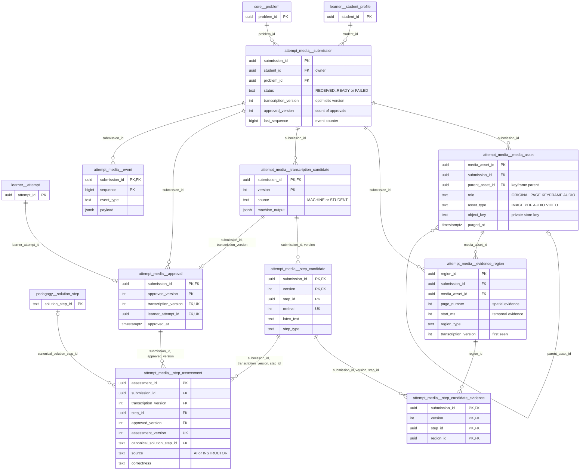

# `attempt_media` schema — multimodal learner work (uploads → transcription → approval → assessment)

`attempt_media` stores a learner's handwritten, photographed, PDF, audio or video work on a problem and turns it into structured, evidence-linked steps. One **submission** owns private **media assets** (bytes in the object store, metadata here), versioned **transcription candidates** made of **step candidates**, each linked to normalised **evidence regions** (page rectangles or time intervals). When the student explicitly **approves** a transcription version, a `learner.attempt` row is created (with `is_correct = NULL`) and the approved steps can be **assessed** (AI or instructor) against the published canonical solution. Every state change is written to an ordered per-submission **event** log and mirrored to `pipeline.outbox_event` (identifiers only). The schema has 9 tables and 4 views.

Source of truth: migrations [021_attempt_media.sql](../../../mathbank-db/sql/021_attempt_media.sql). Catalog extracted 2026-11-01 from migrations 001–054; endpoint mapping traced from mathbank-rest source and manually verified.

## 1. Purpose, ownership and data flow

- **Domain.** Requirement [32_MULTIMODAL_ATTEMPTS_AND_ARTIFACTS.md](../../requirements/32_MULTIMODAL_ATTEMPTS_AND_ARTIFACTS.md): let a student submit real work, review the machine transcription, explicitly approve it, and receive step-level feedback that never silently changes mastery ("uncertainty does not change mastery").
- **Write owner.** Only mathbank-rest: router [routers/attempt_media.py](../../../mathbank-rest/src/mathbank_rest/routers/attempt_media.py) (commands, uploads, provider orchestration) and runtime [attempt_media.py](../../../mathbank-rest/src/mathbank_rest/attempt_media.py) (locking, version checks, transcript/approval/assessment writes, event log). Provider calls (vision/speech transcription, segmentation, alignment/critique) live in [media_processing.py](../../../mathbank-rest/src/mathbank_rest/media_processing.py) and run **outside** DB transactions; results are committed only if `expected_version` still matches.
- **Readers.** mathbank-web (`/learn/attempt-media`, `/admin/attempt-media`, `AttemptMediaWorkspace.jsx`, `WrittenWorkUpload.jsx` via the same-origin proxy `app/api/rest/attempt-media/[[...path]]`), the tutor agent ([attempt_media_tools.py](../../../mathbank-agent/agents/mathbank_tutor/tools/attempt_media_tools.py): `get_multimodal_attempt`, `get_multimodal_step_assessment`), mathbank-live ([lib/attemptEvents.mjs](../../../mathbank-live/lib/attemptEvents.mjs) tails `/submissions/{sid}/events`), and read-only analytics SQL [11_learner_feedback_aggregates.sql](../../../mathbank-data-ingestion/queries/11_learner_feedback_aggregates.sql).
- **Lifecycle.** A versioned, optimistic-concurrency state machine on `submission.status` (§3). Candidates, approvals, assessments and events are **append-only by convention** (new versions, never rewrites); immutability is enforced in Python, not by triggers. Raw media can be purged (`media_asset.purged_at`) while the approved attempt and its text steps are preserved.
- **Privacy class.** **Learner-private.** Every read checks ownership (`submission.student_id` = JWT subject) unless the caller presents the admin key. Asset bytes are served with `Cache-Control: private, no-store`; the outbox payload carries only `submission_id`, `sequence`, `transcription_version`.

```
upload ─► media_asset ─► process (provider) ─► transcription_candidate(v) + step_candidate + evidence_region + step_candidate_evidence
student edits (PUT/PATCH/merge/split) ─► new transcription_candidate(v+1, STUDENT) …
approve ─► learner.attempt + approval(approved_version) ─► analyse/override ─► step_assessment(assessment_version)
every command ─► event(sequence) + pipeline.outbox_event
```

## 2. Entity diagram — as-is



Views (not drawn): `approved_step` = approval ⋈ step_candidate; `approved_step_evidence` = approval ⋈ step_candidate_evidence; `step_alignment` and `visual_explanation` = column projections of `step_assessment`.

## 3. Tables

Common endpoint notes for this section — all paths are under `/v1/attempt-media`; auth dependency `staff_or_student` ([routers/fluid.py](../../../mathbank-rest/src/mathbank_rest/routers/fluid.py)) accepts **Admin key (X-Admin-Api-Key)** (role ADMIN, sees every submission) **or Learner JWT** (role STUDENT, owner only; other owners get 404 `SUBMISSION_NOT_FOUND`). Some handlers further restrict the role in the body (noted). "Snapshot" = `runtime.snapshot()` which reads the submission plus all its assets, regions, current-version steps+evidence, approvals, assessments and up to 500 events; it is returned by `POST /submissions`, `GET /submissions/{sid}`, `GET …/transcription`, `POST …/process`, `PUT …/transcription`, `PATCH …/steps/{step_id}`, `POST …/merge`, `POST …/split`, `POST …/analyse`, `POST …/override`.

### `attempt_media.submission`

**Role.** One row = one learner's multimodal attempt at one `core.problem`. It is the aggregate root: it owns the status machine, the optimistic-concurrency counter (`transcription_version`), the approval counter and the event sequence. Created by the student (`POST /submissions`, which resolves `problem_ref` by `canonical_code` or UUID); every later command locks this row `FOR UPDATE` and checks `expected_version`.

**Lifecycle.** `status` transitions (code: `set_status`, `save_transcript`, `_begin`, `_failure`, `save_assessments`):
`RECEIVED` →(upload) `MEDIA_NORMALIZED` →(process) `TRANSCRIBING` → `TRANSCRIPTION_READY` (machine result) or →(student edit) `STUDENT_REVIEWING` →(approve) `APPROVED` →(analyse) `ALIGNING` → `READY` (assessments saved, also after instructor override). Any provider/validation failure sets `FAILED` + `error_code` (only if the version still matches); a later successful command clears `error_code`. `CRITIQUING` and `VISUAL_GROUNDING` are allowed by the CHECK but never set by code (only tested as "processing running"). `transcription_version` is bumped by **every** upload and every saved transcript, so it is the submission's revision counter — it does not always correspond to a `transcription_candidate` row (uploads bump it without inserting a candidate). No soft delete; rows disappear only via `learner.student_profile` cascade.

**Columns**

| Column | Type | Null | Default | Description |
|---|---|---|---|---|
| submission_id | uuid | NO | gen_random_uuid() | Surrogate key; used in every URL `{sid}` and as outbox `aggregate_id` (aggregate type `MULTIMODAL_ATTEMPT`). |
| student_id | uuid | NO | — | Owner → learner.student_profile.student_id (ON DELETE CASCADE). Set from the JWT subject; admins cannot create submissions (403 `STUDENT_SUBMISSION_REQUIRED`). |
| problem_id | uuid | NO | — | Problem attempted → core.problem.problem_id (NO ACTION). Used by `analyse` to load published `pedagogy.solution_step` rows and `core.problem.statement_text`. |
| status | text | NO | 'RECEIVED' | Pipeline stage; CHECK ∈ RECEIVED, MEDIA_NORMALIZED, TRANSCRIBING, TRANSCRIPTION_READY, STUDENT_REVIEWING, APPROVED, ALIGNING, CRITIQUING, VISUAL_GROUNDING, READY, FAILED. `TRANSCRIBING`/`ALIGNING`/`CRITIQUING` block concurrent processing and purge (409). |
| transcription_version | integer | NO | 1 | Optimistic-concurrency revision (CHECK > 0). Clients must send it as `expected_version`; mismatches → 409 `TRANSCRIPTION_VERSION_CONFLICT`. Equals the latest candidate version after a transcript save. |
| approved_version | integer | NO | 0 | Number of approvals so far (CHECK ≥ 0); the next `approval.approved_version` is this + 1. |
| last_sequence | bigint | NO | 0 | Last allocated `event.sequence`; incremented atomically in `runtime.event()` (also bumps `updated_at`). |
| error_code | text | yes | — | Machine-readable failure code when `status = FAILED` (e.g. `TRANSCRIPTION_UNAVAILABLE`, `TRANSCRIPTION_RESULT_INVALID`, `ANALYSIS_UNAVAILABLE`, `UPLOAD_MEDIA_FIRST`); cleared on the next successful status change. |
| created_at | timestamptz | NO | now() | Creation time; listing order (`created_at DESC`). |
| updated_at | timestamptz | NO | now() | Bumped whenever an event is appended (no trigger; set by `runtime.event`). |

**Keys, constraints, indexes.**
- PK `submission_id`.
- FK `student_id` → learner.student_profile ON DELETE CASCADE; FK `problem_id` → core.problem (NO ACTION — a problem with submissions cannot be deleted).
- CHECKs: status enum; `transcription_version > 0`; `approved_version >= 0`.
- Index `submission_owner_idx (student_id, created_at DESC)` serves the learner listing.
- Referenced (ON DELETE CASCADE) by media_asset, evidence_region, transcription_candidate, approval, event.

**REST operations today.**

| Op | Method & path | Auth | Handler | Notes |
|---|---|---|---|---|
| C | POST /v1/attempt-media/submissions | Learner JWT (admin key → 403) | `attempt_media.create` | Body `{problem_ref}`; returns snapshot (201). |
| R | GET /v1/attempt-media/submissions | Admin key or Learner JWT | `attempt_media.listing` | Own rows (admin: all), joins core.problem for `canonical_code`; `limit` ≤ 100, `offset`, returns `{items, has_more}` (no total, no filters). |
| R | GET /v1/attempt-media/submissions/{sid} · GET …/transcription · GET …/events | Admin key or Learner JWT | `get`, `transcription`, `events` | Ownership check on every read. |
| R | GET …/assets/{aid}/content · GET …/assets/{aid}/pages/{page} · GET /attempts/{aid}/steps · GET /attempts/{aid}/steps/{step_id}/assessment (alias `/visual`) | Admin key or Learner JWT | `content`, `pdf_page`, `approved_steps`, `approved_assessment` | Read for ownership only. |
| U | POST …/assets?expected_version= | Admin key or Learner JWT | `upload` | `transcription_version += 1`, status `MEDIA_NORMALIZED`. |
| U | POST …/process · PUT …/transcription · PATCH …/transcription/steps/{step_id} · POST …/transcription/merge · POST …/transcription/split | Admin key or Learner JWT (PUT/PATCH/merge/split: student only, 403 `STUDENT_EDIT_REQUIRED`) | `process`, `replace`, `patch`, `merge`, `split` | New version, status `TRANSCRIBING` → `TRANSCRIPTION_READY` / `STUDENT_REVIEWING` or `FAILED`. |
| U | POST …/approve | Learner JWT (admin → 403 `STUDENT_APPROVAL_REQUIRED`) | `approve` | `approved_version += 1`, status `APPROVED`; idempotent per transcription version. |
| U | POST …/analyse · POST …/override | Admin key or Learner JWT (override: admin key only, 403 `INSTRUCTOR_REQUIRED`) | `analyse`, `override` | Status `ALIGNING` → `READY` or `FAILED`. |
| U | DELETE …/assets/{aid} | Admin key or Learner JWT | `purge` | Only `last_sequence`/`updated_at` (via event). |

### `attempt_media.media_asset`

**Role.** One row = one private binary object belonging to a submission: an uploaded original (`ORIGINAL`) or a derivative (`KEYFRAME` PNGs extracted from video during `process`; `PAGE`/`AUDIO` roles are allowed but not produced by current code). The bytes live in the object store ([object_store.py](../../../mathbank-rest/src/mathbank_rest/object_store.py), key `<uuid hex>.<suffix>`); this row holds metadata, integrity hash and purge state. At most 10 un-purged originals per submission (enforced in Python, 422 `ASSET_COUNT_LIMIT`).

**Lifecycle.** Insert-only except `purged_at`: `DELETE …/assets/{aid}` deletes the object (and those of child keyframes) and sets `purged_at = now()`; the row stays so regions/approvals remain explainable. Purged assets return 410 `RAW_MEDIA_PURGED` and cannot be cited by new evidence. `retention_class` is always the default `RAW_MEDIA`; no retention job exists yet.

**Columns**

| Column | Type | Null | Default | Description |
|---|---|---|---|---|
| media_asset_id | uuid | NO | gen_random_uuid() | Surrogate key; `{aid}` in asset URLs and `media_asset_id` in evidence regions. |
| submission_id | uuid | NO | — | Owning submission → attempt_media.submission.submission_id (ON DELETE CASCADE). |
| role | text | NO | 'ORIGINAL' | CHECK ∈ ORIGINAL (student upload), PAGE, KEYFRAME (video frame, has `parent_asset_id` + `timestamp_ms`), AUDIO. Only ORIGINAL and KEYFRAME are written today. |
| parent_asset_id | uuid | yes | — | Source asset for derivatives → attempt_media.media_asset.media_asset_id (ON DELETE SET NULL). Purge of a parent also purges its children. |
| asset_type | text | NO | — | Detected media kind, CHECK ∈ IMAGE, PDF, AUDIO, VIDEO (from `media_processing.media_info`, not the client header alone). |
| object_key | text | NO | — | Private object-store key (`<32 hex>.<ext>`); never returned by the snapshot (bytes are fetched via `…/content`). |
| mime_type | text | NO | — | Normalised MIME type served on `…/content`. |
| sha256 | text | NO | — | Hex SHA-256 of the stored bytes (from `object_store.put_bytes`). |
| size_bytes | bigint | NO | — | Object size in bytes, CHECK > 0; upload stream is capped by `media_processing.MAX_BYTES` (413 `MEDIA_SIZE_LIMIT`). |
| page_count | integer | yes | — | Pages for PDF/IMAGE (CHECK 1–10); bounds `evidence_region.page_number` and `…/pages/{page}`. |
| duration_ms | integer | yes | — | Length for AUDIO/VIDEO in ms (CHECK 1–120000, i.e. ≤ 2 min); bounds temporal evidence `end_ms`. |
| timestamp_ms | integer | yes | — | For KEYFRAME rows: offset in the parent video (CHECK ≥ 0). |
| retention_class | text | NO | 'RAW_MEDIA' | Intended retention policy bucket; constant today (no CHECK, no job). |
| purged_at | timestamptz | yes | — | When the object was deleted from the store; non-null = bytes gone, metadata kept. |
| created_at | timestamptz | NO | now() | Upload / derivation time; snapshot order. |

**Keys, constraints, indexes.**
- PK `media_asset_id`; self-FK `parent_asset_id` ON DELETE SET NULL; FK `submission_id` ON DELETE CASCADE.
- CHECKs: role enum, asset_type enum, `size_bytes > 0`, `page_count` 1–10, `duration_ms` 1–120000, `timestamp_ms ≥ 0`.
- Index `asset_submission_idx (submission_id)`.
- Referenced by evidence_region.media_asset_id (NO ACTION).

**REST operations today.**

| Op | Method & path | Auth | Handler | Notes |
|---|---|---|---|---|
| C | POST /v1/attempt-media/submissions/{sid}/assets?expected_version=&filename= | Admin key or Learner JWT | `attempt_media.upload` | Raw request body streamed; object written first, row inserted in a version-checked transaction; object deleted if the transaction fails. |
| C | POST …/{sid}/process | Admin key or Learner JWT | `attempt_media.process` | Inserts `KEYFRAME` rows for VIDEO originals. |
| R | GET …/{sid}/assets/{aid}/content · GET …/{sid}/assets/{aid}/pages/{page} | Admin key or Learner JWT | `content`, `pdf_page` | Streams bytes / rasterised PNG page; 410 if purged. |
| R | Snapshot endpoints (see section intro) | Admin key or Learner JWT | various | `object_key` omitted; `content_url` added. |
| U | DELETE …/{sid}/assets/{aid} | Admin key or Learner JWT | `attempt_media.purge` | Sets `purged_at` on the asset and its children after deleting objects; 409 while processing. |

### `attempt_media.evidence_region`

**Role.** One row = one normalised piece of evidence inside a media asset: either a **page rectangle** (`page_number` + `x/y/width/height_norm` in 0–1 page units) or a **time interval** (`start_ms`–`end_ms`), with a reading order and detector confidence. Regions are produced by transcription (`process`) or supplied by the student in a `PUT …/transcription` body, and are cited by step candidates via `step_candidate_evidence`. They let the UI highlight exactly where each step came from.

**Lifecycle.** Immutable once inserted: `save_transcript` upserts with `ON CONFLICT (region_id) DO UPDATE SET region_id = EXCLUDED.region_id WHERE submission_id matches` (a no-op used to detect cross-submission ID reuse → 422 `EVIDENCE_ID_UNAVAILABLE`), and `validate_links` rejects any changed geometry for an existing `region_id` (409 `EVIDENCE_IMMUTABLE_CREATE_NEW_REGION`). Regions survive later transcript versions; they are deleted only with the submission.

**Columns**

| Column | Type | Null | Default | Description |
|---|---|---|---|---|
| region_id | uuid | NO | — | Client- or server-generated UUID (Pydantic default `uuid4`); referenced in steps' `evidence_ids`. |
| submission_id | uuid | NO | — | Owning submission → attempt_media.submission.submission_id (ON DELETE CASCADE). |
| media_asset_id | uuid | NO | — | Asset the region lies in → attempt_media.media_asset.media_asset_id (NO ACTION). Must belong to the same submission and not be purged (checked in Python). |
| page_number | integer | yes | — | 1-based page (CHECK 1–10) for spatial evidence; must be ≤ asset `page_count`; NULL for temporal evidence. |
| x_norm | double precision | yes | — | Left edge as a fraction of page width (CHECK 0–1). |
| y_norm | double precision | yes | — | Top edge as a fraction of page height (CHECK 0–1). |
| width_norm | double precision | yes | — | Width fraction (CHECK > 0 and ≤ 1); `x_norm + width_norm ≤ 1.000001`. |
| height_norm | double precision | yes | — | Height fraction (CHECK > 0 and ≤ 1); `y_norm + height_norm ≤ 1.000001`. |
| start_ms | integer | yes | — | Interval start in ms for AUDIO/VIDEO evidence (CHECK ≥ 0); NULL for spatial evidence. |
| end_ms | integer | yes | — | Interval end in ms (CHECK `end_ms > start_ms`; Python caps at 120000 and at asset `duration_ms`). |
| region_type | text | NO | — | Kind of mark; Python Literal ∈ MATH_LINE, PROSE_LINE, DIAGRAM_LABEL, DIAGRAM_MARK, SCRATCH, CANCELLED, TABLE, ARROW_OR_CALLOUT, SPEECH, KEYFRAME (no DB CHECK). |
| reading_order | integer | NO | — | Order of the region in the reading sequence (CHECK ≥ 0); snapshot sort key. |
| confidence | double precision | NO | — | Detector confidence 0–1 (CHECK). |
| transcription_version | integer | NO | — | Transcript version in which the region was first saved (provenance only; not a FK). |

**Keys, constraints, indexes.**
- PK `region_id`.
- FKs: `submission_id` ON DELETE CASCADE; `media_asset_id` NO ACTION.
- CHECK `evidence_region_check`: exactly one of (full in-page rectangle, no times) or (`start_ms` and `end_ms > start_ms`, no page/rectangle). Plus range CHECKs on each coordinate, page_number, start_ms, reading_order, confidence.
- No index on `submission_id` (snapshot and `validate_links` filter by it).
- Referenced by step_candidate_evidence.region_id (NO ACTION).

**REST operations today.**

| Op | Method & path | Auth | Handler | Notes |
|---|---|---|---|---|
| C | POST /v1/attempt-media/submissions/{sid}/process | Admin key or Learner JWT | `attempt_media.process` → `runtime.save_transcript` | Machine regions (and synthetic KEYFRAME temporal regions for video). |
| C | PUT …/{sid}/transcription · PATCH …/steps/{step_id} · POST …/merge · POST …/split | Learner JWT | `replace`, `patch`, `merge`, `split` → `save_transcript` | Optional `regions[]` (≤ 300) in the transcript body; PATCH/merge/split reuse existing regions. |
| R | Snapshot endpoints | Admin key or Learner JWT | various | `regions` ordered by `reading_order`. |

### `attempt_media.transcription_candidate`

**Role.** One row = one immutable version of the transcript for a submission, either produced by the machine (`MACHINE`, with raw provider output) or by a student edit (`STUDENT`). Its steps are in `step_candidate`. The approval FK pins exactly which version the student approved.

**Lifecycle.** Append-only: each save inserts `version = submission.transcription_version + 1` and advances the submission; earlier versions are never updated or deleted (except by submission cascade).

**Columns**

| Column | Type | Null | Default | Description |
|---|---|---|---|---|
| submission_id | uuid | NO | — | Owning submission → attempt_media.submission.submission_id (ON DELETE CASCADE). |
| version | integer | NO | — | Transcript version (= the submission's `transcription_version` after the save). |
| source | text | NO | — | CHECK ∈ MACHINE (from `process`) or STUDENT (PUT/PATCH/merge/split). |
| machine_output | jsonb | yes | — | Raw per-asset provider output for MACHINE versions: array of `{asset_id, regions: [...], lines: [{plain_text, latex_text, step_type, confidence, evidence_ids, ...}]}`; NULL for STUDENT versions. Private. |
| model_profile | text | yes | — | Model name used (`media_processing.MODEL`, from `runtime_ai.model_name()`); NULL for STUDENT versions. |
| created_at | timestamptz | NO | now() | When the version was saved. |

**Keys, constraints, indexes.**
- PK `(submission_id, version)`; FK `submission_id` ON DELETE CASCADE; CHECK on `source`.
- Referenced by step_candidate (ON DELETE CASCADE) and approval (NO ACTION).

**REST operations today.**

| Op | Method & path | Auth | Handler | Notes |
|---|---|---|---|---|
| C | POST /v1/attempt-media/submissions/{sid}/process | Admin key or Learner JWT | `attempt_media.process` | source MACHINE. |
| C | PUT …/{sid}/transcription · PATCH …/transcription/steps/{step_id} · POST …/transcription/merge · POST …/transcription/split | Learner JWT | `replace`, `patch`, `merge`, `split` | source STUDENT. |
| R | — | — | — | Not read directly by any endpoint (only via its steps and the approval FK). |

### `attempt_media.step_candidate`

**Role.** One row = one ordered mathematical step within a transcript version: plain text, LaTeX, a step type and a confidence. Steps are what the student reviews and approves and what the analyser aligns to canonical solution steps. `step_id` is stable across versions when a step is carried over (PATCH keeps it; merge keeps the first step's id; split takes caller-supplied ids).

**Lifecycle.** Immutable per version (new transcript → new rows under the new version). Rows with confidence < 0.7 force AI assessment `correctness = UNCERTAIN` (Python rule).

**Columns**

| Column | Type | Null | Default | Description |
|---|---|---|---|---|
| submission_id | uuid | NO | — | Part of FK to the owning transcript version. |
| version | integer | NO | — | Transcript version → attempt_media.transcription_candidate(submission_id, version) (ON DELETE CASCADE). |
| step_id | uuid | NO | — | Step identity, unique within a version; used in step URLs and assessments. |
| ordinal | integer | NO | — | 1-based position in the version (CHECK > 0; UNIQUE per version; Python requires 1..n contiguous, ≤ 100). |
| plain_text | text | NO | — | Plain-language rendering (≤ 4000 chars in API); may be empty if `latex_text` is set. |
| latex_text | text | NO | — | LaTeX rendering (≤ 8000 chars); approval concatenates `latex_text or plain_text` into `learner.attempt.submitted_answer`. |
| step_type | text | NO | — | Python Literal ∈ SETUP, OBSERVATION, CONSTRUCTION, THEOREM_SELECTION, THEOREM_APPLICATION, ANGLE_RELATION, LENGTH_RELATION, SIMILARITY_CLAIM, CONGRUENCE_CLAIM, RATIO, ALGEBRA, CASE, INTERMEDIATE_RESULT, CONCLUSION, QUESTION_OR_UNCERTAINTY (no DB CHECK). |
| confidence | double precision | NO | — | Transcription confidence 0–1 (CHECK). Student-edited steps default to 1. |

**Keys, constraints, indexes.**
- PK `(submission_id, version, step_id)`; UNIQUE `(submission_id, version, ordinal)`.
- FK `(submission_id, version)` → transcription_candidate ON DELETE CASCADE.
- CHECKs: `ordinal > 0`, confidence 0–1.
- Referenced by step_candidate_evidence (ON DELETE CASCADE) and step_assessment (NO ACTION).

**REST operations today.**

| Op | Method & path | Auth | Handler | Notes |
|---|---|---|---|---|
| C | POST …/{sid}/process | Admin key or Learner JWT | `process` → `save_transcript` | Steps from `media_processing.segment`. |
| C | PUT …/transcription · PATCH …/steps/{step_id} · POST …/merge · POST …/split | Learner JWT | `replace`, `patch`, `merge`, `split` | Whole step list re-inserted under a new version. |
| R | Snapshot endpoints; GET /v1/attempt-media/attempts/{aid}/steps (via view `approved_step`) | Admin key or Learner JWT | various, `approved_steps` | Snapshot returns current-version steps with aggregated `evidence_ids`. |

### `attempt_media.step_candidate_evidence`

**Role.** Junction: links each step candidate to the evidence regions that support it (1–30 per step, enforced in Python). Assessments may only cite evidence that is linked here.

**Lifecycle.** Inserted with each new transcript version; immutable.

**Columns**

| Column | Type | Null | Default | Description |
|---|---|---|---|---|
| submission_id | uuid | NO | — | Part of FK to the step. |
| version | integer | NO | — | Part of FK to the step (transcript version). |
| step_id | uuid | NO | — | Step → attempt_media.step_candidate(submission_id, version, step_id) (ON DELETE CASCADE). |
| region_id | uuid | NO | — | Supporting region → attempt_media.evidence_region.region_id (NO ACTION). Asset must not be purged when linked. |

**Keys, constraints, indexes.**
- PK `(submission_id, version, step_id, region_id)`.
- FKs as above. No index on `region_id` alone.

**REST operations today.**

| Op | Method & path | Auth | Handler | Notes |
|---|---|---|---|---|
| C | POST …/{sid}/process · PUT …/transcription · PATCH …/steps/{step_id} · POST …/merge · POST …/split | process: Admin key or Learner JWT; others: Learner JWT | `save_transcript` callers | Plain `INSERT … VALUES` per evidence id. |
| R | Snapshot endpoints | Admin key or Learner JWT | various | `jsonb_agg(region_id)` → `steps[].evidence_ids`. |

### `attempt_media.approval`

**Role.** One row = the student's explicit approval of one transcript version. Approval is the boundary at which private work becomes learner history: the same transaction inserts a `learner.attempt` row (`is_correct = NULL`, `source = 'multimodal_approved'`, `submitted_answer` = concatenated step LaTeX) and links it 1:1 here. Assessments always reference an approval.

**Lifecycle.** Append-only; idempotent per transcript version (re-approving the same version returns the existing row). A later edit + approval creates `approved_version + 1` and a new learner attempt.

**Columns**

| Column | Type | Null | Default | Description |
|---|---|---|---|---|
| submission_id | uuid | NO | — | Owning submission → attempt_media.submission.submission_id (ON DELETE CASCADE). |
| approved_version | integer | NO | — | 1-based approval counter for the submission (mirrors `submission.approved_version`). |
| transcription_version | integer | NO | — | Approved transcript → attempt_media.transcription_candidate(submission_id, version) (NO ACTION); UNIQUE per submission. |
| learner_attempt_id | uuid | NO | — | Learner-history row created at approval → learner.attempt.attempt_id (NO ACTION); UNIQUE. Used as `{aid}` in `/attempts/{aid}/…`. |
| approved_at | timestamptz | NO | now() | Approval time. |
| student_edit_summary | text | NO | — | Free-text summary; currently always the constant "Explicit student approval of the reviewed evidence-linked transcription". |

**Keys, constraints, indexes.**
- PK `(submission_id, approved_version)`; UNIQUE `(submission_id, transcription_version)`; UNIQUE `learner_attempt_id`.
- FKs: submission (CASCADE), transcription_candidate (NO ACTION), learner.attempt (NO ACTION — deleting the attempt is blocked while the approval exists).
- Referenced by step_assessment `(submission_id, approved_version)` (NO ACTION).

**REST operations today.**

| Op | Method & path | Auth | Handler | Notes |
|---|---|---|---|---|
| C | POST /v1/attempt-media/submissions/{sid}/approve | Learner JWT (admin → 403) | `attempt_media.approve` → `runtime.approve` | Body `{expected_version}`; 409 while `TRANSCRIBING`; 422 `NO_STEPS_TO_APPROVE`. Also inserts learner.attempt. |
| R | GET /v1/attempt-media/attempts/{aid}/steps · GET /attempts/{aid}/steps/{step_id}/assessment (alias `/visual`) | Admin key or Learner JWT | `approved_steps`, `approved_assessment` | Lookup by `learner_attempt_id`, then ownership check on the submission. |
| R | Snapshot endpoints; POST …/analyse, …/override (`ensure_approved`) | Admin key or Learner JWT | various | `approvals[]` in snapshot. |

### `attempt_media.step_assessment`

**Role.** One row = one versioned judgement of one approved step: correctness, how it aligns with the canonical solution (optionally pinned to a published `pedagogy.solution_step`), why, the failure mode and the next action, with the evidence regions it relies on. Produced by the AI analyser (`analyse`, which must cover every step) or by an instructor override; instructor rows are never overwritten by AI retries. Read by the student UI and the tutor agent.

**Lifecycle.** Append-only: each new judgement for the same `(submission, transcription_version, step)` gets `assessment_version = max + 1`; readers take the highest version for the current approval. After saving, the submission moves to `READY`.

**Columns**

| Column | Type | Null | Default | Description |
|---|---|---|---|---|
| assessment_id | uuid | NO | gen_random_uuid() | Surrogate key. |
| submission_id | uuid | NO | — | Part of both composite FKs. |
| transcription_version | integer | NO | — | Approved transcript version (part of FK to step_candidate). |
| step_id | uuid | NO | — | Assessed step → attempt_media.step_candidate(submission_id, version, step_id) via `(submission_id, transcription_version, step_id)` (NO ACTION). |
| approved_version | integer | NO | — | Approval the assessment belongs to → attempt_media.approval(submission_id, approved_version) (NO ACTION). |
| assessment_version | integer | NO | — | 1-based revision per step (CHECK > 0); UNIQUE with submission/transcription_version/step. |
| source | text | NO | — | CHECK ∈ AI (analyse) or INSTRUCTOR (override). |
| actor_id | text | NO | — | Requesting student's UUID as text, or the literal `instructor` when called with the admin key (even for AI runs triggered by staff). |
| correctness | text | NO | — | CHECK ∈ CORRECT, PARTIALLY_CORRECT, INCORRECT, UNJUSTIFIED, UNCERTAIN (AI must use UNCERTAIN when step confidence < 0.7). |
| alignment_type | text | NO | — | Python Literal ∈ MATCHES_SOLUTION_STEP, VALID_ALTERNATE_STEP, PARTIAL_STEP, PREREQUISITE_STEP, IRRELEVANT_STEP, UNSUPPORTED_LEAP, UNMATCHED_BUT_PLAUSIBLE (override default); no DB CHECK. |
| canonical_solution_step_id | text | yes | — | Matched canonical step → pedagogy.solution_step.solution_step_id (NO ACTION); Python also requires it to be PUBLISHED and belong to the same problem. |
| confidence | double precision | NO | — | Assessor confidence 0–1 (CHECK); overrides store 1. |
| why | text | NO | — | Explanation shown to the student (≤ 4000 chars). |
| failure_mode | text | NO | — | Short failure label (≤ 200 chars); empty string when none. |
| next_action | text | NO | — | Suggested next move for the learner (≤ 1000 chars). |
| evidence_ids | jsonb | NO | — | JSON array (CHECK `jsonb_typeof = 'array'`) of region UUID strings; must be a subset of the step's linked evidence. |
| model_profile | text | NO | — | Assessor profile; currently the constant `multimodal-v1` for both sources. |
| created_at | timestamptz | NO | now() | Insert time; history order. |

**Keys, constraints, indexes.**
- PK `assessment_id`; UNIQUE `(submission_id, transcription_version, step_id, assessment_version)` (also serves lookups).
- FKs: approval `(submission_id, approved_version)`; step_candidate `(submission_id, transcription_version, step_id)`; pedagogy.solution_step — all NO ACTION. There is no FK to `submission` itself, so a submission (or learner-profile) delete that cascades to `approval`/`step_candidate` fails while assessment rows exist (see 5.1 #1).
- CHECKs: assessment_version > 0, confidence 0–1, correctness enum, source enum, evidence_ids is array.

**REST operations today.**

| Op | Method & path | Auth | Handler | Notes |
|---|---|---|---|---|
| C | POST /v1/attempt-media/submissions/{sid}/analyse | Admin key or Learner JWT | `attempt_media.analyse` → `save_assessments(source='AI')` | Paid provider call; requires current version approved (409 `APPROVE_CURRENT_TRANSCRIPTION_FIRST`). |
| C | POST /v1/attempt-media/submissions/{sid}/override | Admin key only (403 `INSTRUCTOR_REQUIRED`) | `attempt_media.override` → `save_assessments(source='INSTRUCTOR')` | Single step; evidence copied from the step. |
| R | GET /v1/attempt-media/attempts/{aid}/steps/{step_id}/assessment (alias `/visual`) | Admin key or Learner JWT | `approved_assessment` | Latest `assessment_version` for the approval. |
| R | Snapshot endpoints | Admin key or Learner JWT | various | `assessments` (current version); `assessment_history` only for admin. |

### `attempt_media.event`

**Role.** One row = one ordered domain event for a submission (`attempt.upload.accepted`, `attempt.transcription.started|progress|ready`, `attempt.approved`, `attempt.analysis.started|complete`, `attempt.step.assessed`, `attempt.visual.ready`, `attempt.processing.failed`, `attempt.media.purged`). It is the replay log that UIs and mathbank-live poll with `after_sequence`, and each row is mirrored to `pipeline.outbox_event` without private content.

**Lifecycle.** Append-only by convention (no trigger). `sequence` is allocated from `submission.last_sequence` in the same transaction.

**Columns**

| Column | Type | Null | Default | Description |
|---|---|---|---|---|
| submission_id | uuid | NO | — | Owning submission → attempt_media.submission.submission_id (ON DELETE CASCADE). |
| sequence | bigint | NO | — | Gap-free per-submission sequence (1, 2, …). |
| event_type | text | NO | — | Dotted event name (values listed above; no CHECK). |
| transcription_version | integer | NO | — | Submission revision at the time of the event. |
| approved_attempt_version | integer | NO | — | `submission.approved_version` at the time of the event (same concept as `approved_version` elsewhere). |
| payload | jsonb | NO | '{}'::jsonb | Small event detail, e.g. `{media_asset_id}`, `{media_asset_id, lines_ready}`, `{step_id, assessment_version}`, `{code}`. No step text or media. |
| created_at | timestamptz | NO | now() | Event time. |

**Keys, constraints, indexes.**
- PK `(submission_id, sequence)` (serves `sequence > :after ORDER BY sequence LIMIT 500`).
- FK `submission_id` ON DELETE CASCADE.

**REST operations today.**

| Op | Method & path | Auth | Handler | Notes |
|---|---|---|---|---|
| C | POST …/{sid}/assets · POST …/process · PUT/PATCH …/transcription… · POST …/merge · POST …/split · POST …/approve · POST …/analyse · POST …/override · DELETE …/assets/{aid} | as per endpoint | via `runtime.event` / `set_status` | One or more events per command (process also emits per-asset progress and failure events). |
| R | GET /v1/attempt-media/submissions/{sid}/events?after_sequence= | Admin key or Learner JWT | `attempt_media.events` | ≤ 500 rows; also embedded in every snapshot. |

### View `attempt_media.approved_step`

**Role.** Read model of the steps a student approved: `approval ⋈ step_candidate` on `(submission_id, transcription_version = version)`. Avoids copying approved content (migration comment: "Approved steps are immutable candidate-version rows referenced by approval").

| Column | Type | Description |
|---|---|---|
| approved_version | integer | From approval. |
| learner_attempt_id | uuid | From approval; the filter key used by the endpoint. |
| submission_id | uuid | From step_candidate. |
| version | integer | Approved transcript version. |
| step_id | uuid | Step identity. |
| ordinal | integer | Step position (ORDER BY key). |
| plain_text | text | Approved plain text. |
| latex_text | text | Approved LaTeX. |
| step_type | text | Step classification. |
| confidence | double precision | Transcription confidence. |

**Consumers.** `GET /v1/attempt-media/attempts/{aid}/steps` (`approved_steps`; Admin key or Learner JWT, owner-checked).

### View `attempt_media.approved_step_evidence`

**Role.** `approval ⋈ step_candidate_evidence` — region links of approved steps. Columns: `approved_version` (int), `learner_attempt_id` (uuid), `submission_id` (uuid), `version` (int), `step_id` (uuid), `region_id` (uuid), with the same meanings as above. **Consumers:** none (no SQL reference in any service or query file).

### View `attempt_media.step_alignment`

**Role.** Projection of `step_assessment` focused on alignment. Columns: `assessment_id`, `submission_id`, `step_id`, `transcription_version`, `approved_version`, `alignment_type`, `canonical_solution_step_id`, `confidence` (same types/meanings as the table). Includes all assessment versions (no "latest" filter). **Consumers:** none.

### View `attempt_media.visual_explanation`

**Role.** Projection of `step_assessment` for visual feedback. Columns: `assessment_id`, `submission_id`, `step_id`, `transcription_version`, `approved_version`, `evidence_ids` (jsonb), `why`, `next_action`. All versions. **Consumers:** none — `GET …/steps/{step_id}/visual` is an alias of the assessment endpoint and reads `step_assessment` directly.

## 4. CRUD coverage — as-is

| Table | Create | Read | Update | Delete | Notes |
|---|---|---|---|---|---|
| submission | ✅ | ✅ | ✅ | ❌ | No way to delete/withdraw a submission (only learner-profile cascade, which leaves objects behind). Listing has no status/student filter or total. |
| media_asset | ✅ | ✅ | ✅ | — | "Delete" is a purge (bytes removed, row kept) — correct for evidence. |
| evidence_region | ✅ | ✅ | — | — | Immutable evidence. |
| transcription_candidate | ✅ | ⚙️ | — | — | Not exposed directly; `machine_output` never returned (good for privacy, but staff cannot inspect raw provider output — ❌ for admin debugging, P3). |
| step_candidate | ✅ | ✅ | — | — | Edits create new versions. |
| step_candidate_evidence | ✅ | ✅ | — | — | Junction, versioned. |
| approval | ✅ | ✅ | — | — | Immutable decision. |
| step_assessment | ✅ | ✅ | — | — | Append-only; corrections via override. |
| event | ✅ | ✅ | — | — | Append-only log. |
| approved_step (view) | — | ✅ | — | — | |
| approved_step_evidence (view) | — | — | — | — | Unused. |
| step_alignment (view) | — | — | — | — | Unused. |
| visual_explanation (view) | — | — | — | — | Unused. |

Other readers: [11_learner_feedback_aggregates.sql](../../../mathbank-data-ingestion/queries/11_learner_feedback_aggregates.sql) reads submission, media_asset, step_assessment (⚙️, read-only analytics).

## 5. Target state — how it should be

### 5.1 Schema improvements

1. **P1 — Submission deletion is blocked by NO ACTION FKs and leaks object-store bytes.** `step_assessment` references `approval` and `step_candidate` with NO ACTION and has no FK to `submission`; deleting a `learner.student_profile` (cascade → submission → approval/step_candidate) fails once any assessment exists. Even without assessments, the cascade deletes `media_asset` rows without deleting the objects (the only object deletion path is `purge`, [routers/attempt_media.py:618](../../../mathbank-rest/src/mathbank_rest/routers/attempt_media.py)). Fix: make both `step_assessment` composite FKs `ON DELETE CASCADE`, and add an explicit erasure command that purges objects first (see 5.3), or an outbox-driven object sweeper keyed on deleted `media_asset` rows.
2. **P2 — Enforce append-only/immutability in the database.** The migration comment states approved steps are immutable ([021 line 108](../../../mathbank-db/sql/021_attempt_media.sql)) but only Python enforces it. Add `BEFORE UPDATE` (and non-cascade `DELETE`) guard triggers on `event`, `approval`, `transcription_candidate`, `step_candidate`, `step_candidate_evidence`, `step_assessment`, mirroring `live.session_event_append_only` ([020](../../../mathbank-db/sql/020_live_fluid_platform.sql)). Allow only `media_asset.purged_at` updates.
3. **P2 — Move Python-only enumerations into CHECKs.** `step_candidate.step_type`, `evidence_region.region_type`, `step_assessment.alignment_type` are `Literal`s in [attempt_media_models.py](../../../mathbank-rest/src/mathbank_rest/attempt_media_models.py) only; add CHECKs (or small lookup tables) so ETL/analytics can trust them. Also cap `evidence_region.end_ms ≤ 120000` and `step_candidate.ordinal ≤ 100` as in the models.
4. **P2 — Missing supporting indexes.** `evidence_region(submission_id, reading_order)` (snapshot + `validate_links` filter by submission, no index today); `step_candidate_evidence(region_id)` (FK lookups/deletes).
5. **P3 — Remove or adopt unused objects.** Views `approved_step_evidence`, `step_alignment`, `visual_explanation` have no consumers; statuses `CRITIQUING`, `VISUAL_GROUNDING` and roles `PAGE`, `AUDIO` are never written; `retention_class` is constant with no retention job. Either implement (e.g. a retention sweeper that purges `RAW_MEDIA` after N days) or drop to reduce surface.
6. **P3 — Naming/semantics.** `event.approved_attempt_version` vs `approved_version` everywhere else; `step_assessment.actor_id` stores the literal `instructor` for any admin-key call (no staff identity) — add an `actor_type` column or record the `X-Actor-Id` like the live router does. `model_profile` is hard-coded `multimodal-v1` even for INSTRUCTOR rows.
7. **P3 — `media_asset.object_key` integrity.** `artifact_runtime.artifact_asset` has `UNIQUE(object_key)` and regex CHECKs on key/sha256; `media_asset` has neither. Add `UNIQUE(object_key)`, `CHECK (sha256 ~ '^[0-9a-f]{64}$')`.

### 5.2 Entity diagram — target

Structure unchanged; see 5.1 (changes are FK delete actions, CHECKs, triggers and indexes).

### 5.3 Endpoints to build

| Priority | Method & path | Auth | Table(s) / op | Purpose | Notes (validation, concurrency, audit) |
|---|---|---|---|---|---|
| P1 | DELETE /v1/attempt-media/submissions/{sid} | Learner JWT (owner) or Admin key | submission D (+ cascade), media_asset objects | Learner withdrawal / erasure of a whole submission. | Lock row; 409 while processing; delete all objects first, then rows; keep `learner.attempt` only if policy says so (else block when approved). Requires 5.1 #1. Audit to `audit.action_log` for admin calls. |
| P2 | GET /v1/admin/attempt-media/submissions?status=&student_id=&problem_ref=&limit=&offset= | Admin key | submission R | Staff triage queue (FAILED, awaiting approval, awaiting override). | `{items,total,limit,offset}`, limit ≤ 200; never return `object_key`. Today staff reuse the learner listing without filters. |
| P2 | POST /v1/admin/attempt-media/submissions/{sid}/retry | Admin key | submission U, event C | Reset a `FAILED` submission so `process`/`analyse` can rerun without a new upload. | Requires `expected_version`; clears `error_code`; event `attempt.retry.requested`. |
| P3 | GET /v1/admin/attempt-media/submissions/{sid}/transcriptions/{version} | Admin key | transcription_candidate R | Inspect raw `machine_output` for provider debugging. | Admin only; private content — log access in `audit.action_log`. |
| P3 | POST /v1/admin/attempt-media/retention/purge?older_than_days= | Admin key | media_asset U | Operational retention sweep for `RAW_MEDIA`. | Skips submissions in processing states; idempotent; emits `attempt.media.purged` per asset. |
