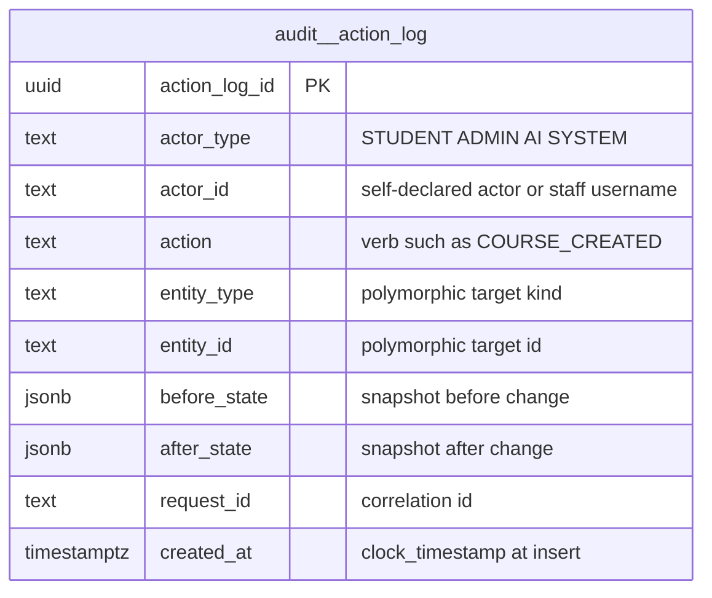

# `audit` schema — general-purpose action trail

The `audit` schema holds the platform-wide, append-only record of who changed what. Its only table, `audit.action_log`, gets one row per traced action. Writers are admin catalogue mutations (micro-courses, taxonomy, activities, theorems), learner "help / give up" requests in micro-courses, and Socratic Studio sign-ins, role switches, user administration and draft saves. The schema has existed since migration 001; migration 035 created its first table.

Source of truth: migrations [035](../../../mathbank-db/sql/035_admin_micro_course_platform.sql). Catalog extracted 2026-11-01 from migrations 001–054; endpoint mapping traced from mathbank-rest source and manually verified.

## 1. Purpose, ownership and data flow

- **Domain:** accountability and forensic trail for admin, staff, AI and selected learner actions ([requirements/44](../../requirements/44_MICRO_COURSE_MOBILE_AI_ANALYTICS_PLATFORM.md) MCX-8). `request_id` correlates one action across this log, `pipeline.outbox_event` and AI-usage records.
- **Writers (all in mathbank-rest, all INSERT-only):**
  - `record_audit_event()` in [micro_course_service.py:72-105](../../../mathbank-rest/src/mathbank_rest/micro_course_service.py). This is the shared helper, called from `micro_course_service` (course create/deactivate/reactivate, release review/publish), [taxonomy_service.py](../../../mathbank-rest/src/mathbank_rest/taxonomy_service.py) (5 actions), [quiz_service.py](../../../mathbank-rest/src/mathbank_rest/quiz_service.py) (6 activity actions), [theorem_service.py](../../../mathbank-rest/src/mathbank_rest/theorem_service.py) (8 actions) and [micro_course_assist.py:260](../../../mathbank-rest/src/mathbank_rest/micro_course_assist.py) (learner help/give-up, actor `STUDENT`).
  - `socratic_users.record()` in [socratic_users.py:253-271](../../../mathbank-rest/src/mathbank_rest/socratic_users.py) writes best-effort Studio access audit with entity `STAFF_USER`. Its own transaction carries a 3 s statement timeout, and failures are only logged. It writes nothing unless `SOCRATIC_ACCESS_AUDIT` is enabled ([config.py:64-66](../../../mathbank-rest/src/mathbank_rest/config.py)); the flag defaults to off.
  - `record_revision()` in [socratic_service.py:208-211](../../../mathbank-rest/src/mathbank_rest/socratic_service.py) writes `SOCRATIC_DRAFT_SAVED` for `SOCRATIC_WORKFLOW` in the same transaction as the draft, with `request_id` = Idempotency-Key.
- **Readers:** only `socratic_users.access_history()`, which returns the last 30 days of `STAFF_USER` events for `GET /v1/admin/socratic/users/{username}`. No general audit read endpoint exists.
- **Lifecycle:** append-only by convention. No guard trigger; the migration comment says no code path should ever UPDATE or DELETE. No retention policy.
- **Privacy class:** staff-only operational evidence. `before_state` / `after_state` may embed learner identifiers (e.g. `enrollment_id`) and Studio client metadata (IP prefix, user-agent).

## 2. Entity diagram — as-is

`audit.action_log` has no foreign keys. `entity_type` / `entity_id` form a polymorphic pointer to any audited row.

## 3. Tables

### `audit.action_log`

**Role.** One row = one audited action by one actor on one entity. The service function that performs a mutation inserts it in the same transaction, except for the Socratic access audit, which runs in its own transaction. It answers "who deactivated this concept, and what did it look like before?" and feeds the Studio user-detail access history. Nothing projects it to Neo4j or analytics.

**Lifecycle.** Insert-only. No status. `created_at` uses `clock_timestamp()`, so several rows written in one transaction keep their real order. No trigger enforces immutability (see 5.1).

**Columns**

| Column | Type | Null | Default | Description |
|---|---|---|---|---|
| `action_log_id` | uuid | NO | `gen_random_uuid()` | Surrogate key. |
| `actor_type` | text | NO | — | Kind of actor (CHECK): `STUDENT`, `ADMIN`, `AI`, `SYSTEM`. `record_audit_event` upper-cases its input. Studio sign-in failures use `SYSTEM`. |
| `actor_id` | text | yes | — | Actor identifier. For admin-key routes, the free-text `actor` field from the request body (1–200 chars, e.g. [admin_taxonomy.py:51](../../../mathbank-rest/src/mathbank_rest/routers/admin_taxonomy.py)); it is not authenticated. For Studio routes, the Cognito/staff `actor_id`. For learners, the `student_id`. NULL for anonymous sign-in failures. |
| `action` | text | NO | — | Verb, free text. Values in use: `COURSE_CREATED`, `COURSE_DEACTIVATED`, `COURSE_REACTIVATED`, `RELEASE_REVIEW_<STATUS>`, `RELEASE_PUBLISHED`, `TAXONOMY_ENTITY_UPDATED`, `TAXONOMY_ENTITY_DEACTIVATED`, `TAXONOMY_ENTITY_REACTIVATED`, `TAXONOMY_ALIAS_ADDED`, `TAXONOMY_ALIAS_REMOVED`, `ACTIVITY_CREATED`, `ACTIVITY_UPDATED`, `ACTIVITY_SKILL_MAPPED`, `ACTIVITY_SOURCE_MAPPED`, `ACTIVITY_DEACTIVATED`, `ACTIVITY_REACTIVATED`, `CREATE` / `UPDATE` / `APPROVE` / `REJECT` / `LINK` (theorems), `MICRO_COURSE_ITEM_HELP` / `MICRO_COURSE_ITEM_GIVE_UP`, `SOCRATIC_DRAFT_SAVED`, and the Studio `AccessAction` set (`STUDIO_SIGN_IN_SUCCEEDED`, `STUDIO_SIGN_IN_FAILED`, `STUDIO_SIGN_OUT`, `STUDIO_ROLE_SWITCHED`, `STUDIO_PASSWORD_CHANGED`, `ADMIN_PASSWORD_RESET`, `ADMIN_GLOBAL_SIGN_OUT`, `ADMIN_GROUP_ADDED`, `ADMIN_GROUP_REMOVED`, `ADMIN_USER_DISABLED`, `ADMIN_USER_ENABLED`). |
| `entity_type` | text | NO | — | Kind of the target row, free text. Mixed casing today: `MICRO_COURSE`, `MICRO_COURSE_RELEASE`, `ACTIVITY`, `CONCEPT` / `TECHNIQUE` / … (taxonomy `entity_label` upper-cased), `MICRO_COURSE_ITEM`, `SOCRATIC_WORKFLOW`, `STAFF_USER`, but lower-case `theorem`, `theorem_relation`, `technique_theorem`, `theorem_taxonomy_link`, `theorem_source`. |
| `entity_id` | text | NO | — | Identifier of the target as text: a UUID, a composite such as `"<technique_id>:<theorem_id>"` or `"<item_kind>:<item_id>"`, or a staff username (truncated to 128 chars). |
| `before_state` | jsonb | yes | — | Snapshot of relevant fields before the change (taxonomy updates, course/activity toggles). NULL for creates and access events. |
| `after_state` | jsonb | yes | — | Snapshot after the change, or event detail. Examples: the created theorem row; `{enrollment_id, item_kind, intent}` for learner help; `{revision, content_hash, prototype_only}` for Socratic drafts; `{ip_prefix, user_agent, …}` for Studio access events. |
| `request_id` | text | yes | — | Correlation id. `record_audit_event` generates a UUID when the caller passes none. Socratic draft saves use the Idempotency-Key. Studio access events leave it NULL. |
| `created_at` | timestamptz | NO | `clock_timestamp()` | Wall-clock insert time (not transaction start). |

**Keys, constraints, indexes.**
- PK `action_log_id`.
- CHECK `actor_type` ∈ {STUDENT, ADMIN, AI, SYSTEM}.
- No FKs (polymorphic target), no UNIQUE.
- Indexes: `action_log_entity_idx (entity_type, entity_id, created_at DESC)` for per-entity history; partial `action_log_request_idx (request_id) WHERE request_id IS NOT NULL` for correlation.
- No triggers. Immutability is by convention only.

**REST operations today.** Every route below writes (C) as a side effect of its own mutation. Socratic routes are also mounted in the separate `socratic_app` deployment with identical handlers; the trace listed them twice, and they are collapsed here.

| Op | Method & path | Auth | Handler | Notes |
|---|---|---|---|---|
| C | `POST /v1/admin/micro-courses` | Admin key (X-Admin-Api-Key) | `routers.micro_courses.create_admin_course` | `COURSE_CREATED`, entity `MICRO_COURSE`. |
| C | `POST /v1/admin/micro-courses/{canonical_code}/deactivate` · `/reactivate` | Admin key (X-Admin-Api-Key) | `deactivate_admin_course` · `reactivate_admin_course` | `COURSE_DEACTIVATED` / `COURSE_REACTIVATED` with before/after `is_active`. |
| C | `POST /v1/admin/micro-courses/releases/{release_id}/review` | Admin key (X-Admin-Api-Key) | `review_admin_release` | `RELEASE_REVIEW_<STATUS>`, entity `MICRO_COURSE_RELEASE`. |
| C | `POST /v1/admin/micro-courses/releases/{release_id}/publish` | Admin key (X-Admin-Api-Key) | `publish_admin_release` | `RELEASE_PUBLISHED`. |
| C | `POST /v1/micro-courses/enrollments/{enrollment_id}/item-help` | Learner JWT | `routers.micro_courses.get_item_help` → `micro_course_assist.get_item_assist` | Actor `STUDENT`; `MICRO_COURSE_ITEM_HELP` or `_GIVE_UP`. |
| C | `PATCH /v1/admin/taxonomy/{kind}/{code}` | Admin key (X-Admin-Api-Key) | `routers.admin_taxonomy.update_entity` | `TAXONOMY_ENTITY_UPDATED` with before/after. |
| C | `POST /v1/admin/taxonomy/{kind}/{code}/deactivate` · `/reactivate` | Admin key (X-Admin-Api-Key) | `deactivate_entity` · `reactivate_entity` | `TAXONOMY_ENTITY_(DE\|RE)ACTIVATED`. |
| C | `POST /v1/admin/taxonomy/{kind}/{code}/aliases` · `DELETE …/aliases/{alias_id}` | Admin key (X-Admin-Api-Key) | `add_alias` · `remove_alias` | `TAXONOMY_ALIAS_ADDED` / `_REMOVED`. |
| C | `POST /v1/admin/activities` · `PATCH /v1/admin/activities/{activity_id}` | Admin key (X-Admin-Api-Key) | `routers.admin_activities.create_activity` · `update_activity` | `ACTIVITY_CREATED` / `ACTIVITY_UPDATED`. |
| C | `POST /v1/admin/activities/{activity_id}/deactivate` · `/reactivate` | Admin key (X-Admin-Api-Key) | `deactivate_activity` · `reactivate_activity` | `ACTIVITY_DEACTIVATED` / `_REACTIVATED`. |
| C | `PATCH /v1/admin/activities/{activity_id}/skill-mapping` · `/source-mapping` | Admin key (X-Admin-Api-Key) | `set_skill_mapping` · `set_source_mapping` | `ACTIVITY_SKILL_MAPPED` / `ACTIVITY_SOURCE_MAPPED`. |
| C | `POST /v1/admin/theorems` · `PATCH /v1/admin/theorems/{slug}` | Admin key (X-Admin-Api-Key) | `routers.theorems.create_admin_theorem` · `update_admin_theorem` | `CREATE` / `UPDATE`, entity `theorem`. |
| C | `POST /v1/admin/theorems/{slug}/approve` · `/reject` | Admin key (X-Admin-Api-Key) | `approve_admin_theorem` · `reject_admin_theorem` | `APPROVE` / `REJECT`. |
| C | `POST /v1/admin/theorems/{slug}/relations` · `/techniques` · `/taxonomy-links` | Admin key (X-Admin-Api-Key) | `create_theorem_relation` · `link_theorem_technique` · `link_theorem_taxonomy` | `CREATE` / `LINK` on `theorem_relation`, `technique_theorem`, `theorem_taxonomy_link`. |
| C | `POST /v1/admin/theorems/sources/{theorem_source_id}/approve` | Admin key (X-Admin-Api-Key) | `approve_theorem_source` | `APPROVE`, entity `theorem_source`. |
| C | `POST /v1/admin/socratic/session` | Anonymous (credentials in body) | `routers.socratic.login` | `STUDIO_SIGN_IN_SUCCEEDED` / `_FAILED`; only when `SOCRATIC_ACCESS_AUDIT` is on. |
| C | `DELETE /v1/admin/socratic/session` | Staff cookie (Cognito) | `routers.socratic.logout` | `STUDIO_SIGN_OUT`; flag-gated. |
| C | `PUT /v1/admin/socratic/session/role` | Staff cookie (Cognito) | `routers.socratic.switch_role` | `STUDIO_ROLE_SWITCHED`; flag-gated. |
| C | `POST /v1/admin/socratic/session/password` | Staff cookie (Cognito) | `routers.socratic.change_password` | `STUDIO_PASSWORD_CHANGED`; flag-gated. |
| C | `PUT` · `DELETE /v1/admin/socratic/users/{username}/groups/{group}` | Staff cookie (Cognito) | `add_group` · `remove_group` | `ADMIN_GROUP_ADDED` / `_REMOVED`; flag-gated. |
| C | `POST /v1/admin/socratic/users/{username}/password-reset` · `/sign-out` | Staff cookie (Cognito) | `reset_password` · `sign_out_everywhere` | `ADMIN_PASSWORD_RESET` / `ADMIN_GLOBAL_SIGN_OUT`; flag-gated. |
| C | `PUT /v1/admin/socratic/users/{username}/enabled` | Staff cookie (Cognito) | `set_enabled` | `ADMIN_USER_ENABLED` / `_DISABLED`; flag-gated. |
| C | `POST /v1/admin/socratic/workflows` · `PUT /v1/admin/socratic/workflows/{workflow_id}` | Staff cookie (Cognito) | `create_workflow` · `update_workflow` | `SOCRATIC_DRAFT_SAVED`, transactional with the draft (always on). |
| R | `GET /v1/admin/socratic/users/{username}` | Staff cookie (Cognito) | `routers.socratic.get_user` | Reads the last 25 `STAFF_USER` events plus 30-day counts (`access_history`). |

## 4. CRUD coverage — as-is

| Table | Create | Read | Update | Delete | Notes |
|---|---|---|---|---|---|
| `audit.action_log` | ✅ | ❌ | — | — | Written only as a side effect of other mutations (correct). The only read is the Studio per-user access history; no admin endpoint can browse by entity, actor or request id. |

## 5. Target state — how it should be

### 5.1 Schema improvements

1. **P1 — Authenticate `actor_id` for admin-key routes.** Today the admin key is shared, and `actor` is a free-text body field ([admin_taxonomy.py:51-63](../../../mathbank-rest/src/mathbank_rest/routers/admin_taxonomy.py), and similarly in activities, theorems and micro-courses), so the audit trail records a claimed identity, not a verified one. Derive the actor from a per-admin credential (or the Studio Cognito session) and keep the body field only as `on_behalf_of`.
2. **P2 — Enforce append-only with a trigger.** The migration skips this deliberately ([035 §1](../../../mathbank-db/sql/035_admin_micro_course_platform.sql)), but every other evidence ledger (`learner.event`, `learner.*_event`, `learner.misconception_evidence`) uses `BEFORE UPDATE OR DELETE` guards. An audit log is the table where tamper-resistance matters most. Reuse `learner.forbid_update()` or add `audit.forbid_mutation()`.
3. **P2 — Normalise `entity_type` casing and vocabulary.** Theorem actions write lower-case `theorem`, `theorem_relation` … ([theorem_service.py:143-568](../../../mathbank-rest/src/mathbank_rest/theorem_service.py)), while every other writer uses UPPER_SNAKE. Per-entity history queries on `action_log_entity_idx` must then guess the case. Add a `CHECK (entity_type = upper(entity_type))` after a one-off `UPDATE` backfill, and switch the theorem verbs to `THEOREM_CREATED` and similar for consistency.
4. **P2 — Add an actor index** `(actor_type, actor_id, created_at DESC)`. "What did this admin do?" is the second most common audit query, and today it requires a sequential scan.
5. **P3 — Retention and archival.** No policy exists. The [66A](../../requirements/66A_POSTGRES_TABLE_MIGRATION_ASSESSMENT.md) assessment recommends keeping it in Postgres for atomicity and archiving cold rows to S3. Consider monthly range partitioning on `created_at` when volume justifies it.
6. **P3 — Make the Studio access audit on by default in hosted environments.** The flag defaults to `False` ([config.py:66](../../../mathbank-rest/src/mathbank_rest/config.py)), so a misconfigured deploy silently records no sign-ins.

### 5.2 Entity diagram — target

Structure unchanged (no new tables or FKs); see 5.1 for the trigger, CHECK and index changes.

### 5.3 Endpoints to build

| Priority | Method & path | Auth | Table(s) / op | Purpose | Notes (validation, concurrency, audit) |
|---|---|---|---|---|---|
| P1 | `GET /v1/admin/audit/action-logs?entity_type=&entity_id=&actor_type=&actor_id=&action=&request_id=&from=&to=&limit=&offset=` | Admin key (X-Admin-Api-Key) | `audit.action_log` / R | Browse and filter the audit trail; the read side the design guide §4 prescribes. | Limit ≤ 200; `{items,total,limit,offset}`; ordered `created_at DESC`; use `action_log_entity_idx` / `action_log_request_idx`; `entity_type` matched case-insensitively until 5.1-3 lands. |
| P2 | `GET /v1/admin/audit/action-logs/{action_log_id}` | Admin key (X-Admin-Api-Key) | `audit.action_log` / R | Full before/after detail for one entry. | 404 if missing. |
| P2 | `GET /v1/admin/socratic/audit?entity_type=&entity_id=&limit=&offset=` | Staff cookie (Cognito) + `manage_users` capability | `audit.action_log` / R | Studio-side history for workflows and staff users beyond the 25-row user view. | Restrict to `entity_type IN ('STAFF_USER','SOCRATIC_WORKFLOW')`; CSRF not needed for GET. |
| — | (no write endpoints) | — | — | Writes stay internal via `record_audit_event`, as REST_CRUD_DESIGN_GUIDE §4 requires. | — |
