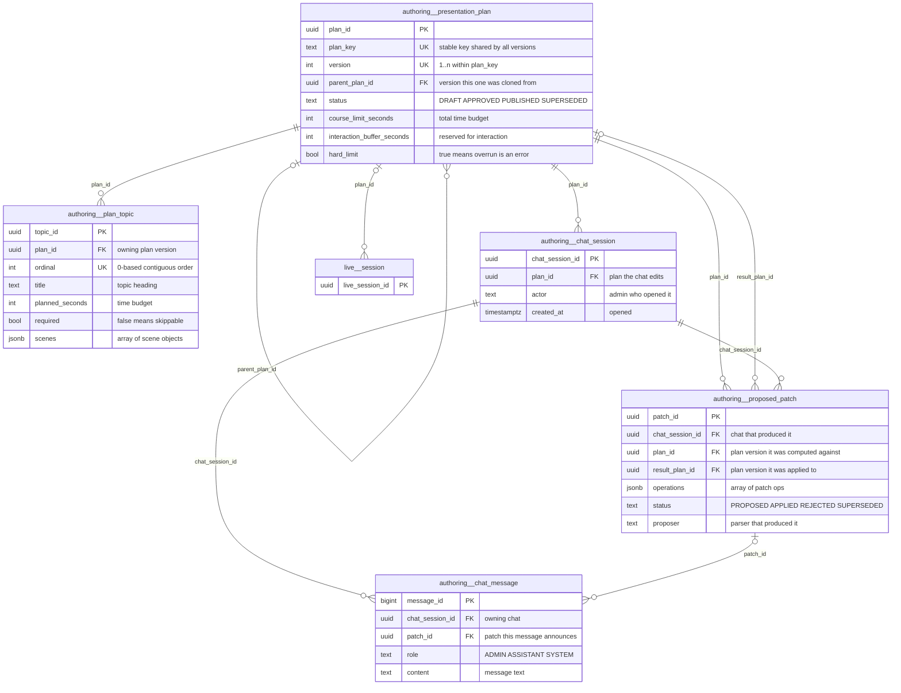
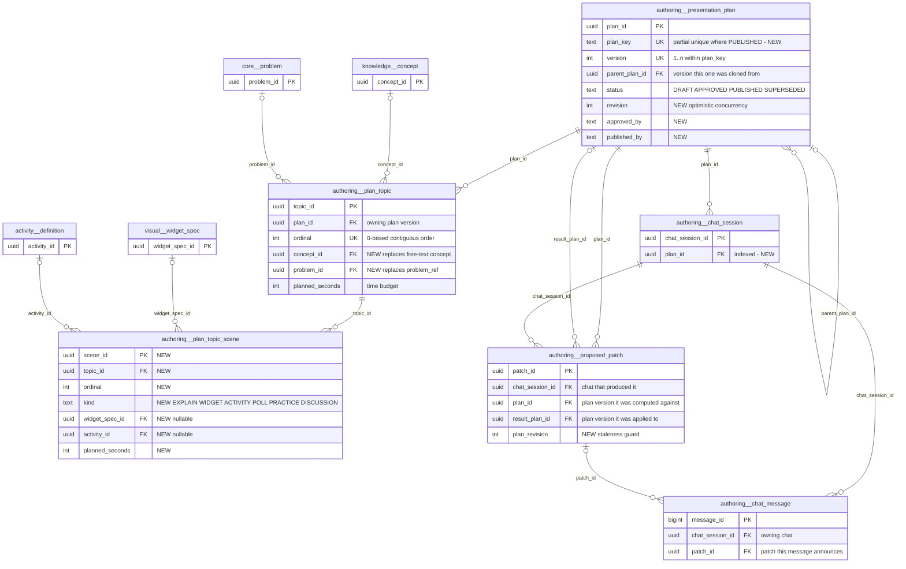

# `authoring` schema — Live-lesson presentation plans and admin authoring chat

The `authoring` schema stores **presentation plans**: versioned, timed outlines of topics and scenes that an instructor or the AI tutor runs as a live classroom session (fluid docs 04/05/06). It also stores the **admin authoring chat** that edits those plans. In that chat, an admin types natural-language requests such as "make topic 2 five minutes shorter". A deterministic parser (with an optional LLM fallback) turns each request into a structured *proposed patch*, and the patch changes the plan only when the admin explicitly applies it. Published plans are immutable. Editing a published plan always creates a new DRAFT version under the same `plan_key`.

Source of truth: migration [020_live_fluid_platform.sql](../../../mathbank-db/sql/020_live_fluid_platform.sql). Catalog extracted 2026-11-01 from migrations 001–054; endpoint mapping traced from mathbank-rest source and manually verified.

## 1. Purpose, ownership and data flow

- **Domain:** authoring of live-lesson run sheets: topic order, time budgets, a scene list per topic, and the hard/soft course time limit.
- **Owner of writes:** `mathbank-rest`.
  - The service logic is in [authoring.py](../../../mathbank-rest/src/mathbank_rest/authoring.py).
  - The routes are in [routers/fluid.py](../../../mathbank-rest/src/mathbank_rest/routers/fluid.py) under `/v1/authoring/*`. All routes are admin-key protected; `X-Actor-Id` is recorded as `created_by`/`decided_by`.
  - No ETL script or other service writes these tables.
- **Readers:**
  - The admin plan editor in `mathbank-web`, through the REST proxy.
  - [live_runtime.py](../../../mathbank-rest/src/mathbank_rest/live_runtime.py) `create_session`. When `POST /v1/live/sessions` is given a `plan_id`, it reads the plan and its topics, accepts only `APPROVED`/`PUBLISHED` plans, and **copies** the topics into `live.session.topics`. A running session is therefore insulated from later plan edits.
- **Lifecycle:**
  - Plan status moves `DRAFT → APPROVED → PUBLISHED → SUPERSEDED`. Any content edit on an `APPROVED` plan drops it back to `DRAFT` (`save_plan_state`).
  - Publishing supersedes the previously `PUBLISHED` version with the same `plan_key`.
  - Triggers make `PUBLISHED`/`SUPERSEDED` plans and their topics immutable. The only change allowed on them is `PUBLISHED → SUPERSEDED`, with all other fields left unchanged.
  - A proposed patch moves `PROPOSED → APPLIED | REJECTED | SUPERSEDED`. `SUPERSEDED` is used when the admin asks for an alternative.
  - Chat messages are append-only in practice: there is no update or delete path.
- **Privacy class:** staff-only authoring content and provenance. There is no learner data.

## 2. Entity diagram — as-is

## 3. Tables

### `authoring.presentation_plan`

**Role.** One row is one **version** of a live-lesson plan. The versions of one plan share a `plan_key`, and `version` increments from 1.
- `POST /v1/authoring/presentation-plans` creates version 1 (the key is a title slug plus a random suffix).
- `POST …/{id}/new-version` clones the topics into the next version. It returns the existing editable version if there already is one.
- Applying a chat patch to a published plan also creates a new version automatically.
- `live.session.plan_id` points here when a session is started from a plan.

**Lifecycle.** The `status` CHECK allows `DRAFT`, `APPROVED`, `PUBLISHED`, `SUPERSEDED`.
- **Approve:** `approve_plan` requires `validate_plan` to pass, with no errors.
- **Publish:** `publish_plan` requires `APPROVED`. It first sets every `PUBLISHED` row with the same `plan_key` to `SUPERSEDED`.
- **Trigger `presentation_plan_guard`** (`authoring.guard_published_plan`, BEFORE UPDATE OR DELETE):
  - It blocks DELETE of a `PUBLISHED` row.
  - It blocks any UPDATE of a `PUBLISHED`/`SUPERSEDED` row, except `PUBLISHED → SUPERSEDED` with `title`, `course_limit_seconds`, `interaction_buffer_seconds` and `hard_limit` unchanged.
  - Setting the session flag `authoring.allow_purge=on` bypasses the guard; it is meant for test fixtures only.

**Columns**

| Column | Type | Null | Default | Description |
|---|---|---|---|---|
| `plan_id` | uuid | NO | `gen_random_uuid()` | Identifier of this plan version. |
| `plan_key` | text | NO | — | Stable logical plan identifier shared by all versions. Defaults to `<title-slug≤40>-<6 hex>` or is caller-supplied. UNIQUE together with `version`. |
| `version` | integer | NO | `1` | Version number within `plan_key`. CHECK `≥ 1`. `new_version` uses `max(version)+1`. |
| `parent_plan_id` | uuid | yes | — | Version this row was cloned from. → `authoring.presentation_plan.plan_id` (ON DELETE SET NULL). NULL for version 1. |
| `title` | text | NO | — | Plan title shown to instructors and in live sessions (1–200 characters at the API). |
| `description` | text | yes | — | Free-text summary. Set only at creation; no endpoint edits it afterwards. |
| `status` | text | NO | `'DRAFT'` | `DRAFT`, `APPROVED`, `PUBLISHED` or `SUPERSEDED` (CHECK). See Lifecycle. |
| `course_limit_seconds` | integer | NO | — | Total session time budget in seconds. CHECK `> 0`. |
| `interaction_buffer_seconds` | integer | NO | `0` | Seconds reserved out of the limit for polls and questions. CHECK `≥ 0`. Available content time = limit − buffer. |
| `hard_limit` | boolean | NO | `false` | When true, planned content over the available time is a validation **error** (`validate_plan`). When false it is only a warning. The flag is copied into `live.session.hard_limit`, where it blocks AI-proposed `EXTEND` actions (`propose_ai_action`). |
| `created_by` | text | NO | `'admin'` | Actor who created the version, from the `X-Actor-Id` header (default `admin`). |
| `created_at` | timestamptz | NO | `now()` | Version creation time. |
| `updated_at` | timestamptz | NO | `now()` | Last content or status change; the list endpoint sorts on it. Set by the application. |
| `approved_at` | timestamptz | yes | — | Time of the latest approval. Reset to NULL when an approved plan is edited back to DRAFT. |
| `published_at` | timestamptz | yes | — | Time the version was published. |

**Keys, constraints, indexes.**
- PK `plan_id`.
- UNIQUE `(plan_key, version)`.
- Self-FK `parent_plan_id` (SET NULL).
- CHECKs on `status`, `version ≥ 1`, `course_limit_seconds > 0` and `interaction_buffer_seconds ≥ 0`.
- Trigger `presentation_plan_guard`.
- Referenced by:
  - `authoring.plan_topic.plan_id` (CASCADE)
  - `authoring.chat_session.plan_id` (CASCADE)
  - `authoring.proposed_patch.plan_id` (CASCADE)
  - `authoring.proposed_patch.result_plan_id` (SET NULL)
  - `live.session.plan_id` (SET NULL)
- Not enforced: "one `PUBLISHED` per `plan_key`" and "one editable version per `plan_key`" (see 5.1).

**REST operations today.**

| Op | Method & path | Auth | Handler | Notes |
|---|---|---|---|---|
| R | `GET /v1/authoring/presentation-plans?limit=` | Admin key (X-Admin-Api-Key) | `fluid.plans` → `authoring.list_plans` | `ORDER BY updated_at DESC`, limit ≤ 500. Returns `{items}` only, with no offset, total or filters. Includes `topic_count`. |
| C | `POST /v1/authoring/presentation-plans` | Admin key (X-Admin-Api-Key) | `fluid.create_plan` → `authoring.create_plan` | Inserts version 1 and its topics. Structural validation returns 422. |
| R | `GET /v1/authoring/presentation-plans/{plan_id}` | Admin key (X-Admin-Api-Key) | `fluid.plan` → `authoring.get_plan` | Includes `topics` and a computed `timing` summary. |
| U | `PUT /v1/authoring/presentation-plans/{plan_id}/topics` | Admin key (X-Admin-Api-Key) | `fluid.plan_topics` → `authoring.update_topics` | Locks the row. Returns 409 when the plan is published or superseded. Resets status to DRAFT. |
| U | `PATCH /v1/authoring/presentation-plans/{plan_id}/timing` | Admin key (X-Admin-Api-Key) | `fluid.plan_timing` → `authoring.update_timing` | Updates limit, buffer and `hard_limit`. Resets status to DRAFT. |
| R | `POST /v1/authoring/presentation-plans/{plan_id}/validate` | Admin key (X-Admin-Api-Key) | `fluid.plan_validate` | Pure validation; nothing is written. |
| U | `POST /v1/authoring/presentation-plans/{plan_id}/approve` | Admin key (X-Admin-Api-Key) | `fluid.plan_approve` → `authoring.approve_plan` | 422 if the plan is invalid. |
| U | `POST /v1/authoring/presentation-plans/{plan_id}/publish` | Admin key (X-Admin-Api-Key) | `fluid.plan_publish` → `authoring.publish_plan` | 409 unless the plan is `APPROVED`. Supersedes the prior published version. |
| C | `POST /v1/authoring/presentation-plans/{plan_id}/new-version` | Admin key (X-Admin-Api-Key) | `fluid.plan_new_version` → `authoring.new_version` | Idempotent: returns an existing DRAFT/APPROVED version if there is one. |
| R | `POST /v1/authoring/chat/sessions` | Admin key (X-Admin-Api-Key) | `fluid.chat_create` | Checks that the plan exists. |
| R | `POST /v1/authoring/chat/sessions/{chat_id}/messages` | Admin key (X-Admin-Api-Key) | `fluid.chat_message` | Reads the plan to parse the message against it. |
| C, U | `POST /v1/authoring/chat/sessions/{chat_id}/proposed-patches/{patch_id}/apply` | Admin key (X-Admin-Api-Key) | `fluid.chat_patch_decide` → `authoring.decide_patch` | `APPLY`/`MODIFY` call `save_plan_state`, which updates the plan. If the plan is published, `new_version` inserts a new row first. |
| R | `POST /v1/live/sessions` (with `plan_id`) | Admin key (X-Admin-Api-Key) (`staff_actor`) | `live.create_session` → `live_runtime.create_session` | Requires the plan to be `APPROVED`/`PUBLISHED` (otherwise 409). Copies the topics into the session. |

### `authoring.plan_topic`

**Role.** One row is one ordered topic inside one plan version, together with its time budget and declarative scene list. Topics are never edited individually. Every write path (`create_plan`, `update_topics`, `update_timing`, patch apply, `new_version`) calls `_write_topics`, which **deletes all topics of the plan and re-inserts them**. Each scene gets a generated `scene_id` (`sc_<8 hex>`) if it has none. Live sessions copy the topic rows into `live.session.topics` at start.

**Lifecycle.** Topics have no status of their own; their mutability follows the parent plan. Trigger `plan_topic_guard` (`authoring.guard_published_topic`, BEFORE INSERT OR UPDATE OR DELETE) raises if the parent plan is `PUBLISHED`/`SUPERSEDED`, unless `authoring.allow_purge=on`. One consequence: deleting a `SUPERSEDED` plan fails because the cascaded topic deletes are rejected.

**Columns**

| Column | Type | Null | Default | Description |
|---|---|---|---|---|
| `topic_id` | uuid | NO | `gen_random_uuid()` | Row identifier. Regenerated on every save because topics are rewritten, so it is not stable across edits. |
| `plan_id` | uuid | NO | — | Owning plan version. → `authoring.presentation_plan.plan_id` (ON DELETE CASCADE). |
| `ordinal` | integer | NO | — | 0-based position. CHECK `≥ 0`. The application renumbers topics contiguously from 0. UNIQUE `(plan_id, ordinal)` is DEFERRABLE INITIALLY DEFERRED so that reordering can happen in one transaction. |
| `title` | text | NO | — | Topic heading (1–200 characters at the API). |
| `concept` | text | yes | — | Free-text concept label for the topic. Not linked to `knowledge.concept`. |
| `problem_ref` | text | yes | — | Free-text reference to a corpus problem, used as a canonical code or id by the presenter. Not validated and has no FK. |
| `planned_seconds` | integer | NO | — | Planned duration in seconds. CHECK `> 0`. It must lie in [`min_seconds`, `max_seconds`] when those are set (Python validation). |
| `min_seconds` | integer | yes | — | Lower bound the time-rebalancer may shrink the topic to. CHECK `> 0` when set. |
| `max_seconds` | integer | yes | — | Upper bound the time-rebalancer may stretch the topic to. CHECK `> 0` when set. |
| `required` | boolean | NO | `true` | False marks an optional topic that may be skipped or donate time. The "ask for alternative" patch borrows time from optional topics. |
| `scenes` | jsonb | NO | `'[]'` | Array of scene objects (CHECK `jsonb_typeof = 'array'`): `{scene_id, kind: EXPLAIN\|WIDGET\|ACTIVITY\|POLL\|PRACTICE\|DISCUSSION, title, planned_seconds, optional, widget_spec_id?, activity_id?}`. Only `kind` is validated (`authoring.SCENE_KINDS`); the referenced ids are not. |

**Keys, constraints, indexes.**
- PK `topic_id`.
- UNIQUE `(plan_id, ordinal)`, deferrable, backed by index `plan_topic_plan_id_ordinal_key`.
- FK `plan_id` (CASCADE).
- CHECKs on `ordinal`, the seconds columns and the `scenes` array type.
- Trigger `plan_topic_guard`.

**REST operations today.** Every create and delete below is the delete-and-reinsert done by `_write_topics`.

| Op | Method & path | Auth | Handler | Notes |
|---|---|---|---|---|
| R | `GET /v1/authoring/presentation-plans` | Admin key (X-Admin-Api-Key) | `fluid.plans` | Sub-select `count(*)` for `topic_count`. |
| C | `POST /v1/authoring/presentation-plans` | Admin key (X-Admin-Api-Key) | `fluid.create_plan` | Initial topics. |
| R | `GET /v1/authoring/presentation-plans/{plan_id}` | Admin key (X-Admin-Api-Key) | `fluid.plan` | Topics ordered by `ordinal`. |
| C, D | `PUT /v1/authoring/presentation-plans/{plan_id}/topics` | Admin key (X-Admin-Api-Key) | `fluid.plan_topics` | Bulk replace. |
| C, D | `PATCH /v1/authoring/presentation-plans/{plan_id}/timing` | Admin key (X-Admin-Api-Key) | `fluid.plan_timing` | Rewrites topics even when only the limits change. |
| R | `POST …/{plan_id}/validate`, `…/approve`, `…/publish` | Admin key (X-Admin-Api-Key) | `fluid.plan_validate` / `plan_approve` / `plan_publish` | Read through `get_plan`. |
| C | `POST /v1/authoring/presentation-plans/{plan_id}/new-version` | Admin key (X-Admin-Api-Key) | `fluid.plan_new_version` | Clones the topics. |
| R | `POST /v1/authoring/chat/sessions`, `POST …/{chat_id}/messages` | Admin key (X-Admin-Api-Key) | `fluid.chat_create` / `chat_message` | Read through `get_plan`. |
| C, D | `POST /v1/authoring/chat/sessions/{chat_id}/proposed-patches/{patch_id}/apply` | Admin key (X-Admin-Api-Key) | `fluid.chat_patch_decide` | `APPLY`/`MODIFY` rewrite the topics. |
| R | `POST /v1/live/sessions` | Admin key (X-Admin-Api-Key) (`staff_actor`) | `live.create_session` | Copies the topics into the session. |

### `authoring.chat_session`

**Role.** One row is one admin chat thread attached to one plan version. It is the container for natural-language edit requests, the assistant's replies, and the proposed patches. It is created by `POST /v1/authoring/chat/sessions {plan_id}`. When a patch is applied to a published plan, a new plan version is created, but the chat stays linked to the plan it was opened on. Later patches are then still computed against `chat_session.plan_id` (see 5.1 item 6).

**Lifecycle.** Created once. There is no status, no close action and no deletion path. Rows cascade-delete with the plan.

**Columns**

| Column | Type | Null | Default | Description |
|---|---|---|---|---|
| `chat_session_id` | uuid | NO | `gen_random_uuid()` | Chat thread identifier (`chat_id` in URLs). |
| `plan_id` | uuid | NO | — | Plan version this chat edits. → `authoring.presentation_plan.plan_id` (ON DELETE CASCADE). |
| `actor` | text | NO | `'admin'` | Admin who opened the chat, from `X-Actor-Id`. |
| `created_at` | timestamptz | NO | `now()` | When the chat was opened. |

**Keys, constraints, indexes.**
- PK `chat_session_id`.
- FK `plan_id` (CASCADE).
- No index on `plan_id`, so "chats for a plan" would be a sequential scan; no endpoint needs it yet.
- Referenced by `chat_message.chat_session_id` and `proposed_patch.chat_session_id` (both CASCADE).

**REST operations today.**

| Op | Method & path | Auth | Handler | Notes |
|---|---|---|---|---|
| C, R | `POST /v1/authoring/chat/sessions` | Admin key (X-Admin-Api-Key) | `fluid.chat_create` → `authoring.create_chat` | 201; returns the chat with messages and patches. |
| R | `GET /v1/authoring/chat/sessions/{chat_id}` | Admin key (X-Admin-Api-Key) | `fluid.chat_get` → `authoring.get_chat` | 404 if the chat is unknown. |
| R | `POST /v1/authoring/chat/sessions/{chat_id}/messages` | Admin key (X-Admin-Api-Key) | `fluid.chat_message` | Loads the chat in order to load its plan. |
| R | `POST /v1/authoring/chat/sessions/{chat_id}/proposed-patches/{patch_id}/apply` | Admin key (X-Admin-Api-Key) | `fluid.chat_patch_decide` | Returns the refreshed chat. |

### `authoring.proposed_patch`

**Role.** One row is one structured, reviewable change set produced from an admin chat message.
- **Where the operations come from:** `parse_admin_message` (deterministic regex parser) produces them. If it understands nothing and the LLM parser is configured, the LLM parser produces them instead. "Ask for alternative" produces them through `alternative_operations`.
- **What the row stores:** the operations, their computed timing `impact` and the validation result, so that the admin can Apply, Modify, Reject or ask for an alternative.
- **When it is applied:** `result_plan_id` records which plan version received the change. This is a new version if the target was published.

**Lifecycle.** The `status` CHECK allows `PROPOSED`, `APPLIED`, `REJECTED`, `SUPERSEDED`. `decide_patch` locks the row and accepts a decision only while the patch is `PROPOSED` (409 otherwise).
- **REJECT** → `REJECTED`.
- **ASK_FOR_ALTERNATIVE** → `SUPERSEDED`, and a new `PROPOSED` patch is created when an alternative exists.
- **APPLY/MODIFY** → `APPLIED`. MODIFY overwrites `operations` with the admin-edited list.

**Columns**

| Column | Type | Null | Default | Description |
|---|---|---|---|---|
| `patch_id` | uuid | NO | `gen_random_uuid()` | Patch identifier. |
| `chat_session_id` | uuid | NO | — | Chat that produced the patch. → `authoring.chat_session.chat_session_id` (ON DELETE CASCADE). |
| `plan_id` | uuid | NO | — | Plan version the patch was computed against. → `authoring.presentation_plan.plan_id` (ON DELETE CASCADE). |
| `summary` | text | NO | — | Human-readable description of the operations, joined from `authoring._describe(op)` per operation. Shown in the chat UI. |
| `operations` | jsonb | NO | — | Array (CHECK `jsonb_typeof='array'`) of `{op, target?, after?, …}` objects interpreted by `authoring.apply_operations`. The `op` value must be in `PATCH_OPS`: `UPDATE_TOPIC_TIME`, `UPDATE_COURSE_LIMIT`, `UPDATE_BUFFER`, `SET_HARD_LIMIT`, `SET_TOPIC_REQUIRED`, `RENAME_TOPIC`, `REMOVE_TOPIC`, `MOVE_TOPIC`, `ADD_TOPIC`, `ADD_SCENE`. `target` names a topic by ordinal or title. |
| `impact` | jsonb | NO | `'{}'` | Before/after comparison from `patch_impact`: `{planned_content_seconds, course_limit_seconds, slack_seconds, topic_count}`, each as `{before, after}`, plus `valid`, `errors[]`, `warnings[]`. |
| `validation` | jsonb | NO | `'{}'` | `{valid, errors[], warnings[]}` of the plan after applying the patch, at proposal time. |
| `proposer` | text | NO | `'DETERMINISTIC_PARSER'` | Producer of the operations. Values in use: `DETERMINISTIC_PARSER`, `LLM_PARSER`, `DETERMINISTIC_ALTERNATIVE`. There is no CHECK. |
| `status` | text | NO | `'PROPOSED'` | `PROPOSED`, `APPLIED`, `REJECTED` or `SUPERSEDED` (CHECK). |
| `result_plan_id` | uuid | yes | — | Plan version the patch was applied to. Set only when `APPLIED`. → `authoring.presentation_plan.plan_id` (ON DELETE SET NULL). |
| `decided_by` | text | yes | — | Admin who applied, rejected or superseded the patch (`X-Actor-Id`). |
| `decided_at` | timestamptz | yes | — | Decision time. |
| `created_at` | timestamptz | NO | `now()` | Proposal time; list sort key. |

**Keys, constraints, indexes.**
- PK `patch_id`.
- FKs: `chat_session_id` (CASCADE), `plan_id` (CASCADE), `result_plan_id` (SET NULL).
- CHECKs on `status` and the `operations` array type.
- Index `proposed_patch_chat_idx (chat_session_id, created_at)`.
- Referenced by `chat_message.patch_id` (SET NULL).

**REST operations today.**

| Op | Method & path | Auth | Handler | Notes |
|---|---|---|---|---|
| R | `POST /v1/authoring/chat/sessions` | Admin key (X-Admin-Api-Key) | `fluid.chat_create` | Embeds the patch list (empty for a new chat). |
| R | `GET /v1/authoring/chat/sessions/{chat_id}` | Admin key (X-Admin-Api-Key) | `fluid.chat_get` | |
| C | `POST /v1/authoring/chat/sessions/{chat_id}/messages` | Admin key (X-Admin-Api-Key) | `fluid.chat_message` → `authoring.post_message` | Inserts a patch only when operations were parsed and the patch passes `apply_operations`. |
| R | `GET /v1/authoring/chat/sessions/{chat_id}/proposed-patches` | Admin key (X-Admin-Api-Key) | `fluid.chat_patches` → `authoring.list_patches` | Ordered by `created_at`. |
| C, U | `POST /v1/authoring/chat/sessions/{chat_id}/proposed-patches/{patch_id}/apply` | Admin key (X-Admin-Api-Key) | `fluid.chat_patch_decide` → `authoring.decide_patch` | Body `{action: APPLY\|MODIFY\|REJECT\|ASK_FOR_ALTERNATIVE, operations?}`. ALTERNATIVE inserts a new patch. |

### `authoring.chat_message`

**Role.** One row is one line in an authoring chat transcript:
- the admin's request (`ADMIN`);
- the assistant's interpretation, which links the patch it proposed (`ASSISTANT`);
- or the system note recording an apply, reject or alternative decision (`SYSTEM`).

Rows are written only by `post_message` and `decide_patch`. The transcript is returned in order of `message_id`.

**Lifecycle.** The table is append-only in practice: no code path updates or deletes a message. There is no trigger enforcing this. Rows cascade with the chat. `patch_id` is set to NULL if the patch row is deleted.

**Columns**

| Column | Type | Null | Default | Description |
|---|---|---|---|---|
| `message_id` | bigint | NO | `nextval('authoring.chat_message_message_id_seq')` | Monotonic `bigserial` id; also the transcript order. |
| `chat_session_id` | uuid | NO | — | Owning chat. → `authoring.chat_session.chat_session_id` (ON DELETE CASCADE). |
| `role` | text | NO | — | Speaker. CHECK: `ADMIN` (typed request), `ASSISTANT` (parser reply), `SYSTEM` (decision note). |
| `content` | text | NO | — | Message text. Admin input is truncated to 4000 characters. |
| `patch_id` | uuid | yes | — | Patch announced or decided by this message. → `authoring.proposed_patch.patch_id` (ON DELETE SET NULL). NULL for admin messages and for replies that proposed nothing. |
| `created_at` | timestamptz | NO | `now()` | Time the message was written. |

**Keys, constraints, indexes.**
- PK `message_id`.
- FKs: `chat_session_id` (CASCADE), `patch_id` (SET NULL).
- CHECK on `role`.
- Index `chat_message_session_idx (chat_session_id, message_id)`.

**REST operations today.**

| Op | Method & path | Auth | Handler | Notes |
|---|---|---|---|---|
| R | `POST /v1/authoring/chat/sessions` | Admin key (X-Admin-Api-Key) | `fluid.chat_create` | Returns the (empty) transcript. |
| R | `GET /v1/authoring/chat/sessions/{chat_id}` | Admin key (X-Admin-Api-Key) | `fluid.chat_get` | Full transcript, with no pagination. |
| C | `POST /v1/authoring/chat/sessions/{chat_id}/messages` | Admin key (X-Admin-Api-Key) | `fluid.chat_message` | Inserts the `ADMIN` message and then the `ASSISTANT` reply. |
| C | `POST /v1/authoring/chat/sessions/{chat_id}/proposed-patches/{patch_id}/apply` | Admin key (X-Admin-Api-Key) | `fluid.chat_patch_decide` | Inserts a `SYSTEM` note, or an `ASSISTANT` note for an alternative. |

## 4. CRUD coverage — as-is

| Table | Create | Read | Update | Delete | Notes |
|---|---|---|---|---|---|
| `authoring.presentation_plan` | ✅ | ✅ | ✅ | ❌ | Lifecycle actions (approve, publish, new-version) exist. There is no way to discard an unused DRAFT, and no endpoint edits `description` or `title` directly. |
| `authoring.plan_topic` | ✅ | ✅ | ✅ | ✅ | Bulk-replace semantics only (`PUT …/topics`); deletes are part of the rewrite. |
| `authoring.chat_session` | ✅ | ✅ | — | ❌ | No "list chats for a plan" read, so a chat can only be reopened by its id. |
| `authoring.proposed_patch` | ✅ | ✅ | ✅ | — | Decision-only updates; deletion is intentionally absent because patches are provenance. |
| `authoring.chat_message` | ✅ | ✅ | — | — | Append-only transcript. |

## 5. Target state — how it should be

### 5.1 Schema improvements

1. **P1 — Enforce "one published version per plan_key" in the database.**
   - The invariant lives only in `publish_plan`: an `UPDATE … SET status='SUPERSEDED' WHERE plan_key=:k AND status='PUBLISHED'`, followed by the publish ([authoring.py:412-420](../../../mathbank-rest/src/mathbank_rest/authoring.py)).
   - `get_plan(lock=True)` locks only the row being published. Two different APPROVED versions of one key published concurrently can therefore both end up `PUBLISHED`.
   - Add `CREATE UNIQUE INDEX … ON authoring.presentation_plan (plan_key) WHERE status = 'PUBLISHED'`.
2. **P2 — Enforce "one editable version per plan_key".** `new_version` looks up an existing `DRAFT`/`APPROVED` version and returns it ([authoring.py:423-429](../../../mathbank-rest/src/mathbank_rest/authoring.py)), but nothing prevents two from existing. Add a partial unique index on `(plan_key) WHERE status IN ('DRAFT','APPROVED')`.
3. **P2 — Record who approved and who published.** Only `created_by` exists, and approve and publish write no actor or audit row. Add `approved_by text` and `published_by text`, and write `audit.action_log` entries for approve and publish, as the micro-course and quiz admin flows already do (`record_audit_event`).
4. **P2 — Make scene references real FKs.**
   - `plan_topic.scenes[].widget_spec_id` and `activity_id` are free JSON, and `validate_plan` checks only `kind` ([authoring.py:45-88](../../../mathbank-rest/src/mathbank_rest/authoring.py)). A plan can therefore be approved while it references specs or activities that are missing or `INACTIVE`/`REJECTED`.
   - Either validate them on approve, or normalise scenes into an `authoring.plan_topic_scene` table with FKs to `visual.widget_spec` and `activity.definition`. The new table is shown in 5.2.
5. **P2 — Replace free-text topic links.** `plan_topic.concept` and `problem_ref` are unvalidated text. Add nullable `concept_id → knowledge.concept` and `problem_id → core.problem`. Keep the text columns as display labels during migration.
6. **P3 — Patch staleness.** A patch stores `plan_id` but not the plan's `updated_at` or a revision at proposal time. Applying an older patch after another edit silently re-bases it onto the current plan, because `decide_patch` re-reads the plan and re-applies the operations. Add `plan_revision` to both tables, a `revision integer` to `presentation_plan` incremented on each save, and reject a stale apply with 409.
7. **P3 — Optimistic concurrency for plan edits.** `PUT …/topics` and `PATCH …/timing` take a row lock but have no `expected_revision`, so two editors overwrite each other's work. This uses the same `revision` column as item 6.
8. **P3 — CHECK on `proposed_patch.proposer`.** Restrict it to `DETERMINISTIC_PARSER`, `LLM_PARSER`, `DETERMINISTIC_ALTERNATIVE`.
9. **P3 — Index `chat_session(plan_id)`.** Needed for the "list chats of a plan" endpoint in 5.3.
10. **P3 — Purge path for superseded plans.** The topic guard rejects the cascaded deletes, so a `SUPERSEDED` plan cannot be deleted, while the plan guard itself allows it. Decide on a retention rule. Either keep everything (and change the plan guard to also block deleting `SUPERSEDED`), or allow purge of never-run superseded versions.

### 5.2 Entity diagram — target

### 5.3 Endpoints to build

| Priority | Method & path | Auth | Table(s) / op | Purpose | Notes (validation, concurrency, audit) |
|---|---|---|---|---|---|
| P2 | `GET /v1/authoring/presentation-plans?q=&status=&plan_key=&limit=&offset=` | Admin key (X-Admin-Api-Key) | `presentation_plan` / R | Bring the existing list up to the list convention. | `{items,total,limit,offset}`, limit ≤ 200. Filtering by `plan_key` returns the version history. |
| P2 | `PATCH /v1/authoring/presentation-plans/{plan_id}` | Admin key (X-Admin-Api-Key) | `presentation_plan` / U | Edit `title`/`description`. Today `description` can never change after creation. | `expected_revision` (409 on mismatch). DRAFT/APPROVED only (409 otherwise). Resets APPROVED to DRAFT. |
| P2 | `DELETE /v1/authoring/presentation-plans/{plan_id}` | Admin key (X-Admin-Api-Key) | `presentation_plan`, `plan_topic`, chats / D | Discard an unused draft version. | 204 only for `DRAFT` rows with no `live.session` referencing them. Otherwise 409. Write `audit.action_log`. |
| P2 | *(existing)* `POST …/{plan_id}/approve`, `…/publish` | Admin key (X-Admin-Api-Key) | `presentation_plan` / U | Add the actor and audit trail. | Record `approved_by`/`published_by` from `X-Actor-Id` and write `audit.action_log`. Handle a unique-violation from the new partial index as 409. |
| P2 | `GET /v1/authoring/presentation-plans/{plan_id}/chat-sessions` | Admin key (X-Admin-Api-Key) | `chat_session` / R | Reopen earlier authoring conversations for a plan. | `{items,total,limit,offset}`. Needs the `chat_session(plan_id)` index. |
| P3 | `GET /v1/authoring/chat/sessions/{chat_id}/messages?after_id=&limit=` | Admin key (X-Admin-Api-Key) | `chat_message` / R | Page long transcripts instead of embedding all of them in `GET …/{chat_id}`. | Keyset pagination on `message_id`. |
| P3 | `GET /v1/authoring/presentation-plans/{plan_id}/live-sessions` | Admin key (X-Admin-Api-Key) | `live.session` / R | Show which sessions ran a plan version, to decide whether it is safe to delete. | Read-only join on `live.session.plan_id`. |
