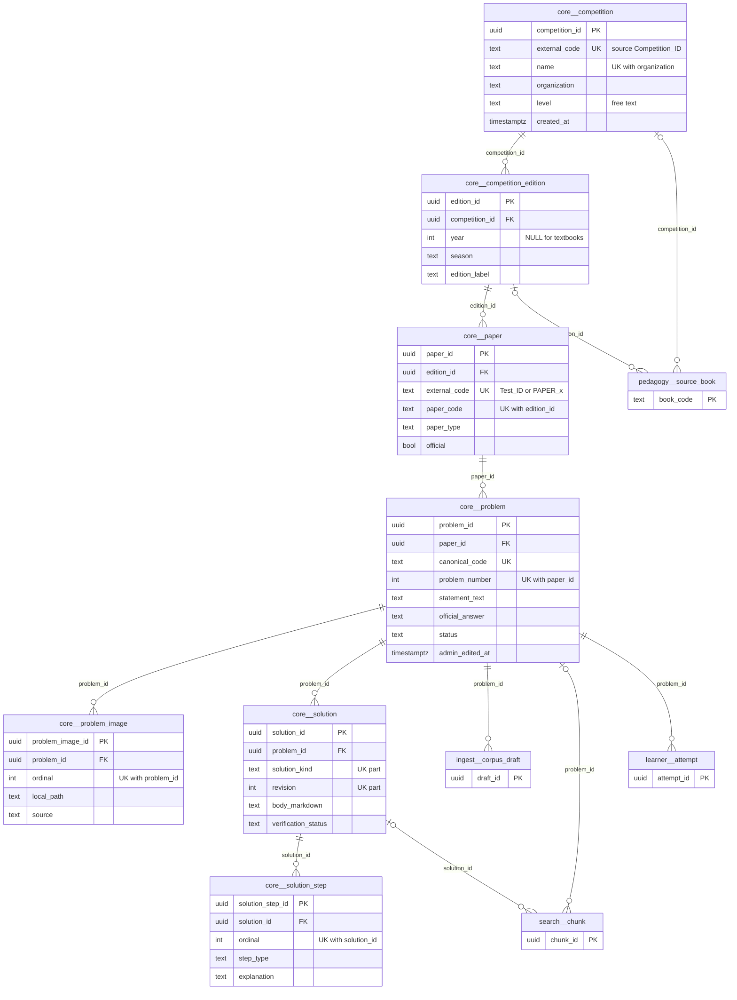
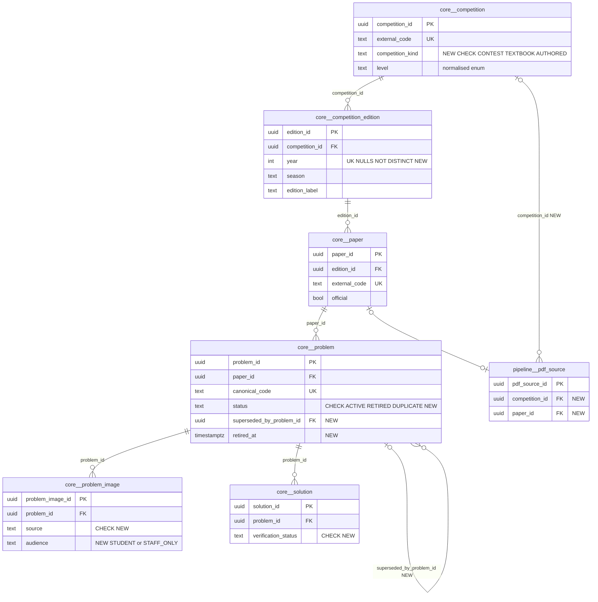

# `core` schema — canonical competition corpus (competitions, papers, problems, solutions, figures)

`core` is the system of record for the public problem corpus: competitions (and textbooks modelled as competitions), their editions, papers (or textbook chapters), problems, reference solutions and problem figures. Nearly every other schema hangs off `core.problem` (30 inbound foreign keys). Rows are created almost entirely by offline ETL in `mathbank-db/etl/` (CSV mirror load, PDF/HTML crawl ingest, textbook package import); the only REST writers are the admin "create competition" endpoint and the reviewed corpus-authoring workflow (`ingest.corpus_draft` → approve).

Source of truth: migrations [001](../../../mathbank-db/sql/001_schema.sql), [010](../../../mathbank-db/sql/010_textbook_import.sql) (edition `year` made nullable), [025](../../../mathbank-db/sql/025_corpus_authoring.sql) (`problem.admin_edited_at` + `protect_admin_statement` trigger). Catalog extracted 2026-11-01 from migrations 001–054; endpoint mapping traced from mathbank-rest source and manually verified.

## 1. Purpose, ownership and data flow

- **Domain.** Public maths-competition corpus: `competition → competition_edition → paper → problem → {solution → solution_step, problem_image}`. Textbooks (e.g. Prasolov) are imported as a `competition` with `level='TEXTBOOK'`, one edition with `year NULL` and one `paper` per chapter (`paper_type='TEXTBOOK_CHAPTER'`) — see the header of [migration 010](../../../mathbank-db/sql/010_textbook_import.sql).
- **Writers (ETL, primary).**
  - [load_corpus.py](../../../mathbank-db/etl/load_corpus.py) — competitions, editions, papers, placeholder problems from `competition_catalog.csv` / `test_registry.csv` / `question_index.csv`; statements/solutions from AoPS crawl (`data/crawl/*/*/parsed.json`) and split PDF crawl (`data/crawl_pdf/...`); images via `pdf_assets.store_images`.
  - [pdf_pipeline.py](../../../mathbank-db/etl/pdf_pipeline.py) — ingests `pipeline.pdf_source` rows that are `PARSED`: editions, papers, problems, `PDF_PARSED` solutions, images; sets `official_answer`/`answer_type` for Purple Comet / ARML. Orchestrated per paper by [paper_batches.py](../../../mathbank-db/etl/paper_batches.py) and [arml_queue.py](../../../mathbank-db/etl/arml_queue.py).
  - [import_textbook_package.py](../../../mathbank-db/etl/import_textbook_package.py) — textbook packages: competition, edition, chapter papers, problems, `TEXTBOOK` solutions and `TEXTBOOK_PACKAGE` problem images (generic `upsert()` helper, so static tracing missed these writes).
  - [pdf_assets.py](../../../mathbank-db/etl/pdf_assets.py) (`store_images`) used by load_corpus, pdf_pipeline and [backfill_question_figures.py](../../../mathbank-db/etl/backfill_question_figures.py); [repair_question_text.py](../../../mathbank-db/etl/repair_question_text.py) (statement/answer repair); [purple_comet.py](../../../mathbank-db/etl/purple_comet.py) and arml_queue.py (competition registration).
- **Writers (REST).** `POST /v1/admin/competitions` ([db/admin.py](../../../mathbank-rest/src/mathbank_rest/db/admin.py)); `POST /v1/admin/corpus/drafts/{draft_id}/review` ([corpus_authoring.py](../../../mathbank-rest/src/mathbank_rest/corpus_authoring.py) `review()`), which applies an approved `ingest.corpus_draft`: TEXT_EDIT updates `problem.statement_text`, IMAGE inserts a `problem_image`, NEW_PROBLEM creates a non-official `MATHBANK_GENERATED` competition/edition/paper/problem/`ADMIN_AUTHORED` solution.
- **Readers.** Essentially all of mathbank-rest (public corpus API `/v1/problems…`, search, tutor, quiz, learner progress, admin pipeline/corpus/textbook/socratic pages), the Neo4j projectors ([project_from_postgres.py](../../../mathbank-graph/etl/project_from_postgres.py), [project_textbook_steps.py](../../../mathbank-graph/etl/project_textbook_steps.py)), the embedding ETL ([embed_corpus.py](../../../mathbank-db/etl/embed_corpus.py)) and scripts ([enrich_corpus.py](../../../mathbank-rest/scripts/enrich_corpus.py), [seed_demo_students.py](../../../mathbank-rest/scripts/seed_demo_students.py)).
- **REST-boundary exception.** `mathbank-ml-training` ([extract/postgres_extract.py](../../../mathbank-ml-training/src/mathbank_ml_training/extract/postgres_extract.py)) and `mathbank-ml-inference` ([db.py](../../../mathbank-ml-inference/src/mathbank_ml_inference/db.py)) open their own SQLAlchemy engines to Postgres instead of going through mathbank-rest. Today every query function is a `NotImplementedError` stub, but `extract_content_catalog` is specified to read the canonical content tables (this schema included) directly. This is an intentional, documented exception (read-only role `mathbank_ml_readonly`, requirements/55 §2) and must stay read-only.
- **Lifecycle.** Upsert-on-natural-key (`external_code`, `canonical_code`, `(problem_id, solution_kind, revision)`), never hard-deleted by application code. Admin-reviewed statements are protected from re-ingestion by trigger `core.protect_admin_statement` (raises if ingestion changes `statement_text` of a row with `admin_edited_at` set without bumping it). Admin-uploaded images are protected by a `WHERE source NOT IN ('ADMIN_SOURCE_DIAGRAM','ADMIN_SOLUTION_DIAGRAM')` guard in `pdf_assets.store_images` (Python only).
- **Privacy class.** Public corpus. Exception: `problem_image` rows with solution/answer sources and `solution.body_*` are answer-revealing; student surfaces must filter with `STUDENT_IMAGE_FILTER` ([db/problem_images.py](../../../mathbank-rest/src/mathbank_rest/db/problem_images.py)).

## 2. Entity diagram — as-is

(Only representative inbound FKs are drawn; the full `referenced_by` list is in §3.)

## 3. Tables

### `core.competition`

**Role.** One row per competition family (e.g. AMC 10, AIME, Purple Comet HS, ARML) or per imported textbook (`level='TEXTBOOK'`), plus the synthetic `MATHBANK_GENERATED` competition that hosts admin-approved original problems. Created by ETL from `competition_catalog.csv` (load_corpus), by crawl registrars (purple_comet.py, arml_queue.py), by the textbook importer, by `POST /v1/admin/competitions`, and on first NEW_PROBLEM approval. Projected to Neo4j as `:Competition` by project_from_postgres.py.

**Lifecycle.** No status column; upserted on `external_code`. Never deleted by code.

**Columns**

| Column | Type | Null | Default | Description |
|---|---|---|---|---|
| competition_id | uuid | NO | gen_random_uuid() | Surrogate PK. |
| external_code | text | yes | — | Natural key from the corpus mirror (`Competition_ID` in competition_catalog.csv), crawl codes such as `PURPLE_HS`, `ARML_LOCAL`, textbook `book_code`, or `MATHBANK_GENERATED`. Unique; joins to `pipeline.pdf_source.competition_external_code` (no FK). |
| name | text | NO | — | Display name, e.g. "Purple Comet High School"; textbooks use the book title. |
| organization | text | yes | — | Organiser (e.g. `ARML`, `Purple Comet Math Meet`, `MathBank`) or textbook author. Part of UNIQUE(name, organization). |
| country | text | yes | — | Country of the organiser; only set via `POST /v1/admin/competitions`. |
| level | text | yes | — | Free-text audience/round level. Observed values: CSV `Event_or_Round`, `HIGH_SCHOOL` (ARML), `high_school`/`middle_school` (Purple Comet), `TEXTBOOK` (importer). No CHECK. |
| created_at | timestamptz | NO | now() | Row creation time. |

**Keys, constraints, indexes.**
- PK `competition_id`.
- UNIQUE `external_code`; UNIQUE `(name, organization)` (NULL organization rows are not de-duplicated because NULLs are distinct).
- Referenced by `core.competition_edition.competition_id` and `pedagogy.source_book.competition_id` (both NO ACTION).

**REST operations today.**

| Op | Method & path | Auth | Handler | Notes |
|---|---|---|---|---|
| C/U | POST /v1/admin/competitions | Admin key (X-Admin-Api-Key) | `routers.admin.create_competition` → `db.admin.create_competition` | Upsert on `external_code` (overwrites name/organization/country/level). |
| C | POST /v1/admin/corpus/drafts/{draft_id}/review | Admin key | `routers.admin_corpus.review` → `corpus_authoring.review` | On first NEW_PROBLEM approval inserts `MATHBANK_GENERATED` (no-op upsert afterwards). |
| R | GET /v1/competitions | Anonymous | `routers.v1.get_competitions` | Public list. |
| R | GET /v1/problems, GET /v1/problems/by-code/{canonical_code}, POST /v1/search/problems, GET /v1/corpus/coverage, GET /v1/admin/pipeline/jobs, GET /v1/admin/corpus/problems, tutor/quiz/learner reads | various | `db.queries`, `db.hybrid_search`, `db.pipeline_jobs`, `corpus_authoring.inventory`, … | Joined for competition code/name in problem listings. |

### `core.competition_edition`

**Role.** One sitting/edition of a competition — normally a year (optionally season/label), or a textbook edition (`year NULL`, `edition_label` like "English translation (…)"), or `(year=current, season='AUTHORED', edition_label='Practice')` for generated problems. Created lazily by load_corpus, pdf_pipeline, the textbook importer and NEW_PROBLEM approval. Referenced by `pedagogy.source_book.edition_id`.

**Lifecycle.** Immutable after insert in practice; no status.

**Columns**

| Column | Type | Null | Default | Description |
|---|---|---|---|---|
| edition_id | uuid | NO | gen_random_uuid() | Surrogate PK. |
| competition_id | uuid | NO | — | → core.competition.competition_id (ON DELETE NO ACTION). |
| year | integer | yes | — | Contest year, CHECK 1900–2200. Nullable since [migration 010](../../../mathbank-db/sql/010_textbook_import.sql) for textbooks. |
| season | text | yes | — | Optional sitting qualifier (e.g. `AUTHORED` for generated practice); ETL leaves NULL. |
| edition_label | text | yes | — | Optional label (textbook translation/edition text, `Practice`). |

**Keys, constraints, indexes.**
- PK `edition_id`; FK `competition_id` → core.competition.
- UNIQUE `(competition_id, year, season, edition_label)` — **NULLs are distinct**, so the ETL pattern `INSERT … (competition_id, year) ON CONFLICT DO NOTHING` never conflicts when `season`/`edition_label` are NULL (see §5.1 #1).
- CHECK `year BETWEEN 1900 AND 2200`.

**REST operations today.**

| Op | Method & path | Auth | Handler | Notes |
|---|---|---|---|---|
| C/U | POST /v1/admin/corpus/drafts/{draft_id}/review | Admin key | `corpus_authoring.review` | NEW_PROBLEM approval upserts the `AUTHORED/Practice` edition (all key columns non-NULL, so the upsert works). |
| R | Same read set as `core.competition` (problem listings, search, coverage, pipeline jobs, tutor, quiz) | various | — | Year/season shown with problems. |

### `core.paper`

**Role.** One exam paper/form of an edition (e.g. AMC 10A 2019, `PAPER_PURPLE_HS_2024_MAIN`) or one textbook chapter (`CH03`, `paper_type='TEXTBOOK_CHAPTER'`) or one `AUTHORED_<draft>` pseudo-paper per approved NEW_PROBLEM draft (`official=false`). Problems are numbered within a paper. `external_code` equals `pipeline.pdf_source.paper_external_code` for crawled papers. Also referenced by `pedagogy.chapter_section.paper_id`.

**Lifecycle.** Upserted on `external_code`; no status.

**Columns**

| Column | Type | Null | Default | Description |
|---|---|---|---|---|
| paper_id | uuid | NO | gen_random_uuid() | Surrogate PK. |
| edition_id | uuid | NO | — | → core.competition_edition.edition_id (NO ACTION). |
| external_code | text | yes | — | Natural key: `Test_ID` (test_registry.csv), crawl `PAPER_*` id, `<book>_CHnn`, or `AUTHORED_<draft hex>`. Unique. |
| paper_code | text | NO | — | Short code within the edition: CSV `Form` (+ `-Session`), crawl suffix, `CHnn`, or the authored code. UNIQUE with `edition_id`. |
| paper_type | text | yes | — | Free text; only the textbook importer sets it (`TEXTBOOK_CHAPTER`). |
| duration_minutes | integer | yes | — | Exam duration; not populated by any current writer. |
| question_count | integer | yes | — | Expected number of questions (CSV `Question_Count`; textbook importer keeps the max of existing/incoming chapter counts). |
| max_score | numeric | yes | — | Maximum score; not populated by any current writer. |
| official | boolean | NO | true | `false` only for admin-authored practice papers, so generated problems never claim official contest identity. |

**Keys, constraints, indexes.**
- PK `paper_id`; FK `edition_id`.
- UNIQUE `external_code`; UNIQUE `(edition_id, paper_code)`.

**REST operations today.**

| Op | Method & path | Auth | Handler | Notes |
|---|---|---|---|---|
| C | POST /v1/admin/corpus/drafts/{draft_id}/review | Admin key | `corpus_authoring.review` | NEW_PROBLEM approval creates `AUTHORED_<id>` with `official=false`. |
| R | Problem listings/search/coverage, GET /v1/admin/pipeline/jobs (FULL JOIN with `pipeline.pdf_source` on external_code), tutor, quiz | various | `db.queries`, `db.pipeline_jobs`, … | — |

### `core.problem`

**Role.** The canonical problem — the central entity of the platform. One row per question, identified externally by `canonical_code` (CSV `Question_ID`, crawl `PAPER_…_Qnn`, textbook code, or `GENERATED_<draft>_Q01`). Created as a placeholder from question_index.csv and enriched with real text by the AoPS/PDF crawl loaders or the textbook importer; edited only through reviewed corpus drafts. Downstream: embedded into `search.representation/chunk/embedding`, classified in `knowledge.problem_*`, decomposed in `pedagogy.*`, attempted in `learner.*`, projected to Neo4j `:Problem`.

**Lifecycle.** `status` defaults to `ACTIVE` and no code changes it. Statement text is upserted by ETL until an admin approves a TEXT_EDIT draft, which sets `admin_edited_at`; from then on trigger `protect_admin_statement` blocks statement overwrites that don't bump `admin_edited_at` (raises an exception, aborting the ETL transaction). Placeholder rows (`statement_text LIKE '[Placeholder]%'`) are excluded from embedding.

**Columns**

| Column | Type | Null | Default | Description |
|---|---|---|---|---|
| problem_id | uuid | NO | gen_random_uuid() | Surrogate PK; target of 30 inbound FKs. |
| paper_id | uuid | NO | — | → core.paper.paper_id (NO ACTION). |
| problem_number | integer | NO | — | Question number within the paper (CSV `Q_Number`, crawl `Qnn`, textbook number, `1` for generated). UNIQUE with `paper_id`. |
| canonical_code | text | NO | — | Stable public identifier used in all URLs (`/v1/problems/by-code/{canonical_code}`). Source `Question_ID` or crawl `PAPER_ID_Qnn`. Unique. |
| statement_text | text | NO | — | Markdown + `$…$` LaTeX statement. `[Placeholder] … Full statement not yet ingested` until a crawl/importer fills it. Protected by `protect_admin_statement` once admin-edited. |
| statement_latex | text | yes | — | Optional pure-LaTeX rendition; cleared to NULL on an approved TEXT_EDIT; not populated by current ETL. |
| answer_type | text | yes | — | Free text. Observed: `INTEGER` (Purple Comet), `TEXT` (ARML with answer), `PROOF` (ARML contextual problems without official answer). |
| official_answer | text | yes | — | Official answer key (CSV `Correct_Answer`, crawl `answers.json`, AoPS `answer_value`, admin draft `answer`). Answer-revealing: must not be sent to learners before they answer. |
| source_url | text | yes | — | Provenance URL: AoPS question URL / direct problem URL (CSV), or `pdf_source.problem_url` (+`#page=n` for ARML). |
| difficulty_band | text | yes | — | Source difficulty label, e.g. "AIME D3 / Entry (Q1-5)" (CSV `Difficulty_Band`) or textbook band. |
| classification_status | text | yes | — | Concept-mapping status from the CSV: `UNMAPPED` / `FINE_CONCEPT_MAPPED` / `BROAD_OR_OTHER_ONLY`; textbook importer writes `PACKAGE_MAPPED`. |
| status | text | NO | 'ACTIVE'::text | Lifecycle flag; only `ACTIVE` is ever written. No CHECK. |
| content_hash | text | yes | — | SHA-256 hex of `statement_text`; used for change detection and as the corpus-draft `base_hash` optimistic-concurrency token. |
| created_at | timestamptz | NO | now() | Row creation. |
| updated_at | timestamptz | NO | now() | Bumped by ETL upserts and approved edits (application-maintained, no trigger). |
| admin_edited_at | timestamptz | yes | — | Added by [migration 025](../../../mathbank-db/sql/025_corpus_authoring.sql). Set (clock_timestamp) when an admin-approved TEXT_EDIT or NEW_PROBLEM wrote the statement; arms `protect_admin_statement`. |

**Keys, constraints, indexes.**
- PK `problem_id`; FK `paper_id` → core.paper.
- UNIQUE `canonical_code`; UNIQUE `(paper_id, problem_number)`.
- Indexes: `idx_problem_paper (paper_id, problem_number)` (duplicates the unique index); GIN `idx_problem_statement_fts` on `to_tsvector('english', statement_text)`; GIN trigram `idx_problem_statement_trgm`.
- Trigger `protect_admin_statement` BEFORE UPDATE → `core.protect_admin_statement()`.
- Referenced by (ON DELETE): CASCADE from `core.problem_image`, `core.solution`, `knowledge.problem_concept/_skill/_technique/_pedagogy`, `knowledge.enrichment_job`, `learner.pedagogy_feedback`, `pedagogy.diagram/learning_item/problem_enrichment/problem_source_ref/solution_dag_review/solution_part/solution_source_ref/solution_step`; RESTRICT from `ingest.corpus_draft`, `orchestration.socratic_revision`; SET NULL from `visual.asset`; NO ACTION from `activity.definition`, `artifact_runtime.artifact_request`, `attempt_media.submission`, `learner.attempt`, `learner.solve_attempt`, `pedagogy.recovery_plan`, `pedagogy.solution_route_release`, `quiz.question`, `quiz.question_source`, `search.chunk`, `tutor.runtime_state`.

**REST operations today.**

| Op | Method & path | Auth | Handler | Notes |
|---|---|---|---|---|
| C/U | POST /v1/admin/corpus/drafts/{draft_id}/review | Admin key | `corpus_authoring.review` | APPROVED TEXT_EDIT → UPDATE statement (checks `base_hash`, 409 on drift); APPROVED NEW_PROBLEM → INSERT `GENERATED_…_Q01`. |
| R | GET /v1/problems, GET /v1/problems/by-code/{canonical_code}, GET /v1/concepts/{slug}/problems, GET /v1/techniques/{slug}/problems, GET /v1/corpus/coverage | Anonymous | `routers.v1` → `db.queries` | Public corpus API. |
| R | POST /v1/search/problems | Anonymous | `routers.v1.search_problems` → `db.hybrid_search` | Hybrid FTS + vector + graph. |
| R | GET /v1/admin/corpus/problems, GET /v1/admin/corpus/problems/{code}, POST /v1/admin/corpus/drafts, /images, /generate, GET /v1/admin/corpus/drafts | Admin key | `routers.admin_corpus` | Inventory + `expected_hash` for drafts. |
| R | ~100 further read paths (tutor `/v1/tutor/*`, quiz, learner `/v1/learner/*`, step runtime, tutoring routes, pedagogy admin, socratic `/v1/admin/socratic/*`, live, widgets) | Learner JWT / Admin key / Staff cookie | various services | Problem lookup by `canonical_code` or id; static trace lists 116 endpoints. |

### `core.problem_image`

**Role.** One figure attached to a problem: diagram crops and page renders extracted from PDFs, AoPS diagrams, textbook package diagrams (`TEXTBOOK_PACKAGE`, student-visible problem diagrams only) and admin-uploaded figures (`local_path='object-store:<key>'`). `ordinal` orders figures per problem. Served by `GET /v1/problem-images/{image_id}` and embedded in problem payloads; `pedagogy.diagram.problem_image_id` links to it.

**Lifecycle.** `store_images` rewrites ordinals 1..n per source family and deletes surplus ordinals of that family; admin-uploaded rows (`ADMIN_*`) are skipped by that upsert guard. arml_queue re-classifies answer pages to `PDF_ANSWER_PAGE`. No soft delete.

**Columns**

| Column | Type | Null | Default | Description |
|---|---|---|---|---|
| problem_image_id | uuid | NO | gen_random_uuid() | Surrogate PK; public id in `/v1/problem-images/{image_id}`. |
| problem_id | uuid | NO | — | → core.problem.problem_id (ON DELETE CASCADE). |
| ordinal | integer | NO | — | 1-based display order within the problem; UNIQUE with `problem_id`. Admin uploads take `max(ordinal)+1`. |
| local_path | text | NO | — | Absolute path under `mathbank-data-ingestion/data/crawl_pdf/.../images/` (or crawl dir), textbook package path, or `object-store:<object_key>` for admin uploads. |
| source | text | NO | 'PDF_PARSED'::text | Provenance/visibility class (no CHECK). Values written: `PDF_PARSED`, `PDF_PROBLEM_PAGE`, `PDF_QUESTION_FIGURE`, `PDF_SOLUTION_PAGE`, `PDF_SOLUTION_FIGURE`, `PDF_ANSWER_PAGE`, `AOPS_CRAWL`, `AOPS_PROBLEM_DIAGRAM`, `AOPS_SOLUTION_DIAGRAM`, `TEXTBOOK_PACKAGE`, `ADMIN_SOURCE_DIAGRAM`, `ADMIN_SOLUTION_DIAGRAM`. Solution/answer/raw-page sources are hidden from students by `STUDENT_IMAGE_FILTER`. |

**Keys, constraints, indexes.**
- PK `problem_image_id`; FK `problem_id` ON DELETE CASCADE.
- UNIQUE `(problem_id, ordinal)`.
- Referenced by `pedagogy.diagram.problem_image_id` (ON DELETE SET NULL).

**REST operations today.**

| Op | Method & path | Auth | Handler | Notes |
|---|---|---|---|---|
| C | POST /v1/admin/corpus/drafts/{draft_id}/review | Admin key | `corpus_authoring.review` | APPROVED IMAGE draft → `ADMIN_SOURCE_DIAGRAM` / `ADMIN_SOLUTION_DIAGRAM` row. |
| R | GET /v1/problem-images/{image_id} | Anonymous | `routers.step_runtime` (FileResponse) | Streams the file. |
| R | GET /v1/problems/by-code/{canonical_code}, GET /v1/problems/by-code/{code}/diagrams, tutor workspace/practice/coach, widgets, live session commands | Anonymous / Learner JWT / Admin key | `db.problem_images`, `db.queries`, `widgets`, `live_runtime` | Filtered by `STUDENT_IMAGE_FILTER` for learner surfaces. |
| R | GET /v1/admin/pipeline/jobs, GET /v1/admin/corpus/problems | Admin key | `db.pipeline_jobs`, `corpus_authoring.inventory` | Image counts / missing-diagram heuristic. |

### `core.solution`

**Role.** A reference solution body for a problem, versioned by `(solution_kind, revision)`. Kinds written today: `AOPS_COMMUNITY` (revision = index of AoPS solution), `PDF_PARSED`, `TEXTBOOK`, `ADMIN_AUTHORED`; default `CURATED` is unused. Feeds `search` (`SOLUTION_FULL` representations), the tutor/solution-guidance (`solution_guidance.py` prefers `VERIFIED`), the route compiler (`pedagogy.route_compile_task/route_compiler_job/solution_route_release`), the pedagogy solution DAG (`pedagogy.solution_part/solution_step`), and Neo4j `:Solution`.

**Lifecycle.** Upserted on `(problem_id, solution_kind, revision)`; `verification_status` is always written as `UNVERIFIED` — no code path promotes to `VERIFIED`. No delete path.

**Columns**

| Column | Type | Null | Default | Description |
|---|---|---|---|---|
| solution_id | uuid | NO | gen_random_uuid() | Surrogate PK. |
| problem_id | uuid | NO | — | → core.problem.problem_id (ON DELETE CASCADE). |
| solution_kind | text | NO | 'CURATED'::text | Origin family (no CHECK): `AOPS_COMMUNITY`, `PDF_PARSED`, `TEXTBOOK`, `ADMIN_AUTHORED`, default `CURATED`. |
| revision | integer | NO | 1 | Revision/ordinal within the kind (AoPS uses 1..n for multiple community solutions). |
| body_markdown | text | yes | — | Solution text in Markdown + LaTeX. Answer-revealing. load_corpus may overwrite it (or only fill blanks when `only_missing`). |
| body_latex | text | yes | — | Optional pure-LaTeX body; not populated by current writers. |
| verification_status | text | NO | 'UNVERIFIED'::text | Mathematical verification state; consumers treat `VERIFIED` as authoritative. No CHECK; no writer sets anything but `UNVERIFIED`. |
| created_at | timestamptz | NO | now() | Row creation. |

**Keys, constraints, indexes.**
- PK `solution_id`; FK `problem_id` ON DELETE CASCADE.
- UNIQUE `(problem_id, solution_kind, revision)` (also serves problem_id lookups).
- Referenced by: CASCADE from `core.solution_step`, `pedagogy.solution_dag_review/solution_part/solution_source_ref/solution_step`; RESTRICT from `orchestration.socratic_revision`; NO ACTION from `pedagogy.route_compile_task`, `pedagogy.route_compiler_job`, `pedagogy.solution_route_release`, `search.chunk`.

**REST operations today.**

| Op | Method & path | Auth | Handler | Notes |
|---|---|---|---|---|
| C | POST /v1/admin/corpus/drafts/{draft_id}/review | Admin key | `corpus_authoring.review` | NEW_PROBLEM approval inserts `ADMIN_AUTHORED`, `UNVERIFIED`. |
| R | GET /v1/problems/by-code/{canonical_code}, POST /v1/tutor/decompose, GET /v1/tutor/learning-context/{problem_code}, POST /v1/tutor/guidance-plan, POST /v1/tutor/coach, POST /v1/tutor/route-attempts | Anonymous / Learner JWT | `db.queries`, `solution_guidance`, `tutor` | Solution reveal is gated in the tutor flow. |
| R | GET /v1/admin/tutoring-routes/{release_id}, POST …/review, POST …/edit, POST /v1/admin/pedagogy/reclassify, GET /v1/admin/textbooks/problems/{code}, GET /v1/admin/pipeline/jobs | Admin key | `route_*`, `db.textbook_admin`, `db.pipeline_jobs` | — |
| R | GET /v1/admin/socratic/resources, POST/PUT /v1/admin/socratic/workflows…, …/validate, …/simulate | Staff cookie (Cognito) | `socratic_service` | Workflow drafts pin a `solution_id`. |

### `core.solution_step`

**Role.** Original (migration 001) ordered step list for a `core.solution`. It is **dead**: no ETL, service or script writes or reads it (only the ad-hoc audit queries `mathbank-data-ingestion/queries/04_solutions_steps.sql` and `06_pedagogy_learning.sql` select from it). Step-level content now lives in `pedagogy.solution_step` (text ids, DAG, review status, embeddings, graph projection).

**Lifecycle.** None (empty table in practice).

**Columns**

| Column | Type | Null | Default | Description |
|---|---|---|---|---|
| solution_step_id | uuid | NO | gen_random_uuid() | Surrogate PK. |
| solution_id | uuid | NO | — | → core.solution.solution_id (ON DELETE CASCADE). |
| ordinal | integer | NO | — | Step order within the solution; UNIQUE with `solution_id`. |
| step_type | text | yes | — | Intended step classification (free text, never populated). |
| explanation | text | yes | — | Intended prose for the step (never populated). |
| formula_latex | text | yes | — | Intended LaTeX formula for the step (never populated). |

**Keys, constraints, indexes.**
- PK `solution_step_id`; FK `solution_id` ON DELETE CASCADE; UNIQUE `(solution_id, ordinal)`.

**REST operations today.** None — no writer anywhere in the repo; superseded by `pedagogy.solution_step`.

## 4. CRUD coverage — as-is

| Table | Create | Read | Update | Delete | Notes |
|---|---|---|---|---|---|
| core.competition | ✅ | ✅ | ✅ | — | Admin upsert + ETL; no delete (FK-referenced corpus root). Missing: admin GET list/detail with counts is public only. |
| core.competition_edition | ⚙️ | ✅ (embedded) | ❌ | — | Only ETL / NEW_PROBLEM approval; no admin endpoint to correct year/season/label or merge duplicates. |
| core.paper | ⚙️ | ✅ (embedded) | ❌ | — | Admin registers papers via `pipeline.pdf_source`, not here; no edit of `question_count`/`paper_type`/`official`. |
| core.problem | ✅ (draft review) | ✅ | ✅ (draft review) | — | Writes only through reviewed `ingest.corpus_draft`; no retire/withdraw lifecycle for `status`. |
| core.problem_image | ✅ (draft review) | ✅ | ⚙️ | ❌ | Wrong/duplicate figures can only be fixed by ETL re-run or SQL; need admin withdraw/reorder. |
| core.solution | ✅ (draft review, NEW_PROBLEM only) | ✅ | ❌ | — | No way to verify (`verification_status`) or correct a solution via API. |
| core.solution_step | — | — | — | — | Dead table; superseded by `pedagogy.solution_step`. |

## 5. Target state — how it should be

### 5.1 Schema improvements

1. **P1 — Make edition uniqueness NULL-safe.** `UNIQUE (competition_id, year, season, edition_label)` treats NULLs as distinct, so `load_corpus.py` ([lines 129–145](../../../mathbank-db/etl/load_corpus.py), [334–350](../../../mathbank-db/etl/load_corpus.py)) and `pdf_pipeline.py` ([231–245](../../../mathbank-db/etl/pdf_pipeline.py)) insert a new `(competition_id, year, NULL, NULL)` edition on every run and then `fetchone()` an arbitrary one. Replace with `UNIQUE NULLS NOT DISTINCT (competition_id, year, season, edition_label)` (PG ≥15) after de-duplicating existing rows (repoint `core.paper.edition_id` / `pedagogy.source_book.edition_id` to the oldest edition).
2. **P1 — Enforce vocabularies with CHECKs (or lookup tables).** `problem.status` (only `ACTIVE`), `problem.answer_type` (`INTEGER|TEXT|PROOF|…`), `problem.classification_status` (`UNMAPPED|FINE_CONCEPT_MAPPED|BROAD_OR_OTHER_ONLY|PACKAGE_MAPPED`), `problem_image.source` (12 values in `pdf_assets.IMAGE_SOURCES` + `TEXTBOOK_PACKAGE` + `ADMIN_*`), `solution.solution_kind`, `solution.verification_status` (`UNVERIFIED|VERIFIED|DISPUTED`). `problem_image.source` is security-relevant — a typo bypasses `STUDENT_IMAGE_FILTER` and leaks solution figures.
3. **P1 — Persist image visibility instead of deriving it from `source` + path regex.** Add `problem_image.audience text NOT NULL CHECK (audience IN ('STUDENT','STAFF_ONLY'))` (backfilled from `STUDENT_IMAGE_FILTER`) so student queries filter on a column; migration 010's rule "solution diagrams never in core.problem_image" is already violated by `ADMIN_SOLUTION_DIAGRAM`/`PDF_SOLUTION_*` rows.
4. **P2 — Protect admin images in the database, not only in Python.** `import_textbook_package.py` [line 1073](../../../mathbank-db/etl/import_textbook_package.py) upserts `core.problem_image` on `(problem_id, ordinal)` without the `ADMIN_*` guard that `pdf_assets.store_images` has, so a re-import can overwrite an admin-uploaded figure. Add a BEFORE UPDATE/DELETE trigger mirroring `protect_admin_statement` for `source LIKE 'ADMIN_%'`.
5. **P2 — Add retire lifecycle + audit columns to `core.problem`.** Give `status` a CHECK (`ACTIVE|RETIRED|DUPLICATE`), add `retired_at`, `superseded_by_problem_id uuid REFERENCES core.problem`, and an `updated_at` trigger (today `updated_at` is maintained by hand and missing in some writers, e.g. `pdf_pipeline.py` line 298 and `arml_queue.py` line 218).
6. **P2 — Link `pipeline.pdf_source` to the corpus by FK.** `pdf_source.competition_external_code` and `paper_external_code` join to `core.competition.external_code`/`core.paper.external_code` by convention only (`db/pipeline_jobs.py` FULL JOIN). Add `competition_id uuid REFERENCES core.competition` and `paper_id uuid REFERENCES core.paper` (nullable until ingested); `POST /v1/admin/papers` currently accepts an unknown competition code.
7. **P2 — Normalise `competition.level`.** Values mix `HIGH_SCHOOL`, `high_school`, `middle_school`, `TEXTBOOK` and CSV round names. Introduce `competition_kind` (`CONTEST|TEXTBOOK|AUTHORED`) with CHECK and keep `level` as a normalised audience enum.
8. **P3 — Drop `core.solution_step`.** No writer or service reader (only two ad-hoc audit SQL files); superseded by `pedagogy.solution_step`. Also drop the redundant `idx_problem_paper` (same columns as `problem_paper_id_problem_number_key`).
9. **P3 — Unused columns.** `paper.duration_minutes`, `paper.max_score`, `problem.statement_latex`, `solution.body_latex` are never populated; either populate from sources or drop to avoid misleading API consumers.

### 5.2 Entity diagram — target

(`core.solution_step` removed.)

### 5.3 Endpoints to build

| Priority | Method & path | Auth | Table(s) / op | Purpose | Notes (validation, concurrency, audit) |
|---|---|---|---|---|---|
| P1 | GET /v1/admin/corpus/problems/{code}/images | Admin key | core.problem_image R | Staff view of all figures incl. staff-only sources, with `source`/`audience`. | Never exposed on learner routes. |
| P1 | POST /v1/admin/corpus/images/{problem_image_id}/withdraw | Admin key | core.problem_image D (or `audience='STAFF_ONLY'`) | Remove a wrong/leaking figure without SQL. | Write `audit.action_log` with before-state; refuse if referenced by `pedagogy.diagram` unless `force`. |
| P1 | POST /v1/admin/corpus/problems/{code}/retire | Admin key | core.problem U (`status`) | Retire duplicates/defective problems instead of deleting (30 FKs). | Body `{reason, superseded_by_code?}`; `expected_hash`; audit; exclude RETIRED from public lists/search. |
| P2 | PATCH /v1/admin/corpus/solutions/{solution_id} | Admin key | core.solution U (`verification_status`, `body_markdown`) | Mark solutions VERIFIED/DISPUTED; route via `ingest.corpus_draft` for body edits. | Literal enum; `If-Match` on `revision`; audit. |
| P2 | GET /v1/admin/competitions/{external_code} and PATCH same | Admin key | core.competition R/U | Edit name/organization/level without re-POST upsert semantics. | PATCH partial; 404 vs silent create. |
| P2 | GET /v1/admin/competitions/{external_code}/editions, PATCH /v1/admin/editions/{edition_id}, POST /v1/admin/editions/{edition_id}/merge-into/{target_id} | Admin key | core.competition_edition R/U | Fix and merge duplicate editions created by NULL-distinct uniqueness. | Merge repoints `core.paper`/`pedagogy.source_book` in one transaction; audit. |
| P3 | PATCH /v1/admin/papers/{paper_id} | Admin key | core.paper U (`question_count`, `paper_type`, `duration_minutes`, `max_score`) | Correct paper metadata used by coverage/exam generation. | Partial update; audit. |
