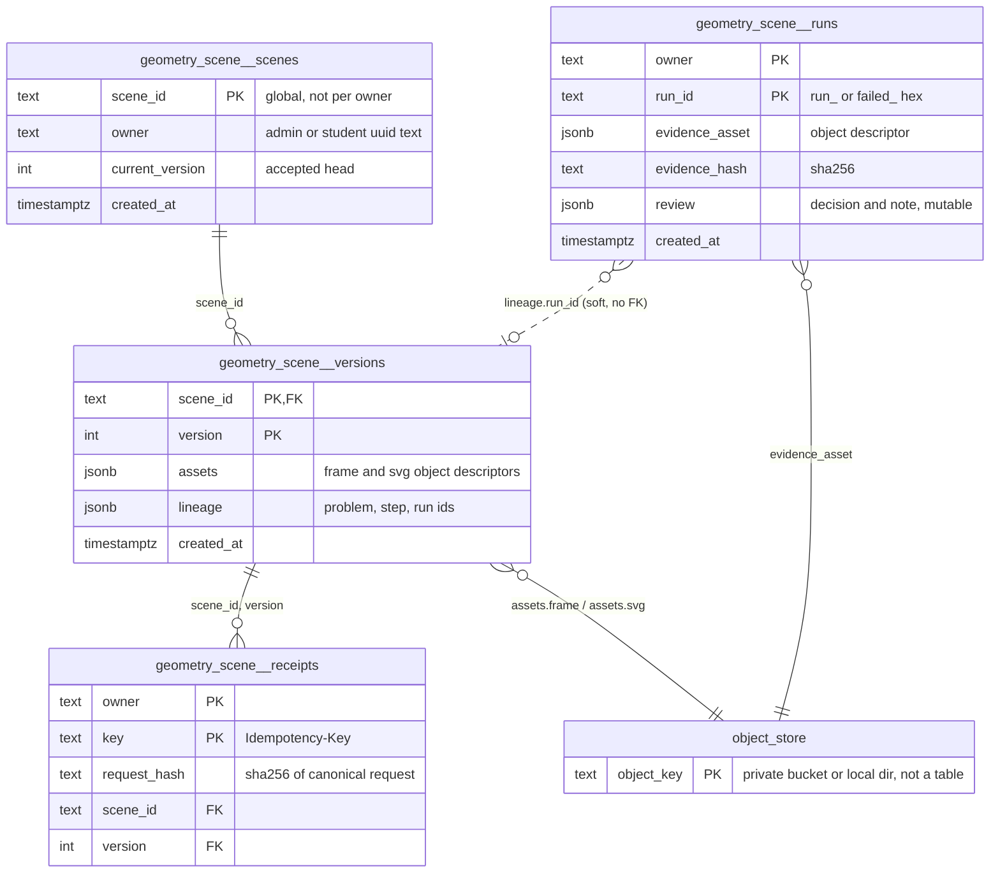
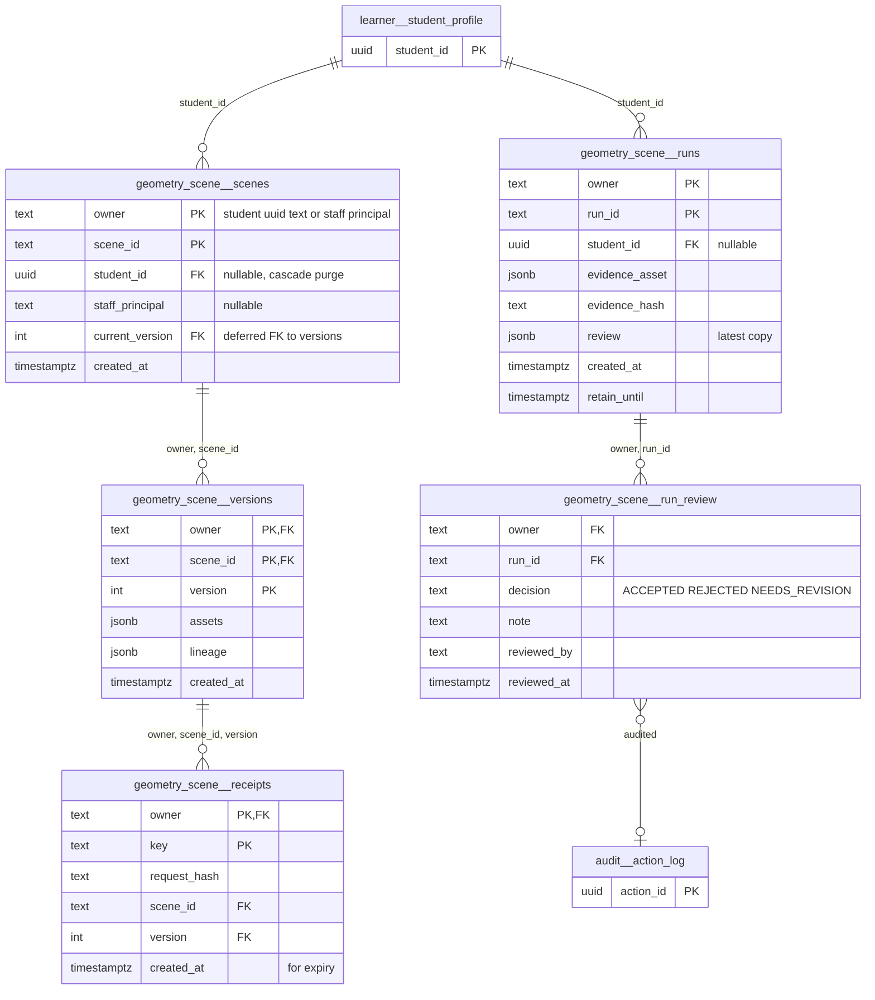

# `geometry_scene` schema — versioned geometry scenes, idempotency receipts and interpretation runs

The `geometry_scene` schema is the PostgreSQL storage behind the deterministic geometry scene engine ([mathbank-geometry-engine](../../../mathbank-geometry-engine/src/geometry_scene/)) when it is mounted inside mathbank-rest. It has four tables. `scenes` is one row per scene with its accepted head version. `versions` is an immutable, append-only list of accepted frames; each row points at private object-store blobs holding the frame JSON and the rendered SVG. `receipts` maps an owner-scoped `Idempotency-Key` to the version it produced. `runs` stores evidence from LLM interpretation runs: a pointer to an object-store JSON blob, plus a mutable staff `review`. Frames themselves are **not** stored in the database. The rows hold only `{object_key, sha256, size_bytes}` descriptors, and every read re-checks the size and hash.

Source of truth: migration [mathbank-rest/src/mathbank_rest/migrations/026_geometry_scenes.sql](../../../mathbank-rest/src/mathbank_rest/migrations/026_geometry_scenes.sql), applied by [scripts/migrate_geometry_scenes.py](../../../mathbank-rest/scripts/migrate_geometry_scenes.py) (`make migrate-geometry-scenes`). This schema is **not** in `mathbank-db/sql` and is therefore absent from the generated catalog (migrations 001–054). Columns and constraints here come directly from the SQL file. Endpoint mapping was traced from mathbank-rest and mathbank-geometry-engine source and manually verified (2026-11-02).

## 1. Purpose, ownership and data flow

**Domain.** The schema holds geometry diagrams that a tutor, an agent or a learner builds step by step: create a scene, apply deltas, and read or render any accepted version. It also holds the LLM "interpret this problem into a scene" pipeline, including its audit evidence and a staff review of each run.

**Where the schema lives (important).** Unlike every other application schema, `geometry_scene` is **created outside `mathbank-db/sql`**. The DDL is the mathbank-rest package resource `migrations/026_geometry_scenes.sql`. It is applied only on explicit request: `migrate_geometry_scenes.py --apply [--direct]` runs it in one transaction against the direct (non-pooler) Neon host, and nothing runs it at application start-up. Its number **026 collides with [mathbank-db 026_tutoring_routes.sql](../../../mathbank-db/sql/026_tutoring_routes.sql)**, so "migration 026" is ambiguous. No `mathbank-db` tooling, ETL or catalog extraction knows about this schema. §5.1 #1 recommends moving it.

**Write ownership.** All runtime SQL lives in one class, `PostgresGeometryRepository` in [geometry_storage.py](../../../mathbank-rest/src/mathbank_rest/geometry_storage.py). It is called from two routers:

| Path family | Router | Caller | Auth |
|---|---|---|---|
| `/v1/geometry-scenes` (7 engine paths) | built by `make_router(...)` in [geometry_scene/api.py](../../../mathbank-geometry-engine/src/geometry_scene/api.py) and mounted by [routers/geometry_scenes.py](../../../mathbank-rest/src/mathbank_rest/routers/geometry_scenes.py) | mathbank-web scene viewer [GeometryScene.jsx](../../../mathbank-web/app/_components/GeometryScene.jsx) via the proxy [geometryScenesProxy.mjs](../../../mathbank-web/lib/geometryScenesProxy.mjs) | `staff_or_student` ([routers/fluid.py:36](../../../mathbank-rest/src/mathbank_rest/routers/fluid.py)): admin key **or** learner JWT |
| `/v1/geometry-scenes/debug/runs...` | [routers/geometry_scenes.py:82-96](../../../mathbank-rest/src/mathbank_rest/routers/geometry_scenes.py) | admin page [GeometrySceneRun.jsx](../../../mathbank-web/app/admin/(protected)/geometry-scenes/GeometrySceneRun.jsx) | admin key only (`staff` dependency → 403 for learners) |
| `POST /v1/geometry-scenes/interpret` | [routers/geometry_interpretation.py](../../../mathbank-rest/src/mathbank_rest/routers/geometry_interpretation.py) → [geometry_orchestration.interpret](../../../mathbank-rest/src/mathbank_rest/geometry_orchestration.py) | mathbank-agent tool `generate_geometry_scene` ([geometry_scene_tools.py](../../../mathbank-agent/agents/mathbank_tutor/tools/geometry_scene_tools.py), learner bearer + `Idempotency-Key: geometry:<call_id>`) and the web proxy | `staff_or_student` |

**Owner model.** `owner` is the text `"admin"` for every admin-key caller and `str(student_id)` for a learner ([geometry_owner](../../../mathbank-rest/src/mathbank_rest/routers/geometry_scenes.py)). The standalone engine server uses `"standalone"`. No FK links it to `learner.student_profile`. Every scene read filters on `scenes.owner`.

**Write paths.**
1. **Create / apply delta.** `create` and `apply` call `_write`. `_write` first checks the receipt (`_replay`). If there is none, `_publish` re-validates the frame (it never trusts a caller-supplied PASS report) and takes `pg_advisory_xact_lock` on `["scene", scene_id]`. It then does one of two things:
   - Initial version: inserts `scenes(current_version=0)`.
   - Later versions: checks `current_version = expected_version` and that `apply_delta(previous) == frame`.

   After that it uploads `frame.json` and `frame.svg` to the object store, inserts `versions`, compare-and-swaps `scenes.current_version`, and inserts the `receipts` row. Everything happens in one transaction. Objects uploaded inside a transaction that rolls back are deleted ([geometry_storage.py:56-71](../../../mathbank-rest/src/mathbank_rest/geometry_storage.py)).
2. **Interpretation.** `interpret` first calls `lookup_receipt` (replay). It then runs the LLM orchestration and writes `runs` through `save_run` on both success and failure. On success it publishes through `commit_candidate`, with `lineage = {problem_id, solution_step_id, current_math_step, run_id}`.
3. **Failed candidates.** When `_publish` raises `InvalidFrame`, `_write` records a `runs` row with ID `failed_<uuid>` in a **separate** transaction after the rollback ([geometry_storage.py:193-206](../../../mathbank-rest/src/mathbank_rest/geometry_storage.py)).
4. **Staff review.** `review_run` updates only `runs.review`.

**Readers.** Only `PostgresGeometryRepository`. No ETL, Neo4j projector, ML job or other service reads these tables. The engine's own SQLite `Repository` ([repository.py](../../../mathbank-geometry-engine/src/geometry_scene/repository.py)) has a different, file-local shape (`scenes`/`frames(payload)`/`receipts`) and is used only by the standalone server and tests.

**Tests.** [test_geometry_postgres.py](../../../mathbank-rest/tests/test_geometry_postgres.py) applies the same SQL into a throwaway schema and is opt-in through `GEOMETRY_TEST_POSTGRES_DSN`. It also checks that the immutability triggers reject tampering.

**Privacy class.** Learner-private. Scenes, versions and receipts are owner-scoped. Run evidence contains full LLM prompts, responses and the learner's problem text (`provider_calls`, `request`), so it is **staff-only** and read only through the debug routes.

## 2. Entity diagram — as-is

## 3. Tables

### `geometry_scene.scenes`

**Role.** Each row is the identity and head pointer of one geometry scene. `_publish` inserts the row with `current_version = 0` when it accepts the initial frame. Each accepted delta then moves the pointer with a compare-and-swap update (`... AND current_version = :expected`). Readers resolve "current" through this row and use it as the ownership gate: `_head` and `_read` both filter `owner = :owner`.

**Table type (§4).** Revisioned authoring object (head pointer). `current_version` is the revision, and the versions behind it are immutable snapshots. Clients change it only through `POST .../deltas` with `expected_version`, never through a PATCH.

**Lifecycle.** Inserted once and then only `current_version` moves forward. There is no delete path: deleting a scene is blocked because its `versions` rows reference it with NO ACTION and are themselves undeletable (trigger). There is no status, archive or retention policy.

**Columns**

| Column | Type | Null | Default | Description |
|---|---|---|---|---|
| `scene_id` | text | NO | — | Global scene identity. It matches the engine `Identifier` pattern `^[A-Za-z][A-Za-z0-9_]{0,63}$` (Pydantic and path validation only; there is no DB CHECK). The server generates `scene_<uuid hex>` when `SceneInput.scene_id` is omitted, and interpretation always generates it. A client may choose it on `POST /v1/geometry-scenes`. |
| `owner` | text | NO | — | Owner namespace: `"admin"` (all admin-key callers share it), the learner's `student_id` as text, or `"standalone"`. There is no FK. |
| `current_version` | integer | NO | — | Accepted head version, starting at 0 and moving by +1 per accepted delta. CHECK `>= 0`. It always equals the highest `versions.version` for the scene, but this is enforced only by the code (no FK or trigger). |
| `created_at` | timestamptz | NO | `now()` | Creation time of the scene row. |

**Keys, constraints, indexes.**
- PK `scene_id`. This is global, not `(owner, scene_id)`, so a learner who picks an ID that another owner already uses gets 409 `scene identity already exists`, which reveals that the ID exists.
- CHECK `current_version >= 0`.
- Index `geometry_scene_owner_idx (owner)`. No code path lists scenes by owner today.
- No FK from `(scene_id, current_version)` to `versions`. No triggers.

**REST operations today.**

| Op | Method & path | Auth | Handler | Notes |
|---|---|---|---|---|
| C | POST /v1/geometry-scenes | Admin key or learner JWT | engine `api.create` → `PostgresGeometryRepository.create` | 201. Optional `Idempotency-Key`. `authorize_math_status` rejects learner-submitted `PROVEN`/`DISPROVEN` relations (422). |
| R,U | POST /v1/geometry-scenes/{scene_id}/deltas | Admin key or learner JWT | engine `api.delta` → `apply` | CAS on `current_version` with `StateDelta.expected_version`. 409 `SCENE_VERSION_CONFLICT` on mismatch. |
| C / R,U | POST /v1/geometry-scenes/interpret | Admin key or learner JWT | `geometry_interpretation.interpret_scene` → `geometry_orchestration.interpret` → `commit_candidate` | Synchronous LLM orchestration (OpenAI, up to `GEOMETRY_MAX_CALLS`=9 calls and 120 s), then publishes. Learners cannot send `trusted_facts`, and `solve_attempt_id` is ownership-checked through `step_runtime.get_runtime`. |
| R | GET /v1/geometry-scenes/{scene_id} | Admin key or learner JWT | engine `api.current` → `current` | Owner-scoped. Solver diagnostics are reduced to `tool_versions` (`expose_solver_diagnostics=False`). |
| R | GET /v1/geometry-scenes/{scene_id}/frames | Admin key or learner JWT | engine `api.frames` → `frames` | Owner check through `_head`, then lists versions. |
| R | GET /v1/geometry-scenes/{scene_id}/versions/{version}[/render] and POST .../validate | Admin key or learner JWT | engine `api.read` / `render_version` / `validate` | Join on `scenes.owner`. See `versions`. |

### `geometry_scene.versions`

**Role.** Each row is one accepted, validated frame of a scene. The row does not hold the frame itself, only `assets`: object-store descriptors for the frame JSON (math state, scene state, visual state, validation report, applied delta) and for the SVG. On every read, `_read` downloads both blobs, checks `size_bytes` and `sha256`, re-parses the `Frame`, re-checks `version`/`scene_id` identity, and re-runs `validate_frame`. Any mismatch returns 503 `GEOMETRY_STORAGE_UNAVAILABLE` ("stored geometry frame is corrupt").

**Table type (§4).** Release / snapshot. Rows are immutable and append-only: the trigger `immutable_geometry_versions` rejects UPDATE and DELETE.

**Lifecycle.** Inserted only inside `_publish`, in the same transaction as the `scenes` insert or CAS and the receipt. It is never updated or deleted. The trigger raises `accepted geometry versions and receipts are immutable`. The object-store blobs are never garbage-collected.

**Columns**

| Column | Type | Null | Default | Description |
|---|---|---|---|---|
| `scene_id` | text | NO | — | Scene → `geometry_scene.scenes.scene_id` (NO ACTION). |
| `version` | integer | NO | — | Frame version: 0 for the initial frame, `expected_version + 1` for each delta. CHECK `>= 0`. Must equal `frame.scene_state.version`. |
| `assets` | jsonb | NO | — | `{"frame": {object_key, sha256, size_bytes}, "svg": {object_key, sha256, size_bytes}}`. `object_key` is `<uuid hex>.json` / `<uuid hex>.svg` from [object_store.put_bytes](../../../mathbank-rest/src/mathbank_rest/object_store.py) (S3 `IfNoneMatch="*"` or a local write-once file). Each blob is limited to 25 MiB. The frame JSON is the canonical (`sort_keys`, compact) `Frame` dump without `svg`. |
| `lineage` | jsonb | NO | `'{}'::jsonb` | Provenance; at most 64 KiB (checked in code). Empty for direct create/delta. Interpretation writes `{problem_id, solution_step_id, current_math_step, run_id}`, where `run_id` points softly at `runs.run_id` (no FK). |
| `created_at` | timestamptz | NO | `now()` | Acceptance time. |

**Keys, constraints, indexes.**
- PK `(scene_id, version)`. This index also serves `frames()` (`WHERE scene_id ORDER BY version`).
- FK `scene_id` → `geometry_scene.scenes` (NO ACTION).
- CHECK `version >= 0`.
- Trigger `immutable_geometry_versions` BEFORE UPDATE OR DELETE → `geometry_scene.reject_accepted_mutation()`.
- There are no CHECKs on the `assets` shape or the hash format.

**REST operations today.**

| Op | Method & path | Auth | Handler | Notes |
|---|---|---|---|---|
| C | POST /v1/geometry-scenes, POST /v1/geometry-scenes/{scene_id}/deltas, POST /v1/geometry-scenes/interpret | Admin key or learner JWT | `_publish` | One row per accepted frame. |
| R | GET /v1/geometry-scenes/{scene_id}/versions/{version} | Admin key or learner JWT | engine `api.read` → `read` | Returns the full frame JSON plus `frame_asset.content_path`. |
| R | GET /v1/geometry-scenes/{scene_id}/versions/{version}/render | Admin key or learner JWT | engine `api.render_version` | `image/svg+xml`, `Cache-Control: private, no-store`, CSP `sandbox`. |
| R | POST /v1/geometry-scenes/{scene_id}/versions/{version}/validate | Admin key or learner JWT | engine `api.validate` | Read-only re-validation that uses POST. It passes `authorize_math_status` because the path does not end in `/deltas`. |
| R | GET /v1/geometry-scenes/{scene_id}/frames | Admin key or learner JWT | engine `api.frames` | `{frames: [{version, render_path}]}`. Not paginated. |
| R | GET /v1/geometry-scenes/{scene_id} | Admin key or learner JWT | engine `api.current` | Reads the head version. |

### `geometry_scene.receipts`

**Role.** An owner-scoped idempotency ledger. A row records that `(owner, Idempotency-Key)` produced `(scene_id, version)` from a request whose canonical SHA-256 is `request_hash`. A retry with the same key and hash replays the stored frame (`replayed: true`). The same key with a different hash returns 409 `IDEMPOTENCY_CONFLICT`. An advisory lock on `["receipt", [owner, key]]` serialises concurrent attempts. Interpretation looks up the receipt *before* calling the LLM (`lookup_receipt`). Concurrent misses can still both call the provider, but only one can publish.

**Table type (§4).** Audit / idempotency ledger. Rows are append-only and immutable: the trigger `immutable_geometry_receipts` rejects UPDATE and DELETE. It is an internal table with no resource of its own.

**Lifecycle.** Inserted in `_publish` only when a key was supplied. Never updated or deleted, with no expiry or TTL.

**Columns**

| Column | Type | Null | Default | Description |
|---|---|---|---|---|
| `owner` | text | NO | — | Same owner namespace as `scenes.owner`. It is not constrained to equal the referenced scene's owner. |
| `key` | text | NO | — | The `Idempotency-Key` header value, 1–200 characters (checked in code and by the header `max_length`). The agent sends `geometry:<function_call_id>`. |
| `request_hash` | text | NO | — | Hex SHA-256 of canonical JSON. The input depends on the operation: `["create", SceneInput]`, `["apply:<scene_id>", StateDelta]`, `["interpret", GeometryRequest]`, or `["candidate", frame, expected_version, lineage]`. |
| `scene_id` | text | NO | — | Scene that the request produced. Part of the composite FK. |
| `version` | integer | NO | — | Version that the request produced. Part of the composite FK. |

**Keys, constraints, indexes.**
- PK `(owner, key)`.
- FK `(scene_id, version)` → `geometry_scene.versions (scene_id, version)` (NO ACTION).
- Trigger `immutable_geometry_receipts` BEFORE UPDATE OR DELETE → `reject_accepted_mutation()`.
- No `created_at` column, so receipts cannot be expired. No index on `(scene_id, version)`, but nothing reads by it.

**REST operations today.**

| Op | Method & path | Auth | Handler | Notes |
|---|---|---|---|---|
| C,R | POST /v1/geometry-scenes, POST /v1/geometry-scenes/{scene_id}/deltas | Admin key or learner JWT | `_replay` + `_publish` | Only used when `Idempotency-Key` is sent. |
| C,R | POST /v1/geometry-scenes/interpret | Admin key or learner JWT | `lookup_receipt` (pre-LLM) + `commit_candidate` | The hash covers the raw request body, so a retry skips the paid LLM call. |

### `geometry_scene.runs`

**Role.** Each row is the evidence record of one geometry interpretation run, or of one rejected candidate frame. The evidence JSON lives in the object store, and `evidence_asset` points to it. For orchestration, that JSON is `{schema_version, prompt_version, theorem_snapshot, request, model, attempts[], calls, provider_calls, elapsed_seconds, status: ACCEPTED|FAILED}`, and on success also `candidate_scene_id` and `publication_status: "REVIEWED_CANDIDATE"`. For `failed_*` rows it is `{status: "FAILED_CANDIDATE", request_hash, frame}`. `save_run` is idempotent per `(owner, run_id)`: a second save with the same hash is a no-op, and one with a different hash returns 409. Staff can attach a `review`.

**Table type (§4).** Queue / job / run (evidence log). The evidence columns are append-only: the trigger `immutable_geometry_run_evidence` allows an UPDATE only when it changes `review` alone.

**Lifecycle.** The row is inserted by `save_run` in three cases: after an orchestration failure, before publishing a successful candidate, and after an `InvalidFrame` rejection. A successful run is therefore persisted even if the later `commit_candidate` fails with a version conflict. Staff set `review` through the review route, and it can be overwritten any number of times. DELETE is always rejected by the trigger. There is no retention policy, although the evidence contains learner problem text and full LLM transcripts.

**Columns**

| Column | Type | Null | Default | Description |
|---|---|---|---|---|
| `owner` | text | NO | — | Owner namespace of the caller who triggered the run (`"admin"`, the learner's `student_id` text, or `"standalone"`). |
| `run_id` | text | NO | — | 1–200 characters (checked in code). Either `run_<uuid hex>` (interpretation) or `failed_<uuid hex>` (rejected candidate). Returned to the client in error details (`detail.run_id`) so staff can look it up. |
| `evidence_asset` | jsonb | NO | — | Object descriptor `{object_key, sha256, size_bytes}` of the evidence JSON (`<uuid>.json`, ≤ 25 MiB). Immutable. |
| `evidence_hash` | text | NO | — | Hex SHA-256 of the canonical evidence JSON. This is the idempotency comparator for repeated `save_run` calls. Immutable. |
| `review` | jsonb | YES | — | Staff verdict `{decision: ACCEPTED\|REJECTED\|NEEDS_REVISION, note: str ≤ 4000}` (Pydantic `Review`). NULL until reviewed. Overwritten in place, with no reviewer or time recorded. |
| `created_at` | timestamptz | NO | `now()` | Insert time. `list_runs` sorts by it. Immutable. |

**Keys, constraints, indexes.**
- PK `(owner, run_id)`.
- Trigger `immutable_geometry_run_evidence` BEFORE UPDATE OR DELETE → `geometry_scene.protect_run_evidence()`. It rejects DELETE and any change to `owner`, `run_id`, `evidence_asset`, `evidence_hash` or `created_at`.
- No CHECK on the `review` shape. There is no index for `WHERE owner ORDER BY created_at DESC` (the PK prefix covers the filter but not the sort).

**REST operations today.**

| Op | Method & path | Auth | Handler | Notes |
|---|---|---|---|---|
| C | POST /v1/geometry-scenes/interpret | Admin key or learner JWT | `geometry_orchestration.interpret` → `save_run` | Written on success and on `OrchestrationFailure`. |
| C | POST /v1/geometry-scenes, POST .../deltas, POST .../interpret | Admin key or learner JWT | `_write` → `save_run("failed_…")` on `InvalidFrame` | Separate transaction after the rollback. |
| R | GET /v1/geometry-scenes/debug/runs?owner=&limit= | Admin key (X-Admin-Api-Key) | `geometry_scenes.list_runs` → `list_runs` | `owner` is required. `limit` 1–100, default 50. Returns `{run_id, created_at, review}` only. There is no cross-owner listing or offset. |
| R | GET /v1/geometry-scenes/debug/runs/{run_id}?owner= | Admin key (X-Admin-Api-Key) | `geometry_scenes.read_run` → `read_run` | Returns the full evidence JSON (hash-verified). |
| U | POST /v1/geometry-scenes/debug/runs/{run_id}/review?owner= | Admin key (X-Admin-Api-Key) | `geometry_scenes.review_run` → `review_run` | Overwrites `review`. Writes no `audit.action_log` row. |

## 4. CRUD coverage — as-is

| Table | Table type | Create | Read | Update | Delete | List | Notes |
|---|---|---|---|---|---|---|---|
| `geometry_scene.scenes` | Revisioned authoring object (head) | ✅ `POST /v1/geometry-scenes`, `/interpret` | ✅ `GET /{scene_id}` | ✅ head CAS via `/deltas`, `/interpret` | ❌ (impossible: blocked by immutable versions) | ❌ none (owner index unused) | No "my scenes" list, no archive. |
| `geometry_scene.versions` | Release / snapshot | ✅ via create/delta/interpret | ✅ `GET .../versions/{v}`, `/render`, `POST .../validate` | — (trigger) | — (trigger) | ✅ `GET /{scene_id}/frames` | Unpaginated list. |
| `geometry_scene.receipts` | Idempotency ledger | ✅ (internal) | ✅ (internal replay) | — (trigger) | — (trigger) | — | No expiry; no `created_at`. |
| `geometry_scene.runs` | Run / evidence log | ✅ (internal `save_run`) | ✅ `GET /debug/runs/{run_id}` (staff) | ✅ `review` only, `POST .../review` (staff) | — (trigger) | ✅ `GET /debug/runs?owner=` (staff, per owner) | No cross-owner triage queue; review not audited. |

**Findings.**
1. **Schema outside `mathbank-db/sql`, with a colliding number.** `026_geometry_scenes.sql` is applied by a one-off script. That script's presence check covers `versions`, `receipts` and `runs` but not `scenes` ([migrate_geometry_scenes.py](../../../mathbank-rest/scripts/migrate_geometry_scenes.py)). The schema is invisible to catalog generation and to the mathbank-db migration order, and its number collides with mathbank-db `026_tutoring_routes.sql`.
2. **`owner` is unconstrained text.** There is no FK to `learner.student_profile`, every admin-key caller shares one `"admin"` namespace, and receipts are not tied to the scene owner. Learner deletion leaves orphaned scenes and runs. Because the immutability triggers block DELETE, there is no erasure path for learner-private evidence at all.
3. **Global `scene_id` lets one owner learn about another's scenes.** A learner can `POST /v1/geometry-scenes` with a chosen `scene_id`, and the 409 "scene identity already exists" confirms that another owner's scene exists. Reads are owner-scoped, so the content does not leak.
4. **Run reviews are unaudited and overwrite each other.** `review_run` replaces `review` without reviewer, timestamp or `audit.action_log` row (guide §5 Create/Update). Staff debug routes accept any `owner` query value. That is acceptable for staff, but there is no listing across owners to find unreviewed runs.
5. **Synchronous paid work in a request.** `POST /interpret` runs up to 9 LLM calls with a 120 s deadline inline (guide §5 Bulk and jobs). It is at least an authenticated POST with pre-call receipt replay.
6. **SQL lives in a dedicated storage module, not the router.** This follows guide §2, but the module is not under `db/` and has no `*_service` naming. Domain errors map cleanly to HTTP (404/409/422/503).
7. **Object blobs are never collected.** Rolled-back uploads are deleted, but nothing removes the blobs of rows that stay. Since rows cannot be deleted, the blobs live forever.

## 5. Target state — how it should be

### 5.1 Schema improvements

1. **P1: Move the schema into `mathbank-db/sql`.** Add `mathbank-db/sql/NNN_geometry_scene.sql` with the next free number (after 054) and the same idempotent DDL (`CREATE ... IF NOT EXISTS`, `CREATE OR REPLACE FUNCTION`, `DROP TRIGGER IF EXISTS`), so it is a no-op on databases where `make migrate-geometry-scenes` already ran. Then:
   - Delete `mathbank-rest/src/mathbank_rest/migrations/026_geometry_scenes.sql` and turn `migrate_geometry_scenes.py` into a presence check that also checks `scenes`.
   - Point `test_geometry_postgres.py` at the new file.
   - Regenerate `generated/catalog.json` so this document can be catalog-backed like the others.

   This removes the duplicate "026" and puts the schema in the normal migration order and review process (guide §2, Schema row).
2. **P1: Bind `owner` to a real principal.** Replace `owner text` with `student_id uuid NULL REFERENCES learner.student_profile ON DELETE ...` plus `staff_principal text NULL`, with `CHECK (num_nonnulls(student_id, staff_principal) = 1)`. Alternatively, keep `owner` and add a generated `student_id` column with an FK. Record the individual staff identity instead of the shared `"admin"`.
3. **P1: Add a learner-erasure path.** Add a `SECURITY DEFINER` purge function, or a session flag such as `SET LOCAL geometry_scene.allow_purge = on`, that the triggers honour only for an admin purge. The purge deletes `receipts` → `versions` → `scenes` and `runs` for one owner, deletes their object keys, and writes `audit.action_log`. Today the triggers make deletion impossible.
4. **P2: Make the scene ID per-owner, or stop accepting client-chosen IDs from learners.** Either change the PK to `(owner, scene_id)` (and carry `owner` into the `versions` and `receipts` FKs), or ignore `SceneInput.scene_id` for learner callers. Add `CHECK (scene_id ~ '^[A-Za-z][A-Za-z0-9_]{0,63}$')`.
5. **P2: Enforce head consistency.** Add a `DEFERRABLE INITIALLY DEFERRED` FK `(scene_id, current_version)` → `versions(scene_id, version)`. The initial insert happens before the version row in the same transaction, so the FK must be deferred.
6. **P2: Tie receipts to the owner.** Once the PK includes `owner`, use a composite FK `(owner, scene_id, version)`. Add `created_at timestamptz NOT NULL DEFAULT now()` so receipts can expire (e.g. 30 days) through an allowed purge.
7. **P2: Make reviews auditable.** Add `reviewed_by text`, `reviewed_at timestamptz` and `CHECK (review IS NULL OR review->>'decision' IN ('ACCEPTED','REJECTED','NEEDS_REVISION'))`. Better still, add an append-only `geometry_scene.run_review(owner, run_id, decision, note, reviewed_by, reviewed_at)` table and keep `runs.review` as the latest copy. Write `audit.action_log` on each review.
8. **P3: Add indexes for the existing queries.** Add `runs (owner, created_at DESC, run_id)` for `list_runs`, and a partial `runs (created_at DESC) WHERE review IS NULL` for a staff triage queue.
9. **P3: Add CHECKs on the descriptors.** Add `CHECK (evidence_hash ~ '^[0-9a-f]{64}$')`, `CHECK (request_hash ~ '^[0-9a-f]{64}$')`, and `jsonb` shape checks (`assets ? 'frame' AND assets ? 'svg'`, `evidence_asset ? 'object_key'`).
10. **P3: Set a retention policy for run evidence.** Evidence contains learner text and full LLM transcripts. Add `retain_until` or a scheduled purge (through the allowed purge path above) that also deletes the object blobs.

### 5.2 Entity diagram — target

### 5.3 Endpoints to build

| Priority | Method & path | Auth | Table(s) / op | Table type | Purpose | Notes (validation, concurrency, audit) |
|---|---|---|---|---|---|---|
| P1 | `GET /v1/geometry-scenes?limit=&offset=&sort=-created_at` | Learner JWT (owner-scoped) or admin key | `scenes` / list | Revisioned authoring object | "My scenes" list for the learner workspace; uses the existing owner index. | `WHERE owner = :owner` in SQL; `{items,total,limit,offset}`; limit ≤ 200. |
| P1 | `POST /v1/admin/geometry-scenes/owners/{owner}/purge` | Admin key (X-Admin-Api-Key) | all four tables / D | — | Learner erasure (GDPR) through the allowed purge path (§5.1 #3). | Returns 202 + job id. Deletes object blobs. Writes `audit.action_log`. Dry-run flag that returns counts. |
| P2 | `GET /v1/admin/geometry-scenes/runs?owner=&review=NONE\|ACCEPTED\|REJECTED\|NEEDS_REVISION&status=&limit=&offset=` | Admin key (X-Admin-Api-Key) | `runs` / list | Queue / job / run | Cross-owner triage queue that replaces the per-owner `/debug/runs`. | Keyset or offset pagination. Returns `{run_id, owner, created_at, review}` only; full evidence stays on the detail route. |
| P2 | `POST /v1/admin/geometry-scenes/runs/{owner}/{run_id}/reviews` | Admin key (X-Admin-Api-Key) | `run_review` / C, `runs.review` / U | Learner event / evidence (append-only) | Replaces `POST /debug/runs/{run_id}/review`, keeping history and reviewer. | Body `{decision: Literal[...], note ≤ 4000}`. Writes `audit.action_log`. Returns 201. |
| P2 | `POST /v1/geometry-scenes/interpret` → 202 + `GET /v1/geometry-scenes/interpret-jobs/{run_id}` | Learner JWT / admin key | `runs` / C+R | Queue / job / run | Move the multi-call LLM orchestration out of the request (guide §5 Bulk and jobs). | Keep the `Idempotency-Key` receipt replay. The job publishes through `commit_candidate`. |
| P3 | `GET /v1/geometry-scenes/{scene_id}/frames?limit=&after_version=` | Learner JWT / admin key | `versions` / list | Release / snapshot | Paginate long scene histories. | Keyset on `version`. |
| P3 | `POST /v1/admin/geometry-scenes/receipts/expire?older_than_days=30` | Admin key (X-Admin-Api-Key) | `receipts` / D | Idempotency ledger | Expire old receipts after `created_at` is added (§5.1 #6). | Returns 202 + job id. Allowed purge path only. Audited. |
