# `ingest` schema — content-package import, staging, reconciliation and corpus review

`ingest` holds the operational evidence for getting content into the canonical schemas: textbook content packages (manifest, files, per-row staging with validation results, conflicts, reconciliation counts, status history), the append-only audit of admin import-review decisions, and the review-gated corpus-authoring drafts (text edits, figures, AI/admin-authored new problems) that are the only REST path into `core.problem`.

Source of truth: migrations [010](../../../mathbank-db/sql/010_textbook_import.sql) (package tables), [019](../../../mathbank-db/sql/019_admin_import_review.sql) (`admin_review_action`, `import_conflict.decision/decided_at`), [025](../../../mathbank-db/sql/025_corpus_authoring.sql) (`corpus_draft`), [030](../../../mathbank-db/sql/030_ai_proposed_taxonomy.sql) (seeds the synthetic `route-compiler-ai-proposed-taxonomy` package). Catalog extracted 2026-11-01 from migrations 001–054; endpoint mapping traced from mathbank-rest source and manually verified.

## 1. Purpose, ownership and data flow

- **Package import (ETL-owned).** [import_textbook_package.py](../../../mathbank-db/etl/import_textbook_package.py) (`make` targets `textbook-import*`) is the sole writer of `content_package`, `package_file`, `staging_row`, `import_conflict` (detection), `reconciliation` and `package_status_event`. Flow per run (`run()`):
  1. `register()` — upsert `content_package` on `(package_name, package_version, manifest_hash)`; first insert logs a `REGISTERED` status event; upsert one `package_file` per CSV/asset with sha256.
  2. `set_status(VALIDATING)` → `stage_rows()` — `DELETE` + `COPY` all `staging_row`s for the package; upsert `import_conflict` (updates severity/detail, preserves admin `decision`).
  3. `set_status(IMPORTING)` → `import_plan()` writes `core.*`, `knowledge.*`, `pedagogy.*`; `stage_rows()` again to persist DB-discovered conflicts.
  4. `set_status(RECONCILING)` → `reconcile()` upserts one `reconciliation` row per entity type, marks `VALID` staging rows `IMPORTED`, stores `report`.
  5. `set_status(POSTGRES_COMPLETE | FAILED)`; `POSTGRES_COMPLETE` also inserts outbox event `CONTENT_PACKAGE_IMPORTED`, which `outbox_worker` turns into `pipeline.projection_request`s (see [pipeline.md](pipeline.md)).
  Every `set_status` appends `package_status_event`. Downstream, [embed_textbook_steps.py](../../../mathbank-db/etl/embed_textbook_steps.py) and [project_textbook_steps.py](../../../mathbank-graph/etl/project_textbook_steps.py) merge `vector_projection` / `graph_projection` summaries into `content_package.report` (they never advance `status`).
- **Admin review (REST-owned).** [routers/admin_imports.py](../../../mathbank-rest/src/mathbank_rest/routers/admin_imports.py) → [db/import_admin.py](../../../mathbank-rest/src/mathbank_rest/db/import_admin.py): reads packages/issues/conflicts/reconciliation, records conflict decisions, and every mutation (conflict decision, projection request, learning-item review, step edit, dependency upsert/reject, DAG review) writes one `admin_review_action` row in the same transaction.
- **Corpus authoring (REST-owned).** [routers/admin_corpus.py](../../../mathbank-rest/src/mathbank_rest/routers/admin_corpus.py) → [corpus_authoring.py](../../../mathbank-rest/src/mathbank_rest/corpus_authoring.py): drafts are created (`DRAFT`), optionally revised (NEW_PROBLEM only, `revision+1`), then `APPROVED` (applied to `core.*`) or `REJECTED`; trigger `protect_corpus_draft` freezes reviewed drafts.
- **Readers.** Admin import UI (`/v1/admin/imports/*`), admin textbook pages (`/v1/admin/textbooks/*` via [db/textbook_admin.py](../../../mathbank-rest/src/mathbank_rest/db/textbook_admin.py)), route compiler ([route_compiler.py](../../../mathbank-rest/src/mathbank_rest/route_compiler.py) `ai_taxonomy_package_id()` reads the synthetic package), project_textbook_steps.py (`READY_STATUSES`).
- **REST-boundary note.** `mathbank-ml-training`/`mathbank-ml-inference` connect to Postgres directly (see [core.md §1](core.md#1-purpose-ownership-and-data-flow)) but are not specified to read `ingest`.
- **Lifecycle.** Package tables: re-runnable, idempotent, rows never deleted except `staging_row` (replaced each run) and cascade from `content_package`. `admin_review_action`: append-only (trigger). `corpus_draft`: DRAFT → APPROVED/REJECTED, then immutable (trigger).
- **Privacy class.** Staff-only operational data. `corpus_draft.payload` may contain unreviewed solutions/answers and `object_key` points at private object storage (`Cache-Control: private, no-store`).

## 2. Entity diagram — as-is

```mermaid
erDiagram
    ingest__content_package ||--o{ ingest__package_file : "content_package_id"
    ingest__content_package ||--o{ ingest__staging_row : "content_package_id"
    ingest__content_package ||--o{ ingest__import_conflict : "content_package_id"
    ingest__content_package ||--o{ ingest__reconciliation : "content_package_id"
    ingest__content_package ||--o{ ingest__package_status_event : "content_package_id"
    ingest__content_package |o--o{ pedagogy__solution_step : "content_package_id"
    ingest__content_package |o--o{ pedagogy__taxonomy_node : "content_package_id"
    core__problem |o--o{ ingest__corpus_draft : "problem_id"

    ingest__content_package {
        uuid content_package_id PK
        text package_name "UK part"
        text package_version "UK part"
        text manifest_hash "UK part"
        text book_code
        text status "CHECK 10 states"
        text last_scope
        jsonb report
    }
    ingest__package_file {
        uuid content_package_id PK,FK
        text relative_path PK
        text file_role "RAW ENRICHED ASSET"
        text sha256
        bigint byte_size
    }
    ingest__staging_row {
        bigint staging_row_id PK
        uuid content_package_id FK
        text source_file "UK part"
        int source_row_number "UK part"
        text entity_type
        text validation_status "CHECK"
        jsonb validation_errors
    }
    ingest__import_conflict {
        bigint conflict_id PK
        uuid content_package_id FK
        text entity_type "UK part"
        text external_id "UK part"
        text conflict_type "UK part"
        text severity "CHECK"
        text resolution_status "CHECK"
        text decision "CHECK"
    }
    ingest__reconciliation {
        uuid content_package_id PK,FK
        text scope PK
        text entity_type PK
        int source_count
        int present_in_db
        bool reconciled
    }
    ingest__package_status_event {
        bigint event_id PK
        uuid content_package_id FK
        text from_status
        text to_status
        timestamptz created_at
    }
    ingest__admin_review_action {
        bigint action_id PK
        text target_type "CHECK"
        text target_id "polymorphic, no FK"
        text action
        jsonb before_state
        jsonb after_state
    }
    ingest__corpus_draft {
        uuid draft_id PK
        text kind "CHECK"
        uuid problem_id FK
        jsonb payload
        text state "CHECK"
        text origin "CHECK"
        int revision
    }
    core__problem {
        uuid problem_id PK
    }
    pedagogy__solution_step {
        text solution_step_id PK
    }
    pedagogy__taxonomy_node {
        text taxonomy_node_id PK
    }
```

(`content_package` is also referenced, NO ACTION, by `pedagogy.chapter_section, diagram, learning_item, problem_enrichment, problem_source_ref, solution_part, solution_source_ref, solution_step_dependency, taxonomy_edge`; two shown as examples.)

## 3. Tables

### `ingest.admin_review_action`

**Role.** One row per admin decision taken through `/v1/admin/imports` — the audit trail for import-conflict decisions, projection requests, learning-item reviews, solution-step edits, dependency create/change/reject and semantic-DAG reviews. Written by `db.import_admin._audit()` in the same transaction as the change, so an action without its effect (or vice versa) cannot exist. Read by `GET /v1/admin/imports/actions` and the per-problem DAG view.

**Lifecycle.** Append-only: trigger `admin_review_action_append_only` raises on any UPDATE or DELETE. No retention policy.

**Columns**

| Column | Type | Null | Default | Description |
|---|---|---|---|---|
| action_id | bigint | NO | nextval('ingest.admin_review_action_action_id_seq'::regclass) | Monotonic PK (bigserial); returned to the caller as `action_id`. |
| target_type | text | NO | — | Kind of object acted on. CHECK: `IMPORT_CONFLICT`, `SOLUTION_STEP`, `STEP_DEPENDENCY`, `SOLUTION_DAG`, `LEARNING_ITEM`, `PROJECTION_REQUEST`. |
| target_id | text | NO | — | Polymorphic id of the target (no FK): `conflict_id`, `solution_step_id`, `<code>|<from>-><to>` for dependencies, `problem_id` for DAG review, `learning_item_id`, `projection_request_id`. |
| action | text | NO | — | Verb (free text): conflict decision (`KEEP_EXISTING`/`ACCEPT_INCOMING`/`MERGE_MANUALLY`), `REQUEST`, item decision (`APPROVED`/`REJECTED`/`NEEDS_REVISION`), `EDIT`, `CREATE`/`CHANGE_TYPE`/`REJECT`, DAG status (`APPROVED`/`NEEDS_REVISION`). |
| before_state | jsonb | yes | — | Snapshot of the target's relevant columns before the change (NULL for creations/requests). |
| after_state | jsonb | yes | — | Snapshot after the change (RETURNING row or request descriptor). |
| note | text | yes | — | Optional admin note (≤2000 chars at the API). |
| actor | text | NO | 'admin'::text | Who acted. Always the default `admin` — the shared admin key carries no identity. |
| created_at | timestamptz | NO | now() | Action time. |

**Keys, constraints, indexes.**
- PK `action_id`; CHECK on `target_type`.
- Index `admin_review_action_target_idx (target_type, target_id, created_at DESC)`.
- Trigger `admin_review_action_append_only` BEFORE UPDATE OR DELETE → raises.

**REST operations today.**

| Op | Method & path | Auth | Handler | Notes |
|---|---|---|---|---|
| C | POST /v1/admin/imports/conflicts/{conflict_id}/decision | Admin key (X-Admin-Api-Key) | `routers.admin_imports.decide_conflict` → `db.import_admin.decide_conflict` | `IMPORT_CONFLICT`. |
| C | POST /v1/admin/imports/projection-requests | Admin key | `request_projection` | `PROJECTION_REQUEST` / `REQUEST` (also when coalesced). |
| C | POST /v1/admin/imports/learning-items/{learning_item_id}/review | Admin key | `review_learning_item` | `LEARNING_ITEM`. |
| C | PATCH /v1/admin/imports/steps/{step_id} | Admin key | `edit_step` | `SOLUTION_STEP` / `EDIT`. |
| C | PUT /v1/admin/imports/dependencies | Admin key | `upsert_dependency` | `STEP_DEPENDENCY` / `CREATE` or `CHANGE_TYPE`. |
| C | POST /v1/admin/imports/dependencies/reject | Admin key | `reject_dependency` | `STEP_DEPENDENCY` / `REJECT`. |
| C | POST /v1/admin/imports/problems/{code}/dag/review | Admin key | `review_dag` | `SOLUTION_DAG`. |
| R | GET /v1/admin/imports/actions | Admin key | `actions` → `list_actions` | Filter `target_type`, `limit`. |
| R | GET /v1/admin/imports/problems/{code}/dag | Admin key | `problem_dag` | Recent actions for the problem. |

### `ingest.content_package`

**Role.** One imported content package version — today the Prasolov geometry textbook (`package_name = <dir>_pedagogy_v3`, `book_code` e.g. `PRASOLOV`) — plus the synthetic `route-compiler-ai-proposed-taxonomy` anchor seeded by [migration 030](../../../mathbank-db/sql/030_ai_proposed_taxonomy.sql) so compiler-proposed `pedagogy.taxonomy_node`s satisfy their NOT NULL FK. A new manifest hash (any file content change) creates a new row. All imported `pedagogy.*` rows carry `content_package_id` for provenance.

**Lifecycle.** `status` CHECK: `REGISTERED → VALIDATING → IMPORTING → RECONCILING → POSTGRES_COMPLETE` (or `FAILED` from any step); `INVALID`, `EMBEDDING`, `GRAPH_PROJECTING`, `COMPLETED` are defined and treated as "Postgres ready" by readers but never set by any writer (except `COMPLETED` on the synthetic seed). History in `package_status_event`. Never deleted (deleting would cascade to all ingest evidence and is blocked by pedagogy FKs).

**Columns**

| Column | Type | Null | Default | Description |
|---|---|---|---|---|
| content_package_id | uuid | NO | gen_random_uuid() | Surrogate PK; provenance FK target for 10 pedagogy tables and 5 ingest tables. |
| package_name | text | NO | — | `<package dir lowercased>_pedagogy_v3`, or `route-compiler-ai-proposed-taxonomy`. |
| package_version | text | NO | — | Importer contract version (`PACKAGE_VERSION = "pedagogy_v3"`; `v1` for the synthetic seed). |
| manifest_hash | text | NO | — | SHA-256 over sorted `relative_path\tsha256` lines of all package files; re-import of identical content reuses the row. |
| book_code | text | yes | — | Canonical book code (e.g. `PRASOLOV`) = `core.competition.external_code` / `pedagogy.source_book.book_code` (no FK). NULL for the synthetic package. |
| source_root | text | yes | — | Absolute path of the package directory on the importing machine (updated on every re-register). |
| status | text | NO | 'REGISTERED'::text | Pipeline state, CHECK: `REGISTERED`, `VALIDATING`, `INVALID`, `IMPORTING`, `RECONCILING`, `POSTGRES_COMPLETE`, `EMBEDDING`, `GRAPH_PROJECTING`, `COMPLETED`, `FAILED`. |
| status_detail | text | yes | — | Human detail for the current status (e.g. `reconciled`, exception text ≤900 chars on `FAILED`). |
| last_scope | text | yes | — | Scope of the last run: `all` or `chapters:1,2,…` (pilot imports via `--chapter`). Joins `reconciliation.scope`. |
| report | jsonb | NO | '{}'::jsonb | Run report. Importer writes `Plan.summary()` (`package`, `scope`, `manifest_hash`, `staging{entity:{status:n}}`, `planned{entity:n}`, `conflicts{severity:n}`, `conflict_kinds`) + `upserts{entity:{created,updated,unchanged}}`; embed_textbook_steps merges `vector_projection{profile,model,kinds,reconciled}`; project_textbook_steps merges `graph_projection{run_id,reconciled,counts,projection_version}`. |
| created_at | timestamptz | NO | now() | Registration time. |
| updated_at | timestamptz | NO | now() | Last status change (set by `set_status`). |
| imported_at | timestamptz | yes | — | Set when status becomes `POSTGRES_COMPLETE`. |

**Keys, constraints, indexes.**
- PK `content_package_id`; UNIQUE `(package_name, package_version, manifest_hash)`; CHECK on `status`.
- Referenced with ON DELETE CASCADE by `import_conflict`, `package_file`, `package_status_event`, `reconciliation`, `staging_row`; NO ACTION by `pedagogy.chapter_section, diagram, learning_item, problem_enrichment, problem_source_ref, solution_part, solution_source_ref, solution_step, solution_step_dependency, taxonomy_edge, taxonomy_node`.

**REST operations today.**

| Op | Method & path | Auth | Handler | Notes |
|---|---|---|---|---|
| R | GET /v1/admin/imports/packages, GET /v1/admin/imports/packages/{package_id} | Admin key | `routers.admin_imports` → `db.import_admin.list_packages/package_detail` | With file/staging/conflict counts and pending projection requests. |
| R | GET /v1/admin/imports/reconciliation | Admin key | `reconciliation` → `db.textbook_admin.coverage` | — |
| R | GET /v1/admin/textbooks/coverage, /problems/{code}, /taxonomy | Admin key | `routers.admin_textbooks` → `db.textbook_admin` | Package status per book. |
| R | POST /v1/admin/tutoring-routes/{release_id}/edit | Admin key | `routers.tutoring_routes.edit` → `route_compiler.ai_taxonomy_package_id` | Looks up the synthetic package id for AI-proposed nodes. |

### `ingest.corpus_draft`

**Role.** A review-gated proposed change to the canonical corpus: `TEXT_EDIT` (new statement for an existing problem), `IMAGE` (uploaded PNG/JPEG figure stored privately in the object store) or `NEW_PROBLEM` (admin- or AI-written original practice problem). Nothing reaches `core.*` until an admin approves; approval applies the change atomically in `corpus_authoring.review()` (see [core.md](core.md#coreproblem)). The leading comment: "Review-only authoring. New synthetic questions never acquire official contest identity."

**Lifecycle.** `state`: `DRAFT → APPROVED | REJECTED`. While `DRAFT`, only NEW_PROBLEM drafts may be edited (`PUT`, `revision+1`, optimistic `expected_revision`); approval sets `problem_id` (NEW_PROBLEM) then `state/review_note/reviewed_at`. Trigger `protect_corpus_draft` forbids any DELETE, any UPDATE once `state <> 'DRAFT'`, and any change to `origin`/`provenance`. Idempotent re-review with identical decision/note returns the prior result.

**Columns**

| Column | Type | Null | Default | Description |
|---|---|---|---|---|
| draft_id | uuid | NO | gen_random_uuid() | PK; also used to derive `GENERATED_<id>_Q01` / `AUTHORED_<id>` codes on approval. |
| kind | text | NO | — | CHECK `TEXT_EDIT`, `IMAGE`, `NEW_PROBLEM`. |
| problem_id | uuid | yes | — | → core.problem.problem_id (ON DELETE RESTRICT). Required unless `kind='NEW_PROBLEM'`; filled with the created problem when a NEW_PROBLEM is approved. |
| payload | jsonb | NO | — | Draft body. TEXT_EDIT/NEW_PROBLEM: `{statement, solution, answer, diagram_required}` (TEXT_EDIT adds `before_statement`); IMAGE: `{side: "problem"|"solution", mime_type: "image/png", rights_confirmed: true}`. Contains answers — staff only. |
| base_hash | text | yes | — | SHA-256 of `core.problem.statement_text` when the draft was created; approval is refused (409) if the live statement hash differs. NULL for NEW_PROBLEM. |
| object_key | text | yes | — | Private object-store key of the normalised PNG; CHECK: non-NULL iff `kind='IMAGE'`. |
| state | text | NO | 'DRAFT'::text | CHECK `DRAFT`, `APPROVED`, `REJECTED`. |
| origin | text | NO | — | CHECK `ADMIN` (manual) or `AI` (`POST /generate`). Immutable. |
| provenance | jsonb | NO | '{}'::jsonb | Creation provenance `{creation_note, model?}` (model name for AI drafts). Immutable. |
| revision | integer | NO | 1 | Optimistic-concurrency counter (CHECK > 0); bumped by `PUT /drafts/{id}`; review must send matching `expected_revision`. |
| note | text | NO | — | Author's note / rationale (AI drafts: `Explicit AI draft: <theme>`). |
| review_note | text | yes | — | Reviewer's decision note. |
| created_at | timestamptz | NO | now() | Draft creation. |
| reviewed_at | timestamptz | yes | — | Review time (set with `state`). |

**Keys, constraints, indexes.**
- PK `draft_id`; FK `problem_id` → core.problem ON DELETE RESTRICT.
- CHECKs: `kind`, `state`, `origin`, `revision > 0`, `kind='NEW_PROBLEM' OR problem_id IS NOT NULL`, `(kind='IMAGE') = (object_key IS NOT NULL)`.
- Index `corpus_draft_state_idx (state, created_at DESC)` (review queue).
- Trigger `protect_corpus_draft` BEFORE UPDATE OR DELETE.

**REST operations today.**

| Op | Method & path | Auth | Handler | Notes |
|---|---|---|---|---|
| C | POST /v1/admin/corpus/drafts | Admin key | `routers.admin_corpus.create_draft` → `corpus_authoring.save_draft` | TEXT_EDIT requires `problem_code` + `expected_hash` (409 on drift); NEW_PROBLEM must not name a code. 201. |
| C | POST /v1/admin/corpus/images | Admin key | `upload` | Validates PNG/JPEG magic, ≤5 MB, ≤16 MP; stores object first, deletes it if the insert fails. 201. |
| C | POST /v1/admin/corpus/generate | Admin key | `generate` | Requires `confirm_paid: true`; OpenAI call; schema probe `SELECT … LIMIT 0` first. 201. |
| U | PUT /v1/admin/corpus/drafts/{draft_id} | Admin key | `update_draft` | NEW_PROBLEM + DRAFT only; `expected_revision` (409). |
| U | POST /v1/admin/corpus/drafts/{draft_id}/review | Admin key | `review` → `corpus_authoring.review` | `{decision: APPROVED|REJECTED, note, expected_revision}`; applies to `core.*` and stales `search.representation`. |
| R | GET /v1/admin/corpus/drafts | Admin key | `drafts` | Filter `state`; `limit ≤100`, `offset`; returns `{items, hasMore}`. |
| R | GET /v1/admin/corpus/drafts/{draft_id}/image | Admin key | `draft_image` | Streams the private PNG (`no-store`). |

### `ingest.import_conflict`

**Role.** One detected anomaly while planning/importing a package, keyed by `(package, entity_type, external_id, conflict_type)` — e.g. `taxonomy_node NAME_CONFLICT`, `problem DUPLICATE_PROBLEM_ID`, `solution ORPHAN_SOLUTION`, `step_dependency CYCLE_EDGE_REJECTED`, `learning_item MISSING_STEP_ANCHOR`, `problem_enrichment TECHNIQUE_EVIDENCE_MISSING`. Upserted by `stage_rows()`; admins record a decision via the import UI. The decision is *recorded, not executed* (docstring of `decide_conflict`): ACCEPT_INCOMING / MERGE_MANUALLY take effect only on the next re-import or a manual DAG edit.

**Lifecycle.** `resolution_status`: `OPEN` → `RESOLVED` (admin decision). `AUTO_RESOLVED` and `IGNORED` are allowed but never written. Re-import updates `severity/detail/updated_at` but preserves `decision`/`resolution_status`. Conflicts that disappear in a later run are not closed.

**Columns**

| Column | Type | Null | Default | Description |
|---|---|---|---|---|
| conflict_id | bigint | NO | nextval('ingest.import_conflict_conflict_id_seq'::regclass) | PK (bigserial); used in `/conflicts/{conflict_id}/decision`. |
| content_package_id | uuid | NO | — | → ingest.content_package (ON DELETE CASCADE). |
| entity_type | text | NO | — | Package entity: `taxonomy_node`, `problem`, `solution`, `problem_enrichment`, `solution_part`, `solution_step`, `step_dependency`, `learning_item` (free text). |
| external_id | text | NO | — | Package-side id of the entity (problem id, step id, `from|to|type` for dependencies…). |
| conflict_type | text | NO | — | Conflict code (free text), e.g. `NAME_CONFLICT`, `DUPLICATE_ID`, `DUPLICATE_PROBLEM_ID`, `ORPHAN_SOLUTION`, `DUPLICATE_SOLUTION`, `DUPLICATE_TAXONOMY_ROW`, `REPEATED_PART_ID`, `REPEATED_STEP_ID`, `STEP_COUNT_MISMATCH`, `AMBIGUOUS_REPEATED_STEP_ID`, `DUPLICATE_TRANSFORMATION_ID`, `MISSING_STEP_ANCHOR`, `TECHNIQUE_EVIDENCE_MISSING`, `CYCLE_EDGE_REJECTED`. |
| severity | text | NO | — | CHECK `INFO`, `WARNING`, `ERROR`. |
| detail | jsonb | NO | '{}'::jsonb | Conflict-specific evidence, e.g. `{kept, incoming}` for name conflicts, `{problem_id}`, `{occurrences}`, `{anchor}`, `{problem}`. |
| resolution_status | text | NO | 'OPEN'::text | CHECK `OPEN`, `AUTO_RESOLVED`, `RESOLVED`, `IGNORED`. |
| resolution | text | yes | — | Free-text resolution; set to the admin note (or the decision code) on decision. |
| created_at | timestamptz | NO | now() | First detection. |
| updated_at | timestamptz | NO | now() | Last re-detection or decision. |
| decision | text | yes | — | Added by [migration 019](../../../mathbank-db/sql/019_admin_import_review.sql). CHECK NULL or `KEEP_EXISTING`, `ACCEPT_INCOMING`, `MERGE_MANUALLY`. |
| decided_at | timestamptz | yes | — | Added by migration 019. Time of the admin decision. |

**Keys, constraints, indexes.**
- PK `conflict_id`; FK `content_package_id` ON DELETE CASCADE.
- UNIQUE `(content_package_id, entity_type, external_id, conflict_type)`.
- CHECKs on `severity`, `resolution_status`, `decision`.
- No index on `(content_package_id, resolution_status)`; listing filters by package and status.

**REST operations today.**

| Op | Method & path | Auth | Handler | Notes |
|---|---|---|---|---|
| U | POST /v1/admin/imports/conflicts/{conflict_id}/decision | Admin key | `decide_conflict` | `SELECT … FOR UPDATE`, sets decision/RESOLVED, audits. Re-deciding is allowed (overwrites). |
| R | GET /v1/admin/imports/packages/{package_id}/conflicts | Admin key | `list_conflicts` | Filters `entity_type`, `resolution_status`; paged. |
| R | GET /v1/admin/imports/packages, /packages/{package_id}, GET /v1/admin/imports/reconciliation, GET /v1/admin/textbooks/coverage | Admin key | `db.import_admin`, `db.textbook_admin` | Open/total counts. |

### `ingest.package_file`

**Role.** One file of a content package (raw CSV under `csv/`, enriched CSV under `pedagogy_v3/csv/`, diagram asset under `diagrams/`) with checksum and size — the evidence behind `manifest_hash`. Upserted by `register()`.

**Lifecycle.** Upsert on `(content_package_id, relative_path)`; since the manifest hash covers all files, rows of one package never change in practice.

**Columns**

| Column | Type | Null | Default | Description |
|---|---|---|---|---|
| content_package_id | uuid | NO | — | PK part; → ingest.content_package (ON DELETE CASCADE). |
| relative_path | text | NO | — | PK part; POSIX path relative to the package root, e.g. `pedagogy_v3/csv/solution_steps.csv`. |
| file_role | text | NO | — | `RAW` (csv/), `ENRICHED` (pedagogy_v3/), `ASSET` (diagrams/). Free text, no CHECK. |
| sha256 | text | NO | — | Hex SHA-256 of file content. |
| byte_size | bigint | NO | — | File size in bytes. |
| row_count | integer | yes | — | Data-row count for CSV files; NULL for assets. |

**Keys, constraints, indexes.** PK `(content_package_id, relative_path)`; FK ON DELETE CASCADE.

**REST operations today.**

| Op | Method & path | Auth | Handler | Notes |
|---|---|---|---|---|
| R | GET /v1/admin/imports/packages, GET /v1/admin/imports/packages/{package_id} | Admin key | `list_packages`, `package_detail` | File list with role/rows/size/sha256. |
| R | GET /v1/admin/imports/reconciliation, GET /v1/admin/textbooks/coverage | Admin key | `db.textbook_admin.coverage` | — |

Writer: `import_textbook_package.py` `register()` (C/U via generic `upsert()`, missed by the static trace).

### `ingest.package_status_event`

**Role.** Append-style history of `content_package.status` transitions (`from_status → to_status`, scope, detail), one row per `set_status()` call plus the initial `REGISTERED` event. Shown as the timeline on the package detail page.

**Lifecycle.** Insert-only by convention (no trigger). Deleted only by cascade.

**Columns**

| Column | Type | Null | Default | Description |
|---|---|---|---|---|
| event_id | bigint | NO | nextval('ingest.package_status_event_event_id_seq'::regclass) | PK (bigserial), orders events. |
| content_package_id | uuid | NO | — | → ingest.content_package (ON DELETE CASCADE). |
| from_status | text | yes | — | Status before the transition; NULL for the initial `REGISTERED` event. |
| to_status | text | NO | — | New status (same vocabulary as `content_package.status`, not CHECKed here). |
| scope | text | yes | — | Run scope (`all` / `chapters:…`). |
| detail | text | yes | — | Detail text (e.g. `staging rows + validation`, error message). |
| created_at | timestamptz | NO | now() | Transition time. |

**Keys, constraints, indexes.** PK `event_id`; FK ON DELETE CASCADE. No index on `content_package_id` (detail page filters by it).

**REST operations today.**

| Op | Method & path | Auth | Handler | Notes |
|---|---|---|---|---|
| R | GET /v1/admin/imports/packages/{package_id} | Admin key | `package_detail` | Status timeline. |

Writer: `import_textbook_package.py` `register()` / `set_status()`.

### `ingest.reconciliation`

**Role.** Per package × scope × entity type, the source-vs-database reconciliation of one import run: how many rows the package had, how many validated, created/updated/unchanged/rejected/conflicting, and whether every expected key is present in the target table (`RECONCILE_QUERIES`). `reconciled=false` on any entity makes the run `FAILED` ("reconciliation mismatch").

**Lifecycle.** Upserted (overwritten) on each run for the same scope; no history.

**Columns**

| Column | Type | Null | Default | Description |
|---|---|---|---|---|
| content_package_id | uuid | NO | — | PK part; → ingest.content_package (ON DELETE CASCADE). |
| scope | text | NO | — | PK part; run scope `all` / `chapters:…`. |
| entity_type | text | NO | — | PK part; `taxonomy_node`, `taxonomy_edge`, `problem`, `solution`, `problem_enrichment`, `solution_part`, `solution_step`, `step_dependency`, `learning_item`, `diagram`. |
| source_count | integer | NO | 0 | Rows of this entity in the package files. |
| valid_count | integer | NO | 0 | Distinct expected keys after validation/scoping. |
| imported_count | integer | NO | 0 | Written with the same value as `present_in_db` (keys found in the target table). |
| created_count | integer | NO | 0 | Rows inserted by this run (`xmax = 0`). |
| updated_count | integer | NO | 0 | Rows changed by this run. |
| unchanged_count | integer | NO | 0 | Rows skipped because identical (or protected by human-review guards). |
| rejected_count | integer | NO | 0 | Staging rows with `validation_status='REJECTED'`. |
| conflict_count | integer | NO | 0 | Conflicts recorded for this entity in the run. |
| present_in_db | integer | NO | 0 | `count(DISTINCT key)` found in the target table for the expected keys. |
| reconciled | boolean | NO | false | `present_in_db = valid_count`. |
| reconciled_at | timestamptz | NO | now() | Time of the last reconciliation. |

**Keys, constraints, indexes.** PK `(content_package_id, scope, entity_type)`; FK ON DELETE CASCADE. No CHECKs (e.g. counts ≥ 0).

**REST operations today.**

| Op | Method & path | Auth | Handler | Notes |
|---|---|---|---|---|
| R | GET /v1/admin/imports/packages, GET /v1/admin/imports/packages/{package_id} | Admin key | `list_packages`, `package_detail` | `bool_and(reconciled)` for `last_scope`. |

Writer: `import_textbook_package.py` `reconcile()`.

### `ingest.staging_row`

**Role.** One raw CSV row of a package as staged for validation: the full row JSON, entity type, external id, validation status with errors/warnings, and the target key it maps to. Gives the admin "issues" view (rejected rows and warnings such as "outside import scope …") and the counts in `report.staging`.

**Lifecycle.** Fully replaced per run (`DELETE` + `COPY`, twice per run); `validation_status`: `PENDING → VALID | REJECTED`, then `VALID → IMPORTED` after reconciliation. No history across runs.

**Columns**

| Column | Type | Null | Default | Description |
|---|---|---|---|---|
| staging_row_id | bigint | NO | nextval('ingest.staging_row_staging_row_id_seq'::regclass) | PK (bigserial); renumbered every run. |
| content_package_id | uuid | NO | — | → ingest.content_package (ON DELETE CASCADE). |
| source_file | text | NO | — | Package-relative CSV path (key of `IMPORTED_FILES`). |
| source_row_number | integer | NO | — | 1-based file line number (header = 1, first data row = 2). |
| entity_type | text | NO | — | Entity for the file: `book`, `chapter_section`, `problem`, `solution`, `diagram`, `taxonomy_node`, `taxonomy_edge`, `problem_enrichment`, `solution_part`, `solution_step`, `step_dependency`, `learning_item`. |
| external_id | text | yes | — | Package id column value (or row index when the file has no id). |
| source_row_json | jsonb | NO | — | The CSV row as `{column: value}` strings. |
| validation_status | text | NO | 'PENDING'::text | CHECK `PENDING`, `VALID`, `IMPORTED`, `REJECTED`. |
| validation_errors | jsonb | NO | '[]'::jsonb | Array of error strings causing rejection (e.g. `step_text and step_type are required`). |
| validation_warnings | jsonb | NO | '[]'::jsonb | Array of warning strings (e.g. `outside import scope chapters:1`). |
| target_key | text | yes | — | Canonical key the row maps to in the target table (e.g. `canonical_code`). |
| created_at | timestamptz | NO | now() | Staging time. |
| updated_at | timestamptz | NO | now() | Set when promoted to `IMPORTED`. |

**Keys, constraints, indexes.**
- PK `staging_row_id`; FK ON DELETE CASCADE; UNIQUE `(content_package_id, source_file, source_row_number)`.
- CHECK `validation_status`.
- Index `staging_row_status_idx (content_package_id, entity_type, validation_status)`.

**REST operations today.**

| Op | Method & path | Auth | Handler | Notes |
|---|---|---|---|---|
| R | GET /v1/admin/imports/packages/{package_id}/issues | Admin key | `validation_issues` | Rejected/warning rows, filter `entity_type`, paged. |
| R | GET /v1/admin/imports/packages, /packages/{package_id} | Admin key | `list_packages`, `package_detail` | Counts by status. |

Writer: `import_textbook_package.py` `stage_rows()` (D + C via COPY) and `reconcile()` (U). The static trace listed only D/R/U because COPY is not an INSERT.

## 4. CRUD coverage — as-is

| Table | Create | Read | Update | Delete | Notes |
|---|---|---|---|---|---|
| ingest.admin_review_action | ✅ (side effect of every import-review write) | ✅ | — | — | Append-only by trigger. |
| ingest.content_package | ⚙️ | ✅ | ⚙️ | — | Import is CLI-only; no admin endpoint to cancel/mark a package superseded. |
| ingest.corpus_draft | ✅ | ✅ | ✅ (DRAFT, NEW_PROBLEM only) / review | — | Reviewed drafts immutable by trigger; no withdraw for an unreviewed draft other than REJECTED. |
| ingest.import_conflict | ⚙️ | ✅ | ✅ (decision) | — | No bulk decision; no "ignore" action despite `IGNORED` status. |
| ingest.package_file | ⚙️ | ✅ | — | — | Immutable evidence. |
| ingest.package_status_event | ⚙️ | ✅ | — | — | History. |
| ingest.reconciliation | ⚙️ | ✅ | — | — | Recomputed per run. |
| ingest.staging_row | ⚙️ | ✅ | — | — | Replaced per run. |

## 5. Target state — how it should be

### 5.1 Schema improvements

1. **P1 — Record a real actor on review/audit rows.** `admin_review_action.actor` is always `'admin'` and `corpus_draft` has no `created_by`/`reviewed_by`, because the shared `X-Admin-Api-Key` carries no identity. Add `created_by`/`reviewed_by text` to `corpus_draft` and populate `actor` from an `X-Actor-Id` header (already accepted by `live_actor` in [routers/live.py](../../../mathbank-rest/src/mathbank_rest/routers/live.py)) or the future Cognito staff identity; a four-eyes rule (reviewer ≠ author) can then be enforced in `protect_corpus_draft`.
2. **P1 — Close the content-package state machine.** `EMBEDDING`, `GRAPH_PROJECTING`, `COMPLETED` and `INVALID` are never written; embed_textbook_steps.py and project_textbook_steps.py only merge into `report`, and `record_report()` in embed_textbook_steps.py ([line 409](../../../mathbank-db/etl/embed_textbook_steps.py)) updates **every** package row (no `WHERE`), including the synthetic route-compiler package. Either have those projectors call `set_status` for the package(s) they process (with a `package_status_event`) or drop the unused states from the CHECK; scope the report update by `content_package_id`.
3. **P2 — Make conflict decisions actionable and closable.** Add `decided_by`, and a `superseded_at` / auto-close when a re-import no longer reports the conflict (today stale conflicts stay `OPEN` forever); either use or remove `AUTO_RESOLVED`/`IGNORED`. Add index `(content_package_id, resolution_status)` for the conflicts list.
4. **P2 — CHECKs for free-text vocabularies.** `package_file.file_role` (`RAW|ENRICHED|ASSET`), `staging_row.entity_type`/`import_conflict.entity_type`/`reconciliation.entity_type` (the 12 `IMPORTED_FILES` entities), `package_status_event.to_status`/`from_status` (same CHECK as `content_package.status`), `admin_review_action.action`.
5. **P2 — Indexes for timelines.** `package_status_event(content_package_id, created_at)`; `corpus_draft(problem_id)` (FK with RESTRICT, looked up when deleting/merging problems).
6. **P3 — Remove the redundant `reconciliation.imported_count`.** It is written with the same value as `present_in_db` ([import_textbook_package.py lines 1144–1154](../../../mathbank-db/etl/import_textbook_package.py)); either store the true imported count (created + updated + unchanged) or drop it.
7. **P3 — Retention.** `staging_row` keeps full raw JSON for every package version forever (replaced only for the same package id). Add a policy to purge staging rows of packages superseded by a newer `manifest_hash` for the same `book_code`.

### 5.2 Entity diagram — target

Structure unchanged; see 5.1 (new columns only: `corpus_draft.created_by/reviewed_by`, `import_conflict.decided_by/superseded_at`).

### 5.3 Endpoints to build

| Priority | Method & path | Auth | Table(s) / op | Purpose | Notes (validation, concurrency, audit) |
|---|---|---|---|---|---|
| P1 | GET /v1/admin/corpus/drafts/{draft_id} | Admin key | ingest.corpus_draft R | Draft detail (payload, provenance, revision, linked problem) — today only the list exists. | 404 if missing; never exposed to learners. |
| P2 | POST /v1/admin/imports/conflicts/decisions (bulk) | Admin key | ingest.import_conflict U, admin_review_action C | Decide many INFO conflicts at once. | Body `{conflict_ids[], decision, note}` ≤200 ids; one audit row per conflict; single transaction. |
| P2 | POST /v1/admin/imports/conflicts/{conflict_id}/ignore | Admin key | ingest.import_conflict U | Use the defined `IGNORED` status. | Audit `IMPORT_CONFLICT` / `IGNORE`. |
| P2 | GET /v1/admin/imports/packages/{package_id}/events | Admin key | ingest.package_status_event R | Paged status timeline (today embedded, unpaged, in package detail). | `limit ≤200`, `offset`. |
| P3 | POST /v1/admin/imports/packages/{package_id}/archive | Admin key | ingest.content_package U, staging_row D | Mark a superseded package archived and purge its staging rows. | Refuse for the newest package of a book or the synthetic package; audit. |
