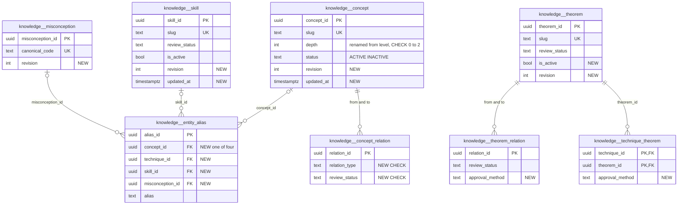

# `knowledge` schema (part 1 of 2) — taxonomy, theorem and misconception catalogue

> **Split notice.** The `knowledge` schema has 29 tables, too many for one readable page, so it is documented in two files that share the same structure:
> - **This file — the catalogue (20 tables):** the governed reference entities (`concept`, `technique`, `skill`, `misconception`, `theorem`), their aliases, the catalogue-to-catalogue relation tables, the theorem satellite tables, and the misconception/theorem link, embedding and similarity tables.
> - **[knowledge-problems.md](./knowledge-problems.md) — problem tagging, enrichment and review governance (9 tables):** `problem_concept`, `problem_technique`, `problem_skill`, `problem_pedagogy`, `enrichment_job`, `relationship_enrichment_job`, `pedagogy_review_event`, `metadata_approval_event`, `pedagogy_publication`. That file also explains the automatic-approval trigger that applies to eight tables in both files.
>
> §4 and §5 in each file cover only that file's tables.

The `knowledge` schema is the shared vocabulary of MathBank. Every other domain tags its rows with entities from this catalogue: problems (`core.problem`), micro-courses, quiz questions, activities, interaction templates, learner mastery and route assets. The catalogue holds four kinds of thing. **Concepts and techniques** come from the original competition-corpus CSVs and the textbook packages. **Skills** are action-level learning objectives, mostly generated by the automatic teaching-enrichment pipeline. **Misconceptions** are a deduplicated library backfilled from route assets. **Theorems** (axioms, lemmas, identities, definitions and so on) form a curated catalogue with a prerequisite DAG. Catalogue rows are public reference data; no learner data lives here.

Source of truth: migrations [001](../../../mathbank-db/sql/001_schema.sql), [006](../../../mathbank-db/sql/006_pedagogy.sql), [008](../../../mathbank-db/sql/008_automatic_metadata.sql), [032](../../../mathbank-db/sql/032_micro_course_platform.sql), [036](../../../mathbank-db/sql/036_taxonomy_admin_crud.sql), [039](../../../mathbank-db/sql/039_misconception_catalog.sql), [040](../../../mathbank-db/sql/040_similarity_embeddings.sql), [041](../../../mathbank-db/sql/041_similarity_embeddings_hnsw_index.sql), [046](../../../mathbank-db/sql/046_theorem_catalog.sql). Catalog extracted 2026-11-01 from migrations 001–054; endpoint mapping traced from mathbank-rest source and manually verified. The static endpoint matrix misses the taxonomy admin routes because they build SQL dynamically (`f"... FROM {table}"` in [taxonomy_service.py](../../../mathbank-rest/src/mathbank_rest/taxonomy_service.py) and `f"knowledge.{kind}"` in [db/pedagogy_admin.py](../../../mathbank-rest/src/mathbank_rest/db/pedagogy_admin.py)); those were traced by hand.

## 1. Purpose, ownership and data flow

**Domain.** The catalogue covers *what can be learned and how it is related*: concept hierarchy and neighbours, techniques, skills and their prerequisites, theorems and their lineage, and known misconceptions. It holds no per-learner state.

**Writers.** Writes come from three REST surfaces, one REST side effect, and several batch tools.

| Writer | Path / entry point | Tables (op) | Auth |
|---|---|---|---|
| Taxonomy admin | `/v1/admin/taxonomy/{kind}/…` → [taxonomy_service.py](../../../mathbank-rest/src/mathbank_rest/taxonomy_service.py) | `concept`, `technique`, `skill`, `misconception` (U, lifecycle); `entity_alias` (C/D) | Admin key (X-Admin-Api-Key) |
| Theorem admin | `/v1/admin/theorems/…` → [theorem_service.py](../../../mathbank-rest/src/mathbank_rest/theorem_service.py) | `theorem` (C/U), `theorem_relation`, `technique_theorem` (C), `theorem_taxonomy_link`, `theorem_source`, `theorem_asset` (C/U) | Admin key |
| Pedagogy review | `/v1/admin/pedagogy/review · bulk-review · approve-starter · edit` → [db/pedagogy_admin.py](../../../mathbank-rest/src/mathbank_rest/db/pedagogy_admin.py) | `skill`, `skill_concept`, `skill_relation`, `concept_relation` (U: `review_status` and editable attributes) | Admin key |
| Teaching enrichment (REST side effect) | `GET /v1/tutor/learning-context/{code}` (default `enrich=true`), `POST /v1/tutor/coach`, `POST /v1/admin/pedagogy/reclassify` → [enrichment.py](../../../mathbank-rest/src/mathbank_rest/enrichment.py) `persist_metadata` → `import_pedagogy.import_manifest` | `skill`, `skill_concept`, `skill_relation` (C/U upsert) | **None (anonymous)** for the two tutor routes; admin key for reclassify |
| Relationship enrichment worker | `make -C mathbank-rest enrich-corpus RELATIONSHIPS=1` → [scripts/enrich_corpus.py](../../../mathbank-rest/scripts/enrich_corpus.py) → [relationship_enrichment.py](../../../mathbank-rest/src/mathbank_rest/relationship_enrichment.py) `store_proposal` | `skill_relation`, `concept_relation` (C) | CLI |
| Corpus ETL | [load_corpus.py](../../../mathbank-db/etl/load_corpus.py) | `concept` (C), `technique` (C/U description), `concept_relation` (C) | CLI |
| Pedagogy manifest import | [import_pedagogy.py](../../../mathbank-db/etl/import_pedagogy.py) `import` | `skill`, `skill_concept`, `skill_relation` (C/U) | CLI |
| Textbook package import | [import_textbook_package.py](../../../mathbank-db/etl/import_textbook_package.py) | `concept`, `technique`, `skill`, `skill_concept`, `concept_relation` (C/U; human-approved and rejected rows guarded) | CLI |
| Misconception backfill | [backfill_misconception_catalog.py](../../../mathbank-rest/scripts/backfill_misconception_catalog.py) | `misconception`, `misconception_taxonomy_link`, `route_asset_misconception_link` (C) | CLI |
| Similarity generation | [generate_similarity_embeddings.py](../../../mathbank-rest/scripts/generate_similarity_embeddings.py) | `misconception_embedding` (C/U), `misconception_similarity` (TRUNCATE + C) | CLI (OpenAI embeddings) |
| *(none)* | — | `theorem_embedding`, `theorem_similarity` | No writer or reader exists anywhere in the repository. |

**Readers.**
- Public catalogue routes in [routers/v1.py](../../../mathbank-rest/src/mathbank_rest/routers/v1.py) / [db/queries.py](../../../mathbank-rest/src/mathbank_rest/db/queries.py): `GET /v1/concepts`, `/v1/concepts/{slug}/problems`, `/v1/concepts/{slug}/neighbors`, `/v1/techniques`, `/v1/techniques/{slug}/problems`. The list routes filter `status='ACTIVE'` and match aliases.
- Public theorem routes `GET /v1/theorems/…` (APPROVED theorems only).
- Micro-course targets and release validation ([micro_course_service.py](../../../mathbank-rest/src/mathbank_rest/micro_course_service.py)), quiz generation and import (slug → id lookups in [quiz_runtime.py](../../../mathbank-rest/src/mathbank_rest/quiz_runtime.py)), mastery recompute, step diagnosis, and admin activities.
- Neo4j projectors: [project_from_postgres.py](../../../mathbank-graph/etl/project_from_postgres.py) (concepts, techniques, skills and their relations; also called in-process by `db/pedagogy_admin.publish`), [project_theorems.py](../../../mathbank-graph/etl/project_theorems.py) (APPROVED theorems; REVIEWED relations and technique links only), [project_misconception_relations.py](../../../mathbank-graph/etl/project_misconception_relations.py), and [route_projection.py](../../../mathbank-rest/src/mathbank_rest/route_projection.py) (misconceptions, their links and `SIMILAR_TO` edges, run by `POST /v1/admin/tutoring-routes/refresh-graph`).
- `mathbank-agent` has no SQL access; it reaches the catalogue only through REST.

**Approval governance.** `skill`, `skill_concept`, `skill_relation` and `concept_relation` (plus four problem tables) carry the `automatic_metadata` BEFORE trigger from migration 008. It rewrites any row inserted or updated with `review_status='PENDING'` to `REVIEWED`/`approval_method='automatic'`, unless the session sets `mathbank.human_review='on'`. It also silently refuses automatic updates to rows that a human approved or that are `REJECTED`. As a result, `PENDING` is the column default but almost never the stored value. Full rules: [knowledge-problems.md §1](./knowledge-problems.md#1-purpose-ownership-and-data-flow).

**Lifecycles (three different conventions).**
- `concept`, `technique`: `status` `ACTIVE`/`INACTIVE`, plus `deactivated_at/by` (036).
- `skill`, `misconception`: a pre-publication `review_status` and, separately, an `is_active` boolean added in 036.
- `theorem`: `review_status` `PENDING_REVIEW`→`APPROVED`/`REJECTED` only; there is no deactivate.

**Privacy class.** Public reference data. `theorem_source.url` and `label` are student-visible once `APPROVED`. Nothing here is learner-private.

## 2. Entity diagram — as-is

```mermaid
erDiagram
    core__problem {
        uuid problem_id PK
    }
    pedagogy__taxonomy_node {
        text taxonomy_node_id PK
        uuid concept_id FK
        uuid skill_id FK
        uuid technique_id FK
        uuid theorem_id FK
    }
    pedagogy__route_asset {
        uuid asset_id PK
    }
    visual__asset {
        uuid asset_id PK
    }
    knowledge__concept {
        uuid concept_id PK
        text slug UK
        text name
        int level "0 to 2 in loaded data"
        text status "ACTIVE INACTIVE"
    }
    knowledge__technique {
        uuid technique_id PK
        text slug UK
        text status "ACTIVE INACTIVE"
    }
    knowledge__skill {
        uuid skill_id PK
        text slug UK
        text objective
        text review_status "PENDING REVIEWED REJECTED"
        bool is_active
    }
    knowledge__misconception {
        uuid misconception_id PK
        text canonical_code UK
        text review_status "PENDING_REVIEW APPROVED REJECTED"
        bool is_active
    }
    knowledge__entity_alias {
        uuid alias_id PK
        text entity_kind "CONCEPT TECHNIQUE SKILL MISCONCEPTION"
        uuid entity_id "polymorphic, no FK"
        text alias
    }
    knowledge__concept_relation {
        uuid relation_id PK
        uuid from_concept_id FK
        uuid to_concept_id FK
        text relation_type "unconstrained"
    }
    knowledge__skill_relation {
        uuid from_skill_id PK, FK
        uuid to_skill_id PK, FK
        text relation_type PK "PREREQUISITE_OF PART_OF BUILDS_ON"
    }
    knowledge__skill_concept {
        uuid skill_id PK, FK
        uuid concept_id PK, FK
    }
    knowledge__theorem {
        uuid theorem_id PK
        text slug UK
        text kind "AXIOM THEOREM LEMMA ..."
        text field "ALGEBRA GEOMETRY ..."
        text review_status "PENDING_REVIEW APPROVED REJECTED"
    }
    knowledge__theorem_relation {
        uuid relation_id PK
        uuid from_theorem_id FK
        uuid to_theorem_id FK
        text relation_type "DEPENDS_ON COROLLARY_OF ..."
    }
    knowledge__technique_theorem {
        uuid technique_id PK, FK
        uuid theorem_id PK, FK
        text role PK "JUSTIFIES APPLIES"
    }
    knowledge__theorem_taxonomy_link {
        uuid theorem_id PK, FK
        text taxonomy_node_id PK, FK
        text role "PRIMARY RELATED"
    }
    knowledge__theorem_source {
        uuid theorem_source_id PK
        uuid theorem_id FK
        text url "UK with theorem_id"
    }
    knowledge__theorem_asset {
        uuid theorem_id PK, FK
        uuid asset_id PK, FK
        int ordinal "UK with theorem_id"
    }
    knowledge__theorem_embedding {
        uuid theorem_id PK, FK
        vector embedding
    }
    knowledge__theorem_similarity {
        uuid theorem_id_a PK, FK
        uuid theorem_id_b PK, FK
        float similarity
    }
    knowledge__misconception_embedding {
        uuid misconception_id PK, FK
        vector embedding "vector 1536, HNSW"
    }
    knowledge__misconception_similarity {
        uuid misconception_id_a PK, FK
        uuid misconception_id_b PK, FK
        float similarity
        smallint rank
    }
    knowledge__misconception_taxonomy_link {
        uuid misconception_id PK, FK
        text taxonomy_node_id PK, FK
    }
    knowledge__route_asset_misconception_link {
        uuid asset_id PK, FK
        uuid misconception_id FK
    }

    knowledge__concept ||--o{ knowledge__concept_relation : "from_concept_id"
    knowledge__concept ||--o{ knowledge__concept_relation : "to_concept_id"
    knowledge__skill ||--o{ knowledge__skill_relation : "from_skill_id"
    knowledge__skill ||--o{ knowledge__skill_relation : "to_skill_id"
    knowledge__skill ||--o{ knowledge__skill_concept : "skill_id"
    knowledge__concept ||--o{ knowledge__skill_concept : "concept_id"
    knowledge__theorem ||--o{ knowledge__theorem_relation : "from_theorem_id"
    knowledge__theorem ||--o{ knowledge__theorem_relation : "to_theorem_id"
    knowledge__technique ||--o{ knowledge__technique_theorem : "technique_id"
    knowledge__theorem ||--o{ knowledge__technique_theorem : "theorem_id"
    knowledge__theorem ||--o{ knowledge__theorem_taxonomy_link : "theorem_id"
    pedagogy__taxonomy_node ||--o{ knowledge__theorem_taxonomy_link : "taxonomy_node_id"
    knowledge__theorem ||--o{ knowledge__theorem_source : "theorem_id"
    knowledge__theorem ||--o{ knowledge__theorem_asset : "theorem_id"
    visual__asset ||--o{ knowledge__theorem_asset : "asset_id"
    knowledge__theorem ||--o| knowledge__theorem_embedding : "theorem_id"
    knowledge__theorem ||--o{ knowledge__theorem_similarity : "theorem_id_a and _b"
    knowledge__misconception ||--o| knowledge__misconception_embedding : "misconception_id"
    knowledge__misconception ||--o{ knowledge__misconception_similarity : "misconception_id_a and _b"
    knowledge__misconception ||--o{ knowledge__misconception_taxonomy_link : "misconception_id"
    pedagogy__taxonomy_node ||--o{ knowledge__misconception_taxonomy_link : "taxonomy_node_id"
    knowledge__misconception ||--o{ knowledge__route_asset_misconception_link : "misconception_id"
    pedagogy__route_asset ||--o| knowledge__route_asset_misconception_link : "asset_id"
    knowledge__concept |o--o{ pedagogy__taxonomy_node : "concept_id"
    knowledge__skill |o--o{ pedagogy__taxonomy_node : "skill_id"
    knowledge__technique |o--o{ pedagogy__taxonomy_node : "technique_id"
    knowledge__theorem |o--o{ pedagogy__taxonomy_node : "theorem_id"
    knowledge__concept |o--o{ knowledge__entity_alias : "entity_id when CONCEPT (logical)"
```

`core.problem` links to `concept`, `technique` and `skill` through the problem tables documented in [knowledge-problems.md §2](./knowledge-problems.md#2-entity-diagram--as-is). Other inbound FKs (not drawn): `pedagogy.micro_course_target`, `quiz.question_concept/technique/skill`, `learner.concept_mastery/technique_mastery`, `activity.definition.target_skill_id`, `search.*` (002), and the interaction-template and micro-course state link tables (032/033) all reference catalogue rows with ON DELETE NO ACTION. In practice that makes catalogue rows undeletable once they are used.

## 3. Tables

### 3.1 Taxonomy entities

### `knowledge.concept`

**Role.** Each row is one mathematical concept, for example `count-subset` or a textbook `DOMAIN`/`CONCEPT`/`SUBCONCEPT` node. Problems, skills, micro-courses, quiz questions, mastery rows and taxonomy nodes all reference it. The hierarchy itself lives in `concept_relation` (`HAS_SUBCONCEPT`) and in `pedagogy.taxonomy_node`. Table type (guide §4): **Catalogue entity**.

**Lifecycle.** `ACTIVE` ↔ `INACTIVE` through the taxonomy admin deactivate/reactivate actions, which write an `audit.action_log` row. Deactivation is blocked (409) while the concept is the `PRIMARY` target of a `PUBLISHED` micro-course release. Rows are never deleted by the application. Inbound NO ACTION FKs block deletion in practice.

**Columns**

| Column | Type | Null | Default | Meaning |
|---|---|---|---|---|
| `concept_id` | uuid | NO | `gen_random_uuid()` | Surrogate key; target of every concept FK. |
| `slug` | text | NO | — | Natural key, lowercased source id: `Canonical_Topic_ID` / `Concept_ID` from the corpus CSVs (`load_corpus.py`), or the lowercased `taxonomy_node_id` from a textbook package. Used as `{code}` by the admin taxonomy routes and as `{slug}` by `/v1/concepts/{slug}/…`. |
| `name` | text | NO | — | Display name. Editable through `PATCH /v1/admin/taxonomy/concepts/{code}`. |
| `description` | text | yes | — | Definition / evidence text from the source CSV (`Definition` or `Evidence_Basis`) or the package node description. The admin PATCH `description` field maps here. |
| `level` | integer | yes | — | Hierarchy depth, not difficulty. `load_corpus.py` writes 0 = Topic, 1 = Subtopic, 2 = Concept (NULL for `topic_taxonomy.csv` rows). The textbook import writes 0 = DOMAIN, 1 = CONCEPT, 2 = SUBCONCEPT. No CHECK. The admin PATCH accepts 1–10, which does not match the loaded 0–2 scale. |
| `status` | text | NO | `'ACTIVE'` | `ACTIVE` or `INACTIVE` (CHECK pinned in 036). Public lists (`GET /v1/concepts`), relationship-enrichment anchors and admin search filter on it. |
| `deactivated_at` | timestamptz | yes | — | Added by 036. Set by deactivate, cleared by reactivate. |
| `deactivated_by` | text | yes | — | Added by 036. Free-text `actor` from the request body (not an authenticated identity). |

**Keys, constraints, indexes.**
- PK `concept_id`; UNIQUE `slug` (`concept_slug_key`).
- CHECK `concept_status_check` (`ACTIVE`, `INACTIVE`).
- No `updated_at`/`revision` column, so admin PATCH has no optimistic concurrency.
- No triggers.

**REST operations today.**

| Op | Method & path | Auth | Handler | Notes |
|---|---|---|---|---|
| R | GET /v1/admin/taxonomy/concepts | Admin key (X-Admin-Api-Key) | `admin_taxonomy.list_entities` → `taxonomy_service.list_entities` | `q` matches name, slug and aliases; `status` filter; `limit` ≤ 200. Response `{items, kind}` has no `total`. |
| R | GET /v1/admin/taxonomy/concepts/{code} | Admin key | `get_entity` | `SELECT *` plus aliases. |
| U | PATCH /v1/admin/taxonomy/concepts/{code} | Admin key | `update_entity` | `name`/`description`/`level`; `SELECT … FOR UPDATE`; audit `TAXONOMY_ENTITY_UPDATED`. No revision check. |
| U | POST /v1/admin/taxonomy/concepts/{code}/deactivate · /reactivate | Admin key | `deactivate_entity` / `reactivate_entity` | Published micro-course guard on deactivate; audit row. |
| R | GET /v1/concepts · /v1/concepts/{slug}/problems · /v1/concepts/{slug}/neighbors | None (anonymous) | `v1.get_concepts` etc. → `db/queries.py` | The list filters `ACTIVE` and matches aliases. `problems` walks `HAS_SUBCONCEPT` recursively. `neighbors` does not filter on status. |
| R | GET /v1/admin/micro-courses/targets, GET /v1/micro-courses…, POST /v1/quiz/generate, mastery and step-runtime routes | various | services | Read-only joins. |
| — | *(no create)* | — | — | Concepts are created only by `load_corpus.py` (`ON CONFLICT (slug) DO NOTHING`) and `import_textbook_package.py` (upsert). |

### `knowledge.technique`

**Role.** A named problem-solving technique, for example a counting or invariant method, from `technique_catalog.csv` or a textbook package. Problems reference it through `problem_technique`, theorems through `technique_theorem`, and it is also a micro-course target type and a quiz tag. Table type: **Catalogue entity**.

**Lifecycle.** Same as `concept`: `status` `ACTIVE`/`INACTIVE` with the published micro-course deactivation guard. There is no `level`.

**Columns**

| Column | Type | Null | Default | Meaning |
|---|---|---|---|---|
| `technique_id` | uuid | NO | `gen_random_uuid()` | Surrogate key. |
| `slug` | text | NO | — | Lowercased `Technique_ID` from the corpus CSV, or the textbook node id. Natural key used in URLs. |
| `name` | text | NO | — | Display name. |
| `description` | text | yes | — | Definition. `load_corpus.py` overwrites it on every load (`ON CONFLICT (slug) DO UPDATE SET description`), so admin edits to `description` are lost on the next corpus reload. |
| `status` | text | NO | `'ACTIVE'` | `ACTIVE` or `INACTIVE` (CHECK 036). |
| `deactivated_at` | timestamptz | yes | — | Added by 036. |
| `deactivated_by` | text | yes | — | Added by 036; free-text actor. |

**Keys, constraints, indexes.** PK `technique_id`; UNIQUE `slug`; CHECK `technique_status_check`. No triggers.

**REST operations today.**

| Op | Method & path | Auth | Handler | Notes |
|---|---|---|---|---|
| R | GET /v1/admin/taxonomy/techniques · /{code} · /{code}/aliases | Admin key | `taxonomy_service` | As for concepts; `level` is rejected (422) for techniques. |
| U | PATCH /v1/admin/taxonomy/techniques/{code} · POST …/deactivate · …/reactivate | Admin key | `taxonomy_service` | Audit rows; published micro-course guard. |
| R | GET /v1/techniques · /v1/techniques/{slug}/problems | None (anonymous) | `v1.get_techniques` etc. | `ACTIVE` only; alias match on `q`. |
| R | GET /v1/theorems/by-technique/{technique_slug} | None (anonymous) | `theorems.list_student_theorems_for_technique` | Joins `technique_theorem`. |
| R | POST /v1/admin/theorems/{slug}/techniques | Admin key | `add_technique_theorem` | Slug → id lookup. |
| — | *(no create)* | — | — | ETL only (`load_corpus.py`, `import_textbook_package.py`). |

### `knowledge.skill`

**Role.** An observable, action-level learning objective, for example "set up a stars-and-bars count". Unlike concepts, skills are mostly machine-generated. The teaching-enrichment pipeline creates them per problem (`source='automatic-model-enrichment:gpt-4o-mini'`). Others come from curated manifests (`mathbank-db/data/pedagogy/*.json` via `import_pedagogy.py`) and from textbook packages (`source='prasolov-package-v3'`). Skills anchor `problem_skill`, `skill_relation` (the prerequisite graph used by `/v1/tutor/prerequisites/{skill_slug}` via Neo4j), activities and micro-course targets. Table type: **Catalogue entity** with an embedded review workflow.

**Lifecycle.** There are two independent axes.
- **`review_status`.** Governed by the pedagogy review queue and the automatic-approval trigger. An insert with `PENDING` becomes `REVIEWED`/`automatic` unless written under `mathbank.human_review='on'`. Admins can move a row to `REVIEWED`, `REJECTED` or back to `PENDING`. Each decision appends a `pedagogy_review_event`.
- **`is_active`.** Added by 036 and toggled by taxonomy deactivate/reactivate. No reader filters on it yet: the projector, enrichment and the micro-course services ignore it.

**Columns**

| Column | Type | Null | Default | Meaning |
|---|---|---|---|---|
| `skill_id` | uuid | NO | `gen_random_uuid()` | Surrogate key. |
| `slug` | text | NO | — | Kebab-case natural key (`^[a-z][a-z0-9-]{2,100}$` for generated skills). Enrichment upserts `ON CONFLICT (slug)`, so the same slug produced for two problems is one shared skill. CHECK non-blank. |
| `name` | text | NO | — | Display name, 3–200 chars when generated. CHECK non-blank. |
| `objective` | text | NO | — | What the learner can do, 10–1000 chars when generated. Maps to `description` in the taxonomy admin API. CHECK non-blank. |
| `level` | integer | yes | — | Skill level 1–5 (CHECK). The taxonomy PATCH validator allows 1–10, so values 6–10 fail the CHECK and return 409 instead of 422. |
| `source` | text | NO | — | Provenance string: `automatic-model-enrichment:gpt-4o-mini`, `prasolov-package-v3`, or the manifest's `source`. CHECK non-blank. |
| `confidence` | numeric | NO | — | 0–1 (CHECK). Model confidence for generated rows; 0.9 for textbook rows. |
| `review_status` | text | NO | `'PENDING'` | `PENDING`, `REVIEWED`, `REJECTED` (CHECK). See the trigger semantics above. |
| `approval_method` | text | yes | — | Added by 008. `automatic` or `human`, set only by the trigger. No CHECK. NULL only for rows that predate 008 and were never reviewed. |
| `is_active` | boolean | NO | `true` | Added by 036. Post-approval visibility toggle. |
| `deactivated_at` | timestamptz | yes | — | Added by 036. |
| `deactivated_by` | text | yes | — | Added by 036; free-text actor. |

**Keys, constraints, indexes.**
- PK `skill_id`; UNIQUE `slug`.
- CHECKs: non-blank `slug`/`name`/`objective`/`source`; `level` 1–5; `confidence` 0–1; `review_status` enumeration.
- Triggers `automatic_metadata` (BEFORE INSERT/UPDATE → `knowledge.apply_automatic_approval()`) and `automatic_metadata_audit` (AFTER → `knowledge.record_automatic_approval()`, which appends `metadata_approval_event` rows).
- Side effect: a taxonomy PATCH or deactivate on an `automatic` skill also writes a `metadata_approval_event` row, because the row changes while `approval_method` stays `automatic`.

**REST operations today.**

| Op | Method & path | Auth | Handler | Notes |
|---|---|---|---|---|
| C,U | GET /v1/tutor/learning-context/{problem_code} (`enrich=true` default) | **None (anonymous)** | `pedagogy.learning_context` → `enrichment.ensure_learning_metadata` → `persist_metadata` → `import_pedagogy.import_manifest` | Only when the problem has no `problem_skill` or no `problem_pedagogy` yet. Upserts generated skills `ON CONFLICT (slug) DO UPDATE` and can overwrite `name`/`objective`/`level` of an existing *automatic* skill shared with other problems (the trigger protects human/rejected rows). GET with writes. |
| C,U | POST /v1/tutor/coach | **None (anonymous)** | `pedagogy.coach` → same `ensure_learning_metadata` | Always attempts enrichment (no `enrich` flag). |
| C,U | POST /v1/admin/pedagogy/reclassify | Admin key | `pedagogy_admin.reclassify` → `enrich_problem(force=True)` | Regenerates even if already enriched; does not publish. |
| R | GET /v1/admin/pedagogy/queue?kind=skill | Admin key | `db/pedagogy_admin.queue` | Returns a `revision` (sha256 of `to_jsonb(row)`) per row for optimistic concurrency. |
| U | POST /v1/admin/pedagogy/review · /bulk-review · /approve-starter | Admin key | `change_decision` | `SET LOCAL mathbank.human_review='on'`, sets `review_status`, appends `pedagogy_review_event`, runs `validate_graph` (acyclicity). |
| U | POST /v1/admin/pedagogy/edit | Admin key | `db/pedagogy_admin.edit` | Editable: `name`, `objective`, `level`, `source`, `confidence`. Sets `approval_method='human'`, which protects the row from automatic overwrite. |
| R | POST /v1/admin/pedagogy/history | Admin key | `history` | Review events for one key. |
| R,U | GET /v1/admin/taxonomy/skills… · PATCH · deactivate/reactivate · aliases | Admin key | `taxonomy_service` | `review_status` filter on list. A PATCH here does **not** set `approval_method='human'`, so automatic enrichment can later overwrite it (unlike `/pedagogy/edit`). |
| R | /v1/admin/activities…, /v1/admin/micro-courses…, /v1/micro-courses…, /v1/quiz-integration/papers… | Admin key / anonymous | services | Read joins. |

Non-REST writers: `scripts/enrich_corpus.py` (same enrichment code path, batch), `import_pedagogy.py`, `import_textbook_package.py` (guarded upsert).

### `knowledge.misconception`

**Role.** The canonical misconception library: a named wrong mental model with symptom, why it is wrong, and the correct model. 032 created it empty. Migration 039 plus `backfill_misconception_catalog.py` filled it (about 70k rows) by exact-text deduplication of the `MISCONCEPTION` rows in `pedagogy.route_asset`. The same script fills `misconception_taxonomy_link` and `route_asset_misconception_link`. Micro-course states and interaction templates reference it. Table type: **Catalogue entity**.

**Lifecycle.**
- `review_status` `PENDING_REVIEW`/`APPROVED`/`REJECTED`. Backfilled rows are inserted directly as `APPROVED`/`automatic`.
- No REST action changes `review_status`.
- `is_active` (036) is toggled by taxonomy deactivate/reactivate. Unlike the other kinds, there is no published-reference guard. Micro-course release validation checks `review_status='APPROVED'` but not `is_active`.

**Columns**

| Column | Type | Null | Default | Meaning |
|---|---|---|---|---|
| `misconception_id` | uuid | NO | `gen_random_uuid()` | Surrogate key. The backfill supplies a deterministic `uuid5(canonical_code)`. |
| `canonical_code` | text | NO | — | Natural key. Backfill format `MIS-AUTO-<first 16 hex of sha256(description)>`. Used as `{code}` in `/v1/admin/taxonomy/misconceptions/{code}`. |
| `name` | text | NO | — | Short display name; for backfilled rows the whitespace-collapsed description truncated to 120 chars. |
| `description` | text | NO | — | Full misconception statement; the deduplication key of the backfill. |
| `symptom` | text | yes | — | Observable learner behaviour, copied from the representative route-asset `content.symptom`. |
| `why_wrong` | text | yes | — | Explanation of the error (`content.why_wrong`). |
| `correct_model` | text | yes | — | The correct mental model (`content.correct_model`). |
| `recognition_pattern` | jsonb | NO | `'{}'` | Intended machine-readable detection cues. No writer sets it; always `{}` today. |
| `severity` | smallint | yes | — | 1–5 (CHECK). Not populated by any writer. |
| `level` | smallint | yes | — | 1–10 (CHECK). Editable by taxonomy PATCH; not set by the backfill. |
| `source` | text | NO | `'HUMAN'` | Provenance. Backfill: `route_enrichment:dedup-exact-text-v1`. No CHECK. |
| `review_status` | text | NO | `'PENDING_REVIEW'` | `PENDING_REVIEW`, `APPROVED`, `REJECTED` (CHECK). Uses a different vocabulary from `skill`. |
| `approval_method` | text | yes | — | `automatic` or `human` (CHECK). Backfill sets `automatic`. |
| `approved_at` | timestamptz | yes | — | Approval time. The backfill inserts `APPROVED` rows without setting it, so it is NULL for the whole library. |
| `created_at` | timestamptz | NO | `now()` | Insert time. |
| `updated_at` | timestamptz | NO | `now()` | Never bumped: taxonomy PATCH and deactivate leave it unchanged. |
| `is_active` | boolean | NO | `true` | Added by 036. Visibility toggle. |
| `deactivated_at` | timestamptz | yes | — | Added by 036. |
| `deactivated_by` | text | yes | — | Added by 036. |

**Keys, constraints, indexes.** PK `misconception_id`; UNIQUE `canonical_code`; CHECKs on `severity`, `level`, `review_status`, `approval_method`. No trigger (it is not in the 008 automatic-approval set).

**REST operations today.**

| Op | Method & path | Auth | Handler | Notes |
|---|---|---|---|---|
| R | GET /v1/admin/taxonomy/misconceptions · /{code} · /{code}/aliases | Admin key | `taxonomy_service` | First listing endpoint for misconceptions; `review_status` filter. |
| U | PATCH /v1/admin/taxonomy/misconceptions/{code} · POST …/deactivate · …/reactivate | Admin key | `taxonomy_service` | Audit rows. No approve/reject action exists. |
| R | GET /v1/admin/micro-courses/targets; POST /v1/admin/micro-courses/releases/{release_id}/validate · /review · /publish | Admin key | `micro_course_service` | Release validation rejects non-`APPROVED` misconceptions. |
| R | POST /v1/admin/tutoring-routes/refresh-graph | Admin key | `route_projection.project` | Projects `Misconception` nodes into Neo4j. |
| — | *(no create)* | — | — | Backfill script only. |

### `knowledge.entity_alias`

**Role.** A shared synonym table for the four taxonomy kinds (036, requirements/45 APID-9), so that `q=AM-GM` finds a technique named differently. Read by the admin taxonomy search and by the public `GET /v1/concepts`/`/v1/techniques` searches. Table type: **Junction / link** (entity → alias strings).

**Lifecycle.** Insert and hard-delete only, through the alias endpoints. Each change writes an `audit.action_log` row (`TAXONOMY_ALIAS_ADDED`/`REMOVED`).

**Columns**

| Column | Type | Null | Default | Meaning |
|---|---|---|---|---|
| `alias_id` | uuid | NO | `gen_random_uuid()` | Surrogate key used in the DELETE path. The service supplies `uuid4()`. |
| `entity_kind` | text | NO | — | `CONCEPT`, `TECHNIQUE`, `SKILL`, `MISCONCEPTION` (CHECK). Selects the target table. |
| `entity_id` | uuid | NO | — | Polymorphic reference to `concept_id`/`technique_id`/`skill_id`/`misconception_id`. **No FK**; resolved in the application. |
| `alias` | text | NO | — | Synonym text, ≤ 200 chars at the API. CHECK non-blank. Case-sensitive uniqueness. |
| `created_at` | timestamptz | NO | `now()` | Insert time. |
| `created_by` | text | yes | — | Free-text `actor` from the request. |

**Keys, constraints, indexes.** PK `alias_id`; UNIQUE `(entity_kind, entity_id, alias)`; index `entity_alias_lookup_idx (entity_kind, alias)`. The `ILIKE '%q%'` searches cannot use that btree index.

**REST operations today.**

| Op | Method & path | Auth | Handler | Notes |
|---|---|---|---|---|
| R | GET /v1/admin/taxonomy/{kind}/{code}/aliases | Admin key | `list_aliases` | |
| C | POST /v1/admin/taxonomy/{kind}/{code}/aliases | Admin key | `add_alias` | 201. Duplicate → 409 (savepoint-protected). |
| D | DELETE /v1/admin/taxonomy/{kind}/{code}/aliases/{alias_id}?actor= | Admin key | `remove_alias` | 204. `actor` is a query parameter. |
| R | GET /v1/admin/taxonomy/{kind}, GET /v1/concepts, GET /v1/techniques | Admin key / anonymous | `list_entities`, `db/queries.py` | `EXISTS` alias match. |

### 3.2 Catalogue relations (reviewed assertions)

### `knowledge.concept_relation`

**Role.** A directed edge between two concepts. `HAS_SUBCONCEPT` edges form the concept hierarchy that `GET /v1/concepts/{slug}/problems` walks recursively. Other types (`PART_OF`, `BUILDS_ON`, `PREREQUISITE_OF`, `RELATED_TO`, …) feed `/neighbors`, step diagnosis, the improvement plan and the Neo4j projection. In the projection `HAS_SUBCONCEPT` becomes a reversed `PART_OF`, and unknown types are skipped. Table type: **Junction / link** with review metadata (a surrogate `relation_id` exists, but the natural key is the UNIQUE triple).

**Lifecycle.**
- Insert by ETL (`load_corpus.py` from `knowledge_graph_edges.csv`, default type `RELATED_TO`), by `import_textbook_package.py` (`HAS_SUBCONCEPT`, guarded upsert of `strength`), and by the relationship-enrichment worker (`PART_OF`/`BUILDS_ON`/`PREREQUISITE_OF`, `source='automatic-relationship-enrichment:<model>:v2'`).
- Every insert passes through the automatic-approval trigger, so rows land as `REVIEWED`/`automatic`.
- The admin review/edit endpoints change `review_status`, `strength` and `assertion_source`. There is no delete.

**Columns**

| Column | Type | Null | Default | Meaning |
|---|---|---|---|---|
| `relation_id` | uuid | NO | `gen_random_uuid()` | Surrogate key. Unused by the review API, which keys on the triple. |
| `from_concept_id` | uuid | NO | — | Source concept → `concept` (NO ACTION). For `HAS_SUBCONCEPT`, the parent. |
| `to_concept_id` | uuid | NO | — | Target concept → `concept` (NO ACTION). |
| `relation_type` | text | NO | — | **No CHECK.** Values in use: `HAS_SUBCONCEPT`, `RELATED_TO`, other CSV `Edge_Type`s, `PART_OF`, `BUILDS_ON`, `PREREQUISITE_OF`. The review API key validator accepts only `PREREQUISITE_OF`, `PART_OF`, `HAS_SUBCONCEPT`, `RELATED_CONCEPT`, `RELATED_TO` ([db/pedagogy_admin.py:106](../../../mathbank-rest/src/mathbank_rest/db/pedagogy_admin.py)), so automatically generated `BUILDS_ON` concept edges cannot be reviewed or edited (422). |
| `strength` | numeric(5,4) | yes | — | Edge weight or confidence 0–1. CSV `Weight` or `Confidence`, package confidence (default 0.9), or the enrichment confidence (≥ 0.75). No CHECK. |
| `assertion_source` | text | NO | — | Provenance: CSV `Evidence_Type` or `CORPUS_IMPORT`, `prasolov-package-v3`, or the enrichment model tag. |
| `review_status` | text | NO | `'PENDING'` | `PENDING`/`REVIEWED`/`REJECTED` by convention. **No CHECK.** Rewritten to `REVIEWED` by the trigger on automatic writes. |
| `approval_method` | text | yes | — | Added by 008. `automatic` or `human` (trigger-managed). No CHECK. |

**Keys, constraints, indexes.**
- PK `relation_id`; UNIQUE `(from_concept_id, to_concept_id, relation_type)`.
- No self-loop CHECK.
- No index leading on `to_concept_id`, although `/neighbors` (incoming edges) and the recursive closure join on it.
- Triggers `automatic_metadata` and `automatic_metadata_audit`.

**REST operations today.**

| Op | Method & path | Auth | Handler | Notes |
|---|---|---|---|---|
| R | GET /v1/admin/pedagogy/queue?kind=concept_relation | Admin key | `queue` | |
| U | POST /v1/admin/pedagogy/review · /bulk-review · /edit | Admin key | `change_decision` / `edit` | Editable: `strength`, `assertion_source`. `validate_graph` checks acyclicity of REVIEWED edges. |
| R | GET /v1/concepts/{slug}/neighbors · /problems | None (anonymous) | `db/queries.py` | No `review_status` filter: `REJECTED` edges are still served. |
| R | GET /v1/learner/mastery/improvement-plan; step-runtime diagnose/responses/outcome; POST /v1/quiz/generate | Learner JWT / admin key | services | Read joins. |

Non-REST writers: `load_corpus.py`, `import_textbook_package.py`, `enrich_corpus.py --relationships`.

### `knowledge.skill_relation`

**Role.** A directed edge between two skills: `PREREQUISITE_OF` (the learning-path graph behind `/v1/tutor/prerequisites/{skill_slug}` via Neo4j), `PART_OF`, or `BUILDS_ON`. `REVIEWED` `BUILDS_ON` and prerequisite edges must stay acyclic (`validate_graph` / `import_pedagogy.validate_cycles`). Table type: **Junction / link** with review metadata.

**Lifecycle.**
- Inserted or upserted by teaching enrichment (`prerequisite_for` links inside one generated skill set), manifest import, and the relationship-enrichment worker (only between two `REVIEWED` skills).
- Lands `REVIEWED`/`automatic` through the trigger.
- Admin review and edit change it. Rows are removed only by cascade when a skill is deleted (never done by the application).

**Columns**

| Column | Type | Null | Default | Meaning |
|---|---|---|---|---|
| `from_skill_id` | uuid | NO | — | Source skill → `skill` (CASCADE). For `PREREQUISITE_OF`, the prerequisite. |
| `to_skill_id` | uuid | NO | — | Target skill → `skill` (CASCADE). |
| `relation_type` | text | NO | — | `PREREQUISITE_OF`, `PART_OF`, `BUILDS_ON` (CHECK). |
| `source` | text | NO | — | Provenance (enrichment model tag, manifest source). CHECK non-blank. |
| `confidence` | numeric | NO | — | 0–1 (CHECK). |
| `review_status` | text | NO | `'PENDING'` | `PENDING`/`REVIEWED`/`REJECTED` (CHECK). Trigger-managed for automatic writes. |
| `approval_method` | text | yes | — | Added by 008. `automatic` or `human`. |

**Keys, constraints, indexes.** PK `(from_skill_id, to_skill_id, relation_type)`; CHECK `from_skill_id <> to_skill_id`; index `skill_relation_target_idx (to_skill_id)`; automatic-approval triggers.

**REST operations today.**

| Op | Method & path | Auth | Handler | Notes |
|---|---|---|---|---|
| C,U | GET /v1/tutor/learning-context/{problem_code}; POST /v1/tutor/coach | **None (anonymous)** | `ensure_learning_metadata` → `import_manifest` | Upsert of generated prerequisite edges, cycle-checked before persisting. |
| C,U | POST /v1/admin/pedagogy/reclassify | Admin key | `enrich_problem(force=True)` | |
| R,U | GET /v1/admin/pedagogy/queue · POST /review · /bulk-review · /approve-starter · /edit · /history | Admin key | `db/pedagogy_admin` | Approving requires both endpoint skills to be `REVIEWED` (409 otherwise). Editable: `source`, `confidence`. |
| R | POST /v1/admin/pedagogy/publish | Admin key | `publish` | Projected to Neo4j. |

### `knowledge.skill_concept`

**Role.** Says which concept(s) a skill exercises. It is projected to Neo4j as `(:Skill)-[:PART_OF]->(:Concept)`, and the relationship enrichment uses it to score candidate skills. Table type: **Junction / link** with review metadata.

**Lifecycle.** Written by enrichment (`concept_slugs` per generated skill), manifest import and the textbook import (`SKILL → CONCEPT` edges, guarded). Reviewed and edited like `skill_relation`. Removed by cascade with the skill. The concept FK is NO ACTION.

**Columns**

| Column | Type | Null | Default | Meaning |
|---|---|---|---|---|
| `skill_id` | uuid | NO | — | → `skill` (CASCADE). |
| `concept_id` | uuid | NO | — | → `concept` (NO ACTION). |
| `source` | text | NO | — | Provenance. CHECK non-blank. |
| `confidence` | numeric | NO | — | 0–1 (CHECK). |
| `review_status` | text | NO | `'PENDING'` | `PENDING`/`REVIEWED`/`REJECTED` (CHECK). Trigger-managed. |
| `approval_method` | text | yes | — | Added by 008. `automatic` or `human`. |

**Keys, constraints, indexes.** PK `(skill_id, concept_id)`; index `skill_concept_concept_idx (concept_id)`; automatic-approval triggers.

**REST operations today.** These are the same enrichment (anonymous GET/POST, admin reclassify) and pedagogy review routes as `skill_relation`. Editable via `/edit`: `source`, `confidence`. The static endpoint matrix lists no route for this table because every access is dynamic (`f"knowledge.{kind}"`).

### 3.3 Theorem catalogue (requirements/61, migration 046)

### `knowledge.theorem`

**Role.** One theorem-shaped entity. `kind` is the only IS-A: axiom, theorem, lemma, proposition, corollary, identity or definition. Each row has a formal statement (inline LaTeX validated by `math_format.check_latex`), a mathematical `field`, and an optional proof sketch. It is the hub for lineage (`theorem_relation`), technique justification, taxonomy links, sources and diagrams, and it can be a `pedagogy.micro_course_target` (`target_type='THEOREM'`). Table type: **Catalogue entity** with a review workflow.

**Lifecycle.** Created as `PENDING_REVIEW` (or `APPROVED`/`human` immediately with `auto_approve=true`). From `PENDING_REVIEW` it moves to `APPROVED` (`approve`, sets `approved_at`) or `REJECTED` (`reject`). There is no transition out of `APPROVED`/`REJECTED`, no deactivate, and no delete. Students and the projector see only `APPROVED` rows. Every admin mutation writes `audit.action_log`.

**Columns**

| Column | Type | Null | Default | Meaning |
|---|---|---|---|---|
| `theorem_id` | uuid | NO | `gen_random_uuid()` | Surrogate key. |
| `slug` | text | NO | — | Natural key (≤ 120 chars at the API) used in every URL. Not updatable. |
| `name` | text | NO | — | Display name, e.g. "Pythagorean theorem". |
| `kind` | text | NO | — | `AXIOM`, `THEOREM`, `LEMMA`, `PROPOSITION`, `COROLLARY`, `IDENTITY`, `DEFINITION` (CHECK). Not updatable. An `AXIOM` cannot have outgoing `DEPENDS_ON`/`COROLLARY_OF` edges (service rule). |
| `field` | text | NO | — | `ALGEBRA`, `GEOMETRY`, `NUMBER_THEORY`, `COMBINATORICS`, `PROBABILITY`, `ANALYSIS`, `LOGIC_AND_SET_THEORY`, `OTHER` (CHECK). |
| `statement_text` | text | NO | — | Authoritative statement with inline `$…$` LaTeX, rendered through the KaTeX pipeline. |
| `statement_latex` | text | yes | — | Optional display-math form. |
| `description` | text | yes | — | Informal explanation. |
| `proof_sketch` | text | yes | — | Optional proof outline. |
| `source` | text | NO | `'HUMAN'` | `HUMAN`, `LLM_DRAFT`, `LLM_REVIEWED` (CHECK). Authorship provenance (agent drafts vs human). |
| `review_status` | text | NO | `'PENDING_REVIEW'` | `PENDING_REVIEW`, `APPROVED`, `REJECTED` (CHECK). |
| `approval_method` | text | yes | — | `automatic` or `human` (CHECK). The service only ever sets `human`. |
| `approved_at` | timestamptz | yes | — | Set on approve or auto-approve. |
| `created_at` | timestamptz | NO | `now()` | Insert time. |
| `updated_at` | timestamptz | NO | `now()` | Bumped by PATCH only (not by approve/reject). |

**Keys, constraints, indexes.**
- PK `theorem_id`; UNIQUE `slug`.
- CHECKs on `kind`, `field`, `source`, `review_status`, `approval_method`, and `kind <> 'AXIOM' OR statement_text IS NOT NULL` (redundant, since `statement_text` is NOT NULL).
- Indexes `theorem_kind_field_idx (kind, field)` and `theorem_review_status_idx`.
- The full-text search computes `to_tsvector(...)` per row without a GIN index.

**REST operations today.**

| Op | Method & path | Auth | Handler | Notes |
|---|---|---|---|---|
| R | GET /v1/admin/theorems | Admin key | `theorems.list_admin_theorems` → `list_theorems` | `q`, `kind`, `field`, `review_status`; `limit` ≤ 200; no `total`. |
| C | POST /v1/admin/theorems | Admin key | `create_admin_theorem` | 201. Duplicate slug → 409. LaTeX check → 422. `auto_approve` optional. Audit `CREATE`. |
| R | GET /v1/admin/theorems/search | Admin key | `search_admin_theorems` | Dedup gate: lexical rank including drafts. |
| R | GET /v1/admin/theorems/{slug} | Admin key | `get_admin_theorem` | Includes all sources, assets, taxonomy links. |
| U | PATCH /v1/admin/theorems/{slug} | Admin key | `update_admin_theorem` | `name`, `field`, `statement_text`, `statement_latex`, `description`, `proof_sketch`. No revision check. Editing an `APPROVED` theorem changes it in place. Audit `UPDATE`. |
| U | POST /v1/admin/theorems/{slug}/approve · /reject | Admin key | `approve_theorem` / `reject_theorem` | Only from `PENDING_REVIEW` (409/404 otherwise). Audit. |
| R | GET /v1/admin/theorems/{slug}/relations · /prerequisites | Admin key | services | |
| R | GET /v1/theorems/search · /{slug} · /{slug}/prerequisites · /by-taxonomy/{taxonomy_node_id} · /by-technique/{technique_slug} | None (anonymous) | `theorems.student_router` | `APPROVED` only. |
| R | GET /v1/admin/micro-courses…, GET /v1/micro-courses… | Admin key / anonymous | `micro_course_service` | `THEOREM` targets. |

Non-REST reader: `mathbank-graph/etl/project_theorems.py` (APPROVED only).

### `knowledge.theorem_relation`

**Role.** The theorem lineage DAG. `DEPENDS_ON` and `COROLLARY_OF` are lineage edges: they must be acyclic, may not originate at an `AXIOM`, and are walked by `/prerequisites`. `GENERALIZES`, `SPECIAL_CASE_OF` and `EQUIVALENT_TO` are cross-references. Acyclicity is enforced in the service (`_lineage_path_exists`), not in the database. Table type: **Junction / link** with review metadata.

**Lifecycle.**
- Insert only, through the admin API, as `PENDING`.
- **No endpoint or script ever moves `review_status` to `REVIEWED`.** `project_theorems.py` projects only `REVIEWED` relations, so REST-created lineage never reaches Neo4j.
- The prerequisite walk does not filter on the edge's `review_status` (only on the target theorem's), so PENDING edges are served to students.
- No delete.

**Columns**

| Column | Type | Null | Default | Meaning |
|---|---|---|---|---|
| `relation_id` | uuid | NO | `gen_random_uuid()` | Surrogate key; used as the audit entity id. |
| `from_theorem_id` | uuid | NO | — | → `theorem` (CASCADE). The dependent theorem. |
| `to_theorem_id` | uuid | NO | — | → `theorem` (CASCADE). The prerequisite or related theorem. |
| `relation_type` | text | NO | — | `DEPENDS_ON`, `GENERALIZES`, `SPECIAL_CASE_OF`, `EQUIVALENT_TO`, `COROLLARY_OF` (CHECK). |
| `assertion_source` | text | NO | — | Free-text provenance (≤ 200 chars at the API). |
| `confidence` | numeric(5,4) | yes | — | 0–1 (CHECK). |
| `review_status` | text | NO | `'PENDING'` | `PENDING`/`REVIEWED`/`REJECTED` (CHECK). Never changed by any code. |
| `created_at` | timestamptz | NO | `now()` | Insert time. |

**Keys, constraints, indexes.** PK `relation_id`; UNIQUE `(from_theorem_id, to_theorem_id, relation_type)`; CHECK no self-loop; indexes `theorem_relation_from_idx` (redundant with the UNIQUE index's leading column) and `theorem_relation_to_idx`. No `approval_method` and no trigger.

**REST operations today.**

| Op | Method & path | Auth | Handler | Notes |
|---|---|---|---|---|
| C | POST /v1/admin/theorems/{slug}/relations | Admin key | `add_theorem_relation` | 201. Cycle or axiom rule → 422; duplicate → 409; audit `CREATE`. |
| R | GET /v1/admin/theorems/{slug}/relations | Admin key | `list_theorem_relations` | Outgoing edges only. |
| R | GET /v1/admin/theorems/{slug}/prerequisites; GET /v1/theorems/{slug}/prerequisites | Admin key / None | `get_theorem_prerequisites` | Recursive CTE, `max_depth` ≤ 10. |

### `knowledge.technique_theorem`

**Role.** A HAS-A link: a technique `JUSTIFIES` (the theorem is why it works) or `APPLIES` a theorem. Students can browse it through `/v1/theorems/by-technique/{slug}`. Table type: **Junction / link**.

**Lifecycle.** Insert-only through the admin API, as `PENDING`. As with `theorem_relation`, nothing ever reviews it, so `project_theorems.py` (REVIEWED only) never projects REST-created links. The public read ignores the link's `review_status`. Cascades with either side.

**Columns**

| Column | Type | Null | Default | Meaning |
|---|---|---|---|---|
| `technique_id` | uuid | NO | — | → `technique` (CASCADE). |
| `theorem_id` | uuid | NO | — | → `theorem` (CASCADE). |
| `role` | text | NO | `'JUSTIFIES'` | `JUSTIFIES` or `APPLIES` (CHECK). Part of the PK. |
| `confidence` | numeric(5,4) | yes | — | 0–1 (CHECK). |
| `assertion_source` | text | NO | — | Free-text provenance. |
| `review_status` | text | NO | `'PENDING'` | `PENDING`/`REVIEWED`/`REJECTED` (CHECK). Never changed by code. |

**Keys, constraints, indexes.** PK `(technique_id, theorem_id, role)`; index `technique_theorem_theorem_idx (theorem_id)`.

**REST operations today.**

| Op | Method & path | Auth | Handler | Notes |
|---|---|---|---|---|
| C | POST /v1/admin/theorems/{slug}/techniques | Admin key | `add_technique_theorem` | 201; duplicate → 409; audit `CREATE`. |
| R | GET /v1/theorems/by-technique/{technique_slug} | None (anonymous) | `get_theorems_for_technique` | `APPROVED` theorems only. |

### `knowledge.theorem_taxonomy_link`

**Role.** Attaches a theorem to a `pedagogy.taxonomy_node` (a DOMAIN, CONCEPT, SUBCONCEPT, SKILL or TECHNIQUE node). This is an addressing convenience, not an IS-A. Projected to Neo4j as `FORMALIZES` when the node is backed by a `knowledge.*` row. Table type: **Junction / link**.

**Lifecycle.** Upsert through the admin API (`ON CONFLICT … DO UPDATE SET role`). No review column; no delete.

**Columns**

| Column | Type | Null | Default | Meaning |
|---|---|---|---|---|
| `theorem_id` | uuid | NO | — | → `theorem` (CASCADE). |
| `taxonomy_node_id` | text | NO | — | → `pedagogy.taxonomy_node` (NO ACTION). |
| `role` | text | NO | `'PRIMARY'` | `PRIMARY` or `RELATED` (validated in the service; **no CHECK**). |
| `derived_via` | text | NO | `'admin_curation'` | Provenance; the API never sets it. |
| `created_at` | timestamptz | NO | `now()` | Insert time (not touched on role update). |

**Keys, constraints, indexes.** PK `(theorem_id, taxonomy_node_id)`; index `theorem_taxonomy_link_node_idx`.

**REST operations today.**

| Op | Method & path | Auth | Handler | Notes |
|---|---|---|---|---|
| C,U | POST /v1/admin/theorems/{slug}/taxonomy-links | Admin key | `add_theorem_taxonomy_link` | 201 even when it only updated the role; audit `LINK`. |
| R | GET /v1/theorems/by-taxonomy/{taxonomy_node_id}; GET /v1/theorems/{slug}; GET /v1/admin/theorems/{slug} | None / Admin key | services | `PRIMARY` first. |

### `knowledge.theorem_source`

**Role.** A citation link (URL + short label) for a theorem: reference, formal proof, video, textbook or other. It is student-visible once `APPROVED`. Only URLs and labels are stored, never copied text (CREDITS policy). Table type: **Catalogue entity** (child) with review.

**Lifecycle.** Insert through the admin API with a caller-chosen `review_status`, which may be `APPROVED` directly, bypassing review. `PENDING_REVIEW` → `APPROVED` through the approve action. There is no reject action for sources and no delete. Creation writes no audit row; approval does.

**Columns**

| Column | Type | Null | Default | Meaning |
|---|---|---|---|---|
| `theorem_source_id` | uuid | NO | `gen_random_uuid()` | Surrogate key; path parameter of the approve action. |
| `theorem_id` | uuid | NO | — | → `theorem` (CASCADE). |
| `url` | text | NO | — | Citation URL (≤ 2000 chars at the API; no format validation). |
| `label` | text | NO | — | Short display label (≤ 200). |
| `source_type` | text | NO | `'REFERENCE'` | `REFERENCE`, `FORMAL_PROOF`, `VIDEO`, `TEXTBOOK`, `OTHER` (CHECK). |
| `ordinal` | integer | NO | `1` | Display order; the service assigns `max+1`. No UNIQUE constraint. |
| `added_by` | text | NO | — | Free-text author or agent id. |
| `review_status` | text | NO | `'PENDING_REVIEW'` | `PENDING_REVIEW`, `APPROVED`, `REJECTED` (CHECK). |
| `created_at` | timestamptz | NO | `now()` | Insert time. |

**Keys, constraints, indexes.** PK `theorem_source_id`; UNIQUE `(theorem_id, url)`; index `theorem_source_theorem_idx` (redundant with the UNIQUE index).

**REST operations today.**

| Op | Method & path | Auth | Handler | Notes |
|---|---|---|---|---|
| C | POST /v1/admin/theorems/{slug}/sources | Admin key | `add_theorem_source` | 201; duplicate URL → 409; no audit. |
| U | POST /v1/admin/theorems/sources/{theorem_source_id}/approve | Admin key | `approve_theorem_source` | Only from `PENDING_REVIEW`; audit `APPROVE`. |
| R | GET /v1/theorems/{slug} (APPROVED only); GET /v1/admin/theorems/{slug} (all) | None / Admin key | `get_theorem` | |

### `knowledge.theorem_asset`

**Role.** Attaches an existing `visual.asset` (upload, geometry-scene render or Manim render) to a theorem as a diagram. Table type: **Junction / link** (ordered).

**Lifecycle.** Upsert through the admin API (`ON CONFLICT (theorem_id, asset_id) DO UPDATE SET caption`). No review gate: assets are returned to students for any `APPROVED` theorem. No delete or reorder. No audit row.

**Columns**

| Column | Type | Null | Default | Meaning |
|---|---|---|---|---|
| `theorem_id` | uuid | NO | — | → `theorem` (CASCADE). |
| `asset_id` | uuid | NO | — | → `visual.asset` (CASCADE). |
| `ordinal` | integer | NO | `1` | Display order (UNIQUE per theorem); the service assigns `max+1`, so concurrent attaches can collide (→ 409). |
| `caption` | text | yes | — | Optional caption. |

**Keys, constraints, indexes.** PK `(theorem_id, asset_id)`; UNIQUE index `theorem_asset_ordinal_idx (theorem_id, ordinal)`.

**REST operations today.**

| Op | Method & path | Auth | Handler | Notes |
|---|---|---|---|---|
| C,U | POST /v1/admin/theorems/{slug}/assets | Admin key | `add_theorem_asset` | 201; unknown asset → 404. |
| R | GET /v1/theorems/{slug}; GET /v1/admin/theorems/{slug} | None / Admin key | `get_theorem` | Joins `visual.asset` for `uri` and `mime_type`. |

### `knowledge.theorem_embedding`

**Role.** One embedding per theorem, intended to back a semantic "related theorems" search (the follow-up to the lexical dedup search). It mirrors `misconception_embedding` but was never switched to a fixed `vector(1536)` type and has no ANN index. Table type: **Derived / cache / embedding**.

**Lifecycle.** **Unused**: no writer or reader exists in any service or script. It is always empty unless filled manually.

**Columns**

| Column | Type | Null | Default | Meaning |
|---|---|---|---|---|
| `theorem_id` | uuid | NO | — | PK → `theorem` (CASCADE). |
| `model` | text | NO | — | Embedding model id (intended: `text-embedding-3-small`). |
| `dimensions` | integer | NO | `1536` | Vector length, 1–8192 (CHECK). |
| `source_text_sha256` | text | NO | — | Hash of the embedded text, for staleness detection. |
| `embedding` | vector | NO | — | Unsized pgvector; CHECK `vector_dims(embedding) = dimensions`. |
| `generated_at` | timestamptz | NO | `now()` | Generation time. |

**Keys, constraints, indexes.** PK `theorem_id`; CHECKs above. No HNSW index (046 notes it mirrors 040, but not 041).

**REST operations today.** None.

### `knowledge.theorem_similarity`

**Role.** Precomputed top-k nearest-neighbour pairs between theorems (the planned `SIMILAR_TO` source). Table type: **Derived / cache / embedding**.

**Lifecycle.** **Unused**: no writer or reader exists.

**Columns**

| Column | Type | Null | Default | Meaning |
|---|---|---|---|---|
| `theorem_id_a` | uuid | NO | — | Anchor theorem → `theorem` (CASCADE). |
| `theorem_id_b` | uuid | NO | — | Neighbour theorem → `theorem` (CASCADE). |
| `similarity` | double precision | NO | — | Cosine similarity −1…1 (CHECK). |
| `rank` | smallint | NO | — | Neighbour rank for `a`, > 0 (CHECK). |
| `computed_at` | timestamptz | NO | `now()` | Computation time. |

**Keys, constraints, indexes.** PK `(theorem_id_a, theorem_id_b)`; CHECK `a <> b`; index `theorem_similarity_a_idx` (redundant with the PK's leading column).

**REST operations today.** None.

### 3.4 Misconception links and similarity (migrations 039–041)

### `knowledge.misconception_taxonomy_link`

**Role.** Many-to-many link from a canonical misconception to every `pedagogy.taxonomy_node` that any of its duplicate route-asset instances named. 73 % of duplicate groups span more than one node. It is projected into Neo4j by `route_projection.py` and `project_misconception_relations.py`. Table type: **Junction / link**.

**Lifecycle.** Insert-only by `backfill_misconception_catalog.py` (`ON CONFLICT DO NOTHING`). Cascades with the misconception. The taxonomy-node FK is NO ACTION.

**Columns**

| Column | Type | Null | Default | Meaning |
|---|---|---|---|---|
| `misconception_id` | uuid | NO | — | → `misconception` (CASCADE). |
| `taxonomy_node_id` | text | NO | — | → `pedagogy.taxonomy_node` (NO ACTION). |
| `derived_via` | text | NO | `'route_asset.taxonomy_node_ids'` | Provenance of the link (`route_asset.content.taxonomy_node_ids`). |
| `created_at` | timestamptz | NO | `now()` | Insert time. |

**Keys, constraints, indexes.** PK `(misconception_id, taxonomy_node_id)`; index `misconception_taxonomy_link_node_idx (taxonomy_node_id)`.

**REST operations today.**

| Op | Method & path | Auth | Handler | Notes |
|---|---|---|---|---|
| R | POST /v1/admin/tutoring-routes/refresh-graph | Admin key | `tutoring_routes.refresh_graph` → `route_projection.project` | Graph rebuild; also run by `route_compiler` and `scripts/route_auto_publish.py`. |

No create, edit or delete endpoint exists; curation is impossible without SQL.

### `knowledge.route_asset_misconception_link`

**Role.** Maps each per-checkpoint `pedagogy.route_asset` row of kind `MISCONCEPTION` to its canonical catalogue entry. It is a side table because `pedagogy.guard_route_snapshot()` forbids writes to route assets of non-draft releases. `route_projection.py` uses it to project the canonical `Misconception` node instead of one node per asset. Table type: **Junction / link** (1 asset → 1 misconception).

**Lifecycle.** Insert-only by the backfill (`ON CONFLICT (asset_id) DO NOTHING`). The route compiler does **not** write it, so misconception assets compiled after the backfill stay unlinked until the backfill is re-run. Cascades with the route asset; the misconception FK is NO ACTION.

**Columns**

| Column | Type | Null | Default | Meaning |
|---|---|---|---|---|
| `asset_id` | uuid | NO | — | PK → `pedagogy.route_asset` (CASCADE). |
| `misconception_id` | uuid | NO | — | → `misconception` (NO ACTION). |
| `created_at` | timestamptz | NO | `now()` | Insert time. |

**Keys, constraints, indexes.** PK `asset_id`; index `route_asset_misconception_link_misconception_idx`.

**REST operations today.** R only, through `POST /v1/admin/tutoring-routes/refresh-graph` (Admin key). There is no write endpoint.

### `knowledge.misconception_embedding`

**Role.** One OpenAI embedding (default `text-embedding-3-small`, 1536 dims) per misconception. The embedded text is `description + symptom + why_wrong + correct_model`. It is the input to the top-k similarity table. Table type: **Derived / cache / embedding**.

**Lifecycle.** `generate_similarity_embeddings.py` upserts in batches (missing rows only unless `--force`). `source_text_sha256` is stored, but the script does not compare it, so edited misconceptions are re-embedded only with `--force`. Cascades with the misconception.

**Columns**

| Column | Type | Null | Default | Meaning |
|---|---|---|---|---|
| `misconception_id` | uuid | NO | — | PK → `misconception` (CASCADE). |
| `model` | text | NO | — | Embedding model id from the search embedding profile. |
| `dimensions` | integer | NO | `1536` | 1–8192 (CHECK); must equal the vector length. |
| `source_text_sha256` | text | NO | — | sha256 of the embedded text. |
| `embedding` | vector(1536) | NO | — | Fixed-size since 041 so that HNSW can index it. |
| `generated_at` | timestamptz | NO | `now()` | Reset on every upsert. |

**Keys, constraints, indexes.** PK `misconception_id`; CHECK `vector_dims(embedding) = dimensions` (041 tried to drop it under a different name, so it remains); CHECK `dimensions` 1–8192; HNSW index `idx_misconception_embedding_hnsw (embedding vector_cosine_ops)`.

**REST operations today.** None (script-only C/U/R).

### `knowledge.misconception_similarity`

**Role.** Precomputed nearest neighbours: for each misconception, up to `TOP_K = 8` others with cosine similarity ≥ `0.80`. Projected as `(:Misconception)-[:SIMILAR_TO {similarity}]->(:Misconception)` by `route_projection.py`. Table type: **Derived / cache / embedding**.

**Lifecycle.** Fully rebuilt by `generate_similarity_embeddings.py` (`TRUNCATE` + `INSERT … CROSS JOIN LATERAL` HNSW lookup) in one transaction. Pairs are directional (a→b and b→a are separate rows).

**Columns**

| Column | Type | Null | Default | Meaning |
|---|---|---|---|---|
| `misconception_id_a` | uuid | NO | — | Anchor → `misconception` (CASCADE). |
| `misconception_id_b` | uuid | NO | — | Neighbour → `misconception` (CASCADE). |
| `similarity` | double precision | NO | — | `1 − cosine distance`, −1…1 (CHECK). |
| `rank` | smallint | NO | — | 1 = nearest neighbour of `a` (CHECK > 0). |
| `computed_at` | timestamptz | NO | `now()` | Rebuild time. |

**Keys, constraints, indexes.** PK `(misconception_id_a, misconception_id_b)`; CHECK `a <> b`; index `idx_misconception_similarity_a` (redundant with the PK).

**REST operations today.**

| Op | Method & path | Auth | Handler | Notes |
|---|---|---|---|---|
| R | POST /v1/admin/tutoring-routes/refresh-graph | Admin key | `route_projection.project` | Reads the whole table on every refresh. |

## 4. CRUD coverage — as-is

Legend: ✅ REST endpoint exists · ⚙️ written only by ETL/script/worker/trigger · ❌ missing · — not applicable.

| Table | Type (guide §4) | Create | Read | Update | Delete | List / search | Notes |
|---|---|---|---|---|---|---|---|
| `knowledge.concept` | Catalogue entity | ⚙️ | ✅ | ✅ PATCH + deactivate | — | ✅ admin + public | No admin create. |
| `knowledge.technique` | Catalogue entity | ⚙️ | ✅ | ✅ | — | ✅ admin + public | `load_corpus.py` overwrites `description`. |
| `knowledge.skill` | Catalogue entity + review | ✅ (anonymous enrichment side effect) / ⚙️ | ✅ | ✅ two separate APIs | — | ✅ admin | Taxonomy PATCH and `/pedagogy/edit` behave differently. |
| `knowledge.misconception` | Catalogue entity + review | ⚙️ | ✅ | ✅ PATCH + deactivate | — | ✅ admin | No approve/reject action. |
| `knowledge.entity_alias` | Junction / link | ✅ | ✅ | — | ✅ | per entity | Polymorphic, no FK. |
| `knowledge.concept_relation` | Junction / link + review | ⚙️ | ✅ | ✅ review / edit | ❌ | ✅ review queue | `BUILDS_ON` rows cannot be reviewed. |
| `knowledge.skill_relation` | Junction / link + review | ✅ (enrichment) / ⚙️ | ✅ | ✅ | ❌ | ✅ queue | |
| `knowledge.skill_concept` | Junction / link + review | ✅ (enrichment) / ⚙️ | ✅ | ✅ | ❌ | ✅ queue | |
| `knowledge.theorem` | Catalogue entity + review | ✅ | ✅ | ✅ | ❌ (no retire) | ✅ admin + public search | |
| `knowledge.theorem_relation` | Junction / link | ✅ | ✅ | ❌ (no review) | ❌ | per theorem | Never `REVIEWED`, so never projected. |
| `knowledge.technique_theorem` | Junction / link | ✅ | ✅ public | ❌ | ❌ | per technique | Same review gap. |
| `knowledge.theorem_taxonomy_link` | Junction / link | ✅ | ✅ | ✅ (role via re-POST) | ❌ | per node | |
| `knowledge.theorem_source` | Child entity + review | ✅ | ✅ | ✅ approve only | ❌ | inside theorem | Create can set `APPROVED`; no audit on create. |
| `knowledge.theorem_asset` | Junction / link | ✅ | ✅ | ✅ (caption) | ❌ | inside theorem | No review gate, no audit. |
| `knowledge.theorem_embedding` | Derived | — | — | — | — | — | Unused. |
| `knowledge.theorem_similarity` | Derived | — | — | — | — | — | Unused. |
| `knowledge.misconception_taxonomy_link` | Junction / link | ⚙️ | ⚙️ (graph refresh) | — | ❌ | ❌ | No curation API. |
| `knowledge.route_asset_misconception_link` | Junction / link | ⚙️ | ⚙️ | — | — | ❌ | Not maintained by the route compiler. |
| `knowledge.misconception_embedding` | Derived | ⚙️ | ⚙️ | ⚙️ | — | — | No rebuild endpoint. |
| `knowledge.misconception_similarity` | Derived | ⚙️ | ⚙️ | ⚙️ (truncate/rebuild) | ⚙️ | — | |

**Findings.**
1. **An anonymous GET writes catalogue rows.**
   - `GET /v1/tutor/learning-context/{problem_code}` defaults to `enrich=true` and, like `POST /v1/tutor/coach`, can upsert `skill`, `skill_concept` and `skill_relation` (plus problem tables and a Neo4j publish; see [knowledge-problems.md](./knowledge-problems.md)) with no authentication ([routers/pedagogy.py:104-111](../../../mathbank-rest/src/mathbank_rest/routers/pedagogy.py), [enrichment.py:61-77](../../../mathbank-rest/src/mathbank_rest/enrichment.py)).
   - Skills are shared by slug, so one anonymous request can overwrite an existing automatic skill's `name`/`objective`/`level` used by other problems.
2. **Two inconsistent update APIs for skills.** `PATCH /v1/admin/taxonomy/skills/{code}` changes `objective`/`level` without `expected_revision` and without marking the row `human`. `POST /v1/admin/pedagogy/edit` is revision-checked and marks it `human`. The next automatic enrichment can silently revert a taxonomy-PATCHed skill.
3. **Theorem lineage and technique links never become reviewable.**
   - `theorem_relation` and `technique_theorem` are created `PENDING`, and no code path sets `REVIEWED`.
   - `project_theorems.py` projects only `REVIEWED` rows, so REST-authored lineage is invisible in Neo4j.
   - The public `/v1/theorems/{slug}/prerequisites` and `/by-technique` routes ignore link review status.
4. **The review-key whitelist is out of sync with the data.** `validate_key` accepts five `concept_relation` types, but enrichment writes `BUILDS_ON` and the CSV loader writes arbitrary `Edge_Type`s. Those rows return 422 from `/review` and `/edit`. Because `relation_type` has no CHECK, the vocabulary is undefined.
5. **Three lifecycle and review vocabularies.**
   - `status ACTIVE/INACTIVE` (concept, technique); `is_active` + `PENDING/REVIEWED/REJECTED` (skill); `is_active` + `PENDING_REVIEW/APPROVED/REJECTED` (misconception, theorem, theorem_source).
   - `is_active` is not honoured by any reader, and the published-reference guard skips misconceptions.
6. **Missing CHECKs and integrity.**
   - `concept_relation.review_status`/`relation_type`/`approval_method`, `theorem_taxonomy_link.role`, and `skill.approval_method` have no CHECK.
   - `entity_alias.entity_id` has no FK, so aliases of deleted entities are orphaned.
   - `concept.level` scale (0–2 in data) disagrees with the PATCH validator (1–10), and `skill.level` 6–10 surfaces as 409 instead of 422.
7. **Audit and concurrency gaps.**
   - No `updated_at`/`revision` on `concept`, `technique` or `skill`; `misconception.updated_at` is never bumped.
   - `theorem` PATCH has no `expected_revision`.
   - `theorem_source` create and `theorem_asset` attach write no `audit.action_log` row.
   - `actor` is a free-text body field everywhere, never the authenticated principal.
8. **List responses lack `total`.** Admin taxonomy and theorem lists return `{items}` without `total` (guide §5).
9. **Dead tables.** `theorem_embedding` and `theorem_similarity` have no writer or reader, and the theorem embedding is unsized and unindexed.
10. **Misconception data quality.** All backfilled rows are `APPROVED` with `approved_at` NULL. `recognition_pattern` and `severity` are never populated. `route_asset_misconception_link` is not maintained for newly compiled routes.

## 5. Target state — how it should be

### 5.1 Schema improvements

1. **P1 — Unify the catalogue lifecycle.**
   - Add `is_active`, `deactivated_at` and `deactivated_by` to `theorem`, or document `REJECTED` as terminal.
   - Make every reader that serves learners or agents (`/v1/concepts`, `/neighbors`, micro-course release validation, enrichment catalogs, the projector) filter `ACTIVE`/`is_active`.
   - Extend `_guard_published_reference` to misconceptions (via `pedagogy.micro_course_state_misconception`) and theorems (`micro_course_target.theorem_id`).
2. **P1 — Add `updated_at` and `revision` to `concept`, `technique`, `skill` and `misconception`.** Bump them in the same UPDATE, and require `expected_revision` on taxonomy PATCH (guide §5 Update). Also have taxonomy PATCH on a skill set `approval_method='human'`, run under `mathbank.human_review='on'`, so curated edits survive re-enrichment.
3. **P2 — Pin vocabularies with CHECKs.**
   - `concept_relation.relation_type` in (`HAS_SUBCONCEPT`, `PART_OF`, `BUILDS_ON`, `PREREQUISITE_OF`, `RELATED_TO`, …), after normalising existing CSV values.
   - `concept_relation.review_status` (`PENDING`, `REVIEWED`, `REJECTED`); `approval_method` (`automatic`, `human`) on all eight trigger tables; `theorem_taxonomy_link.role` (`PRIMARY`, `RELATED`).
   - A self-loop CHECK on `concept_relation`.
   - Align `validate_key` with the CHECK list.
4. **P2 — Make theorem links reviewable.** Add `approval_method` and reuse the review pattern for `theorem_relation` and `technique_theorem`. Alternatively, if admin-authored links are trusted, create them as `REVIEWED`/`human` so that `project_theorems.py` projects them. Public reads should then filter `review_status='REVIEWED'` on the edge.
5. **P2 — Replace the polymorphic `entity_alias.entity_id`** with four nullable FK columns (`concept_id`, `technique_id`, `skill_id`, `misconception_id`) plus `CHECK (num_nonnulls(...) = 1)`, mirroring `pedagogy.taxonomy_node`. Add a `lower(alias)` unique index and a trigram index for `ILIKE` search.
6. **P2 — Indexes.**
   - `concept_relation (to_concept_id)`.
   - GIN `to_tsvector('english', name||' '||statement_text||' '||coalesce(description,''))` on `theorem`.
   - Drop redundant indexes: `theorem_relation_from_idx`, `theorem_source_theorem_idx`, `theorem_similarity_a_idx`, `idx_misconception_similarity_a`.
7. **P3 — Constrain levels.** `concept.level` CHECK 0–2 (hierarchy depth) and rename it to `depth`, or document it. Make the taxonomy PATCH validate per kind (`skill` 1–5, `misconception` 1–10).
8. **P3 — Theorem embeddings.** Either implement the generator (fixed `vector(1536)` + HNSW, as 041 did for misconceptions) or drop `theorem_embedding`/`theorem_similarity` until needed.
9. **P3 — Misconception catalogue hygiene.**
   - Backfill `approved_at`.
   - Bump `updated_at` on edits.
   - Make the route compiler insert `route_asset_misconception_link` when it creates `MISCONCEPTION` assets.
   - Record `source_text_sha256` comparisons in the embedding script so stale vectors are refreshed automatically.

### 5.2 Entity diagram — target

Only the changed parts are shown.

### 5.3 Endpoints to build

| Priority | Method & path | Auth | Table(s) / op · type | Purpose | Notes (validation, concurrency, audit) |
|---|---|---|---|---|---|
| P1 | Make `GET /v1/tutor/learning-context/{problem_code}` read-only (`enrich=false` semantics always) and add `POST /v1/admin/pedagogy/problems/{problem_code}/enrich` (202 + job id) | Admin key (X-Admin-Api-Key); learner-triggered enrichment should be queued, not inline | `skill`, `skill_concept`, `skill_relation` C/U via `enrichment_job` · Queue/job | Remove anonymous writes (guide §3 rule 3). | See [knowledge-problems.md §5.3](./knowledge-problems.md#53-endpoints-to-build). |
| P1 | POST /v1/admin/taxonomy/{kind} | Admin key | concept/technique/skill/misconception C · Catalogue entity | Create a catalogue entry without ETL. | Validate slug format and uniqueness (409); per-kind fields; audit `TAXONOMY_ENTITY_CREATED`; 201 + Location. |
| P1 | PATCH /v1/admin/taxonomy/{kind}/{code} — add `expected_revision` | Admin key | U | Optimistic concurrency (needs §5.1 #2). | 409 `revision_conflict`; for skills, write under `human_review` so `approval_method='human'`. |
| P2 | GET /v1/admin/taxonomy/{kind} — return `total`, accept `sort` | Admin key | R | Guide §5 list contract. | `count(*) OVER ()`. |
| P2 | GET /v1/admin/taxonomy/concepts/{code}/relations · PUT …/relations/{to_code}?type= · DELETE same | Admin key | `concept_relation` · Junction | Curate the concept hierarchy (today ETL-only). | Idempotent attach; cycle check for `HAS_SUBCONCEPT`/`PART_OF`; writes `pedagogy_review_event`; detach only if unreferenced. |
| P2 | PUT / DELETE /v1/admin/taxonomy/skills/{code}/concepts/{concept_code} · …/relations/{to_code}?type= | Admin key | `skill_concept`, `skill_relation` · Junction | Manual linking with human provenance. | As above; `validate_graph`. |
| P2 | POST /v1/admin/theorems/{slug}/relations/{relation_id}/review · POST /v1/admin/theorems/{slug}/techniques/{technique_slug}/review | Admin key | `theorem_relation`, `technique_theorem` U | Close the never-reviewed gap (§4 finding 3). | `review_status` `REVIEWED`/`REJECTED`; note ≥ 10 chars; audit. |
| P2 | DELETE /v1/admin/theorems/{slug}/relations/{relation_id} · …/techniques/{technique_slug}?role= · …/taxonomy-links/{taxonomy_node_id} · …/sources/{theorem_source_id} · …/assets/{asset_id} | Admin key | theorem link tables D · Junction | Detach mistakes. | 204; audit with `before_state`. |
| P2 | POST /v1/admin/theorems/sources/{theorem_source_id}/reject; PATCH …/sources/{id} | Admin key | `theorem_source` U | Reject or fix citations. | Create should default to `PENDING_REVIEW` and ignore a caller-supplied `APPROVED` unless `auto_approve`; audit on create. |
| P2 | POST /v1/admin/theorems/{slug}/deactivate · /reactivate | Admin key | `theorem` U (needs §5.1 #1) | Retire an approved theorem. | Published micro-course guard; audit. |
| P2 | POST /v1/admin/taxonomy/misconceptions/{code}/approve · /reject | Admin key | `misconception` U | Review workflow for the library. | Sets `approved_at`, `approval_method='human'`; audit. |
| P3 | GET · PUT · DELETE /v1/admin/taxonomy/misconceptions/{code}/taxonomy-links/{taxonomy_node_id} | Admin key | `misconception_taxonomy_link` · Junction | Curate misconception placement. | Idempotent; `derived_via='admin_curation'`. |
| P3 | GET /v1/admin/taxonomy/misconceptions/{code}/similar | Admin key | `misconception_similarity` R · Derived | Dedup and merge support. | Top 8 with names. |
| P3 | POST /v1/admin/knowledge/similarity/rebuild?entity=misconception\|theorem | Admin key | `*_embedding`, `*_similarity` · Derived | Replace the manual script run. | 202 + `pipeline.job` id; never inline. |
