# `knowledge` schema (part 2 of 2) — problem tagging, enrichment jobs and review governance

> **Split notice.** The `knowledge` schema has 29 tables and is documented in two files that share the same structure:
> - **[knowledge-catalogue.md](./knowledge-catalogue.md) — the catalogue (20 tables):** `concept`, `technique`, `skill`, `misconception`, `theorem`, `entity_alias`, `concept_relation`, `skill_relation`, `skill_concept`, the theorem satellite tables and the misconception link/embedding/similarity tables.
> - **This file — problem tagging, enrichment and review governance (9 tables):** `problem_concept`, `problem_technique`, `problem_skill`, `problem_pedagogy`, `enrichment_job`, `relationship_enrichment_job`, `pedagogy_review_event`, `metadata_approval_event`, `pedagogy_publication`.
>
> §4 and §5 in each file cover only that file's tables. The automatic-approval trigger described in §1 below applies to tables in both files.

This half of the `knowledge` schema says *what each corpus problem teaches*: which concepts and techniques it uses, which skills it requires, practises or tests, and how hard it is along five pedagogical axes. It also holds the machinery that produces and governs those assertions. That machinery is a resumable LLM enrichment job per problem, a relationship-enrichment job per skill or concept anchor, a human review log, an automatic-approval log written by a trigger, and a log of explicit Postgres → Neo4j publications. Learner mastery (`learner.concept_mastery`, `technique_mastery`), practice selection, quiz targeting, tutoring context and the graph all consume these rows.

Source of truth: migrations [001](../../../mathbank-db/sql/001_schema.sql), [006](../../../mathbank-db/sql/006_pedagogy.sql), [007](../../../mathbank-db/sql/007_pedagogy_review.sql), [008](../../../mathbank-db/sql/008_automatic_metadata.sql), [009](../../../mathbank-db/sql/009_relationship_enrichment.sql). Catalog extracted 2026-11-01 from migrations 001–054; endpoint mapping traced from mathbank-rest source and manually verified. The static endpoint matrix misses most writes here because they use dynamic table names (`f"knowledge.problem_{kind}"` in [enrichment.py](../../../mathbank-rest/src/mathbank_rest/enrichment.py) and `f"knowledge.{kind}"` in [db/pedagogy_admin.py](../../../mathbank-rest/src/mathbank_rest/db/pedagogy_admin.py)) or run through the ETL module that `operator_module("author")` loads at runtime ([import_pedagogy.py](../../../mathbank-db/etl/import_pedagogy.py)). All of these were traced by hand.

## 1. Purpose, ownership and data flow

**Domain.** The schema covers problem-level teaching metadata, the jobs that generate it, and its governance (review, automatic approval, publication).

**Writers.**

| Writer | Entry point | Tables (op) | Auth |
|---|---|---|---|
| Corpus ETL | [load_corpus.py](../../../mathbank-db/etl/load_corpus.py) (`question_taxonomy_map.csv`, `question_technique_map.csv`) | `problem_concept`, `problem_technique` (C, `ON CONFLICT DO NOTHING`) | CLI |
| Textbook import | [import_textbook_package.py](../../../mathbank-db/etl/import_textbook_package.py) | `problem_concept`, `problem_technique`, `problem_skill`, `problem_pedagogy` (C/U, guarded against human/rejected rows) | CLI |
| Manifest import | [import_pedagogy.py](../../../mathbank-db/etl/import_pedagogy.py) `import` | `problem_skill`, `problem_pedagogy` (C/U) | CLI |
| **Teaching enrichment** | [enrichment.py](../../../mathbank-rest/src/mathbank_rest/enrichment.py) `ensure_learning_metadata` / `enrich_problem` / `persist_metadata`, reached from `GET /v1/tutor/learning-context/{code}` (default `enrich=true`) and `POST /v1/tutor/coach` (both **anonymous**), `POST /v1/admin/pedagogy/reclassify` (admin key), and the batch worker [scripts/enrich_corpus.py](../../../mathbank-rest/scripts/enrich_corpus.py) (`make enrich-corpus`) | `enrichment_job` (C/U); `problem_skill`, `problem_pedagogy` (C/U via `import_manifest`); `problem_concept`, `problem_technique` (C); D of automatic rows only when `force=True` (reclassify) | mixed |
| Publication | [db/pedagogy_admin.py](../../../mathbank-rest/src/mathbank_rest/db/pedagogy_admin.py) `publish`, called by `POST /v1/admin/pedagogy/publish` and by `publication.publish_current([code])` inside the anonymous enrichment path | `pedagogy_publication` (C); `enrichment_job.published_at`, `relationship_enrichment_job.published_at` (U); Neo4j projection | mixed |
| Relationship worker | `enrich_corpus.py --relationships` → [relationship_enrichment.py](../../../mathbank-rest/src/mathbank_rest/relationship_enrichment.py) | `relationship_enrichment_job` (C/U) (edges go to catalogue tables) | CLI |
| Review / edit | `POST /v1/admin/pedagogy/review · bulk-review · approve-starter · edit` | the four problem tables (U) + `pedagogy_review_event` (C) | Admin key |
| Trigger | `knowledge.record_automatic_approval()` | `metadata_approval_event` (C) | DB |
| PRACTICES/TESTS inference | [classify_problem_skill_practices_tests.py](../../../mathbank-rest/scripts/classify_problem_skill_practices_tests.py) | `problem_skill` (C) | CLI |

**Readers.**
- Mastery recompute ([db/learner.py](../../../mathbank-rest/src/mathbank_rest/db/learner.py), run by `POST /v1/learner/attempts`, quiz `respond`, step-runtime outcomes).
- Public problem and concept browsing (`GET /v1/problems…`, `/v1/concepts/{slug}/problems`, `/v1/techniques/{slug}/problems`, `/v1/corpus/coverage`).
- Topic practice (`POST /v1/tutor/topic-practice`), quiz generation, `POST /v1/tutor/decompose`.
- The pipeline dashboard (`GET /v1/admin/pipeline/jobs`, [db/pipeline_jobs.py](../../../mathbank-rest/src/mathbank_rest/db/pipeline_jobs.py)).
- The review queue (`GET /v1/admin/pedagogy/queue`).
- The Neo4j projector [project_from_postgres.py](../../../mathbank-graph/etl/project_from_postgres.py), whose output the tutoring routes `learning-context`, `prerequisites` and `practice` read from Neo4j.
- ETL readers: `arml_queue.py`, `paper_batches.py`, `embed_textbook_steps.py`, `seed_demo_students.py`.

**The automatic-approval trigger (migration 008).** Eight tables carry a BEFORE INSERT/UPDATE trigger `automatic_metadata` → `knowledge.apply_automatic_approval()` and an AFTER trigger `automatic_metadata_audit` → `knowledge.record_automatic_approval()`: `problem_concept`, `problem_technique`, `problem_skill`, `problem_pedagogy` (this file) and `skill`, `skill_concept`, `skill_relation`, `concept_relation` ([catalogue](./knowledge-catalogue.md)). Writers steer the trigger with two transaction-local settings: `SET LOCAL mathbank.automatic_writer='on'` (enrichment, relationship worker) and `SET LOCAL mathbank.human_review='on'` (admin review and edit).

| Situation | Effect |
|---|---|
| Row written with `review_status='PENDING'` and `human_review` not on (every ETL insert, enrichment, the PRACTICES/TESTS script) | Rewritten to `REVIEWED`, `approval_method='automatic'`. **`PENDING` therefore never persists from an automatic writer.** |
| `automatic_writer='on'` | `approval_method := 'automatic'`. |
| `human_review='on'` | `approval_method := 'human'`; `PENDING` is kept if requested. |
| UPDATE by an automatic writer (or an update to `PENDING` without `human_review`) on a row that is `REJECTED` or `approval_method='human'` | The trigger returns `OLD`. **The update is silently discarded**, which protects human decisions from re-enrichment. |
| After any insert/change where `NEW.approval_method='automatic'` | Appends `metadata_approval_event (entity_kind = table name, before, after)`. |

**End-to-end enrichment flow** (one problem):
1. `enrich_problem(code)` returns `already_enriched` (no writes) when the problem has at least one `problem_skill` **and** a `problem_pedagogy` row, unless `force`.
2. Otherwise it claims `enrichment_job` (`INSERT … ON CONFLICT DO UPDATE SET status='IN_PROGRESS', attempts=attempts+1`), but only if the job is not already `IN_PROGRESS` or is stale (> 10 min). Otherwise it fails with 502 "already in progress".
3. It calls OpenAI `gpt-4o-mini` with a strict JSON schema (the concept/technique slug catalogue as enums, ≤ 1000). It validates the result, retries up to 3 times, and rejects prerequisite cycles.
4. `persist_metadata` runs in one transaction under `automatic_writer`:
   - With `force`, it first deletes non-rejected automatic `problem_skill`/`problem_concept`/`problem_technique` rows of that problem.
   - It upserts skills, `skill_concept`, `skill_relation`, `problem_skill` and `problem_pedagogy` via `import_manifest`, which `LOCK`s eight tables in SHARE ROW EXCLUSIVE mode.
   - It inserts `problem_concept`/`problem_technique` with `role='primary'`.
   - It sets the job `COMPLETED`, `published_at=NULL`.
5. On error the job becomes `FAILED` with `last_error`.
6. `ensure_learning_metadata` then calls `publish_current([code])` when it generated new data or the job is unpublished. That call fingerprints all eight review tables, projects the problem into Neo4j, inserts `pedagogy_publication`, and stamps `published_at` (§3).

**Privacy class.** Public pedagogical metadata. There is no learner data. `pedagogy_review_event.reviewer` is always the constant `shared-admin-api-key`.

## 2. Entity diagram — as-is

```mermaid
erDiagram
    core__problem {
        uuid problem_id PK
        text canonical_code UK
    }
    knowledge__concept {
        uuid concept_id PK
    }
    knowledge__technique {
        uuid technique_id PK
    }
    knowledge__skill {
        uuid skill_id PK
    }
    knowledge__problem_concept {
        uuid problem_id PK, FK
        uuid concept_id PK, FK
        text role PK "PRIMARY or primary"
        numeric confidence
        text review_status "trigger-managed"
        text approval_method "automatic human"
    }
    knowledge__problem_technique {
        uuid problem_id PK, FK
        uuid technique_id PK, FK
        text role PK "REQUIRED or CSV role or primary"
        text review_status
    }
    knowledge__problem_skill {
        uuid problem_id PK, FK
        uuid skill_id PK, FK
        text relation_type PK "REQUIRES PRACTICES TESTS"
        text role PK "primary supporting"
        int required_level "1 to 5"
        numeric importance "0 to 1"
        text review_status "PENDING REVIEWED REJECTED"
    }
    knowledge__problem_pedagogy {
        uuid problem_id PK, FK
        int conceptual_depth "1 to 5"
        int technical_load "1 to 5"
        int algebraic_load "1 to 5"
        int insight_required "1 to 5"
        int number_of_steps
        text estimated_contest_level
        text review_status
    }
    knowledge__enrichment_job {
        uuid problem_id PK, FK
        text status "IN_PROGRESS COMPLETED FAILED"
        int attempts
        timestamptz published_at
    }
    knowledge__relationship_enrichment_job {
        text entity_kind PK "skill concept"
        uuid anchor_id PK "polymorphic, no FK"
        text input_hash
        text status "IN_PROGRESS COMPLETED FAILED"
        jsonb evidence
        timestamptz published_at
    }
    knowledge__pedagogy_review_event {
        uuid review_event_id PK
        text entity_kind "8 reviewable kinds"
        jsonb entity_key "natural key"
        jsonb before_snapshot
        jsonb after_snapshot
        text reviewer
        text review_note
    }
    knowledge__metadata_approval_event {
        uuid event_id PK
        text entity_kind "TG_TABLE_NAME"
        jsonb before_snapshot
        jsonb after_snapshot
    }
    knowledge__pedagogy_publication {
        uuid publication_id PK
        text source_fingerprint "sha256 of 8 tables"
        int skills_projected
        int edges_projected
    }

    core__problem ||--o{ knowledge__problem_concept : "problem_id CASCADE"
    knowledge__concept ||--o{ knowledge__problem_concept : "concept_id"
    core__problem ||--o{ knowledge__problem_technique : "problem_id CASCADE"
    knowledge__technique ||--o{ knowledge__problem_technique : "technique_id"
    core__problem ||--o{ knowledge__problem_skill : "problem_id CASCADE"
    knowledge__skill ||--o{ knowledge__problem_skill : "skill_id"
    core__problem ||--o| knowledge__problem_pedagogy : "problem_id CASCADE"
    core__problem ||--o| knowledge__enrichment_job : "problem_id CASCADE"
    knowledge__skill |o--o{ knowledge__relationship_enrichment_job : "anchor_id when skill (logical)"
    knowledge__concept |o--o{ knowledge__relationship_enrichment_job : "anchor_id when concept (logical)"
```

`pedagogy_review_event`, `metadata_approval_event` and `pedagogy_publication` have no FKs. They reference rows by natural-key JSON or snapshot only.

## 3. Tables

### 3.1 Problem tagging

### `knowledge.problem_concept`

**Role.** Tags a corpus problem with the concept(s) it exercises. It is the most-read link in the schema. It drives concept mastery (every learner attempt and quiz or step response is attributed to the tagged concepts), concept-to-problem browsing (recursive over `HAS_SUBCONCEPT`), corpus coverage, topic practice and quiz generation. Table type: **Junction / link** with review metadata.

**Lifecycle.**
- Inserted by `load_corpus.py` (`role='PRIMARY'`, `assertion_source` = CSV `Evidence_Source` or `CORPUS_IMPORT`), by the textbook import (guarded upsert of `confidence`), and by enrichment (`role='primary'` lowercase, `assertion_source='automatic-model-enrichment:gpt-4o-mini'`, `ON CONFLICT DO NOTHING`).
- All inserts become `REVIEWED`/`automatic` through the trigger.
- Admin review and edit change `review_status`, `confidence` and `assertion_source`.
- Reclassify (`force`) deletes automatic, non-rejected rows of one problem before regenerating.
- Cascades with the problem; the concept FK is NO ACTION.

**Columns**

| Column | Type | Null | Default | Meaning |
|---|---|---|---|---|
| `problem_id` | uuid | NO | — | → `core.problem` (CASCADE). |
| `concept_id` | uuid | NO | — | → `knowledge.concept` (NO ACTION). |
| `role` | text | NO | `'PRIMARY'` | Part of the PK. **No CHECK.** Values: `PRIMARY` (CSV/default) and `primary` (enrichment). These are distinct PK values, so the same concept can be tagged twice. `get_concept_problems` ranks `role = 'PRIMARY'` first and so ignores enrichment tags for ranking. |
| `confidence` | numeric(5,4) | yes | — | 0–1 by convention (no CHECK): CSV `Confidence` mapped to a number, or the model confidence. |
| `assertion_source` | text | NO | — | Provenance string (see Lifecycle). |
| `review_status` | text | NO | `'PENDING'` | `PENDING`/`REVIEWED`/`REJECTED` by convention. **No CHECK.** Mastery and public reads do not filter it, so `REJECTED` tags still count. |
| `asserted_at` | timestamptz | NO | `now()` | Insert time; never updated. |
| `approval_method` | text | yes | — | Added by 008. `automatic` or `human` (trigger-managed). |

**Keys, constraints, indexes.**
- PK `(problem_id, concept_id, role)`.
- No index leading on `concept_id`, although mastery (`JOIN … USING(concept_id)`) and concept-to-problem queries filter by it.
- Triggers `automatic_metadata` and `automatic_metadata_audit`.

**REST operations today.**

| Op | Method & path | Auth | Handler | Notes |
|---|---|---|---|---|
| C | GET /v1/tutor/learning-context/{problem_code} (`enrich=true`); POST /v1/tutor/coach | **None (anonymous)** | `ensure_learning_metadata` → `persist_metadata` | Only if the problem is not yet enriched. GET with writes. |
| C,D | POST /v1/admin/pedagogy/reclassify | Admin key (X-Admin-Api-Key) | `enrich_problem(force=True)` | Deletes automatic non-rejected rows, then re-inserts. |
| R,U | GET /v1/admin/pedagogy/queue?kind=problem_concept · POST /review · /bulk-review · /edit · /history | Admin key | `db/pedagogy_admin` | Editable: `confidence`, `assertion_source`. |
| R | GET /v1/problems · /v1/problems/by-code/{canonical_code} · /v1/concepts/{slug}/problems · /v1/corpus/coverage; POST /v1/tutor/decompose | None (anonymous) | `db/queries.py`, `tutor` | |
| R | POST /v1/learner/attempts; POST /v1/quiz/{quiz_id}/questions/{question_id}/respond; step-runtime responses/outcome; GET /v1/learner/mastery/improvement-plan · /practice-progress; POST /v1/tutor/topic-practice; POST /v1/quiz/generate | Learner JWT (some admin key) | mastery, quiz, topic services | Mastery attribution. |
| R | GET /v1/admin/pipeline/jobs; GET /v1/quiz-integration/difficulty-distribution | Admin key | services | Counts. |

### `knowledge.problem_technique`

**Role.** Tags a problem with the technique(s) it requires. It drives technique mastery, problem detail, technique-to-problem browsing and topic practice. Table type: **Junction / link** with review metadata.

**Lifecycle.** The same writers as `problem_concept`. Role values differ by writer: `REQUIRED` by default, or the CSV `Role` upper-cased with spaces → `_` from `load_corpus.py`; the textbook package role; `primary` from enrichment. All inserts are auto-approved by the trigger.

**Columns**

| Column | Type | Null | Default | Meaning |
|---|---|---|---|---|
| `problem_id` | uuid | NO | — | → `core.problem` (CASCADE). |
| `technique_id` | uuid | NO | — | → `knowledge.technique` (NO ACTION). |
| `role` | text | NO | `'REQUIRED'` | Part of the PK; **no CHECK**. Mixed vocabulary: `REQUIRED`, other CSV roles, package roles, `primary`. |
| `confidence` | numeric(5,4) | yes | — | 0–1 by convention (no CHECK). |
| `assertion_source` | text | NO | — | Provenance. |
| `review_status` | text | NO | `'PENDING'` | No CHECK; trigger-managed; not filtered by readers. |
| `approval_method` | text | yes | — | Added by 008. |

**Keys, constraints, indexes.** PK `(problem_id, technique_id, role)`. No `technique_id` index. No `asserted_at` (unlike `problem_concept`). Automatic-approval triggers.

**REST operations today.**

| Op | Method & path | Auth | Handler | Notes |
|---|---|---|---|---|
| C | GET /v1/tutor/learning-context/{problem_code}; POST /v1/tutor/coach | **None (anonymous)** | `persist_metadata` | |
| C,D | POST /v1/admin/pedagogy/reclassify | Admin key | `enrich_problem(force=True)` | |
| R,U | GET /v1/admin/pedagogy/queue?kind=problem_technique · POST /review · /bulk-review · /edit · /history | Admin key | `db/pedagogy_admin` | Editable: `confidence`, `assertion_source`. |
| R | GET /v1/problems/by-code/{canonical_code} · /v1/techniques/{slug}/problems · /v1/corpus/coverage; POST /v1/tutor/decompose | None (anonymous) | `db/queries.py` | |
| R | POST /v1/learner/attempts; quiz respond (learner and integration); step-runtime; GET /v1/learner/practice-progress; POST /v1/tutor/topic-practice; POST /v1/tutor/feedback | Learner JWT / Admin key | services | |

### `knowledge.problem_skill`

**Role.** Links a problem to the skills it `REQUIRES`, `PRACTICES` or `TESTS`, each in a `primary` or `supporting` role, with the required level and an importance weight. Together with `problem_pedagogy`, it is the "is this problem enriched?" signal. It is projected to Neo4j as `(:Problem)-[:REQUIRES|PRACTICES|TESTS {role}]->(:Skill)` and feeds the tutoring context, prerequisites and easier-practice selection. Table type: **Junction / link** with review metadata.

**Lifecycle.**
- **Enrichment** writes `REQUIRES` rows for each non-prerequisite generated skill (`importance` 1 for primary, 0.5 for supporting; `required_level` = skill level).
- **Manifest and textbook imports** upsert rows. The textbook import writes `importance` 1.0 for the primary skill and 0.6 for supporting step skills.
- `classify_problem_skill_practices_tests.py` derives `TESTS` (primary, level ≥ 4) and `PRACTICES` (primary, level = 3) rows. They are written as `PENDING`, but the trigger turns them into `REVIEWED`, contrary to the script's stated intent.
- Reclassify deletes automatic non-rejected rows of the problem.
- Cascades with the problem; the skill FK is NO ACTION.

**Columns**

| Column | Type | Null | Default | Meaning |
|---|---|---|---|---|
| `problem_id` | uuid | NO | — | → `core.problem` (CASCADE). |
| `skill_id` | uuid | NO | — | → `knowledge.skill` (NO ACTION). |
| `relation_type` | text | NO | — | `REQUIRES`, `PRACTICES`, `TESTS` (CHECK). |
| `role` | text | NO | — | `primary` or `supporting` (CHECK, lowercase). |
| `required_level` | integer | yes | — | Skill level needed, 1–5 (CHECK). |
| `importance` | numeric | NO | — | Weight 0–1 (CHECK). |
| `source` | text | NO | — | Provenance (model tag, package, manifest, or the classify-script source). CHECK non-blank. |
| `confidence` | numeric | NO | — | 0–1 (CHECK). |
| `review_status` | text | NO | `'PENDING'` | `PENDING`, `REVIEWED`, `REJECTED` (CHECK). Trigger-managed. |
| `approval_method` | text | yes | — | Added by 008. |

**Keys, constraints, indexes.** PK `(problem_id, skill_id, relation_type, role)`; index `problem_skill_skill_idx (skill_id)`; CHECKs above; automatic-approval triggers.

**REST operations today.**

| Op | Method & path | Auth | Handler | Notes |
|---|---|---|---|---|
| C,U | GET /v1/tutor/learning-context/{problem_code} (`enrich=true`); POST /v1/tutor/coach | **None (anonymous)** | `ensure_learning_metadata` | Writes only when the problem lacks `problem_skill` or `problem_pedagogy`. This path runs with `force=False`, so it **does not delete** rows; the DELETE seen by the static trace runs only on reclassify. |
| C,U,D | POST /v1/admin/pedagogy/reclassify | Admin key | `enrich_problem(force=True)` | |
| R,U | GET /v1/admin/pedagogy/queue?kind=problem_skill · POST /review · /bulk-review · /approve-starter · /edit · /history | Admin key | `db/pedagogy_admin` | Approving requires the skill to be `REVIEWED`. Editable: `required_level`, `importance`, `source`, `confidence`. |
| R | POST /v1/admin/pedagogy/publish | Admin key | `publish` | Selects problems to project. |
| R | GET /v1/admin/pipeline/jobs | Admin key | `pipeline_jobs` | Counts `REVIEWED` edges. |

### `knowledge.problem_pedagogy`

**Role.** One row per problem holding five estimated difficulty axes (1–5), the step count, prerequisite depth and an estimated contest level. These are teaching estimates, not calibrated difficulty. They are projected onto the Neo4j `Problem` node as `pedagogy_*` properties and used for easier-practice selection and the tutoring context. Table type: **Catalogue entity** (governed 1:1 annotation of `core.problem`) with review metadata.

**Lifecycle.** Upserted by enrichment (all axes), manifest import, and the textbook import (only `number_of_steps`, and only when `source` is the package's). The trigger auto-approves rows; review and edit change them. Reclassify does not delete it but re-upserts it, and the trigger keeps human-edited rows. Cascades with the problem.

**Columns**

| Column | Type | Null | Default | Meaning |
|---|---|---|---|---|
| `problem_id` | uuid | NO | — | PK → `core.problem` (CASCADE). |
| `conceptual_depth` | integer | yes | — | 1–5 (CHECK): how deep the underlying ideas are. |
| `technical_load` | integer | yes | — | 1–5 (CHECK): procedural or technical burden. |
| `algebraic_load` | integer | yes | — | 1–5 (CHECK): amount of algebraic manipulation. |
| `insight_required` | integer | yes | — | 1–5 (CHECK): need for a non-obvious idea. |
| `number_of_steps` | integer | yes | — | ≥ 0 (CHECK). Enrichment emits 1–100; the textbook import counts solution steps. |
| `prerequisite_depth` | integer | yes | — | ≥ 0 (CHECK). Enrichment emits 0–8. The admin edit validator allows 0–100. |
| `estimated_contest_level` | text | yes | — | Free text, e.g. "AMC 10" (CHECK non-blank if present). |
| `source` | text | NO | — | Provenance. CHECK non-blank. |
| `confidence` | numeric | NO | — | 0–1 (CHECK). |
| `review_status` | text | NO | `'PENDING'` | `PENDING`/`REVIEWED`/`REJECTED` (CHECK). Trigger-managed. |
| `approval_method` | text | yes | — | Added by 008. |

**Keys, constraints, indexes.** PK `problem_id`; CHECKs above; automatic-approval triggers.

**REST operations today.**

| Op | Method & path | Auth | Handler | Notes |
|---|---|---|---|---|
| C,U | GET /v1/tutor/learning-context/{problem_code}; POST /v1/tutor/coach | **None (anonymous)** | `ensure_learning_metadata` | As for `problem_skill`. |
| C,U | POST /v1/admin/pedagogy/reclassify | Admin key | `enrich_problem(force=True)` | |
| R,U | GET /v1/admin/pedagogy/queue?kind=problem_pedagogy · POST /review · /bulk-review · /approve-starter · /edit · /history | Admin key | `db/pedagogy_admin` | Editable: all axes, `estimated_contest_level`, `source`, `confidence`. |
| R | POST /v1/admin/pedagogy/publish; GET /v1/admin/pipeline/jobs | Admin key | services | |

### 3.2 Enrichment jobs

### `knowledge.enrichment_job`

**Role.** One durable, resumable job record per problem for the LLM teaching enrichment. It doubles as a "needs publication" outbox: `COMPLETED` with `published_at IS NULL` means the metadata has not yet been projected to Neo4j. The batch worker publishes those in groups of 25, and the anonymous REST path publishes its own problem immediately. Table type: **Queue / job / run**.

**Lifecycle.**

| From | To | Trigger |
|---|---|---|
| — / `FAILED` (worker: < 3 attempts and > 5 min old) / `IN_PROGRESS` older than 10 min / `COMPLETED` (REST and reclassify only) | `IN_PROGRESS` (`attempts+1`, `last_error=NULL`) | `enrich_problem` claim upsert |
| `IN_PROGRESS` | `COMPLETED` (`published_at=NULL`) | `persist_metadata` / `complete_job`, or `already_enriched` detected after the claim |
| `IN_PROGRESS` | `FAILED` (+`last_error`) | Any generation or validation or DB error |
| `COMPLETED` | `COMPLETED` + `published_at=now()` | `db/pedagogy_admin.publish` (scoped to the given codes, or all unpublished) |

The REST claim has no attempt cap: the 3-attempt limit lives only in the worker's `select_work`. Rows are deleted only by cascade with the problem.

**Columns**

| Column | Type | Null | Default | Meaning |
|---|---|---|---|---|
| `problem_id` | uuid | NO | — | PK → `core.problem` (CASCADE). One job per problem, ever. |
| `status` | text | NO | — | `IN_PROGRESS`, `COMPLETED`, `FAILED` (CHECK). |
| `attempts` | integer | NO | `1` | Claim count, incremented on every re-claim (never reset). |
| `last_error` | text | yes | — | `"<ExceptionType>: <message ≤ 1000>"` on failure; cleared on claim or completion. Shown in the review queue (last 10) and the pipeline dashboard. |
| `updated_at` | timestamptz | NO | `now()` | Last state change. Drives the stale-claim (10 min) and retry cooldown (5 min) rules. |
| `published_at` | timestamptz | yes | — | Set when the problem's metadata was projected to Neo4j; reset to NULL on every completion. |

**Keys, constraints, indexes.** PK `problem_id`; CHECK on `status`. There is no partial index for the `COMPLETED AND published_at IS NULL` outbox query, unlike `relationship_enrichment_job`.

**REST operations today.**

| Op | Method & path | Auth | Handler | Notes |
|---|---|---|---|---|
| C,U | GET /v1/tutor/learning-context/{problem_code} (`enrich=true` default) | **None (anonymous)** | `pedagogy.learning_context` → `ensure_learning_metadata` → `enrich_problem` | Claims the job, runs a paid OpenAI call inline (up to 3 × 90 s), and publishes to Neo4j. A GET request with side effects and cost. `enrich=false` avoids it. |
| C,U | POST /v1/tutor/coach | **None (anonymous)** | `pedagogy.coach` | Same, with no opt-out. |
| C,U | POST /v1/admin/pedagogy/reclassify | Admin key (X-Admin-Api-Key) | `enrich_problem(force=True)` | Does not publish; `published_at` stays NULL until the next publish. |
| U | POST /v1/admin/pedagogy/publish | Admin key | `publish` | Unscoped: stamps every `COMPLETED` unpublished job. |
| R | GET /v1/admin/pedagogy/queue | Admin key | `queue` | `enrichment_counts` by status, 10 latest errors. |
| R | GET /v1/admin/pipeline/jobs | Admin key | `pipeline_jobs` | Per-problem `pedagogy_status`, `published_at`, `last_error`. |

Non-REST writer: `scripts/enrich_corpus.py` (`--watch`, `--limit`, `--workers`).

### `knowledge.relationship_enrichment_job`

**Role.** One job per catalogue anchor (a `REVIEWED` skill or an `ACTIVE` concept). The job asks an LLM (`RELATIONSHIP_MODEL`, default `gpt-4.1`) to propose up to 4 justified `PART_OF`/`BUILDS_ON`/`PREREQUISITE_OF` edges to candidate neighbours. A second model (`RELATIONSHIP_VERIFIER_MODEL`) verifies them, and accepted edges are inserted into `skill_relation`/`concept_relation`. The table records the proposal and verification as evidence and acts as a publication outbox. Table type: **Queue / job / run**.

**Lifecycle.**
- **Claim.** An upsert to `IN_PROGRESS` when there is no job yet, a `FAILED` job (< 3 attempts, > 5 min old), a stale `IN_PROGRESS` job (> 10 min), or a `COMPLETED` job older than 7 days.
- **Unchanged input.** When the `input_hash` is unchanged after 7 days, only `updated_at` is bumped.
- **Attempts.** `attempts` resets to 1 when `input_hash` changes.
- **Completion and failure.** `store_proposal` sets `COMPLETED` with `edges_inserted` and evidence. Errors set `FAILED`.
- **Publication.** Any `publish` (including the one-problem publish triggered by anonymous enrichment) stamps **all** `COMPLETED` unpublished rows.

**Columns**

| Column | Type | Null | Default | Meaning |
|---|---|---|---|---|
| `entity_kind` | text | NO | — | `skill` or `concept` (CHECK). Selects the anchor table. |
| `anchor_id` | uuid | NO | — | `skill_id` or `concept_id`. **Polymorphic, no FK**; orphaned if the anchor is deleted. |
| `input_hash` | text | NO | — | sha256 of the anchor plus candidate catalogue input. Change detection for re-runs. |
| `status` | text | NO | — | `IN_PROGRESS`, `COMPLETED`, `FAILED` (CHECK). |
| `attempts` | integer | NO | `1` | Attempts for the current `input_hash`. |
| `last_error` | text | yes | — | Failure message. |
| `evidence` | jsonb | yes | — | On claim: `{generation_model, verifier_model, previous_proposal?}`. On completion: `{relationships:[{from_slug,to_slug,relation_type,confidence,rationale}], explanation, verification:{reviews:[{edge_index,accepted,reason}], model}, generation_model}`. |
| `edges_inserted` | integer | NO | `0` | Number of new relation rows inserted (existing edges are not counted). |
| `updated_at` | timestamptz | NO | `now()` | Last state change; drives the cooldowns. |
| `published_at` | timestamptz | yes | — | Set by `publish`; reset to NULL on claim and completion. |

**Keys, constraints, indexes.** PK `(entity_kind, anchor_id)`; CHECKs on `entity_kind` and `status`; partial index `relationship_enrichment_outbox_idx (updated_at) WHERE status='COMPLETED' AND published_at IS NULL`.

**REST operations today.**

| Op | Method & path | Auth | Handler | Notes |
|---|---|---|---|---|
| U | POST /v1/admin/pedagogy/publish | Admin key | `publish` | Stamps `published_at`. |
| U | GET /v1/tutor/learning-context/{problem_code}; POST /v1/tutor/coach | **None (anonymous)** | `publish_current([code])` → `publish` | Side effect: stamps *every* completed relationship job as published, although this publish is scoped to one problem. |
| R | GET /v1/admin/pedagogy/queue; GET /v1/admin/pipeline/jobs | Admin key | services | Counts and the 10 latest jobs with anchor slug. |

Non-REST writer: `scripts/enrich_corpus.py --relationships` (C/U). There is no REST trigger or retry endpoint.

### 3.3 Review, approval and publication logs

### `knowledge.pedagogy_review_event`

**Role.** An append-only log of every human review decision and admin edit on the eight reviewable kinds. Each row stores the natural key, full before/after row snapshots (`to_jsonb`) and a mandatory note. `POST /v1/admin/pedagogy/history` reads it. Table type: **Audit**.

**Lifecycle.** Inserted in the same transaction as the decision or edit (`change_decision`, `edit`). Never updated or deleted, although no trigger enforces immutability.

**Columns**

| Column | Type | Null | Default | Meaning |
|---|---|---|---|---|
| `review_event_id` | uuid | NO | `gen_random_uuid()` | Surrogate key. |
| `entity_kind` | text | NO | — | `skill`, `skill_concept`, `skill_relation`, `concept_relation`, `problem_skill`, `problem_pedagogy`, `problem_concept`, `problem_technique` (CHECK, final form from 009). |
| `entity_key` | jsonb | NO | — | Natural key of the reviewed row, e.g. `{"problem_id": "…", "skill_id": "…", "relation_type": "REQUIRES", "role": "primary"}` (the key fields from `KINDS`). |
| `before_snapshot` | jsonb | NO | — | `to_jsonb(row)` before the change. |
| `after_snapshot` | jsonb | NO | — | `to_jsonb(row)` after the change. |
| `reviewer` | text | NO | — | Always the constant `'shared-admin-api-key'` (`REVIEWER`): there is no individual identity. |
| `review_note` | text | NO | — | Justification, 10–2000 chars after trim (CHECK + Pydantic). |
| `reviewed_at` | timestamptz | NO | `now()` | Decision time. |

**Keys, constraints, indexes.** PK `review_event_id`; CHECKs on `entity_kind` and note length; index `pedagogy_review_entity_idx (entity_kind, reviewed_at DESC)`. `history()` filters on `entity_key = CAST(:key AS jsonb)`, which is not indexed (sequential scan within the kind).

**REST operations today.**

| Op | Method & path | Auth | Handler | Notes |
|---|---|---|---|---|
| C | POST /v1/admin/pedagogy/review | Admin key | `decide` → `change_decision` | One event per decision. |
| C | POST /v1/admin/pedagogy/bulk-review | Admin key | `bulk_decide` | ≤ 100 items, atomic. |
| C | POST /v1/admin/pedagogy/approve-starter | Admin key | `approve_starter` | Bulk-approves pending rows of the bundled starter manifest (`mathbank-db/data/pedagogy/counting-foundations.v1.json`). |
| C | POST /v1/admin/pedagogy/edit | Admin key | `edit` | Edit events use the same table. |
| R | POST /v1/admin/pedagogy/history | Admin key | `history` | Latest 50 for one key. This read uses POST. |

### `knowledge.metadata_approval_event`

**Role.** An append-only log of **automatic** approvals: one row per insert or change of a row whose `approval_method` is `automatic`, written by the AFTER trigger `knowledge.record_automatic_approval()` on the eight governed tables. It exists so that automatic acceptance is traceable separately from human review. Table type: **Audit**.

**Lifecycle.** Trigger-written only. Never read, updated or deleted by any code. Volume: one row per automatically written assertion, including every ETL insert, every enrichment upsert and every taxonomy PATCH of an automatic skill. There is no retention policy.

**Columns**

| Column | Type | Null | Default | Meaning |
|---|---|---|---|---|
| `event_id` | uuid | NO | `gen_random_uuid()` | Surrogate key. |
| `entity_kind` | text | NO | — | `TG_TABLE_NAME`, i.e. one of the eight governed table names. No CHECK. |
| `before_snapshot` | jsonb | yes | — | `to_jsonb(OLD)` for updates; NULL for inserts. |
| `after_snapshot` | jsonb | NO | — | `to_jsonb(NEW)`. |
| `approved_at` | timestamptz | NO | `now()` | Transaction time. |

**Keys, constraints, indexes.** PK `event_id` only. There is no natural-key column and no index, so finding the events for one assertion requires a JSON scan.

**REST operations today.** None. Written by the trigger on every C/U path listed for the eight governed tables; there is no reader.

### `knowledge.pedagogy_publication`

**Role.** A log of explicit Postgres → Neo4j publications of teaching metadata. Each row records the sha256 *fingerprint* of the full contents of the eight governed tables at publish time and how many skills and edges were projected. `publication_state` compares the latest fingerprint with the current one to show `needs_publish` in the review queue. Table type: **Audit** (publication log).

**Lifecycle.** Inserted by `db/pedagogy_admin.publish` after a successful projection, in the same Postgres transaction that holds the authoring lock. If the Postgres commit fails after Neo4j has been written, the graph is ahead of the log (documented in the router's 503 message). Never updated or deleted.

**Columns**

| Column | Type | Null | Default | Meaning |
|---|---|---|---|---|
| `publication_id` | uuid | NO | `gen_random_uuid()` | Surrogate key. |
| `source_fingerprint` | text | NO | — | sha256 over `to_jsonb(row)` of every row in the 8 governed tables, ordered. Computed by a full scan of those tables. |
| `publisher` | text | NO | — | Always `'shared-admin-api-key'`, including publications triggered by anonymous enrichment. |
| `skills_projected` | integer | NO | — | Skill nodes written by `project_pedagogy`. |
| `edges_projected` | integer | NO | — | Pedagogy edges written. |
| `published_at` | timestamptz | NO | `now()` | Publication time. |

**Keys, constraints, indexes.** PK `publication_id` only. The latest-row lookup (`ORDER BY published_at DESC LIMIT 1`) has no index. The table does not record the problem scope of a publication.

**REST operations today.**

| Op | Method & path | Auth | Handler | Notes |
|---|---|---|---|---|
| C | POST /v1/admin/pedagogy/publish | Admin key | `publish(expected_fingerprint)` | 409 if the fingerprint changed; full projection. |
| C | GET /v1/tutor/learning-context/{problem_code}; POST /v1/tutor/coach | **None (anonymous)** | `ensure_learning_metadata` → `publish_current([code])` | Scoped projection with up to 3 retries (exponential back-off); full-table fingerprint on every call. |
| R | GET /v1/admin/pedagogy/queue | Admin key | `publication_state` | `last_publication`, `needs_publish`. |

Non-REST writer: `scripts/enrich_corpus.py` (batch publish via `publish_current`).

## 4. CRUD coverage — as-is

Legend: ✅ REST endpoint exists · ⚙️ written only by ETL/script/worker/trigger · ❌ missing · — not applicable.

| Table | Type (guide §4) | Create | Read | Update | Delete | List / search | Notes |
|---|---|---|---|---|---|---|---|
| `knowledge.problem_concept` | Junction / link + review | ✅ anonymous side effect, ⚙️ ETL | ✅ | ✅ review / edit | ✅ reclassify only (automatic rows) | ✅ review queue | No manual attach or detach; mixed `role` casing. |
| `knowledge.problem_technique` | Junction / link + review | ✅ side effect, ⚙️ | ✅ | ✅ | ✅ reclassify only | ✅ queue | Mixed `role` vocabulary. |
| `knowledge.problem_skill` | Junction / link + review | ✅ side effect, ⚙️ | ✅ | ✅ | ✅ reclassify only | ✅ queue | |
| `knowledge.problem_pedagogy` | Catalogue entity (1:1) + review | ✅ side effect, ⚙️ | ✅ | ✅ | — | ✅ queue | |
| `knowledge.enrichment_job` | Queue / job | ✅ (anonymous GET/POST, admin reclassify) | ✅ aggregate only | ✅ | — | ⚠️ counts + 10 errors | No per-job GET, list, cancel or retry endpoint. |
| `knowledge.relationship_enrichment_job` | Queue / job | ⚙️ worker | ✅ aggregate only | ✅ publish stamp | — | ⚠️ 10 latest | No enqueue, retry or detail endpoint. |
| `knowledge.pedagogy_review_event` | Audit | ✅ (via decisions) | ✅ per key (POST) | — | — | ❌ | `reviewer` is a constant. |
| `knowledge.metadata_approval_event` | Audit | ⚙️ trigger | ❌ | — | — | ❌ | Never read. |
| `knowledge.pedagogy_publication` | Audit | ✅ (publish, also anonymous) | ✅ latest only | — | — | ❌ | No history listing. |

**Findings.**
1. **GET with side effects, anonymous, and paid.**
   - `GET /v1/tutor/learning-context/{problem_code}` (default `enrich=true`) and `POST /v1/tutor/coach` require no auth ([routers/pedagogy.py:104-111, 159-162](../../../mathbank-rest/src/mathbank_rest/routers/pedagogy.py)).
   - For an un-enriched problem they claim `enrichment_job` and run up to three synchronous OpenAI calls. They then write `skill`, `skill_concept`, `skill_relation`, `problem_skill`, `problem_pedagogy`, `problem_concept` and `problem_technique`, lock eight tables in SHARE ROW EXCLUSIVE mode, write Neo4j, insert `pedagogy_publication`, and stamp `published_at` on `enrichment_job` and on **all** completed `relationship_enrichment_job` rows.
   - Guide §3 rule 3 lists this case. Correction to the guide and the static matrix: the anonymous path runs with `force=False`, so it does **not** delete `problem_skill` rows. Deletion happens only in admin `reclassify`.
2. **`PENDING` is unreachable for automatic writers.**
   - The 008 trigger converts every `PENDING` insert without `mathbank.human_review` into `REVIEWED`/`automatic`. That includes the CSV loader's explicit `'PENDING'` and `classify_problem_skill_practices_tests.py`, whose docstring promises "explicitly marked review_status='PENDING'".
   - The admin queue's default `status=PENDING` filter is therefore almost always empty. Human review is opt-in correction, not a gate.
3. **Rejected assertions are still used.** Mastery attribution ([db/learner.py](../../../mathbank-rest/src/mathbank_rest/db/learner.py)), public problem and concept reads, and the projector do not filter `review_status`, so a `REJECTED` `problem_concept`/`problem_technique` still changes learner mastery.
4. **Silent no-op updates.** The trigger returns `OLD` for automatic updates to human/rejected rows. Callers such as `import_manifest`, the textbook upsert and enrichment get no error and no rowcount signal, so it is invisible in logs that a regeneration was ignored.
5. **Vocabulary drift and missing CHECKs.**
   - `problem_concept.role` holds both `PRIMARY` and `primary`; `problem_technique.role` holds `REQUIRED`, CSV-derived values and `primary`.
   - Neither table has a CHECK on `role` or `review_status`, and `confidence` has no 0–1 CHECK.
   - Duplicate tags differing only in case are possible, and ranking in `get_concept_problems` assumes `'PRIMARY'`.
6. **No identity in governance logs.** `reviewer` and `publisher` are always `shared-admin-api-key`. Anonymous-triggered publications are recorded under the same name, and no `audit.action_log` row is written for review, edit or publish.
7. **Job tables are not operable through REST.** There is no endpoint to list or inspect a single job, retry a `FAILED` job past the worker's 3-attempt cap, cancel an `IN_PROGRESS` claim, or enqueue relationship enrichment for an anchor.
8. **Cost of fingerprinting.** `fingerprint()` serialises every row of eight tables (tens of thousands of `problem_skill` rows) on every publish and every enrichment-triggered publish, and inside `queue()` on every review-queue page load.
9. **Unbounded, unread audit volume.** `metadata_approval_event` has no reader, no index and no retention, yet grows with every automatic write.
10. **Missing indexes.** `problem_concept (concept_id)` and `problem_technique (technique_id)` are used by mastery and browse queries. There is no partial outbox index on `enrichment_job`, and nothing indexes `pedagogy_publication (published_at)`.

## 5. Target state — how it should be

### 5.1 Schema improvements

1. **P1 — Make human review a real gate, or name it honestly.** Either change `apply_automatic_approval()` so that automatic writers keep `PENDING` (approval requires an explicit `REVIEWED`) and make readers filter `review_status <> 'REJECTED'`, or keep auto-approval but add `CHECK (review_status IN ('REVIEWED','REJECTED') OR approval_method='human')` and drop `PENDING` from automatic writers' code and docs. In both cases, filter `REJECTED` in mastery (`db/learner.py`), public reads and the projector.
2. **P1 — Normalise `role` vocabularies.**
   - Migrate `problem_concept.role` to upper case (`PRIMARY`/`SECONDARY`), merging duplicates, and make enrichment write `PRIMARY`.
   - Pin `problem_technique.role` to an explicit list.
   - Add CHECKs on `role`, `review_status` (`PENDING`, `REVIEWED`, `REJECTED`), `approval_method` (`automatic`, `human`) and `confidence` (0–1) on both tables.
3. **P2 — Indexes.** `CREATE INDEX ON knowledge.problem_concept (concept_id, problem_id)`, `… problem_technique (technique_id, problem_id)`, a partial index on `enrichment_job (updated_at) WHERE status='COMPLETED' AND published_at IS NULL`, and `pedagogy_publication (published_at DESC)`.
4. **P2 — Make the governance logs attributable.**
   - Add `actor text NOT NULL` (the authenticated principal) to `pedagogy_review_event` and `pedagogy_publication`, plus `trigger text` (`ADMIN`, `ENRICHMENT`, `WORKER`) and `problem_codes text[]` (scope) to `pedagogy_publication`.
   - Mirror decisions into `audit.action_log` through `record_audit_event`.
5. **P2 — Give `metadata_approval_event` a key and a retention policy.** Add `entity_key jsonb` (the natural key, as in `pedagogy_review_event`), an index `(entity_kind, approved_at DESC)`, and either a reader (history endpoint) or time-based pruning. If nobody needs it, drop the AFTER trigger.
6. **P2 — Report suppressed automatic updates.** Have the trigger `RAISE NOTICE`, or write a `metadata_approval_event` with `outcome='SUPPRESSED'`, when it returns `OLD`, so that re-enrichment can count protected rows.
7. **P3 — Job tables.**
   - Add `created_at`, `requested_by` (`ANONYMOUS`, `ADMIN`, `WORKER`) and `max_attempts` to `enrichment_job`, and enforce the attempt cap in the claim SQL, not only in the worker.
   - Give `relationship_enrichment_job` two nullable FKs (`skill_id`, `concept_id`) instead of the polymorphic `anchor_id`, with `CHECK (num_nonnulls = 1)`.
   - Make scoped publishes stamp only the relationship jobs whose edges were actually projected.
8. **P3 — Cheaper fingerprints.** Maintain a per-table `revision` counter (statement-level trigger bumping a row in a small `knowledge.authoring_revision` table) and fingerprint that, instead of hashing every row.

### 5.2 Entity diagram — target

```mermaid
erDiagram
    core__problem {
        uuid problem_id PK
    }
    knowledge__problem_concept {
        uuid problem_id PK, FK
        uuid concept_id PK, FK "NEW index concept_id"
        text role PK "NEW CHECK PRIMARY SECONDARY"
        text review_status "NEW CHECK"
    }
    knowledge__problem_technique {
        uuid problem_id PK, FK
        uuid technique_id PK, FK "NEW index technique_id"
        text role PK "NEW CHECK"
    }
    knowledge__enrichment_job {
        uuid problem_id PK, FK
        text status
        int max_attempts "NEW"
        text requested_by "NEW ANONYMOUS ADMIN WORKER"
        timestamptz created_at "NEW"
    }
    knowledge__relationship_enrichment_job {
        uuid job_id PK "NEW surrogate"
        uuid skill_id FK "NEW one of two"
        uuid concept_id FK "NEW"
        text status
    }
    knowledge__pedagogy_review_event {
        uuid review_event_id PK
        text actor "NEW authenticated principal"
    }
    knowledge__metadata_approval_event {
        uuid event_id PK
        jsonb entity_key "NEW"
        text outcome "NEW APPROVED or SUPPRESSED"
    }
    knowledge__pedagogy_publication {
        uuid publication_id PK
        text actor "NEW"
        text trigger "NEW ADMIN ENRICHMENT WORKER"
        text_array problem_codes "NEW scope"
    }
    knowledge__skill {
        uuid skill_id PK
    }
    knowledge__concept {
        uuid concept_id PK
    }

    core__problem ||--o{ knowledge__problem_concept : "problem_id"
    core__problem ||--o{ knowledge__problem_technique : "problem_id"
    core__problem ||--o| knowledge__enrichment_job : "problem_id"
    knowledge__skill |o--o{ knowledge__relationship_enrichment_job : "skill_id NEW FK"
    knowledge__concept |o--o{ knowledge__relationship_enrichment_job : "concept_id NEW FK"
```

### 5.3 Endpoints to build

| Priority | Method & path | Auth | Table(s) / op · type | Purpose | Notes (validation, concurrency, audit) |
|---|---|---|---|---|---|
| P1 | GET /v1/tutor/learning-context/{problem_code} — remove `enrich` (always read-only); same for POST /v1/tutor/coach | None (read-only) | R only | Satisfy guide §3 rule 3 (GET side-effect free); stop anonymous paid calls and table locks. | Return `enrichment: {status: "NOT_ENRICHED"\|"QUEUED"\|...}` instead of enriching inline. |
| P1 | POST /v1/admin/pedagogy/problems/{problem_code}/enrichment | Admin key (X-Admin-Api-Key) | `enrichment_job` C/U · Queue/job | Enqueue (or force) enrichment for one problem. | 202 `{job_id: problem_id, status}`; `force` flag replaces `/reclassify`; 409 if `IN_PROGRESS` and fresh; audit. The worker executes. |
| P1 | POST /v1/learner/problems/{problem_code}/enrichment-request | Learner JWT | `enrichment_job` C · Queue/job | Let the learner UI request enrichment without running it inline. | Rate-limited per learner; idempotent (`ON CONFLICT DO NOTHING`); 202. |
| P2 | GET /v1/admin/pedagogy/enrichment-jobs?status=&q=&limit=&offset= · GET …/{problem_code} | Admin key | `enrichment_job` R | Operate the queue (today: counts and 10 errors only). | `{items,total,limit,offset}`; include `attempts`, `last_error`, `published_at`. |
| P2 | POST /v1/admin/pedagogy/enrichment-jobs/{problem_code}/retry · /cancel | Admin key | `enrichment_job` U | Retry past the worker's attempt cap; release a stuck claim. | Only from `FAILED` / stale `IN_PROGRESS`; audit. |
| P2 | GET /v1/admin/pedagogy/relationship-jobs?entity_kind=&status= · POST …/{entity_kind}/{anchor_slug}/enqueue · …/retry | Admin key | `relationship_enrichment_job` R/C/U · Queue/job | Expose the relationship worker. | 202; evidence returned on detail only. |
| P2 | GET /v1/admin/problems/{problem_code}/concepts · PUT …/concepts/{concept_slug}?role= · DELETE same (same shape for /techniques and /skills?relation_type=&role=) | Admin key | `problem_concept`, `problem_technique`, `problem_skill` · Junction | Manual tagging and untagging with human provenance (today only ETL or LLM can add a tag). | Idempotent PUT under `mathbank.human_review='on'`; DELETE writes `pedagogy_review_event`; validate role vocabulary (422). |
| P2 | PUT /v1/admin/problems/{problem_code}/pedagogy | Admin key | `problem_pedagogy` C/U | Create or replace difficulty axes directly (today edit-only through the generic `/edit`). | `expected_revision` (row hash, as `/edit` does); `approval_method='human'`. |
| P2 | GET /v1/admin/pedagogy/history?kind=&key=… (replace POST /history) | Admin key | `pedagogy_review_event` R · Audit | Make the read a GET and add filters (`reviewer`, date range) and pagination. | Keep POST for one release as a deprecated alias. |
| P2 | GET /v1/admin/pedagogy/publications?limit=&offset= | Admin key | `pedagogy_publication` R · Audit | Publication history (today only the latest row is shown). | Include `actor`, `trigger`, `problem_codes` (§5.1 #4). |
| P3 | GET /v1/admin/pedagogy/automatic-approvals?kind=&since= | Admin key | `metadata_approval_event` R · Audit | Make automatic acceptances inspectable (§5.1 #5). | Keyset pagination (high volume). |
| P3 | Split POST /v1/admin/pedagogy/publish into POST …/publications (202 + job) | Admin key | `pedagogy_publication` C · Queue/job | Neo4j projection is long-running; guide §5 "Bulk and jobs". | Keep the `expected_fingerprint` check at enqueue time. |
