# `learner` schema — student identity, attempts, runtime sessions and evidence

The `learner` schema is the system of record for everything that belongs to one student. It holds the student account (`student_profile`); the per-answer outcome log that mastery is computed from (`attempt`); the derived mastery caches (`concept_mastery`, `technique_mastery`); and the stateful step-by-step solving session with its step states, append-only event log and idempotency store (`solve_attempt`, `attempt_step_state`, `event`, `idempotency_record`). It also holds micro-course enrollments with their append-only state and interaction ledgers (`micro_course_enrollment`, `micro_course_state_event`, `interaction_event`, `misconception_evidence`), the guided tutoring-route cursor (`route_attempt`), learner-reported retrieval feedback (`pedagogy_feedback`), and the link from a student to their Google ADK chat sessions (`agent_session_link`). Almost every other learner-facing schema (`quiz`, `attempt_media`, `tutor`, `analytics`, `live`, `pedagogy` gap/recovery tables) has a foreign key to `learner.student_profile`.

Source of truth: migrations [003](../../../mathbank-db/sql/003_learner_schema.sql), [005](../../../mathbank-db/sql/005_student_profile_names.sql), [012](../../../mathbank-db/sql/012_step_runtime.sql), [014](../../../mathbank-db/sql/014_gap_diagnosis.sql), [015](../../../mathbank-db/sql/015_recovery_runtime.sql), [016](../../../mathbank-db/sql/016_agent_session_link.sql), [018](../../../mathbank-db/sql/018_outbox_consumers.sql), [021](../../../mathbank-db/sql/021_attempt_media.sql), [023](../../../mathbank-db/sql/023_pedagogy_feedback.sql), [024](../../../mathbank-db/sql/024_feedback_evidence.sql), [026](../../../mathbank-db/sql/026_tutoring_routes.sql), [032](../../../mathbank-db/sql/032_micro_course_platform.sql), [033](../../../mathbank-db/sql/033_interaction_template_library.sql), [049](../../../mathbank-db/sql/049_cognito_student_identity.sql). Catalog extracted 2026-11-01 from migrations 001–054; endpoint mapping traced from mathbank-rest source and manually verified.

## 1. Purpose, ownership and data flow

**Domain.** The schema covers who the learner is, what they attempted, how well they know each concept and technique, and the state and history of every guided activity they are in the middle of.

**Write ownership.** All runtime writes go through mathbank-rest. The tables split into six sub-domains, each owned by one module:

| Sub-domain | Tables | Service module(s) | Router(s) | Auth |
|---|---|---|---|---|
| Account and identity | `student_profile` | [db/learner.py](../../../mathbank-rest/src/mathbank_rest/db/learner.py) | [routers/learner.py](../../../mathbank-rest/src/mathbank_rest/routers/learner.py) (`/v1/learner/register`, `/login`, `/me`), [routers/exam_integration.py](../../../mathbank-rest/src/mathbank_rest/routers/exam_integration.py) (`/v1/quiz-integration/students/*`) | none (register/login), Learner JWT, Admin key |
| Outcomes and mastery | `attempt`, `concept_mastery`, `technique_mastery` | [db/learner.py](../../../mathbank-rest/src/mathbank_rest/db/learner.py), [mastery.py](../../../mathbank-rest/src/mathbank_rest/mastery.py) | `routers/learner.py`, plus every flow that calls `mastery.recompute_mastery_for_problem` / `recompute_*` (step runtime, quiz respond, exam respond) | Learner JWT, Admin key |
| Step-by-step solving runtime | `solve_attempt`, `attempt_step_state`, `event`, `idempotency_record` | [step_runtime.py](../../../mathbank-rest/src/mathbank_rest/step_runtime.py), [step_diagnosis.py](../../../mathbank-rest/src/mathbank_rest/step_diagnosis.py), [step_recovery.py](../../../mathbank-rest/src/mathbank_rest/step_recovery.py) | [routers/step_runtime.py](../../../mathbank-rest/src/mathbank_rest/routers/step_runtime.py) (`/v1/students/{id}/…`, `/v1/attempts/…`, `/v1/recovery-plans/…`) | Learner JWT (+ path `student_id` = token subject); `…/outcome` Admin key |
| Micro-course runtime | `micro_course_enrollment`, `micro_course_state_event`, `interaction_event`, `misconception_evidence` | [micro_course_service.py](../../../mathbank-rest/src/mathbank_rest/micro_course_service.py), [micro_course_assist.py](../../../mathbank-rest/src/mathbank_rest/micro_course_assist.py), [interaction_runtime.py](../../../mathbank-rest/src/mathbank_rest/interaction_runtime.py) | [routers/micro_courses.py](../../../mathbank-rest/src/mathbank_rest/routers/micro_courses.py) (`/v1/micro-courses/…`, `/v1/admin/micro-courses/…`) | Learner JWT, Admin key |
| Tutoring routes | `route_attempt` | [route_runtime.py](../../../mathbank-rest/src/mathbank_rest/route_runtime.py) | [routers/tutoring_routes.py](../../../mathbank-rest/src/mathbank_rest/routers/tutoring_routes.py) (`/v1/tutor/route-attempts…`) | Learner JWT |
| Feedback and agent links | `pedagogy_feedback`, `agent_session_link` | [db/topic_pedagogy.py](../../../mathbank-rest/src/mathbank_rest/db/topic_pedagogy.py), [agent_transcripts.py](../../../mathbank-rest/src/mathbank_rest/agent_transcripts.py) | [routers/pedagogy.py](../../../mathbank-rest/src/mathbank_rest/routers/pedagogy.py), [routers/pedagogy_admin.py](../../../mathbank-rest/src/mathbank_rest/routers/pedagogy_admin.py), [routers/agent_sessions.py](../../../mathbank-rest/src/mathbank_rest/routers/agent_sessions.py) | Learner JWT, Admin key |

**Non-REST writers.**
- [outbox_worker.py](../../../mathbank-rest/src/mathbank_rest/outbox_worker.py) `--abandon-idle-days N` calls `step_runtime.abandon_stale_attempts` ([step_runtime.py:470](../../../mathbank-rest/src/mathbank_rest/step_runtime.py)). It sets idle `solve_attempt` rows to `ABANDONED` and appends `ATTEMPT_ABANDONED` to `learner.event`. The same worker's `learner_analytics` consumer only *reads* `student_profile` (an `EXISTS` guard) before writing `analytics.learner_daily_activity` (see [analytics.md](./analytics.md)).
- [attempt_media.py](../../../mathbank-rest/src/mathbank_rest/attempt_media.py) (~L326) inserts a `learner.attempt` row with `is_correct = NULL` and `source = 'multimodal_approved'` when a learner approves a handwritten/voice submission (see [attempt_media.md](./attempt_media.md)).
- No ETL script in `mathbank-db/etl` or `mathbank-graph/etl` writes or reads `learner.*`. The comment in migration 003 about a Neo4j `Student` projection describes an unimplemented plan.

**Callers outside mathbank-rest (all over HTTP).**
- **mathbank-web.** It proxies the learner endpoints (`app/api/rest/learner/*`, `lib/solveProxy.mjs`, `lib/conversationsProxy.mjs`). [lib/agentIdentity.mjs](../../../mathbank-web/lib/agentIdentity.mjs) resolves `/v1/learner/me` server-side so the ADK user id is always the real `student_id`. [lib/cognitoBridge.js](../../../mathbank-web/lib/cognitoBridge.js) (and the copy in mathbank-live) uses the **admin key** server-side to call `/v1/quiz-integration/students/by-cognito-sub/*`, `/students/onboard` and `/students/{id}/mint-session-token`.
- **mathbank-agent.** [step_runtime_tools.py](../../../mathbank-agent/agents/mathbank_tutor/tools/step_runtime_tools.py) drives the step runtime with the student's own bearer token.
- **mathbank-exam-agent.** It onboards Cognito identities ([cognito_auth.py](../../../mathbank-exam-agent/src/mathbank_exam_agent/cognito_auth.py) + `rest_client.onboard_student`) and reads `mastery-summary`.

**Read-only consumers.**
- [mathbank-data-ingestion/queries/11_learner_feedback_aggregates.sql](../../../mathbank-data-ingestion/queries/11_learner_feedback_aggregates.sql) holds analyst SQL over `attempt`, `solve_attempt`, `concept_mastery`, `event` and `pedagogy_feedback`. It suppresses cohorts below 10 learners.
- `mathbank-ml-training` `postgres_extract.py` / `success_labels.py` name `learner.attempt` and `learner.micro_course_state_event` (and the non-existent `learner.exam_session` / `learner.exam_question_event`) in TODO docstrings only. They raise `NotImplementedError` and contain no SQL.

**Lifecycle overview.**
1. **Account.**
   - `POST /v1/learner/register` inserts a `student_profile` with a bcrypt `password_hash`.
   - Cognito onboarding (`POST /v1/quiz-integration/students/onboard`) inserts a row with a random, non-bcrypt `password_hash`, `cognito_sub` and possibly a synthetic `@mathbank.anonymous.invalid` email. If the email already exists, it links the existing row instead.
   - `status` is never changed by any code path. `DISABLED`/`DELETED` exist only in the migration comment.
2. **Outcome log.** Every graded answer becomes one `learner.attempt` row:
   - self-reported through `POST /v1/learner/attempts`;
   - one row per completed solve session (`source='step_runtime'`);
   - one row per approved multimodal submission (`is_correct NULL`).
   Each write is followed by a synchronous, non-transactional recompute of `concept_mastery`/`technique_mastery` for every concept/technique tagged on the problem. The recompute also blends in `quiz.response` (see [quiz.md](./quiz.md)).
3. **Solve session.**
   - `POST /v1/students/{sid}/problems/{ref}/attempts` creates (or resumes) a `solve_attempt` with its `tutor.runtime_state` row and presents the first step (`attempt_step_state` = `PRESENTED`).
   - Responses, hints, evaluations, diagnoses and recovery detours each update `attempt_step_state` and append to `learner.event` under a row lock and the `state_version` check.
   - When every step is done, `_complete` writes the `learner.attempt` outcome row and sets `COMPLETED`.
   - An early hand-in sets `SUBMITTED`. The idle job sets `ABANDONED`.
4. **Micro-course.**
   - `enroll` inserts a `micro_course_enrollment` pinned to the published release, plus an `ENROLLED` state event.
   - `advance`, `responses`, `activity-responses` and `item-help` (give-up) append `micro_course_state_event` rows.
   - `interaction-events` appends `interaction_event` rows.
   - The terminal transition sets the enrollment to `COMPLETED`.
5. **Feedback.** A learner reports "this problem is irrelevant to topic X" (`POST /v1/tutor/feedback`). An admin resolves or dismisses it. Resolved `IRRELEVANT` rows then exclude that problem from topic-practice retrieval for **all** learners.

**Privacy class.**
- **Credentials.** `student_profile.password_hash`.
- **Direct PII.** `student_profile` email, names, phone and grade.
- **Learner-private.** Every other table. They hold free-text answers (`attempt.submitted_answer`, `attempt_step_state.last_response_text`, `event.payload.response`), evaluator evidence, chat-session links and misconception evidence.
- **Teacher-only evidence.** `attempt_step_state.last_evaluation`, the `evaluation` inside `STEP_EVALUATED` event payloads, and the gap-hypothesis confidences in `GAP_HYPOTHESIS_*` payloads. The runtime deliberately strips these for the student view (`_student_evaluation`, `step_diagnosis.student_view`), but `GET /v1/students/{id}/events` returns them raw (finding F1).

**Owner-scoping summary.**
- **Most learner reads are owner-scoped in SQL.** They use `WHERE student_id = :sid`, or a lock query that compares `student_id` and answers 404 for anyone else (`_lock_attempt`, `get_runtime`, `owned_attempt`, `get_enrollment_runtime`, `_owned_plan`, `transcript`).
- **`/v1/students/{student_id}/...` paths** additionally require the path id to equal the token subject (`_same_student` → 403).
- **Exceptions:**
  - `/v1/analytics/weak-concepts` is anonymous and aggregates `concept_mastery` across learners with `min_students` defaulting to 1 (F4).
  - `/v1/quiz-integration/*` and `/v1/admin/*` take any `student_id` behind the shared admin key.
  - `micro_course_assist` reads `interaction_event` by `enrollment_id` only. The enrollment was owner-checked earlier in the same transaction.

## 2. Entity diagram — as-is

```mermaid
erDiagram
    core__problem {
        uuid problem_id PK
    }
    knowledge__concept {
        uuid concept_id PK
    }
    knowledge__technique {
        uuid technique_id PK
    }
    knowledge__misconception {
        uuid misconception_id PK
    }
    pedagogy__solution_step {
        text solution_step_id PK
    }
    pedagogy__solution_part {
        text solution_part_id PK
    }
    pedagogy__recovery_plan {
        uuid recovery_plan_id PK
    }
    pedagogy__solution_route_release {
        uuid route_release_id PK
    }
    pedagogy__micro_course {
        uuid micro_course_id PK
    }
    pedagogy__micro_course_release {
        uuid release_id PK
    }
    pedagogy__micro_course_state {
        uuid state_id PK
    }
    visual__interaction_instance {
        uuid interaction_instance_id PK
    }
    learner__student_profile {
        uuid student_id PK
        text email UK
        text password_hash "bcrypt or random for Cognito rows"
        text status "ACTIVE DISABLED DELETED no CHECK"
        text cognito_sub UK
        bool is_anonymous
    }
    learner__attempt {
        uuid attempt_id PK
        uuid student_id FK
        uuid problem_id FK
        bool is_correct "NULL means unassessed"
        int hint_count
        text source "web step_runtime multimodal_approved"
    }
    learner__concept_mastery {
        uuid student_id PK, FK
        uuid concept_id PK, FK
        numeric mastery_score "0 to 1"
    }
    learner__technique_mastery {
        uuid student_id PK, FK
        uuid technique_id PK, FK
        numeric mastery_score "0 to 1"
    }
    learner__solve_attempt {
        uuid solve_attempt_id PK
        uuid student_id FK "UK with problem and number"
        uuid problem_id FK
        int attempt_number
        text status "IN_PROGRESS SUBMITTED COMPLETED ABANDONED"
        text current_solution_step_id FK
        uuid recovery_plan_id FK
        uuid outcome_attempt_id FK
    }
    learner__attempt_step_state {
        uuid solve_attempt_id PK, FK
        text solution_step_id PK, FK
        text state "PRESENTED to SUCCESS"
        int help_level_used "0 to 5"
        jsonb last_evaluation "teacher evidence"
    }
    learner__event {
        uuid event_id PK
        uuid student_id FK
        uuid solve_attempt_id FK
        text event_type "29 values"
        text actor_type "STUDENT TUTOR AGENT SYSTEM ADMIN"
        jsonb payload
        text idempotency_key "UK with student"
    }
    learner__idempotency_record {
        uuid student_id PK, FK
        text idempotency_key PK
        text operation
        text request_hash "sha256"
        jsonb response "replayed body"
    }
    learner__micro_course_enrollment {
        uuid enrollment_id PK
        uuid student_id FK
        uuid micro_course_id FK
        uuid release_id FK "pinned release"
        text status "IN_PROGRESS COMPLETED ABANDONED"
    }
    learner__micro_course_state_event {
        uuid event_id PK
        uuid enrollment_id FK
        uuid state_id FK
        text event_type "ENROLLED STATE_CHANGED ..."
        jsonb payload
    }
    learner__interaction_event {
        uuid interaction_event_id PK
        uuid student_id FK
        uuid enrollment_id FK
        uuid course_state_id FK
        uuid interaction_instance_id FK
        text semantic_action
        jsonb action_payload
    }
    learner__misconception_evidence {
        uuid evidence_id PK
        uuid student_id FK
        uuid interaction_event_id FK
        uuid misconception_id FK
        numeric evidence_weight "-1 to 1"
        numeric confidence_after
    }
    learner__route_attempt {
        uuid route_attempt_id PK
        uuid student_id FK
        uuid route_release_id FK
        int current_step
        int version "optimistic lock"
    }
    learner__pedagogy_feedback {
        uuid feedback_id PK
        uuid student_id FK "UK with problem topic reason"
        uuid problem_id FK
        text status "PENDING RESOLVED DISMISSED"
        text retrieval_verdict "UNCLASSIFIED IRRELEVANT RELEVANT"
        jsonb audit_snapshot
    }
    learner__agent_session_link {
        uuid agent_session_link_id PK
        text agent_app_name UK
        text agent_session_id UK
        text agent_user_id
        uuid student_id FK
        text surface "HOME_CHAT SOLVE_WORKSPACE OTHER"
    }

    learner__student_profile ||--o{ learner__attempt : "student_id CASCADE"
    core__problem ||--o{ learner__attempt : "problem_id"
    learner__student_profile ||--o{ learner__concept_mastery : "student_id CASCADE"
    knowledge__concept ||--o{ learner__concept_mastery : "concept_id"
    learner__student_profile ||--o{ learner__technique_mastery : "student_id CASCADE"
    knowledge__technique ||--o{ learner__technique_mastery : "technique_id"
    learner__student_profile ||--o{ learner__solve_attempt : "student_id CASCADE"
    core__problem ||--o{ learner__solve_attempt : "problem_id"
    pedagogy__solution_part |o--o{ learner__solve_attempt : "current_solution_part_id"
    pedagogy__solution_step |o--o{ learner__solve_attempt : "current_solution_step_id"
    pedagogy__recovery_plan |o--o{ learner__solve_attempt : "recovery_plan_id SET NULL"
    learner__attempt |o--o| learner__solve_attempt : "outcome_attempt_id SET NULL"
    learner__solve_attempt ||--o{ learner__attempt_step_state : "solve_attempt_id CASCADE"
    pedagogy__solution_step ||--o{ learner__attempt_step_state : "solution_step_id"
    learner__student_profile ||--o{ learner__event : "student_id CASCADE"
    learner__solve_attempt |o--o{ learner__event : "solve_attempt_id CASCADE"
    pedagogy__solution_step |o--o{ learner__event : "solution_step_id"
    learner__student_profile ||--o{ learner__idempotency_record : "student_id CASCADE"
    learner__student_profile ||--o{ learner__micro_course_enrollment : "student_id CASCADE"
    pedagogy__micro_course ||--o{ learner__micro_course_enrollment : "micro_course_id"
    pedagogy__micro_course_release ||--o{ learner__micro_course_enrollment : "release_id"
    learner__micro_course_enrollment ||--o{ learner__micro_course_state_event : "enrollment_id CASCADE"
    pedagogy__micro_course_state |o--o{ learner__micro_course_state_event : "state_id"
    learner__student_profile ||--o{ learner__interaction_event : "student_id NO ACTION"
    learner__micro_course_enrollment |o--o{ learner__interaction_event : "enrollment_id NO ACTION"
    pedagogy__micro_course_state |o--o{ learner__interaction_event : "course_state_id"
    visual__interaction_instance ||--o{ learner__interaction_event : "interaction_instance_id"
    learner__student_profile ||--o{ learner__misconception_evidence : "student_id NO ACTION"
    learner__interaction_event |o--o{ learner__misconception_evidence : "interaction_event_id"
    knowledge__misconception ||--o{ learner__misconception_evidence : "misconception_id"
    learner__student_profile ||--o{ learner__route_attempt : "student_id NO ACTION"
    pedagogy__solution_route_release ||--o{ learner__route_attempt : "route_release_id"
    learner__student_profile ||--o{ learner__pedagogy_feedback : "student_id CASCADE"
    core__problem ||--o{ learner__pedagogy_feedback : "problem_id CASCADE"
    learner__student_profile ||--o{ learner__agent_session_link : "student_id CASCADE"
```



Not shown: the 1:1 checkpoint rows `tutor.runtime_state` (per `solve_attempt`) and `tutor.micro_course_runtime` (per `micro_course_enrollment`) — see [tutor.md](./tutor.md). Also not shown: the many inbound FKs to `student_profile` from `quiz`, `attempt_media`, `analytics`, `live`, `pedagogy.gap_diagnosis`/`knowledge_gap`/`recovery_plan` and `studio`. `agent_session_link` has no FK into the framework-owned `agent_sessions` schema; the link is validated in code.

## 3. Tables

### `learner.student_profile`

**Role.** One row = one learner identity: the root that every learner-owned row in the platform hangs off. There are three ways a row gets created:

- **Password registration.** `register` writes a bcrypt `password_hash` and a `display_name` built from the first and last names.
- **Cognito onboarding.** `create_student_for_cognito` ([db/learner.py:122](../../../mathbank-rest/src/mathbank_rest/db/learner.py)) writes the identity's `cognito_sub`, `grade`, `phone` and `is_anonymous`, and sets `password_hash` to a random 64-hex string, so password login can never succeed for these rows. If the identity has no email it gets a synthetic `anon-<sub-or-uuid>@mathbank.anonymous.invalid` address.
- **Email collision.** When the email already exists, the Cognito onboarding path does **not** insert. `ON CONFLICT (email) DO UPDATE SET cognito_sub = COALESCE(existing, new)` links the existing password account to the new Cognito identity (F2).

**Lifecycle.** `status` defaults to `ACTIVE`. The migration comment documents `ACTIVE | DISABLED | DELETED` (soft delete for MST-08 erasure), but there is **no CHECK** and **no code path** that ever sets a value other than `ACTIVE`.

- **Where `ACTIVE` is checked:** only `login` (403), `mint-session-token` (403) and `start_enrollment` (404) look at it.
- **Where it is not checked:** `get_current_student_id` ([security.py:57](../../../mathbank-rest/src/mathbank_rest/security.py)) never reads the table, so an issued 7-day JWT keeps working whatever the status.

**Hard delete is effectively impossible:**
- `route_attempt`, `interaction_event` and `misconception_evidence` (as well as `quiz.paper`/`quiz.response*` and others) reference the profile with NO ACTION.
- The cascade into `learner.event` and `learner.micro_course_state_event` is rejected by their append-only triggers.

**Columns**

| Column | Type | Null | Default | Description |
|---|---|---|---|---|
| student_id | uuid | NO | gen_random_uuid() | Learner identity. The JWT `sub` claim, the ADK `user_id` for logged-in chats, and the only learner key that other schemas store. |
| email | text | NO | | Login email, UNIQUE. Lower-casing is not normalised in SQL. Pydantic `EmailStr` validates the register path; the Cognito path accepts any ≤320-char string or generates `anon-…@mathbank.anonymous.invalid`. |
| password_hash | text | NO | | bcrypt hash (`security.hash_password`) for password accounts. For Cognito-onboarded rows it is `secrets.token_hex(32)`, which is not a bcrypt hash, so `verify_password` returns false. Never returned by any endpoint (`get_student_by_email` reads it for login only). |
| display_name | text | yes | | "First Last" computed at creation. Shown in live sessions (`live_runtime.join_session` fallback) and agent transcripts. On the Cognito path an empty name becomes `"Student"`. |
| status | text | NO | 'ACTIVE' | Intended `ACTIVE`/`DISABLED`/`DELETED` (comment only, no CHECK). Never updated by the application. |
| created_at | timestamptz | NO | now() | Account creation time. |
| last_login_at | timestamptz | yes | | Set by `touch_last_login` on successful password login only. Cognito logins (`mint-session-token`) do not touch it. |
| first_name | text | yes | | Added by 005. 1–100 chars on both creation paths. |
| last_name | text | yes | | Added by 005. 1–100 chars. Used with `first_name` to build initials in the admin micro-course activity view. |
| cognito_sub | text | yes | | Added by 049. AWS Cognito User Pool `sub` (immutable). UNIQUE. NULL for password-only accounts and for anonymous onboarding without a sub. |
| grade | text | yes | | Added by 049. Free-text school grade collected at Cognito onboarding (≤50 chars in the API). |
| phone | text | yes | | Added by 049. Free-text phone (≤30 chars in the API). |
| is_anonymous | boolean | NO | false | Added by 049. `true` for anonymous exam-web sessions created by onboarding without a real identity. |

**Keys, constraints, indexes.**
- PK `student_id`; UNIQUE `email`; UNIQUE `cognito_sub`.
- `idx_student_profile_cognito_sub (cognito_sub)` duplicates the unique index created by the `UNIQUE` constraint.
- No CHECKs (not on `status`, nor on email/phone format).
- No triggers.

**REST operations today.**

| Op | Method & path | Auth | Handler | Notes |
|---|---|---|---|---|
| C | POST /v1/learner/register | none | `learner.register` → `create_student` | Check-then-insert on email (race → unhandled unique violation → 500). Returns a JWT. |
| R,U | POST /v1/learner/login | none | `learner.login` → `get_student_by_email`, `touch_last_login` | Same 401 for unknown email and wrong password; 403 if not `ACTIVE`. No rate limiting or lockout. |
| R | GET /v1/learner/me | Learner JWT | `learner.get_me` → `get_student_profile` | Owner-scoped by token. Returns email, names, status, grade, phone. |
| C,U | POST /v1/quiz-integration/students/onboard | Admin key (X-Admin-Api-Key) | `exam_integration.onboard_student` → `create_student_for_cognito` | Callers: mathbank-exam-agent, mathbank-web/live `cognitoBridge.js`. Upsert by email links an existing account (F2). |
| R | GET /v1/quiz-integration/students/by-cognito-sub/{cognito_sub} | Admin key | `exam_integration.student_by_cognito_sub` | 404 if unknown. |
| R | GET /v1/quiz-integration/students/{student_id} | Admin key | `exam_integration.student_profile` | Any student by id. |
| R | POST /v1/quiz-integration/students/{student_id}/mint-session-token | Admin key | `exam_integration.mint_session_token` | Issues a normal learner JWT for any `ACTIVE` student. |
| R | GET /v1/admin/agent-sessions, GET /v1/admin/knowledge-gaps, GET /v1/admin/recovery-plans, GET /v1/admin/micro-courses/{code}/activity | Admin key | various | Join for email (search by e-mail substring) or initials. |
| R | POST /v1/live/sessions/join | live actor | `live.join` → `live_runtime.join_session` | Reads `display_name` only. |
| R | POST /v1/micro-courses/{canonical_code}/enroll | Learner JWT | `start_enrollment` | Requires `status='ACTIVE'`. |

There is no learner `PATCH /me`, no password change or reset, no admin list or search of students, and no disable or erase action.

### `learner.attempt`

**Role.** One row = one answer outcome for one corpus problem. This is the "append-only event log that concept_mastery/technique_mastery are derived from; never updated in place" (migration 003 comment). There are three writers:

| Writer | `source` | `is_correct` | Other columns |
|---|---|---|---|
| `POST /v1/learner/attempts` | client-supplied, default `web` | client-supplied | `submitted_answer`, `time_spent_seconds` and `hint_count` are all client-supplied |
| `step_runtime._complete` ([step_runtime.py:514](../../../mathbank-rest/src/mathbank_rest/step_runtime.py)) | `step_runtime` | true only when every step state is `SUCCESS_*` | `hint_count` = number of `HINT_REQUESTED` events; `time_spent_seconds` = now − `started_at` |
| `attempt_media` approve | `multimodal_approved` | NULL ("unassessed") | `submitted_answer` = approved LaTeX lines |

**Lifecycle.** Insert only. No code updates or deletes rows, but unlike `learner.event` there is **no append-only trigger**. Deleted by cascade with the student. `solve_attempt.outcome_attempt_id` (SET NULL) and `attempt_media.approval.learner_attempt_id` (NO ACTION) point at it.

**Columns**

| Column | Type | Null | Default | Description |
|---|---|---|---|---|
| attempt_id | uuid | NO | gen_random_uuid() | Outcome identity. |
| student_id | uuid | NO | | Owner → `student_profile` (CASCADE). |
| problem_id | uuid | NO | | Attempted corpus problem → `core.problem` (NO ACTION). Mastery fans out to the problem's `knowledge.problem_concept` / `problem_technique` tags. |
| is_correct | boolean | yes | | Graded outcome. Originally NOT NULL; 021 dropped NOT NULL so approved multimodal work can be stored as unassessed. NULL rows are excluded from mastery (`compute_mastery_score`) and from mastery counts. |
| submitted_answer | text | yes | | Free-text answer (self-reported path) or the approved multimodal steps. Learner-private; returned only to the owner by `GET /v1/learner/attempts`. |
| time_spent_seconds | integer | yes | | Seconds spent. CHECK NULL or ≥ 0. Not used by mastery. |
| hint_count | integer | NO | 0 | Hints used. Feeds `mastery.hint_penalty` (1.0 at 0 hints, floored at 0.4). Self-reported on the `POST /attempts` path. |
| attempted_at | timestamptz | NO | now() | Event time. Drives the 45-day half-life recency weight in mastery. |
| source | text | NO | 'web' | Origin label. The comment says `web | agent_chat | import`; values actually written are `web` (or any client string, unbounded, on the self-report path), `step_runtime` and `multimodal_approved`. No CHECK. |

**Keys, constraints, indexes.**
- PK `attempt_id`.
- FKs `student_id` → `student_profile` (CASCADE); `problem_id` → `core.problem` (NO ACTION).
- CHECK on `time_spent_seconds`; none on `hint_count` (the API enforces ≥ 0) or `source`.
- Indexes: `idx_attempt_student (student_id, attempted_at DESC)` serves the history list and mastery reads; `idx_attempt_problem (problem_id)`.
- No triggers.

**REST operations today.**

| Op | Method & path | Auth | Handler | Notes |
|---|---|---|---|---|
| C | POST /v1/learner/attempts | Learner JWT | `learner.submit_attempt` → `insert_attempt` + `mastery.recompute_mastery_for_problem` | **Self-graded**: `is_correct`, `hint_count` and `source` come from the client (F3). No idempotency key. No in-repo UI caller found. |
| R | GET /v1/learner/attempts?limit&offset | Learner JWT | `learner.get_attempts` → `list_attempts` | Owner-scoped in SQL; limit ≤ 200; joins problem and competition context; returns a bare list (no `total`). |
| R | GET /v1/learner/practice-progress | Learner JWT | `get_practice_progress` | Distinct attempted problems per concept/technique. |
| C | POST /v1/attempts/{attempt_id}/steps/{step_id}/responses, …/outcome | Learner JWT / Admin key | `step_runtime._complete` | Inserted when the last step finishes. |
| C | POST /v1/attempt-media/submissions/{sid}/approve | staff or student | `attempt_media.approve` | `is_correct NULL`. |
| R | POST /v1/quiz/{quiz_id}/questions/{question_id}/respond, POST /v1/quiz-integration/papers/{quiz_id}/questions/{question_id}/respond | Learner JWT / Admin key | `mastery.recompute_*` | Reads attempts (UNION with `quiz.response`) to recompute mastery. |
| R | POST /v1/tutor/topic-practice | optional Learner JWT | `topic_pedagogy` exposure filter | Problems already attempted (here or in `solve_attempt`) are marked as exposed. |

No admin read exists.

### `learner.concept_mastery`

**Role.** One row = the current mastery score of one student for one `knowledge.concept`. Migration 003 calls it a "materialized cache, not a second source of truth", rebuildable from `learner.attempt` + `knowledge.problem_concept`. Since requirements/53 it is also rebuilt from `quiz.response` + `quiz.question_concept`.

**How it is computed.** `mastery.recompute_concept_mastery` ([mastery.py](../../../mathbank-rest/src/mathbank_rest/mastery.py)) loads all of the student's graded attempts tagged with the concept and computes a weighted accuracy, clamped to [0, 1]:

```
score = Σ(correctness_weight × recency × difficulty) / Σ(recency × difficulty)
```

| Factor | Formula |
|---|---|
| `correctness_weight` | 0 when incorrect; when correct, `max(0.4, 1/(1+0.25·hints))` |
| recency | `exp(-days/45)` |
| difficulty | `1 + 0.5·keyword(difficulty_band)` |

The result is upserted.

**When it runs.** Synchronously after every outcome write, in its own transactions (one connection per read and one per upsert), so it is not atomic with the attempt insert. A failure leaves a stale cache, and there is no rebuild job.

**Columns**

| Column | Type | Null | Default | Description |
|---|---|---|---|---|
| student_id | uuid | NO | | Owner → `student_profile` (CASCADE). |
| concept_id | uuid | NO | | → `knowledge.concept` (NO ACTION). |
| mastery_score | numeric | NO | | Weighted accuracy in [0,1] (CHECK). 0.0 when there are no graded attempts. |
| attempts_count | integer | NO | 0 | Number of graded attempts and quiz responses considered (`is_correct` not NULL). |
| correct_count | integer | NO | 0 | Number of those that were correct. |
| last_attempt_at | timestamptz | yes | | Time of the latest considered attempt. The code writes `now()` if there were none. |
| updated_at | timestamptz | NO | now() | Last recompute. |

**Keys, constraints, indexes.**
- PK `(student_id, concept_id)`.
- FKs `student_id` (CASCADE), `concept_id` (NO ACTION).
- CHECK `mastery_score` between 0 and 1. Nothing checks `correct_count ≤ attempts_count` or that counts are non-negative.
- `idx_concept_mastery_student (student_id)` is redundant with the PK, whose leading column is `student_id`.

**REST operations today.**

| Op | Method & path | Auth | Handler | Notes |
|---|---|---|---|---|
| C,U | POST /v1/learner/attempts; POST /v1/attempts/{id}/steps/{step}/responses; POST …/outcome; POST /v1/quiz/{quiz_id}/questions/{qid}/respond; POST /v1/quiz-integration/papers/{quiz_id}/questions/{qid}/respond | Learner JWT / Admin key | `upsert_concept_mastery` via `mastery.recompute_mastery_for_problem` / quiz equivalents | Full recompute per (student, concept), last writer wins. |
| R | GET /v1/learner/mastery | Learner JWT | `get_mastery_summary` | Owner-scoped; weakest first. |
| R | GET /v1/learner/mastery/improvement-plan | Learner JWT | `mastery.build_improvement_plan` | Weak areas + recommended problems. |
| R | GET /v1/analytics/weak-concepts?min_students&limit | **none** | `v1.get_weak_concepts` → `get_cohort_weak_concepts` | Anonymous cohort aggregate; `min_students` defaults to **1** (F4). |
| R | POST /v1/quiz/generate | Learner JWT | `quiz_runtime` (~L1274) | Weakest areas pick quiz targets when none are given. |
| R | GET /v1/quiz-integration/students/{student_id}/mastery-summary, GET …/papers/{quiz_id}/diagnosis-input | Admin key | `exam_integration` | Any student. |

### `learner.technique_mastery`

**Role.** Same as `concept_mastery`, keyed by `knowledge.technique`. It is computed from `learner.attempt` + `knowledge.problem_technique` and `quiz.response` + `quiz.question_technique`, using the identical formula (`recompute_technique_mastery`).

**Columns**

| Column | Type | Null | Default | Description |
|---|---|---|---|---|
| student_id | uuid | NO | | Owner → `student_profile` (CASCADE). |
| technique_id | uuid | NO | | → `knowledge.technique` (NO ACTION). |
| mastery_score | numeric | NO | | Weighted accuracy in [0,1] (CHECK). |
| attempts_count | integer | NO | 0 | Graded attempts considered. |
| correct_count | integer | NO | 0 | Correct among them. |
| last_attempt_at | timestamptz | yes | | Latest considered attempt (`now()` when there are none). |
| updated_at | timestamptz | NO | now() | Last recompute. |

**Keys, constraints, indexes.**
- PK `(student_id, technique_id)`.
- FKs `student_id` (CASCADE), `technique_id` (NO ACTION).
- CHECK `mastery_score` between 0 and 1.
- `idx_technique_mastery_student (student_id)` is redundant with the PK.

**REST operations today.** The writers are the same as for `concept_mastery`. Reads: `GET /v1/learner/mastery` and `/mastery/improvement-plan` (Learner JWT), `POST /v1/quiz/generate`, and the admin-key `mastery-summary` / `diagnosis-input`. There is no cohort endpoint for techniques.

### `learner.solve_attempt`

**Role.** One row = one step-by-step solving session of one student on one problem. Migration 012 deliberately separates it from `learner.attempt`. The session is stateful: it has a current part/step and an optional recovery plan, and its 1:1 `tutor.runtime_state` row carries `state_version` and the mode. It produces exactly one `learner.attempt` outcome row when it completes. `attempt_number` counts sessions per (student, problem) starting at 1. It is computed as `max+1` under a `pg_advisory_xact_lock(hashtext('solve:<student>:<problem>'))`.

**Lifecycle.**

| From | To | Trigger |
|---|---|---|
| — | `IN_PROGRESS` | `start_attempt` (resumes the open one instead if it exists; partial unique index) |
| `IN_PROGRESS` | `COMPLETED` | `record_step_outcome` when no unfinished step remains → `_complete` (writes `learner.attempt`, sets `completed_at`, `submitted_at`, `outcome_attempt_id`) |
| `IN_PROGRESS` | `SUBMITTED` | `POST /v1/attempts/{id}/submit` (early hand-in; blocked during a recovery detour) |
| `IN_PROGRESS` | `ABANDONED` | `outbox_worker --abandon-idle-days N` when there has been no `learner.event` for N days; also aborts open recovery plans |

`SUBMITTED` is terminal in practice. Nothing moves it to `COMPLETED`, and no `learner.attempt` outcome is written, so an early hand-in never reaches mastery. `ABANDONED` is also terminal. Rows are never deleted by the application. They cascade with the student; deleting a session would cascade into `learner.event` and be rejected by its trigger.

**Columns**

| Column | Type | Null | Default | Description |
|---|---|---|---|---|
| solve_attempt_id | uuid | NO | gen_random_uuid() | Session id used in all `/v1/attempts/{attempt_id}/…` paths. |
| student_id | uuid | NO | | Owner → `student_profile` (CASCADE). `_lock_attempt` and `get_runtime` return 404 when it differs from the token subject. |
| problem_id | uuid | NO | | → `core.problem`. The problem must have `PUBLISHED` `pedagogy.solution_step` rows, else 409. |
| attempt_number | integer | NO | | 1-based ordinal per (student, problem). CHECK ≥ 1; UNIQUE with student and problem. |
| status | text | NO | 'IN_PROGRESS' | CHECK `IN_PROGRESS`, `SUBMITTED`, `COMPLETED`, `ABANDONED` (transitions above). |
| started_at | timestamptz | NO | now() | Session start. Basis for `time_spent_seconds` of the outcome row and the idle fallback. |
| submitted_at | timestamptz | yes | | Hand-in time (early submit) or completion time. |
| completed_at | timestamptz | yes | | Set only by `_complete`. |
| current_solution_part_id | text | yes | | Part of the current step → `pedagogy.solution_part`. NULL when finished. |
| current_solution_step_id | text | yes | | Current step → `pedagogy.solution_step`. Only this step accepts responses and hints (`_require_current_step`). Moved back to the origin step when a recovery detour ends. |
| recovery_plan_id | uuid | yes | | Latest recovery detour → `pedagogy.recovery_plan` (SET NULL; FK added by 015). Set in `step_recovery.create_plan`. The live pointer is `tutor.runtime_state.current_recovery_plan_id`. |
| outcome_attempt_id | uuid | yes | | The `learner.attempt` row written on completion (SET NULL). |
| metadata | jsonb | NO | '{}' | Reserved. No code writes or reads it. |

**Keys, constraints, indexes.**
- PK `solve_attempt_id`; UNIQUE `(student_id, problem_id, attempt_number)`.
- Partial UNIQUE index `solve_attempt_one_open (student_id, problem_id) WHERE status='IN_PROGRESS'`, so there is at most one open session per student and problem.
- Index `solve_attempt_student_idx (student_id, started_at DESC)`.
- FKs listed above. Nothing enforces that `current_solution_step_id` belongs to `problem_id`; only the code guarantees it.
- CHECKs `attempt_number`, `status`. No triggers.

**REST operations today.**

| Op | Method & path | Auth | Handler | Notes |
|---|---|---|---|---|
| C,R,U | POST /v1/students/{student_id}/problems/{problem_ref}/attempts | Learner JWT (path id must equal token, else 403) | `step_runtime.start_attempt` | Accepts `Idempotency-Key`. Resumes the open session (`resumed: true`). Returns the runtime view. |
| R | GET /v1/attempts/{attempt_id}, GET /v1/attempts/{attempt_id}/runtime | Learner JWT | `get_runtime` | Owner check in code (404). Current step metadata, own responses, timeline; reference text only for finished steps. |
| U | POST /v1/attempts/{attempt_id}/steps/{step_id}/responses | Learner JWT | `submit_step_response` + `record_step_outcome` | Requires `state_version`; evaluator runs outside the lock; may complete the session. |
| U | POST /v1/attempts/{attempt_id}/steps/{step_id}/outcome | Admin key | `record_step_outcome` | Internal evaluator/agent outcome; `actor_type` TUTOR/AGENT/SYSTEM/ADMIN. |
| U | POST /v1/attempts/{attempt_id}/submit | Learner JWT | `submit_attempt` | → `SUBMITTED`. |
| U | POST /v1/attempts/{attempt_id}/recovery-plans, POST /v1/recovery-plans/{plan_id}/resume, …/abort | Learner JWT | `step_recovery` | Sets `recovery_plan_id`; moves the current step back. |
| R | GET /v1/attempts/{attempt_id}/steps/{step_id}/hints, POST …/hint, POST …/diagnose, GET …/diagnoses, GET …/recovery-plans, POST /v1/recovery-plans/{plan_id}/items/{item_id}/responses | Learner JWT | `_lock_attempt` / owner checks | Read for ownership and state. |
| R | GET /v1/admin/attempts/{attempt_id}/diagnoses, GET /v1/admin/knowledge-gaps | Admin key | `step_diagnosis` | Any student. |
| R | POST /v1/geometry-scenes/interpret | geometry owner (staff or student) | `geometry_interpretation.interpret_scene` | Calls `get_runtime` with the owner id when `solve_attempt_id` is supplied. |
| R | POST /v1/tutor/topic-practice | optional Learner JWT | `topic_pedagogy` | Exposure filter. |

Non-REST: `outbox_worker --abandon-idle-days` (U → `ABANDONED`). There is **no list endpoint** for a learner's own sessions (resume UIs must already know the id or call start).

### `learner.attempt_step_state`

**Role.** One row = the state of one solution step within one solve session. A row is created lazily by `_present` when the step is first shown, so `NOT_SEEN` (the default) is never actually stored. It holds the help ladder level, the attempt counter, the learner's last answer and the evaluator's last verdict. Hints, mastery-independence and the timeline are derived from it.

**Lifecycle.** The state machine (runtime_extension/09) is:

| Event | New `state` | Notes |
|---|---|---|
| Step first presented | `PRESENTED` | |
| Response saved | `ATTEMPTED` | `attempt_count` + 1 |
| Evaluated `SUCCESS` with `help_level_used = 0` | `SUCCESS_INDEPENDENT` | `independent_success = true` |
| Evaluated `SUCCESS` with any help | `SUCCESS_WITH_HELP` | `independent_success = false` |
| Evaluated `FAILED` | `FAILED` | Re-presentation turns it into `RETRY_PRESENTED` |
| Evaluated `SKIPPED` | `SKIPPED` | |
| Recovery detour starts | `DETOURED` | |
| Detour ends | `RETRY_PRESENTED` if `attempt_count > 0`, else `PRESENTED` | |

Each hint raises `help_level_used` by one, capped at 5. Rows are updated in place and cascade-deleted with the session.

**Columns**

| Column | Type | Null | Default | Description |
|---|---|---|---|---|
| solve_attempt_id | uuid | NO | | → `solve_attempt` (CASCADE). |
| solution_step_id | text | NO | | → `pedagogy.solution_step` (NO ACTION). |
| state | text | NO | 'NOT_SEEN' | CHECK `NOT_SEEN`, `PRESENTED`, `ATTEMPTED`, `SUCCESS_INDEPENDENT`, `SUCCESS_WITH_HELP`, `FAILED`, `DETOURED`, `RETRY_PRESENTED`, `SKIPPED`. "Done" = `SUCCESS_*` or `SKIPPED`. |
| first_seen_at | timestamptz | yes | | Set on first presentation. |
| first_attempted_at | timestamptz | yes | | Set on the first saved response (`coalesce`). |
| last_updated_at | timestamptz | NO | now() | Bumped on every change. |
| independent_success | boolean | yes | | `true` only for `SUCCESS_INDEPENDENT`, `false` for success with help, NULL otherwise. |
| help_level_used | integer | NO | 0 | Highest hint level revealed. CHECK 0–5: 1 directional, 2 concept reminder, 3 strategic, 4 near-explicit, 5 full reveal (the reference step). |
| attempt_count | integer | NO | 0 | Number of saved responses. CHECK ≥ 0. Feeds auto-diagnosis (`should_auto_diagnose`). |
| last_response_text | text | yes | | The learner's latest answer (≤10 000 chars in the API). Returned to the owner as `your_response`. |
| last_evaluation | jsonb | yes | | Last verdict: `{"result": SUCCESS|FAILED|SKIPPED, …evaluator fields}`. With the OpenAI evaluator this includes `verdict`, `confidence`, `feedback`, `failure_mode`, `failure_location`, `evidence`. The learner sees only `result`/`verdict`/`feedback`/`feedback_redacted` (`_student_evaluation`). |
| evidence | jsonb | NO | '{}' | Reserved. No code writes it (013 notes evaluation evidence lives in `last_evaluation`). |

**Keys, constraints, indexes.**
- PK `(solve_attempt_id, solution_step_id)`.
- FKs `solve_attempt_id` (CASCADE) and `solution_step_id` (NO ACTION).
- CHECKs: `state`, `help_level_used` 0–5, `attempt_count` ≥ 0, and `step_state_independent_requires_no_help` (`independent_success IS NOT TRUE OR help_level_used = 0`).
- No secondary indexes. The cross-attempt skill lookups in `step_diagnosis` (~L190, ~L298) reach this table through `solve_attempt.student_id` and then the PK, so no extra index is needed today.
- No triggers.

**REST operations today.** All go through the solve-session routes listed under `solve_attempt`, with the same owner check:

| Op | Method & path | Auth | Handler | Notes |
|---|---|---|---|---|
| C,U | POST /v1/students/{student_id}/problems/{problem_ref}/attempts | Learner JWT | `_present` | First step → `PRESENTED`. |
| U | POST /v1/attempts/{attempt_id}/steps/{step_id}/responses | Learner JWT | `submit_step_response`, `record_step_outcome` | `ATTEMPTED`, then the evaluated state; presents the next step. |
| U | POST /v1/attempts/{attempt_id}/steps/{step_id}/hint | Learner JWT | `request_hint` | `help_level_used` + 1. |
| U | POST /v1/attempts/{attempt_id}/steps/{step_id}/outcome | Admin key | `record_step_outcome` | |
| U | POST /v1/attempts/{attempt_id}/recovery-plans, POST /v1/recovery-plans/{plan_id}/resume, …/abort | Learner JWT | `step_recovery` | `DETOURED` / back. |
| R | GET /v1/attempts/{attempt_id}[/runtime], GET …/steps/{step_id}/hints, POST …/diagnose, POST /v1/geometry-scenes/interpret | Learner JWT | `get_runtime`, `step_diagnosis` | `GET …/hints` regenerates or caches hint text (writes `pedagogy.step_hint`) inside a GET. |

### `learner.event`

**Role.** One row = one fact about a learner's solve session, recorded in the append-only student event log (runtime_extension/08). It is the source of truth behind the analytics rollup, stale-attempt detection, hint counting at completion and the "returned from detour" bookkeeping. Every mutation in `step_runtime`, `step_diagnosis` and `step_recovery` appends one or more events through `_event` ([step_runtime.py:151](../../../mathbank-rest/src/mathbank_rest/step_runtime.py)), in the same transaction as the state change. Outbox rows (`pipeline.outbox_event`) are written alongside for selected types.

**Lifecycle.** Append-only, **enforced**: trigger `event_append_only` raises `restrict_violation` on any UPDATE or DELETE. The migration notes that a hard delete of a student must disable the trigger as an audited admin action. Because both FKs are `ON DELETE CASCADE`, deleting a student or a session fails while the trigger is active. There is no retention policy.

**Columns**

| Column | Type | Null | Default | Description |
|---|---|---|---|---|
| event_id | uuid | NO | gen_random_uuid() | Event identity. |
| student_id | uuid | NO | | Owner → `student_profile` (CASCADE). |
| solve_attempt_id | uuid | yes | | Session → `solve_attempt` (CASCADE). Always set by current writers. Nothing checks that the session belongs to `student_id`. |
| event_type | text | NO | | CHECK (current list from 018): `ATTEMPT_STARTED`, `PROBLEM_VIEWED`, `STEP_PRESENTED`, `STEP_RESPONSE_SUBMITTED`, `STEP_EVALUATED`, `STEP_COMPLETED_INDEPENDENTLY`, `STEP_COMPLETED_WITH_HELP`, `STEP_FAILED`, `STEP_SKIPPED`, `HINT_REQUESTED`, `HINT_PRESENTED`, `GAP_DIAGNOSED`, `GAP_HYPOTHESIS_CREATED`, `GAP_HYPOTHESIS_CONFIRMED`, `GAP_HYPOTHESIS_REJECTED`, `GAP_HYPOTHESIS_RESOLVED`, `RECOVERY_PLAN_CREATED`, `RECOVERY_ITEM_PRESENTED`, `RECOVERY_ITEM_SUBMITTED`, `RECOVERY_ITEM_EVALUATED`, `RECOVERY_PLAN_COMPLETED`, `RECOVERY_PLAN_ABORTED`, `RECOVERY_PLAN_BRANCHED`, `RECOVERY_PLAN_EXHAUSTED`, `RETURNED_TO_ORIGINAL_STEP`, `RETURNED_TO_ORIGINAL_PROBLEM`, `ATTEMPT_SUBMITTED`, `ATTEMPT_COMPLETED`, `ATTEMPT_ABANDONED`. Vocabulary history: 012 → 014 (+`GAP_HYPOTHESIS_RESOLVED`) → 015 (recovery types) → 018 (+`ATTEMPT_ABANDONED`). |
| event_time | timestamptz | NO | clock_timestamp() | Wall-clock time of the insert. Within a transaction, events stay ordered. |
| actor_type | text | NO | | CHECK `STUDENT`, `TUTOR`, `AGENT`, `SYSTEM`, `ADMIN`. Student-initiated actions are `STUDENT`; evaluator verdicts are `TUTOR` (or whatever the admin-key caller passes); presentation and completion are `SYSTEM`. |
| solution_step_id | text | yes | | Step the event concerns → `pedagogy.solution_step`. NULL for session-level events. |
| payload | jsonb | NO | '{}' | Type-specific JSON. Examples: `STEP_RESPONSE_SUBMITTED` `{response}`; `STEP_EVALUATED` `{result, evaluation:{…full evaluator output incl. failure_mode, evidence, confidence}}`; `HINT_REQUESTED` `{help_level, help_kind}`; `HINT_PRESENTED` `{help_level, help_kind, hint_source}`; `GAP_HYPOTHESIS_CREATED` `{knowledge_gap_id, gap_diagnosis_id, rank, failure_location, target_skill_id, confidence}`; `GAP_DIAGNOSED` `{gap_diagnosis_id, trigger, recommended_action, hypotheses}`; `RECOVERY_ITEM_SUBMITTED` `{recovery_plan_id, recovery_plan_item_id, ordinal, stage, learning_item_id, response}`; `ATTEMPT_COMPLETED` `{is_correct, hint_count, outcome_attempt_id}`; `ATTEMPT_ABANDONED` `{idle_days, last_activity_at}`. |
| idempotency_key | text | yes | | Client `Idempotency-Key` of the request that produced the event (traceability). The automatic evaluation step uses `<key>:evaluation`. UNIQUE per student. |

**Keys, constraints, indexes.**
- PK `event_id`; UNIQUE `(student_id, idempotency_key)`. NULL keys are not unique-checked.
- FKs: `student_id`, `solve_attempt_id` (both CASCADE), `solution_step_id`.
- CHECKs `event_type`, `actor_type`.
- Indexes: `event_attempt_idx (solve_attempt_id, event_time)`, `event_student_idx (student_id, event_time DESC)`.
- Trigger `event_append_only` (BEFORE UPDATE OR DELETE → `learner.event_append_only()`).

**REST operations today.**

| Op | Method & path | Auth | Handler | Notes |
|---|---|---|---|---|
| C | POST /v1/students/{student_id}/problems/{problem_ref}/attempts; POST /v1/attempts/{attempt_id}/steps/{step_id}/responses, …/hint, …/outcome (Admin key), …/diagnose; POST /v1/attempts/{attempt_id}/recovery-plans, …/submit; POST /v1/recovery-plans/{plan_id}/items/{item_id}/responses, …/resume, …/abort | Learner JWT unless noted | `_event` via `step_runtime` / `step_diagnosis` / `step_recovery` | Append in the same transaction as the state change. |
| R | GET /v1/students/{student_id}/events?attempt_id&limit | Learner JWT (path = token) | `step_runtime.list_events` ([step_runtime.py:562](../../../mathbank-rest/src/mathbank_rest/step_runtime.py)) | Owner-scoped in SQL (`WHERE student_id = :s`). Limit ≤ 500, newest first. **Returns `payload` unfiltered**, including evaluator evidence and hypothesis confidences (F1). |
| R | POST …/responses, …/outcome | Learner JWT / Admin key | `_returned_from_detour`, `_complete` | Counts `RETURNED_*` and `HINT_REQUESTED` events. |

Non-REST: `outbox_worker --abandon-idle-days` (C `ATTEMPT_ABANDONED`; R last event time). No admin read endpoint exists.

### `learner.idempotency_record`

**Role.** One row = the stored response of one learner mutation that carried an `Idempotency-Key` (runtime_extension/16 §4).

- `_replay` ([step_runtime.py:127](../../../mathbank-rest/src/mathbank_rest/step_runtime.py)) runs first:
  - The same key with the same `operation` and `request_hash` returns the stored `response` with `replayed: true`.
  - The same key with a different operation or body raises 422 `IDEMPOTENCY_KEY_REUSED`.
- `_remember` inserts the row in the same transaction as the mutation.
- Requests without a key are not recorded.

**Lifecycle.** Insert-only, with no trigger. It is never updated or purged; there is no TTL. Deleted with the student (CASCADE).

**Columns**

| Column | Type | Null | Default | Description |
|---|---|---|---|---|
| student_id | uuid | NO | | Key scope → `student_profile` (CASCADE). For admin-key `…/outcome` calls it is the attempt owner. |
| idempotency_key | text | NO | | Client header value. CHECK length 1–200 (the API also caps it at 200). |
| operation | text | NO | | Logical operation: `start_attempt`, `step_response`, `hint`, `step_outcome`, `submit_attempt`, `recovery_create`, `recovery_item_response`, `recovery_resume`, `recovery_abort`. No CHECK. |
| request_hash | text | NO | | `sha256(json([operation, body]))` (`request_hash`), used to detect key reuse with a different body. |
| response | jsonb | NO | | The exact response body returned the first time. It may contain learner answers and evaluator output, and is replayed verbatim. |
| created_at | timestamptz | NO | now() | First use. |

**Keys, constraints, indexes.**
- PK `(student_id, idempotency_key)`.
- FK `student_id` → `student_profile` (CASCADE).
- CHECK on key length.
- No secondary index (a TTL purge on `created_at` would scan). No triggers.

**REST operations today.**

| Op | Method & path | Auth | Handler | Notes |
|---|---|---|---|---|
| C,R | POST /v1/students/{student_id}/problems/{problem_ref}/attempts; POST /v1/attempts/{attempt_id}/steps/{step_id}/responses, …/hint, …/outcome; POST /v1/attempts/{attempt_id}/recovery-plans, …/submit; POST /v1/recovery-plans/{plan_id}/items/{item_id}/responses, …/resume, …/abort | Learner JWT (`…/outcome` Admin key) | `_replay` / `_remember` | Only the step runtime uses it. Micro-course, quiz, route and feedback writes have no idempotency store. |

No read endpoint, no admin view and no purge exist.

### `learner.micro_course_enrollment`

**Role.** One row = one learner taking one micro-course. The row pins the `pedagogy.micro_course_release` that was published at enrollment time, so later releases never change an in-flight course (see [pedagogy-micro-courses.md](./pedagogy-micro-courses.md)). The live position and `state_version` live in the 1:1 `tutor.micro_course_runtime` row (see [tutor.md](./tutor.md)).

`start_enrollment` ([micro_course_service.py:625](../../../mathbank-rest/src/mathbank_rest/micro_course_service.py)) works in three steps:
1. It locks the course row and requires the student to be `ACTIVE`.
2. If the student has an open `IN_PROGRESS` enrollment for the course, it returns that enrollment.
3. Otherwise it inserts the enrollment, its runtime row and an `ENROLLED` state event.

**Lifecycle.** `IN_PROGRESS` → `COMPLETED`: `advance_enrollment` sets this when no further approved transition exists, and stamps `completed_at`. `ABANDONED` is allowed by the CHECK but **never written**: there is no abandon endpoint and no idle job. Re-enrolling after completion creates a new row. Rows cascade with the student, but the cascade into `micro_course_state_event` is rejected by its append-only trigger, and `interaction_event.enrollment_id` is NO ACTION.

**Columns**

| Column | Type | Null | Default | Description |
|---|---|---|---|---|
| enrollment_id | uuid | NO | gen_random_uuid() | Enrollment id used in `/v1/micro-courses/enrollments/{enrollment_id}/…`. |
| student_id | uuid | NO | | Owner → `student_profile` (CASCADE). Every learner query filters `e.student_id = :student_id` in SQL. |
| micro_course_id | uuid | NO | | → `pedagogy.micro_course`. |
| release_id | uuid | NO | | Pinned release → `pedagogy.micro_course_release`. Nothing enforces that it belongs to `micro_course_id`; only the code guarantees it. |
| status | text | NO | 'IN_PROGRESS' | CHECK `IN_PROGRESS`, `COMPLETED`, `ABANDONED` (the last is unused). Writes are rejected unless `IN_PROGRESS` (409). |
| started_at | timestamptz | NO | now() | Enrollment time. |
| completed_at | timestamptz | yes | | Set on completion. |

**Keys, constraints, indexes.**
- PK `enrollment_id`.
- FKs: `student_id` (CASCADE), `micro_course_id`, `release_id`.
- CHECK `status`. No partial unique "one open enrollment per student and course"; that rule depends on the `FOR UPDATE` lock on the course row.
- Index `enrollment_student_idx (student_id)`. The admin activity query filters by `release_id`, which has no index.
- No triggers.

**REST operations today.**

| Op | Method & path | Auth | Handler | Notes |
|---|---|---|---|---|
| C,R | POST /v1/micro-courses/{canonical_code}/enroll | Learner JWT | `micro_courses.enroll_in_course` → `start_enrollment` | Idempotent per open enrollment (returns the existing one). |
| R | GET /v1/micro-courses/enrollments/{enrollment_id} | Learner JWT | `get_enrollment` → `get_enrollment_runtime` | Owner-scoped in SQL. |
| R,U | POST /v1/micro-courses/enrollments/{enrollment_id}/advance | Learner JWT | `advance_enrollment` | `expected_state_version`; may set `COMPLETED`. |
| R | POST …/responses, …/activity-responses, …/interaction-events, …/item-help | Learner JWT | `submit_learning_item_response`, `submit_activity_response`, `record_interaction_event`, `micro_course_assist._runtime_state` | Lock and owner check; `IN_PROGRESS` required. |
| R | GET /v1/admin/micro-courses/{canonical_code}/activity | Admin key | `get_course_activity` | Counts by status for the current release; recent events with student initials. |

There is no learner "my enrollments" list and no abandon or restart action.

### `learner.micro_course_state_event`

**Role.** One row = one fact in a micro-course enrollment's history. Five event types are written:

| `event_type` | Written by | `payload` |
|---|---|---|
| `ENROLLED` | enroll | `{canonical_code}` |
| `STATE_CHANGED` | advance | `{action, from_state_id, to_state_id, from_state_version}` |
| `COMPLETED` | advance, at the end of the course | same as `STATE_CHANGED` |
| `QUIZ_RESPONSE` | learning-item answer | `{learning_item_id, choice_index, is_correct, gave_up}` |
| `ACTIVITY_RESPONSE` | activity answer | `{activity_id, is_correct, gave_up, choice_index | value}` |

Uses of these rows:
- **Resume.** The runtime view reads the latest `ACTIVITY_RESPONSE`/`QUIZ_RESPONSE` per item so a refreshed page shows what was already answered.
- **Admin activity.** The admin activity view aggregates the rows.
- **Not mastery.** Micro-course answers never reach `learner.attempt` or mastery.

**Lifecycle.** Append-only, **enforced** by trigger `micro_course_state_event_append_only` (→ `learner.forbid_update()`), which blocks UPDATE and DELETE. It cascades from the enrollment, so the trigger also blocks enrollment and student deletion. No retention policy.

**Columns**

| Column | Type | Null | Default | Description |
|---|---|---|---|---|
| event_id | uuid | NO | gen_random_uuid() | Event identity. |
| enrollment_id | uuid | NO | | → `micro_course_enrollment` (CASCADE). The owner is reached through the enrollment; there is no `student_id` column. |
| state_id | uuid | yes | | Course state the event concerns → `pedagogy.micro_course_state`. Target state for `STATE_CHANGED`, the current state for responses. |
| event_type | text | NO | | Free text (no CHECK). Values written: `ENROLLED`, `STATE_CHANGED`, `COMPLETED`, `QUIZ_RESPONSE`, `ACTIVITY_RESPONSE`. |
| payload | jsonb | NO | '{}' | Type-specific JSON (table above). Contains correctness, but not the answer key. |
| created_at | timestamptz | NO | clock_timestamp() | Insert time. Used for "latest response" ordering. |

**Keys, constraints, indexes.**
- PK `event_id`.
- FKs `enrollment_id` (CASCADE), `state_id`.
- No CHECK on `event_type` and **no index on `enrollment_id`**. Every runtime read (`WHERE enrollment_id = :id AND event_type = …`, ~L832/L871) and the admin activity join therefore scan the table.
- Trigger `micro_course_state_event_append_only`.

**REST operations today.**

| Op | Method & path | Auth | Handler | Notes |
|---|---|---|---|---|
| C | POST /v1/micro-courses/{canonical_code}/enroll | Learner JWT | `start_enrollment` | `ENROLLED`. |
| C | POST /v1/micro-courses/enrollments/{enrollment_id}/advance | Learner JWT | `advance_enrollment` | `STATE_CHANGED` / `COMPLETED`. |
| C | POST …/responses, POST …/activity-responses | Learner JWT | `submit_learning_item_response`, `submit_activity_response` | `QUIZ_RESPONSE`, `ACTIVITY_RESPONSE`. No idempotency key: a retried POST appends a duplicate. |
| C | POST …/item-help (intent give-up) | Learner JWT | `micro_course_assist.get_item_assist` | Delegates to the two response functions with `gave_up=true`; also writes `audit.action_log`. |
| R | GET /v1/micro-courses/enrollments/{enrollment_id} | Learner JWT | `get_enrollment_runtime` | Answered-item restore. |
| R | GET /v1/admin/micro-courses/{canonical_code}/activity | Admin key | `get_course_activity` | Per-state visits, per-activity correctness, recent events. |

### `learner.interaction_event`

**Role.** One row = one raw learner interaction with a `visual.interaction_instance`, such as a slider settling, a matrix cell edit or a graph click (requirements/41 ITL-14, requirements/44 MCX-7). Migration 033 comments that it is "never projected to shared Neo4j".

**Runtime writer.** `micro_course_service.record_interaction_event` ([micro_course_service.py:1128](../../../mathbank-rest/src/mathbank_rest/micro_course_service.py)):
- It owner-checks the enrollment and requires it to be `IN_PROGRESS`.
- It checks only that the interaction instance *exists*, not that it belongs to the current course state.
- It stores `event_type` and `semantic_action` upper-cased.
- It enqueues a `LEARNER_SIGNAL` outbox event. No consumer for that event exists yet.

**Evaluation columns.** `interaction_runtime.record_interaction_event` ([interaction_runtime.py:50](../../../mathbank-rest/src/mathbank_rest/interaction_runtime.py)) also fills `evaluation_outcome` and `error_signature`, always with `event_type='SUBMIT'`. It is called only from tests, so in production `evaluation_outcome` and `error_signature` are always NULL.

**Reader.** `micro_course_assist` reads the last 10 events for an item to ground "Help me?".

**Lifecycle.** Append-only, **enforced** by trigger `interaction_event_append_only` (→ `learner.forbid_update()`). The FKs to student and enrollment are NO ACTION, so these rows block deletion of both. No retention policy.

**Columns**

| Column | Type | Null | Default | Description |
|---|---|---|---|---|
| interaction_event_id | uuid | NO | gen_random_uuid() | Event identity. Returned to the client. |
| student_id | uuid | NO | | Owner → `student_profile` (NO ACTION). |
| enrollment_id | uuid | yes | | Enrollment context → `micro_course_enrollment` (NO ACTION). Always set by the REST path. Nothing ties it to `student_id` in the database. |
| course_state_id | uuid | yes | | Current course state at the time of the event → `pedagogy.micro_course_state`. Taken from `tutor.micro_course_runtime`, not from the client. |
| interaction_instance_id | uuid | NO | | → `visual.interaction_instance`. |
| event_type | text | NO | | Client-supplied (≤100 chars) and upper-cased, e.g. `CHANGE`, `SUBMIT`. No CHECK. |
| semantic_action | text | NO | | Client-supplied, upper-cased semantic verb (≤100 chars). Matched against `pedagogy.misconception_evidence_rule.semantic_action`. |
| control_key | text | yes | | Which control was touched (≤100). |
| object_id | text | yes | | Which object inside the interaction (≤200). |
| before_state | jsonb | yes | | Client snapshot before the action. Unbounded size. |
| action_payload | jsonb | NO | '{}' | The action's data, e.g. `{"row": [0.3, 0.4, 0.3]}`. Unbounded size. |
| after_state | jsonb | yes | | Client snapshot after the action. Unbounded size. |
| evaluation_outcome | text | yes | | Deterministic evaluator outcome (`CORRECT`/`ERROR` in `interaction_runtime`). Not written by the REST path. |
| error_signature | text | yes | | Declared error code, e.g. `ROW_SUM_INVALID`, `NEGATIVE_PROBABILITY`. Not written by the REST path. |
| created_at | timestamptz | NO | clock_timestamp() | Insert time. |

**Keys, constraints, indexes.**
- PK `interaction_event_id`.
- FKs listed above (all NO ACTION).
- No CHECKs.
- Indexes `interaction_event_instance_idx (interaction_instance_id)` and `interaction_event_student_idx (student_id)`. The assist query (`enrollment_id` + `interaction_instance_id` ORDER BY `created_at`) uses the instance index only.
- Trigger `interaction_event_append_only`.

**REST operations today.**

| Op | Method & path | Auth | Handler | Notes |
|---|---|---|---|---|
| C | POST /v1/micro-courses/enrollments/{enrollment_id}/interaction-events | Learner JWT | `record_interaction_event_endpoint` → `micro_course_service.record_interaction_event` | Owner and `IN_PROGRESS` check; writes outbox `LEARNER_SIGNAL`; no idempotency key. |
| R | POST /v1/micro-courses/enrollments/{enrollment_id}/item-help | Learner JWT | `micro_course_assist` | Reads the last 10 events by enrollment + item, after the enrollment owner check. |

No learner or admin list endpoint exists.

### `learner.misconception_evidence`

**Role.** One row = one weighted piece of evidence that a student holds a `knowledge.misconception`. It is an append-only ledger whose running total (`confidence_after`) decides when a misconception counts as "confirmed". Migration 033 comments: "one wrong answer normally only adds weighted evidence, never confirms a misconception alone" (ITL-9).

`interaction_runtime.apply_evidence` ([interaction_runtime.py:82](../../../mathbank-rest/src/mathbank_rest/interaction_runtime.py)) produces each row in four steps:
1. It finds the `APPROVED` `pedagogy.misconception_evidence_rule` for (template version, semantic action, error signature).
2. It reads the student's latest `confidence_after` for that misconception, without a lock.
3. It adds the rule's weight, clamped to [0,1].
4. It inserts an `OBSERVED_ERROR` row and reports `confirmed` once the confidence reaches ≥ 0.80.

**There is no runtime writer.** `apply_evidence` is called only from `tests/test_interaction_templates.py`; no route, worker or CLI invokes it. The table is effectively empty in production.

**Lifecycle.** Append-only, **enforced** by trigger `misconception_evidence_append_only`. The student FK is NO ACTION.

**Columns**

| Column | Type | Null | Default | Description |
|---|---|---|---|---|
| evidence_id | uuid | NO | gen_random_uuid() | Evidence identity. |
| student_id | uuid | NO | | Owner → `student_profile` (NO ACTION). |
| interaction_event_id | uuid | yes | | Interaction that produced the evidence → `interaction_event` (NO ACTION). NULL is allowed for evidence from other sources (diagnostic responses, transfer checks). |
| misconception_id | uuid | NO | | → `knowledge.misconception`. |
| evidence_type | text | NO | | CHECK `OBSERVED_ERROR`, `DIAGNOSTIC_RESPONSE`, `REPEATED_PATTERN`, `CORRECTIVE_SUCCESS`, `TRANSFER_FAILURE`. Only `OBSERVED_ERROR` is ever written by code. |
| evidence_weight | numeric(5,4) | NO | | Signed contribution in [-1, 1] (CHECK). Negative weights (e.g. `CORRECTIVE_SUCCESS`) lower confidence. Copied from the rule. |
| confidence_before | numeric(5,4) | yes | | Running confidence before this row (0 when this is the first row). |
| confidence_after | numeric(5,4) | yes | | `clamp(before + weight, 0, 1)`. ≥ 0.80 counts as "confirmed". No CHECK on the range. |
| created_at | timestamptz | NO | clock_timestamp() | Insert time. "Latest" is found by ordering on this column. |

**Keys, constraints, indexes.**
- PK `evidence_id`.
- FKs listed above.
- CHECKs `evidence_type`, `evidence_weight`.
- Index `misconception_evidence_student_idx (student_id, misconception_id)`. It lacks `created_at DESC` for the "latest" lookup.
- Trigger `misconception_evidence_append_only`.

**REST operations today.** None — no endpoint, worker or CLI writes or reads it (test-only writer `interaction_runtime.apply_evidence`).

### `learner.route_attempt`

**Role.** One row = one learner's cursor through a published, reviewed `pedagogy.solution_route_release` (guided "explain the next step" tutoring; see [pedagogy-routes-diagnosis.md](./pedagogy-routes-diagnosis.md)).

- `start_attempt` ([route_runtime.py:364](../../../mathbank-rest/src/mathbank_rest/route_runtime.py)) inserts a new row on **every** call. It never resumes, and nothing makes a row unique per student and route.
- `assist` checks `version` (optimistic concurrency) and returns the reviewed hint for the requested level. With `advance=true` (only allowed at level 5) it appends the step to `tutor_explained_steps` and moves `current_step` on.
- The view reports `finished` once no `solution_step_instruction` exists for `current_step`. There is no stored status, and the view always returns `mastery_recorded: false`: route attempts never feed `learner.attempt` or mastery.

**Lifecycle.** Updated in place. No terminal status column. Never deleted. The student FK is NO ACTION, which blocks profile deletion.

**Columns**

| Column | Type | Null | Default | Description |
|---|---|---|---|---|
| route_attempt_id | uuid | NO | gen_random_uuid() | Cursor id used in `/v1/tutor/route-attempts/{attempt_id}`. |
| student_id | uuid | NO | | Owner → `student_profile` (NO ACTION). `owned_attempt` filters `student_id` in SQL. |
| route_release_id | uuid | NO | | → `pedagogy.solution_route_release`. Must be `PUBLISHED` at start. |
| current_step | integer | NO | 1 | 1-based step index into `pedagogy.solution_step_instruction`. CHECK > 0. No upper bound. |
| version | integer | NO | 1 | Optimistic-concurrency counter, bumped on every assist. Must match `expected_version` (409). CHECK > 0. |
| tutor_explained_steps | integer[] | NO | '{}' | Step indexes the tutor fully explained (level-5 advance). These are steps the learner did not do independently. |
| created_at | timestamptz | NO | now() | Start time. |
| updated_at | timestamptz | NO | now() | Last assist. |

**Keys, constraints, indexes.**
- PK `route_attempt_id`.
- FKs `student_id` (NO ACTION), `route_release_id`.
- CHECKs `current_step`, `version`.
- **No index on `student_id`.**
- No triggers.

**REST operations today.**

| Op | Method & path | Auth | Handler | Notes |
|---|---|---|---|---|
| C | POST /v1/tutor/route-attempts | Learner JWT | `tutoring_routes.start` → `route_runtime.start_attempt` | Body `problem_code` (+ optional `route_release_id`); always inserts a new row. |
| R | GET /v1/tutor/route-attempts/{attempt_id} | Learner JWT | `tutoring_routes.current` → `owned_attempt` | Owner-scoped in SQL, but takes `FOR UPDATE` on a GET. |
| R,U | POST /v1/tutor/route-attempts/{attempt_id}/assist | Learner JWT | `route_runtime.assist` | `expected_version`, `hint_level`, `advance`. |

No list of own route attempts and no admin view exist.

### `learner.pedagogy_feedback`

**Role.** One row = one learner report that a problem shown for a topic is not relevant (`feedback_type` is fixed to `RETRIEVAL_IRRELEVANT`), plus the admin's review of that report.

- **Submit.** `submit_feedback` ([db/topic_pedagogy.py:157](../../../mathbank-rest/src/mathbank_rest/db/topic_pedagogy.py)) snapshots `retrieval_audit.audit_problem(...)` into `audit_snapshot` at submission time. The upsert on `(student_id, problem_id, topic, reason)` makes a repeated identical report return the existing row.
- **Review.** `resolve_feedback` sets the review fields only while `PENDING` (409 otherwise).
- **Effect.** Once a report is `RESOLVED` with `retrieval_verdict='IRRELEVANT'`, `topic_practice` excludes that problem for the requested taxonomy node (`audit_snapshot->>'requested_node_id'`) for **every** learner.
- **Training data.** Reviewed rows are also exported as retrieval-evaluation examples.

**Lifecycle.** `PENDING` → `RESOLVED` | `DISMISSED` (admin, once). It cascades with the student and with the problem. The reviewer's identity is not stored, and no `audit.action_log` row is written.

**Columns**

| Column | Type | Null | Default | Description |
|---|---|---|---|---|
| feedback_id | uuid | NO | gen_random_uuid() | Report identity; key for the admin review. |
| student_id | uuid | NO | | Reporter → `student_profile` (CASCADE). |
| problem_id | uuid | NO | | Reported problem → `core.problem` (CASCADE). Resolved from `problem_code`. |
| topic | text | NO | | The topic query the learner was practising (trimmed, 1–200 chars, CHECK). |
| reason | text | NO | | Learner's explanation (trimmed, 10–2000 chars, CHECK). Part of the unique key, so a different wording creates a new report. |
| status | text | NO | 'PENDING' | CHECK `PENDING`, `RESOLVED`, `DISMISSED`. |
| review_note | text | yes | | Admin note (10–2000 chars). Required when not `PENDING` and forbidden while `PENDING` (`pedagogy_feedback_check`). |
| created_at | timestamptz | NO | now() | Submission time; queue ordering. |
| reviewed_at | timestamptz | yes | | Set with the review (paired CHECK). |
| feedback_type | text | NO | 'RETRIEVAL_IRRELEVANT' | Added by 024. CHECK allows only `RETRIEVAL_IRRELEVANT`. |
| audit_snapshot | jsonb | NO | '{}' | Added by 024. Object (CHECK `jsonb_typeof = 'object'`): `{version, problem_code, requested_topic, requested_node_id, published_step_count, supporting_step_ids[≤50], challenged_assertions, structural_validation, suggested_error_kind, review_status, retrieval_score, message}`. |
| retrieval_verdict | text | NO | 'UNCLASSIFIED' | Added by 024. CHECK `UNCLASSIFIED`, `IRRELEVANT`, `RELEVANT`. A non-`UNCLASSIFIED` value requires a completed review (`feedback_negative_review_check`). |
| error_kind | text | NO | 'UNCLASSIFIED' | Added by 024. CHECK `UNCLASSIFIED`, `METADATA`, `RETRIEVAL`, `INSUFFICIENT_EVIDENCE`. Admin classification of the root cause. |

**Keys, constraints, indexes.**
- PK `feedback_id`; UNIQUE `(student_id, problem_id, topic, reason)`.
- FKs `student_id`, `problem_id` (both CASCADE).
- CHECKs: the length checks on `topic`/`reason`/`review_note`; `status`, `feedback_type`, `retrieval_verdict` and `error_kind` enumerations; `audit_snapshot` must be an object; the paired review CHECK; `feedback_negative_review_check`.
- Indexes:
  - `pedagogy_feedback_pending_idx (status, created_at)`.
  - Partial `pedagogy_feedback_reviewed_negative_idx (topic, problem_id) WHERE retrieval_verdict='IRRELEVANT' AND status='RESOLVED'`. The exclusion query in `topic_practice` filters on `problem_id` and `audit_snapshot->>'requested_node_id'`, not on `topic`, so the leading column does not help it.
- No triggers.

**REST operations today.**

| Op | Method & path | Auth | Handler | Notes |
|---|---|---|---|---|
| C | POST /v1/tutor/feedback | Learner JWT | `pedagogy.feedback` → `submit_feedback` | 201; 404 for an unknown problem code. Runs the retrieval audit inside the request transaction. |
| R | POST /v1/tutor/topic-practice | optional Learner JWT | `topic_pedagogy` | Reads resolved `IRRELEVANT` rows as a global exclusion. |
| R | GET /v1/admin/pedagogy/feedback?limit&offset | Admin key | `pedagogy_admin.feedback_queue` | `PENDING` first; `{items,total,limit,offset}`; returns `audit_snapshot` and the related report count. No `student_id` or `status` filter. |
| U | POST /v1/admin/pedagogy/feedback-review | Admin key | `pedagogy_admin.feedback_review` → `resolve_feedback` | Body `feedback_id`, `status`, `note`, `retrieval_verdict`, `error_kind`; 409 if already reviewed. No audit row. |
| R | GET /v1/admin/pedagogy/retrieval-examples?limit | Admin key | `reviewed_retrieval_examples` | Reviewed, classified rows as evaluation examples. |

There is no learner endpoint to list or withdraw one's own reports.

### `learner.agent_session_link`

**Role.** One row = the durable link between a student and one Google ADK chat session stored in the framework-owned `agent_sessions` schema (requirements/22). The link lets a student list and replay their own conversations, and lets an admin read full transcripts. mathbank-web registers it after creating the ADK session under `user_id = student_id` ([lib/agentIdentity.mjs](../../../mathbank-web/lib/agentIdentity.mjs)).

`register_link` ([agent_transcripts.py:106](../../../mathbank-rest/src/mathbank_rest/agent_transcripts.py)) does four things:
1. It verifies that `agent_sessions.sessions` has the row with `app_name='mathbank_tutor'`, `user_id = <token student>` and `id = :session_id`. A student therefore cannot claim another identity's or an anonymous session.
2. It upserts on `(agent_app_name, agent_session_id)`. The upsert merges `context` and bumps `last_seen_at`, but only when the stored `student_id` matches.
3. A mismatch → 409.
4. `surface` is not updated on re-link.

**Lifecycle.** Upsert (insert, or merge `context` and touch `last_seen_at`). Never deleted by code. Cascades with the student. The ADK session itself can disappear independently (`session_missing: true` in lists).

**Columns**

| Column | Type | Null | Default | Description |
|---|---|---|---|---|
| agent_session_link_id | uuid | NO | gen_random_uuid() | Link identity. |
| agent_app_name | text | NO | | ADK app name; always `mathbank_tutor` today (`DEFAULT_APP_NAME`). |
| agent_user_id | text | NO | | ADK `user_id` the session was created under. Equals `student_id::text` for links created by `register_link`. |
| agent_session_id | text | NO | | ADK session id (≤200 chars; mathbank-web restricts it to `[A-Za-z0-9._:-]`). |
| student_id | uuid | NO | | Owner → `student_profile` (CASCADE). |
| surface | text | NO | 'HOME_CHAT' | Where the chat happened. CHECK `HOME_CHAT`, `SOLVE_WORKSPACE`, `OTHER`. |
| context | jsonb | NO | '{}' | Free-form client context merged on every link, e.g. `{problem_code, solve_attempt_id}`. No schema and no size limit. |
| created_at | timestamptz | NO | now() | First link. |
| last_seen_at | timestamptz | NO | now() | Last re-link. Fallback sort key when the ADK session row is missing. |

**Keys, constraints, indexes.**
- PK `agent_session_link_id`; UNIQUE `agent_session_link_session_uq (agent_app_name, agent_session_id)`.
- FK `student_id` (CASCADE). There is deliberately no FK into `agent_sessions`.
- CHECK `surface`.
- Index `agent_session_link_student_idx (student_id, created_at DESC)`.
- No triggers.

**REST operations today.**

| Op | Method & path | Auth | Handler | Notes |
|---|---|---|---|---|
| C,U | POST /v1/learner/agent-sessions | Learner JWT | `agent_sessions.link_agent_session` → `register_link` | Idempotent; 404 if the ADK session is not this student's; 409 if linked to another student. |
| R | GET /v1/learner/agent-sessions?limit | Learner JWT | `my_agent_sessions` → `list_student_sessions` | Owner-scoped in SQL; newest first; preview of the first user message. |
| R | GET /v1/learner/agent-sessions/{agent_session_id}/transcript | Learner JWT | `my_agent_transcript` → `transcript` | 404 unless the link's `student_id` matches; user text and tutor replies only. |
| R | GET /v1/admin/agent-sessions?student&limit | Admin key | `admin_agent_sessions` → `list_all_sessions` | Search by uuid or email substring; also counts unlinked (anonymous) ADK sessions. |
| R | GET /v1/admin/agent-sessions/{agent_session_id}/transcript | Admin key | `admin_agent_transcript` | Full transcript including thinking and tool calls; also works for unlinked sessions. |

No unlink or delete endpoint exists.

## 4. CRUD coverage — as-is

Legend: ✅ exposed over REST · ⚠️ partial or unsafe exposure · ⚙️ written only as a side effect or by a non-REST process · ❌ missing · — not applicable by design.

| Table | Type (guide §4) | Create | Read (owner) | Read / list (admin) | Update | Delete | Notes |
|---|---|---|---|---|---|---|---|
| learner.student_profile | Learner working state (identity) | ✅ `POST /v1/learner/register`, `POST /v1/quiz-integration/students/onboard` | ✅ `GET /v1/learner/me` | ⚠️ `GET /v1/quiz-integration/students/{id}` only, with no list or search | ❌ (only `last_login_at`, `cognito_sub` link) | ❌ | No profile edit, password change or reset, disable or erase. `status` is never enforced on JWT use. |
| learner.attempt | Learner event / evidence (append-only by convention) | ✅ `POST /v1/learner/attempts` (self-graded); internal via step runtime and attempt-media | ✅ `GET /v1/learner/attempts` | ❌ | — | — | Not trigger-protected. Bare list without `total`. |
| learner.concept_mastery | Derived / cache | ⚙️ recompute inside other writes | ✅ `GET /v1/learner/mastery` | ⚠️ anonymous cohort aggregate; admin-key `mastery-summary` | ⚙️ | — | No rebuild job. Recompute is not atomic with the outcome insert. |
| learner.technique_mastery | Derived / cache | ⚙️ | ✅ `GET /v1/learner/mastery` | ⚠️ admin-key `mastery-summary` | ⚙️ | — | As above. |
| learner.solve_attempt | Learner working state (session) | ✅ `POST /v1/students/{id}/problems/{ref}/attempts` | ✅ `GET /v1/attempts/{id}` | ❌ (only via knowledge-gap and diagnosis admin views) | ✅ workflow actions (`responses`, `submit`, recovery) | — | No "my sessions" list. `SUBMITTED` never produces an outcome. |
| learner.attempt_step_state | Learner working state | ✅ (implicit) | ✅ inside the runtime view | ❌ | ✅ workflow actions | — | |
| learner.event | Learner event (append-only, trigger) | ✅ (implicit, every runtime mutation) | ✅ `GET /v1/students/{id}/events` | ❌ | — | — | Owner view leaks teacher-only payload fields (F1). |
| learner.idempotency_record | Derived / cache (replay store, internal) | ✅ (implicit) | — | ❌ | — | ❌ | No TTL or purge. Only the step runtime uses it. |
| learner.micro_course_enrollment | Learner working state | ✅ `POST /v1/micro-courses/{code}/enroll` | ✅ `GET /v1/micro-courses/enrollments/{id}` | ⚠️ counts only (`…/activity`) | ✅ `advance` → `COMPLETED` | ❌ | No list of own enrollments; no abandon or restart. |
| learner.micro_course_state_event | Learner event (append-only, trigger) | ✅ (implicit) | ✅ embedded in the runtime view | ⚠️ aggregate (`…/activity`) | — | — | No `enrollment_id` index, no idempotency. |
| learner.interaction_event | Learner event (append-only, trigger) | ✅ `POST …/interaction-events` | ❌ (internal read by item-help only) | ❌ | — | — | Evaluation columns are never written in production. |
| learner.misconception_evidence | Learner evidence (append-only, trigger) | ❌ (test-only writer) | ❌ | ❌ | — | — | Dead table in production. |
| learner.route_attempt | Learner working state | ✅ `POST /v1/tutor/route-attempts` | ✅ `GET /v1/tutor/route-attempts/{id}` | ❌ | ✅ `…/assist` | ❌ | Unbounded duplicates per student and route; no `student_id` index. |
| learner.pedagogy_feedback | Learner event with an admin review action | ✅ `POST /v1/tutor/feedback` | ❌ | ✅ `GET /v1/admin/pedagogy/feedback` | ✅ `POST /v1/admin/pedagogy/feedback-review` | ❌ | Review is not audited and stores no reviewer. |
| learner.agent_session_link | Junction / link (student ↔ external ADK session) | ✅ `POST /v1/learner/agent-sessions` | ✅ `GET /v1/learner/agent-sessions` | ✅ `GET /v1/admin/agent-sessions` | ✅ (context merge) | ❌ | No unlink. |

**Findings.**

- **F1 — P1: The learner event feed leaks teacher-only evidence.**
  - **Evidence.**
    - `step_runtime._student_evaluation` and `step_diagnosis.student_view` exist so that "teacher evidence and diagnosis codes stay server-side".
    - However, `record_step_outcome` stores the full evaluator output in `STEP_EVALUATED.payload.evaluation` (`failure_mode`, `failure_location`, `evidence`, `confidence`).
    - `step_diagnosis` stores hypothesis `confidence` and `failure_location` in `GAP_HYPOTHESIS_CREATED` payloads.
    - `GET /v1/students/{student_id}/events` ([step_runtime.py:562](../../../mathbank-rest/src/mathbank_rest/step_runtime.py)) returns `payload` verbatim.
  - **Impact.** Any learner can read their own grader evidence and raw diagnosis scores. The spec 17 security rule is bypassed.
  - **Fix.** Project event payloads through a per-type allow-list for the learner view.

- **F2 — P1: Cognito onboarding can take over an existing password account.**
  - **Evidence.**
    - `create_student_for_cognito` ([db/learner.py:122](../../../mathbank-rest/src/mathbank_rest/db/learner.py)) links an existing row by email (`ON CONFLICT (email) DO UPDATE SET cognito_sub = COALESCE(...)`).
    - mathbank-exam-agent `sign_up` ([cognito_auth.py](../../../mathbank-exam-agent/src/mathbank_exam_agent/cognito_auth.py) ~L55–80) creates the Cognito user with `email_verified = "true"` via `admin_create_user` and never verifies the address.
  - **Impact.** Someone who signs up with a victim's email whose password account has no `cognito_sub` yet would be linked to the victim's `student_id`. `mint-session-token` then issues them a JWT for it.
  - **Fix.** Link only when the Cognito email is genuinely verified, or require the existing password once.

- **F3 — P1: Self-graded outcomes feed mastery.**
  - **Evidence.** `POST /v1/learner/attempts` accepts `is_correct`, `hint_count` and free-text `source` from the client and immediately recomputes mastery. No in-repo UI caller was found.
  - **Impact.** Mastery (and everything personalised from it, such as quiz targets and improvement plans) can be inflated at will.

- **F4 — P2: Anonymous cohort endpoint with k = 1.**
  - **Evidence.** `GET /v1/analytics/weak-concepts` has no auth, and `min_students` defaults to 1 ([routers/v1.py:127](../../../mathbank-rest/src/mathbank_rest/routers/v1.py)). With one active learner on a concept, that learner's average mastery is published. The analyst SQL in mathbank-data-ingestion enforces a minimum cohort of 10.

- **F5 — P2: Account status is not enforced, and erasure is impossible.**
  - **Evidence.**
    - `get_current_student_id` never checks `status`, and tokens live 7 days.
    - No code sets `DISABLED` or `DELETED`.
    - A hard delete is blocked by NO ACTION FKs (`route_attempt`, `interaction_event`, `misconception_evidence`, `quiz.*`) and by the append-only triggers on the cascaded `event` and `micro_course_state_event`.
  - **Impact.** MST-08 erasure has no implementation.

- **F6 — P2: `SUBMITTED` solve sessions never reach mastery.**
  - **Evidence.** `submit_attempt` sets `SUBMITTED` but writes no `learner.attempt`, and nothing later converts it. Only fully completed sessions count, so early hand-ins and abandoned work are silently ignored.

- **F7 — P2: Missing indexes on hot learner paths.**
  - **Evidence.**
    - `micro_course_state_event.enrollment_id` has no index, although it is read on every enrollment GET and answer.
    - `route_attempt.student_id` has no index.
    - `misconception_evidence` lacks `created_at` in its index for the "latest confidence" lookup.
    - Redundant indexes: `idx_concept_mastery_student`, `idx_technique_mastery_student` and `idx_student_profile_cognito_sub`.

- **F8 — P3: Dead or partly wired columns and tables.**
  - **Evidence.**
    - `misconception_evidence` has no production writer.
    - `interaction_event.evaluation_outcome` and `error_signature` are never written by REST.
    - `solve_attempt.metadata`, `attempt_step_state.evidence` and the `NOT_SEEN` state are unused.
    - `micro_course_enrollment` `ABANDONED` is unused.
    - The `LEARNER_SIGNAL` outbox events have no consumer.

- **F9 — P3: Side effects and locks on GET.**
  - **Evidence.**
    - `GET /v1/attempts/{id}/steps/{step}/hints` may generate and insert `pedagogy.step_hint` rows (an LLM call inside a GET).
    - `GET /v1/tutor/route-attempts/{id}` takes `SELECT … FOR UPDATE`.

- **F10 — P3: Auditing and inline SQL.**
  - **Evidence.**
    - `feedback-review` mutates learner data without an `audit.action_log` row or a reviewer column.
    - `routers/step_runtime.py` and `routers/tutoring_routes.py` contain inline SQL (guide §2 drift).
    - `POST /v1/learner/register` does a check-then-insert on email, so a race returns 500 instead of 409.
    - `POST /v1/learner/login` has no rate limiting.

## 5. Target state — how it should be

### 5.1 Schema improvements

1. **P1: Constrain and use `student_profile.status`; add erasure columns.**
   - **Evidence.** `status` has no CHECK and is never changed (§3); the JWT dependency ignores it (F5).
   - **Fix.**
     - Add `CHECK (status IN ('ACTIVE','DISABLED','DELETED'))`, `disabled_at`, `deleted_at` and `erased_at`.
     - Make the erasure action scrub PII in place (email → `erased-<uuid>@invalid`, names, phone and grade to NULL, `password_hash` random) rather than deleting the row. The append-only ledgers then stay intact and keyed by an opaque uuid, which matches the MST-08 intent stated in migration 003.
     - Check `status` in `get_current_student_id`. This costs one indexed lookup, or alternatively store a `token_version` claim and bump it on disable.

2. **P1: Make `learner.attempt` append-only and constrain `source`.**
   - **Evidence.** The migration 003 comment promises "never updated in place", but there is no trigger; `source` is free text.
   - **Fix.**
     - Attach `learner.forbid_update()` as `attempt_append_only` (same pattern as `event`).
     - Add `CHECK (source IN ('web','agent_chat','import','step_runtime','multimodal_approved'))` and update the column comment.
     - Add `CHECK (hint_count >= 0)`.

3. **P1: Define an erasure-safe deletion path for the append-only tables.**
   - **Evidence.**
     - Both `learner.event_append_only()` and `learner.forbid_update()` raise on any DELETE, including FK cascades.
     - `interaction_event`, `misconception_evidence` and `route_attempt` use NO ACTION.
   - **Fix.** Either keep rows and pseudonymise them (item 1), or let the trigger functions allow DELETE when `current_setting('mathbank.erasure', true) = 'on'`, set only inside an audited admin erase transaction. Make `route_attempt.student_id` `ON DELETE CASCADE` for consistency with the other learner working-state tables.

4. **P2: Add indexes for the learner hot paths and drop duplicates.**
   - **Evidence.** F7.
   - **Fix.**
     - `CREATE INDEX ON learner.micro_course_state_event (enrollment_id, event_type, created_at DESC)`.
     - `CREATE INDEX ON learner.route_attempt (student_id, created_at DESC)`.
     - `CREATE INDEX ON learner.interaction_event (enrollment_id, interaction_instance_id, created_at DESC)`.
     - Replace `misconception_evidence_student_idx` with `(student_id, misconception_id, created_at DESC)`.
     - `CREATE INDEX ON learner.micro_course_enrollment (release_id, status)`.
     - `CREATE INDEX ON learner.idempotency_record (created_at)` for purging.
     - Drop `idx_concept_mastery_student`, `idx_technique_mastery_student` and `idx_student_profile_cognito_sub`.

5. **P2: Enforce "one open" invariants in the database.**
   - **Evidence.**
     - `solve_attempt` has `solve_attempt_one_open`.
     - `micro_course_enrollment` relies only on a row lock.
     - `route_attempt` allows unlimited duplicates.
   - **Fix.**
     - Add `CREATE UNIQUE INDEX … ON learner.micro_course_enrollment (student_id, micro_course_id) WHERE status = 'IN_PROGRESS'`.
     - Add `status text NOT NULL DEFAULT 'IN_PROGRESS' CHECK (status IN ('IN_PROGRESS','FINISHED','ABANDONED'))` and `finished_at` to `route_attempt`, plus a partial unique `(student_id, route_release_id) WHERE status='IN_PROGRESS'`, so `start` resumes like the step runtime does.

6. **P2: Close the event vocabularies.**
   - **Evidence.** `micro_course_state_event.event_type` and `interaction_event.event_type` are free text; `idempotency_record.operation` is unchecked.
   - **Fix.**
     - Add `CHECK (event_type IN ('ENROLLED','STATE_CHANGED','COMPLETED','QUIZ_RESPONSE','ACTIVITY_RESPONSE'))` on `micro_course_state_event`.
     - Add a documented verb list (or a `pedagogy` vocabulary FK) for `interaction_event.event_type`.
     - Add a CHECK on `operation` listing the nine operations in §3.
     - Mirror all three in Pydantic `Literal`s (guide §6).

7. **P2: Bind owner columns with composite FKs.**
   - **Evidence.**
     - `learner.event.student_id` and `solve_attempt_id` are independent.
     - `interaction_event.student_id` and `enrollment_id` are independent.
     - `micro_course_enrollment.release_id` is not tied to `micro_course_id`.
   - **Fix.**
     - Add `UNIQUE (solve_attempt_id, student_id)` on `solve_attempt` and FK `(solve_attempt_id, student_id)` from `event`.
     - Add `UNIQUE (enrollment_id, student_id)` on `micro_course_enrollment` and FK `(enrollment_id, student_id)` from `interaction_event`.
     - Add FK `(release_id, micro_course_id)` → `pedagogy.micro_course_release (release_id, micro_course_id)` if that pair is unique there.

8. **P2: Add mastery invariants and a rebuild path.**
   - **Evidence.** The mastery tables are documented as rebuildable caches, but nothing rebuilds them, and the recompute runs outside the outcome transaction.
   - **Fix.**
     - Add `CHECK (attempts_count >= 0 AND correct_count BETWEEN 0 AND attempts_count)` on both mastery tables.
     - Add a `mastery_rebuild` job that recomputes per student from `learner.attempt` + `quiz.response`.
     - Move the inline recompute into the same transaction as the outcome insert (or enqueue it on the outbox).

9. **P3: Remove or wire the dead columns.**
   - **Evidence.** F8.
   - **Fix.**
     - Drop `solve_attempt.metadata` and `attempt_step_state.evidence`, or document their intended shape.
     - Wire `interaction_runtime.apply_evidence` into `record_interaction_event` (deterministic evaluator → `evaluation_outcome`/`error_signature` → `misconception_evidence`) or drop the table until the consumer exists.
     - Add `CHECK (confidence_after BETWEEN 0 AND 1)` and the same for `confidence_before`.

10. **P3: Make feedback review auditable.**
    - **Evidence.** No reviewer identity; no `audit.action_log` row; the exclusion is keyed on `audit_snapshot->>'requested_node_id'`.
    - **Fix.**
      - Add a `reviewed_by text` column and write `record_audit_event` in `resolve_feedback`.
      - Promote `requested_node_id` to a real column with an index `(problem_id, requested_node_id) WHERE retrieval_verdict='IRRELEVANT' AND status='RESOLVED'`.

11. **P3: Add retention for operational stores.**
    - **Evidence.** `idempotency_record` grows forever and replays raw learner answers.
    - **Fix.** Add `expires_at timestamptz NOT NULL DEFAULT now() + interval '7 days'` and a purge in the outbox worker.

### 5.2 Entity diagram — target

The target diagram shows only the changed columns and relationships from §5.1 #1, #2, #5, #7, #10 and #11. Everything else is unchanged.

```mermaid
erDiagram
    learner__student_profile {
        uuid student_id PK
        text status "NEW CHECK ACTIVE DISABLED DELETED"
        timestamptz disabled_at "NEW"
        timestamptz erased_at "NEW PII scrubbed"
    }
    learner__attempt {
        uuid attempt_id PK
        uuid student_id FK
        text source "NEW CHECK"
        text append_only "NEW trigger"
    }
    learner__solve_attempt {
        uuid solve_attempt_id PK "NEW UK with student_id"
        uuid student_id FK
    }
    learner__event {
        uuid event_id PK
        uuid solve_attempt_id FK "NEW composite FK with student_id"
        uuid student_id FK
    }
    learner__micro_course_enrollment {
        uuid enrollment_id PK "NEW UK with student_id"
        uuid student_id FK "NEW one open per course"
        uuid micro_course_id FK
    }
    learner__micro_course_state_event {
        uuid event_id PK
        uuid enrollment_id FK "NEW index"
        text event_type "NEW CHECK"
    }
    learner__interaction_event {
        uuid interaction_event_id PK
        uuid enrollment_id FK "NEW composite FK with student_id"
        uuid student_id FK
    }
    learner__route_attempt {
        uuid route_attempt_id PK
        uuid student_id FK "NEW CASCADE and index"
        text status "NEW IN_PROGRESS FINISHED ABANDONED"
        timestamptz finished_at "NEW"
    }
    learner__pedagogy_feedback {
        uuid feedback_id PK
        text requested_node_id "NEW promoted from audit_snapshot"
        text reviewed_by "NEW"
    }
    learner__idempotency_record {
        uuid student_id PK, FK
        text idempotency_key PK
        timestamptz expires_at "NEW purge"
    }

    learner__student_profile ||--o{ learner__attempt : "student_id"
    learner__student_profile ||--o{ learner__solve_attempt : "student_id"
    learner__solve_attempt ||--o{ learner__event : "solve_attempt_id_student_id NEW"
    learner__student_profile ||--o{ learner__micro_course_enrollment : "student_id"
    learner__micro_course_enrollment ||--o{ learner__micro_course_state_event : "enrollment_id"
    learner__micro_course_enrollment ||--o{ learner__interaction_event : "enrollment_id_student_id NEW"
    learner__student_profile ||--o{ learner__route_attempt : "student_id CASCADE NEW"
    learner__student_profile ||--o{ learner__pedagogy_feedback : "student_id"
    learner__student_profile ||--o{ learner__idempotency_record : "student_id"
```



### 5.3 Endpoints to build

| Priority | Method & path | Auth | Table(s) / op | Table type | Purpose | Notes (validation, concurrency, audit) |
|---|---|---|---|---|---|---|
| P1 | Change `GET /v1/students/{student_id}/events` (alias `GET /v1/learner/events?attempt_id&after=&limit=`) | Learner JWT | `event` R | Learner event | Student-safe event feed. | Owner-scoped in SQL; per-`event_type` payload allow-list (drop `evaluation`, `confidence`, `failure_*`); keyset pagination on `(event_time, event_id)`. |
| P1 | Change `POST /v1/learner/attempts` → `POST /v1/admin/learner/students/{student_id}/attempts:import` | Admin key | `attempt` C (+ mastery recompute job) | Learner event | Keep bulk/legacy import without learner self-grading. | `source` fixed to `import`; `Idempotency-Key`; returns 202 when it enqueues the recompute; audit row. Remove or deprecate the learner route (F3). |
| P1 | Change `POST /v1/quiz-integration/students/onboard` | Admin key (target: per-service credential) | `student_profile` C | Learner working state | Safe identity linking. | Never link an existing email unless the caller asserts a verified email; otherwise 409 `EMAIL_ALREADY_REGISTERED` (F2). |
| P1 | `POST /v1/admin/learner/students/{student_id}/disable` · `/reactivate` | Admin key | `student_profile` U | Learner working state | Lock an account. | Optional `reason`; sets `status`/`disabled_at`; `audit.action_log`; the JWT dependency rejects non-`ACTIVE`. |
| P1 | `POST /v1/admin/learner/students/{student_id}/erase` | Admin key | `student_profile` U (+ dependent scrubs) | Learner working state | MST-08 erasure. | Returns 202 + job id; scrubs PII, the ADK transcripts link and object-store keys in other schemas; audited; idempotent. |
| P2 | `PATCH /v1/learner/me` | Learner JWT | `student_profile` U | Learner working state | Edit `first_name`, `last_name`, `display_name`, `grade`, `phone`. | `extra="forbid"`; email and identity fields not editable here; recompute `display_name`. |
| P2 | `POST /v1/learner/me/password` | Learner JWT | `student_profile` U | Learner working state | Change password (password accounts only). | Requires the current password; 409 for Cognito rows; rate-limited. |
| P2 | `GET /v1/admin/learner/students?q=&status=&limit&offset` · `GET /v1/admin/learner/students/{student_id}` | Admin key | `student_profile` R | Learner working state | Staff search and inspect. | `q` matches email, names and uuid; `{items,total,limit,offset}`; never returns `password_hash`. |
| P2 | `GET /v1/admin/learner/students/{student_id}/attempts` · `/mastery` · `/events` · `/solve-attempts` | Admin key | `attempt`, `*_mastery`, `event`, `solve_attempt` R | Learner event / cache | Teacher and support views. | Keyset pagination for `events`; full payloads allowed here (admin). |
| P2 | `GET /v1/learner/solve-attempts?status=&limit&offset` | Learner JWT | `solve_attempt` R | Learner working state | "Continue where you left off" list. | Owner-scoped in SQL; joins problem code; uses `solve_attempt_student_idx`. |
| P2 | `POST /v1/attempts/{attempt_id}/submit` (behaviour change) | Learner JWT | `solve_attempt` U, `attempt` C | Learner working state | Record an outcome for early hand-ins. | Write a `learner.attempt` (`is_correct=false` or NULL by policy) and link `outcome_attempt_id` (F6). |
| P2 | `GET /v1/learner/micro-course-enrollments?status=` · `POST /v1/micro-courses/enrollments/{enrollment_id}/abandon` | Learner JWT | `micro_course_enrollment` R/U, `micro_course_state_event` C | Learner working state | List and leave courses. | Abandon writes an `ABANDONED` state event; `expected_state_version`; `Idempotency-Key`. |
| P2 | `GET /v1/learner/route-attempts?route_release_id=` and resume semantics on `POST /v1/tutor/route-attempts` | Learner JWT | `route_attempt` R/C | Learner working state | Avoid duplicate cursors. | Return the existing `IN_PROGRESS` attempt (201 vs 200) after §5.1 #5. |
| P2 | `GET /v1/learner/feedback` · `POST /v1/learner/feedback/{feedback_id}/withdraw` | Learner JWT | `pedagogy_feedback` R/U | Learner event + review | See and withdraw own reports. | Owner-scoped; withdraw only while `PENDING` (sets `DISMISSED` with an automatic note). |
| P2 | Change `POST /v1/admin/pedagogy/feedback-review` and `GET /v1/admin/pedagogy/feedback?status=&student_id=&q=` | Admin key | `pedagogy_feedback` U/R | Learner event + review | Audited review with filters. | Write `reviewed_by` + `audit.action_log`; typed status filters. |
| P2 | Change `GET /v1/analytics/weak-concepts` → `GET /v1/admin/analytics/weak-concepts` | Admin key | `concept_mastery` R | Derived / cache | Cohort analysis. | Enforce `min_students >= 10` server-side (F4); add a technique variant. |
| P2 | `POST /v1/admin/learner/mastery/rebuild?student_id=` | Admin key | `concept_mastery`, `technique_mastery` U via job | Derived / cache | Rebuild the caches after formula or tag changes. | Returns 202 + job id; batched multi-row upserts; audited. |
| P3 | `GET /v1/learner/agent-sessions/{agent_session_id}` · `DELETE /v1/learner/agent-sessions/{agent_session_id}` | Learner JWT | `agent_session_link` R/D | Junction / link | Inspect or unlink a conversation. | DELETE removes only the link (204); the ADK transcript erasure is a separate admin action. |
| P3 | `GET /v1/admin/learner/interaction-events?enrollment_id=&student_id=&after=` | Admin key | `interaction_event` R | Learner event | Debug interaction telemetry. | Payloads only on detail; keyset pagination. |
| P3 | `GET /v1/learner/misconceptions` · `GET /v1/admin/learner/students/{student_id}/misconceptions` | Learner JWT / Admin key | `misconception_evidence` R | Learner evidence | Current confidence per misconception. | Only after a production writer exists (§5.1 #9); learner view hides weights. |
| P3 | `POST /v1/admin/learner/idempotency-records/purge` (or a worker flag) | Admin key | `idempotency_record` D | Derived / cache | Retention. | Deletes `expires_at < now()` in batches; returns 202. |
