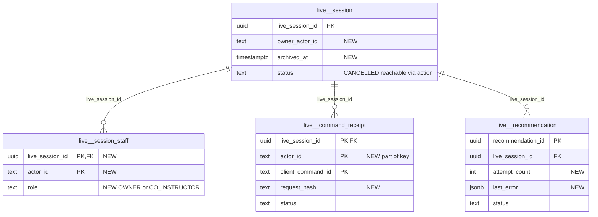

# `live` schema — realtime classroom sessions

The `live` schema is the authoritative state of the realtime classroom (requirements/28 and the fluid widget pack). It stores each session with its frozen topic plan and stage snapshot, the participants, an ordered append-only event log that the Socket.IO gateway replays, idempotency receipts for commands, per-topic timing, AI and instructor-NL proposals, and instructor takeovers. Every mutation runs inside one mathbank-rest transaction that updates state, appends a `live.session_event` and writes a `pipeline.outbox_event`. The `mathbank-live` gateway itself holds no state and has no database connection.

Source of truth: migrations [020](../../../mathbank-db/sql/020_live_fluid_platform.sql). Catalog extracted 2026-11-01 from migrations 001–054; endpoint mapping traced from mathbank-rest source and manually verified.

## 1. Purpose, ownership and data flow

**Domain.** A live session is a timed, instructor- or AI-led class over an ordered list of topics. Students join with a six-character code, answer polls/activities, ask questions and see widgets. The AI tutor can only *propose* actions. Instructors can take over the whole session, one student or a group.

**Write ownership.** All writes go through [live_runtime.py](../../../mathbank-rest/src/mathbank_rest/live_runtime.py) (the service module; routers contain no SQL). It is exposed by one router, [routers/live.py](../../../mathbank-rest/src/mathbank_rest/routers/live.py):

| Path family | Caller | Auth |
|---|---|---|
| `/v1/live/sessions*`, `/v1/realtime/sessions/{sid}` | mathbank-live Next.js API routes ([app/api/sessions/route.js](../../../mathbank-live/app/api/sessions/route.js), [app/api/join/route.js](../../../mathbank-live/app/api/join/route.js)) and the Socket.IO gateway ([lib/gateway.mjs](../../../mathbank-live/lib/gateway.mjs)) | `live_actor`: admin key (X-Admin-Api-Key) → INSTRUCTOR named by `X-Actor-Id`, or learner JWT → STUDENT `student:{uuid}`. `staff_actor` additionally requires INSTRUCTOR. |
| `/v1/instructor/live/{sid}/*` | Gateway (staff operations) | `staff_actor` (admin key) |
| `/v1/tutor/sessions/{sid}/*` | Gateway `ask_tutor` operation (system actor) and the tutor agent | Admin key (`require_admin_api_key`); actor recorded as `AI_TUTOR` |

**mathbank-live verified.** [server.mjs](../../../mathbank-live/server.mjs) and [lib/gateway.mjs](../../../mathbank-live/lib/gateway.mjs) contain no Postgres driver (`package.json` has no `pg`). The gateway forwards socket operations to the REST routes above (`OPERATIONS` map, gateway.mjs:89–118). It fans events out with a per-session pump that polls `GET /v1/live/sessions/{sid}/events?after_sequence=` every 700 ms as the system (admin-key) actor, then routes each event to rooms by `audience`. No ETL, worker or other service writes `live.*`.

**Downstream.** Every `emit()` also inserts a `pipeline.outbox_event` (`event_type='LIVE_EVENT'`, `aggregate_type='live_session'`). No outbox consumer subscribes to `LIVE_EVENT` (see [pipeline.md](./pipeline.md)), so these rows only accumulate. Sibling tables in other schemas that hang off `live.session` are `activity.instance`, `visual.widget_spec` and `visual.widget_state`. All cascade on session delete.

**Command lifecycle** (`execute_command`, live_runtime.py:867–920):
1. Look up `live.command_receipt` by `(live_session_id, client_command_id)`. On a hit, return the stored result with `duplicate: true`.
2. Lock the session row (`FOR UPDATE`) and open a SAVEPOINT.
3. Authorise by actor type: staff → `CONTROL_COMMANDS`; students → `STUDENT_COMMANDS` and must be a participant of an ACTIVE/PAUSED session; AI → `TUTOR_MESSAGE` only.
4. Check `expected_session_version` against `state_version` for non-students. AI commands must send it.
5. Dispatch, then `emit()`. `emit()` increments `last_sequence` (and `state_version` when the event is a control/stage change), inserts the `session_event` and inserts the outbox row.
6. On a `LiveError`, roll back to the savepoint and store a REJECTED receipt. Either way the receipt commits; the router then maps REJECTED to HTTP 4xx.

**Privacy class.** `participant.student_id`, `display_name` and student-authored event payloads (questions, responses) are **learner-private within the session**. The event log is filtered by `audience` for students in Python (`_visible`). Staff and the gateway see everything. `command_receipt.result` and `takeover.handoff_packet` are **staff-only**.

## 2. Entity diagram — as-is

```mermaid
erDiagram
    authoring__presentation_plan {
        uuid plan_id PK
    }
    learner__student_profile {
        uuid student_id PK
    }
    live__session {
        uuid live_session_id PK
        uuid plan_id FK "nullable, SET NULL"
        text join_code UK
        text status "SCHEDULED ACTIVE PAUSED COMPLETED CANCELLED"
        text control_mode "AI_ACTIVE or INSTRUCTOR_ACTIVE"
        bigint state_version
        bigint last_sequence
        jsonb topics "frozen topic list"
        jsonb stage "widgets and open activity"
    }
    live__participant {
        uuid live_session_id PK, FK
        text participant_id PK "student:uuid or instructor:name"
        text role "STUDENT INSTRUCTOR OBSERVER"
        uuid student_id FK "nullable, SET NULL"
        text group_id
        text control_mode
    }
    live__session_event {
        uuid live_session_id PK, FK
        bigint sequence PK
        uuid event_id UK
        text event_type
        bigint session_version
        text actor_type
        text audience "SESSION STUDENT INSTRUCTOR GROUP"
        jsonb payload
    }
    live__command_receipt {
        uuid live_session_id PK, FK
        text client_command_id PK
        text command_type
        text status "ACCEPTED or REJECTED"
        jsonb result
    }
    live__topic_run {
        uuid live_session_id PK, FK
        int topic_index PK
        text status "PENDING ACTIVE DONE SKIPPED"
        int planned_seconds
        int actual_seconds
    }
    live__recommendation {
        uuid recommendation_id PK
        uuid live_session_id FK
        text source
        jsonb action
        bigint based_on_version
        text status "PROPOSED ACCEPTED REJECTED STALE"
    }
    live__takeover {
        uuid takeover_id PK
        uuid live_session_id FK
        text scope "SESSION STUDENT GROUP"
        text scope_id
        text instructor
        timestamptz ended_at "NULL while active"
    }
    activity__instance {
        uuid activity_instance_id PK
        uuid live_session_id FK
    }
    visual__widget_spec {
        uuid widget_spec_id PK
        uuid live_session_id FK "nullable"
    }
    visual__widget_state {
        uuid live_session_id PK, FK
        text widget_instance_id PK
    }

    authoring__presentation_plan |o--o{ live__session : "plan_id"
    live__session ||--o{ live__participant : "live_session_id"
    learner__student_profile |o--o{ live__participant : "student_id"
    live__session ||--o{ live__session_event : "live_session_id"
    live__session ||--o{ live__command_receipt : "live_session_id"
    live__session ||--o{ live__topic_run : "live_session_id"
    live__session ||--o{ live__recommendation : "live_session_id"
    live__session ||--o{ live__takeover : "live_session_id"
    live__session ||--o{ activity__instance : "live_session_id"
    live__session |o--o{ visual__widget_spec : "live_session_id"
    live__session ||--o{ visual__widget_state : "live_session_id"
```

## 3. Tables

### `live.session`

**Role.** Each row is one live classroom. `create_session` inserts it as `SCHEDULED`, copying the topic list either from an APPROVED/PUBLISHED `authoring.presentation_plan` (with its time limits) or from ad-hoc topics in the request. Without topics it creates one "main" topic. The row is both the state machine and the read model: `stage` caches the visible widgets and the open activity so `GET /state` needs no joins. `state_version` is the optimistic-concurrency token for control commands; `last_sequence` is the event-log high-water mark.

**Lifecycle.** `status` transitions in `_navigate`/`_complete`:

| From | To | Trigger |
|---|---|---|
| — | `SCHEDULED` | Row insert |
| `SCHEDULED` | `ACTIVE` | `START` (sets `started_at`, enters topic 0) |
| `ACTIVE` | `PAUSED` | `PAUSE` (sets `paused_at`) |
| `PAUSED` | `ACTIVE` | `RESUME` (adds to `paused_total_seconds`, shifts `topic_started_at`) |
| `ACTIVE`/`PAUSED` | `COMPLETED` | `COMPLETE`, or `SKIP` of the last topic (ends active takeovers) |
| any | `CANCELLED` | **No code path** sets it; only read as "ended" |

Rows are never deleted by the application. There is no retention policy.

**Columns**

| Column | Type | Null | Default | Description |
|---|---|---|---|---|
| `live_session_id` | uuid | NO | `gen_random_uuid()` | Session identity; the `sid` path parameter and Socket.IO room key (`session:{sid}`). |
| `plan_id` | uuid | yes | — | Source presentation plan → `authoring.presentation_plan` (ON DELETE SET NULL). Must exist (404 `PLAN_NOT_FOUND`) and be APPROVED or PUBLISHED (409 `PLAN_NOT_APPROVED`) at creation. NULL for ad-hoc sessions. |
| `title` | text | NO | — | Display title. Defaults to the plan title, else "Live session". mathbank-live caps it at 200 chars. |
| `join_code` | text | NO | — | Six characters from `ABCDEFGHJKLMNPQRSTUVWXYZ23456789` (no 0/O/1/I). Generated with up to 20 collision retries (503 `JOIN_CODE_EXHAUSTED`). Students join with it, upper-cased. Never rotated or expired. |
| `status` | text | NO | `'SCHEDULED'` | CHECK `SCHEDULED`, `ACTIVE`, `PAUSED`, `COMPLETED`, `CANCELLED` (transitions above). |
| `control_mode` | text | NO | `'AI_ACTIVE'` | Session-level control. CHECK `AI_ACTIVE` (AI proposals may auto-apply) or `INSTRUCTOR_ACTIVE` (set by a SESSION-scope `TAKEOVER`, cleared by `RELEASE`). Initial value from the request. |
| `controller` | text | yes | — | Actor id of the instructor holding a SESSION takeover; NULL otherwise. |
| `agent_locked` | boolean | NO | `false` | `LOCK_AGENT`/`UNLOCK_AGENT`. While true the AI is never "in control" and locking marks open AI proposals `STALE`. |
| `state_version` | bigint | NO | `1` | Incremented by `emit(..., bump=True)` on control/stage changes only (navigation, takeover, widgets, activities, agent lock). Student responses and chat do not bump it. Compared with `expected_session_version` and `recommendation.based_on_version`. CHECK ≥ 1. |
| `last_sequence` | bigint | NO | `0` | Highest `session_event.sequence`; incremented in the same UPDATE that allocates the next event. CHECK ≥ 0. |
| `current_topic_index` | integer | NO | `0` | Index into `topics` of the current topic. |
| `current_scene_index` | integer | NO | `0` | Scene within the current topic; reset to 0 on topic change, set by `FORCE_SCENE`. |
| `course_limit_seconds` | integer | NO | — | Planned session length. From the plan, the request, or the sum of topic `planned_seconds`. CHECK > 0. |
| `interaction_buffer_seconds` | integer | NO | `0` | Slack reserved for interactions (copied from plan/request; not used in `time_state` calculations). |
| `hard_limit` | boolean | NO | `false` | When true the AI may never `EXTEND` (409 `HARD_LIMIT`) and the time orchestrator suggests `SHORTEN` instead of `EXTEND`. |
| `extension_seconds` | integer | NO | `0` | Net `EXTEND`/`SHORTEN` adjustment added to the limit. Can go negative (no CHECK). |
| `started_at` | timestamptz | yes | — | Set by `START`. |
| `paused_at` | timestamptz | yes | — | Start of the current pause; NULL while running. |
| `paused_total_seconds` | integer | NO | `0` | Accumulated paused time, excluded from elapsed time. |
| `topic_started_at` | timestamptz | yes | — | Entry time of the current topic (shifted forward by pause length on `RESUME`). |
| `completed_at` | timestamptz | yes | — | Set by `COMPLETE`. |
| `stage` | jsonb | NO | `'{}'` | Snapshot of what students see: `{"widgets": {<widget_instance_id>: {widget_spec_id, spec, state, visible}}, "activity": {activity_instance_id, status, …public fields}}`. Rewritten whole by `_save_stage`. |
| `created_by` | text | NO | `'admin'` | Actor id of the creator, e.g. `instructor:alice`. |
| `created_at` | timestamptz | NO | `now()` | Creation time; list order. |
| `updated_at` | timestamptz | NO | `now()` | Touched by every `emit()`. Other UPDATEs do not set it, but they always run alongside an `emit()`. |
| `topics` | jsonb | NO | `'[]'` | Frozen topic array (added by `ALTER` in 020): `[{ordinal, title, planned_seconds, required, scenes, concept?, problem_ref?, min_seconds?, max_seconds?, topic_key?}]`. Navigation and the time orchestrator read it; `topic_run` mirrors timing per entry. |

**Keys, constraints, indexes.**
- PK `live_session_id`; UNIQUE `join_code`.
- FK `plan_id` → `authoring.presentation_plan` ON DELETE SET NULL.
- CHECKs: `status`, `control_mode`; `state_version ≥ 1`; `last_sequence ≥ 0`; `course_limit_seconds > 0`.
- No secondary index (`list_sessions` sorts by `created_at` with a seq scan).
- No triggers. Inbound cascading FKs from every other `live.*` table, `activity.instance`, `visual.widget_spec` and `visual.widget_state`.

**REST operations today.**

| Op | Method & path | Auth | Handler | Notes |
|---|---|---|---|---|
| C | POST /v1/live/sessions | Admin key → INSTRUCTOR | `live.create_session` → `live_runtime.create_session` | Also inserts `topic_run` rows, the instructor `participant` and a `session.created` event. 201. |
| R | GET /v1/live/sessions?limit= | Admin key → INSTRUCTOR | `live.list_sessions` | Latest ≤ 200 by `created_at`. Returns `{items}` with no `total`/offset. Lists **all** sessions, not just the caller's. |
| R | GET /v1/live/sessions/{sid}/state | Admin key or participant JWT | `live.state` → `snapshot` | Staff view adds participants, open recommendations, takeovers and topic runs. |
| R | GET /v1/live/sessions/{sid}/time | Admin key → INSTRUCTOR | `live.time_state` | Pure computation from the row (elapsed, projected, ON_TRACK/BEHIND/OVER, suggested SKIP/EXTEND/SHORTEN). Suggestions are not persisted. |
| R | GET /v1/realtime/sessions/{sid} | Admin key or participant JWT | `live.realtime_info` | Room names and `state_version`/`last_sequence` for the gateway. |
| U | POST /v1/live/sessions/{sid}/commands, …/transition, …/pause, …/resume, …/activities, …/activities/{aid}/close, …/reveal, …/widgets, PATCH …/widgets/{wid}/state, DELETE …/widgets/{wid}, POST /v1/instructor/live/{sid}/overrides | See router | `execute_command` | Every accepted command updates `last_sequence`/`state_version` and usually `status`, topic indices, `stage`, `control_mode`, `controller` or `agent_locked`. |
| U | POST /v1/live/sessions/join | Learner JWT | `join_session` | Updates `last_sequence` through `emit` on first join. |
| U | POST /v1/tutor/sessions/{sid}/actions, …/messages | Admin key (agent) | `propose_ai_action`, `execute_command` | Auto-applied AI actions run as actor type `INSTRUCTOR` with id `auto:ai_tutor`. |

### `live.participant`

**Role.** Membership of a session. The creating instructor is inserted with role `INSTRUCTOR` at session creation. Students upsert themselves through `POST /join`; a repeat join only refreshes `last_seen_at`. Students are authorised for every later command by looking up this row. Per-student `control_mode` supports STUDENT- and GROUP-scope takeovers.

**Lifecycle.** Inserted on create/join. Updated by takeover/release (`control_mode`) and `MARK_CONFUSED` (`confused`, `last_seen_at`). Never deleted except by session cascade. There is no leave/kick operation.

**Columns**

| Column | Type | Null | Default | Description |
|---|---|---|---|---|
| `live_session_id` | uuid | NO | — | → `live.session` (ON DELETE CASCADE). |
| `participant_id` | text | NO | — | Actor id within the session: `student:{student_uuid}` for learners, `instructor:{actor}` for the creator. `create_session` receives an actor id that is already prefixed, so the stored value is `instructor:instructor:{name}`. |
| `role` | text | NO | — | CHECK `STUDENT`, `INSTRUCTOR`, `OBSERVER`. `OBSERVER` is never written. |
| `student_id` | uuid | yes | — | → `learner.student_profile.student_id` (ON DELETE SET NULL). Set for students only. |
| `display_name` | text | NO | — | Name shown to staff. From the join request (≤ 80 chars), else `learner.student_profile.display_name`, else "Student". |
| `group_id` | text | yes | — | Breakout group used by GROUP audience routing and GROUP takeovers. **No code path ever sets it**, so GROUP scope is currently inert. |
| `control_mode` | text | NO | `'AI_ACTIVE'` | Per-participant control. CHECK `AI_ACTIVE`/`INSTRUCTOR_ACTIVE`. Set by STUDENT/GROUP `TAKEOVER`/`RELEASE`; consulted by `_ai_in_control`. |
| `confused` | boolean | NO | `false` | Latest `MARK_CONFUSED` flag, shown to staff. |
| `joined_at` | timestamptz | NO | `now()` | First join; staff participant list order. |
| `last_seen_at` | timestamptz | NO | `now()` | Refreshed on re-join and `MARK_CONFUSED` only. It is not a presence heartbeat; the gateway's socket connections do not touch it. |

**Keys, constraints, indexes.**
- PK `(live_session_id, participant_id)`.
- FKs: `live_session_id` → `live.session` CASCADE; `student_id` → `learner.student_profile` SET NULL.
- CHECKs: `role`, `control_mode`.
- Partial index `participant_student_idx (student_id) WHERE student_id IS NOT NULL`.

**REST operations today.**

| Op | Method & path | Auth | Handler | Notes |
|---|---|---|---|---|
| C | POST /v1/live/sessions | Admin key → INSTRUCTOR | `create_session` | Instructor row, `ON CONFLICT DO NOTHING`. |
| C,U | POST /v1/live/sessions/join | Learner JWT | `join_session` | `ON CONFLICT … DO UPDATE SET last_seen_at`; emits `participant.joined` only on first insert. 404 unknown code, 409 ended session. |
| R | GET /v1/live/sessions/{sid}/state, /events, /realtime/sessions/{sid}, …/aggregate | Participant JWT | `_participant_view` | 403 `NOT_A_PARTICIPANT` for students who have not joined. |
| R | GET /v1/live/sessions/{sid}/state (staff) | Admin key | `snapshot` | Full participant list. |
| U | POST /v1/instructor/live/{sid}/overrides (TAKEOVER/RELEASE with scope STUDENT/GROUP) | Admin key | `_takeover`, `_release` | Flips `control_mode`. |
| U | POST /v1/live/sessions/{sid}/commands (`MARK_CONFUSED`) | Learner JWT | `_dispatch` | Sets `confused`. |

### `live.session_event`

**Role.** The ordered, append-only replay log of a session (distributed handoff 04 envelope). Every socket message originates as a row here. The gateway polls `GET /events?after_sequence=` and emits each new row to the rooms derived from `audience`. Clients that reconnect replay from their last sequence.

**Lifecycle.** Insert-only via `emit()`. A BEFORE UPDATE trigger raises `live.session_event is append-only`. DELETE is not guarded; rows go only with the session cascade. No retention.

**Columns**

| Column | Type | Null | Default | Description |
|---|---|---|---|---|
| `live_session_id` | uuid | NO | — | → `live.session` (ON DELETE CASCADE). |
| `sequence` | bigint | NO | — | Gap-free per-session order, allocated by `UPDATE live.session SET last_sequence = last_sequence + 1 … RETURNING` under the session row lock. CHECK ≥ 1. |
| `event_id` | uuid | NO | `gen_random_uuid()` | Global event id (application supplies `uuid4()`); used as `causation_id` of follow-on events. UNIQUE. |
| `event_type` | text | NO | — | Dotted name, not CHECK-constrained. Emitted values: `session.created/started/paused/resumed/completed`, `participant.joined`, `scene.changed`, `topic.skipped`, `time.adjusted`, `branch.selected`, `agent.locked/unlocked`, `instructor.takeover.started/ended`, `instructor.handoff_packet`, `instructor.message`, `tutor.message`, `widget.shown/updated/hidden`, `activity.opened/closed/revealed`, `activity.response.accepted`, `activity.aggregate.updated`, `student.question/hint_requested/confused/widget_interaction`, `recommendation.proposed`. |
| `session_version` | bigint | NO | — | `live.session.state_version` after this event (bumped or not). |
| `correlation_id` | text | yes | — | Request correlation; defaults to the `client_command_id`. |
| `causation_id` | text | yes | — | `client_command_id` for primary events; the primary `event_id` for derived events (handoff packet, aggregate update). |
| `actor_type` | text | NO | — | CHECK `STUDENT`, `INSTRUCTOR`, `ADMIN`, `AI_TUTOR`, `SYSTEM`. `ADMIN` is never written. Auto-applied AI actions are recorded as `INSTRUCTOR`. |
| `actor_id` | text | yes | — | e.g. `student:{uuid}`, `instructor:{name}`, `auto:ai_tutor`, `agent:mathbank_tutor`; NULL for SYSTEM. |
| `audience` | text | NO | `'SESSION'` | Fan-out scope. CHECK `SESSION` (everyone), `STUDENT` (one participant), `INSTRUCTOR` (staff room only), `GROUP`. Students see only SESSION events plus STUDENT/GROUP events addressed to them (`_visible`). |
| `audience_id` | text | yes | — | Target `participant_id` or `group_id` for STUDENT/GROUP audiences. |
| `payload` | jsonb | NO | `'{}'` | Event body (shape per `event_type`), e.g. `{"topic_index", "scene_index", "topic", "reason"}` for `scene.changed`, `{"text"}` for messages, full aggregate for `activity.aggregate.updated`, `{"handoff_packet", "takeover_id"}` for the private handoff event. Student text is truncated to 4000 chars. |
| `created_at` | timestamptz | NO | `clock_timestamp()` | Wall-clock insert time (returned as `timestamp`). |

**Keys, constraints, indexes.**
- PK `(live_session_id, sequence)`, which also serves the replay range scan; UNIQUE `event_id`.
- FK → `live.session` CASCADE.
- CHECKs: `sequence ≥ 1`, `actor_type`, `audience`.
- Trigger `session_event_append_only` BEFORE UPDATE → `live.session_event_append_only()`.

**REST operations today.**

| Op | Method & path | Auth | Handler | Notes |
|---|---|---|---|---|
| C | Every accepted command route (see `live.session`), POST /v1/live/sessions, POST /v1/live/sessions/join, POST /v1/tutor/sessions/{sid}/actions (`recommendation.proposed`) | Various | `emit` | One to three rows per command. |
| R | GET /v1/live/sessions/{sid}/events?after_sequence=&limit= | Admin key or participant JWT | `live.events` → `list_events` | Max 1000 per page. Student filtering happens **after** `LIMIT`, so a student page can be short or empty while `next_after` still advances. |
| R | GET /v1/instructor/live/{sid}/handoff | Admin key | `handoff_packet` | Last 12 question/hint/confused/tutor/response events. |
| R | GET /v1/tutor/sessions/{sid}/context | Admin key | `tutor_context` | Last 10 SESSION-or-addressed events. |

### `live.command_receipt`

**Role.** Idempotency store for live commands (handoff 04: `client_command_id` + `expected_session_version`). Each executed command, accepted or rejected, writes one receipt with the full JSON result. A retry with the same id returns that result without re-executing. Recommendations reuse it with the synthetic id `rec:{recommendation_id}`.

**Lifecycle.** Insert-only from application code (no UPDATE path, but no trigger either). Never purged.

**Columns**

| Column | Type | Null | Default | Description |
|---|---|---|---|---|
| `live_session_id` | uuid | NO | — | → `live.session` (ON DELETE CASCADE). |
| `client_command_id` | text | NO | — | Client-supplied id (6–120 chars; the server generates `uuid4()` when omitted), or `rec:{recommendation_id}`. Unique per session, **not per actor**. |
| `command_type` | text | NO | — | Upper-cased command, e.g. `START`, `NEXT`, `SHOW_WIDGET`, `RESPONSE_SUBMIT`, `TUTOR_MESSAGE` (the `CONTROL_COMMANDS` ∪ `STUDENT_COMMANDS` ∪ `AI_COMMANDS` sets in live_runtime.py:26–32). Not CHECK-constrained; unknown commands are stored as REJECTED. |
| `actor_type` | text | NO | — | Actor that issued it (`INSTRUCTOR`, `STUDENT`, `AI_TUTOR`). Not CHECK-constrained here. |
| `actor_id` | text | yes | — | Issuer id. |
| `status` | text | NO | — | CHECK `ACCEPTED` or `REJECTED`. |
| `result` | jsonb | NO | `'{}'` | Returned body. Accepted: `{status, command_type, client_command_id, event (envelope), session_version, last_sequence, handoff_packet?}`. Rejected: `{status, command_type, client_command_id, error: {code, message, http_status, …details}, session_version}`. |
| `created_at` | timestamptz | NO | `now()` | Execution time. |

**Keys, constraints, indexes.**
- PK `(live_session_id, client_command_id)`.
- FK → `live.session` CASCADE.
- CHECK `status`.
- No other indexes, triggers or retention.

**REST operations today.**

| Op | Method & path | Auth | Handler | Notes |
|---|---|---|---|---|
| C,R | All command routes (see `live.session`), POST /v1/instructor/live/{sid}/recommendations/{rid}, POST /v1/instructor/live/{sid}/commands (`auto_apply`), POST /v1/tutor/sessions/{sid}/actions, …/messages | Various | `execute_command` | The duplicate lookup is not scoped to the actor and does not compare `command_type`, so a reused id returns someone else's result. |
| R | — | — | — | No endpoint lists receipts (no admin audit view). |

### `live.topic_run`

**Role.** Planned vs actual timing for each topic of a session (fluid 06). One row per entry of `live.session.topics`, created with the session. It drives the staff timing view.

**Lifecycle.** `status`: `PENDING` → `ACTIVE` (`_enter_topic`, keeps the first `started_at`, clears `ended_at`) → `DONE` (`_close_topic` on leaving, sets `ended_at` and `actual_seconds`) or `SKIPPED` (`SKIP` of the current topic, or a `PENDING` topic skipped ahead). Going `BACK` re-activates a `DONE` topic, and `actual_seconds` is then recomputed from the original `started_at`, which double-counts the time spent elsewhere.

**Columns**

| Column | Type | Null | Default | Description |
|---|---|---|---|---|
| `live_session_id` | uuid | NO | — | → `live.session` (ON DELETE CASCADE). |
| `topic_index` | integer | NO | — | The topic's `ordinal` in `live.session.topics`. |
| `title` | text | NO | — | Topic title copied at creation. |
| `planned_seconds` | integer | NO | — | Planned duration (topic value, default 300). No CHECK. |
| `started_at` | timestamptz | yes | — | First entry into the topic. |
| `ended_at` | timestamptz | yes | — | Last exit. |
| `actual_seconds` | integer | yes | — | `now() - started_at` at close (pauses are **not** subtracted). |
| `status` | text | NO | `'PENDING'` | CHECK `PENDING`, `ACTIVE`, `DONE`, `SKIPPED`. |

**Keys, constraints, indexes.**
- PK `(live_session_id, topic_index)`.
- FK → `live.session` CASCADE.
- CHECK `status`. No index on `status`; no trigger.

**REST operations today.**

| Op | Method & path | Auth | Handler | Notes |
|---|---|---|---|---|
| C | POST /v1/live/sessions | Admin key | `create_session` | One row per topic. |
| U | Navigation commands (START, NEXT, BACK, SKIP, FORCE_SCENE, COMPLETE, SELECT_BRANCH CONTINUE) through /commands, /transition, /recommendations/{rid}, /tutor/…/actions | Admin key | `_enter_topic`, `_close_topic`, `_navigate` | |
| R | GET /v1/live/sessions/{sid}/state (staff) | Admin key | `snapshot` | `topic_runs` array. |

### `live.recommendation`

**Role.** Proposed session actions that a human (or the auto-apply policy) must accept: AI tutor proposals, instructor natural-language commands compiled by `compile_instructor_command`, and poll-driven branch suggestions. `based_on_version` makes stale proposals unappliable (dist 20). `propose_ai_action` auto-applies an AI proposal only when the session is `AI_ACTIVE`, unlocked, the version matches and the command is in `AUTO_APPLY` (`SHOW_WIDGET`, `OPEN_ACTIVITY`, `CLOSE_ACTIVITY`, `REVEAL_ACTIVITY`, `NEXT`, `SELECT_BRANCH`).

**Lifecycle.**

| From | To | Trigger |
|---|---|---|
| — | `PROPOSED` | `_recommend` (AI action, instructor NL, `CLOSE_ACTIVITY` poll branch) |
| `PROPOSED` | `STALE` | Inserted with an old `based_on_version`; SESSION takeover; `LOCK_AGENT` (AI_TUTOR rows only) |
| `PROPOSED` | `ACCEPTED`/`REJECTED` | Auto-apply policy (`decided_by='policy:auto'`) or staff decision |

A staff ACCEPT whose command is rejected leaves the row `PROPOSED` but stores a REJECTED receipt under `rec:{rid}`. Any later ACCEPT returns that cached rejection, so the row can never be accepted.

**Columns**

| Column | Type | Null | Default | Description |
|---|---|---|---|---|
| `recommendation_id` | uuid | NO | `gen_random_uuid()` | Identity; the `rid` path parameter. |
| `live_session_id` | uuid | NO | — | → `live.session` (ON DELETE CASCADE). |
| `source` | text | NO | — | CHECK `AI_TUTOR`, `INSTRUCTOR_NL`, `TIME_ORCHESTRATOR`, `POLL_BRANCH`, `VISUAL_AGENT`. Only `AI_TUTOR`, `INSTRUCTOR_NL` and `POLL_BRANCH` are written. Time-orchestrator suggestions are computed in `time_state` but never persisted. |
| `action` | jsonb | NO | — | `{"command_type": <CONTROL_COMMAND>, "payload": {...}}`, e.g. `{"command_type":"SELECT_BRANCH","payload":{"branch":"REINFORCE","activity_instance_id":"…"}}`. |
| `rationale` | text | yes | — | Free text: agent rationale (≤ 1000), the instructor's NL message (≤ 500), or "NN% correct → BRANCH". |
| `based_on_version` | bigint | NO | — | `state_version` the proposal was computed against. Poll branches use `state_version + 1` (the version after the close). |
| `status` | text | NO | `'PROPOSED'` | CHECK `PROPOSED`, `ACCEPTED`, `REJECTED`, `STALE`. |
| `decided_by` | text | yes | — | Staff actor id, `policy:auto`, `system`, `takeover` or `lock`. |
| `decided_at` | timestamptz | yes | — | Decision time. |
| `created_at` | timestamptz | NO | `now()` | Proposal time. |

**Keys, constraints, indexes.**
- PK `recommendation_id`.
- FK → `live.session` CASCADE.
- CHECKs `source`, `status`.
- Index `recommendation_session_idx (live_session_id, created_at DESC)`.

**REST operations today.**

| Op | Method & path | Auth | Handler | Notes |
|---|---|---|---|---|
| C,U | POST /v1/tutor/sessions/{sid}/actions | Admin key (agent) | `propose_ai_action` | 422 unknown command; 409 `HARD_LIMIT` for EXTEND. Returns STALE, auto-applied, or PROPOSED (emits `recommendation.proposed` to INSTRUCTOR). |
| C,U | POST /v1/instructor/live/{sid}/commands | Admin key | `instructor_nl` | Regex compiler; with `auto_apply` each action is accepted immediately. |
| C | POST /v1/live/sessions/{sid}/activities/{aid}/close | Admin key | `_dispatch` CLOSE_ACTIVITY | POLL_BRANCH proposal when the aggregate recommends a branch. |
| R | GET /v1/instructor/live/{sid}/recommendations?status= | Admin key | `list_recommendations` | Latest 100. `status` is an unvalidated string. |
| U | POST /v1/instructor/live/{sid}/recommendations/{rid} | Admin key | `decide_recommendation` | `ACCEPT`/`REJECT`; row locked; 404/409. |
| U | POST /v1/instructor/live/{sid}/overrides (TAKEOVER, LOCK_AGENT) | Admin key | `_takeover`, `_dispatch` | Marks AI_TUTOR proposals `STALE`. |

### `live.takeover`

**Role.** Instructor takeovers (dist 20). A row records who took control of which scope and freezes a handoff packet (recent questions, hints, confusion, tutor messages, current activity aggregate and a likely-gap guess) for the instructor. A partial unique index allows only one active takeover per scope.

**Lifecycle.** Inserted by `TAKEOVER` (only if that scope was `AI_ACTIVE`; 409 `ALREADY_TAKEN_OVER` otherwise). `ended_at` is set by `RELEASE` (409 `NO_ACTIVE_TAKEOVER` if none) or for all open rows on session `COMPLETE`. Rows are kept as history.

**Columns**

| Column | Type | Null | Default | Description |
|---|---|---|---|---|
| `takeover_id` | uuid | NO | `gen_random_uuid()` | Identity, returned in the `instructor.takeover.started` event. |
| `live_session_id` | uuid | NO | — | → `live.session` (ON DELETE CASCADE). |
| `scope` | text | NO | — | CHECK `SESSION`, `STUDENT`, `GROUP`. |
| `scope_id` | text | NO | `'*'` | `*` for SESSION, a `participant_id` for STUDENT, a `group_id` for GROUP. |
| `instructor` | text | NO | — | Actor id of the instructor. |
| `handoff_packet` | jsonb | NO | `'{}'` | Snapshot from `handoff_packet()`: current topic, recent events, hint/confusion counts, tutor attempts, activity aggregate, `likely_gap`. Also emitted privately to INSTRUCTOR as `instructor.handoff_packet`. |
| `started_at` | timestamptz | NO | `now()` | Takeover time. |
| `ended_at` | timestamptz | yes | — | Release time; NULL means active. |

**Keys, constraints, indexes.**
- PK `takeover_id`.
- FK → `live.session` CASCADE.
- CHECK `scope`.
- Partial UNIQUE `takeover_active_uidx (live_session_id, scope, scope_id) WHERE ended_at IS NULL`.

**REST operations today.**

| Op | Method & path | Auth | Handler | Notes |
|---|---|---|---|---|
| C,U | POST /v1/instructor/live/{sid}/overrides (`TAKEOVER`/`RELEASE`) | Admin key | `_takeover`, `_release` | Body `{action, scope, scope_id, client_command_id, expected_session_version}`. |
| U | Any COMPLETE path | Admin key | `_complete` | Ends all open takeovers. |
| R | GET /v1/live/sessions/{sid}/state (staff) | Admin key | `snapshot` | Active takeovers only. |
| R | GET /v1/instructor/live/{sid}/handoff | Admin key | `handoff_packet` | Computes a fresh packet; does not read stored rows. |
| R | `_ai_in_control` (tutor context/messages) | Admin key | | GROUP takeover check. |

## 4. CRUD coverage — as-is

✅ REST endpoint · ❌ missing · — not applicable to the table type.

| Table | Type (guide §4) | Create | Read | Update | Delete | List | Notes |
|---|---|---|---|---|---|---|---|
| `live.session` | Learner working state / runtime aggregate | ✅ POST /v1/live/sessions | ✅ GET …/{sid}/state | ✅ command routes | ❌ | ✅ GET /v1/live/sessions (no total/offset/filters) | No cancel or archive action, although `CANCELLED` exists. |
| `live.participant` | Junction (session × actor) | ✅ POST …/join | ✅ in state | ✅ takeover, MARK_CONFUSED | ❌ | ✅ in staff state | No leave/kick, no group assignment. |
| `live.session_event` | Learner event (append-only) | ✅ via commands | ✅ GET …/events | — | — | ✅ GET …/events (cursor) | Correct shape. Student filtering after LIMIT. |
| `live.command_receipt` | Queue/idempotency (internal) | ✅ via commands | ❌ | — | — | ❌ | Internal; there is no audit read for rejected commands. |
| `live.topic_run` | Runtime child state | ✅ with session | ✅ in staff state | ✅ navigation | — | ✅ in staff state | |
| `live.recommendation` | Queue (proposal) | ✅ tutor/NL/poll | ❌ single GET | ✅ decide | — | ✅ GET …/recommendations | |
| `live.takeover` | Learner event (history) | ✅ overrides | ✅ active only | ✅ release | — | ❌ history | Ended takeovers are not readable. |

**Findings.**
1. **Admin key = any instructor = every session.** `live_actor` maps the shared admin key to INSTRUCTOR and trusts `X-Actor-Id` for identity ([routers/live.py:67–77](../../../mathbank-rest/src/mathbank_rest/routers/live.py)). There is no per-session instructor ownership, and `GET /v1/live/sessions` lists every session. The same key authenticates the tutor agent (`/v1/tutor/sessions/*`).
2. **A rejected ACCEPT poisons a recommendation forever.** `decide_recommendation` reuses `client_command_id = rec:{rid}`. When the command is rejected (for example a stale version), the REJECTED receipt is committed and the row stays `PROPOSED`, so every retry returns the cached rejection (live_runtime.py:968–991).
3. **Idempotency is not actor-scoped.** `command_receipt` is keyed by `(session, client_command_id)` only and returns the stored result without comparing actor or command. A student who reuses an instructor's id receives the instructor's result, which can include `handoff_packet`.
4. **Dead vocabulary and inert features.** `participant.group_id` is never written, so GROUP takeovers and GROUP audiences cannot work. `role='OBSERVER'`, `status='CANCELLED'`, `actor_type='ADMIN'` and the `TIME_ORCHESTRATOR`/`VISUAL_AGENT` sources are never produced.
5. **Unbounded growth and unconsumed outbox rows.** `session_event`, `command_receipt` and the `LIVE_EVENT` rows in `pipeline.outbox_event` have no retention. Nothing consumes `LIVE_EVENT`; the gateway polls REST instead.
6. **Inline SQL is fine here.** All SQL is in `live_runtime.py`; the router has none. `/activities/{aid}/aggregate` does not check that `aid` belongs to `sid` (it reads `activity.*`).

## 5. Target state — how it should be

### 5.1 Schema improvements

1. **P1: Scope command idempotency to the actor and the request.**
   - **Evidence.** PK `(live_session_id, client_command_id)` together with the unconditional duplicate return in `execute_command` (live_runtime.py:873–877).
   - **Fix.** Add `request_hash text NOT NULL` (sha256 of `command_type` and canonical payload). Return the cached result only when `actor_id` and `request_hash` match; otherwise return 409 `IDEMPOTENCY_KEY_REUSED`. Optionally change the PK to `(live_session_id, actor_id, client_command_id)`.

2. **P1: Make recommendation acceptance retryable.**
   - **Evidence.** Finding 2.
   - **Fix.** Either use `client_command_id = rec:{rid}:{attempt}`, or add `attempt_count` and `last_error jsonb` to `live.recommendation` and mark it `REJECTED` (or `STALE`) when the applied command is rejected. Add `CHECK ((status = 'PROPOSED') = (decided_at IS NULL))`.

3. **P2: Record session ownership.**
   - **Evidence.** `created_by` is free text, and there is no instructor/session relationship to authorise against.
   - **Fix.** Add `owner_actor_id text NOT NULL` (backfilled from `created_by`), plus an optional `live.session_staff (live_session_id, actor_id, role)` junction for co-instructors. Filter staff lists and commands by it.

4. **P2: Retention for the log tables.**
   - **Evidence.** The append-only log and receipts grow per keystroke-level event.
   - **Fix.** Add `archived_at` to `live.session` and a job that archives `session_event` and `command_receipt` rows of sessions completed more than N days ago (66A marks `session_event` K/O: archive cold bodies). Also add an index `live.session (status, created_at DESC)` for the list endpoint.

5. **P2: Make groups real or drop them.** Either add group assignment (`PUT …/participants/{pid}` with `group_id`) or remove `GROUP` from the `audience`/`scope` CHECKs and `OBSERVER` from `role`. Unused enum values mislead readers of the CHECKs.

6. **P3: Guard DELETE on `session_event`.** Extend the trigger to `BEFORE UPDATE OR DELETE` while still allowing the cascade, for example by checking `pg_trigger_depth() > 1` or using a session-level bypass flag for archival.

7. **P3: Fix timing semantics.**
   - **Evidence.** `topic_run.actual_seconds` ignores pauses and re-entry. `extension_seconds` has no lower bound.
   - **Fix.** Accumulate `active_seconds` on each close (subtracting the pause time that overlaps the topic), and add `CHECK (course_limit_seconds + extension_seconds > 0)`.

8. **P3: Store the instructor participant id correctly.** Stop prefixing twice (`instructor:instructor:…`) in `create_session`, and backfill existing rows.

### 5.2 Entity diagram — target

Only the changed parts are shown.

### 5.3 Endpoints to build

| Priority | Method & path | Auth | Table(s) / op | Purpose | Notes (validation, concurrency, audit) |
|---|---|---|---|---|---|
| P1 | (change) all `/v1/live/sessions/{sid}/*` staff routes | Instructor credential, not the shared admin key | `live.session` R | Enforce session ownership. | Resolve the instructor from a signed staff session instead of `X-Actor-Id`. Require `owner_actor_id` or a `session_staff` row; 403 otherwise. |
| P1 | (change) POST /v1/instructor/live/{sid}/recommendations/{rid} | Instructor | `live.recommendation` U, `live.command_receipt` C | Retryable accept. | Per §5.1 #2. On a rejected command, return 409 with the error and leave the recommendation retryable or mark it `REJECTED` explicitly. |
| P2 | POST /v1/live/sessions/{sid}/cancel | Instructor (owner) | `live.session` U, `session_event` C | Reach `CANCELLED` from `SCHEDULED`/`ACTIVE`/`PAUSED`. | Runs through `execute_command` (new `CANCEL` command) so it is versioned and idempotent. Ends takeovers and writes `audit.action_log`. |
| P2 | GET /v1/admin/live/sessions?status=&q=&limit=&offset= | Admin key (X-Admin-Api-Key) | `live.session` R | Ops list with filters and `total`. | Guide §5 list contract; `q` matches title/join_code. |
| P2 | GET /v1/admin/live/sessions/{sid}/commands?status=REJECTED | Admin key | `live.command_receipt` R | Diagnose rejected commands. | Keyset by `created_at`; omits `result.handoff_packet` by default. |
| P2 | PUT /v1/live/sessions/{sid}/participants/{pid} | Instructor (owner) | `live.participant` U | Assign `group_id`, or remove a participant (`DELETE` same path). | Versioned command so the change appears in the event log. |
| P3 | GET /v1/live/sessions/{sid}/takeovers | Instructor | `live.takeover` R | Takeover history including ended ones. | Read-only; excludes `handoff_packet` unless `?include=packet`. |
| P3 | GET /v1/learner/live-sessions | Learner JWT | `live.participant` R ⋈ `live.session` | "Sessions I joined". | Owner-scoped in SQL (`student_id = :sid`). |
| P3 | POST /v1/admin/live/sessions/archive | Admin key | `session_event`, `command_receipt` D (archive) | Retention job. | Returns 202 with the `pipeline.run` id; never runs inline. |
