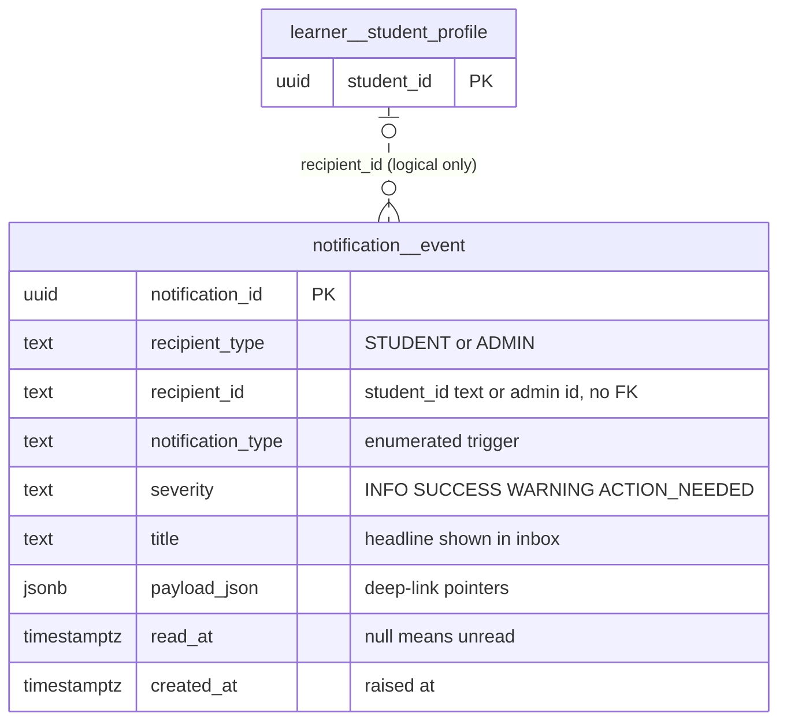
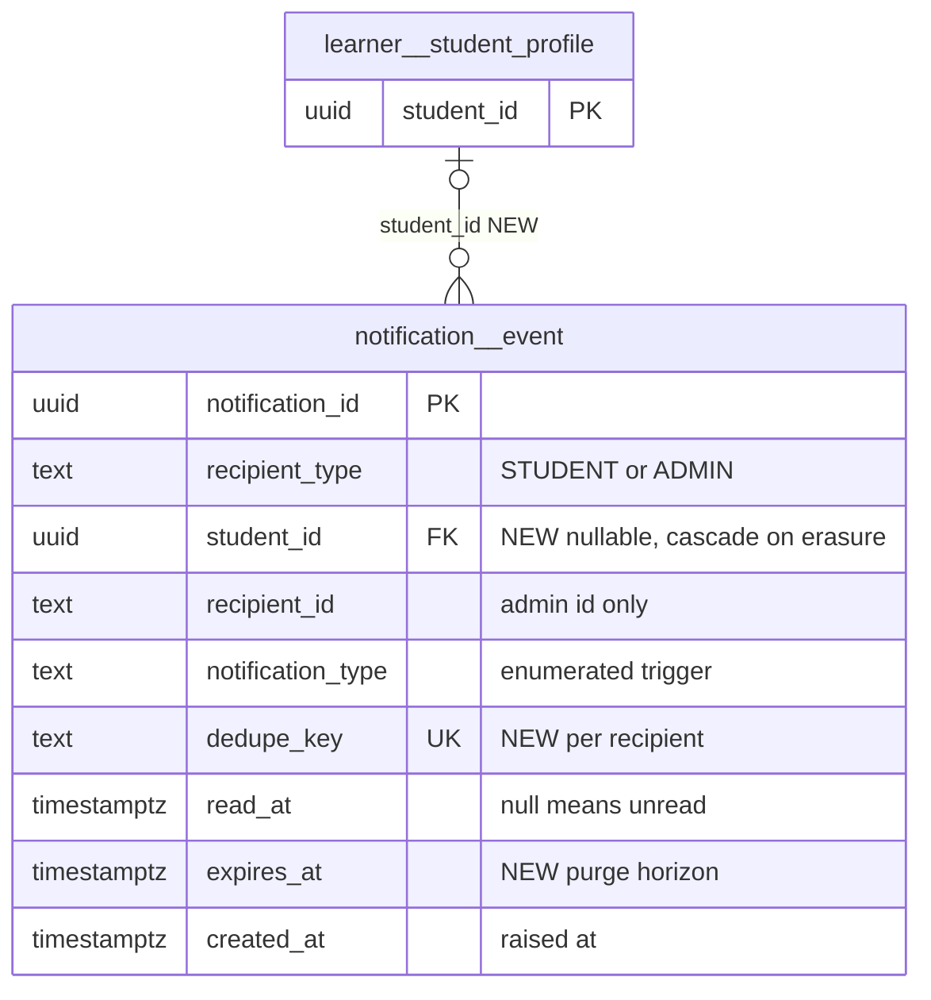

# `notification` schema — student/admin notification inbox (scaffolded)

The `notification` schema holds in-app notifications addressed to a student or an admin, raised as a side effect of existing grading/review paths ([requirements/59](../../requirements/59_STUDENT_ADMIN_NOTIFICATIONS_PLATFORM.md)). It contains one table, `notification.event`. The feature is **scaffolded only**: the insert helper exists, but no grading path calls it, and the two REST routes return HTTP 501.

Source of truth: migrations [043](../../../mathbank-db/sql/043_notifications.sql). Catalog extracted 2026-11-01 from migrations 001–054; endpoint mapping traced from mathbank-rest source and manually verified.

## 1. Purpose, ownership and data flow

- **Domain:** learner and staff notifications ("your quiz was graded", "release ready for review", "data gap found").
- **Owner:** [notifications.py](../../../mathbank-rest/src/mathbank_rest/notifications.py) in mathbank-rest. `record_notification()` is the only implemented SQL (INSERT). The wrappers `record_quiz_graded`, `record_micro_course_item_graded`, `record_micro_course_activity_graded` and `record_admin_review_needed` exist, but nothing calls them (NOTIF-5, intentional). `list_notifications()`, `mark_read()` and `_publish_realtime()` raise `NotImplementedError`.
- **Intended flow:** grading function → `record_*` (same transaction) → row in `notification.event` → learner inbox (`GET /v1/notifications/me`) and optional Socket.IO push through mathbank-live (deferred).
- **Deployment status:** the migration header says it is "NOT applied to any live database in this pass" ([043:6-9](../../../mathbank-db/sql/043_notifications.sql)). It is applied by the scaffolded [scripts/migrate_notifications.py](../../../mathbank-rest/scripts/migrate_notifications.py) and was included in the scratch catalog used here.
- **Lifecycle:** append-mostly; the only planned mutation is setting `read_at`. No expiry or retention is defined.
- **Privacy class:** learner-private (student rows) / staff-only (admin rows).

## 2. Entity diagram — as-is

`recipient_id` is a polymorphic text reference with no FK. The dotted relationship shows the intended logical link when `recipient_type = 'STUDENT'`.

## 3. Tables

### `notification.event`

**Role.** One row = one notification delivered to one recipient. A `record_*` wrapper in [notifications.py](../../../mathbank-rest/src/mathbank_rest/notifications.py) would create it inside the grading or review transaction that triggered it. The learner inbox and an admin inbox would then read it. No row is written by any production path today.

**Lifecycle.** Unread (`read_at IS NULL`) → read (`read_at` set by `mark_read`, still a stub that must verify ownership). No delete, archive or expiry is defined. No triggers.

**Columns**

| Column | Type | Null | Default | Description |
|---|---|---|---|---|
| `notification_id` | uuid | NO | `gen_random_uuid()` | Surrogate key; returned by `record_notification()` and used in `POST /v1/notifications/{notification_id}/read`. |
| `recipient_type` | text | NO | — | Audience: `STUDENT` or `ADMIN` (CHECK). Selects how `recipient_id` is interpreted. |
| `recipient_id` | text | NO | — | Recipient identity as text. For `STUDENT`, the `learner.student_profile.student_id` UUID string; for `ADMIN`, an admin identifier (resolution strategy undecided, see the `record_admin_review_needed` TODO). No FK. |
| `notification_type` | text | NO | — | Trigger kind (CHECK): `QUIZ_GRADED`, `MICRO_COURSE_ITEM_GRADED`, `MICRO_COURSE_ACTIVITY_GRADED`, `MASTERY_MILESTONE`, `ADMIN_DATA_GAP`, `ADMIN_REVIEW_NEEDED`. Mirrored by the `NotificationType` Literal. |
| `severity` | text | NO | `'INFO'` | Visual emphasis (CHECK): `INFO`, `SUCCESS`, `WARNING`, `ACTION_NEEDED`. The wrappers use `SUCCESS` when the learner was correct and `ACTION_NEEDED` for admin review requests. |
| `title` | text | NO | — | Short headline, e.g. "Your quiz was graded" or "`<course>` has a release ready for review". |
| `body` | text | yes | — | Optional detail line, e.g. `Score: 80%`. |
| `payload_json` | jsonb | NO | `'{}'` | Deep-link pointers for the UI, keyed by type: `{quiz_id, is_correct}`, `{item_id, is_correct, gave_up}`, `{activity_id, is_correct, gave_up}`, `{release_id}`. The migration leaves a TODO to replace it with typed FKs. |
| `read_at` | timestamptz | yes | — | When the recipient marked it read; NULL = unread. Drives the partial unread index. |
| `created_at` | timestamptz | NO | `now()` | When the notification was raised. Inbox sort key. |

**Keys, constraints, indexes.**
- PK `notification_id`.
- CHECKs: `recipient_type` ∈ {STUDENT, ADMIN}; `notification_type` ∈ the six values above; `severity` ∈ {INFO, SUCCESS, WARNING, ACTION_NEEDED}.
- No FKs and no uniqueness. Duplicate notifications for the same trigger are possible.
- Indexes: `idx_notification_event_recipient (recipient_type, recipient_id, created_at DESC)` for the inbox; partial `idx_notification_event_unread (recipient_type, recipient_id) WHERE read_at IS NULL` for the unread badge.
- No triggers.

**REST operations today.** The static trace found no endpoint because neither route reaches SQL. Both routes are mounted ([main.py:119](../../../mathbank-rest/src/mathbank_rest/main.py)), but neither is functional:

| Op | Method & path | Auth | Handler | Notes |
|---|---|---|---|---|
| R | `GET /v1/notifications/me?limit=&offset=` | Learner JWT | `routers.notifications.list_my_notifications` | Calls `notifications.list_notifications`, which raises `NotImplementedError`; returns **501**. |
| U | `POST /v1/notifications/{notification_id}/read` | Learner JWT | `routers.notifications.mark_notification_read` | Calls `notifications.mark_read` (stub); returns **501**. |

No writer is wired. `record_notification()` has no caller outside [notifications.py](../../../mathbank-rest/src/mathbank_rest/notifications.py).

## 4. CRUD coverage — as-is

| Table | Create | Read | Update | Delete | Notes |
|---|---|---|---|---|---|
| `notification.event` | ❌ | ❌ | ❌ | — | Insert helper exists but has no caller; the read and mark-read routes return 501. Delete is intentionally absent (retention via expiry is preferable). |

## 5. Target state — how it should be

### 5.1 Schema improvements

1. **P1 — Wire at least one producer before relying on the table.** Without a caller of `record_notification()`, the table stays empty. Start with `quiz_runtime` / `micro_course_service.submit_learning_item_response`, as documented in the wrapper docstrings ([notifications.py:97-140](../../../mathbank-rest/src/mathbank_rest/notifications.py)).
2. **P2 — Split the polymorphic recipient so student rows cascade on erasure.** Add `student_id uuid NULL REFERENCES learner.student_profile ON DELETE CASCADE` and `CHECK ((recipient_type = 'STUDENT') = (student_id IS NOT NULL))`. Keep `recipient_id` only for admins. Without this, learner erasure leaves orphaned student notifications, and `recipient_id` text cannot be validated (66A §notification: "enforce owner/read/expiry").
3. **P2 — Add `expires_at timestamptz` and a purge job.** Notifications are derived. No retention is defined in 043 or requirements/59, so the table grows without bound.
4. **P3 — Add a dedupe key** (`dedupe_key text`, `UNIQUE (recipient_type, recipient_id, dedupe_key)`). The grading paths are retried with Idempotency-Keys, so a retried grading call could raise the same notification twice.
5. **P3 — Typed payload validation.** Replace the free `payload_json` with per-type Pydantic models and a `CHECK (jsonb_typeof(payload_json) = 'object')`, as the 043 TODO suggests.

### 5.2 Entity diagram — target

### 5.3 Endpoints to build

| Priority | Method & path | Auth | Table(s) / op | Purpose | Notes (validation, concurrency, audit) |
|---|---|---|---|---|---|
| P1 | `GET /v1/notifications/me?unread=&limit=&offset=` (implement existing route) | Learner JWT | `notification.event` / R | Learner inbox plus unread count. | Owner-scoped in SQL (`recipient_type='STUDENT' AND recipient_id=:sid`); limit ≤ 200; response `{items,total,unread_count,limit,offset}`; uses both existing indexes. |
| P1 | `POST /v1/notifications/{notification_id}/read` (implement existing route) | Learner JWT | `notification.event` / U | Mark one notification read. | `UPDATE … SET read_at = coalesce(read_at, now()) WHERE notification_id=:id AND recipient_id=:sid`; 404 if not owned; idempotent. |
| P2 | `POST /v1/notifications/me/read-all` | Learner JWT | `notification.event` / U | Clear the unread badge. | Owner-scoped bulk update; returns the count updated. |
| P2 | `GET /v1/admin/notifications?recipient_type=&type=&unread=&limit=&offset=` | Admin key (X-Admin-Api-Key) | `notification.event` / R | Admin inbox (`ADMIN_REVIEW_NEEDED`, `ADMIN_DATA_GAP`). | Requires an admin identity to scope `recipient_id`; until then, list all admin-type rows. |
| P3 | `POST /v1/admin/notifications/{notification_id}/read` | Admin key (X-Admin-Api-Key) | `notification.event` / U | Admin acknowledges an action-needed notification. | Writes `audit.action_log` (`NOTIFICATION_ACKNOWLEDGED`). |
