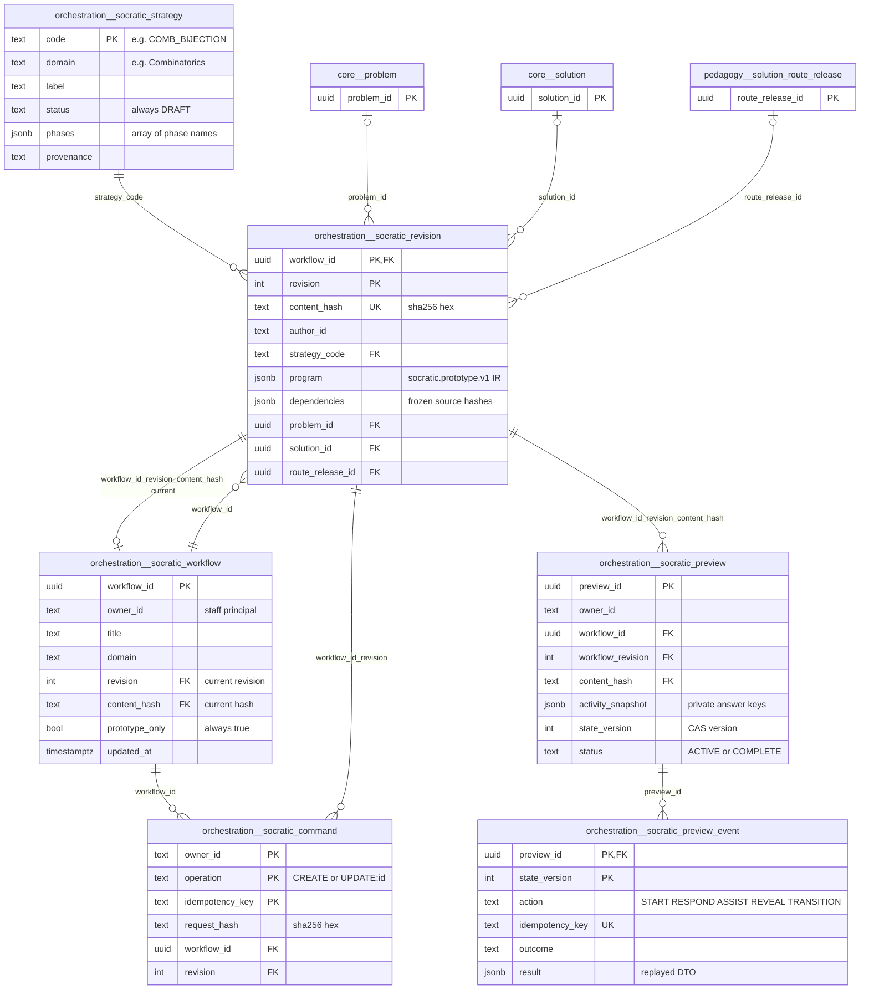
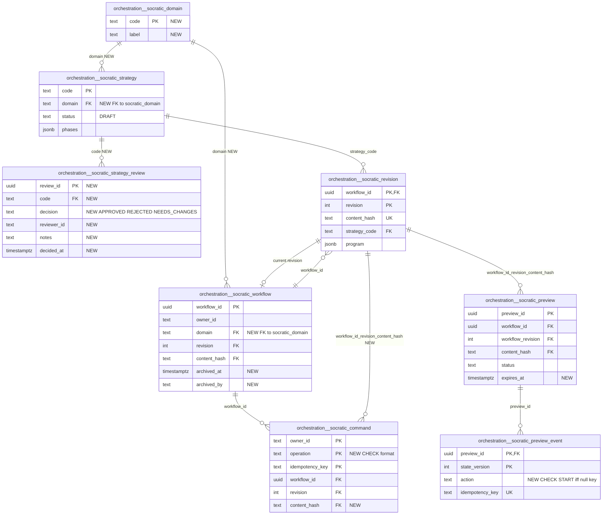

# `orchestration` schema — Adaptive Socratic Studio drafts and synthetic previews

The `orchestration` schema stores staff-authored **prototype** Socratic tutoring workflows for the Adaptive Socratic Studio (requirements/65). It holds a registry of candidate teaching strategies, owner-scoped workflow drafts with an immutable, hash-pinned revision history, idempotency receipts for save commands, and synthetic, staff-only previews that run a pinned revision against a private snapshot of the bound `activity.definition` rows. Nothing in this schema is released to learners. No row here writes canonical, learner, mastery, course or activity data, and every table is protected by CHECKs (`prototype_only`, `synthetic`, `status='DRAFT'`) or immutability triggers.

Source of truth: migrations [053](../../../mathbank-db/sql/053_socratic_drafts.sql), [054](../../../mathbank-db/sql/054_socratic_previews.sql). Catalog extracted 2026-11-01 from migrations 001–054; endpoint mapping traced from mathbank-rest source and manually verified.

## 1. Purpose, ownership and data flow

**Domain.** Staff use this schema to author and dry-run adaptive Socratic workflows. A workflow is a graph of nodes and edges (`socratic.prototype.v1` program IR) that is bound to an optional canonical problem/solution/route source and to activity definitions. It can be previewed deterministically, without models or learners.

**Write ownership.** Only mathbank-rest writes these tables:

| Module | Responsibility |
|---|---|
| [socratic_service.py](../../../mathbank-rest/src/mathbank_rest/socratic_service.py) | Strategies, workflows, revisions, command receipts, validation |
| [socratic_preview.py](../../../mathbank-rest/src/mathbank_rest/socratic_preview.py) | Previews and preview events |
| [socratic_contracts.py](../../../mathbank-rest/src/mathbank_rest/socratic_contracts.py) | Strict IR and DTOs |

They are exposed by one router, [routers/socratic.py](../../../mathbank-rest/src/mathbank_rest/routers/socratic.py) (`/v1/admin/socratic/*`), which runs in **two deployments**:
- the **main mathbank-rest app**: `main.py` calls `include_router(socratic_router)`;
- the **separately deployed, isolated Socratic API**: [socratic_app.py](../../../mathbank-rest/src/mathbank_rest/socratic_app.py), run as a Lambda through [socratic_lambda.py](../../../mathbank-rest/src/mathbank_rest/socratic_lambda.py) in `MathBankSocraticStack` (mathbank-infra-aws). It mounts only this router and the Studio SPA, and requires Cognito.

Both deployments use the same handlers and SQL, so every endpoint below is listed once and applies to both. The isolated app's `/health` checks only that the six tables exist (`to_regclass`); it reads no rows.

**Other writers.** None. Each save also writes, in the same transaction, `audit.action_log` (`SOCRATIC_DRAFT_SAVED`) and `pipeline.outbox_event` (`SOCRATIC_DRAFT_SAVED`). No consumer of that outbox event exists. The scripts [migrate_socratic_drafts.py](../../../mathbank-rest/scripts/migrate_socratic_drafts.py) and `run_socratic_local.py` only check table existence or start the local server.

**Readers.** Only the Studio SPA (`mathbank-socratic-admin`), through the endpoints below.

**Lifecycle.**
- **Workflow drafts.** A workflow is created at revision 1. Each save appends an immutable revision n+1 and moves the workflow's current-revision pointer, fenced by `expected_hash`. Saves are idempotent through `socratic_command`.
- **Strategies.** Seeded, immutable `DRAFT` candidates. There is no review or approval path.
- **Previews.** A preview starts from the current revision's exact `content_hash` with a private activity snapshot. It advances through compare-and-swap (`state_version`) commands, each of which appends an immutable event that stores the returned DTO for replay. A preview goes from `ACTIVE` to `COMPLETE`.
- **Retention.** Nothing is ever deleted: every FK is RESTRICT and four tables have immutability triggers.

**Privacy class.** **Staff-only** data.
- Rows are scoped by `owner_id`: the Cognito `sub`, or `local:<uuid5>` in loopback-only local mode. A non-owner sees 404.
- `socratic_preview.activity_snapshot` and `socratic_preview_event.evidence`/`response` contain **answer keys and scorer evidence**. They are never returned by the API.

**Auth.** Every route depends on `require_staff`, which means **Staff cookie (Cognito)**: an HttpOnly access cookie plus an optional role cookie. Mutations also require the exact trusted `Origin` and an `X-CSRF-Token`. Handlers then check a capability, either `author` or `author`|`preview`.

## 2. Entity diagram — as-is

## 3. Tables

### `orchestration.socratic_strategy`

**Role.** Each row is one candidate Socratic teaching strategy for a mathematical domain, for example `COMB_BIJECTION` "Build a bijection" in Combinatorics. Migration 053 seeds 20 strategies across 8 domains, all with the phases `["Discover","Justify","Transfer","Reflect"]` and the provenance "requirements/65 SOC-DOM-02: candidate registry v1; human review pending". Strategies define the valid **domains** for workflows: `create_workflow` picks the first strategy in the requested domain, and `dependency_snapshot` rejects a program whose strategy domain does not match the workflow's domain.

**Lifecycle.** Immutable: trigger `socratic_strategy_immutable` rejects every UPDATE and DELETE with SQLSTATE 23514. `status` can only be `DRAFT`. New strategies are added only by migration (`ON CONFLICT (code) DO NOTHING`). There is no review or approval state.

**Columns**

| Column | Type | Null | Default | Description |
|---|---|---|---|---|
| code | text | NO | | Stable strategy key (UPPER_SNAKE), referenced by `socratic_revision.strategy_code` and by `program.strategy_code`. |
| domain | text | NO | | Mathematical domain label. The seeded values are Arithmetic, Algebra, Combinatorics, Probability, Number theory, Complex numbers, Planar geometry and Solid geometry. Free text that doubles as the domain registry for `socratic_workflow.domain`. |
| label | text | NO | | Human-readable strategy name shown in the Studio. |
| status | text | NO | 'DRAFT' | Review status. CHECK `= 'DRAFT'`: these are unreviewed candidates, not approved teaching policies. |
| phases | jsonb | NO | | Ordered phase names as a JSON array of strings (CHECK `jsonb_typeof = 'array'`). |
| provenance | text | NO | | Where the candidate came from and its review state, as free text. |

**Keys, constraints, indexes.** PK `code`. CHECKs on `status` and the `phases` array type. Trigger `socratic_strategy_immutable` (BEFORE UPDATE OR DELETE → `orchestration.socratic_immutable()`).

**REST operations today.**

| Op | Method & path | Auth | Handler | Notes |
|---|---|---|---|---|
| R | GET /v1/admin/socratic/strategies | Staff cookie (Cognito), capability `author` | `socratic.strategies` → `service.strategies` | Ordered by domain, code. |
| R | POST /v1/admin/socratic/workflows | Staff cookie (Cognito), `author` | `socratic.create_workflow` | Picks the domain's first strategy and validates the domain. |
| R | PUT /v1/admin/socratic/workflows/{workflow_id} | Staff cookie (Cognito), `author` | `socratic.update_workflow` → `dependency_snapshot` | Strategy must exist in the workflow's domain. |
| R | POST /v1/admin/socratic/workflows/{workflow_id}/validate | Staff cookie (Cognito), `author` | `socratic.validate_workflow` | Freshness re-snapshot. |
| R | POST /v1/admin/socratic/workflows/{workflow_id}/simulate | Staff cookie (Cognito), `author`\|`preview` | `socratic.simulate` → `start_preview` | Freshness re-snapshot. |

### `orchestration.socratic_workflow`

**Role.** Each row is one staff member's prototype workflow draft: its title, domain and **current-revision pointer** (`revision`, `content_hash`). `create_workflow` creates it at revision 1. Every successful `update_workflow` advances the pointer and `updated_at`. The pointer is a deferred composite FK into `socratic_revision`, so the workflow and its first revision can be inserted in either order within one transaction. The Studio's "my drafts" list pages this table by `owner_id`.

**Lifecycle.** Mutable pointer row; `title` and `domain` cannot change after creation, because no API updates them. `prototype_only` must be true. There is no delete or archive: RESTRICT FKs from `socratic_revision` and `socratic_command`, plus the immutable children, prevent deletion.

**Columns**

| Column | Type | Null | Default | Description |
|---|---|---|---|---|
| workflow_id | uuid | NO | | Draft identity, generated by the application (`uuid4()`). There is no DB default. |
| owner_id | text | NO | | Owning staff principal (Cognito `sub`, or `local:<uuid5>` in local mode). CHECK length 1–200. Every read and write filters on it; non-owners get 404. |
| title | text | NO | | Draft title. CHECK trimmed length 1–200. Part of the content hash. |
| domain | text | NO | | Domain chosen at creation. It must match some `socratic_strategy.domain`, but this is enforced only in Python. |
| revision | integer | NO | | Current revision number. CHECK > 0. Part of the composite FK to `socratic_revision`. |
| content_hash | text | NO | | SHA-256 hex of `{title, domain, program, dependencies}` for the current revision. CHECK `^[a-f0-9]{64}$`. Clients send it back as `expected_hash` for optimistic concurrency. |
| prototype_only | boolean | NO | true | Must be true (CHECK). Marks every row as a non-releasable prototype. |
| created_at | timestamptz | NO | clock_timestamp() | Creation time. |
| updated_at | timestamptz | NO | clock_timestamp() | Time of the last pointer advance, set in code on update. List ordering key. |

**Keys, constraints, indexes.**
- PK `workflow_id`.
- FK `socratic_workflow_current_revision_fk (workflow_id, revision, content_hash)` → `socratic_revision (workflow_id, revision, content_hash)`, DEFERRABLE INITIALLY DEFERRED, NO ACTION.
- CHECKs: `owner_id` length, `title` length, `revision > 0`, `content_hash` hex, `prototype_only`.
- Index `socratic_workflow_owner_idx (owner_id, updated_at DESC, workflow_id)`, which supports the paged list.
- No trigger.

**REST operations today.**

| Op | Method & path | Auth | Handler | Notes |
|---|---|---|---|---|
| R | GET /v1/admin/socratic/workflows | Staff cookie (Cognito), `author`\|`preview` | `socratic.workflows` → `list_workflows` | Owner's drafts. `limit` ≤ 100, `offset`. Returns `{workflows, has_more}`. |
| C,R | POST /v1/admin/socratic/workflows | Staff cookie (Cognito), `author` | `socratic.create_workflow` | `Idempotency-Key` header required. Advisory-lock replay. 201. |
| R | GET /v1/admin/socratic/workflows/{workflow_id} | Staff cookie (Cognito), `author`\|`preview` | `socratic.workflow` → `get_workflow` | Current revision. |
| R | GET /v1/admin/socratic/workflows/{workflow_id}/revisions/{revision} | Staff cookie (Cognito), `author` | `socratic.workflow_revision` | Ownership via join. |
| R,U | PUT /v1/admin/socratic/workflows/{workflow_id} | Staff cookie (Cognito), `author` | `socratic.update_workflow` | `SELECT … FOR UPDATE`, `expected_hash` fence (409 `SOCRATIC_DRAFT_STALE`), pointer UPDATE. |
| R | POST /v1/admin/socratic/workflows/{workflow_id}/validate | Staff cookie (Cognito), `author` | `socratic.validate_workflow` | `expected_hash` fence. |
| R | POST /v1/admin/socratic/workflows/{workflow_id}/simulate | Staff cookie (Cognito), `author`\|`preview` | `socratic.simulate` | `expected_hash` fence. |
| R | GET /v1/admin/socratic/previews/{preview_id}; POST …/previews/{preview_id}/respond · /assist · /reveal · /transition | Staff cookie (Cognito), `author`\|`preview` | `socratic.get_preview`, `respond_preview`, `assist_preview`, `reveal_preview`, `transition_preview` | Commands compare the workflow's current `content_hash` with the preview's pin (409 `SOCRATIC_PREVIEW_DRAFT_CHANGED`). `get_preview` reads it through `revision_row`. |

### `orchestration.socratic_revision`

**Role.** One immutable, content-addressed snapshot of a workflow's program at revision *n*. Each snapshot holds:
- the strict program IR: nodes, edges, entry, fallback, `max_transitions` and source;
- the frozen dependency snapshot: the strategy row, and the source problem `statement_hash`, `solution_hash` and route `source_hash`;
- logical pins to the canonical problem, the solution revision and the published route release.

`record_revision` writes a revision on every create or update, together with the command receipt, the audit log row and the outbox event. Previews and validation always run against a specific revision.

**Lifecycle.** Append-only and immutable: trigger `socratic_revision_immutable` rejects UPDATE and DELETE. Revision numbers increase by 1 per save under a row lock on the workflow. Canonical sources cannot be deleted while a revision references them (RESTRICT).

**Columns**

| Column | Type | Null | Default | Description |
|---|---|---|---|---|
| workflow_id | uuid | NO | | Owning draft → orchestration.socratic_workflow.workflow_id (ON DELETE RESTRICT). |
| revision | integer | NO | | Revision number, starting at 1 and incremented by 1 per save. CHECK > 0. |
| content_hash | text | NO | | SHA-256 hex of `{title, domain, program, dependencies}`. CHECK `^[a-f0-9]{64}$`. Pinned by the workflow pointer and by previews. |
| author_id | text | NO | | Staff principal that saved this revision (the server-derived `actor_id`, never client-supplied). Always equals the workflow owner today. |
| strategy_code | text | NO | | Strategy used → orchestration.socratic_strategy.code (NO ACTION). Mirrors `program.strategy_code`. |
| program | jsonb | NO | | Canonical JSON of the `Program` IR: `{"schema_version":"socratic.prototype.v1","strategy_code","source":{problem_code,solution_id,solution_revision,route_release_id},"entry","nodes":[{key,label,type,prompt,topic,objective,source_claim_ref,activity_ref,accessible_alternative}],"edges":[{from_key,to_key,outcome,priority,annotation}],"fallback_key","max_transitions"}`. CHECK: an object with that `schema_version`. |
| dependencies | jsonb | NO | | Frozen dependency snapshot `{"strategy":{...row...},"source":{problem_id,problem_code,statement_hash,solution_id?,solution_revision?,solution_hash?,route?:{route_release_id,content_hash,source_hash,status}}}`. CHECK: an object. Compared against a fresh snapshot to detect stale sources. |
| problem_id | uuid | yes | | Bound canonical problem → core.problem.problem_id (ON DELETE RESTRICT), resolved from `source.problem_code`. |
| solution_id | uuid | yes | | Bound canonical solution → core.solution.solution_id (ON DELETE RESTRICT). Requires `problem_id`. |
| solution_revision | integer | yes | | Logical pin of the solution's `revision` at save time (CHECK > 0). It is not an FK into a history table. Must be set together with `solution_id`. |
| route_release_id | uuid | yes | | Bound published route → pedagogy.solution_route_release.route_release_id (ON DELETE RESTRICT). Requires `solution_id`. Its `source_hash` must match the current solution. |
| created_at | timestamptz | NO | clock_timestamp() | Save time. Returned as the DTO's `updated_at`. |

**Keys, constraints, indexes.**
- PK `(workflow_id, revision)`; UNIQUE `(workflow_id, revision, content_hash)`, which is the target of the workflow pointer and preview FKs.
- FKs: `workflow_id` (RESTRICT), `strategy_code` (NO ACTION), `problem_id`, `solution_id` and `route_release_id` (all RESTRICT).
- CHECKs:
  - `revision > 0`, `solution_revision > 0`, `content_hash` hex, `dependencies` is an object;
  - `program` schema_version, checked twice (`socratic_revision_program_check` and `socratic_revision_program_shape_check`);
  - `(solution_id IS NULL) = (solution_revision IS NULL)`;
  - a solution requires a problem; a route requires a solution.
- Trigger `socratic_revision_immutable`.

**REST operations today.**

| Op | Method & path | Auth | Handler | Notes |
|---|---|---|---|---|
| C,R | POST /v1/admin/socratic/workflows | Staff cookie (Cognito), `author` | `create_workflow` → `record_revision` | Revision 1, written with the receipt, `audit.action_log` and `pipeline.outbox_event`. |
| C,R | PUT /v1/admin/socratic/workflows/{workflow_id} | Staff cookie (Cognito), `author` | `update_workflow` → `record_revision` | Revision n+1. 409 when the same source has changed content (`SOCRATIC_SOURCE_STALE`). |
| R | GET /v1/admin/socratic/workflows/{workflow_id} | Staff cookie (Cognito), `author`\|`preview` | `get_workflow` | |
| R | GET /v1/admin/socratic/workflows/{workflow_id}/revisions/{revision} | Staff cookie (Cognito), `author` | `get_workflow(…, revision)` | Historical revision. |
| R | POST /v1/admin/socratic/workflows/{workflow_id}/validate | Staff cookie (Cognito), `author` | `validate_workflow` | Reachability, completion and activity-binding findings. Scope is `DRAFT_STRUCTURE_ONLY`. |
| R | POST /v1/admin/socratic/workflows/{workflow_id}/simulate | Staff cookie (Cognito), `author`\|`preview` | `start_preview` | |
| R | GET /v1/admin/socratic/previews/{preview_id}; POST …/respond · /assist · /reveal · /transition | Staff cookie (Cognito), `author`\|`preview` | `_program` → `revision_row` | Loads the pinned revision's program. |

### `orchestration.socratic_command`

**Role.** An idempotency receipt for each accepted create or update command. The key is `(owner_id, operation, idempotency_key)`, where `operation` is `CREATE` or `UPDATE:<workflow uuid>`. Within one transaction, `command_replay` takes `pg_advisory_xact_lock` on that scope and looks up the receipt:
- same `request_hash` → the stored revision is replayed;
- different hash → 409 `SOCRATIC_IDEMPOTENCY_CONFLICT`.

**Lifecycle.** Immutable: trigger `socratic_command_immutable` rejects UPDATE and DELETE. Receipts are kept forever; there is no expiry.

**Columns**

| Column | Type | Null | Default | Description |
|---|---|---|---|---|
| owner_id | text | NO | | Staff principal that issued the command. Scopes keys per user. |
| operation | text | NO | | `CREATE`, or `UPDATE:<workflow_id>` (format enforced only in code). |
| idempotency_key | text | NO | | Client `Idempotency-Key` header (pattern `^[A-Za-z0-9_-]+$` at the API). CHECK length 1–128. |
| request_hash | text | NO | | SHA-256 hex of the canonical request body. CHECK `^[a-f0-9]{64}$`. |
| workflow_id | uuid | NO | | Workflow the command produced or changed → orchestration.socratic_workflow.workflow_id (ON DELETE RESTRICT). |
| revision | integer | NO | | Revision the command produced. Composite FK `(workflow_id, revision)` → socratic_revision (ON DELETE RESTRICT). |
| created_at | timestamptz | NO | clock_timestamp() | Receipt time. |

**Keys, constraints, indexes.** PK `(owner_id, operation, idempotency_key)`. FKs `workflow_id` → workflow (RESTRICT) and `(workflow_id, revision)` → revision (RESTRICT). CHECKs on key length and hash format. Trigger `socratic_command_immutable`.

**REST operations today.**

| Op | Method & path | Auth | Handler | Notes |
|---|---|---|---|---|
| C,R | POST /v1/admin/socratic/workflows | Staff cookie (Cognito), `author` | `create_workflow` → `command_replay` / `record_revision` | |
| C,R | PUT /v1/admin/socratic/workflows/{workflow_id} | Staff cookie (Cognito), `author` | `update_workflow` → `command_replay` / `record_revision` | |

### `orchestration.socratic_preview`

**Role.** One synthetic, staff-owned run of a pinned workflow revision. `POST …/simulate` creates it after checking:
- the `expected_hash` fence;
- dependency freshness;
- that the start node is reachable.

At creation it binds every node's `activity_ref` to `activity.definition`, which must be ACTIVE, belong to the same source problem and be scoreable. The result is stored in `activity_snapshot`, a private copy that includes correctness policies, hints and explanations. The row is the authoritative position. Each command (`respond`, `assist`, `reveal`, `transition`) is a compare-and-swap on `state_version` under `SELECT … FOR UPDATE` and appends a `socratic_preview_event` in the same transaction.

**Lifecycle.**
- `status` goes from `ACTIVE` to `COMPLETE`. It is `COMPLETE` immediately if the start node is a COMPLETE node.
- It becomes `COMPLETE` when routing reaches a COMPLETE node, exhausts `max_transitions`, or finds no eligible rule at the fallback.
- Any command on a `COMPLETE` preview returns 409.
- Commands also return 409 if the workflow has been saved since the preview started.
- `synthetic` must be true.
- Rows are never deleted (RESTRICT from events).

**Columns**

| Column | Type | Null | Default | Description |
|---|---|---|---|---|
| preview_id | uuid | NO | | Preview identity (application `uuid4()`). |
| owner_id | text | NO | | Staff principal running the preview. CHECK length 1–200. All reads filter on it. |
| workflow_id | uuid | NO | | Previewed workflow. Part of the composite FK to `socratic_revision`. |
| workflow_revision | integer | NO | | Pinned revision number. Part of the composite FK. |
| content_hash | text | NO | | Pinned revision hash. CHECK `^[a-f0-9]{64}$`. Composite FK `(workflow_id, workflow_revision, content_hash)` → socratic_revision (ON DELETE RESTRICT). |
| activity_snapshot | jsonb | NO | | **Private** map `{node_key: {activity_id, activity_type, prompt, options, policy, kind, revision}}`. `revision` is the SHA-256 of the snapshot, which pins the mutable `activity.definition`. Never returned. CHECK: an object. |
| state_version | integer | NO | | CAS version, starting at 1 and incremented per accepted command. Clients send `expected_version`. CHECK > 0. |
| current_node_key | text | NO | | Node the synthetic learner is on. CHECK length 1–100. |
| status | text | NO | | CHECK `ACTIVE`, `COMPLETE`. |
| transitions_used | integer | NO | 0 | Node-changing moves consumed against `program.max_transitions`. CHECK ≥ 0. |
| hint_level | integer | NO | 0 | Number of approved hints disclosed on the current node (reset on a node change). CHECK 0–5. |
| revealed | boolean | NO | false | Whether the current node's explanation was revealed. A later correct answer then counts as `CORRECT_AFTER_REVEAL` with outcome `UNCERTAIN`. |
| feedback | text | yes | | Last feedback message shown (scorer feedback or the "Assisted reveal: …" explanation). CHECK ≤ 12000 chars. |
| synthetic | boolean | NO | true | Must be true (CHECK). Marks the row as never being real learner data. |
| created_at | timestamptz | NO | clock_timestamp() | Start time. |
| updated_at | timestamptz | NO | clock_timestamp() | Time of the last accepted command, set in code. |

**Keys, constraints, indexes.**
- PK `preview_id`.
- Composite FK to `socratic_revision` (RESTRICT).
- CHECKs: `owner_id` and `current_node_key` lengths, `content_hash` hex, `activity_snapshot` object, `state_version > 0`, `status`, `transitions_used ≥ 0`, `hint_level` 0–5, `feedback` length, `synthetic`.
- Index `socratic_preview_owner_idx (owner_id, workflow_id, created_at DESC)`. No endpoint uses this index yet.
- No trigger.

**REST operations today.**

| Op | Method & path | Auth | Handler | Notes |
|---|---|---|---|---|
| C | POST /v1/admin/socratic/workflows/{workflow_id}/simulate | Staff cookie (Cognito), `author`\|`preview` | `socratic.simulate` → `start_preview` | 201. Body: `expected_hash`, optional `start_node_key`. |
| R | GET /v1/admin/socratic/previews/{preview_id} | Staff cookie (Cognito), `author`\|`preview` | `socratic.get_preview` | Safe DTO: current node, public activity (no answer key), hint text, history. |
| R,U | POST /v1/admin/socratic/previews/{preview_id}/respond | Staff cookie (Cognito), `author`\|`preview` | `socratic.respond_preview` → `respond` | Deterministic scoring with `activity_scoring`, then routing. Body includes `expected_version` and `idempotency_key`. |
| R,U | POST /v1/admin/socratic/previews/{preview_id}/assist | Staff cookie (Cognito), `author`\|`preview` | `socratic.assist_preview` → `assist` | Increments `hint_level`. 409 when no hints are left. |
| R,U | POST /v1/admin/socratic/previews/{preview_id}/reveal | Staff cookie (Cognito), `author`\|`preview` | `socratic.reveal_preview` → `reveal` | Sets `revealed` and the explanation feedback. |
| R,U | POST /v1/admin/socratic/previews/{preview_id}/transition | Staff cookie (Cognito), `author`\|`preview` | `socratic.transition_preview` → `transition` | Staff-simulated outcome (not a grade). |

### `orchestration.socratic_preview_event`

**Role.** The immutable decision log of a preview, keyed by the `state_version` reached after each action. `START` is version 1, with a NULL idempotency key. Each event records the action, the routing decision (`from_key`, `to_key`, `outcome`, `rule_id`, `decision_source`, `reason`) and whether the step was assisted. It also stores the private synthetic response and scorer evidence, and the **exact DTO returned** (`result`). A retry with the same `idempotency_key` and the same request hash replays that DTO; a retry with a different body returns 409. `get_preview` returns the non-START history.

**Lifecycle.** Append-only and immutable (trigger `socratic_preview_event_immutable`). Kept forever.

**Columns**

| Column | Type | Null | Default | Description |
|---|---|---|---|---|
| preview_id | uuid | NO | | Preview → orchestration.socratic_preview.preview_id (ON DELETE RESTRICT). |
| state_version | integer | NO | | Preview version after this action (1 = START). CHECK > 0. Part of the PK, which gives a gap-free ordering. |
| action | text | NO | | CHECK `START`, `RESPOND`, `ASSIST`, `REVEAL`, `TRANSITION`. |
| idempotency_key | text | yes | | Client command key (from the request body). NULL only for `START`, though that rule is not enforced. CHECK NULL or length 1–128. UNIQUE with `preview_id`. |
| request_hash | text | NO | | SHA-256 hex of `{action, body without idempotency_key}` (`START` hashes the simulate body). CHECK `^[a-f0-9]{64}$`. |
| node_key | text | NO | | Node the event concerns. After a move, this is the destination. |
| from_key | text | yes | | Origin node of a routing move. |
| to_key | text | yes | | Destination node of a routing move. |
| outcome | text | yes | | Routing outcome. CHECK NULL or `ALWAYS`, `SUCCESS`, `RETRY`, `UNCERTAIN`. |
| rule_id | text | yes | | Matched edge as `"<from_key>:<outcome>:<priority>"`. NULL for fallback, budget and stay decisions. |
| decision_source | text | NO | | Why the move happened. Values: `PREVIEW_START`, `ASSISTANCE`, `ASSISTED_REVEAL`, or a routing source (`INSTRUCTOR_RULE`, `FALLBACK`, `BUDGET_EXHAUSTED`, `STAY_ON_NODE`, `NO_ELIGIBLE_RULE`) prefixed by `DETERMINISTIC_EVALUATION:` or `STAFF_SIMULATION:`. Free text. |
| reason | text | NO | | Human-readable explanation, including any instructor edge annotation. |
| assisted | boolean | NO | false | True when a hint or reveal preceded or constituted the step. Assisted success is not independent success. |
| response | jsonb | yes | | **Private** synthetic response for `RESPOND` (`{"selected_keys":[...]}` or `{"text":"..."}`). |
| evidence | jsonb | NO | '{}' | **Private** scorer evidence: `{verdict, hint_level, revealed, ...evaluator evidence}`. CHECK: an object. |
| result | jsonb | NO | | Exact preview DTO returned for this action, replayed on an identical retry. CHECK: an object. |
| created_at | timestamptz | NO | clock_timestamp() | Event time. |

**Keys, constraints, indexes.**
- PK `(preview_id, state_version)`; UNIQUE `(preview_id, idempotency_key)`. Multiple NULL keys are allowed, but only `START` uses NULL.
- FK `preview_id` (RESTRICT).
- CHECKs on `action`, key length, `outcome`, hash format, and the object type of `evidence` and `result`.
- Trigger `socratic_preview_event_immutable`.

**REST operations today.**

| Op | Method & path | Auth | Handler | Notes |
|---|---|---|---|---|
| C | POST /v1/admin/socratic/workflows/{workflow_id}/simulate | Staff cookie (Cognito), `author`\|`preview` | `start_preview` → `_append` | `START` event. |
| R | GET /v1/admin/socratic/previews/{preview_id} | Staff cookie (Cognito), `author`\|`preview` | `get_preview` → `_history` | Excludes `START`, `response` and `evidence`. |
| C,R | POST /v1/admin/socratic/previews/{preview_id}/respond · /assist · /reveal · /transition | Staff cookie (Cognito), `author`\|`preview` | `_command` → `_append` | Replay lookup by `(preview_id, idempotency_key)`, history read, then append. |

## 4. CRUD coverage — as-is

| Table | Create | Read | Update | Delete | Notes |
|---|---|---|---|---|---|
| orchestration.socratic_strategy | — | ✅ | — | — | Seeded by migration; immutable by trigger. A review/approval flow is missing (see 5.1 #2). |
| orchestration.socratic_workflow | ✅ | ✅ | ✅ | ❌ | Updates only advance the revision pointer. No rename, archive or delete; drafts accumulate forever. |
| orchestration.socratic_revision | ✅ | ✅ | — | — | Immutable history. Single-revision GET exists, but there is no revision list. |
| orchestration.socratic_command | ✅ | ✅ | — | — | Internal idempotency receipts; not exposed and should not be. |
| orchestration.socratic_preview | ✅ | ✅ | ✅ | ❌ | No list of a workflow's previews and no expiry or purge, although rows hold private answer-key snapshots. |
| orchestration.socratic_preview_event | ✅ | ✅ | — | — | Immutable evidence; read through the preview DTO. |

## 5. Target state — how it should be

### 5.1 Schema improvements

1. **P2: Add archive and retention to workflows and previews.**
   - **Evidence.** Every FK is `ON DELETE RESTRICT`, and `socratic_revision`, `socratic_command` and `socratic_preview_event` are immutable by trigger (migration 053 L88–104, migration 054 L52). As a result, nothing in the schema can ever be removed. Every preview also stores a full private `activity_snapshot` that includes correctness policies (migration 054 L10).
   - **Fix.**
     - Add `archived_at timestamptz` and `archived_by text` to `socratic_workflow`; the list excludes archived drafts by default.
     - Add `expires_at timestamptz` to `socratic_preview`.
     - Add a staff purge job that deletes expired previews and their events. It would run under a session GUC (for example `SET LOCAL orchestration.allow_purge = on`) that `socratic_immutable()` checks, and would write `audit.action_log`.

2. **P2: Give strategies a reviewable lifecycle.**
   - **Evidence.** `socratic_strategy.status` CHECK `= 'DRAFT'`, plus the immutability trigger, means no strategy can ever become reviewed. The seed provenance says "human review pending" (migration 053 L109), and the router describes strategies as "not approved teaching policies".
   - **Fix.** Keep `socratic_strategy` immutable. Add an append-only `orchestration.socratic_strategy_review` table (`code` FK, `decision` `APPROVED|REJECTED|NEEDS_CHANGES`, `reviewer_id`, `notes`, `decided_at`, the same immutability trigger). Derive "current review status" from the latest decision instead of mutating the strategy row.

3. **P3: Make domains a first-class lookup.**
   - **Evidence.** `socratic_workflow.domain` and `socratic_strategy.domain` are free text. That a workflow's domain exists is checked only by `create_workflow` selecting a strategy in that domain ([socratic_service.py](../../../mathbank-rest/src/mathbank_rest/socratic_service.py) `create_workflow`).
   - **Fix.** Add `orchestration.socratic_domain(code PK, label)` with FKs from both tables. This also gives the Studio a stable domain list.

4. **P3: Remove the redundant program CHECK.**
   - **Evidence.** `socratic_revision_program_check` (inline, migration 053 L33) is subsumed by `socratic_revision_program_shape_check` (L62–73), which additionally rejects SQL-NULL and non-object programs.
   - **Fix.** Drop the inline check.

5. **P3: Enforce command-receipt formats in the database.**
   - **Evidence.** `socratic_command.operation` is free text; the format is produced only in code (`"UPDATE:" + str(workflow_id)`). The FK to the revision omits `content_hash`.
   - **Fix.** Add `CHECK (operation = 'CREATE' OR operation = 'UPDATE:' || workflow_id::text)` and extend the FK to `(workflow_id, revision, content_hash)` by adding a `content_hash` column, which makes receipts self-verifying.

6. **P3: Tighten preview-event invariants.**
   - **Evidence.** Only `START` events are written with `idempotency_key` NULL (`start_preview` passes `None`; `PreviewCommand.idempotency_key` is required), but the schema allows NULL keys for any action. `decision_source` is free text with a closed vocabulary (see §3).
   - **Fix.** Add `CHECK ((action = 'START') = (idempotency_key IS NULL))`. Optionally add a CHECK on the `decision_source` prefix/base vocabulary.

7. **P3: Align list paging with the house convention.**
   - **Evidence.** `GET /workflows` returns `{workflows, has_more}` with `limit` ≤ 100, rather than `{items,total,limit,offset}` (REST_CRUD_DESIGN_GUIDE).
   - **Fix.** Keep the current response shape for SPA compatibility. Add `total` (cheap with `socratic_workflow_owner_idx`), or document the cursor-style exception.

### 5.2 Entity diagram — target

### 5.3 Endpoints to build

All endpoints are served by both deployments (main mathbank-rest and the isolated `socratic_app` Lambda). Mutations follow the existing conventions: `Origin` + `X-CSRF-Token`, and `Idempotency-Key` where the operation is not naturally idempotent.

| Priority | Method & path | Auth | Table(s) / op | Purpose | Notes (validation, concurrency, audit) |
|---|---|---|---|---|---|
| P2 | GET /v1/admin/socratic/workflows/{workflow_id}/revisions | Staff cookie (Cognito), `author` | socratic_revision R | Revision history list (revision, content_hash, author_id, strategy_code, created_at). Today only single-revision GET exists, so the Studio cannot show history or diffs without guessing numbers. | Owner-scoped (404 for non-owners). `limit` ≤ 200, `offset`, newest first. Omit `program` from list items. |
| P2 | GET /v1/admin/socratic/workflows/{workflow_id}/previews | Staff cookie (Cognito), `author`\|`preview` | socratic_preview R | List the caller's previews of a workflow (status, pinned revision, state_version, created/updated) so abandoned runs can be resumed. | Uses `socratic_preview_owner_idx`. Never return `activity_snapshot`. `{items,total,limit,offset}`. |
| P2 | POST /v1/admin/socratic/workflows/{workflow_id}/archive · /reactivate | Staff cookie (Cognito), `author` | socratic_workflow U (needs 5.1 #1) | Remove drafts from the working list without deleting immutable evidence. | Body `expected_hash`. Idempotent. Writes `audit.action_log` (`SOCRATIC_DRAFT_ARCHIVED`/`REACTIVATED`). Updates and simulate should reject archived drafts with 409. |
| P2 | GET /v1/admin/socratic/strategies/{code}/reviews; POST /v1/admin/socratic/strategies/{code}/reviews | Staff cookie (Cognito), new `review_strategy` capability (admin role) | socratic_strategy_review C/R (needs 5.1 #2) | Record human review of candidate strategies (requirements/65 SOC-DOM-02). | Append-only. `decision` as a Literal. `Idempotency-Key`. Writes `audit.action_log`. The strategies list gains `latest_review`. |
| P3 | POST /v1/admin/socratic/previews/{preview_id}/close | Staff cookie (Cognito), `author`\|`preview` | socratic_preview U | Explicitly end an `ACTIVE` preview (today one stays ACTIVE until routing completes). | `expected_version` CAS plus `idempotency_key`. Appends a new `CLOSE` action event (extend the `action` CHECK). |
| P3 | PATCH /v1/admin/socratic/workflows/{workflow_id} | Staff cookie (Cognito), `author` | socratic_workflow U + socratic_revision C | Rename a draft (`title` is part of the content hash, so a rename must create a new revision). | `expected_hash` fence. `Idempotency-Key`. Reuses `record_revision`, `audit` and `outbox`. |
