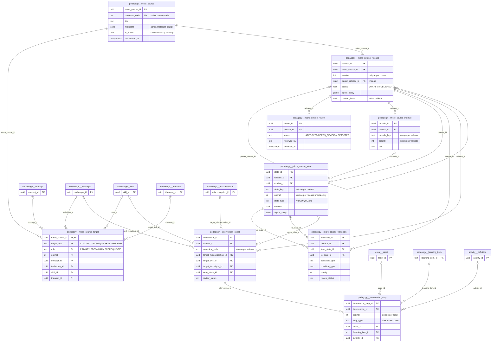
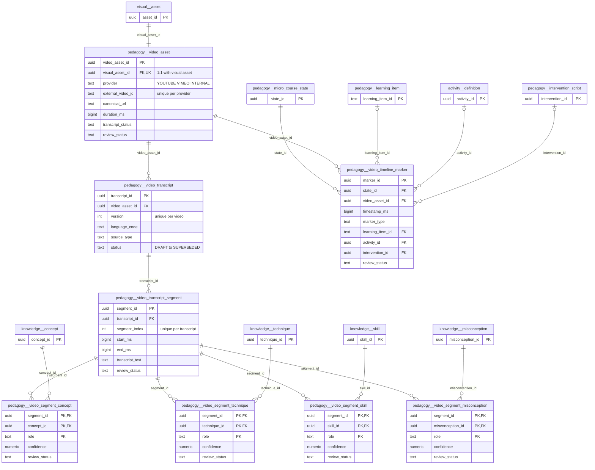
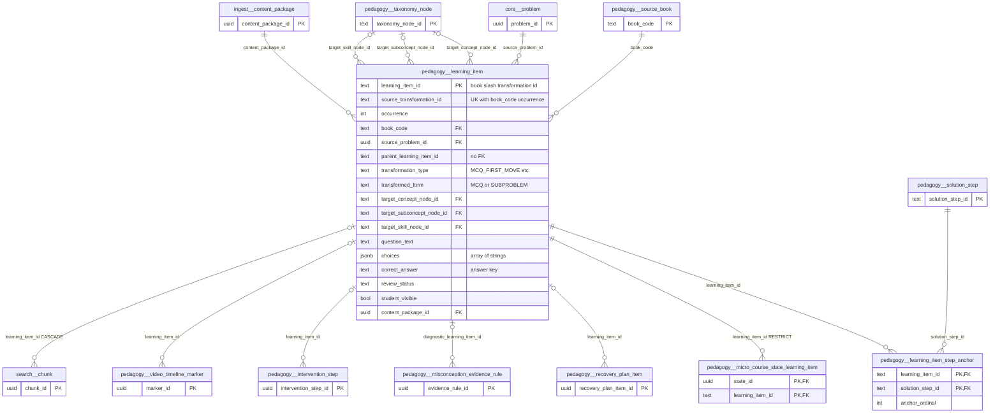
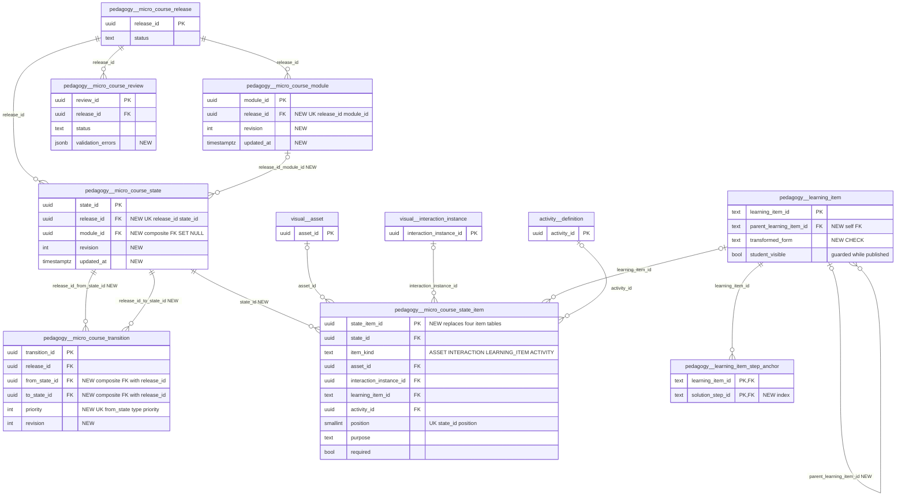

# `pedagogy` schema (part 4 of 5) — micro-courses, release structure and learning items

The deterministic micro-course platform: an admin-authored course (`micro_course`) mapped to canonical knowledge targets, versioned into immutable releases (`micro_course_release`) made of modules, typed lesson states, FK-backed semantic bindings, attached assets/interactions/quizzes/activities and authored transitions, gated by an append-only review log. It also covers the review-gated textbook **learning items** (`learning_item`, `learning_item_step_anchor`) that micro-course quiz states, recovery plans and diagnosis probes draw from. Learners only ever see the single `PUBLISHED` release of an active course; the runtime may rephrase approved content but never invents states, quizzes or media.

This file documents 17 `pedagogy` tables. Sibling files: [pedagogy-routes-diagnosis.md](pedagogy-routes-diagnosis.md) (tutoring routes, gap diagnosis, recovery plans), [pedagogy-taxonomy-sources.md](pedagogy-taxonomy-sources.md) (source books, taxonomy nodes/edges, `state_qa_context`), [pedagogy-solutions-feedback.md](pedagogy-solutions-feedback.md) (solution parts/steps that learning items anchor to, feedback catalogues and the `intervention_*` tables) and [pedagogy-video.md](pedagogy-video.md) (the curated-video layer). Tables owned by sibling files appear in the diagrams below only as context.

Source of truth: migrations [010](../../../mathbank-db/sql/010_textbook_import.sql), [015](../../../mathbank-db/sql/015_recovery_runtime.sql), [032](../../../mathbank-db/sql/032_micro_course_platform.sql), [034](../../../mathbank-db/sql/034_micro_course_template_bindings.sql), [035](../../../mathbank-db/sql/035_admin_micro_course_platform.sql), [037](../../../mathbank-db/sql/037_quiz_authoring.sql), [038](../../../mathbank-db/sql/038_micro_course_item_sequence.sql), [046](../../../mathbank-db/sql/046_theorem_catalog.sql). Catalog extracted 2026-11-01 from migrations 001–054; endpoint mapping traced from mathbank-rest source and manually verified.

Shorthand used below: **`/admin/mc`** = `/v1/admin/micro-courses`, **`/mc`** = `/v1/micro-courses`. "Release QA reads" = `POST /admin/mc/releases/{release_id}/validate`, `/review`, `/publish` (all call `validate_release`; publish also hashes the release in `_content_hash`). "Reader reads" = anonymous `GET /mc/{canonical_code}` plus admin `GET /admin/mc/{canonical_code}/preview` (both `_assemble_course_reader_payload`). "Runtime reads" = learner `POST /mc/{canonical_code}/enroll`, `GET /mc/enrollments/{enrollment_id}`, `POST /mc/enrollments/{enrollment_id}/advance` (all end in `get_enrollment_runtime`).

## 1. Purpose, ownership and data flow

**Domain.** Short, structured, teacher/admin-authored lessons that teach one canonical concept/technique/skill/theorem (requirements [40](../../requirements/40_MICRO_COURSE_PLATFORM.md) MCR-2…MCR-24, [43](../../requirements/43_ADMIN_MICRO_COURSE_AUTHORING_UI.md), [46](../../requirements/46_MICRO_COURSE_QUIZ_AUTHORING_API_GAPS.md), [47](../../requirements/47_MICRO_COURSE_STUDENT_NAVIGATION_V2_AND_AI_ASSIST.md)). The tables reuse existing catalogs rather than duplicating them: `knowledge.concept/technique/skill/theorem/misconception`, `pedagogy.learning_item`, `activity.definition`, `visual.asset`, `visual.interaction_instance`.

**Write ownership.** Only mathbank-rest writes, through [micro_course_service.py](../../../mathbank-rest/src/mathbank_rest/micro_course_service.py), routed by [routers/micro_courses.py](../../../mathbank-rest/src/mathbank_rest/routers/micro_courses.py) (admin authoring + student reader/runtime) and the `binding_router` in [routers/admin_activities.py](../../../mathbank-rest/src/mathbank_rest/routers/admin_activities.py) (state↔activity bindings, cross-kind sequencing). Two seed scripts call the same service layer directly: [seed_reference_courses.py](../../../mathbank-rest/scripts/seed_reference_courses.py) (also a raw `UPDATE … learning_objectives`) and [seed_reference_course_extras.py](../../../mathbank-rest/scripts/seed_reference_course_extras.py). Several service functions exist but are **not routed** (`create_intervention`, `add_intervention_step`, `attach_learning_item`, `attach_asset` for an existing asset), and **no code anywhere writes** `video_asset`, `video_transcript`, `video_transcript_segment`, `video_segment_*`, `video_timeline_marker` or `state_qa_context` (they are only read).

**Readers.** Admin UI (mathbank-web `/admin/courses`), anonymous course catalog/reader, the learner runtime (`learner.micro_course_enrollment`, `tutor.micro_course_runtime`, `learner.micro_course_state_event` — documented with their schemas), the scoped "Help me / Give up" assist ([micro_course_assist.py](../../../mathbank-rest/src/mathbank_rest/micro_course_assist.py)), and publish guards in [taxonomy_service.py](../../../mathbank-rest/src/mathbank_rest/taxonomy_service.py) (`_guard_published_reference`) and [quiz_service.py](../../../mathbank-rest/src/mathbank_rest/quiz_service.py) (`_guard_published_binding`). Publishing emits a `pipeline.outbox_event` `MICRO_COURSE_PUBLISHED` and returns `projection: PENDING`, but no Neo4j projector for micro-courses exists yet (MCR-19's `project_micro_courses.py` is absent from `mathbank-graph/etl/`).

**Lifecycle.** Course identity is created once with ≥1 PRIMARY target. Content lives on a release: `DRAFT` (editable; every authoring call checks `_editable_release`) → `review` (`APPROVED` runs the validator, bulk-approves pending transitions/interventions/Q&A contexts/timeline markers and sets the release `APPROVED`; `NEEDS_REVISION`/`REJECTED` return it to `DRAFT`) → `publish` (re-validates with `require_approved_children`, supersedes the previous `PUBLISHED` release, stores `content_hash`, writes outbox + `audit.action_log`). Triggers make releases in `PUBLISHED/SUPERSEDED/RETIRED` and all their children immutable (bypass only with session setting `pedagogy.allow_purge=on`). `micro_course_review` is append-only. Course visibility is toggled separately via `is_active` (deactivate/reactivate).

**Release structure (modules, states, bindings, transitions, reviews).** Every child row is created by one admin call against a `DRAFT` release; the service resolves the owning release (`state_id → release_id`) and locks it with `_editable_release` ([micro_course_service.py:133](../../../mathbank-rest/src/mathbank_rest/micro_course_service.py)). The web authoring UI ([ContentTab.jsx](../../../mathbank-web/app/admin/(protected)/micro-courses/[code]/ContentTab.jsx)) calls the module, binding and transition endpoints. There is **no update or delete for any release child except state↔activity bindings** (and `sequence_position` on the four item bindings): a mistake in a draft can only be fixed by starting another empty draft release. Semantic bindings (`micro_course_state_concept/technique/skill/misconception`) are written and shown in the admin release detail, validated (misconceptions must be `APPROVED`) and hashed, but nothing at runtime consumes them yet (no mastery feedback, no Neo4j projection). Transitions drive navigation, but the learner runtime only follows `condition_type='ALWAYS'` edges of type `NEXT`/`USER_CONTINUE`/`USER_BACK`; conditional edges and `condition_payload` are stored, hashed and returned but never evaluated.

**Learning items.** `pedagogy.learning_item` and `learning_item_step_anchor` are **not** micro-course-specific: they are the "transformations" (lower-difficulty MCQ/sub-problem variants of a textbook problem) imported by the batch ETL [import_textbook_package.py](../../../mathbank-db/etl/import_textbook_package.py) (`upsert` at ~L1043, COPY + `INSERT … ON CONFLICT`, content updates only while `review_status='PENDING_REVIEW'`). The only REST writer is the admin review action `POST /v1/admin/imports/learning-items/{learning_item_id}/review` ([db/import_admin.py:246](../../../mathbank-rest/src/mathbank_rest/db/import_admin.py)), which sets `review_status`, flips `student_visible`, writes `audit.action_log` and an outbox `LEARNING_ITEM_PUBLISHED/WITHDRAWN` event. Readers: the micro-course reader/runtime/grader/assist (via `micro_course_state_learning_item`), recovery planning ([step_recovery.py](../../../mathbank-rest/src/mathbank_rest/step_recovery.py)), diagnosis probes ([step_diagnosis.py:270](../../../mathbank-rest/src/mathbank_rest/step_diagnosis.py)), admin textbook views ([db/textbook_admin.py](../../../mathbank-rest/src/mathbank_rest/db/textbook_admin.py)), the embedding ETL [embed_textbook_steps.py](../../../mathbank-db/etl/embed_textbook_steps.py) (→ `search.chunk`) and the Neo4j projector [project_textbook_steps.py](../../../mathbank-graph/etl/project_textbook_steps.py) (`:LearningItem`, `ANCHORED_AT`).

**Privacy class.** Staff-authored curriculum. Draft releases and unapproved children are staff-only (admin key); the `PUBLISHED` release of an active course is public corpus (anonymous read). No learner-private data is stored in these tables. `learning_item.correct_answer` and `answer_or_solution_seed` are answer keys that must not reach a learner before they answer (guide §3 rule 4) — today they do (see §4).

## 2. Entity diagram — as-is

### 2a. Course, release structure, transitions, reviews and interventions

### 2b. State content bindings and Q&A context

```mermaid
erDiagram
    pedagogy__micro_course_state {
        uuid state_id PK
        uuid release_id "owning release"
        text state_type
    }
    pedagogy__micro_course_state_concept {
        uuid state_id PK,FK
        uuid concept_id PK,FK
        text role PK "TEACHES REQUIRES REVIEWS MENTIONS"
        numeric importance "0 to 1"
    }
    pedagogy__micro_course_state_technique {
        uuid state_id PK,FK
        uuid technique_id PK,FK
        text role PK "TEACHES REQUIRES RECOGNIZES APPLIES REVIEWS"
        numeric importance "0 to 1"
    }
    pedagogy__micro_course_state_skill {
        uuid state_id PK,FK
        uuid skill_id PK,FK
        text role PK "TEACHES REQUIRES ASSESSES REVIEWS"
        smallint required_level "1 to 5"
    }
    pedagogy__micro_course_state_misconception {
        uuid state_id PK,FK
        uuid misconception_id PK,FK
        text role PK "WATCH_FOR ADDRESSES DIAGNOSES"
    }
    pedagogy__micro_course_state_asset {
        uuid state_id PK,FK
        uuid asset_id PK,FK
        int ordinal "unique per state"
        text presentation_role
        smallint sequence_position "cross-kind order"
    }
    pedagogy__micro_course_state_interaction {
        uuid state_id PK,FK
        uuid interaction_instance_id PK,FK
        int ordinal "unique per state"
        bool required
        smallint sequence_position
    }
    pedagogy__micro_course_state_learning_item {
        uuid state_id PK,FK
        text learning_item_id PK,FK
        int ordinal "unique per state"
        text purpose
        bool required
        smallint sequence_position
    }
    pedagogy__micro_course_state_activity {
        uuid state_id PK,FK
        uuid activity_id PK,FK
        int ordinal "unique per state"
        text purpose
        bool required
        smallint sequence_position
    }
    pedagogy__state_qa_context {
        uuid qa_context_id PK
        uuid state_id FK
        text context_type
        text approved_content
        uuid concept_id FK
        uuid technique_id FK
        uuid skill_id FK
        uuid misconception_id FK
        text review_status
    }
    knowledge__concept { uuid concept_id PK }
    knowledge__technique { uuid technique_id PK }
    knowledge__skill { uuid skill_id PK }
    knowledge__misconception { uuid misconception_id PK }
    visual__asset { uuid asset_id PK }
    visual__interaction_instance { uuid interaction_instance_id PK }
    pedagogy__learning_item { text learning_item_id PK }
    activity__definition { uuid activity_id PK }

    pedagogy__micro_course_state ||--o{ pedagogy__micro_course_state_concept : "state_id"
    knowledge__concept ||--o{ pedagogy__micro_course_state_concept : "concept_id"
    pedagogy__micro_course_state ||--o{ pedagogy__micro_course_state_technique : "state_id"
    knowledge__technique ||--o{ pedagogy__micro_course_state_technique : "technique_id"
    pedagogy__micro_course_state ||--o{ pedagogy__micro_course_state_skill : "state_id"
    knowledge__skill ||--o{ pedagogy__micro_course_state_skill : "skill_id"
    pedagogy__micro_course_state ||--o{ pedagogy__micro_course_state_misconception : "state_id"
    knowledge__misconception ||--o{ pedagogy__micro_course_state_misconception : "misconception_id"
    pedagogy__micro_course_state ||--o{ pedagogy__micro_course_state_asset : "state_id"
    visual__asset ||--o{ pedagogy__micro_course_state_asset : "asset_id"
    pedagogy__micro_course_state ||--o{ pedagogy__micro_course_state_interaction : "state_id"
    visual__interaction_instance ||--o{ pedagogy__micro_course_state_interaction : "interaction_instance_id"
    pedagogy__micro_course_state ||--o{ pedagogy__micro_course_state_learning_item : "state_id"
    pedagogy__learning_item ||--o{ pedagogy__micro_course_state_learning_item : "learning_item_id"
    pedagogy__micro_course_state ||--o{ pedagogy__micro_course_state_activity : "state_id"
    activity__definition ||--o{ pedagogy__micro_course_state_activity : "activity_id"
    pedagogy__micro_course_state ||--o{ pedagogy__state_qa_context : "state_id"
    knowledge__concept |o--o{ pedagogy__state_qa_context : "concept_id"
    knowledge__technique |o--o{ pedagogy__state_qa_context : "technique_id"
    knowledge__skill |o--o{ pedagogy__state_qa_context : "skill_id"
    knowledge__misconception |o--o{ pedagogy__state_qa_context : "misconception_id"
```

### 2c. Video, transcripts, segments and timeline markers

Note: `micro_course_state_asset.asset_id` and `video_asset.visual_asset_id` both point at `visual.asset`; a state "uses" a video when its attached asset has a `video_asset` row (joined on `v.visual_asset_id = sa.asset_id`), not through a direct FK.

### 2d. Learning items and their anchors

Other inbound FKs to tables in this file (documented with their own schemas): `learner.micro_course_state_event.state_id`, `learner.interaction_event.course_state_id` and `tutor.micro_course_runtime.current_state_id` → `micro_course_state` (no ON DELETE action, so a state with learner history cannot be deleted).

## 3. Tables

### `pedagogy.micro_course`

**Role.** One row is a stable course identity (code, title, catalog metadata) that outlives all of its versions. Created by `POST /admin/mc` (`create_course`) together with its canonical targets in one transaction; the content itself lives on `micro_course_release`. Read by the admin list/detail, the anonymous catalog (`WHERE is_active` and a `PUBLISHED` release exists), enrollments (`learner.micro_course_enrollment.micro_course_id`) and the taxonomy/quiz deactivation guards.

**Lifecycle.** Identity columns (`canonical_code, title, description, metadata, estimated_minutes, difficulty_level`) are frozen by trigger `micro_course_published_identity_guard` once any release is `PUBLISHED/SUPERSEDED/RETIRED` (DELETE is blocked too). `is_active` is toggled at any time by deactivate/reactivate (audited as `COURSE_DEACTIVATED/REACTIVATED`). No endpoint edits identity fields even while all releases are drafts.

**Table type.** Catalogue entity (guide §4) — governed identity with deactivate/reactivate, no hard delete once published.

**Columns**

| Column | Type | Null | Default | Description |
|---|---|---|---|---|
| micro_course_id | uuid | NO | gen_random_uuid() | Surrogate PK; referenced by releases, targets and enrollments. |
| canonical_code | text | NO | | Stable human-readable course code used in every URL (`/mc/{canonical_code}`); UNIQUE; Pydantic limits 1–120 chars. |
| title | text | NO | | Display title (≤300 chars at the API). |
| description | text | yes | | Catalog blurb shown on the course card and reader header. |
| estimated_minutes | integer | yes | | Author's estimate of total course duration in minutes; CHECK > 0 when set. |
| difficulty_level | smallint | yes | | Author-assigned difficulty, CHECK 1–10 when set. |
| created_by | text | NO | 'admin'::text | Free-text actor that created the course (request field `created_by`, not an authenticated identity). |
| created_at | timestamptz | NO | now() | Insert time. |
| updated_at | timestamptz | NO | now() | Intended last-modified time; no trigger or service code maintains it (stays equal to `created_at`). |
| metadata | jsonb | NO | '{}'::jsonb | Added by 034. Admin-authored stable course metadata (CHECK must be a JSON object); seeds store e.g. `{"collection": "reference-examples", "source": "..."}`. Binary objects stay in private object storage and are referenced through `visual.asset`. Included in the release `content_hash`. |
| is_active | boolean | NO | true | Added by 035. Course-level student visibility independent of release status; `false` hides the course from `GET /mc` and `GET /mc/{code}` while release history stays immutable. |
| deactivated_at | timestamptz | yes | | Added by 035. When the course was last deactivated; CHECK `is_active OR deactivated_at IS NOT NULL`; cleared on reactivate. |
| deactivated_by | text | yes | | Added by 035. Free-text actor (`ActorRequest.actor`) who deactivated it; cleared on reactivate. |

**Keys, constraints, indexes.**
- PK `micro_course_id`; UNIQUE `canonical_code`.
- CHECKs: `estimated_minutes > 0`, `difficulty_level` 1–10, `metadata` is an object, `micro_course_deactivation_consistent`.
- Trigger `micro_course_published_identity_guard` (BEFORE UPDATE/DELETE, `guard_published_micro_course_identity`, redefined in 035 to exclude the activation columns).
- Referenced by `micro_course_release` and `micro_course_target` (ON DELETE CASCADE) and `learner.micro_course_enrollment` (no action).

**REST operations today.**

| Op | Method & path | Auth | Handler | Notes |
|---|---|---|---|---|
| C | `POST /admin/mc` | Admin key (X-Admin-Api-Key) | `micro_courses.create_admin_course` → `create_course` | Requires ≥1 PRIMARY target; writes `audit.action_log` `COURSE_CREATED`. |
| R | `GET /admin/mc`, `GET /admin/mc/{canonical_code}`, `GET /admin/mc/{canonical_code}/activity`, `GET /admin/mc/releases/{release_id}`, `GET /admin/mc/releases/{release_id}/diff/{other_release_id}` | Admin key | `list_admin_courses`, `get_admin_course`, `get_admin_course_activity`, `get_admin_release`, `diff_admin_releases` | Admin list paginates `limit≤200/offset` but returns a bare list (no `total`). |
| R | `POST /admin/mc/{canonical_code}/releases` | Admin key | `create_admin_release` | `SELECT … FOR UPDATE` to serialise version numbering. |
| R | Reader reads; Release QA reads | Anonymous / Admin key | `get_student_course`, `get_admin_course_preview`; `validate/review/publish_admin_release` | Anonymous reader filters `is_active`; preview ignores it. |
| R | `GET /mc` | Anonymous | `list_student_courses` → `list_published_courses` | Only active courses with a PUBLISHED release. |
| R | `GET /mc/{canonical_code}/assets/{asset_id}/content` | Anonymous | `get_student_asset` → `get_published_asset` | Streams a private object only if attached to the published release. |
| R | Runtime reads | Learner JWT | `enroll_in_course`, `get_enrollment`, `advance_enrollment` | |
| R | `POST /v1/admin/taxonomy/{kind}/{code}/deactivate`, `POST /v1/admin/activities/{activity_id}/deactivate` | Admin key | `admin_taxonomy.deactivate_entity`, `admin_activities.deactivate_activity` | Guards: refuse if referenced by a published course. |
| U | `POST /admin/mc/{canonical_code}/deactivate`, `/reactivate` | Admin key | `deactivate_admin_course`, `reactivate_admin_course` | Only `is_active/deactivated_*`; 409 if already in that state. |

### `pedagogy.micro_course_target`

**Role.** Maps a course to the canonical knowledge entities it teaches (PRIMARY), touches (SECONDARY) or assumes (PREREQUISITE). Exactly one typed FK column is set per row. Created only inside `create_course` (ordinal = position in the request array); never edited afterwards by code. Used for catalog cards (`primary_targets`), reader prerequisites, the publish validator ("course has no PRIMARY canonical target"), the item-help fallback context, and the taxonomy deactivation guard.

**Lifecycle.** Course-level (not release-scoped) and **not covered by any immutability trigger**, despite MCR-2 freezing identity after publication. No status column.

**Table type.** Junction / link (course → canonical knowledge entity, typed by `target_type` + `role`).

**Columns**

| Column | Type | Null | Default | Description |
|---|---|---|---|---|
| micro_course_id | uuid | NO | | Owning course → `pedagogy.micro_course.micro_course_id` (ON DELETE CASCADE). |
| target_type | text | NO | | Which FK column is populated: `CONCEPT`, `TECHNIQUE`, `SKILL`, `THEOREM` (THEOREM added by 046). |
| concept_id | uuid | yes | | → `knowledge.concept.concept_id`; set iff `target_type='CONCEPT'`. |
| technique_id | uuid | yes | | → `knowledge.technique.technique_id`; set iff `target_type='TECHNIQUE'`. |
| skill_id | uuid | yes | | → `knowledge.skill.skill_id`; set iff `target_type='SKILL'`. |
| role | text | NO | 'PRIMARY'::text | `PRIMARY` (what the course teaches), `SECONDARY`, `PREREQUISITE` (shown as `prerequisite_targets` in the reader). |
| ordinal | integer | NO | 0 | Display order (CHECK ≥ 0); the service uses the request array index, so it is unique across all of a course's targets. |
| theorem_id | uuid | yes | | Added by 046. → `knowledge.theorem.theorem_id`; set iff `target_type='THEOREM'`. Omitted from the release `content_hash` query. |

**Keys, constraints, indexes.**
- PK `(micro_course_id, target_type, role, ordinal)` — the same entity can be inserted twice under different ordinals.
- `micro_course_target_check`: exactly the column matching `target_type` is non-null, the other three null.
- FKs to `knowledge.concept/technique/skill/theorem` (no ON DELETE action).
- Partial indexes on each of `concept_id`, `technique_id`, `skill_id`, `theorem_id` `WHERE … IS NOT NULL` (reverse lookups for taxonomy guards).

**REST operations today.**

| Op | Method & path | Auth | Handler | Notes |
|---|---|---|---|---|
| C | `POST /admin/mc` | Admin key | `create_admin_course` → `create_course` | 1–30 targets, validated against the canonical tables by `_canonical_target`. |
| R | `GET /admin/mc`, `GET /admin/mc/{canonical_code}`; Reader reads; Release QA reads | Admin key / Anonymous | `list_admin_courses`, `get_admin_course`, `get_student_course`, `get_admin_course_preview`, validate/review/publish | |
| R | `GET /mc` | Anonymous | `list_student_courses` | PRIMARY targets only. |
| R | `POST /mc/enrollments/{enrollment_id}/item-help` | Learner JWT | `get_item_help` → `assist._state_fallback_context` | PRIMARY targets as tier-4 grounding (theorems ignored). |
| R | `POST /v1/admin/taxonomy/{kind}/{code}/deactivate` | Admin key | `deactivate_entity` → `taxonomy_service._guard_published_reference` | Blocks deactivating a concept/technique/skill targeted by a published course. |

### `pedagogy.micro_course_release`

**Role.** One immutable, numbered version of a course's content; every module, state, transition and intervention hangs off a release. Created empty by `POST /admin/mc/{code}/releases` (version = max+1, `agent_policy` = `DEFAULT_AGENT_POLICY`); `parent_release_id` only records lineage — **no content is copied** from the parent. Enrollments pin a `release_id` for life, so a learner never sees content change mid-course.

**Lifecycle.** CHECK allows `DRAFT, REVIEWED, APPROVED, PUBLISHED, SUPERSEDED, RETIRED`; code only uses `DRAFT → APPROVED` (review APPROVED) / `→ DRAFT` (NEEDS_REVISION/REJECTED), `APPROVED → PUBLISHED`, and `PUBLISHED → SUPERSEDED` when a newer version publishes. `REVIEWED` and `RETIRED` are never set. Trigger `micro_course_release_guard` forbids any change to a `PUBLISHED/SUPERSEDED/RETIRED` row except the status moves PUBLISHED→SUPERSEDED/RETIRED and SUPERSEDED→RETIRED with unchanged content, and forbids DELETE of `PUBLISHED/SUPERSEDED` rows. Partial unique index guarantees one PUBLISHED release per course.

**Table type.** Release / snapshot (guide §4) — but today it is also the *draft container*: content is authored directly onto a `DRAFT` release row rather than onto a separate revisioned draft.

**Columns**

| Column | Type | Null | Default | Description |
|---|---|---|---|---|
| release_id | uuid | NO | gen_random_uuid() | Surrogate PK. |
| micro_course_id | uuid | NO | | → `pedagogy.micro_course.micro_course_id` (ON DELETE CASCADE). |
| version | integer | NO | | 1-based version within the course (CHECK ≥ 1; UNIQUE with `micro_course_id`); assigned as max+1 under a course row lock. |
| parent_release_id | uuid | yes | | Lineage pointer to the release this draft was derived from → `pedagogy.micro_course_release.release_id` (ON DELETE SET NULL); must belong to the same course (checked in Python). |
| status | text | NO | 'DRAFT'::text | Release lifecycle state (see Lifecycle). |
| learning_objectives | jsonb | NO | '[]'::jsonb | JSON array of objectives shown in the reader; elements are strings or `{text}` objects (mathbank-web `learn/courses/[code]/page.jsx`). Only set by the seed script's raw UPDATE — no API writes it. |
| prerequisite_summary | jsonb | NO | '[]'::jsonb | JSON array summarising prerequisites for the reader; no writer exists yet. |
| agent_policy | jsonb | NO | '{}'::jsonb | Runtime-agent policy flags object, e.g. `{"may_rephrase":true,"may_explain_current_content":true,"may_create_quiz":false,…}`; validation requires every flag in `FORBIDDEN_POLICY_FLAGS` to be explicitly `false`. |
| content_hash | text | yes | | SHA-256 of the canonical JSON snapshot of the release and all its children (`_content_hash`), written at publish. |
| created_by | text | NO | | Free-text author of the draft. |
| reviewed_by | text | yes | | Reviewer from the latest review action. |
| approved_by | text | yes | | Reviewer who approved (or the publisher, via COALESCE, if unset). |
| created_at | timestamptz | NO | now() | Draft creation time. |
| reviewed_at | timestamptz | yes | | Time of the latest review action. |
| approved_at | timestamptz | yes | | Approval time; cleared again if a later review is not APPROVED. |
| published_at | timestamptz | yes | | When the release became PUBLISHED. |

**Keys, constraints, indexes.**
- PK `release_id`; UNIQUE `(micro_course_id, version)`; partial UNIQUE `micro_course_one_published (micro_course_id) WHERE status='PUBLISHED'`.
- CHECKs: `version ≥ 1`, status enumeration.
- FKs: course (CASCADE), self parent (SET NULL). Referenced by modules, states, transitions, interventions, reviews (all CASCADE) and `learner.micro_course_enrollment` (no action).
- Trigger `micro_course_release_guard` (BEFORE UPDATE/DELETE).

**REST operations today.**

| Op | Method & path | Auth | Handler | Notes |
|---|---|---|---|---|
| C | `POST /admin/mc/{canonical_code}/releases` | Admin key | `create_admin_release` → `create_release` | Body `{created_by, parent_release_id?}`; empty draft. |
| R | `GET /admin/mc`, `GET /admin/mc/{canonical_code}`, `/activity`, `/preview`, `GET /admin/mc/releases/{release_id}`, `/diff/{other_release_id}` | Admin key | list/get/activity/preview/get_release/diff | |
| R | Every DRAFT-only authoring call: `POST /admin/mc/releases/{release_id}/modules`, `/states`, `/transitions`, `POST /admin/mc/states/{state_id}/bindings`, `/interactions`, `/assets`, `POST/PATCH/DELETE /admin/mc/states/{state_id}/activities…`, `PATCH /admin/mc/states/{state_id}/items/{item_kind}/{item_id}/sequence` | Admin key | `_editable_release` lock | 409 unless status is DRAFT. |
| R | `GET /mc`, Reader reads, `GET /mc/{canonical_code}/assets/{asset_id}/content`, Runtime reads, `POST /mc/enrollments/{enrollment_id}/item-help` | Anonymous / Learner JWT | | Only the PUBLISHED release (runtime: the pinned release). |
| R | `POST /v1/admin/taxonomy/{kind}/{code}/deactivate`, `POST /v1/admin/activities/{activity_id}/deactivate` | Admin key | publish-reference guards | |
| U | `POST /admin/mc/releases/{release_id}/review` | Admin key | `review_admin_release` → `review_release` | DRAFT only (REVIEWED accepted but unreachable); APPROVED runs the validator first. |
| U | `POST /admin/mc/releases/{release_id}/publish` | Admin key | `publish_admin_release` → `publish_release` | Requires APPROVED + latest review APPROVED + strict validation; supersedes previous; outbox + audit. |

### `pedagogy.micro_course_module`

**Role.** Optional chapter-like grouping of states inside one release (e.g. "Warm-up", "Core idea"). Purely presentational: the reader returns a `modules` list and a `module_key` on each state; the runtime returns the current state's `module_title`. Created by `POST /admin/mc/releases/{release_id}/modules` (`add_module`, [micro_course_service.py:1762](../../../mathbank-rest/src/mathbank_rest/micro_course_service.py)), which the admin Content tab calls. Neither seed script creates modules.

**Lifecycle.** Release-scoped; insertable only while the release is `DRAFT` (service check) and immutable once the release is `PUBLISHED/SUPERSEDED/RETIRED` (trigger). No update or delete endpoint. `required` and `estimated_seconds` are stored, hashed and returned but nothing enforces or sums them.

**Table type.** Revisioned authoring object (child of a draft release), without a revision column.

**Columns**

| Column | Type | Null | Default | Description |
|---|---|---|---|---|
| module_id | uuid | NO | gen_random_uuid() | Surrogate PK; referenced by `micro_course_state.module_id` (ON DELETE CASCADE — deleting a module deletes its states). |
| release_id | uuid | NO | | Owning release → `pedagogy.micro_course_release.release_id` (ON DELETE CASCADE). |
| module_key | text | NO | | Author-chosen stable key, unique per release (API 1–120 chars, trimmed). Returned on reader states as `module_key` and used in the release `content_hash`. |
| ordinal | integer | NO | | Display order within the release (CHECK ≥ 0; UNIQUE per release). |
| title | text | NO | | Module heading shown in the reader and as `module_title` in the runtime (API ≤ 300 chars). |
| objective | text | yes | | Free-text learning objective for the module; shown in reader/admin views only. |
| estimated_seconds | integer | yes | | Author's duration estimate (CHECK > 0 when set); not aggregated anywhere. |
| required | boolean | NO | true | Author flag "module is mandatory"; stored and hashed but not read by the validator or runtime (only states' own `required` matters). |

**Keys, constraints, indexes.**
- PK `module_id`; UNIQUE `(release_id, module_key)`; UNIQUE `(release_id, ordinal)`.
- CHECKs: `ordinal ≥ 0`, `estimated_seconds > 0`.
- FK `release_id` → release (CASCADE).
- Trigger `micro_course_module_guard` (BEFORE INSERT/UPDATE/DELETE, `guard_published_release_child`; bypass `pedagogy.allow_purge=on`). On UPDATE the function only checks `NEW.release_id`.

**REST operations today.**

| Op | Method & path | Auth | Handler | Notes |
|---|---|---|---|---|
| C | `POST /admin/mc/releases/{release_id}/modules` | Admin key | `micro_courses.create_module` → `add_module` | DRAFT only (409 otherwise); duplicate key/ordinal → `IntegrityError` → 409. No audit row. |
| R | `GET /admin/mc/releases/{release_id}` | Admin key | `get_admin_release` → `get_release` | Full module list. |
| R | Reader reads; Runtime reads | Anonymous / Learner JWT / Admin key | `_assemble_course_reader_payload`, `get_enrollment_runtime` | `LEFT JOIN` for `module_key` / `module_title`. |
| R | `POST /admin/mc/releases/{release_id}/states` | Admin key | `add_state` | Checks that `module_id` belongs to the same release (422 otherwise). |
| R | Release QA reads | Admin key | `validate_release`, `_content_hash` | Validator flags states pointing at a module of another release. |

### `pedagogy.micro_course_review`

**Role.** Append-only history of review decisions on a release (who approved/sent back/rejected, when, with what note). `review_release` ([micro_course_service.py:2849](../../../mathbank-rest/src/mathbank_rest/micro_course_service.py)) inserts one row per decision; `publish_release` requires the most recent row (by `reviewed_at DESC, review_id DESC`) to be `APPROVED`. The release row duplicates the latest reviewer in `reviewed_by/reviewed_at` and `approved_by/approved_at`.

**Lifecycle.** Insert-only; trigger `micro_course_review_append_only` (`pedagogy.forbid_update`) raises on UPDATE and DELETE and has **no** `allow_purge` bypass, so a release that has ever been reviewed cannot be deleted (the CASCADE from the release would raise). When an `APPROVED` request fails validation the service returns `200 {"status":"REJECTED","errors":[…]}` and writes **no** review row and no audit row.

**Table type.** Audit (append-only review log).

**Columns**

| Column | Type | Null | Default | Description |
|---|---|---|---|---|
| review_id | uuid | NO | gen_random_uuid() | Surrogate PK; tie-breaker when two reviews share `reviewed_at`. |
| release_id | uuid | NO | | Reviewed release → `pedagogy.micro_course_release.release_id` (ON DELETE CASCADE, effectively blocked by the append-only trigger). |
| status | text | NO | | Decision: `APPROVED` (release → `APPROVED`, pending transitions/interventions/Q&A contexts/markers bulk-approved), `NEEDS_REVISION` or `REJECTED` (both return the release to `DRAFT`; `REJECTED` is not terminal). |
| note | text | yes | | Reviewer comment (API ≤ 2000 chars); also copied into the audit row's `after_state`. |
| reviewed_by | text | NO | | Free-text reviewer name from the request body (`reviewer`, ≤ 200 chars), not an authenticated identity. |
| reviewed_at | timestamptz | NO | now() | Decision time; ordering key for "latest review". |

**Keys, constraints, indexes.**
- PK `review_id`; CHECK on `status`; FK `release_id` (CASCADE).
- No index on `release_id` (publish looks up the latest review per release with a sequential scan; small table today).
- Trigger `micro_course_review_append_only` (BEFORE UPDATE/DELETE).

**REST operations today.**

| Op | Method & path | Auth | Handler | Notes |
|---|---|---|---|---|
| C | `POST /admin/mc/releases/{release_id}/review` | Admin key | `review_admin_release` → `review_release` | Body `{status, reviewer, note?}`; release must be `DRAFT`; also writes `audit.action_log` `RELEASE_REVIEW_<status>`. |
| R | `POST /admin/mc/releases/{release_id}/publish` | Admin key | `publish_admin_release` → `publish_release` | Reads only the latest status. |
| — | (no list) | | | No endpoint returns review history; `GET /admin/mc/releases/{release_id}` exposes only the release-level `reviewed_by/at`. |

Non-REST writers: [seed_reference_courses.py](../../../mathbank-rest/scripts/seed_reference_courses.py) and [seed_reference_course_extras.py](../../../mathbank-rest/scripts/seed_reference_course_extras.py) call `review_release(..., "APPROVED", ...)` directly.

### `pedagogy.micro_course_transition`

**Role.** A directed edge of a release's lesson graph: "from state A, on event T (subject to condition C), go to state B". Created by `add_transition` ([micro_course_service.py:1905](../../../mathbank-rest/src/mathbank_rest/micro_course_service.py)). The validator (`validate_state_graph`, L154) requires every required state to be reachable from the entry state (lowest `ordinal`) and to have a path to a terminal state (a state with **no** outgoing transition of any type — so a `USER_BACK` edge on the last state makes the graph invalid). At runtime `get_enrollment_runtime` derives `can_continue` / `can_go_back` / `can_finish` from the current state's approved outgoing edges, and `advance_enrollment` (L1215) follows the lowest-`priority` approved edge with `condition_type='ALWAYS'` and type `NEXT`/`USER_CONTINUE` (action CONTINUE) or `USER_BACK` (action BACK). All other transition types and conditions are stored, hashed and shown but never executed.

**Lifecycle.** `review_status` starts `PENDING_REVIEW`; a release-level `APPROVED` review bulk-sets every pending transition to `APPROVED`; `REJECTED` is never set by code. Publish requires all transitions `APPROVED`. Immutable after publication (trigger). No update/delete endpoint.

**Table type.** Revisioned authoring object (release child).

**Columns**

| Column | Type | Null | Default | Description |
|---|---|---|---|---|
| transition_id | uuid | NO | gen_random_uuid() | Surrogate PK; secondary sort key after `priority`. |
| release_id | uuid | NO | | Owning release → `pedagogy.micro_course_release.release_id` (ON DELETE CASCADE). |
| from_state_id | uuid | NO | | Source state → `pedagogy.micro_course_state.state_id` (CASCADE). Same-release membership is checked in the service and validator, not by the database. |
| to_state_id | uuid | NO | | Target state → `pedagogy.micro_course_state.state_id` (CASCADE). May equal `from_state_id` only for `RETRY` (CHECK). |
| transition_type | text | NO | | Trigger event: `NEXT`, `CORRECT`, `INCORRECT`, `RETRY`, `MISCONCEPTION`, `PREREQUISITE_GAP`, `USER_CONTINUE`, `USER_BACK`, `USER_QUESTION_RESOLVED`, `INTERVENTION_COMPLETE`. Only `NEXT`, `USER_CONTINUE` and `USER_BACK` are acted on today. |
| condition_type | text | NO | 'ALWAYS'::text | Guard kind: `ALWAYS`, `LEARNING_ITEM_RESULT`, `ACTIVITY_RESULT`, `MISCONCEPTION_CODE`, `SKILL_STATUS`, `INTERVENTION_RESULT`. Runtime only follows `ALWAYS`. |
| condition_payload | jsonb | NO | '{}'::jsonb | Free-form parameters of the condition (e.g. which item/result/misconception code); no schema, no CHECK, never evaluated. |
| priority | integer | NO | 0 | Tie-break among outgoing edges; **lower value wins** (`ORDER BY priority, transition_id`). |
| review_status | text | NO | 'PENDING_REVIEW'::text | `PENDING_REVIEW`, `APPROVED`, `REJECTED`. Anonymous reader and runtime only see `APPROVED`. |

**Keys, constraints, indexes.**
- PK `transition_id` only — no uniqueness on `(from_state_id, transition_type, priority)`, so duplicate or ambiguous edges are accepted.
- CHECKs: enumerations for `transition_type`, `condition_type`, `review_status`; `from_state_id <> to_state_id OR transition_type='RETRY'`.
- FKs: release, from/to state (all CASCADE).
- No index on `(release_id, from_state_id)` although every runtime read filters on it.
- Trigger `micro_course_transition_guard` (`guard_published_release_child`).

**REST operations today.**

| Op | Method & path | Auth | Handler | Notes |
|---|---|---|---|---|
| C | `POST /admin/mc/releases/{release_id}/transitions` | Admin key | `micro_courses.create_transition` → `add_transition` | DRAFT only; 422 if a state is outside the release or a non-RETRY self-loop. No audit row. |
| U | `POST /admin/mc/releases/{release_id}/review` | Admin key | `review_release` | Bulk `PENDING_REVIEW → APPROVED` on an approving review. |
| R | `GET /admin/mc/releases/{release_id}` | Admin key | `get_release` | All transitions with `review_status`. |
| R | Reader reads | Anonymous / Admin key | `_assemble_course_reader_payload` | Anonymous: approved only; preview: all. Returns `condition_payload`. |
| R | Runtime reads (`enroll`, `GET enrollment`, `advance`) | Learner JWT | `get_enrollment_runtime`, `advance_enrollment` | Approved outgoing edges of the current state. |
| R | Release QA reads | Admin key | `validate_release`, `_content_hash` | Graph checks; publish requires all approved. |

Non-REST writer: [seed_reference_course_extras.py](../../../mathbank-rest/scripts/seed_reference_course_extras.py) (`add_transition(..., "NEXT")` chain).

### `pedagogy.micro_course_state`

**Role.** One typed lesson step of a release — the unit the learner runtime points at (`tutor.micro_course_runtime.current_state_id`) and the parent of every content binding. The state with the lowest `ordinal` is the entry state (`start_enrollment`, L667). Created by `add_state` ([micro_course_service.py:1794](../../../mathbank-rest/src/mathbank_rest/micro_course_service.py)). The validator applies type rules to required states: `QUIZ`/`CHECKPOINT`/`DIAGNOSTIC` need ≥ 1 required learning item; `VIDEO` needs an approved, valid video asset and an approved transcript segment; non-`OPTIONAL` assets must be `VALID`.

**Lifecycle.** Release-scoped; created only on a `DRAFT` release, immutable after publication (trigger), no update or delete endpoint. Rows referenced by learner history (`learner.micro_course_state_event`, `learner.interaction_event`, `tutor.micro_course_runtime`, NO ACTION) cannot be deleted. `skippable` and the per-state `agent_policy` are stored, hashed and returned but **not enforced** by the runtime or the assist; the validator checks the forbidden policy flags only for `required` states.

**Table type.** Revisioned authoring object (release child), without a revision column.

**Columns**

| Column | Type | Null | Default | Description |
|---|---|---|---|---|
| state_id | uuid | NO | gen_random_uuid() | Surrogate PK; referenced by all `micro_course_state_*` bindings, transitions, Q&A contexts, timeline markers, intervention entry points and learner runtime/event rows. |
| release_id | uuid | NO | | Owning release → `pedagogy.micro_course_release.release_id` (CASCADE). |
| module_id | uuid | yes | | Optional grouping → `pedagogy.micro_course_module.module_id` (ON DELETE CASCADE); must belong to the same release (service + validator only). |
| state_key | text | NO | | Author-chosen stable key, unique per release (API 1–120 chars); the identity used by `diff_releases`, `_content_hash` and validator messages. |
| ordinal | integer | NO | | Linear position (CHECK ≥ 0; UNIQUE per release). Lowest = entry; also used for "step N of M" in the runtime. |
| state_type | text | NO | | Lesson-step kind: `ORIENTATION`, `EXPLANATION`, `SLIDE`, `VIDEO`, `READING`, `VISUAL`, `EXAMPLE`, `CHECKPOINT`, `QUIZ`, `DIAGNOSTIC`, `REMEDIATION`, `PRACTICE`, `SUMMARY`, `TRANSFER`. Drives the validator rules above and the reader layout. |
| title | text | NO | | Step heading (API ≤ 300 chars). |
| objective | text | yes | | What this step teaches; shown in reader/runtime and used as assist grounding. |
| student_instruction | text | yes | | Instruction text shown to the learner for this step. |
| estimated_seconds | integer | yes | | Author's duration estimate (CHECK > 0); returned but not hashed or enforced. |
| required | boolean | NO | true | Whether the state must be reachable/completable; optional states are exempt from graph, asset, quiz and policy checks. |
| skippable | boolean | NO | false | Author flag "learner may skip"; returned to the reader but the runtime has no skip action. |
| agent_policy | jsonb | NO | '{}'::jsonb | Per-state override object using the same flags as the release policy (`may_rephrase`, `may_create_quiz`, …). Only validated (forbidden flags must not be `true` on required states) and hashed; not read at runtime. |
| created_at | timestamptz | NO | now() | Insert time. |

**Keys, constraints, indexes.**
- PK `state_id`; UNIQUE `(release_id, state_key)`; UNIQUE `(release_id, ordinal)`; index `micro_course_state_release_idx (release_id)` (redundant with the two unique indexes that lead on `release_id`).
- CHECKs: `ordinal ≥ 0`, `estimated_seconds > 0`, `state_type` enumeration.
- FKs: release (CASCADE), module (CASCADE).
- Trigger `micro_course_state_guard` (`guard_published_release_child`).

**REST operations today.**

| Op | Method & path | Auth | Handler | Notes |
|---|---|---|---|---|
| C | `POST /admin/mc/releases/{release_id}/states` | Admin key | `micro_courses.create_state` → `add_state` | DRAFT only; `state_type` validated by Pydantic `Literal`. No audit row. |
| R | `GET /admin/mc/releases/{release_id}`, `GET /admin/mc/releases/{release_id}/diff/{other_release_id}` | Admin key | `get_release`, `diff_releases` | Diff compares states by `state_key` (type/title/ordinal/required/skippable) and their interaction codes. |
| R | `GET /admin/mc/{canonical_code}/activity` | Admin key | `get_course_activity` | Per-state funnel from learner events. |
| R | Every state-scoped authoring call (`/states/{state_id}/bindings`, `/interactions`, `/assets`, `/activities…`, `/items/…/sequence`) | Admin key | `_editable_release` via `state_id → release_id` | 404 for unknown state, 409 unless DRAFT. |
| R | Reader reads; Runtime reads; `POST /mc/enrollments/{enrollment_id}/responses`, `/activity-responses`, `/interaction-events`, `/item-help` | Anonymous / Learner JWT | reader, runtime, graders, `micro_course_assist` | Runtime uses the pinned release's current state. |
| R | Release QA reads | Admin key | `validate_release`, `_content_hash` | Type rules, policy flags, graph. |
| R | `POST /v1/admin/activities/{activity_id}/deactivate` | Admin key | `quiz_service._guard_published_binding` | Joins state → published release. |

Non-REST writers: both seed scripts call `add_state` directly.

### `pedagogy.micro_course_state_activity`

**Role.** Ordered binding of an `activity.definition` quiz question (static, precompiled or instructor-created) into a state, with its pedagogical purpose. This is the only release child with full attach / update / detach endpoints (requirements/46 QZA-4), served by the `binding_router` in [routers/admin_activities.py](../../../mathbank-rest/src/mathbank_rest/routers/admin_activities.py). Learners answer these through `POST /mc/enrollments/{enrollment_id}/activity-responses`, which accepts any activity bound anywhere in the enrolled release (not only the current state) and never affects `can_continue`.

**Lifecycle.** Attach requires the activity to be `ACTIVE`, `persistence_mode='STATIC'` and `source_type` ∈ {`PRECOMPILED`,`INSTRUCTOR_CREATED`}; the validator re-checks source/persistence (not `status`). Detach compacts later ordinals with one `UPDATE … SET ordinal = ordinal - 1`, which can violate the non-deferrable `UNIQUE (state_id, ordinal)` depending on row order (→ 409). Immutable after publication. Deactivating an activity used by a published course is refused (`quiz_service._guard_published_binding`).

**Table type.** Junction / link (ordered, with attributes).

**Columns**

| Column | Type | Null | Default | Description |
|---|---|---|---|---|
| state_id | uuid | NO | | Owning state → `pedagogy.micro_course_state.state_id` (CASCADE). |
| activity_id | uuid | NO | | Bound quiz → `activity.definition.activity_id` (ON DELETE RESTRICT). |
| ordinal | integer | NO | | Order among this state's activities (CHECK ≥ 0; UNIQUE per state). |
| purpose | text | NO | | Pedagogical role: `ENTRY_CHECK`, `COMPREHENSION`, `RECOGNITION`, `MISCONCEPTION_DIAGNOSTIC`, `EXECUTION`, `EXIT_CHECK`, `TRANSFER` (CHECK added by 037). |
| required | boolean | NO | true | Author flag; returned to the reader but activities are explicitly optional at runtime (they never gate progress). Seeds attach with `required=false`. |
| sequence_position | smallint | yes | | Added by 038. Cross-kind position within the state shared with asset/interaction/learning-item siblings; NULL = fall back to grouped-by-kind order (`_build_state_items`, L386). No CHECK; API limits 0–32767. Not in `content_hash`. |

**Keys, constraints, indexes.**
- PK `(state_id, activity_id)`; UNIQUE `(state_id, ordinal)`.
- CHECKs: `ordinal ≥ 0`, `purpose` enumeration.
- FKs: state (CASCADE), activity (RESTRICT). No index leading on `activity_id` (the deactivate guard scans).
- Trigger `micro_course_state_activity_guard` (`guard_published_state_child`).

**REST operations today.**

| Op | Method & path | Auth | Handler | Notes |
|---|---|---|---|---|
| C | `POST /v1/admin/micro-courses/states/{state_id}/activities` | Admin key | `admin_activities.attach_activity` → `attach_activity` | DRAFT only; 422 for non-static/non-active activity; 409 duplicate. |
| U | `PATCH /v1/admin/micro-courses/states/{state_id}/activities/{activity_id}` | Admin key | `update_activity_binding` | Any of `ordinal/purpose/required`. |
| U | `PATCH /v1/admin/micro-courses/states/{state_id}/items/activity/{activity_id}/sequence` | Admin key | `set_item_sequence_position` | Sets/clears `sequence_position`. |
| D | `DELETE /v1/admin/micro-courses/states/{state_id}/activities/{activity_id}` | Admin key | `detach_activity` | 204; compacts ordinals. No audit row for any binding change. |
| R | `GET /admin/mc/releases/{release_id}`; Reader reads; Runtime reads | Admin key / Anonymous / Learner JWT | `get_release`, reader, runtime | **Reader and runtime return `correctness_policy` (answer key) before the learner answers.** |
| R | `POST /mc/enrollments/{enrollment_id}/activity-responses` | Learner JWT | `submit_activity_response` | Finds the binding across the release with `one_or_none()`; an activity bound in two states raises `MultipleResultsFound` → 503. |
| R | `POST /mc/enrollments/{enrollment_id}/item-help`; `GET /admin/mc/{canonical_code}/activity` | Learner JWT / Admin key | `micro_course_assist._ground_activity`, `get_course_activity` | Assist grounding; per-activity accuracy stats. |
| R | Release QA reads; `POST /v1/admin/activities/{activity_id}/deactivate` | Admin key | `validate_release`, `_content_hash`, `_guard_published_binding` | |

Non-REST writer: [seed_reference_course_extras.py](../../../mathbank-rest/scripts/seed_reference_course_extras.py) (`attach_activity`).

### `pedagogy.micro_course_state_asset`

**Role.** Ordered binding of a `visual.asset` (uploaded image/PDF/text/video/audio in private object storage, or an external video registered as a `video_asset`) to a state, with a presentation role. The admin upload route creates the `visual.asset` row and this binding in one transaction (`register_uploaded_asset`, [micro_course_service.py:1979](../../../mathbank-rest/src/mathbank_rest/micro_course_service.py); ordinal = current max + 1). `attach_asset` (bind an existing asset with an explicit ordinal) exists but is only called by the extras seed script. The anonymous content route streams an object only if it is attached to the published release of an active course.

**Lifecycle.** DRAFT-only insert, immutable after publication, no detach/reorder endpoint (only `sequence_position`). Reader and runtime show only `validation_status='VALID'` assets; the validator requires non-`OPTIONAL` assets of required states to be `VALID`.

**Table type.** Junction / link (ordered, with attributes).

**Columns**

| Column | Type | Null | Default | Description |
|---|---|---|---|---|
| state_id | uuid | NO | | Owning state → `pedagogy.micro_course_state.state_id` (CASCADE). |
| asset_id | uuid | NO | | Attached asset → `visual.asset.asset_id` (ON DELETE RESTRICT). If the asset also has a `pedagogy.video_asset` row, the state is a video state (transcripts/markers join through it). |
| ordinal | integer | NO | | Order among the state's assets (CHECK ≥ 0; UNIQUE per state). |
| presentation_role | text | NO | | How the asset is shown: `PRIMARY`, `SUPPORT` (upload default), `EXAMPLE`, `REFERENCE`, `OPTIONAL` (exempt from the VALID check). |
| sequence_position | smallint | yes | | Added by 038 (column comment): cross-kind ordering within the state shared with interaction/learning-item/activity siblings; NULL = not yet sequenced (grouped-by-kind fallback). Not hashed. |

**Keys, constraints, indexes.**
- PK `(state_id, asset_id)`; UNIQUE `(state_id, ordinal)`.
- CHECKs: `ordinal ≥ 0`, `presentation_role` enumeration.
- FKs: state (CASCADE), asset (RESTRICT). No index leading on `asset_id` (`get_published_asset` filters by it).
- Trigger `micro_course_state_asset_guard` (`guard_published_state_child`).

**REST operations today.**

| Op | Method & path | Auth | Handler | Notes |
|---|---|---|---|---|
| C | `POST /admin/mc/states/{state_id}/assets?title=&presentation_role=&reviewed_by=&admin_confirmed=true` (raw body upload ≤ 25 MB) | Admin key | `micro_courses.upload_state_asset` → `register_uploaded_asset` | Also creates `visual.asset`; deletes the stored object if registration fails. 415 for unsupported MIME. No audit row. |
| U | `PATCH /v1/admin/micro-courses/states/{state_id}/items/asset/{asset_id}/sequence` | Admin key | `set_item_sequence_position` | |
| R | `GET /admin/mc/releases/{release_id}`; Reader reads; Runtime reads | Admin key / Anonymous / Learner JWT | `get_release`, reader, runtime | Learner payload hides `uri`, adds `private_object`. |
| R | `GET /mc/{canonical_code}/assets/{asset_id}/content` | Anonymous | `get_published_asset` | Verifies SHA-256 and size before streaming. |
| R | `POST /mc/enrollments/{enrollment_id}/item-help` | Learner JWT | `micro_course_assist` | Asset + transcript grounding. |
| R | Release QA reads | Admin key | `validate_release`, `_content_hash` | VALID / video checks. |

Non-REST writer: [seed_reference_course_extras.py](../../../mathbank-rest/scripts/seed_reference_course_extras.py) (`attach_asset`).

### `pedagogy.micro_course_state_concept`

**Role.** FK-backed semantic tag: this state teaches / requires / reviews / mentions a `knowledge.concept`. Written by `bind_state_target` ([micro_course_service.py:1848](../../../mathbank-rest/src/mathbank_rest/micro_course_service.py)) for `target_type='CONCEPT'`. Read only by the admin release detail and the content hash — the reader, runtime, assist and mastery code ignore it.

**Lifecycle.** DRAFT-only insert, immutable after publication, no unbind endpoint. Not covered by the taxonomy deactivation guard (which checks `micro_course_target` only), so a bound concept can be deactivated under a published course.

**Table type.** Junction / link (with role and weight).

**Columns**

| Column | Type | Null | Default | Description |
|---|---|---|---|---|
| state_id | uuid | NO | | Tagged state → `pedagogy.micro_course_state.state_id` (CASCADE). |
| concept_id | uuid | NO | | Concept → `knowledge.concept.concept_id` (NO ACTION). Existence checked by `_canonical_target`. |
| role | text | NO | | `TEACHES`, `REQUIRES`, `REVIEWS`, `MENTIONS`. The API accepts any 1–40-char string and upper-cases it; an invalid value fails the CHECK → 409 (not 422). |
| importance | numeric(3,2) | yes | | Relative weight 0–1 (CHECK); from request `importance`. |

**Keys, constraints, indexes.** PK `(state_id, concept_id, role)` (the same concept may carry several roles). CHECKs on `role` and `importance`. FKs as above; no index leading on `concept_id`. Trigger `micro_course_state_concept_guard` (`guard_published_state_child`).

**REST operations today.**

| Op | Method & path | Auth | Handler | Notes |
|---|---|---|---|---|
| C | `POST /admin/mc/states/{state_id}/bindings` with `target_type=CONCEPT` | Admin key | `micro_courses.bind_state` → `bind_state_target` | 201 `{"status":"BOUND"}`; duplicate → 409. `required_level` silently ignored. |
| R | `GET /admin/mc/releases/{release_id}` | Admin key | `get_release` | Returns `target_id, role` only (no `importance`). |
| R | Release QA reads | Admin key | `_content_hash` | |

### `pedagogy.micro_course_state_interaction`

**Role.** Ordered binding from a state to an approved `visual.interaction_instance` (an admin-configured widget pinned to an exact published template version; table comment). `attach_interaction` ([micro_course_service.py:2254](../../../mathbank-rest/src/mathbank_rest/micro_course_service.py)) only accepts instances with `review_status='APPROVED'` whose template version is `PUBLISHED`. Learner telemetry for these widgets goes to `learner.interaction_event` (`POST /mc/enrollments/{id}/interaction-events`), which records the current state but does **not** check that the instance is bound to it.

**Lifecycle.** DRAFT-only insert (migration 034), immutable after publication via its own trigger function `guard_micro_course_state_interaction` (same rule as the other state children), no detach endpoint.

**Table type.** Junction / link (ordered).

**Columns**

| Column | Type | Null | Default | Description |
|---|---|---|---|---|
| state_id | uuid | NO | | Owning state → `pedagogy.micro_course_state.state_id` (CASCADE). |
| interaction_instance_id | uuid | NO | | Widget instance → `visual.interaction_instance.interaction_instance_id` (ON DELETE RESTRICT). |
| ordinal | integer | NO | | Order among the state's interactions (CHECK ≥ 0; UNIQUE per state). |
| required | boolean | NO | true | Author flag "learner must engage"; returned but not enforced by `can_continue`. |
| sequence_position | smallint | yes | | Added by 038: cross-kind ordering shared with siblings; NULL = grouped-by-kind fallback. Not hashed. |

**Keys, constraints, indexes.** PK `(state_id, interaction_instance_id)`; UNIQUE `(state_id, ordinal)`; index `micro_course_state_interaction_instance_idx (interaction_instance_id)`; CHECK `ordinal ≥ 0`; FKs as above. Trigger `micro_course_state_interaction_guard`.

**REST operations today.**

| Op | Method & path | Auth | Handler | Notes |
|---|---|---|---|---|
| C | `POST /admin/mc/states/{state_id}/interactions` | Admin key | `micro_courses.bind_interaction` → `attach_interaction` | 422 unless approved + published template; 409 duplicate. |
| U | `PATCH /v1/admin/micro-courses/states/{state_id}/items/interaction/{interaction_instance_id}/sequence` | Admin key | `set_item_sequence_position` | |
| R | `GET /admin/mc/releases/{release_id}`, `/diff/{other_release_id}` | Admin key | `get_release`, `diff_releases` | Diff by interaction `canonical_code` per `state_key`. |
| R | Reader reads; Runtime reads; `POST /mc/enrollments/{enrollment_id}/item-help` | Anonymous / Learner JWT | reader, runtime, assist | Anonymous/runtime: approved instance + published version only. Returns `success_criteria`. |
| R | Release QA reads | Admin key | `validate_release`, `_content_hash` | Re-checks approval/publication. |

Non-REST writers: both seed scripts (`attach_interaction`).

### `pedagogy.micro_course_state_learning_item`

**Role.** Ordered binding of an approved, student-visible `pedagogy.learning_item` (fixed MCQ) into a state; these are the **graded** questions of a lesson. `QUIZ`/`CHECKPOINT`/`DIAGNOSTIC` required states must have at least one required item, and the runtime sets `can_continue`/`can_finish` only after every required item of the current state has a `QUIZ_RESPONSE` event. Graded by `submit_learning_item_response` ([micro_course_service.py:949](../../../mathbank-rest/src/mathbank_rest/micro_course_service.py)).

**Lifecycle.** The service function `attach_learning_item` (L2291, requires `APPROVED` + `student_visible`) is **not routed and not used by any script**, so no code path creates rows — in practice the table can only be filled by manual SQL, and required quiz-type states cannot pass validation through the API. Immutable after publication. If an admin later withdraws a bound item (`REJECT`/`NEEDS_REVISION` sets `student_visible=false`), the published release silently loses it.

**Table type.** Junction / link (ordered, with attributes).

**Columns**

| Column | Type | Null | Default | Description |
|---|---|---|---|---|
| state_id | uuid | NO | | Owning state → `pedagogy.micro_course_state.state_id` (CASCADE). |
| learning_item_id | text | NO | | Item → `pedagogy.learning_item.learning_item_id` (ON DELETE RESTRICT). |
| ordinal | integer | NO | | Order among the state's learning items (CHECK ≥ 0; UNIQUE per state). |
| purpose | text | NO | | Same vocabulary as activities: `ENTRY_CHECK`, `COMPREHENSION`, `RECOGNITION`, `MISCONCEPTION_DIAGNOSTIC`, `EXECUTION`, `EXIT_CHECK`, `TRANSFER`. |
| required | boolean | NO | true | Required items gate `can_continue` (client-side only — see §4) and count for the quiz-state validator rule. |
| sequence_position | smallint | yes | | Added by 038: cross-kind ordering; NULL = grouped-by-kind fallback. Not hashed. |

**Keys, constraints, indexes.** PK `(state_id, learning_item_id)`; UNIQUE `(state_id, ordinal)`; CHECKs `ordinal ≥ 0`, `purpose`; FKs as above (no index leading on `learning_item_id`). Trigger `micro_course_state_learning_item_guard`.

**REST operations today.**

| Op | Method & path | Auth | Handler | Notes |
|---|---|---|---|---|
| C | — | | | None (`attach_learning_item` is unrouted). |
| U | `PATCH /v1/admin/micro-courses/states/{state_id}/items/learning_item/{learning_item_id}/sequence` | Admin key | `set_item_sequence_position` | Only edit possible. |
| R | Reader reads; Runtime reads | Anonymous / Learner JWT / Admin key | reader, runtime | **Returns `correct_answer` and `answer_or_solution_seed` before answering.** Anonymous/runtime filter approved + visible items. |
| R | `POST /mc/enrollments/{enrollment_id}/responses` | Learner JWT | `submit_learning_item_response` | Item must be bound to the current state; append-only event; latest answer wins. |
| R | `POST /mc/enrollments/{enrollment_id}/item-help` | Learner JWT | `micro_course_assist._ground_learning_item` | Answer key passed to the LLM as grounding; output filtered. |
| R | Release QA reads | Admin key | `validate_release`, `_content_hash` | Not returned by `GET /admin/mc/releases/{release_id}` or the diff. |

### `pedagogy.micro_course_state_misconception`

**Role.** FK-backed tag linking a state to a canonical `knowledge.misconception` it watches for, addresses or diagnoses. Written by `bind_state_target` (`target_type='MISCONCEPTION'`). The validator rejects review/publish while any bound misconception is not `APPROVED`. Otherwise read only by the admin release detail and the content hash.

**Lifecycle.** DRAFT-only insert, immutable after publication, no unbind endpoint.

**Table type.** Junction / link (with role).

**Columns**

| Column | Type | Null | Default | Description |
|---|---|---|---|---|
| state_id | uuid | NO | | Tagged state → `pedagogy.micro_course_state.state_id` (CASCADE). |
| misconception_id | uuid | NO | | Misconception → `knowledge.misconception.misconception_id` (NO ACTION). |
| role | text | NO | | `WATCH_FOR` (runtime should listen for it), `ADDRESSES` (state remediates it), `DIAGNOSES` (state's items detect it). Free text at the API; CHECK violation → 409. |

**Keys, constraints, indexes.** PK `(state_id, misconception_id, role)`; CHECK on `role`; FKs as above (no index leading on `misconception_id`). Trigger `micro_course_state_misconception_guard`.

**REST operations today.**

| Op | Method & path | Auth | Handler | Notes |
|---|---|---|---|---|
| C | `POST /admin/mc/states/{state_id}/bindings` with `target_type=MISCONCEPTION` | Admin key | `bind_state_target` | `importance`/`required_level` ignored. |
| R | `GET /admin/mc/releases/{release_id}` | Admin key | `get_release` | |
| R | Release QA reads | Admin key | `validate_release`, `_content_hash` | Approved-misconception rule. |

### `pedagogy.micro_course_state_skill`

**Role.** FK-backed tag: this state teaches / requires / assesses / reviews a `knowledge.skill`, optionally at a required proficiency level. Written by `bind_state_target` (`target_type='SKILL'`); read only by the admin release detail and the content hash.

**Lifecycle.** DRAFT-only insert, immutable after publication, no unbind endpoint; not covered by the taxonomy deactivation guard.

**Table type.** Junction / link (with role and level).

**Columns**

| Column | Type | Null | Default | Description |
|---|---|---|---|---|
| state_id | uuid | NO | | Tagged state → `pedagogy.micro_course_state.state_id` (CASCADE). |
| skill_id | uuid | NO | | Skill → `knowledge.skill.skill_id` (NO ACTION). |
| role | text | NO | | `TEACHES`, `REQUIRES`, `ASSESSES`, `REVIEWS`. Free text at the API; CHECK violation → 409. |
| required_level | smallint | yes | | Proficiency level 1–5 the state assumes/targets (CHECK); from request `required_level`. |

**Keys, constraints, indexes.** PK `(state_id, skill_id, role)`; CHECKs on `role` and `required_level`; FKs as above (no index leading on `skill_id`). Trigger `micro_course_state_skill_guard`.

**REST operations today.**

| Op | Method & path | Auth | Handler | Notes |
|---|---|---|---|---|
| C | `POST /admin/mc/states/{state_id}/bindings` with `target_type=SKILL` | Admin key | `bind_state_target` | `importance` silently ignored. |
| R | `GET /admin/mc/releases/{release_id}` | Admin key | `get_release` | Returns `target_id, role` only. |
| R | Release QA reads | Admin key | `_content_hash` | |

### `pedagogy.micro_course_state_technique`

**Role.** FK-backed tag: this state teaches / requires / helps recognise / applies / reviews a `knowledge.technique`. Written by `bind_state_target` (`target_type='TECHNIQUE'`); read only by the admin release detail and the content hash.

**Lifecycle.** DRAFT-only insert, immutable after publication, no unbind endpoint; not covered by the taxonomy deactivation guard.

**Table type.** Junction / link (with role and weight).

**Columns**

| Column | Type | Null | Default | Description |
|---|---|---|---|---|
| state_id | uuid | NO | | Tagged state → `pedagogy.micro_course_state.state_id` (CASCADE). |
| technique_id | uuid | NO | | Technique → `knowledge.technique.technique_id` (NO ACTION). |
| role | text | NO | | `TEACHES`, `REQUIRES`, `RECOGNIZES`, `APPLIES`, `REVIEWS`. Free text at the API; CHECK violation → 409. |
| importance | numeric(3,2) | yes | | Relative weight 0–1 (CHECK). |

**Keys, constraints, indexes.** PK `(state_id, technique_id, role)`; CHECKs on `role` and `importance`; FKs as above (no index leading on `technique_id`). Trigger `micro_course_state_technique_guard`.

**REST operations today.**

| Op | Method & path | Auth | Handler | Notes |
|---|---|---|---|---|
| C | `POST /admin/mc/states/{state_id}/bindings` with `target_type=TECHNIQUE` | Admin key | `bind_state_target` | `required_level` ignored. |
| R | `GET /admin/mc/releases/{release_id}` | Admin key | `get_release` | Returns `target_id, role` only. |
| R | Release QA reads | Admin key | `_content_hash` | |

### `pedagogy.learning_item`

**Role.** One "transformation" of a textbook problem: a lower-difficulty multiple-choice or sub-problem question derived from a source problem's solution (first move, method recognition, local goal, step sequence, intermediate skill …), never a proof. Rows are seeded from a content package's `pedagogy_v3/csv/transformations_v3_no_proof.csv` by [import_textbook_package.py](../../../mathbank-db/etl/import_textbook_package.py) and stay hidden until a human approves them (`student_visible` requires `APPROVED`, table comment). Approved items are used as micro-course quiz questions, recovery-plan practice items ([pedagogy-routes-diagnosis.md](pedagogy-routes-diagnosis.md)), diagnosis probes, diagnostic items of misconception evidence rules, intervention steps and video timeline markers, and are embedded into `search.chunk` and projected to Neo4j as `:LearningItem`.

**Lifecycle.** Import inserts with the CSV's `review_status` (default `PENDING_REVIEW`) and `student_visible=false`; re-import updates content only while the row is still `PENDING_REVIEW` (human decisions are never overwritten; `updated_at` touched). `POST /v1/admin/imports/learning-items/{id}/review` sets `APPROVED` (+ visible, `approval_method='human'`, `approved_at`) or `REJECTED`/`NEEDS_REVISION` (hidden) and emits `LEARNING_ITEM_PUBLISHED`/`WITHDRAWN` to the outbox; there is no guard for items bound to published micro-courses. Rows are deleted only by cascade from `core.problem`, blocked (RESTRICT / NO ACTION) while referenced by a course state, recovery plan item, rule, intervention step or marker.

**Table type.** Catalogue entity (imported, review-gated reference content).

**Columns**

| Column | Type | Null | Default | Description |
|---|---|---|---|---|
| learning_item_id | text | NO | | Natural key `{book_code}/{transformation_id}`, suffixed `#n` for the n-th duplicate of the same transformation id in a package (`suffix()` in the importer). |
| source_transformation_id | text | NO | | The package CSV `transformation_id`. |
| occurrence | integer | NO | 1 | Occurrence number of `source_transformation_id` within the import (1 for the first). |
| book_code | text | NO | | Source textbook → `pedagogy.source_book.book_code`. |
| source_problem_id | uuid | NO | | Problem the item was derived from → `core.problem.problem_id` (ON DELETE CASCADE). Diagnosis/recovery exclude items from the problem being solved. |
| parent_learning_item_id | text | yes | | `{book}/{parent_transformation_id}` from the CSV — a chained transformation; **no FK** and no `#n` suffix, so it may not resolve. |
| transformation_type | text | NO | | Kind of transformation (no CHECK). Observed: `MCQ_FIRST_MOVE`, `MCQ_METHOD_RECOGNITION`, `MCQ_LOCAL_GOAL`, `MCQ_STEP_SEQUENCE`, `MCQ_INTERMEDIATE_SKILL`, `SUBPROBLEM_FIRST_MOVE`, `SUBPROBLEM_NEXT_INTERMEDIATE`. Drives probe ordering in diagnosis. |
| transformed_form | text | yes | | Answer format: observed `MCQ` or `SUBPROBLEM`; exposed as `learning_item_type` in search and used by recovery to choose the answer field. |
| target_concept_node_id | text | yes | | Targeted concept → `pedagogy.taxonomy_node.taxonomy_node_id`. |
| target_subconcept_node_id | text | yes | | Targeted sub-concept → `pedagogy.taxonomy_node` (fallback match for recovery/diagnosis). |
| target_skill_node_id | text | yes | | Targeted skill → `pedagogy.taxonomy_node` (primary match for recovery/diagnosis). |
| difficulty_direction | text | yes | | Difficulty relative to the source problem; observed only `LOWER`. |
| question_text | text | NO | | The learner-facing question (`transformed_question` in the CSV). |
| choices | jsonb | yes | | MCQ options as a JSON array of strings (NULL for sub-problems; invalid JSON → NULL with an import warning). |
| correct_answer | text | yes | | **Answer key**: the exact text of the correct choice; graders compare `choices[i] == correct_answer`. |
| answer_or_solution_seed | text | yes | | **Answer key / explanation**: worked answer or seed; returned as `explanation` after a response and used as recovery answer for sub-problems. |
| generation_mode | text | yes | | How the package generated the item, e.g. `RULE_SEEDED_FROM_SOLUTION_STEPS_V3`, `RULE_SEEDED_V3`. |
| solution_part_label | text | yes | | Label of the source solution part the item comes from (CSV `solution_part`). |
| requires_source_problem | boolean | yes | | Whether the question only makes sense next to the source problem statement. |
| diagram_strategy | text | yes | | Diagram handling, e.g. `NONE_REQUIRED_BY_SOURCE`, `REUSE_SOURCE_IF_REQUIRED`. |
| no_proof | boolean | NO | | Always true (CHECK `no_proof`); the importer rejects proof items. |
| review_status | text | NO | 'PENDING_REVIEW'::text | `PENDING_REVIEW`, `APPROVED`, `REJECTED`, `NEEDS_REVISION`. |
| student_visible | boolean | NO | false | Release gate for learners; CHECK requires `APPROVED`; set to `(review_status='APPROVED')` by the review action. |
| content_package_id | uuid | NO | | Package that first imported the row → `ingest.content_package` (not updated on re-import). |
| created_at | timestamptz | NO | now() | Insert time. |
| updated_at | timestamptz | NO | now() | Bumped by re-import content changes and by review. |
| approval_method | text | yes | | Added by 015: `automatic` or `human` (CHECK). Only `human` is ever written (review action); importer leaves NULL. |
| approved_at | timestamptz | yes | | Added by 015: approval time; cleared by a non-approve decision. |

**Keys, constraints, indexes.**
- PK `learning_item_id`; UNIQUE `(book_code, source_transformation_id, occurrence)`.
- CHECKs: `no_proof`, `review_status` enumeration, `learning_item_visible_requires_approval`, `approval_method`.
- FKs: `source_book`, `core.problem` (CASCADE), three `taxonomy_node` FKs, `ingest.content_package`.
- Indexes: `learning_item_problem_idx (source_problem_id)`; partial `learning_item_skill_visible_idx (target_skill_node_id, transformation_type) WHERE student_visible`; partial `learning_item_subconcept_visible_idx (target_subconcept_node_id, transformation_type) WHERE student_visible`.

**REST operations today.**

| Op | Method & path | Auth | Handler | Notes |
|---|---|---|---|---|
| U | `POST /v1/admin/imports/learning-items/{learning_item_id}/review` | Admin key | `admin_imports.review_learning_item` → `import_admin.review_learning_item` | `{decision: APPROVE\|REJECT\|NEEDS_REVISION, note?}`; `SELECT … FOR UPDATE`; audit + outbox. |
| R | `GET /v1/admin/textbooks/learning-items?book=&transformation_type=&chapter=&q=&limit=&offset=` | Admin key | `textbook_admin.list_learning_items` | `{total,limit,offset,types,items}`; no `review_status` filter, no single-item GET. |
| R | `GET /v1/admin/textbooks/problems`, `/problems/{code}`, `/coverage`; `GET /v1/admin/imports/reconciliation` | Admin key | `textbook_admin`, `import_admin` | Per-problem items (with anchors, embedded flag) and coverage counts. |
| R | Reader reads; Runtime reads; `POST /mc/enrollments/{enrollment_id}/responses`, `/item-help` | Anonymous / Learner JWT | micro-course service, assist | Via `micro_course_state_learning_item`; answer keys exposed (see §4). |
| R | `POST /v1/attempts/{attempt_id}/steps/{step_id}/diagnose`, `POST /v1/attempts/{attempt_id}/recovery-plans`, `GET /v1/recovery-plans/{plan_id}`, `/next`, `POST …/items/{item_id}/responses`, `GET /v1/admin/recovery-plans/{plan_id}` | Learner JWT / Admin key | `step_diagnosis.find_probes`, `step_recovery` | Approved + visible + `no_proof` only; see [pedagogy-routes-diagnosis.md](pedagogy-routes-diagnosis.md). |

Non-REST: [import_textbook_package.py](../../../mathbank-db/etl/import_textbook_package.py) (C/U), [embed_textbook_steps.py](../../../mathbank-db/etl/embed_textbook_steps.py) (R → `search.chunk`), [project_textbook_steps.py](../../../mathbank-graph/etl/project_textbook_steps.py) (R → Neo4j).

### `pedagogy.learning_item_step_anchor`

**Role.** Links a learning item to the solution step(s) of its source problem it was derived from (CSV `solution_step_anchor_id`, pipe-separated). Used for provenance in the admin problem view, as the first-anchor metadata on the item's `search.chunk`, for the Neo4j `(:LearningItem)-[:ANCHORED_AT]->(:SolutionStep)` edge, and as an optional `anchor_step_id` filter in the `learning_item` search unit of [db/step_search.py](../../../mathbank-rest/src/mathbank_rest/db/step_search.py) (whose `search_learning_items` has no caller today). Steps are documented in [pedagogy-solutions-feedback.md](pedagogy-solutions-feedback.md).

**Lifecycle.** Written only by the importer (`INSERT … ON CONFLICT DO UPDATE SET anchor_ordinal`); anchors that point at a step of a different problem or a missing step are skipped with a `MISSING_STEP_ANCHOR` import conflict. Anchors removed from a later package version are never deleted. Cascades from both the item and the step.

**Table type.** Junction / link (derived from import).

**Columns**

| Column | Type | Null | Default | Description |
|---|---|---|---|---|
| learning_item_id | text | NO | | Item → `pedagogy.learning_item.learning_item_id` (ON DELETE CASCADE). |
| solution_step_id | text | NO | | Anchor step → `pedagogy.solution_step.solution_step_id` (ON DELETE CASCADE); always a step of the item's `source_problem_id` (importer check, not a DB constraint). |
| anchor_ordinal | integer | NO | | 1-based position of the anchor in the CSV's pipe-separated list; the embedding ETL uses the lowest as the primary anchor. No CHECK. |

**Keys, constraints, indexes.** PK `(learning_item_id, solution_step_id)`; FKs as above; no index leading on `solution_step_id` (step-side cascades and "items anchored at this step" lookups scan).

**REST operations today.**

| Op | Method & path | Auth | Handler | Notes |
|---|---|---|---|---|
| R | `GET /v1/admin/textbooks/problems/{code}`, `/coverage`; `GET /v1/admin/imports/reconciliation` | Admin key | `textbook_admin`, `import_admin` | `anchor_step` array per item; anchor counts per book. |

Non-REST: [import_textbook_package.py](../../../mathbank-db/etl/import_textbook_package.py) (C/U), [embed_textbook_steps.py](../../../mathbank-db/etl/embed_textbook_steps.py) (R), [project_textbook_steps.py](../../../mathbank-graph/etl/project_textbook_steps.py) (R).

## 4. CRUD coverage — as-is

✅ = REST endpoint, ⚙️ = non-REST writer only (ETL/seed), ❌ = missing, — = not applicable by design. "Partial" means some columns/paths only.

| Table | Type (guide §4) | Create | Read / list | Update | Delete | Notes |
|---|---|---|---|---|---|---|
| `pedagogy.micro_course` | Catalogue entity | ✅ `POST /admin/mc` | ✅ admin list/get, `GET /mc`, reader | Partial — only `is_active` via deactivate/reactivate | — (trigger after publish; none before) | Admin list has no `total`, `q` or status filter; no identity PATCH even for never-published courses. |
| `pedagogy.micro_course_target` | Junction | ✅ (only inside course create) | ✅ via course get/reader | ❌ | ❌ | Not frozen by any trigger after publish; theorem targets excluded from `content_hash`. |
| `pedagogy.micro_course_release` | Release / snapshot | ✅ `POST /admin/mc/{code}/releases` (empty) | ✅ get, diff, preview | Partial — status via review/publish; `learning_objectives`/`prerequisite_summary` not writable | ❌ (no retire) | `parent_release_id` copies nothing; `REVIEWED`/`RETIRED` unreachable. |
| `pedagogy.micro_course_module` | Revisioned authoring (release child) | ✅ `POST …/releases/{id}/modules` | ✅ release get, reader, runtime | ❌ | ❌ | `required` unused. FK to states is ON DELETE CASCADE. |
| `pedagogy.micro_course_review` | Audit (append-only) | ✅ `POST …/releases/{id}/review` | ❌ (publish reads latest only) | — | — | No history endpoint; validator-rejected approvals leave no trace. |
| `pedagogy.micro_course_transition` | Revisioned authoring (release child) | ✅ `POST …/releases/{id}/transitions` | ✅ release get, reader, runtime | Partial — bulk approve via review | ❌ | Conditional types/conditions never executed; no per-edge reject. |
| `pedagogy.micro_course_state` | Revisioned authoring (release child) | ✅ `POST …/releases/{id}/states` | ✅ release get, diff, reader, runtime, activity stats | ❌ | ❌ | `skippable`, `agent_policy` not enforced at runtime. |
| `pedagogy.micro_course_state_activity` | Junction (ordered) | ✅ `POST /states/{id}/activities` | ✅ release get, reader, runtime, stats | ✅ `PATCH …/activities/{aid}`, `…/sequence` | ✅ `DELETE …/activities/{aid}` | Only fully-CRUD child. Leaks `correctness_policy`. Detach compaction can 409. |
| `pedagogy.micro_course_state_asset` | Junction (ordered) | ✅ upload `POST /states/{id}/assets`; ⚙️ `attach_asset` (seed) | ✅ release get, reader, runtime, content stream | Partial — `sequence_position` only | ❌ | No attach-existing-asset route; no reorder/detach. |
| `pedagogy.micro_course_state_concept` | Junction | ✅ `POST /states/{id}/bindings` | Partial — release get (no `importance`) | ❌ | ❌ | Not read by reader/runtime; not covered by deactivation guards. |
| `pedagogy.micro_course_state_interaction` | Junction (ordered) | ✅ `POST /states/{id}/interactions` | ✅ release get, diff, reader, runtime | Partial — `sequence_position` only | ❌ | |
| `pedagogy.micro_course_state_learning_item` | Junction (ordered) | ❌ (service fn unrouted) | ✅ reader, runtime, grader, assist | Partial — `sequence_position` only | ❌ | No writer at all; leaks answer keys; absent from admin release detail. |
| `pedagogy.micro_course_state_misconception` | Junction | ✅ `POST /states/{id}/bindings` | Partial — release get | ❌ | ❌ | Validator requires `APPROVED` misconceptions. |
| `pedagogy.micro_course_state_skill` | Junction | ✅ `POST /states/{id}/bindings` | Partial — release get (no `required_level`) | ❌ | ❌ | |
| `pedagogy.micro_course_state_technique` | Junction | ✅ `POST /states/{id}/bindings` | Partial — release get (no `importance`) | ❌ | ❌ | |
| `pedagogy.learning_item` | Catalogue entity (imported) | ⚙️ ETL importer | ✅ admin textbook list/problem views; learner via courses/recovery/diagnosis | Partial — review decision only; content via re-import ⚙️ | — (cascade from problem) | No single-item admin GET, no `review_status` filter, no content PATCH. |
| `pedagogy.learning_item_step_anchor` | Junction (derived) | ⚙️ ETL importer | ✅ admin problem view | ⚙️ ordinal via re-import | ❌ (stale anchors never removed) | |

**Findings (gaps and risks).**

1. **P1 — Answer keys sent to anonymous users and learners before they answer.** `_assemble_course_reader_payload` (anonymous `GET /v1/micro-courses/{code}`, [micro_course_service.py:529-537](../../../mathbank-rest/src/mathbank_rest/micro_course_service.py)) and `get_enrollment_runtime` (L843-851) select `learning_item.correct_answer` and `answer_or_solution_seed`, and both return `activity.definition.correctness_policy` (L590-597, L807-815) for every bound quiz. The "reveal on give-up" logic in the graders is therefore cosmetic. Violates guide §3 rule 4.
2. **P1 — Progress gating is client-side only.** `can_continue` requires all required learning items answered, but `advance_enrollment` (L1215) never checks it; a learner can `POST …/advance {action: CONTINUE}` past a required quiz. Also, answers are append-only and the newest wins (`DISTINCT ON … ORDER BY created_at DESC`), so a learner can give up, see the answer and re-answer correctly.
3. **P1 — Learning-item bindings cannot be created.** `attach_learning_item` (L2291) is unrouted and unused, so required `QUIZ`/`CHECKPOINT`/`DIAGNOSTIC` states can never validate through the API, and graded quizzes exist only via manual SQL.
4. **P2 — Withdrawing a learning item breaks published courses silently.** `review_learning_item` ([db/import_admin.py:246](../../../mathbank-rest/src/mathbank_rest/db/import_admin.py)) hides an item without checking `micro_course_state_learning_item` of published releases; the item disappears from the "immutable" release (its `content_hash` no longer matches) and a required quiz state with no visible items becomes `assessment_complete`. Similarly the taxonomy deactivation guard ignores state-level concept/skill/technique bindings.
5. **P2 — Draft editing is append-only.** No update/delete for modules, states, transitions, semantic bindings, interactions or assets in a `DRAFT`; `create_release` with `parent_release_id` copies no content. One typo forces rebuilding a whole release. No audit rows are written for any release-child mutation.
6. **P2 — Stored semantics that nothing executes.** Conditional transitions (`CORRECT`, `MISCONCEPTION`, … and `condition_payload`), `skippable`, `module.required`, release/state `agent_policy` and all four semantic binding tables are validated/hashed but have no runtime consumer; no Neo4j projector exists for courses (outbox `MICRO_COURSE_PUBLISHED` has no consumer).
7. **P2 — Review history is write-only.** No endpoint lists `micro_course_review`; an `APPROVED` request that fails validation returns HTTP 200 `{"status":"REJECTED"}` and is not recorded.
8. **P3 — Error mapping and races.** Binding `role` is free text in `StateBinding` (CHECK violation → 409 instead of 422); `detach_activity` compaction can violate `UNIQUE (state_id, ordinal)`; `submit_activity_response` uses `one_or_none()` across the release and returns 503 if the activity is bound twice.
9. **P3 — Integrity holes the database does not enforce.** Same-release membership of `transition.from/to_state_id` and `state.module_id` is checked only in Python; the published-child guard functions check only `NEW` on UPDATE (a child could be moved out of a published release); `micro_course_review`'s append-only trigger has no `allow_purge` bypass; `learning_item.parent_learning_item_id` has no FK.
10. **P3 — Content hash gaps.** `_content_hash` (L2941) omits state `module_id` and `estimated_seconds`, every `sequence_position` and `micro_course_target.theorem_id`, so these can differ between releases with equal hashes.

## 5. Target state — how it should be

### 5.1 Schema improvements

1. **P1 — Learner-safe projections (service, no DDL).** Split reader/runtime response models from admin ones: never select `correct_answer`, `answer_or_solution_seed` or `correctness_policy` in `_assemble_course_reader_payload`/`get_enrollment_runtime`; return them only from the grader response after a submitted answer (or give-up), per guide §3 rule 4.
2. **P1 — Enforce progression in `advance_enrollment`.** Recompute `assessment_complete` for the current state inside the locked transaction and return 409 when a required learning item is unanswered; treat a give-up as final for `answered_correctly` (first decisive answer wins, or record attempts with a cap).
3. **P2 — Guard learning items used by published courses.** In `review_learning_item`, refuse (409 listing course codes) to withdraw an item bound to a `PUBLISHED` release, mirroring `_guard_published_binding`; extend `taxonomy_service._guard_published_reference` to `micro_course_state_concept/skill/technique`. Add indexes `(learning_item_id)` on `micro_course_state_learning_item`, `(concept_id)`, `(skill_id)`, `(technique_id)`, `(misconception_id)` on the binding tables, `(activity_id)` on `micro_course_state_activity` and `(asset_id)` on `micro_course_state_asset` for these reverse lookups.
4. **P2 — Make release membership a database invariant.** Add `UNIQUE (release_id, state_id)` on `micro_course_state` and `UNIQUE (release_id, module_id)` on `micro_course_module`; replace the single-column FKs with composite FKs `micro_course_transition (release_id, from_state_id)` / `(release_id, to_state_id)` → state, and `micro_course_state (release_id, module_id)` → module `ON DELETE SET NULL (module_id)` (PG ≥ 15) instead of CASCADE.
5. **P2 — Tighten transitions.** Index `(release_id, from_state_id, priority)`; `UNIQUE (from_state_id, transition_type, priority)` to forbid ambiguous edges; a CHECK that `condition_payload` is a JSON object. Either implement conditional evaluation in the runtime or drop the unused enum values until it exists.
6. **P2 — Fix the immutability guards.** In `guard_published_release_child` / `guard_published_state_child` / `guard_micro_course_state_interaction`, check both `OLD` and `NEW` parents on UPDATE; give `pedagogy.forbid_update` the same `allow_purge` bypass so draft releases with reviews can be purged.
7. **P2 — Revision columns for draft children.** Add `revision integer NOT NULL DEFAULT 1` and `updated_at` to `micro_course_module`, `micro_course_state` and `micro_course_transition` so the PATCH endpoints in §5.3 can use `expected_revision` (guide §5).
8. **P3 — One item table per state.** Consider replacing the four ordered item tables (`_asset`, `_interaction`, `_learning_item`, `_activity`) by one `micro_course_state_item (state_item_id, state_id, item_kind, asset_id|interaction_instance_id|learning_item_id|activity_id, position, purpose, required, presentation_role)` with a CHECK that exactly the kind's FK is set and `UNIQUE (state_id, position)`. That makes cross-kind order a constraint rather than the nullable, unconstrained `sequence_position` (add `CHECK (sequence_position >= 0)` meanwhile).
9. **P3 — Learning-item vocabulary and lineage.** CHECKs for `transformed_form` (`MCQ`,`SUBPROBLEM`), `transformation_type` and `difficulty_direction` matching the package spec; `CHECK (choices IS NULL OR jsonb_typeof(choices)='array')`; self-FK on `parent_learning_item_id` (importer must apply the `#n` suffix); have the importer delete anchors no longer present in the package; index `learning_item_step_anchor (solution_step_id)`.
10. **P3 — Review log usefulness.** Add `validation_errors jsonb` to `micro_course_review` and record validator-rejected approvals with status `NEEDS_REVISION`; index `(release_id, reviewed_at DESC)`.
11. **P3 — Complete the content hash.** Include state `module_id`/`estimated_seconds`, `sequence_position` of all item bindings and `micro_course_target.theorem_id` in `_content_hash`.

### 5.2 Entity diagram — target

Only changed tables and relationships are shown (§5.1 #4, #5, #7, #8, #9, #10).

### 5.3 Endpoints to build

All admin routes use the `X-Admin-Api-Key` family `/v1/admin/micro-courses/...` (abbreviated `/admin/mc`) or `/v1/admin/learning-items`; every mutation writes `audit.action_log` via `record_audit_event`, runs `_editable_release` for release children, and maps `IntegrityError` to 409/422 with the constraint name.

| Priority | Method & path | Auth | Table(s) / op | Purpose | Notes (validation, concurrency, audit) |
|---|---|---|---|---|---|
| P1 | *(change)* `GET /v1/micro-courses/{code}`, `GET /v1/micro-courses/enrollments/{id}`, `POST …/enroll`, `POST …/advance` | Anonymous / Learner JWT | learning_item, state_activity R | Learner-safe response models without answer keys (§5.1 #1). | Separate `LearnerItem` vs `AdminItem` Pydantic models; admin preview keeps keys. |
| P1 | *(change)* `POST /v1/micro-courses/enrollments/{id}/advance` | Learner JWT | state_learning_item R | Server-side gating (§5.1 #2). | 409 `assessment_incomplete` listing unanswered required item ids. |
| P1 | `PUT /admin/mc/states/{state_id}/learning-items/{learning_item_id}` · `PATCH` same path · `DELETE` same path | Admin key | micro_course_state_learning_item C/U/D | Idempotent attach (body `{ordinal, purpose, required}`), edit, detach — wires `attach_learning_item`. | Item must be `APPROVED` + visible; DRAFT only; detach compacts ordinals in a deferred/two-phase update. |
| P2 | `GET /v1/admin/learning-items?q=&book=&review_status=&student_visible=&transformation_type=&skill_node_id=&limit=&offset=` | Admin key | learning_item R | Picker for course authors and review queue. | `{items,total,limit,offset}`; `limit ≤ 200`; never needed by learners. |
| P2 | `GET /v1/admin/learning-items/{learning_item_id}` | Admin key | learning_item, learning_item_step_anchor R | Detail with answer key, anchors and "used by" (course states, recovery plans, rules). | Use the usages list for the withdrawal guard. |
| P2 | *(change)* `POST /v1/admin/imports/learning-items/{id}/review` | Admin key | learning_item U | Refuse withdrawal of items used by published courses (§5.1 #3). | 409 with blocking course codes; `force` not offered. |
| P2 | `PATCH /admin/mc/releases/{release_id}` | Admin key | micro_course_release U | Edit `learning_objectives`, `prerequisite_summary`, `agent_policy` on a DRAFT (replaces the seed's raw UPDATE). | DRAFT only; validate policy flags; arrays of strings/objects. |
| P2 | `POST /admin/mc/{code}/releases` with `{clone_from_release_id}` | Admin key | release + all children C | New draft pre-filled from an existing release (guide: "create from a validated draft"). | Single transaction, multi-row INSERT…SELECT with id remapping; returns 201 + Location. |
| P2 | `POST /admin/mc/releases/{release_id}/retire` | Admin key | micro_course_release U | Use the `RETIRED` status the trigger already allows. | From `PUBLISHED`/`SUPERSEDED`; reason required; existing enrollments keep their pin. |
| P2 | `PATCH /admin/mc/modules/{module_id}` · `DELETE /admin/mc/modules/{module_id}` | Admin key | micro_course_module U/D | Fix or remove a module in a draft. | `expected_revision` (§5.1 #7); delete sets states' `module_id` NULL. |
| P2 | `PATCH /admin/mc/states/{state_id}` · `DELETE /admin/mc/states/{state_id}` | Admin key | micro_course_state U/D | Edit title/type/instruction/flags/policy; delete a draft state (cascades its bindings and transitions). | `expected_revision`; re-validate `module_id` membership. |
| P2 | `PATCH /admin/mc/transitions/{transition_id}` · `DELETE /admin/mc/transitions/{transition_id}` | Admin key | micro_course_transition U/D | Change type/condition/priority or remove an edge. | Same-release check; resets `review_status` to `PENDING_REVIEW`. |
| P2 | `PUT /admin/mc/states/{state_id}/bindings/{target_type}/{target_id}/{role}` · `DELETE` same path | Admin key | state_concept/technique/skill/misconception C/U/D | Idempotent tag/untag, replacing the POST-only binding route. | `role` as Pydantic `Literal` per target type (422, not 409); body `{importance?, required_level?}`. |
| P2 | `PUT /admin/mc/states/{state_id}/interactions/{instance_id}` · `DELETE` same path | Admin key | micro_course_state_interaction C/U/D | Reorder/require/detach widgets. | Approved + published template check on attach. |
| P2 | `PUT /admin/mc/states/{state_id}/assets/{asset_id}` · `PATCH` · `DELETE` same path | Admin key | micro_course_state_asset C/U/D | Attach an existing asset (routes `attach_asset`), change role/ordinal, detach. | Asset must be `VALID`; detach does not delete the `visual.asset`. |
| P2 | `GET /admin/mc/releases/{release_id}/reviews` | Admin key | micro_course_review R | Review history timeline for the admin UI. | Ordered `reviewed_at DESC`; include `validation_errors` (§5.1 #10). |
| P3 | `PATCH /admin/mc/{canonical_code}` | Admin key | micro_course U | Edit identity fields while no release has been published. | Trigger already blocks after publish → map to 409. |
| P3 | `PUT /admin/mc/{canonical_code}/targets` | Admin key | micro_course_target C/D (replace set) | Correct targets before first publish. | ≥ 1 PRIMARY; 409 once any release is published (add trigger). |
| P3 | `GET /admin/mc?q=&status=ACTIVE\|INACTIVE\|ALL&limit=&offset=` | Admin key | micro_course R | Bring the admin list to the guide contract. | `{items,total,limit,offset}`. |
