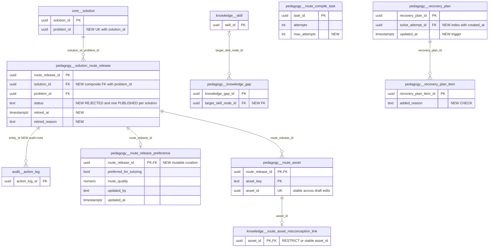

# `pedagogy` schema (part 3 of 5) — tutoring routes, diagnosis, recovery and feedback

This part covers 14 `pedagogy` tables (plus 3 feedback catalogue tables shown for context) behind three runtime areas. **Precompiled tutoring routes**: an LLM compiler turns a canonical `core.solution` into an immutable, reviewed `solution_route_release`. Each release contains steps, instructions, hints, taxonomy requirements and assets. A distributed compile queue (`route_compile_task`, `route_compiler_run`, `route_compiler_job`) produces these releases. **Step-level gap diagnosis and recovery**: the runtime stores `gap_diagnosis`, ranks `knowledge_gap` hypotheses and runs `recovery_plan` detours for one learner's solve attempt. **Interaction feedback and misconception evidence**: `feedback_policy`, `feedback_template` and `misconception_evidence_rule` are catalog rows used by the interaction-template library. The three feedback catalogue tables have their full column sections in [pedagogy-solutions-feedback.md](pedagogy-solutions-feedback.md); here they appear only in §1–§2. Sibling parts: [pedagogy-taxonomy-sources.md](pedagogy-taxonomy-sources.md) (taxonomy, sources), [pedagogy-solutions-feedback.md](pedagogy-solutions-feedback.md) (solution steps, hints, feedback, interventions), [pedagogy-micro-courses.md](pedagogy-micro-courses.md) (micro-courses, learning items) and [pedagogy-video.md](pedagogy-video.md) (video layer).

Source of truth: migrations [014](../../../mathbank-db/sql/014_gap_diagnosis.sql), [015](../../../mathbank-db/sql/015_recovery_runtime.sql), [026](../../../mathbank-db/sql/026_tutoring_routes.sql), [027](../../../mathbank-db/sql/027_route_generation_provenance.sql), [028](../../../mathbank-db/sql/028_route_distributed_queue.sql), [031](../../../mathbank-db/sql/031_requirement_proposal_fields.sql), [033](../../../mathbank-db/sql/033_interaction_template_library.sql). Catalog extracted 2026-11-01 from migrations 001–054; endpoint mapping traced from mathbank-rest source and manually verified.

## 1. Purpose, ownership and data flow

| Area | Tables | Writes owned by | Read by | Lifecycle | Privacy class |
|---|---|---|---|---|---|
| Route compilation queue | `route_compile_task`, `route_compiler_run`, `route_compiler_job` | [route_batch.py](../../../mathbank-rest/src/mathbank_rest/route_batch.py) (`make routes-ingest`, multi-machine lease queue), [route_compiler.py](../../../mathbank-rest/src/mathbank_rest/route_compiler.py) CLI (`compile`), [route_watchdog.py](../../../mathbank-rest/scripts/route_watchdog.py) (marks stalled runs `PARTIAL`) | Operators through `make routes-status` or `routes-progress`; no REST | Queue/lease: `QUEUED → RUNNING → DONE/FAILED`. Expired leases are re-claimed | Operational |
| Route releases | `solution_route_release`, `route_step`, `solution_step_instruction`, `route_step_hint`, `solution_step_requirement`, `route_asset`, `route_asset_link` | Created by `route_compiler.persist()`/`write_program()`. Reviewed, published and edited via admin `/v1/admin/tutoring-routes/*` ([routers/tutoring_routes.py](../../../mathbank-rest/src/mathbank_rest/routers/tutoring_routes.py) → [route_runtime.py](../../../mathbank-rest/src/mathbank_rest/route_runtime.py)), or in bulk with `route_compiler approve-drafts / publish-reviewed` | Learner route tutor (`/v1/tutor/route-attempts*`), anonymous `/v1/tutor/guidance-plan` and `/v1/tutor/coach`, Socratic Studio (pins PUBLISHED releases), Neo4j projection [route_projection.py](../../../mathbank-rest/src/mathbank_rest/route_projection.py) (`tutoring_routes` layer), [enrich_route_asset_properties.py](../../../mathbank-graph/etl/enrich_route_asset_properties.py), [backfill_misconception_catalog.py](../../../mathbank-rest/scripts/backfill_misconception_catalog.py), [relabel_taxonomy_buckets.py](../../../mathbank-rest/scripts/relabel_taxonomy_buckets.py) | `DRAFT → REVIEWED → PUBLISHED → RETIRED`. Triggers freeze the release and every snapshot row once it leaves `DRAFT`. Content changes require a new `release_version` | Public corpus (staff-reviewed). Generation metadata is staff-only |
| Gap diagnosis | `gap_diagnosis`, `knowledge_gap` | [step_diagnosis.py](../../../mathbank-rest/src/mathbank_rest/step_diagnosis.py) (invoked from [step_runtime.py](../../../mathbank-rest/src/mathbank_rest/step_runtime.py) on failed step outcomes and on learner request). [step_recovery.py](../../../mathbank-rest/src/mathbank_rest/step_recovery.py) resolves gaps | Learner attempt runtime, admin gap dashboards, topic-practice ranking ([db/topic_pedagogy.py](../../../mathbank-rest/src/mathbank_rest/db/topic_pedagogy.py)) | Append-only hypotheses. Only `knowledge_gap.status` moves (`UNRESOLVED → CONFIRMED/REJECTED`, `CONFIRMED → RESOLVED`), and each move is mirrored in `learner.event` and the outbox. Identical evidence reuses the existing diagnosis | Learner-private |
| Recovery detours | `recovery_plan`, `recovery_plan_item` | [step_recovery.py](../../../mathbank-rest/src/mathbank_rest/step_recovery.py). [outbox_worker.py](../../../mathbank-rest/src/mathbank_rest/outbox_worker.py) aborts plans of abandoned attempts | Learner runtime, admin recovery views | Plan: `ACTIVE ⇄ SUSPENDED → COMPLETED/EXHAUSTED/ABORTED`, with at most one ACTIVE plan per attempt. Items: `PENDING → PRESENTED → PASSED/FAILED/SKIPPED` | Learner-private |
| Feedback and evidence catalog | `feedback_policy`, `feedback_template`, `misconception_evidence_rule` | **No production writer.** Rows come only from tests ([test_interaction_templates.py](../../../mathbank-rest/tests/test_interaction_templates.py)) | [interaction_validators.py](../../../mathbank-rest/src/mathbank_rest/interaction_validators.py) (instance validate/approve) and [interaction_template_projection.py](../../../mathbank-rest/src/mathbank_rest/interaction_template_projection.py) (Neo4j rebuild/verify). [interaction_runtime.py](../../../mathbank-rest/src/mathbank_rest/interaction_runtime.py) `apply_evidence()`/`select_feedback()` read them but have no production caller | Versioned `(key, version)` rows reviewed with `PENDING_REVIEW → APPROVED/REJECTED` | Public catalog (staff-authored) |

Data flow, in four stages:

1. **Compile.** `core.solution` is compiled through the `route_compile_task` lease into a `solution_route_release` (DRAFT) and its snapshot rows. When an identical `(solution_id, source_hash, generator_version)` already exists, the compiler reuses that release (`route_compiler_job.status='REUSED'`).
2. **Review and publish.** An admin reviews the draft, comparing `expected_hash` with `content_hash`, then publishes it. `refresh-graph` projects published releases into Neo4j.
3. **Tutor.** The learner route tutor and the anonymous coach always use the highest-ranked PUBLISHED release for a problem (`route_runtime.select_published`, [route_runtime.py:20](../../../mathbank-rest/src/mathbank_rest/route_runtime.py)).
4. **Diagnose and recover.** This path uses the older textbook step runtime (`pedagogy.solution_step`, part 1), not route steps. A failed step writes `gap_diagnosis` and ranked `knowledge_gap` rows. A learner-started `recovery_plan` then runs `recovery_plan_item`s and returns to the origin step. Plan completion resolves the gap.

## 2. Entity diagram — as-is

```mermaid
erDiagram
    core__problem { uuid problem_id PK }
    core__solution { uuid solution_id PK }
    pedagogy__taxonomy_node { text taxonomy_node_id PK }
    pedagogy__solution_step { text solution_step_id PK }
    pedagogy__learning_item { text learning_item_id PK }
    pedagogy__intervention_script { uuid intervention_id PK }
    learner__student_profile { uuid student_id PK }
    learner__solve_attempt { uuid solve_attempt_id PK }
    learner__route_attempt { uuid route_attempt_id PK }
    orchestration__socratic_revision { uuid route_release_id FK }
    tutor__runtime_state { uuid current_recovery_plan_id FK }
    knowledge__misconception { uuid misconception_id PK }
    knowledge__route_asset_misconception_link { uuid asset_id PK }
    visual__interaction_template_version { uuid interaction_template_version_id PK }
    visual__interaction_instance { uuid feedback_policy_id FK }
    visual__icon_token { uuid icon_token_id PK }
    visual__animation_template { uuid animation_template_id PK }

    pedagogy__route_compiler_run {
        uuid run_id PK
        text generator_version
        text status "RUNNING COMPLETED PARTIAL FAILED"
        int requested_limit
        jsonb generation_config "frozen model config"
    }
    pedagogy__route_compiler_job {
        uuid run_id PK, FK
        uuid solution_id PK, FK
        uuid route_release_id FK
        text status "QUEUED RUNNING DRAFT REUSED FAILED"
        text source_hash
    }
    pedagogy__route_compile_task {
        uuid task_id PK
        uuid solution_id FK
        uuid owner_run_id FK
        uuid route_release_id FK
        text generator_version UK
        text source_hash UK
        text status "QUEUED RUNNING DONE FAILED"
        timestamptz lease_until
    }
    pedagogy__solution_route_release {
        uuid route_release_id PK
        uuid solution_id FK
        uuid problem_id FK
        int release_version UK
        text source_hash UK
        text content_hash "program digest"
        text status "DRAFT REVIEWED PUBLISHED RETIRED"
        bool preferred_for_tutoring
    }
    pedagogy__route_step {
        uuid route_release_id PK, FK
        int step_index PK
        uuid step_id UK
        text mathematical_result
        jsonb generation_metadata
    }
    pedagogy__solution_step_instruction {
        uuid route_release_id PK, FK
        int step_index PK, FK
        jsonb content "Instruction model"
    }
    pedagogy__route_step_hint {
        uuid route_release_id PK, FK
        int step_index PK, FK
        int hint_level PK "1-5"
        text hint_variant PK
        text misconception_key PK
        text hint_text
    }
    pedagogy__solution_step_requirement {
        uuid route_release_id PK, FK
        int step_index PK, FK
        text taxonomy_node_id PK, FK
        text role PK
        int required_level
        bool blocking
    }
    pedagogy__route_asset {
        uuid route_release_id PK, FK
        text asset_key PK
        uuid asset_id UK
        text asset_kind "CLAIM MISCONCEPTION THEORY LEARNING_ITEM"
        jsonb content
    }
    pedagogy__route_asset_link {
        uuid route_release_id PK, FK
        int step_index PK, FK
        text asset_key PK, FK
        text role PK "CAN_TRIGGER CHECKED_BY EXPLAINED_BY"
    }
    pedagogy__gap_diagnosis {
        uuid gap_diagnosis_id PK
        uuid student_id FK
        uuid solve_attempt_id FK
        text solution_step_id FK
        text evidence_fingerprint UK
        text recommended_action
        jsonb ai_rerank
    }
    pedagogy__knowledge_gap {
        uuid knowledge_gap_id PK
        uuid gap_diagnosis_id FK
        uuid student_id FK
        uuid solve_attempt_id FK
        text solution_step_id FK
        text source_step_id FK
        int rank UK
        text status "UNRESOLVED CONFIRMED REJECTED RESOLVED"
        text target_skill_id
    }
    pedagogy__recovery_plan {
        uuid recovery_plan_id PK
        uuid student_id FK
        uuid solve_attempt_id FK
        uuid origin_problem_id FK
        text origin_step_id FK
        uuid gap_diagnosis_id FK
        uuid knowledge_gap_id FK
        uuid parent_recovery_plan_id FK
        text status
    }
    pedagogy__recovery_plan_item {
        uuid recovery_plan_item_id PK
        uuid recovery_plan_id FK
        int ordinal UK
        text learning_item_id FK
        text worked_step_id FK
        text stage
        text status
    }
    pedagogy__feedback_policy {
        uuid feedback_policy_id PK
        text policy_key UK
        int version UK
        jsonb policy_json "stages ladder"
        text review_status
    }
    pedagogy__feedback_template {
        uuid feedback_template_id PK
        text feedback_key UK
        int version UK
        uuid icon_token_id FK
        uuid animation_template_id FK
        text feedback_type
        text review_status
    }
    pedagogy__misconception_evidence_rule {
        uuid evidence_rule_id PK
        uuid misconception_id FK
        uuid interaction_template_version_id FK
        text diagnostic_learning_item_id FK
        uuid feedback_template_id FK
        uuid intervention_id FK
        text error_signature
        numeric evidence_weight
    }

    pedagogy__route_compiler_run ||--o{ pedagogy__route_compiler_job : "run_id"
    pedagogy__route_compiler_run |o--o{ pedagogy__route_compile_task : "owner_run_id"
    core__solution ||--o{ pedagogy__route_compiler_job : "solution_id"
    core__solution ||--o{ pedagogy__route_compile_task : "solution_id"
    core__solution ||--o{ pedagogy__solution_route_release : "solution_id"
    core__problem ||--o{ pedagogy__solution_route_release : "problem_id"
    pedagogy__solution_route_release |o--o{ pedagogy__route_compiler_job : "route_release_id"
    pedagogy__solution_route_release |o--o{ pedagogy__route_compile_task : "route_release_id"
    pedagogy__solution_route_release ||--o{ pedagogy__route_step : "route_release_id"
    pedagogy__solution_route_release ||--o{ pedagogy__route_asset : "route_release_id"
    pedagogy__route_step ||--|| pedagogy__solution_step_instruction : "route_release_id,step_index"
    pedagogy__route_step ||--o{ pedagogy__route_step_hint : "route_release_id,step_index"
    pedagogy__route_step ||--o{ pedagogy__solution_step_requirement : "route_release_id,step_index"
    pedagogy__taxonomy_node ||--o{ pedagogy__solution_step_requirement : "taxonomy_node_id"
    pedagogy__route_step ||--o{ pedagogy__route_asset_link : "route_release_id,step_index"
    pedagogy__route_asset ||--o{ pedagogy__route_asset_link : "route_release_id,asset_key"
    pedagogy__route_asset ||--o| knowledge__route_asset_misconception_link : "asset_id"
    pedagogy__solution_route_release ||--o{ learner__route_attempt : "route_release_id"
    pedagogy__solution_route_release ||--o{ orchestration__socratic_revision : "route_release_id"

    learner__student_profile ||--o{ pedagogy__gap_diagnosis : "student_id"
    learner__solve_attempt ||--o{ pedagogy__gap_diagnosis : "solve_attempt_id"
    pedagogy__solution_step ||--o{ pedagogy__gap_diagnosis : "solution_step_id"
    pedagogy__gap_diagnosis ||--o{ pedagogy__knowledge_gap : "gap_diagnosis_id"
    learner__student_profile ||--o{ pedagogy__knowledge_gap : "student_id"
    learner__solve_attempt ||--o{ pedagogy__knowledge_gap : "solve_attempt_id"
    pedagogy__solution_step ||--o{ pedagogy__knowledge_gap : "solution_step_id"
    pedagogy__solution_step |o--o{ pedagogy__knowledge_gap : "source_step_id"
    learner__student_profile ||--o{ pedagogy__recovery_plan : "student_id"
    learner__solve_attempt ||--o{ pedagogy__recovery_plan : "solve_attempt_id"
    core__problem ||--o{ pedagogy__recovery_plan : "origin_problem_id"
    pedagogy__solution_step ||--o{ pedagogy__recovery_plan : "origin_step_id"
    pedagogy__gap_diagnosis |o--o{ pedagogy__recovery_plan : "gap_diagnosis_id"
    pedagogy__knowledge_gap |o--o{ pedagogy__recovery_plan : "knowledge_gap_id"
    pedagogy__recovery_plan |o--o{ pedagogy__recovery_plan : "parent_recovery_plan_id"
    pedagogy__recovery_plan ||--o{ pedagogy__recovery_plan_item : "recovery_plan_id"
    pedagogy__learning_item |o--o{ pedagogy__recovery_plan_item : "learning_item_id"
    pedagogy__solution_step |o--o{ pedagogy__recovery_plan_item : "worked_step_id"
    pedagogy__recovery_plan |o--o{ learner__solve_attempt : "recovery_plan_id"
    pedagogy__recovery_plan |o--o{ tutor__runtime_state : "current_recovery_plan_id"

    visual__icon_token |o--o{ pedagogy__feedback_template : "icon_token_id"
    visual__animation_template |o--o{ pedagogy__feedback_template : "animation_template_id"
    pedagogy__feedback_policy |o--o{ visual__interaction_instance : "feedback_policy_id"
    knowledge__misconception ||--o{ pedagogy__misconception_evidence_rule : "misconception_id"
    visual__interaction_template_version |o--o{ pedagogy__misconception_evidence_rule : "interaction_template_version_id"
    pedagogy__learning_item |o--o{ pedagogy__misconception_evidence_rule : "diagnostic_learning_item_id"
    pedagogy__feedback_template |o--o{ pedagogy__misconception_evidence_rule : "feedback_template_id"
    pedagogy__intervention_script |o--o{ pedagogy__misconception_evidence_rule : "intervention_id"
```

## 3. Tables

### 3.1 Route compilation queue

### `pedagogy.route_compile_task`
**Role.** One shared unit of compile work: "compile solution X at source hash H with generator version V". [Migration 028](../../../mathbank-db/sql/028_route_distributed_queue.sql) added it so that several machines (each running `make routes-ingest` with its own local model) can split one corpus without duplicating work. Work identity is independent of any one machine's run configuration. `route_batch.enqueue` inserts tasks with `ON CONFLICT DO NOTHING`. Workers claim tasks with `FOR UPDATE SKIP LOCKED`, renew a 180-second lease while generating, and finish them as `DONE` (with the release) or `FAILED`.
**Lifecycle.** `QUEUED → RUNNING → DONE | FAILED`. A `RUNNING` task whose `lease_until` has passed can be claimed again, and `attempts` increases on every claim. `--retry-failed` resets `FAILED → QUEUED`. Rows are never deleted.

| Column | Type | Null | Default | Description |
|---|---|---|---|---|
| task_id | uuid | NO | gen_random_uuid() | Surrogate key of the work item. |
| generator_version | text | NO | | Compiler `VERSION` constant this task targets. Part of the natural key, so a new compiler version re-queues every solution. |
| solution_id | uuid | NO | | → `core.solution.solution_id` (no ON DELETE action). Canonical solution to compile. |
| source_hash | text | NO | | `route_compiler.source_hash()` of statement + solution body + verification status at enqueue time. A changed source creates a new task. |
| status | text | NO | 'QUEUED' | `QUEUED`, `RUNNING`, `DONE` or `FAILED`. |
| owner_token | uuid | yes | | Random token of the worker holding the lease. Lease renewal and completion are guarded by `owner_token = :token`. |
| owner_run_id | uuid | yes | | → `pedagogy.route_compiler_run.run_id`. Machine run that last claimed the task. |
| lease_until | timestamptz | yes | | Lease expiry (now + 180 s, renewed by a heartbeat). Set to NULL on completion. |
| attempts | integer | NO | 0 | Number of claims so far, including re-claims after an expired lease. There is no upper bound. |
| route_release_id | uuid | yes | | → `pedagogy.solution_route_release.route_release_id`. Release produced or reused when `DONE`. |
| error_code | text | yes | | Short failure class (exception type name) when `FAILED`. |
| created_at | timestamptz | NO | now() | Enqueue time. Also the FIFO claim order. |
| completed_at | timestamptz | yes | | Time the task reached `DONE`/`FAILED`. Reset to NULL on re-claim or retry. |

**Keys, constraints, indexes.**
- PK `task_id`. UNIQUE `(generator_version, solution_id, source_hash)`.
- FKs: `solution_id` → `core.solution`, `owner_run_id` → `route_compiler_run`, `route_release_id` → `solution_route_release` (all NO ACTION).
- CHECK: `status` must be one of the four values.
- Index `route_compile_task_claim (generator_version, status, lease_until, created_at)` serves the claim query.

**REST operations today.** None. Written and read by [route_batch.py](../../../mathbank-rest/src/mathbank_rest/route_batch.py) (`run`, `status`, `migrate` subcommands through the `routes-*` Makefile targets).

### `pedagogy.route_compiler_run`
**Role.** One invocation of the route compiler on one machine: a `route_compiler compile` CLI run or a `route_batch run` worker process. It records the generator version, the requested batch size and the frozen model configuration, so that every job and release can be traced back to the exact provider and model. It is the parent of `route_compiler_job` and the lease owner referenced by `route_compile_task`.
**Lifecycle.** `RUNNING → COMPLETED | PARTIAL | FAILED`. `route_watchdog.py` marks a stalled `RUNNING` run as `PARTIAL`. `route_compiler compile --resume` sets a run back to `RUNNING`. Rows are kept indefinitely.

| Column | Type | Null | Default | Description |
|---|---|---|---|---|
| run_id | uuid | NO | gen_random_uuid() | Surrogate key of the run. |
| generator_version | text | NO | | Compiler `VERSION` used by this run. |
| auto_review_by | text | yes | | Operator identity passed as `--approve-by`. When set, drafts produced by the run are validated and marked `REVIEWED` under this identity; publication still needs a separate step. Resuming the run must use the same value. |
| requested_limit | integer | NO | | Maximum number of sources the run was asked to process. CHECK `> 0`. |
| status | text | NO | | `RUNNING`, `COMPLETED`, `PARTIAL` or `FAILED`. |
| created_at | timestamptz | NO | now() | Run start. |
| completed_at | timestamptz | yes | | Run end. NULL while running. |
| generation_config | jsonb | NO | '{}' | Added by [027](../../../mathbank-db/sql/027_route_generation_provenance.sql). Frozen provider/model/options for the run, for example `{provider, model, num_ctx, num_thread, …, critic_model, critic}`. `critic_model` is null unless an independent critic was enabled, and `critic` then holds that critic's configuration. Older rows contain `{}`. |

**Keys, constraints, indexes.**
- PK `run_id`.
- CHECKs: `requested_limit > 0`; `status` must be one of the four values.
- Referenced by `route_compiler_job.run_id` and `route_compile_task.owner_run_id`.

**REST operations today.** None. Written by [route_compiler.py](../../../mathbank-rest/src/mathbank_rest/route_compiler.py) (`_compile_pilot`) and [route_batch.py](../../../mathbank-rest/src/mathbank_rest/route_batch.py). Updated by [route_watchdog.py](../../../mathbank-rest/scripts/route_watchdog.py). Read by `route_compiler status/run_report`.

### `pedagogy.route_compiler_job`
**Role.** The outcome of one solution within one run. It records whether the run produced a new DRAFT release, reused an identical release, or failed, together with error details and per-solution generation/critic provenance. It is the per-run audit trail, while `route_compile_task` is the shared cross-run work item.
**Lifecycle.** `QUEUED → RUNNING → DRAFT | REUSED | FAILED`. An upsert on `(run_id, solution_id)` resets a job when it is retried within the same run. Rows are never deleted.

| Column | Type | Null | Default | Description |
|---|---|---|---|---|
| run_id | uuid | NO | | → `pedagogy.route_compiler_run.run_id`. Part of the PK. |
| solution_id | uuid | NO | | → `core.solution.solution_id`. Part of the PK. |
| source_hash | text | NO | | Source hash the job compiled. |
| status | text | NO | | `QUEUED`, `RUNNING`, `DRAFT` (new release created), `REUSED` (identical release already existed) or `FAILED`. |
| route_release_id | uuid | yes | | → `pedagogy.solution_route_release.route_release_id`. Release created or reused. |
| error_code | text | yes | | Failure class when `FAILED`. |
| error_details | jsonb | NO | '[]' | Array of validation or generation error detail objects for a failed job. Reset to `[]` on retry. |
| created_at | timestamptz | NO | now() | Time the job was first queued in this run. |
| completed_at | timestamptz | yes | | Time the job reached `DRAFT`/`REUSED`/`FAILED`. |
| generation_metadata | jsonb | NO | '{}' | Added by 027. Per-job generation/critic provenance that mirrors `route_step.generation_metadata`. `critic_model` is null unless a critic was enabled. Older rows contain `{}`. |

**Keys, constraints, indexes.**
- PK `(run_id, solution_id)`.
- FKs: `run_id`, `solution_id` and `route_release_id` (all NO ACTION).
- CHECK: `status` must be one of the five values.

**REST operations today.** None. Written by `route_compiler.py` and `route_batch.py`. Read by [route_watchdog.py](../../../mathbank-rest/scripts/route_watchdog.py) and `route_compiler status`.

### 3.2 Route releases (immutable after review)

### `pedagogy.solution_route_release`
**Role.** One versioned, reviewable tutoring route for one canonical solution: an ordered "program" of checkpoints the tutor walks the learner through. `route_compiler.persist()` creates it as `DRAFT` after the LLM output validates against `RouteProgram` ([route_contracts.py](../../../mathbank-rest/src/mathbank_rest/route_contracts.py)). It is the publication pointer for the route tutor (`learner.route_attempt`), the anonymous guidance plan and coach, and Socratic workflows (`orchestration.socratic_revision`). `content_hash` (the `program_digest`) is the optimistic-concurrency token for review and edit.
**Lifecycle.** Trigger `immutable_route_release` (`pedagogy.guard_route_release()`) enforces the lifecycle:
- A `DRAFT` row may be updated freely, but may move only to `REVIEWED`.
- Once a row has left `DRAFT`, only `REVIEWED → PUBLISHED` and `PUBLISHED → RETIRED` are allowed, and only `status` and `published_at` may change.
- Only `DRAFT` rows can be deleted.
- A CHECK requires `reviewed_by` and `reviewed_at` on every non-draft row.

No code path sets `RETIRED` today.

| Column | Type | Null | Default | Description |
|---|---|---|---|---|
| route_release_id | uuid | NO | gen_random_uuid() | Surrogate key of the release. |
| solution_id | uuid | NO | | → `core.solution.solution_id`. Source solution. |
| problem_id | uuid | NO | | → `core.problem.problem_id`. Denormalised for per-problem selection. Not constrained to equal the solution's problem. |
| release_version | integer | NO | | Per-solution sequence (`max+1`), > 0. UNIQUE with `solution_id`. |
| source_hash | text | NO | | Hash of the canonical statement, solution body and verification status at compile time. Review rejects the release if the source has since changed. |
| content_hash | text | NO | | SHA-256 `program_digest` of the full RouteProgram. Recomputed on edit. Review requires the client's `expected_hash` to match. |
| approach_name | text | NO | | Short name of the solution approach (≤ 200 chars in the contract). |
| approach_summary | text | NO | | One-paragraph rationale (≤ 600 chars). Returned as `rationale` by `/v1/tutor/guidance-plan`. |
| difficulty_level | integer | NO | | Overall difficulty 1–5. |
| conceptual_load | integer | NO | | Conceptual load 1–5. |
| algebraic_load | integer | NO | | Algebraic/manipulative load 1–5. |
| insight_load | integer | NO | | "Key insight" load 1–5. |
| preferred_for_tutoring | boolean | NO | false | First sort key in `select_published`. No writer sets it to true yet. |
| route_quality | numeric | yes | | Quality score in [0, 1]. Second sort key (NULLS LAST). Never populated today. |
| status | text | NO | 'DRAFT' | `DRAFT`, `REVIEWED`, `PUBLISHED` or `RETIRED` (see Lifecycle). |
| generator_version | text | NO | | Compiler version that produced the release. Part of a UNIQUE key. |
| reviewed_by | text | yes | | Reviewer identity: the request `reviewer`, or `--approve-by` for bulk approval. Required when not DRAFT. |
| reviewed_at | timestamptz | yes | | Review time. Required when not DRAFT. |
| published_at | timestamptz | yes | | Time the release was published. |
| created_at | timestamptz | NO | now() | Compile time. |

**Keys, constraints, indexes.**
- PK `route_release_id`.
- UNIQUE `(solution_id, release_version)`.
- UNIQUE `(solution_id, source_hash, generator_version)`, which provides compile idempotency.
- FKs: `solution_id` → `core.solution` and `problem_id` → `core.problem` (NO ACTION).
- CHECKs: the four load/difficulty columns are 1–5; `route_quality` is in [0, 1]; `release_version > 0`; status enum; reviewer is required unless DRAFT.
- Index `route_release_problem_status (problem_id, status)`.
- Trigger `immutable_route_release` (BEFORE UPDATE OR DELETE).

**REST operations today.**

| Op | Method & path | Auth | Handler | Notes |
|---|---|---|---|---|
| R | GET /v1/admin/tutoring-routes | Admin key (X-Admin-Api-Key) | `tutoring_routes.drafts` | Lists all releases, not just drafts, newest first, with a step count. Takes `limit` ≤ 100 and `offset`, and returns `{releases,total}`. There is no status filter. |
| R | GET /v1/admin/tutoring-routes/{release_id} | Admin key | `tutoring_routes.preview` | Returns the release, the source solution, the full program (`load_program`) and per-step generation metadata. |
| R/U | POST /v1/admin/tutoring-routes/{release_id}/review | Admin key | `tutoring_routes.review` → `route_runtime.review` | DRAFT → REVIEWED. Requires `expected_hash` and `mathematical_review_confirmed: true`, then re-validates the source and the program. |
| R/U | POST /v1/admin/tutoring-routes/{release_id}/publish | Admin key | `tutoring_routes.publish` → `route_runtime.publish` | REVIEWED → PUBLISHED. Returns `graph_status: refresh_required`. |
| R/U | POST /v1/admin/tutoring-routes/{release_id}/edit | Admin key | `tutoring_routes.edit` → `route_runtime.edit` | Applies to the current DRAFT only. Replaces the snapshot and updates `content_hash` and the approach/load columns. |
| R | POST /v1/admin/tutoring-routes/refresh-graph | Admin key | `tutoring_routes.refresh_graph` → `route_projection.project` | Projects PUBLISHED releases into Neo4j. |
| R | POST /v1/tutor/route-attempts | Learner JWT | `tutoring_routes.start` → `route_runtime.start_attempt` | Selects the best PUBLISHED release (or the given one) and inserts `learner.route_attempt`. |
| R | POST /v1/tutor/guidance-plan | Anonymous | `pedagogy.guidance_plan` → `solution_guidance` → `route_runtime.plan` | Plan built from the published route. |
| R | POST /v1/tutor/coach | Anonymous | `pedagogy.coach` → `route_runtime.coaching` | First checkpoint only. |
| R | GET /v1/admin/socratic/resources | Staff cookie (Cognito) | `socratic.resources` | Lists the PUBLISHED routes for each problem. |
| R | POST /v1/admin/socratic/workflows; PUT /v1/admin/socratic/workflows/{workflow_id}; POST …/{workflow_id}/validate; POST …/{workflow_id}/simulate | Staff cookie (Cognito) | `socratic_service.dependency_snapshot` (also called from `socratic_preview.start_preview`) | Checks that a pinned route is PUBLISHED and matches the problem/solution and current source hash. |

Non-REST: `route_compiler.py` (C on `persist`; U through the `approve-drafts`/`publish-reviewed` CLI) and `route_batch.py` (R).

### `pedagogy.route_step`
**Role.** One checkpoint (mathematical sub-result) of a route release, numbered from 1. It carries the verbatim source quote that justifies the step and the claim graph between steps (`depends_on`, `produces`, `uses_claims`). Instructions, hints, requirements and asset links hang off its composite key `(route_release_id, step_index)`. `step_id` is a stable UUID for graph projection.
**Lifecycle.** Immutable unless the parent release is `DRAFT`, enforced by trigger `immutable_route_snapshot` (`guard_route_snapshot()` on INSERT, UPDATE and DELETE). A draft edit deletes and rewrites all of the release's steps.

| Column | Type | Null | Default | Description |
|---|---|---|---|---|
| route_release_id | uuid | NO | | → `pedagogy.solution_route_release.route_release_id` (NO ACTION). Part of the PK. |
| step_index | integer | NO | | 1-based position in the route. CHECK `> 0`. |
| step_id | uuid | NO | gen_random_uuid() | Stable step identity, used as the Neo4j node key. UNIQUE. |
| mathematical_result | text | NO | | What the step establishes (the checkpoint's mathematical content). |
| source_quote | text | NO | | Verbatim excerpt of the canonical solution that justifies the step. The compiler binds it to source excerpts. |
| depends_on | integer[] | NO | '{}' | `step_index` values of earlier steps this step depends on. |
| produces | text[] | NO | '{}' | CLAIM asset keys established by this step. |
| uses_claims | text[] | NO | '{}' | CLAIM asset keys consumed by this step. |
| generation_metadata | jsonb | NO | '{}' | Added by 027. Holds generation provider, model, digest, options, usage, timing, source and validation provenance. It always has `generation_started_at` and `model`. `critic_model` is JSON null unless a critic ran (`ROUTE_CRITIC=1`), in which case `critic` holds the per-step evaluation. A draft edit adds `manual_edit {edited_at, previous_hash, current_hash}`. Older rows contain `{}`. This is provenance, not proof certification. |

**Keys, constraints, indexes.**
- PK `(route_release_id, step_index)`. UNIQUE `step_id`.
- FK → `solution_route_release`.
- CHECK `step_index > 0`.
- Trigger `immutable_route_snapshot`.
- Referenced by `solution_step_instruction`, `route_step_hint`, `solution_step_requirement` and `route_asset_link`.

**REST operations today.**

| Op | Method & path | Auth | Handler | Notes |
|---|---|---|---|---|
| R | GET /v1/admin/tutoring-routes | Admin key | `drafts` | Step count only. |
| R | GET /v1/admin/tutoring-routes/{release_id} | Admin key | `preview` | Reads the program and `generation_metadata`. |
| R | POST …/{release_id}/review, …/publish | Admin key | `route_runtime.review/publish` → `load_program` | Re-validation. |
| C/R/U/D | POST …/{release_id}/edit | Admin key | `route_runtime.edit` | Reads the old metadata, deletes the steps, re-inserts them (`write_program`) and re-applies metadata plus `manual_edit`. |
| R | POST /v1/admin/tutoring-routes/refresh-graph | Admin key | `route_projection.project` | Projects steps as Neo4j nodes. |

Non-REST: `route_compiler.write_program` (C) and `persist` (U on `generation_metadata` while DRAFT).

### `pedagogy.solution_step_instruction`
**Role.** The learner-facing teaching content of one route step: exactly one row per `route_step`. It is stored as a validated `Instruction` JSON document. This is what the route tutor shows (`student_prompt`, explanations) and what the anonymous guidance plan and coach return.
**Lifecycle.** Same snapshot immutability as `route_step` (trigger `immutable_route_snapshot`).

| Column | Type | Null | Default | Description |
|---|---|---|---|---|
| route_release_id | uuid | NO | | Part of the PK and of the composite FK → `pedagogy.route_step`. |
| step_index | integer | NO | | Part of the PK and of the composite FK → `pedagogy.route_step`. |
| instruction_version | integer | NO | 1 | Schema version of the instruction document. Always 1 today. |
| content_hash | text | NO | | SHA-256 of the `content` JSON (`content_hash()` in the compiler). |
| content | jsonb | NO | | `Instruction` model: `{goal_text, recognition_cue, has_diagram, diagram_description, diagram_instructions, reasoning_explanation, why_this_works, prerequisite_recap, connection_to_previous_step, connection_to_next_step, common_error_summary, student_prompt, expected_response, short_explanation, full_explanation}`. `expected_response` is the answer key, so it must never be sent to a learner before they answer. |

**Keys, constraints, indexes.**
- PK `(route_release_id, step_index)`, which also forms the 1:1 FK → `route_step` (NO ACTION).
- Trigger `immutable_route_snapshot`.

**REST operations today.**

| Op | Method & path | Auth | Handler | Notes |
|---|---|---|---|---|
| R | GET /v1/admin/tutoring-routes/{release_id}; POST …/review; POST …/publish | Admin key | `load_program` | |
| C/D | POST /v1/admin/tutoring-routes/{release_id}/edit | Admin key | `route_runtime.edit` | Deletes and re-inserts. |
| R | POST /v1/tutor/route-attempts; GET /v1/tutor/route-attempts/{attempt_id}; POST …/{attempt_id}/assist | Learner JWT | `route_runtime.start_attempt/current_view/assist` | Reads the current step's instruction. |
| R | POST /v1/tutor/guidance-plan | Anonymous | `route_runtime.plan` | Uses `goal_text` per step and step 1's `student_prompt`. |
| R | POST /v1/tutor/coach | Anonymous | `route_runtime.coaching` | Step 1 only: `prerequisite_recap` / `recognition_cue` / `student_prompt`. |

### `pedagogy.route_step_hint`
**Role.** The graded hint ladder for one route step. The compiler writes exactly 5 levels: levels 1–4 are the four model hints and level 5 is the instruction's `full_explanation` ([route_compiler.py:826](../../../mathbank-rest/src/mathbank_rest/route_compiler.py)). The route tutor's `assist` action discloses levels in order, and the anonymous coach serves step 1's hints.
**Lifecycle.** Snapshot-immutable (trigger `immutable_route_snapshot`).

| Column | Type | Null | Default | Description |
|---|---|---|---|---|
| route_release_id | uuid | NO | | Part of the PK and of the composite FK → `pedagogy.route_step`. |
| step_index | integer | NO | | Part of the PK and of the composite FK → `pedagogy.route_step`. |
| hint_level | integer | NO | | Disclosure level 1–5 (CHECK). Level 5 is the full explanation. |
| hint_variant | text | NO | 'default' | Reserved variant axis, for example alternative phrasings. Always `default` today, and readers filter on it. |
| misconception_key | text | NO | '' | Reserved for misconception-specific hints. Always `''` today. |
| content_hash | text | NO | | SHA-256 of `hint_text`. |
| hint_text | text | NO | | Hint text shown to the learner. |

**Keys, constraints, indexes.**
- PK `(route_release_id, step_index, hint_level, hint_variant, misconception_key)`.
- FK → `route_step`.
- CHECK `hint_level` is 1–5.
- Trigger `immutable_route_snapshot`.

**REST operations today.**

| Op | Method & path | Auth | Handler | Notes |
|---|---|---|---|---|
| R | GET /v1/admin/tutoring-routes/{release_id}; POST …/review; POST …/publish | Admin key | `load_program` | |
| C/D | POST /v1/admin/tutoring-routes/{release_id}/edit | Admin key | `route_runtime.edit` | |
| R | POST /v1/tutor/route-attempts/{attempt_id}/assist | Learner JWT | `route_runtime.assist` | Requires `expected_version`. Discloses the requested `hint_level` for the current step. |
| R | POST /v1/tutor/coach | Anonymous | `route_runtime.coaching` | Step 1, `default` variant only. |

### `pedagogy.solution_step_requirement`
**Role.** Links a route step to the taxonomy nodes (concepts, subconcepts, skills, techniques) it requires, with role, level, importance and a blocking flag. This drives the `REQUIRES` edges of the Neo4j projection and the taxonomy relabelling tools. Migration 031 added the `proposed_*` columns. They let a release that proposed a new taxonomy node remember that fact after the node has been upserted into `taxonomy_node`, so that `program_digest` round-trips exactly.
**Lifecycle.** Snapshot-immutable (trigger `immutable_route_snapshot`).

| Column | Type | Null | Default | Description |
|---|---|---|---|---|
| route_release_id | uuid | NO | | Part of the PK and of the composite FK → `pedagogy.route_step`. |
| step_index | integer | NO | | Part of the PK and of the composite FK → `pedagogy.route_step`. |
| taxonomy_node_id | text | NO | | → `pedagogy.taxonomy_node.taxonomy_node_id` (NO ACTION). Required node. Part of the PK. |
| role | text | NO | | `REQUIRED`, `HELPFUL`, `RECOGNITION`, `EXECUTION`, `JUSTIFICATION` or `USED`. Part of the PK. |
| required_level | integer | NO | | Mastery level the step needs, 1–5. |
| importance | numeric | NO | | Weight in [0, 1]. |
| blocking | boolean | NO | | True when failing this requirement blocks progress on the step. |
| proposed_node_type | text | NO | '' | Added by 031. `CONCEPT`, `SUBCONCEPT`, `SKILL`, `TECHNIQUE`, or `''` when the release reused an existing node. Validated only in Python (`Requirement` model). |
| proposed_name | text | NO | '' | Added by 031. Proposed node name (≤ 200 chars), or `''`. |
| proposed_description | text | NO | '' | Added by 031. Proposed node description (≤ 600 chars), or `''`. |

**Keys, constraints, indexes.**
- PK `(route_release_id, step_index, taxonomy_node_id, role)`.
- FKs → `route_step` and → `taxonomy_node`.
- CHECKs: `importance` in [0, 1]; `required_level` 1–5; `role` enum.
- Trigger `immutable_route_snapshot`.

**REST operations today.**

| Op | Method & path | Auth | Handler | Notes |
|---|---|---|---|---|
| R | GET /v1/admin/tutoring-routes/{release_id}; POST …/review; POST …/publish | Admin key | `load_program` | |
| C/D | POST /v1/admin/tutoring-routes/{release_id}/edit | Admin key | `route_runtime.edit` | |
| R | POST /v1/admin/tutoring-routes/refresh-graph | Admin key | `route_projection.project` | |

Non-REST: `route_compiler.write_program` (C) and [relabel_taxonomy_buckets.py](../../../mathbank-rest/scripts/relabel_taxonomy_buckets.py) (R).

### `pedagogy.route_asset`
**Role.** A reusable content asset declared by a release: a CLAIM produced or used by steps, a MISCONCEPTION, a THEORY item, or a diagnostic LEARNING_ITEM. Its `content` is the validated `Asset` model. Steps reference assets through `route_asset_link`. The projection turns assets into `Claim`/`Misconception`/`TheoryItem`/`LearningItem` nodes. `asset_id` is the stable key that `knowledge.route_asset_misconception_link` uses for misconception de-duplication (migration 039).
**Lifecycle.** Snapshot-immutable (trigger `immutable_route_snapshot`). A DRAFT edit deletes and re-inserts the rows, which generates new `asset_id`s (see 5.1 #4).

| Column | Type | Null | Default | Description |
|---|---|---|---|---|
| route_release_id | uuid | NO | | → `pedagogy.solution_route_release.route_release_id` (NO ACTION). Part of the PK. |
| asset_key | text | NO | | Release-local key (pattern-validated in `Asset.key`). It is referenced by `route_step.produces/uses_claims` and by `route_asset_link`. Part of the PK. |
| asset_id | uuid | NO | gen_random_uuid() | Globally unique asset identity. UNIQUE. Target of `knowledge.route_asset_misconception_link` (ON DELETE CASCADE). |
| asset_kind | text | NO | | `CLAIM`, `MISCONCEPTION`, `THEORY` or `LEARNING_ITEM`. |
| content_hash | text | NO | | SHA-256 of `content`. |
| content | jsonb | NO | | `Asset` model: `{key, kind, title, description, canonical_expression, symptom, why_wrong, correct_model, recognition_cues[], question, expected_answer, purpose, taxonomy_node_ids[], diagnoses[], remediates[]}`. `purpose` is one of PREREQUISITE_CHECK, MISCONCEPTION_DIAGNOSTIC, TECHNIQUE_RECOGNITION, ISOLATED_EXECUTION, GUIDED_PRACTICE, TRANSFER, MASTERY_CHECK or NONE. |

**Keys, constraints, indexes.**
- PK `(route_release_id, asset_key)`. UNIQUE `asset_id`.
- FK → `solution_route_release`.
- CHECK: `asset_kind` enum.
- Trigger `immutable_route_snapshot`.
- Referenced by `route_asset_link` (NO ACTION) and `knowledge.route_asset_misconception_link` (CASCADE).

**REST operations today.**

| Op | Method & path | Auth | Handler | Notes |
|---|---|---|---|---|
| R | GET /v1/admin/tutoring-routes/{release_id}; POST …/review; POST …/publish | Admin key | `load_program` | |
| C/D | POST /v1/admin/tutoring-routes/{release_id}/edit | Admin key | `route_runtime.edit` | |
| R | POST /v1/admin/tutoring-routes/refresh-graph | Admin key | `route_projection.project` | |

Non-REST: `route_compiler.write_program` (C), [backfill_misconception_catalog.py](../../../mathbank-rest/scripts/backfill_misconception_catalog.py) (R, all statuses) and [enrich_route_asset_properties.py](../../../mathbank-graph/etl/enrich_route_asset_properties.py) (R).

### `pedagogy.route_asset_link`
**Role.** A typed edge between a route step and a release asset. `CAN_TRIGGER` means the step can trigger a misconception, `CHECKED_BY` means a learning item checks the step, and `EXPLAINED_BY` means theory explains the step. The tutor's program view uses these edges, and the projection turns them into Neo4j relationships.
**Lifecycle.** Snapshot-immutable (trigger `immutable_route_snapshot`).

| Column | Type | Null | Default | Description |
|---|---|---|---|---|
| route_release_id | uuid | NO | | Shared by both composite FKs. Part of the PK. |
| step_index | integer | NO | | → `pedagogy.route_step (route_release_id, step_index)`. |
| asset_key | text | NO | | → `pedagogy.route_asset (route_release_id, asset_key)`. |
| role | text | NO | | `CAN_TRIGGER`, `CHECKED_BY` or `EXPLAINED_BY`. |

**Keys, constraints, indexes.**
- PK `(route_release_id, step_index, asset_key, role)`.
- Composite FKs → `route_step` and → `route_asset` (NO ACTION). Sharing `route_release_id` keeps links inside one release.
- CHECK: `role` enum.
- Trigger `immutable_route_snapshot`.

**REST operations today.** Same as `route_asset`: R through `load_program` (preview, review, publish) and through `refresh-graph`, and C/D through `edit`. Non-REST: `route_compiler.write_program` (C).

### 3.3 Gap diagnosis and recovery (learner-private)

### `pedagogy.gap_diagnosis`
**Role.** One diagnosis run for one solve attempt at one textbook solution step (`pedagogy.solution_step`). It snapshots the evidence that was scored and stores the recommended next action and any candidate diagnostic probes. The ranked hypotheses live in `knowledge_gap`. `step_diagnosis.diagnose_locked()` creates rows in two cases. Automatically (`AUTO`), when a step outcome meets `should_auto_diagnose`, which happens during `submit_step_response` and `record_step_outcome`. On request (`STUDENT_REQUEST`), through `/diagnose`. When `DIAGNOSIS_LLM_RERANK=1` is enabled, an LLM may write an advisory re-ranking once.
**Lifecycle.** Effectively append-only. If the same `(attempt, step, evidence_fingerprint)` is diagnosed again, the existing row is returned (`reused: true`). The only update is a one-time `ai_rerank` set (`WHERE ai_rerank IS NULL`). Rows are deleted only by cascade when the learner or attempt is deleted. Mastery is never set from a diagnosis.

| Column | Type | Null | Default | Description |
|---|---|---|---|---|
| gap_diagnosis_id | uuid | NO | gen_random_uuid() | Surrogate key. |
| student_id | uuid | NO | | → `learner.student_profile.student_id` (ON DELETE CASCADE). Owner. |
| solve_attempt_id | uuid | NO | | → `learner.solve_attempt.solve_attempt_id` (ON DELETE CASCADE). |
| solution_step_id | text | NO | | → `pedagogy.solution_step.solution_step_id` (NO ACTION). Step being diagnosed. |
| trigger | text | NO | | `AUTO` (runtime after a failed outcome), `STUDENT_REQUEST` or `TUTOR` (allowed, but not emitted by current code paths). |
| recommended_action | text | NO | | `RETRY_WITH_HINT`, `DIAGNOSTIC_PROBE` or `RECOVERY_DETOUR`, chosen by `recommend_action()`. |
| evidence_fingerprint | text | NO | | Hash of the scoring context. Makes re-diagnosis idempotent. |
| evidence | jsonb | NO | '{}' | Scored context snapshot: `{current, skill_history, predecessor_steps[], subconcept_failures}`. |
| probes | jsonb | NO | '[]' | Candidate diagnostic learning items for the top hypothesis (from `find_probes`). Empty when the action is `RETRY_WITH_HINT`. |
| diagnoser_version | text | NO | | `DIAGNOSER_VERSION` of the rules engine. |
| created_at | timestamptz | NO | now() | Diagnosis time. |
| ai_rerank | jsonb | yes | | Added by [015](../../../mathbank-db/sql/015_recovery_runtime.sql). Optional LLM re-ranking: `{order[knowledge_gap_id], rationale(≤500), model, rules_order[], changed}`. The rules ranking in `knowledge_gap.rank` is never overwritten. |

**Keys, constraints, indexes.**
- PK `gap_diagnosis_id`. UNIQUE `(solve_attempt_id, solution_step_id, evidence_fingerprint)`.
- FKs as listed in the column table.
- CHECKs: `trigger` and `recommended_action` enums.
- Index `gap_diagnosis_student_idx (student_id, created_at DESC)`.
- Referenced by `knowledge_gap` (CASCADE) and `recovery_plan` (SET NULL).

**REST operations today.**

| Op | Method & path | Auth | Handler | Notes |
|---|---|---|---|---|
| R | POST /v1/students/{student_id}/problems/{problem_ref}/attempts | Learner JWT | `step_runtime.start_attempt` → `get_runtime` | The runtime view embeds the latest diagnosis for the current step. |
| R | GET /v1/attempts/{attempt_id} and /v1/attempts/{attempt_id}/runtime | Learner JWT | `step_runtime.get_runtime` | |
| C/R/U | POST /v1/attempts/{attempt_id}/steps/{step_id}/responses | Learner JWT | `submit_step_response` → `record_step_outcome` → `diagnose_locked`; `_reranked` | Automatic diagnosis on failure, plus an optional rerank. |
| R | GET /v1/attempts/{attempt_id}/steps/{step_id}/hints | Learner JWT | `list_hints` → `get_runtime` | |
| C/R | POST /v1/attempts/{attempt_id}/steps/{step_id}/outcome | Admin key | `record_step_outcome` | Internal evaluator hook. |
| C/R/U | POST /v1/attempts/{attempt_id}/steps/{step_id}/diagnose | Learner JWT | `step_diagnosis.diagnose_step` | `STUDENT_REQUEST`, followed by an optional rerank. |
| R | GET /v1/attempts/{attempt_id}/diagnoses | Learner JWT | `list_diagnoses` | Student view: likelihood labels, no internal scores. |
| R | GET /v1/admin/attempts/{attempt_id}/diagnoses | Admin key | `list_diagnoses` | |
| R | GET /v1/admin/knowledge-gaps | Admin key | `admin_gap_overview` | |
| R | POST /v1/attempts/{attempt_id}/recovery-plans | Learner JWT | `step_recovery.create_plan` | Validates the referenced diagnosis. |
| R | POST /v1/geometry-scenes/interpret | Learner JWT or Staff cookie (`staff_or_student`) | `geometry_interpretation.interpret_scene` → `get_runtime` | Reads runtime context when `solve_attempt_id` is supplied. |

### `pedagogy.knowledge_gap`
**Role.** One ranked hypothesis inside a diagnosis: "the learner failed this step because of failure mode M at location L, targeting concept/subconcept/skill T, with confidence c". These rows are the learner-private "knowledge gaps". Open gaps (`UNRESOLVED`/`CONFIRMED`) bias topic-practice selection, seed recovery plans, and appear on admin dashboards. Each insert emits a `GAP_HYPOTHESIS_CREATED` event and a `KNOWLEDGE_GAP_CREATED` outbox message.
**Lifecycle.** Hypotheses are never overwritten or deleted by the runtime. `status` follows `UNRESOLVED → CONFIRMED | REJECTED` and `CONFIRMED → RESOLVED`; `UNRESOLVED → RESOLVED` is also possible after a completed recovery. Transitions come from later step outcomes (`step_diagnosis.update_gap_statuses`) and from recovery plan endings: COMPLETED resolves the gap and EXHAUSTED confirms it. Each transition writes `learner.event`. Rows are deleted only by cascade from the student, attempt or diagnosis.

| Column | Type | Null | Default | Description |
|---|---|---|---|---|
| knowledge_gap_id | uuid | NO | gen_random_uuid() | Surrogate key. |
| gap_diagnosis_id | uuid | NO | | → `pedagogy.gap_diagnosis` (ON DELETE CASCADE). Parent diagnosis. |
| student_id | uuid | NO | | → `learner.student_profile` (ON DELETE CASCADE). Denormalised owner for per-student queries. |
| solve_attempt_id | uuid | NO | | → `learner.solve_attempt` (ON DELETE CASCADE). |
| solution_step_id | text | NO | | → `pedagogy.solution_step` (NO ACTION). Step where the failure surfaced. |
| rank | integer | NO | | Rules-engine rank within the diagnosis, ≥ 1, where 1 is most likely. UNIQUE per diagnosis. |
| failure_location | text | NO | | `CONCEPT`, `SUBCONCEPT`, `SKILL`, `TECHNIQUE`, `PREREQUISITE` or `REPRESENTATION`. |
| failure_mode | text | NO | | `NOT_RECOGNIZED`, `MISUNDERSTOOD`, `THEOREM_NOT_RECALLED`, `WRONG_THEOREM_SELECTED`, `CANNOT_EXECUTE`, `PROOF_CONNECTION_MISSING`, `DIAGRAM_MISREAD`, `ALGEBRA_BREAKDOWN`, `CASE_MISSED`, `OVERCOMPLICATED` or `CARELESS`. |
| target_concept_id | text | yes | | Taxonomy concept code, for example `GEO.C01`. Not FK-enforced. |
| target_subconcept_id | text | yes | | Taxonomy subconcept code, for example `GEO.C01.S01`. Not FK-enforced. |
| target_skill_id | text | yes | | Taxonomy skill code (`solution_step.skill_id`). Used by the open-gap index and topic practice. Not FK-enforced. |
| target_skill_node_id | uuid | yes | | Logical link to `knowledge.skill.skill_id`. Not enforced (migration comment). |
| target_label | text | yes | | Human-readable label of the target, shown to learners. |
| source_step_id | text | yes | | → `pedagogy.solution_step` (NO ACTION). Prerequisite step whose history suggested this hypothesis. |
| confidence | numeric(4,3) | NO | | Rules confidence in [0, 1]. Learners see only a likelihood label. |
| evidence | jsonb | NO | '{}' | Per-hypothesis scoring evidence (signals that raised or lowered the confidence). |
| status | text | NO | 'UNRESOLVED' | `UNRESOLVED`, `CONFIRMED`, `REJECTED` or `RESOLVED`. |
| status_reason | text | yes | | Free-text reason for the last transition, for example `recovery plan <id> COMPLETED`. |
| created_at | timestamptz | NO | now() | Creation time. |
| status_changed_at | timestamptz | yes | | Time of the last status change. |
| resolved_at | timestamptz | yes | | Set when the status becomes `RESOLVED`. |

**Keys, constraints, indexes.**
- PK `knowledge_gap_id`. UNIQUE `(gap_diagnosis_id, rank)`.
- FKs as listed in the column table.
- CHECKs: `confidence` in [0, 1]; `rank ≥ 1`; enums for `failure_location`, `failure_mode` and `status`.
- Index `knowledge_gap_attempt_idx (solve_attempt_id)`.
- Partial index `knowledge_gap_open_idx (student_id, target_skill_id) WHERE status IN ('UNRESOLVED','CONFIRMED')`.
- Referenced by `recovery_plan.knowledge_gap_id` (SET NULL).

**REST operations today.**

| Op | Method & path | Auth | Handler | Notes |
|---|---|---|---|---|
| R | POST /v1/tutor/topic-practice | Optional learner JWT | `pedagogy.topic_practice` → `topic_pedagogy.topic_candidates` | Open gap skills of the caller. |
| R | POST /v1/students/{student_id}/problems/{problem_ref}/attempts; GET /v1/attempts/{attempt_id}[/runtime]; GET …/steps/{step_id}/hints | Learner JWT | `get_runtime` | |
| C/R/U | POST /v1/attempts/{attempt_id}/steps/{step_id}/responses | Learner JWT | `record_step_outcome` → `update_gap_statuses`, `diagnose_locked` | |
| C/R/U | POST /v1/attempts/{attempt_id}/steps/{step_id}/outcome | Admin key | `record_step_outcome` | |
| C/R | POST /v1/attempts/{attempt_id}/steps/{step_id}/diagnose | Learner JWT | `diagnose_step` | |
| R | GET /v1/attempts/{attempt_id}/diagnoses | Learner JWT | `list_diagnoses` | |
| R | GET /v1/admin/attempts/{attempt_id}/diagnoses | Admin key | `list_diagnoses` | |
| R | GET /v1/admin/students/{student_id}/knowledge-gaps | Admin key | `list_student_gaps` | Filters by `status` and `limit`. |
| R | GET /v1/admin/knowledge-gaps | Admin key | `admin_gap_overview` | Joins the latest recovery plan. |
| R | POST /v1/attempts/{attempt_id}/recovery-plans | Learner JWT | `step_recovery.create_plan` | Chooses the target gap. |
| R/U | POST /v1/recovery-plans/{plan_id}/items/{item_id}/responses | Learner JWT | `apply_item_response` → `_end_plan` → `_update_gap` | RESOLVED or CONFIRMED when the plan ends. |
| U | POST /v1/recovery-plans/{plan_id}/resume; POST /v1/recovery-plans/{plan_id}/abort | Learner JWT | `step_recovery.leave_recovery` | |
| R | POST /v1/geometry-scenes/interpret | Learner JWT or Staff cookie | `get_runtime` | |

### `pedagogy.recovery_plan`
**Role.** A persisted detour taken out of one solve attempt at one textbook step. It is a short ordered list of items (theory or worked example, approved learning items, a transfer item, then a `RETURN` to the exact origin step). The plan is written before it runs, so it never exists only in agent memory. When a learner fails a recognition item, the planner may open a prerequisite *branch* as a child plan (`parent_recovery_plan_id`, at most one level deep, `MAX_BRANCH_DEPTH = 1`) while the parent waits `SUSPENDED`. `tutor.runtime_state.current_recovery_plan_id` and `learner.solve_attempt.recovery_plan_id` point at the active plan.
**Lifecycle.**
- `ACTIVE ⇄ SUSPENDED` (parent while a branch runs), then `COMPLETED` (mastery policy met), `EXHAUSTED` (items ran out; the learner still returns), or `ABORTED` (learner abort, or attempt abandoned by [outbox_worker.py](../../../mathbank-rest/src/mathbank_rest/outbox_worker.py) → `step_runtime.abandon_stale_attempts`).
- `SUPERSEDED` is allowed and treated as ended ([step_recovery.py:65](../../../mathbank-rest/src/mathbank_rest/step_recovery.py)), but no code writes it.
- At most one `ACTIVE` plan per attempt (partial unique index).
- Rows are never deleted by the runtime.

| Column | Type | Null | Default | Description |
|---|---|---|---|---|
| recovery_plan_id | uuid | NO | gen_random_uuid() | Surrogate key. |
| student_id | uuid | NO | | → `learner.student_profile` (ON DELETE CASCADE). Owner. |
| solve_attempt_id | uuid | NO | | → `learner.solve_attempt` (ON DELETE CASCADE). Attempt being detoured. |
| origin_problem_id | uuid | NO | | → `core.problem.problem_id` (NO ACTION). Problem the learner returns to. |
| origin_step_id | text | NO | | → `pedagogy.solution_step` (NO ACTION). Exact step the learner returns to. |
| gap_diagnosis_id | uuid | yes | | → `pedagogy.gap_diagnosis` (ON DELETE SET NULL). Diagnosis that motivated the plan, if any. |
| knowledge_gap_id | uuid | yes | | → `pedagogy.knowledge_gap` (ON DELETE SET NULL). Targeted hypothesis. It is resolved or confirmed when the plan ends. |
| parent_recovery_plan_id | uuid | yes | | → `pedagogy.recovery_plan` (ON DELETE CASCADE). Parent plan when this plan is a prerequisite branch. |
| trigger | text | NO | | `DIAGNOSIS`, `STUDENT_REQUEST`, `TUTOR` or `BRANCH`. |
| target_skill_id | text | yes | | Taxonomy skill code (`solution_step.skill_node_id`) being remediated. |
| target_subconcept_id | text | yes | | Taxonomy subconcept code being remediated. |
| target_label | text | yes | | Learner-facing label of the target. |
| status | text | NO | 'ACTIVE' | `ACTIVE`, `SUSPENDED`, `COMPLETED`, `EXHAUSTED`, `ABORTED` or `SUPERSEDED`. |
| current_item_ordinal | integer | yes | | Ordinal of the item currently presented. NULL before the first presentation. |
| mastery_policy | jsonb | NO | '{"max_help_level_on_final": 1, "transfer_success_required": true, "independent_successes_required": 2}' | Completion rule: the number of independent successes required, whether a transfer success is required, and the maximum help level allowed on the final item. |
| outcome | jsonb | NO | '{}' | Set when the plan ends: `{mastery: {…evaluation of mastery_policy…}}`. |
| planner_version | text | NO | | `PLANNER_VERSION` of the plan builder. |
| created_at | timestamptz | NO | now() | Creation time. |
| updated_at | timestamptz | NO | now() | Last state change. Maintained in code; there is no trigger. |
| ended_at | timestamptz | yes | | Time the plan reached an ended status. |

**Keys, constraints, indexes.**
- PK `recovery_plan_id`.
- FKs as listed in the column table.
- CHECKs: `status` and `trigger` enums.
- Partial unique index `recovery_plan_one_active_idx (solve_attempt_id) WHERE status='ACTIVE'`.
- Index `recovery_plan_student_idx (student_id, created_at DESC)`.
- Referenced by `recovery_plan_item` (CASCADE), itself (CASCADE), `learner.solve_attempt.recovery_plan_id` (SET NULL) and `tutor.runtime_state.current_recovery_plan_id` (SET NULL).

**REST operations today.**

| Op | Method & path | Auth | Handler | Notes |
|---|---|---|---|---|
| R | POST /v1/students/{student_id}/problems/{problem_ref}/attempts; GET /v1/attempts/{attempt_id}[/runtime]; GET …/steps/{step_id}/hints | Learner JWT | `get_runtime` → `recovery_summary` | |
| C/R/U | POST /v1/attempts/{attempt_id}/recovery-plans | Learner JWT | `step_recovery.create_plan` | Requires `state_version`; the Idempotency-Key header is optional. If a detour is already running it is returned. Returns 201. |
| R | GET /v1/attempts/{attempt_id}/recovery-plans | Learner JWT | `list_attempt_plans` | |
| R | GET /v1/recovery-plans/{plan_id} | Learner JWT | `get_plan` | Ownership is checked. |
| R | GET /v1/recovery-plans/{plan_id}/next | Learner JWT | `next_item` | |
| C/R/U | POST /v1/recovery-plans/{plan_id}/items/{item_id}/responses | Learner JWT | `prepare_item_response` / `apply_item_response` | Can open a branch plan or end the plan. |
| R/U | POST /v1/recovery-plans/{plan_id}/resume | Learner JWT | `leave_recovery` | Returns to the origin step. |
| R/U | POST /v1/recovery-plans/{plan_id}/abort | Learner JWT | `leave_recovery(abort=True)` | Aborts the plan and its branch tree. |
| R | GET /v1/admin/recovery-plans | Admin key | `admin_plans` | Filters by `student_id`, `status` and `limit`. |
| R | GET /v1/admin/recovery-plans/{plan_id} | Admin key | `admin_plan_detail` | |
| R | GET /v1/admin/knowledge-gaps | Admin key | `admin_gap_overview` | Latest plan per gap. |
| R | POST /v1/geometry-scenes/interpret | Learner JWT or Staff cookie | `get_runtime` | |

Non-REST: [outbox_worker.py](../../../mathbank-rest/src/mathbank_rest/outbox_worker.py) (U: aborts the plans of abandoned attempts).

### `pedagogy.recovery_plan_item`
**Role.** One ordered step of a recovery plan, with its pedagogical stage and the content it presents: an approved `pedagogy.learning_item`, a THEORY worked example taken from another problem's solution step, or the final `RETURN` to the origin step. The row also holds the learner's latest response and grading result for that item. The planner inserts the initial items. Adaptive items are inserted just before `RETURN` (shifting ordinals) when mastery is not yet met, after help was needed, or after a failure.
**Lifecycle.** `PENDING → PRESENTED → PASSED | FAILED`, or `SKIPPED` when a plan is aborted (a `RETURN` item is marked `PASSED` instead). `tries` increments per response. Rows are never deleted except by cascade from the plan.

| Column | Type | Null | Default | Description |
|---|---|---|---|---|
| recovery_plan_item_id | uuid | NO | gen_random_uuid() | Surrogate key. |
| recovery_plan_id | uuid | NO | | → `pedagogy.recovery_plan` (ON DELETE CASCADE). |
| ordinal | integer | NO | | 1-based position in the plan, ≥ 1. UNIQUE per plan. Shifted in two phases (+100001 then −100000) when an adaptive item is inserted. |
| stage | text | NO | | `FOUNDATION`, `RECOGNITION`, `ISOLATED_EXECUTION`, `GUIDED_APPLICATION`, `TRANSFER` or `RETURN_TO_STEP`. |
| item_kind | text | NO | | `LEARNING_ITEM`, `THEORY` (worked example) or `RETURN`. |
| learning_item_id | text | yes | | → `pedagogy.learning_item.learning_item_id` (NO ACTION). Required exactly when `item_kind='LEARNING_ITEM'` (CHECK). |
| worked_step_id | text | yes | | → `pedagogy.solution_step` (NO ACTION). Worked-example step from another problem, used by THEORY items. |
| is_transfer | boolean | NO | false | True for the transfer item that counts toward `transfer_success_required`. |
| required | boolean | NO | true | Whether the item must be passed for the plan to complete. |
| status | text | NO | 'PENDING' | `PENDING`, `PRESENTED`, `PASSED`, `FAILED` or `SKIPPED`. |
| tries | integer | NO | 0 | Number of responses submitted for the item. |
| independent_success | boolean | yes | | True when the item was passed on the first try. NULL until the item is final. |
| last_response | jsonb | yes | | Learner's last response payload. |
| last_result | jsonb | yes | | Last grading: `{result, verdict, feedback, teacher: {evidence, failure_mode, confidence, grader}}`. The `teacher` part is not shown to learners. |
| added_reason | text | NO | 'PLANNED' | Why the item exists: `PLANNED`, `MASTERY_NOT_YET_MET`, `CONFIRMATION_AFTER_HELP` or `ALTERNATE_AFTER_FAILURE`. Free text; there is no CHECK. |
| presented_at | timestamptz | yes | | First presentation time. |
| completed_at | timestamptz | yes | | Time the item reached a final status. |

**Keys, constraints, indexes.**
- PK `recovery_plan_item_id`. UNIQUE `(recovery_plan_id, ordinal)`.
- FKs as listed in the column table.
- CHECKs: `(item_kind = 'LEARNING_ITEM') = (learning_item_id IS NOT NULL)`; `ordinal ≥ 1`; enums for `stage`, `item_kind` and `status`.

**REST operations today.**

| Op | Method & path | Auth | Handler | Notes |
|---|---|---|---|---|
| C/R/U | POST /v1/attempts/{attempt_id}/recovery-plans | Learner JWT | `create_plan` → `_insert_items`, `_present_item` | |
| R | GET /v1/attempts/{attempt_id}/recovery-plans; GET /v1/recovery-plans/{plan_id}; GET /v1/recovery-plans/{plan_id}/next | Learner JWT | `list_attempt_plans` / `get_plan` / `next_item` | Student view hides answer keys. |
| C/R/U | POST /v1/recovery-plans/{plan_id}/items/{item_id}/responses | Learner JWT | `apply_item_response` | Grades the response and may insert adaptive items. |
| R/U | POST /v1/recovery-plans/{plan_id}/resume; POST /v1/recovery-plans/{plan_id}/abort | Learner JWT | `leave_recovery` | Abort marks remaining items SKIPPED. |
| R | GET /v1/admin/recovery-plans; GET /v1/admin/recovery-plans/{plan_id} | Admin key | `admin_plans` / `admin_plan_detail` | |

## 4. CRUD coverage — as-is

This section covers the 14 tables documented in §3. The three feedback/evidence catalog tables shown in §1–§2 (`feedback_policy`, `feedback_template`, `misconception_evidence_rule`) have no §3 entry in this file and are not covered here. Legend: ✅ REST route · ❌ missing · ⚙️ written only by CLI/worker or as a side effect of another resource's action · — not applicable for this table type.

| Table | Type (guide §4) | Create | Read | List | Update | Delete / lifecycle | Notes |
|---|---|---|---|---|---|---|---|
| pedagogy.route_compile_task | Queue / job | ⚙️ `route_batch` | ❌ | ❌ | ⚙️ lease/heartbeat | — (`--retry-failed` CLI only) | Operators use `make routes-status`. |
| pedagogy.route_compiler_run | Queue / job / run | ⚙️ | ❌ | ❌ | ⚙️ (watchdog → `PARTIAL`) | — | Model configuration (`generation_config`) visible only through the CLI. |
| pedagogy.route_compiler_job | Queue / job / run | ⚙️ | ❌ | ❌ | ⚙️ | — | Per-solution errors (`error_details`) are not exposed to admins. |
| pedagogy.solution_route_release | Revisioned authoring object → release | ⚙️ `route_compiler.persist` | ✅ `GET /v1/admin/tutoring-routes/{id}` | ✅ `GET /v1/admin/tutoring-routes` (no filters) | ✅ `POST …/edit` (DRAFT), `/review`, `/publish` | ❌ no retire, reject or discard | No audit row; `preferred_for_tutoring`/`route_quality` unsettable. |
| pedagogy.route_step | Release snapshot child | ⚙️ compiler; ✅ via `edit` | ✅ via preview | — | ✅ via `edit` (delete + reinsert) | — | Immutable after DRAFT (trigger). |
| pedagogy.solution_step_instruction | Release snapshot child | ⚙️; ✅ via `edit` | ✅ admin preview; learner route tutor; anonymous plan/coach | — | ✅ via `edit` | — | `expected_response` (answer key) is never sent to anonymous or learner callers. |
| pedagogy.route_step_hint | Release snapshot child | ⚙️; ✅ via `edit` | ✅ preview, `assist`, coach (levels ≤ 3) | — | ✅ via `edit` | — | |
| pedagogy.solution_step_requirement | Release snapshot child | ⚙️; ✅ via `edit` | ✅ preview, `refresh-graph` | — | ✅ via `edit` | — | |
| pedagogy.route_asset | Release snapshot child | ⚙️; ✅ via `edit` | ✅ preview, `refresh-graph` | — | ✅ via `edit` | — | `edit` regenerates `asset_id` (see 5.1 #4). |
| pedagogy.route_asset_link | Release snapshot child (junction) | ⚙️; ✅ via `edit` | ✅ preview, `refresh-graph` | — | ✅ via `edit` | — | |
| pedagogy.gap_diagnosis | Learner evidence (append-only) | ⚙️ on step responses; ✅ `POST …/diagnose` | ✅ learner `GET /v1/attempts/{id}/diagnoses`; admin | ✅ per attempt only | ⚙️ one-time `ai_rerank` | — | No list per student for the learner. |
| pedagogy.knowledge_gap | Learner evidence with status | ⚙️ with the diagnosis | ✅ inside diagnoses; admin per student and overview | ✅ admin only | ⚙️ from step outcomes and plan endings | — | No learner "my open gaps" read; no teacher override of `status`. |
| pedagogy.recovery_plan | Learner working state | ✅ `POST /v1/attempts/{id}/recovery-plans` | ✅ learner and admin | ✅ per attempt; admin | ✅ `resume`/`abort`; ⚙️ outbox abort | — | Owner-scoped. Admin cannot abort a stuck plan. |
| pedagogy.recovery_plan_item | Learner working state | ⚙️ with the plan or adaptively | ✅ via plan/next | — | ✅ `POST …/items/{item_id}/responses` | — | Student view hides answer keys and `last_result.teacher`. |

Findings:

1. **No audit trail for route publication.**
   - `route_runtime.review`, `publish` and `edit` ([route_runtime.py:214, 258, 289](../../../mathbank-rest/src/mathbank_rest/route_runtime.py)) write no `audit.action_log` row. `reviewer` is a free-text body field, not the authenticated caller.
   - The CLI `approve-drafts`/`publish-reviewed` path is also unaudited.
   - This contradicts guide §5 ("Write an `audit.action_log` row for every admin/staff mutation").
2. **No way out of `PUBLISHED`.**
   - `RETIRED` is allowed by the trigger (`026_tutoring_routes.sql` L180-181), but no route, service function or CLI sets it.
   - Publishing a newer release of the same solution does not retire the old one. Both stay `PUBLISHED`, and `select_published` breaks the tie by `preferred_for_tutoring`, `route_quality`, `difficulty_level` and `release_version` ([route_runtime.py:20-36](../../../mathbank-rest/src/mathbank_rest/route_runtime.py)).
   - A DRAFT that should never be published can only stay DRAFT forever. Deleting it is allowed by the trigger, but in practice the NO ACTION FKs from `route_compiler_job`/`route_compile_task` block it.
3. **Tutoring-preference columns cannot be set.** `preferred_for_tutoring` and `route_quality` are sort keys of `select_published`. The release trigger forbids changing any column except `status`/`published_at` after DRAFT, so they can never be set on a published release, and nothing sets them on drafts either.
4. **Draft edit silently drops misconception links.**
   - `route_runtime.edit` deletes every `route_asset` row of the draft and re-inserts it ([route_runtime.py:319-328](../../../mathbank-rest/src/mathbank_rest/route_runtime.py)), which produces new `asset_id`s.
   - `knowledge.route_asset_misconception_link.asset_id` is `ON DELETE CASCADE`, so any link rows written for that draft (`backfill_misconception_catalog.py` reads all statuses) are deleted without notice.
5. **Inline SQL and a non-standard admin list.**
   - `drafts` and `preview` in [routers/tutoring_routes.py:63-133](../../../mathbank-rest/src/mathbank_rest/routers/tutoring_routes.py) run SQL in the router (guide §2 drift).
   - The list has no `status`/`problem_code`/`q` filter, and it returns `{releases,total}` instead of `{items,total,limit,offset}`.
   - Admin knowledge-gap and recovery-plan lists in [routers/step_runtime.py:244-357](../../../mathbank-rest/src/mathbank_rest/routers/step_runtime.py) return bare lists without `total`/`offset`.
6. **Graph refresh runs synchronously.** `POST /v1/admin/tutoring-routes/refresh-graph` projects every PUBLISHED release inside the HTTP request, contrary to guide §5 "Bulk and jobs".
7. **The compile queue is invisible to the admin UI.** The run, job and task tables, including failure details and model provenance, are reachable only through Makefile/CLI.
8. **Small gaps on learner diagnosis and recovery.**
   - These paths are otherwise well-shaped: owner-scoped, idempotent, with a separate student view, and GETs without side effects.
   - A learner cannot see their open knowledge gaps across attempts.
   - Staff cannot confirm or reject a hypothesis.
   - Staff cannot abort a stuck plan, except through the stale-attempt worker.
   - `list_attempt_plans` filters by `solve_attempt_id`, but `recovery_plan` has only the partial `WHERE status='ACTIVE'` index on that column ([step_recovery.py:804](../../../mathbank-rest/src/mathbank_rest/step_recovery.py)).
9. **Dead or unenforced vocabulary.**
   - `recovery_plan.status='SUPERSEDED'` and `gap_diagnosis.trigger='TUTOR'` are never written.
   - `recovery_plan_item.added_reason` has no CHECK.
   - `knowledge_gap.target_*` codes and `target_skill_node_id` are not FK-enforced.
   - `recovery_plan.updated_at` is maintained only by code.

## 5. Target state — how it should be

### 5.1 Schema improvements

1. **P1: Audit route publication and use the caller's identity.**
   - **Evidence.** Finding 1.
   - **Fix.** Call `record_audit_event(conn, "ADMIN", actor, "ROUTE_RELEASE_REVIEWED" | "…_PUBLISHED" | "…_EDITED" | "…_RETIRED", "SOLUTION_ROUTE_RELEASE", id, before_state, after_state)` in `route_runtime.review/publish/edit`, and in the `route_compiler` bulk approve/publish commands with the `--approve-by` identity. Take `reviewed_by` from the authenticated admin principal once one exists, rather than from the request body.
2. **P1: Allow one published release per solution and add a retire path.**
   - **Evidence.** Finding 2.
   - **Fix.** Add `CREATE UNIQUE INDEX route_release_one_published ON pedagogy.solution_route_release (solution_id) WHERE status='PUBLISHED'` after checking existing data for duplicates. Make `publish` retire the previous PUBLISHED release of the same solution in the same transaction; the trigger already allows `PUBLISHED → RETIRED`.
   - Add `retired_at timestamptz` and `retired_reason text`, and allow them in the trigger's changed-column whitelist next to `status`/`published_at`.
   - Add `REJECTED` to the status CHECK and allow `DRAFT → REJECTED` in `guard_route_release()`, so a bad draft can be closed without deletion. Compile idempotency is unaffected because a changed source creates a new `source_hash`.
3. **P2: Make tutoring preference settable.**
   - **Evidence.** Finding 3.
   - **Fix.** Either whitelist `preferred_for_tutoring`/`route_quality` in `guard_route_release()` (they are curation metadata, not route content, and are not part of `content_hash`), or move them to a small mutable table `pedagogy.route_release_preference (route_release_id PK, preferred_for_tutoring, route_quality, updated_by, updated_at)` joined by `select_published`.
4. **P2: Keep `route_asset.asset_id` stable across draft edits.**
   - **Evidence.** Finding 4.
   - **Fix.** In `route_runtime.edit`, upsert `route_asset` by `(route_release_id, asset_key)` (`INSERT … ON CONFLICT DO UPDATE`), keeping `asset_id` and deleting only removed keys. Alternatively, change `knowledge.route_asset_misconception_link.asset_id` to `ON DELETE RESTRICT`, so a destructive edit fails loudly instead of silently dropping links.
5. **P2: Check release and problem consistency.**
   - **Evidence.** `problem_id` is denormalised and nothing requires it to match `core.solution.problem_id`.
   - **Fix.** Add `UNIQUE (solution_id, problem_id)` on `core.solution` and a composite FK `(solution_id, problem_id)` → `core.solution (solution_id, problem_id)`.
6. **P2: Tighten recovery data.**
   - **Fix.** Add `CHECK (added_reason IN ('PLANNED','MASTERY_NOT_YET_MET','CONFIRMATION_AFTER_HELP','ALTERNATE_AFTER_FAILURE'))` on `recovery_plan_item`.
   - Add an index `recovery_plan (solve_attempt_id, created_at DESC)` for `list_attempt_plans`.
   - Either implement `SUPERSEDED`, for example when a new plan replaces an ended one for the same gap, or drop it from the CHECK.
   - Maintain `updated_at` with a BEFORE UPDATE trigger.
7. **P3: Enforce knowledge-gap targets.**
   - **Fix.** Add the FK `target_skill_node_id` → `knowledge.skill(skill_id)` (ON DELETE SET NULL). The `target_*_id` text codes look like taxonomy codes; first verify they equal `pedagogy.taxonomy_node.taxonomy_node_id`, and if so add FKs as well. Otherwise document them as display-only.
8. **P3: Bound the compile queue.**
   - **Fix.** Add `max_attempts integer NOT NULL DEFAULT 5` to `route_compile_task` and make the claim query move a task to `FAILED` once `attempts >= max_attempts`; today a poison task is re-leased forever.
   - Add an index `route_compiler_job (solution_id)` for "history of this solution" lookups.
9. **P3: Remove router SQL.**
   - **Fix.** Move the `drafts` and `preview` SQL into `route_runtime` (`list_releases`, `get_release_preview`) as part of the list rework in 5.3.

### 5.2 Entity diagram — target

The diagram shows only changed tables, columns and relationships. Everything else is as in §2.

### 5.3 Endpoints to build

| Priority | Method & path | Auth | Table(s) / op | Table type | Purpose | Notes (validation, concurrency, audit) |
|---|---|---|---|---|---|---|
| P1 | `POST /v1/admin/tutoring-routes/{release_id}/retire` | Admin key (X-Admin-Api-Key) | `solution_route_release` / U (lifecycle) | Release | Withdraw a bad published route. | Body `{reason}`. PUBLISHED only (409 otherwise). Sets `retired_at`/`retired_reason` and writes an audit row. Response includes `graph_status: refresh_required`. Active `learner.route_attempt`s keep their pinned release. |
| P1 | Audit on existing `POST …/{release_id}/review`, `/publish`, `/edit` | Admin key | `audit.action_log` / C | Audit | Close finding 1. | Same transaction as the change (guide §6). `publish` also retires the previous PUBLISHED release of the solution (5.1 #2). |
| P2 | `POST /v1/admin/tutoring-routes/{release_id}/reject` | Admin key | `solution_route_release` / U | Revisioned authoring object | Close a draft that should never ship. | DRAFT only; body `{reviewer, reason}`. Needs the `REJECTED` status (5.1 #2). Audited. |
| P2 | `GET /v1/admin/tutoring-routes?status=&problem_code=&q=&generator_version=&limit=&offset=&sort=-created_at` | Admin key | `solution_route_release`, `route_step` / R list | Release | Replace the unfiltered `drafts` list. | `{items,total,limit,offset}`, limit ≤ 200, `status` typed as a `Literal` of the CHECK values. SQL moves to `route_runtime.list_releases` (5.1 #9). Keep the old shape behind the current path until mathbank-web migrates. |
| P2 | `PATCH /v1/admin/tutoring-routes/{release_id}/preference` | Admin key | `route_release_preference` (or whitelisted columns) / U | Catalogue-like curation | Set `preferred_for_tutoring` and `route_quality` (5.1 #3). | `route_quality` in [0, 1]. Audited. Does not change `content_hash`. |
| P2 | `PUT /v1/admin/tutoring-routes/{release_id}/program` | Admin key | release snapshot tables / C+U+D | Revisioned authoring object | RESTful successor of `POST …/edit`. | Body `{expected_hash, program}`; 409 `revision_conflict` with `current_hash`. Asset-preserving upsert (5.1 #4). Keep `POST …/edit` as a deprecated alias. |
| P2 | `POST /v1/admin/tutoring-routes/graph-refreshes` | Admin key | `pipeline.job` / C | Queue / job | Asynchronous successor of `refresh-graph`. | 202 + `job_id`; `GET /v1/admin/tutoring-routes/graph-refreshes/{job_id}` for status. |
| P2 | `GET /v1/admin/route-compiler/runs?status=&limit=&offset=` and `GET /v1/admin/route-compiler/runs/{run_id}` | Admin key | `route_compiler_run`, `route_compiler_job` / R | Queue / job / run | Show compile runs with model provenance (`generation_config`) and per-solution outcomes or errors. | Read-only. Job `error_details` only on the detail view. |
| P2 | `GET /v1/admin/route-compiler/tasks?status=&generator_version=&solution_id=&limit=&offset=` | Admin key | `route_compile_task` / R | Queue / job | Queue depth, stuck leases (`lease_until < now()`) and failures. | Never lets clients change `owner_token`/`lease_until`. |
| P3 | `POST /v1/admin/route-compiler/tasks` | Admin key | `route_compile_task` / C | Queue / job | Enqueue compilation for selected solutions. | Body `{solution_ids[], generator_version?}`; idempotent on the UNIQUE `(generator_version, solution_id, source_hash)`. Returns 202. Workers remain `route_batch run`. |
| P3 | `POST /v1/admin/route-compiler/tasks/{task_id}/retry` | Admin key | `route_compile_task` / U | Queue / job | Per-task equivalent of `--retry-failed`. | FAILED → QUEUED, resets `completed_at`. Audited. |
| P2 | `GET /v1/learner/knowledge-gaps?status=open\|resolved\|all&limit=&offset=` | Learner JWT | `knowledge_gap` / R list | Learner evidence | Let learners see "what I'm working on" across attempts. | Owner-scoped in SQL (`WHERE student_id = :sid`). Student view only (target label and likelihood label; no `confidence`/`evidence`/`failure_mode`), reusing `step_diagnosis.student_view` conventions. |
| P3 | `POST /v1/admin/knowledge-gaps/{knowledge_gap_id}/confirm` and `/reject` | Admin key (target: teacher role) | `knowledge_gap` / U (lifecycle) | Learner evidence with status | Teacher override of a hypothesis. | Only from `UNRESOLVED`/`CONFIRMED`. Writes `status_reason`, a `learner.event` row (as the runtime does) and an audit row. |
| P3 | `POST /v1/admin/recovery-plans/{plan_id}/abort` | Admin key | `recovery_plan`, `recovery_plan_item` / U | Learner working state | Ops cleanup of a stuck plan without waiting for the stale-attempt worker. | Reuses `step_recovery.leave_recovery(abort=True)` semantics. Body `{reason}`. Audited. |
| P3 | `limit`/`offset` and `{items,total,limit,offset}` on `GET /v1/admin/knowledge-gaps`, `/v1/admin/students/{student_id}/knowledge-gaps`, `/v1/admin/recovery-plans` | Admin key | `knowledge_gap`, `recovery_plan` / R list | — | Align with guide §5 list contract. | Additive: keep the current response shape until the admin UI switches. |
