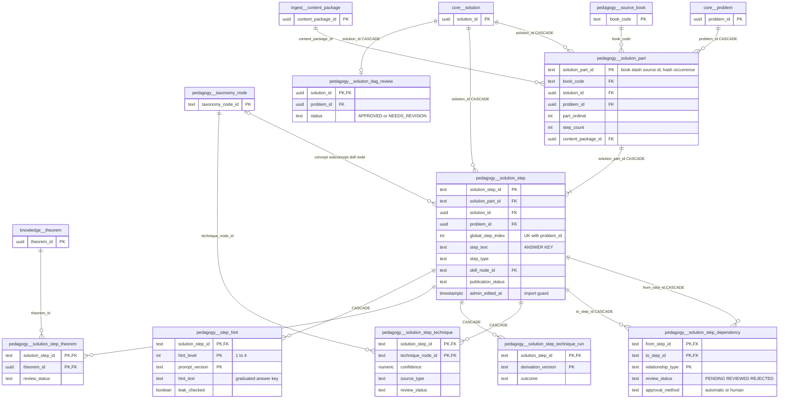

# `pedagogy` schema (part 2 of 5) — solution DAGs, hints, feedback and interventions

This part covers 13 `pedagogy` tables in four groups. **Solution DAG**: textbook solutions (today only the Prasolov plane-geometry package) are imported as parts (`solution_part`), atomic steps (`solution_step`) and typed step→step edges (`solution_step_dependency`). Each solution gets one semantic-DAG approval row (`solution_dag_review`). **Step annotations**: derived step→technique tags (`solution_step_technique`), their run log (`solution_step_technique_run`) and step→theorem citations (`solution_step_theorem`). **Progressive hints**: `step_hint` caches LLM-written hint levels 1–4 per step, shared by all learners. **Interaction feedback and interventions**: `feedback_template`, `feedback_policy` and `misconception_evidence_rule` from the interaction-template library, and the fixed misconception `intervention_script`/`intervention_step` that belong to a micro-course release. The step-solving runtime (`/v1/attempts/*`) is the main consumer. Several tables in this file hold **answer-key content**: step text, part text, dependency rationales and hints.

The `pedagogy` schema is documented across several files:

- [pedagogy-taxonomy-sources.md](pedagogy-taxonomy-sources.md): source books, taxonomy nodes and edges, source references, problem enrichment, learning items and diagrams.
- [pedagogy-routes-diagnosis.md](pedagogy-routes-diagnosis.md): precompiled tutoring routes, compile queue, gap diagnosis and recovery.
- [pedagogy-micro-courses.md](pedagogy-micro-courses.md): micro-course releases, states, bindings and transitions. Interventions are children of these releases.
- [pedagogy-video.md](pedagogy-video.md): curated video, transcripts, segments and timeline markers. Markers can point at an intervention.
- This file: solution DAGs, hints, feedback and interventions.

Source of truth: migrations [010](../../../mathbank-db/sql/010_textbook_import.sql), [013](../../../mathbank-db/sql/013_step_hints.sql), [017](../../../mathbank-db/sql/017_step_techniques.sql), [019](../../../mathbank-db/sql/019_admin_import_review.sql), [032](../../../mathbank-db/sql/032_micro_course_platform.sql), [033](../../../mathbank-db/sql/033_interaction_template_library.sql), [046](../../../mathbank-db/sql/046_theorem_catalog.sql). Catalog extracted 2026-11-01 from migrations 001–054; endpoint mapping traced from mathbank-rest source and manually verified.

## 1. Purpose, ownership and data flow

| Area | Tables | Writes owned by | Read by | Lifecycle | Privacy class |
|---|---|---|---|---|---|
| Solution DAG | `solution_part`, `solution_step`, `solution_step_dependency`, `solution_dag_review` | Batch import [import_textbook_package.py](../../../mathbank-db/etl/import_textbook_package.py) (stage "PARTS → STEPS → STEP DEPENDENCIES", L1001–1039). Admin review via `/v1/admin/imports/*` ([routers/admin_imports.py](../../../mathbank-rest/src/mathbank_rest/routers/admin_imports.py) → [db/import_admin.py](../../../mathbank-rest/src/mathbank_rest/db/import_admin.py)): step skill/checkpoint edits, edge create/retype/reject, DAG approve | Step runtime [step_runtime.py](../../../mathbank-rest/src/mathbank_rest/step_runtime.py), [step_tutor.py](../../../mathbank-rest/src/mathbank_rest/step_tutor.py), [step_diagnosis.py](../../../mathbank-rest/src/mathbank_rest/step_diagnosis.py), [step_recovery.py](../../../mathbank-rest/src/mathbank_rest/step_recovery.py), attempt-media grading ([routers/attempt_media.py](../../../mathbank-rest/src/mathbank_rest/routers/attempt_media.py) L540–575), admin textbook browser ([db/textbook_admin.py](../../../mathbank-rest/src/mathbank_rest/db/textbook_admin.py)), Neo4j projector [project_textbook_steps.py](../../../mathbank-graph/etl/project_textbook_steps.py) (metadata only, no step text), embedder [embed_textbook_steps.py](../../../mathbank-db/etl/embed_textbook_steps.py) | Re-import upserts are idempotent. A step with `admin_edited_at` is never overwritten. Edges with `approval_method='human'` are never overwritten. Nothing prunes removed rows. Admin edits emit `SOLUTION_STEP_CHANGED` on `pipeline.outbox_event`, which re-projects the graph and embeddings ([outbox_worker.py](../../../mathbank-rest/src/mathbank_rest/outbox_worker.py) L45) | **Answer key** (step/part text, logical dependencies). Shared, staff-curated corpus |
| Step annotations | `solution_step_technique`, `solution_step_technique_run`, `solution_step_theorem` | [derive_step_techniques.py](../../../mathbank-db/etl/derive_step_techniques.py) (rules; LLM only with `--llm`). **No writer** exists for `solution_step_theorem` | Search/topic practice ([db/queries.py](../../../mathbank-rest/src/mathbank_rest/db/queries.py), [db/topic_pedagogy.py](../../../mathbank-rest/src/mathbank_rest/db/topic_pedagogy.py), [db/step_search.py](../../../mathbank-rest/src/mathbank_rest/db/step_search.py), [db/retrieval_audit.py](../../../mathbank-rest/src/mathbank_rest/db/retrieval_audit.py)), diagnosis, textbook coverage, graph projection (`USES_TECHNIQUE`) | Rule rows are re-derived and pruned per book. `HUMAN` and `REJECTED` rows are kept | Shared metadata. `evidence` quotes step text |
| Hints | `step_hint` | [step_tutor.get_or_create_hint](../../../mathbank-rest/src/mathbank_rest/step_tutor.py) (L222–249), called from the learner hint routes in [routers/step_runtime.py](../../../mathbank-rest/src/mathbank_rest/routers/step_runtime.py) | Same function. Operator SQL in [04_solutions_steps.sql](../../../mathbank-data-ingestion/queries/04_solutions_steps.sql) | Write-once cache keyed by `(step, level, prompt_version)`. A new prompt version creates new rows | Graduated answer key (level 4 is "near explicit") |
| Feedback and evidence | `feedback_template`, `feedback_policy`, `misconception_evidence_rule` | **No application writer.** Only the test fixture in [test_interaction_templates.py](../../../mathbank-rest/tests/test_interaction_templates.py) inserts an evidence rule | [interaction_validators.py](../../../mathbank-rest/src/mathbank_rest/interaction_validators.py) (instance validate/approve), [interaction_template_projection.py](../../../mathbank-rest/src/mathbank_rest/interaction_template_projection.py) (Neo4j `FeedbackTemplate`/`FeedbackPolicy`/`EvidenceRule` nodes). [interaction_runtime.py](../../../mathbank-rest/src/mathbank_rest/interaction_runtime.py) `apply_evidence`/`select_feedback` read them, but **only tests call those functions** | Versioned `(key, version)` with `review_status`. No timestamps | Staff catalogue. `approved_content` is learner-facing text |
| Interventions | `intervention_script`, `intervention_step` | [micro_course_service.py](../../../mathbank-rest/src/mathbank_rest/micro_course_service.py) `create_intervention` / `add_intervention_step` (L2480–2570), **not exposed by any router or CLI**. `review_release` bulk-approves scripts | Release QA (`validate_release` L2733–2775, `_content_hash` L2961–2962), FKs from `pedagogy.video_timeline_marker`, `tutor.micro_course_runtime`, `misconception_evidence_rule` | Release-scoped. Triggers freeze both tables once the release is `PUBLISHED`/`SUPERSEDED`/`RETIRED`. `create_release` does not copy them into a new release | Staff authored; learner-facing once a runtime exists |

**Learner exposure of answer keys (guide §3 rule 4).** The step runtime handles this carefully:

- `get_runtime` ([step_runtime.py](../../../mathbank-rest/src/mathbank_rest/step_runtime.py) L285–305) returns `reference_text` (= `step_text`) only for steps in `DONE_STATES` (`SUCCESS_INDEPENDENT`, `SUCCESS_WITH_HELP`, `SKIPPED`). Future steps are `LOCKED` and opaque.
- Hint level 5 (`FULL_REVEAL`) returns `step_text` only after four escalations on the **current** step (`_require_current_step`).
- `leaks_solution` (7-word n-gram copy check) screens generated hints at levels 1–3 and evaluator feedback on failed steps.
- `/v1/solution-steps/{id}/practice`, the probes in `step_diagnosis` and the Neo4j projection return codes/metadata only.

Gaps:

- Level-4 hints are stored without a leak check, yet `step_hint.leak_checked` defaults to `true` (see §5.1 #1).
- `GET …/hints` can generate and insert hints (§4 finding 1).
- Recovery worked examples show another problem's `step_text`. That problem is excluded only if the learner has already attempted it ([step_recovery.py](../../../mathbank-rest/src/mathbank_rest/step_recovery.py) L235–252), so it can pre-reveal a future problem.
- The admin textbook detail (`GET /v1/admin/textbooks/problems/{code}`) returns full step text and learning-item answers. It is admin-key only, which is acceptable.

## 2. Entity diagram — as-is

Feedback, evidence and intervention tables (migrations 032/033):

```mermaid
erDiagram
    knowledge__misconception {
        uuid misconception_id PK
    }
    knowledge__skill {
        uuid skill_id PK
    }
    knowledge__technique {
        uuid technique_id PK
    }
    pedagogy__micro_course_release {
        uuid release_id PK
        text status
    }
    pedagogy__micro_course_state {
        uuid state_id PK
    }
    pedagogy__learning_item {
        text learning_item_id PK
    }
    visual__asset {
        uuid asset_id PK
    }
    activity__definition {
        uuid activity_id PK
    }
    visual__interaction_template_version {
        uuid interaction_template_version_id PK
    }
    visual__interaction_instance {
        uuid interaction_instance_id PK
        uuid feedback_policy_id FK
    }
    visual__icon_token {
        uuid icon_token_id PK
    }
    visual__animation_template {
        uuid animation_template_id PK
    }
    pedagogy__video_timeline_marker {
        uuid marker_id PK
        uuid intervention_id FK
    }
    tutor__micro_course_runtime {
        uuid enrollment_id PK
        uuid active_intervention_id FK
    }
    pedagogy__feedback_template {
        uuid feedback_template_id PK
        text feedback_key "UK with version"
        int version
        text feedback_type
        text approved_content
        text review_status
    }
    pedagogy__feedback_policy {
        uuid feedback_policy_id PK
        text policy_key "UK with version"
        int version
        jsonb policy_json "stages ladder"
        text review_status
    }
    pedagogy__misconception_evidence_rule {
        uuid evidence_rule_id PK
        uuid misconception_id FK
        uuid interaction_template_version_id FK
        text semantic_action
        text error_signature
        numeric evidence_weight "minus 1 to 1"
        uuid feedback_template_id FK
        uuid intervention_id FK
        text review_status
    }
    pedagogy__intervention_script {
        uuid intervention_id PK
        uuid release_id FK "UK with canonical_code"
        text canonical_code
        uuid target_misconception_id FK
        uuid target_skill_id FK
        uuid target_technique_id FK
        uuid entry_state_id FK
        text review_status
    }
    pedagogy__intervention_step {
        uuid intervention_step_id PK
        uuid intervention_id FK "UK with ordinal"
        int ordinal
        text step_type
        text prompt_text
    }
    visual__icon_token |o--o{ pedagogy__feedback_template : "icon_token_id"
    visual__animation_template |o--o{ pedagogy__feedback_template : "animation_template_id"
    pedagogy__feedback_policy |o--o{ visual__interaction_instance : "feedback_policy_id"
    knowledge__misconception ||--o{ pedagogy__misconception_evidence_rule : "misconception_id"
    visual__interaction_template_version |o--o{ pedagogy__misconception_evidence_rule : "template version"
    pedagogy__learning_item |o--o{ pedagogy__misconception_evidence_rule : "diagnostic item"
    pedagogy__feedback_template |o--o{ pedagogy__misconception_evidence_rule : "feedback_template_id"
    pedagogy__intervention_script |o--o{ pedagogy__misconception_evidence_rule : "intervention_id"
    pedagogy__micro_course_release ||--o{ pedagogy__intervention_script : "release_id CASCADE"
    knowledge__misconception |o--o{ pedagogy__intervention_script : "target"
    knowledge__skill |o--o{ pedagogy__intervention_script : "target"
    knowledge__technique |o--o{ pedagogy__intervention_script : "target"
    pedagogy__micro_course_state |o--o{ pedagogy__intervention_script : "entry_state_id"
    pedagogy__intervention_script ||--|{ pedagogy__intervention_step : "intervention_id CASCADE"
    visual__asset |o--o{ pedagogy__intervention_step : "asset_id"
    pedagogy__learning_item |o--o{ pedagogy__intervention_step : "learning_item_id"
    activity__definition |o--o{ pedagogy__intervention_step : "activity_id"
    pedagogy__intervention_script |o--o{ pedagogy__video_timeline_marker : "intervention_id"
    pedagogy__intervention_script |o--o{ tutor__micro_course_runtime : "active_intervention_id"
```

**Inbound FKs to `pedagogy.solution_step`.** These are not drawn above. All are NO ACTION unless noted:

- `learner.solve_attempt.current_solution_step_id`, and `current_solution_part_id` → `solution_part`.
- `learner.attempt_step_state.solution_step_id`.
- `learner.event.solution_step_id`.
- `tutor.runtime_state.current_step_id`.
- `pedagogy.gap_diagnosis.solution_step_id`.
- `pedagogy.knowledge_gap.solution_step_id` and `source_step_id`.
- `pedagogy.recovery_plan.origin_step_id`.
- `pedagogy.recovery_plan_item.worked_step_id`.
- `attempt_media.step_assessment.canonical_solution_step_id`.
- `pedagogy.learning_item_step_anchor.solution_step_id` (CASCADE).
- `search.chunk.solution_step_id` (CASCADE).

## 3. Tables

### 3.1 Solution DAG (imported corpus)

### `pedagogy.solution_part`

**Role.** One row is one labelled part of an imported textbook solution, for example "(a)" or "(b)". Parts let the runtime show "Part (b), step 2" and group the `solution_step` rows. The importer builds them from `pedagogy_v3/csv/solution_parts.csv`. If one solution reuses a part label, the repeated id is stored with an occurrence suffix (`#2`) and an `INFO` `REPEATED_PART_ID` conflict. Learners never receive `part_text_normalized`. They see only `part_label` through the runtime timeline.

**Table type (§4).** Catalogue entity, ETL-owned and read-only over REST.

**Lifecycle.** Created and updated only by `import_textbook_package.py`. The upsert is keyed on `solution_part_id`, sets `touch=True` (bumps `updated_at`) and updates label, ordinal, counts, page and text. Nothing deletes parts except a cascade from `core.solution` or `core.problem`. Such a cascade is blocked in practice whenever a learner row references one of the part's steps (NO ACTION FKs, §2).

**Columns**

| Column | Type | Null | Default | Meaning |
|---|---|---|---|---|
| `solution_part_id` | text | NO | — | Deterministic key `<book_code>/<source_part_id>`, plus `#<occurrence>` from the second occurrence on (`suffix()`, importer L100). |
| `source_part_id` | text | NO | — | Part id exactly as in the package CSV. |
| `occurrence` | integer | NO | `1` | 1-based occurrence of `source_part_id` within the book. Disambiguates repeated source ids. |
| `book_code` | text | NO | — | Source book → `pedagogy.source_book.book_code`, e.g. `PRASOLOV_PGV1`. |
| `solution_id` | uuid | NO | — | Canonical solution → `core.solution` (ON DELETE CASCADE). |
| `problem_id` | uuid | NO | — | Problem → `core.problem` (ON DELETE CASCADE). Denormalised from the solution. |
| `part_label` | text | YES | — | Display label of the part, e.g. `a`. NULL for single-part solutions. |
| `part_ordinal` | integer | NO | — | 1-based order of the part within its problem, assigned in CSV order. |
| `step_count` | integer | NO | — | Number of `solution_step` rows the importer attached to this part. |
| `source_step_count` | integer | YES | — | Step count declared in the package. A mismatch with `step_count` records an `INFO` `STEP_COUNT_MISMATCH` import conflict. |
| `source_page` | integer | YES | — | Page in the source book. |
| `part_text_normalized` | text | YES | — | Normalised full text of this part of the solution. **Answer key.** Not read by mathbank-rest today. |
| `content_package_id` | uuid | NO | — | Package that last wrote the row → `ingest.content_package`. |
| `updated_at` | timestamptz | NO | `now()` | Last importer upsert that changed the row. |

**Keys, constraints, indexes.**
- PK `solution_part_id`. UNIQUE `(book_code, source_part_id, occurrence)`.
- FKs: `book_code` → `source_book`; `solution_id` → `core.solution` CASCADE; `problem_id` → `core.problem` CASCADE; `content_package_id` → `ingest.content_package`.
- Index `solution_part_problem_idx (problem_id, part_ordinal)`.
- No CHECKs (for example, `part_ordinal >= 1` is not enforced). No triggers. Nothing guarantees that `problem_id` matches `solution_id`'s problem.

**REST operations today.**

| Op | Method & path | Auth | Handler | Notes |
|---|---|---|---|---|
| R | GET /v1/attempts/{attempt_id} · GET /v1/attempts/{attempt_id}/runtime | Learner JWT | `step_runtime.get_runtime` | `part_label` only. |
| R | POST /v1/students/{student_id}/problems/{problem_ref}/attempts | Learner JWT | `step_runtime.start_attempt` → `get_runtime` | |
| R | POST /v1/attempts/{attempt_id}/steps/{step_id}/responses · POST …/hint · GET …/hints | Learner JWT | `step_tutor.load_step_context` | `part_label` goes into the LLM prompt. |
| R | /v1/attempts/{attempt_id}/recovery-plans, /v1/recovery-plans/{plan_id}[/next, /items/{item_id}/responses], GET /v1/admin/recovery-plans/{plan_id} | Learner JWT / Admin key | `step_recovery.plan_view` | Origin step label. |
| R | POST /v1/geometry-scenes/interpret | staff or student | `routers/geometry_interpretation.interpret_scene` → `get_runtime` | |
| R | GET /v1/admin/textbooks/problems/{code} | Admin key (X-Admin-Api-Key) | `textbook_admin.problem_detail` (L369) | Parts with nested steps. |
| R | GET /v1/admin/textbooks/coverage · GET /v1/admin/imports/reconciliation | Admin key (X-Admin-Api-Key) | `textbook_admin.coverage` | Counts only. |

Non-REST writer: `import_textbook_package.py` (C/U). Non-REST readers: `project_textbook_steps.py` (`SolutionPart` nodes) and `RECONCILE_QUERIES` in the importer.

### `pedagogy.solution_step`

**Role.** One row is one atomic step of an imported solution. It is the unit that the step-by-step tutor presents, grades, hints and diagnoses. `step_text` is the reference ("canonical") step and is the answer key for that step. The row also carries the package's pedagogical tags: step type, tutor role, concept/subconcept/skill taxonomy nodes and a suggested hint level. The runtime (`_steps`, [step_runtime.py](../../../mathbank-rest/src/mathbank_rest/step_runtime.py) L167) loads only `publication_status='PUBLISHED'` steps, ordered by `global_step_index`.

**Table type (§4).** Catalogue entity, ETL-owned. Admins may edit `skill_node_id`/`is_checkpoint` through a PATCH.

**Lifecycle.** The importer upserts each row (`touch=True`) only while `admin_edited_at IS NULL`. After one admin edit, re-import no longer updates *any* column of that step, including `step_text`. `PATCH /v1/admin/imports/steps/{step_id}` sets `admin_edited_at`, writes `ingest.admin_review_action`, and emits `SOLUTION_STEP_CHANGED` to the outbox. No code ever sets `publication_status` to anything other than its default. The column is filtered on `'PUBLISHED'` everywhere ([attempt_media.py](../../../mathbank-rest/src/mathbank_rest/attempt_media.py) L391, `step_search`, `step_diagnosis`, `step_recovery`, `topic_pedagogy`). Do not confuse this table with `core.solution_step` (uuid PK, migration 001), which is a separate and older table.

**Columns**

| Column | Type | Null | Default | Meaning |
|---|---|---|---|---|
| `solution_step_id` | text | NO | — | Deterministic key `<book_code>/<source_step_id>`, plus `#<occurrence>` from the second occurrence on. Contains `/`, hence `{step_id:path}` in routes. |
| `source_step_id` | text | NO | — | Step id as in `solution_steps.csv`. The second dash-separated token is the source problem id. |
| `occurrence` | integer | NO | `1` | Occurrence of `source_step_id` within the book. When there are more step occurrences than part occurrences, the step is attached to the last part (with a warning). |
| `book_code` | text | NO | — | → `pedagogy.source_book`. |
| `solution_part_id` | text | NO | — | Owning part → `solution_part` (ON DELETE CASCADE). |
| `solution_id` | uuid | NO | — | → `core.solution` (CASCADE). Used by `load_step_context` to fetch earlier steps. |
| `problem_id` | uuid | NO | — | → `core.problem` (CASCADE). |
| `global_step_index` | integer | NO | — | Order of the step across the whole solution. Unique per problem. Drives runtime order. |
| `step_index_in_part` | integer | NO | — | Order within the part. Shown as "step n". |
| `step_text` | text | NO | — | Reference step text (Markdown/LaTeX). **Answer key.** Learners receive it only as `reference_text` after the step is done, or at hint level 5. It is sent to the LLM evaluator and hint writer as context. |
| `step_type` | text | NO | — | Package step category. The runtime maps `SETUP_OR_CONSTRUCTION`, `OBSERVATION`, `GEOMETRIC_RELATION`, `SIMILARITY_RELATION`, `ALGEBRAIC_OR_RATIO_RELATION`, `INFERENCE`, `JUSTIFICATION`, `CASE_OR_ASSUMPTION` and `CONCLUSION` to a learner-facing goal (`STEP_GOALS`, [step_tutor.py](../../../mathbank-rest/src/mathbank_rest/step_tutor.py) L38). Other values get a generic goal. No CHECK. |
| `tutor_role` | text | YES | — | Package tutor-role tag (free text). Passed to the LLM prompt and to the graph. |
| `concept_node_id` | text | YES | — | → `pedagogy.taxonomy_node` (CONCEPT). |
| `subconcept_node_id` | text | YES | — | → `taxonomy_node` (SUBCONCEPT). |
| `skill_node_id` | text | YES | — | → `taxonomy_node` (SKILL). Drives diagnosis, recovery, practice and worked-example lookup. Admin-editable. |
| `skill_name` | text | YES | — | Denormalised skill name, refreshed by the admin PATCH from `taxonomy_node.name`. |
| `hint_level` | smallint | YES | — | Package-suggested hint depth 1–4. Out-of-range values are dropped with a warning. Projected to the graph. Not used by the runtime help ladder (`learner.attempt_step_state.help_level_used`). |
| `is_checkpoint` | boolean | NO | `false` | Marks a key milestone step. Admin-editable. Recovery prefers checkpoint steps as worked examples. |
| `source_previous_step_id` | text | YES | — | Package "previous step" hint (source id, not an FK). Ignored for ordering. Dependencies come only from the dependency CSV. |
| `source_next_step_id` | text | YES | — | Package "next step" hint (source id, not an FK). |
| `source_page` | integer | YES | — | Source-book page. |
| `source_metadata` | jsonb | NO | `'{}'` | Import provenance `{"solution_part": <csv column>, "source_row": <csv row number>}`. |
| `publication_status` | text | NO | `'PUBLISHED'` | Visibility to runtime and search. Only `PUBLISHED` is ever used. No CHECK and no writer. |
| `content_package_id` | uuid | NO | — | → `ingest.content_package`. |
| `created_at` | timestamptz | NO | `now()` | Insert time. |
| `updated_at` | timestamptz | NO | `now()` | Last importer or admin change. |
| `admin_edited_at` | timestamptz | YES | — | Added by 019. Time of the last admin PATCH. When non-NULL the importer skips the row entirely. |

**Keys, constraints, indexes.**
- PK `solution_step_id`. UNIQUE `(problem_id, global_step_index)`. UNIQUE `(book_code, source_step_id, occurrence)`.
- FKs: `solution_part_id` → `solution_part` CASCADE; `solution_id`/`problem_id` → core CASCADE; three `taxonomy_node` FKs (NO ACTION); `book_code`; `content_package_id`.
- CHECK `hint_level BETWEEN 1 AND 4`.
- Indexes `solution_step_part_idx (solution_part_id, step_index_in_part)`, `solution_step_skill_idx (skill_node_id)`. No index on `solution_id`, although `load_step_context` filters `solution_id = :sol AND global_step_index < :i`.
- No triggers. Many inbound NO ACTION FKs from learner/runtime tables (§2).

**REST operations today.**

| Op | Method & path | Auth | Handler | Notes |
|---|---|---|---|---|
| R | POST /v1/students/{student_id}/problems/{problem_ref}/attempts; GET /v1/attempts/{attempt_id}[/runtime] | Learner JWT | `step_runtime.start_attempt` / `get_runtime` | Owner check. `reference_text` only for done steps. Locked steps are opaque. |
| R | POST /v1/attempts/{attempt_id}/steps/{step_id}/responses | Learner JWT | `routers/step_runtime` → `step_tutor.evaluate_step` | LLM grades against `step_text`. Feedback is sanitised with `leaks_solution`. |
| R | POST /v1/attempts/{attempt_id}/steps/{step_id}/hint | Learner JWT | `request_hint` → `get_or_create_hint` | Level 5 returns `step_text`. Current step only. |
| R | GET /v1/attempts/{attempt_id}/steps/{step_id}/hints | Learner JWT | `list_hints` | Levels already used. Includes `step_text` if level 5 was used. |
| R | POST /v1/attempts/{attempt_id}/steps/{step_id}/outcome | Admin key (X-Admin-Api-Key) | `record_step_outcome` | Internal evaluator path. |
| R | POST /v1/attempts/{attempt_id}/steps/{step_id}/diagnose | Learner JWT | `step_diagnosis` | Metadata only; `student_view` strips evidence. |
| R | recovery-plan routes (`/v1/attempts/{id}/recovery-plans`, `/v1/recovery-plans/{id}/*`) | Learner JWT | `step_recovery` | THEORY worked example shows another problem's `step_text` (§1). |
| R | GET /v1/solution-steps/{step_id}/practice; POST /v1/search/concepts; POST /v1/tutor/topic-practice; POST /v1/tutor/feedback; GET /v1/learner/practice-progress | Learner JWT / anonymous / optional learner | `step_search`, `topic_pedagogy`, `queries`, `retrieval_audit` | Ids, skills and counts. No step text. |
| R | POST /v1/attempt-media/submissions/{sid}/analyse · …/override | staff or student | inline SQL in [routers/attempt_media.py](../../../mathbank-rest/src/mathbank_rest/routers/attempt_media.py) L540–575, [attempt_media.py](../../../mathbank-rest/src/mathbank_rest/attempt_media.py) L391 | Canonical steps are sent to the grader. |
| R | POST /v1/geometry-scenes/interpret | staff or student | `get_runtime` | |
| R | GET /v1/admin/textbooks/problems, /problems/{code}, /taxonomy, /coverage; GET /v1/admin/imports/reconciliation | Admin key (X-Admin-Api-Key) | `textbook_admin` | `/problems/{code}` returns full `step_text`. |
| R | GET /v1/admin/imports/problems/{code}/dag | Admin key (X-Admin-Api-Key) | `import_admin.problem_dag` (L284) | `left(step_text, 400)`. |
| R,U | PATCH /v1/admin/imports/steps/{step_id} | Admin key (X-Admin-Api-Key) | `import_admin.edit_step` (L328) | `skill_node_id` (must be a SKILL node) and/or `is_checkpoint`. Sets `admin_edited_at`, writes audit and outbox. No `expected_revision`. |

Non-REST: `import_textbook_package.py` (C/U), `project_textbook_steps.py` and `embed_textbook_steps.py` (R), `derive_step_techniques.py` (R).

### `pedagogy.solution_step_dependency`

**Role.** One row is one typed edge between two steps of the same solution. `DEPENDS_ON` edges are the runtime prerequisites. A step becomes eligible once all its `DEPENDS_ON` predecessors are done, and diagnosis walks them to find upstream gaps. Other types (`NEXT`, `JUSTIFIES`, `ALTERNATIVE_TO`, …) are kept for review and for the graph. `logical_dependency` explains *why* the later step needs the earlier one. That explanation is part of the solution's reasoning and therefore answer-key content.

**Table type (§4).** Junction / link (step → step), with review status.

**Lifecycle.**
- **Import.** The importer reads `solution_step_dependencies.csv` and drops backward edges in cyclic problems (`_reject_cycles`). It upserts edges with `source_type='IMPORTED_PACKAGE'`, `review_status='REVIEWED'` and `approval_method='automatic'`. Rows with `approval_method='human'` are never updated.
- **Admin `PUT /dependencies`.** Creates an edge or changes its type (delete plus insert). It rejects a `DEPENDS_ON` edge that would close a cycle (409) and edges that cross problems (422). Rows it writes get `source_type='ADMIN_REVIEWED'`, `review_status='REVIEWED'` and `approval_method='human'`.
- **Admin `POST /dependencies/reject`.** Sets `REJECTED` plus `human`.
- **Who honours `REJECTED`.** The runtime and diagnosis ignore `REJECTED` edges (`review_status <> 'REJECTED'`, so `PENDING` edges count). Attempt-media grading uses only `REVIEWED`. The graph projector prunes `REJECTED` edges.

**Columns**

| Column | Type | Null | Default | Meaning |
|---|---|---|---|---|
| `from_step_id` | text | NO | — | Earlier/prerequisite step → `solution_step` (CASCADE). |
| `to_step_id` | text | NO | — | Dependent step → `solution_step` (CASCADE). |
| `relationship_type` | text | NO | — | Edge type. The column comment (019) and the admin API list `NEXT`, `DEPENDS_ON`, `DERIVES_FROM`, `USES_RESULT_FROM`, `ALTERNATIVE_TO`, `BRANCHES_TO`, `JOINS_AT`, `JUSTIFIES`. The importer accepts `NEXT`, `DEPENDS_ON`, `USES_RESULT`, `JUSTIFIES`, `ALTERNATIVE_TO`, `CHECKS` and stores any other value with only a warning. No CHECK. |
| `logical_dependency` | text | YES | — | Free-text rationale (package or admin, ≤2000 chars over the API). **Answer-key content.** |
| `confidence` | numeric | YES | — | Package confidence 0–1. NULL for admin edges. |
| `source_type` | text | NO | — | Provenance. Values in use: `IMPORTED_PACKAGE`, `ADMIN_REVIEWED`. No CHECK. |
| `review_status` | text | NO | `'REVIEWED'` | `PENDING`, `REVIEWED`, `REJECTED` (CHECK). Note that this vocabulary differs from `PENDING_REVIEW/APPROVED` used elsewhere in the schema. |
| `approval_method` | text | YES | — | `automatic` (importer) or `human` (admin; protects the row from re-import). No CHECK. |
| `metadata` | jsonb | NO | `'{}'` | Admin edges: `{"previous_type": <old type or null>}`. Importer rows: `{}`. |
| `content_package_id` | uuid | YES | — | Package of the dependent step. The admin path copies it from `to_step`. The graph projector selects edges by this column, so an edge with NULL here would never be projected. |

**Keys, constraints, indexes.**
- PK `(from_step_id, to_step_id, relationship_type)`.
- CHECK `from_step_id <> to_step_id`, CHECK `confidence` NULL or 0–1, CHECK `review_status`.
- Index `solution_step_dependency_to_idx (to_step_id)`. The `from_step_id` direction is covered by the PK.
- Same-problem membership and acyclicity are enforced only in Python (`upsert_dependency`, `_would_cycle`, importer `_reject_cycles`).

**REST operations today.**

| Op | Method & path | Auth | Handler | Notes |
|---|---|---|---|---|
| R | Learner step-runtime routes (start, runtime, responses, hints, diagnose, outcome) | Learner JWT / Admin key | `step_runtime._steps`, `step_diagnosis` | Edge types and ids only. |
| R | POST /v1/attempt-media/submissions/{sid}/analyse | staff or student | inline router SQL | Sends `logical_dependency` to the grader, not to the client. |
| R | POST /v1/geometry-scenes/interpret | staff or student | `get_runtime` | |
| R | GET /v1/admin/imports/problems/{code}/dag; GET /v1/admin/textbooks/problems/{code}; GET /v1/admin/textbooks/coverage; GET /v1/admin/imports/reconciliation | Admin key (X-Admin-Api-Key) | `import_admin.problem_dag`, `textbook_admin` | |
| C,U,D | PUT /v1/admin/imports/dependencies | Admin key (X-Admin-Api-Key) | `import_admin.upsert_dependency` (L366) | Create, or change type (DELETE old plus INSERT). Cycle check gives 409. Audit plus outbox. |
| U | POST /v1/admin/imports/dependencies/reject | Admin key (X-Admin-Api-Key) | `import_admin.reject_dependency` (L413) | Soft reject. There is no un-reject; re-`PUT` the same type to restore. |

Non-REST: importer (C/U), `project_textbook_steps.py` (R).

### `pedagogy.solution_dag_review`

**Role.** One row per canonical solution records an admin's verdict on that solution's semantic step DAG (spec 15 §7 "approve semantic DAG"). It is a review marker only. **No runtime, projector or search query reads it** apart from the admin DAG view itself, so `NEEDS_REVISION` does not hide a solution from learners.

**Table type (§4).** Revisioned authoring object (approval state). The decision history lives in `ingest.admin_review_action` (`target_type='SOLUTION_DAG'`).

**Lifecycle.** `POST /v1/admin/imports/problems/{code}/dag/review` upserts the row. On conflict it overwrites `status`/`note`, resets `reviewed_at` and forces `reviewed_by='admin'`. Deleted by cascade with the solution or problem.

**Columns**

| Column | Type | Null | Default | Meaning |
|---|---|---|---|---|
| `solution_id` | uuid | NO | — | Reviewed solution → `core.solution` (CASCADE). Also the PK. The admin route resolves it from the problem's first imported step. |
| `problem_id` | uuid | NO | — | → `core.problem` (CASCADE). Denormalised. |
| `status` | text | NO | — | `APPROVED` or `NEEDS_REVISION` (CHECK). |
| `note` | text | YES | — | Reviewer note (≤2000 chars over the API). |
| `reviewed_by` | text | NO | `'admin'` | Always the literal `admin`, because the admin key carries no user identity. |
| `reviewed_at` | timestamptz | NO | `now()` | Time of the last decision. |

**Keys, constraints, indexes.** PK `solution_id`. FKs to `core.solution` and `core.problem` (CASCADE). CHECK on `status`. No other index; there is no lookup by `problem_id`.

**REST operations today.**

| Op | Method & path | Auth | Handler | Notes |
|---|---|---|---|---|
| R | GET /v1/admin/imports/problems/{code}/dag | Admin key (X-Admin-Api-Key) | `import_admin.problem_dag` | `review` object. |
| C,U | POST /v1/admin/imports/problems/{code}/dag/review | Admin key (X-Admin-Api-Key) | `import_admin.review_dag` (L434) | Upsert plus audit row. Returns 422 if the problem has no imported steps. |

Non-REST: operator SQL in [04_solutions_steps.sql](../../../mathbank-data-ingestion/queries/04_solutions_steps.sql) (R).

### 3.2 Step annotations and hints

### `pedagogy.solution_step_technique`

**Role.** One row asserts that a solution step uses a technique (taxonomy node of type `TECHNIQUE`). The Prasolov package tags techniques only per problem (`pedagogy.problem_enrichment.technique_ids`), so these step-level tags are *derived* by [derive_step_techniques.py](../../../mathbank-db/etl/derive_step_techniques.py). Readers use only `review_status='APPROVED'` rows:

- topic and technique search (`technique_problem_evidence_sql`, step support for `knowledge.problem_technique`);
- topic practice and "similar steps";
- the diagnosis evidence `step_techniques`;
- textbook coverage counts;
- the graph edge `(SolutionStep)-[:USES_TECHNIQUE]->(Technique)`, bridged through `taxonomy_node.technique_id`.

**Table type (§4).** Junction / link with provenance and review status.

**Lifecycle.** Each ETL run, per book:

1. Upserts rule rows, auto-approved (`review_status='APPROVED'`, `approval_method='automatic'`, `approved_at=now()`). An existing row is updated only if it is not `HUMAN`, not `REJECTED`, and not an `LLM` row being replaced by another `LLM` row.
2. Deletes stale `RULE_%` rows that are not `REJECTED` (L214).
3. With `--llm --max-calls N`, calls a paid LLM for untagged steps.

No REST endpoint writes this table, so there is no way to set `HUMAN` or `REJECTED` today except manual SQL.

**Columns**

| Column | Type | Null | Default | Meaning |
|---|---|---|---|---|
| `solution_step_id` | text | NO | — | → `solution_step` (CASCADE). |
| `technique_node_id` | text | NO | — | → `pedagogy.taxonomy_node`. Should be a `TECHNIQUE` node, but this is not enforced (the projector joins on `node_type='TECHNIQUE'`). |
| `confidence` | numeric(3,2) | NO | — | 0–1. Rule constants: in-problem 0.85, named 0.80, formula 0.90/0.70, LLM closed list 0.70, LLM open 0.60. |
| `source_type` | text | NO | — | `RULE_STEP_TEXT_IN_PROBLEM`, `RULE_STEP_TEXT_NAMED`, `RULE_STEP_FORMULA`, `LLM`, `RUNTIME` (planned), `HUMAN` (CHECK). |
| `evidence` | text | YES | — | Matched phrase from the step text, or the model rationale. Contains no student data, but **quotes the answer key**. |
| `derivation_version` | text | NO | — | e.g. `rules-v1` or `llm-v1:<model>`. |
| `review_status` | text | NO | `'APPROVED'` | `PENDING_REVIEW`, `APPROVED`, `REJECTED` (CHECK). |
| `approval_method` | text | YES | — | `automatic` or `human` (CHECK). |
| `approved_at` | timestamptz | YES | — | Approval time. The ETL sets it on insert only. |
| `created_at` | timestamptz | NO | `now()` | Insert time. |
| `updated_at` | timestamptz | NO | `now()` | Bumped by the ETL upsert. |

**Keys, constraints, indexes.** PK `(solution_step_id, technique_node_id)`. FKs to `solution_step` (CASCADE) and `taxonomy_node`. CHECKs on `confidence`, `source_type`, `review_status` and `approval_method`. Partial index `solution_step_technique_technique_idx (technique_node_id) WHERE review_status='APPROVED'`.

**REST operations today.**

| Op | Method & path | Auth | Handler | Notes |
|---|---|---|---|---|
| R | POST /v1/search/concepts; POST /v1/tutor/topic-practice; POST /v1/tutor/feedback; GET /v1/learner/practice-progress; GET /v1/solution-steps/{step_id}/practice | anonymous / optional learner / Learner JWT | `db/queries`, `db/topic_pedagogy`, `db/step_search`, `db/retrieval_audit` | Confidence and ids only. `evidence` is never returned. |
| R | POST /v1/attempts/{attempt_id}/steps/{step_id}/responses · …/diagnose · …/outcome | Learner JWT / Admin key | `step_diagnosis` (L261) | Technique names and confidence in the diagnosis input. |
| R | GET /v1/admin/textbooks/coverage; GET /v1/admin/imports/reconciliation | Admin key (X-Admin-Api-Key) | `textbook_admin.coverage` | Count of approved rows. |

Non-REST: `derive_step_techniques.py` (C/R/U/D), `embed_textbook_steps.py` and `project_textbook_steps.py` (R).

### `pedagogy.solution_step_technique_run`

**Role.** One row per (step, derivation version) records that the technique derivation examined the step and what happened. Untagged steps are therefore visible, so coverage and the LLM backlog can be measured without re-running the rules. `derive_step_techniques.py --status` reports its outcome counts. `--llm` uses it to pick steps that have neither a tag nor an LLM run.

**Table type (§4).** Queue / job / run (derivation run log).

**Lifecycle.** The ETL upserts it (updating `outcome`, `candidate_ids` and `created_at` when they change). Removed by cascade with the step. No REST access.

**Columns**

| Column | Type | Null | Default | Meaning |
|---|---|---|---|---|
| `solution_step_id` | text | NO | — | → `solution_step` (CASCADE). |
| `derivation_version` | text | NO | — | Same values as `solution_step_technique.derivation_version`. |
| `outcome` | text | NO | — | `TAGGED`, `NO_MATCH` (rules found nothing), `NO_PROBLEM_TECHNIQUE` (the problem lists no technique to confirm) (CHECK). |
| `candidate_ids` | text[] | NO | `'{}'` | Technique node ids that were candidates for the step. |
| `created_at` | timestamptz | NO | `now()` | Time of the last run that changed the row. It is overwritten, so it is not the first-run time. |

**Keys, constraints, indexes.** PK `(solution_step_id, derivation_version)`. FK to `solution_step` (CASCADE). CHECK on `outcome`.

**REST operations today.** None. Written and read only by [derive_step_techniques.py](../../../mathbank-db/etl/derive_step_techniques.py) (L168, L240, L293).

### `pedagogy.solution_step_theorem`

**Role.** An optional direct citation from a step to a theorem in `knowledge.theorem` (migration 046 §4.6). It is meant for steps that need a more specific citation than their technique tag provides. **Nothing in the repository reads or writes it**, so the table is empty by design until a citation pipeline exists.

**Table type (§4).** Junction / link with review status.

**Lifecycle.** None implemented. `review_status` defaults to `PENDING_REVIEW`, unlike `solution_step_technique`, which defaults to `APPROVED`.

**Columns**

| Column | Type | Null | Default | Meaning |
|---|---|---|---|---|
| `solution_step_id` | text | NO | — | → `solution_step` (CASCADE). |
| `theorem_id` | uuid | NO | — | → `knowledge.theorem` (NO ACTION). |
| `confidence` | numeric(3,2) | NO | — | 0–1. |
| `source_type` | text | NO | — | `LLM`, `RUNTIME`, `HUMAN` (CHECK). |
| `evidence` | text | YES | — | Rationale or matched phrase. Would quote step text. |
| `review_status` | text | NO | `'PENDING_REVIEW'` | `PENDING_REVIEW`, `APPROVED`, `REJECTED` (CHECK). |

**Keys, constraints, indexes.** PK `(solution_step_id, theorem_id)`. FKs as above. No index on `theorem_id` for the reverse lookup "steps citing a theorem". No timestamps and no `approval_method`.

**REST operations today.** None, and no non-REST reader or writer either.

### `pedagogy.step_hint`

**Role.** A shared cache of progressive hints for one solution step. The runtime help ladder ([step_runtime.py](../../../mathbank-rest/src/mathbank_rest/step_runtime.py) `HELP_LEVELS`) has five levels:

| Level | Kind | Source |
|---|---|---|
| 1 | Directional prompt | `step_hint` |
| 2 | Concept reminder | `step_hint` |
| 3 | Strategic hint | `step_hint` |
| 4 | Near-explicit step | `step_hint` |
| 5 | Full reveal | `solution_step.step_text`; never stored here |

Levels 1–4 are written once per `(step, level, prompt_version)` by `get_or_create_hint` using `STEP_TUTOR_MODEL` (default `gpt-4.1-mini`). Every learner then reuses that row, so the paid call happens at most once per hint.

The leak check works as follows. Levels 1–3 are tested with `leaks_solution`: no 7-word run of `step_text` that the learner has not already seen. A leaking hint is regenerated once with stricter wording, then replaced by a `FALLBACK_HINTS` template. **Level 4 is not leak-checked.** An empty LLM answer also falls back to a template.

**Table type (§4).** Derived / cache.

**Lifecycle.**
- **Insert.** `INSERT … ON CONFLICT DO NOTHING`, from POST `…/hint` and, as a side effect, from GET `…/hints`.
- **Never updated.** A re-imported `step_text` does not invalidate hints, so cached hints can describe an older version of the step. Bumping `HINT_PROMPT_VERSION` (`step-hint-v1` today) is the only invalidation.
- **Delete.** Removed by cascade with the step.

**Columns**

| Column | Type | Null | Default | Meaning |
|---|---|---|---|---|
| `solution_step_id` | text | NO | — | → `solution_step` (CASCADE). |
| `hint_level` | integer | NO | — | 1–4 (CHECK). See the ladder above. |
| `prompt_version` | text | NO | — | Hint prompt version (`HINT_PROMPT_VERSION`, currently `step-hint-v1`). |
| `hint_text` | text | NO | — | Hint shown to the learner (≤45 words, `$…$` math). Graduated answer-key content. CHECK non-empty. |
| `model` | text | NO | — | Generating model, or `fallback-template` when a template was used. This is the only way to tell generated hints from fallback ones. |
| `leak_checked` | boolean | NO | `true` | Intended to mean "passed the leak check". The application never sets it, so every row, including level-4 and fallback rows, reads `true`. |
| `created_at` | timestamptz | NO | `now()` | Generation time. |

**Keys, constraints, indexes.** PK `(solution_step_id, hint_level, prompt_version)`, which also serves the lookups. FK to `solution_step` (CASCADE). CHECKs on `hint_level` and `hint_text`.

**REST operations today.**

| Op | Method & path | Auth | Handler | Notes |
|---|---|---|---|---|
| C,R | POST /v1/attempts/{attempt_id}/steps/{step_id}/hint | Learner JWT | `routers/step_runtime.request_hint` → `step_runtime.request_hint` (owner, state version, current step) then `_hint_text` → `step_tutor.get_or_create_hint` | The help-level bump commits first. Hint generation runs in a second transaction, and an LLM call can happen inside the request. |
| C,R | GET /v1/attempts/{attempt_id}/steps/{step_id}/hints | Learner JWT | `routers/step_runtime.list_hints` → `_hint_text` per used level | **GET with side effects**: a missing cache row (e.g. after a `prompt_version` bump) triggers an LLM call and an INSERT. |

Agent path: `mathbank-agent` `request_step_hint` ([step_runtime_tools.py](../../../mathbank-agent/agents/mathbank_tutor/tools/step_runtime_tools.py) L216) calls the POST route on the learner's behalf. Non-REST reader: [04_solutions_steps.sql](../../../mathbank-data-ingestion/queries/04_solutions_steps.sql) (hint coverage per prompt version and model).

### 3.3 Interaction feedback, misconception evidence and interventions

### `pedagogy.feedback_template`

**Role.** A versioned, reviewed piece of approved feedback content for the interaction-template library (requirements [41](../../requirements/41_INTERACTION_TEMPLATE_LIBRARY.md) ITL-8). Examples are a "try again" nudge, a misconception probe and a transfer-success message. It can carry an icon and an animation. `allowed_agent_rephrase` says whether a tutor agent may paraphrase `approved_content` or must show it verbatim.

Evidence rules point at a template, and so, by JSON id, do feedback-policy stages. The graph projector creates `FeedbackTemplate` nodes and `EvidenceRule-[:USES_FEEDBACK]->FeedbackTemplate` edges for `APPROVED` rows. **No code ever inserts a row and no runtime serves `approved_content`.**

**Table type (§4).** Catalogue entity (versioned).

**Lifecycle.** Intended: a new `(feedback_key, version)` per content change, reviewed `PENDING_REVIEW → APPROVED/REJECTED`. Implemented: none. There are no timestamps or reviewer columns.

**Columns**

| Column | Type | Null | Default | Meaning |
|---|---|---|---|---|
| `feedback_template_id` | uuid | NO | `gen_random_uuid()` | Identity. |
| `feedback_key` | text | NO | — | Stable natural key shared by all versions. |
| `version` | integer | NO | — | ≥1 (CHECK). |
| `feedback_type` | text | NO | — | `CORRECT`, `PARTIAL`, `TRY_AGAIN`, `PROCEDURAL_ERROR`, `CONCEPTUAL_ERROR`, `MISCONCEPTION_PROBE`, `MISCONCEPTION_CONFIRMED`, `PREREQUISITE_GAP`, `TRANSFER_SUCCESS`, `OUT_OF_SCOPE` (CHECK). |
| `approved_content` | text | NO | — | Learner-facing feedback text. Once served, it must not reveal the item's answer before submission (guide §3 rule 4), but no validator checks this. |
| `icon_token_id` | uuid | YES | — | → `visual.icon_token`. |
| `animation_template_id` | uuid | YES | — | → `visual.animation_template`. |
| `allowed_agent_rephrase` | boolean | NO | `false` | `true` lets the agent paraphrase the content; `false` means verbatim. |
| `review_status` | text | NO | `'PENDING_REVIEW'` | `PENDING_REVIEW`, `APPROVED`, `REJECTED` (CHECK). Only `APPROVED` rows are projected. |

**Keys, constraints, indexes.** PK `feedback_template_id`. UNIQUE `(feedback_key, version)`. FKs to `visual.icon_token` and `visual.animation_template`. CHECKs on `version`, `feedback_type` and `review_status`. Inbound: `misconception_evidence_rule.feedback_template_id`.

**REST operations today.**

| Op | Method & path | Auth | Handler | Notes |
|---|---|---|---|---|
| R | POST /v1/admin/interaction-templates/graph/rebuild · GET …/graph/verify | Admin key (X-Admin-Api-Key) | `interaction_template_projection.metadata` (L152–175) via `project` / `verify` | `APPROVED` rows become `FeedbackTemplate` nodes. |

No create, read-by-id, update or delete endpoint exists.

### `pedagogy.feedback_policy`

**Role.** A versioned feedback "ladder" that an interaction instance attaches through `visual.interaction_instance.feedback_policy_id`. It decides which feedback to give as attempts accumulate. Requirements 41 define the staged ladder: neutral clue → focused clue → diagnostic probe → intervention at confidence ≥ threshold → retry original. `interaction_runtime.select_feedback` reads `policy_json['stages'][attempt_number-1]` and returns its `feedback` value as a `feedback_template_id`. Instance validation and approval require an attached policy to be `APPROVED`.

**Table type (§4).** Catalogue entity (versioned).

**Lifecycle.** Same as `feedback_template`: no writer and no timestamps. `select_feedback` does not filter on `review_status`; only validation does.

**Columns**

| Column | Type | Null | Default | Meaning |
|---|---|---|---|---|
| `feedback_policy_id` | uuid | NO | `gen_random_uuid()` | Identity. |
| `policy_key` | text | NO | — | Natural key shared by all versions. |
| `version` | integer | NO | — | ≥1 (CHECK). |
| `policy_json` | jsonb | NO | — | Ladder definition. Shape consumed by code: `{"stages": [{"feedback": "<feedback_template_id>", …}, …]}`, one stage per attempt number. Requirements 41 refer to `schemas/feedback_policy.schema.json`; the database does not validate it, and stage template ids are not FKs. |
| `review_status` | text | NO | `'PENDING_REVIEW'` | `PENDING_REVIEW`, `APPROVED`, `REJECTED` (CHECK). |

**Keys, constraints, indexes.** PK `feedback_policy_id`. UNIQUE `(policy_key, version)`. CHECKs on `version` and `review_status`. Inbound: `visual.interaction_instance.feedback_policy_id` (NO ACTION).

**REST operations today.**

| Op | Method & path | Auth | Handler | Notes |
|---|---|---|---|---|
| R | POST /v1/admin/interaction-templates/instances/{instance_id}/validate · …/approve | Admin key (X-Admin-Api-Key) | `interaction_validators.validate_interaction_instance` (L77–85) | Error "attached feedback_policy is not APPROVED". |
| R | POST /v1/admin/interaction-templates/graph/rebuild · GET …/graph/verify | Admin key (X-Admin-Api-Key) | `interaction_template_projection` (L176–195) | `FeedbackPolicy` nodes; `InteractionInstance-[:USES_FEEDBACK_POLICY]->FeedbackPolicy` edges. |

`interaction_runtime.select_feedback` (L161) reads `policy_json`, but no route calls it.

### `pedagogy.misconception_evidence_rule`

**Role.** Maps a deterministic interaction error to evidence for a misconception (ITL-9). The match key is the interaction template version, the `semantic_action` and the evaluator's `error_signature`. `apply_evidence` ([interaction_runtime.py](../../../mathbank-rest/src/mathbank_rest/interaction_runtime.py) L82) works as follows:

1. Find the `APPROVED` rule for that key (`LIMIT 1`, no ORDER BY).
2. Add its `evidence_weight` to the learner's running confidence and append a `learner.misconception_evidence` row.
3. Report `confirmed` once confidence reaches `CONFIRMATION_THRESHOLD = 0.80`, so one wrong answer normally does not confirm.
4. Return the rule's probe item, feedback template and intervention.

Instance validation also uses the table: every `CAN_REVEAL` misconception binding of an instance needs an approved rule for the bound template version.

**Table type (§4).** Catalogue entity.

**Lifecycle.** No application writer (test fixture only). `interaction_validators.validate_evidence_rule` checks that the weight is in range and that `requires_probe` implies a diagnostic item, but **nothing calls it**.

**Columns**

| Column | Type | Null | Default | Meaning |
|---|---|---|---|---|
| `evidence_rule_id` | uuid | NO | `gen_random_uuid()` | Identity. |
| `misconception_id` | uuid | NO | — | Misconception the evidence is for → `knowledge.misconception`. |
| `interaction_template_version_id` | uuid | YES | — | Template version whose evaluator emits the signature → `visual.interaction_template_version`. NULL would never match `apply_evidence`. |
| `semantic_action` | text | NO | — | Semantic learner action, e.g. `SUBMIT_ROW` in the Markov test. |
| `error_signature` | text | NO | — | Evaluator error code, e.g. `ROW_SUM_INVALID` or `NEGATIVE_PROBABILITY`. |
| `predicate_json` | jsonb | NO | — | Extra match predicate. Not evaluated by any code yet (fixture uses `{}`). |
| `evidence_weight` | numeric(5,4) | NO | — | Confidence delta, −1 to 1 (CHECK). Negative weights are counter-evidence. |
| `severity` | smallint | YES | — | 1–5 (CHECK). Not read by code. |
| `requires_probe` | boolean | NO | `false` | `true` means a diagnostic probe (`diagnostic_learning_item_id`) should run before confirming. |
| `diagnostic_learning_item_id` | text | YES | — | Probe item → `pedagogy.learning_item`. |
| `feedback_template_id` | uuid | YES | — | Feedback to show → `feedback_template`. |
| `intervention_id` | uuid | YES | — | Fixed remediation to launch on confirmation → `intervention_script`. Because scripts are release-scoped, a global rule pins one specific micro-course release. |
| `review_status` | text | NO | `'PENDING_REVIEW'` | `PENDING_REVIEW`, `APPROVED`, `REJECTED` (CHECK). |

**Keys, constraints, indexes.**
- PK `evidence_rule_id`. FKs as listed (all NO ACTION). CHECKs on `evidence_weight`, `severity` and `review_status`.
- Indexes `evidence_rule_misconception_idx (misconception_id)` and `evidence_rule_signature_idx (interaction_template_version_id, error_signature)`.
- No uniqueness on the match key `(interaction_template_version_id, semantic_action, error_signature)`.
- Table comment: "Maps a template error_signature to misconception evidence weight/probe/feedback/intervention (ITL-9)."

**REST operations today.**

| Op | Method & path | Auth | Handler | Notes |
|---|---|---|---|---|
| R | POST /v1/admin/interaction-templates/instances/{instance_id}/validate · …/approve | Admin key (X-Admin-Api-Key) | `validate_interaction_instance` (L95–112) | Coverage check for `CAN_REVEAL` bindings. |
| R | POST /v1/admin/interaction-templates/graph/rebuild · GET …/graph/verify | Admin key (X-Admin-Api-Key) | `interaction_template_projection` (L293–346) | `EvidenceRule` nodes with `APPLIES_TO`, `EVIDENCE_FOR`, `USES_DIAGNOSTIC` and `USES_FEEDBACK` edges. |

The learner runtime path (`apply_evidence`) is not wired to any route.

### `pedagogy.intervention_script`

**Role.** A fixed, staff-authored remediation script inside one micro-course release (requirements [40](../../requirements/40_MICRO_COURSE_PLATFORM.md)). It targets exactly one misconception, skill or technique (enforced in Python) and enters at a state of the same release. The runtime is meant to follow its steps deterministically instead of improvising. Other tables point at it: video timeline markers of type `INTERVENTION`, `tutor.micro_course_runtime.active_intervention_id` and evidence rules. No runtime code launches or advances an intervention yet.

**Table type (§4).** Release / snapshot child: mutable while the release is `DRAFT`/`REVIEWED`, immutable afterwards.

**Lifecycle.**
- `create_intervention` (service only) inserts it as `PENDING_REVIEW`. It requires an editable release and a canonical target of type `MISCONCEPTION`/`SKILL`/`TECHNIQUE`, and checks that the entry state belongs to the release.
- `POST /admin/micro-courses/releases/{id}/review` with `APPROVED` runs `validate_release`, then bulk-sets all `PENDING_REVIEW` scripts to `APPROVED`.
- `validate_release` requires, per script: `APPROVED` (at publish), an `APPROVED` target misconception, an entry state in the release, and a last step of type `RETURN`.
- `_content_hash` includes scripts and steps in the release hash.
- Trigger `intervention_script_guard` (`guard_published_release_child`) blocks INSERT/UPDATE/DELETE once the release is `PUBLISHED`/`SUPERSEDED`/`RETIRED`, unless `pedagogy.allow_purge='on'`.
- `create_release` does not copy scripts into a new release, and no route can author them.

**Columns**

| Column | Type | Null | Default | Meaning |
|---|---|---|---|---|
| `intervention_id` | uuid | NO | `gen_random_uuid()` | Identity. |
| `release_id` | uuid | NO | — | Owning release → `pedagogy.micro_course_release` (ON DELETE CASCADE). |
| `canonical_code` | text | NO | — | Code unique within the release. Validation looks steps up by it. |
| `name` | text | NO | — | Staff-facing name. |
| `target_misconception_id` | uuid | YES | — | → `knowledge.misconception`. Set when the target type is `MISCONCEPTION`. |
| `target_skill_id` | uuid | YES | — | → `knowledge.skill`. Set when the target type is `SKILL`. |
| `target_technique_id` | uuid | YES | — | → `knowledge.technique`. Set when the target type is `TECHNIQUE`. |
| `entry_state_id` | uuid | YES | — | State at which the script starts → `pedagogy.micro_course_state`. Must belong to the same release (checked in Python only). |
| `review_status` | text | NO | `'PENDING_REVIEW'` | `PENDING_REVIEW`, `APPROVED`, `REJECTED` (CHECK). |

**Keys, constraints, indexes.**
- PK `intervention_id`. UNIQUE `(release_id, canonical_code)`.
- FKs as listed (only `release_id` cascades).
- No CHECK that exactly one target is set. No indexes on the target columns.
- Trigger `intervention_script_guard` BEFORE INSERT/UPDATE/DELETE.

**REST operations today.**

| Op | Method & path | Auth | Handler | Notes |
|---|---|---|---|---|
| R | POST /v1/admin/micro-courses/releases/{release_id}/validate | Admin key (X-Admin-Api-Key) | `micro_course_service.validate_release` (L2572) | |
| R,U | POST /v1/admin/micro-courses/releases/{release_id}/review | Admin key (X-Admin-Api-Key) | `review_release` (L2849) | `APPROVED` bulk-approves `PENDING_REVIEW` scripts after validation. |
| R | POST /v1/admin/micro-courses/releases/{release_id}/publish | Admin key (X-Admin-Api-Key) | `publish_release` → `validate_release`, `_content_hash` | |

No create, list, get, update or delete endpoint exists. The service functions `create_intervention`/`add_intervention_step` have no caller.

### `pedagogy.intervention_step`

**Role.** One ordered step of an intervention script. A step can ask a question, explain something, show an asset, present a learning item or activity, wait for a response, or `RETURN` to the course. The final step must be `RETURN` (release validation).

**Table type (§4).** Release / snapshot child (via its script).

**Lifecycle.** `add_intervention_step` (service only) checks that the release is editable and that the script belongs to it, upper-cases `step_type` and inserts the row. Trigger `intervention_step_guard` (`guard_published_intervention_child`) freezes steps once the script's release is published, superseded or retired. Removed by cascade with the script.

**Columns**

| Column | Type | Null | Default | Meaning |
|---|---|---|---|---|
| `intervention_step_id` | uuid | NO | `gen_random_uuid()` | Identity. |
| `intervention_id` | uuid | NO | — | → `intervention_script` (CASCADE). |
| `ordinal` | integer | NO | — | ≥0 (CHECK), unique per script. Execution order. |
| `step_type` | text | NO | — | `ASK`, `EXPLAIN`, `SHOW_ASSET`, `LEARNING_ITEM`, `ACTIVITY`, `WAIT_FOR_RESPONSE`, `RETURN` (CHECK). |
| `prompt_text` | text | YES | — | Learner-facing text for `ASK`/`EXPLAIN`. |
| `asset_id` | uuid | YES | — | → `visual.asset`, for `SHOW_ASSET`. |
| `learning_item_id` | text | YES | — | → `pedagogy.learning_item`, for `LEARNING_ITEM`. A served item must hide `correct_answer`/`answer_or_solution_seed` until answered. |
| `activity_id` | uuid | YES | — | → `activity.definition`, for `ACTIVITY`. Its `correctness_policy` is an answer key. |
| `expected_response_type` | text | YES | — | Free-text hint for `ASK`/`WAIT_FOR_RESPONSE`, e.g. a short answer. No CHECK. |

**Keys, constraints, indexes.**
- PK `intervention_step_id`. UNIQUE `(intervention_id, ordinal)`.
- FKs as listed. CHECKs on `ordinal` and `step_type`.
- No CHECK tying the payload column to `step_type` (e.g. `SHOW_ASSET` without `asset_id` is accepted).
- Trigger `intervention_step_guard`.

**REST operations today.**

| Op | Method & path | Auth | Handler | Notes |
|---|---|---|---|---|
| R | POST /v1/admin/micro-courses/releases/{release_id}/validate · …/review · …/publish | Admin key (X-Admin-Api-Key) | `validate_release` (final-step check), `_content_hash` | |

No write or learner-read endpoint exists.

## 4. CRUD coverage — as-is

Legend: ✅ REST endpoint exists · ⚙️ non-REST writer only (ETL/service/worker) · ❌ missing · — not applicable for the table type.

| Table | Type (§4) | Create | Read (get) | Update | Delete | List | Notes |
|---|---|---|---|---|---|---|---|
| `pedagogy.solution_part` | Catalogue entity (ETL-owned) | ⚙️ importer | ✅ admin textbook detail; learner runtime (label only) | ⚙️ importer | — | ✅ admin textbook detail (per problem) | Read-only over REST by design. |
| `pedagogy.solution_step` | Catalogue entity (ETL-owned) | ⚙️ importer | ✅ admin textbook/DAG; learner runtime (gated) | ✅ `PATCH /v1/admin/imports/steps/{id}` (skill, checkpoint only) | — | ✅ admin textbook problems/DAG | No `expected_revision`; no publication toggle. |
| `pedagogy.solution_step_dependency` | Junction / link | ✅ `PUT /v1/admin/imports/dependencies` + ⚙️ importer | ✅ `GET …/problems/{code}/dag` | ✅ PUT (retype), `POST …/dependencies/reject` | ⚙️ only as part of retype | ✅ per problem | Not the guide's `PUT /parents/{id}/children/{child}` shape. |
| `pedagogy.solution_dag_review` | Revisioned authoring object | ✅ `POST …/dag/review` | ✅ in `GET …/dag` | ✅ same POST | — | ❌ | Not consulted by any runtime. |
| `pedagogy.solution_step_technique` | Junction / link | ⚙️ ETL | ❌ (aggregated reads only) | ⚙️ ETL | ⚙️ ETL prune | ❌ | No human approve/reject path. |
| `pedagogy.solution_step_technique_run` | Queue / job / run | ⚙️ ETL | ❌ | ⚙️ ETL | — | ❌ | `--status` CLI only. |
| `pedagogy.solution_step_theorem` | Junction / link | ❌ | ❌ | ❌ | ❌ | ❌ | Dead table: no reader or writer. |
| `pedagogy.step_hint` | Derived / cache | ✅ learner POST `…/hint` (and GET `…/hints`) | ✅ learner (own levels only) | — | ❌ (cascade only) | ❌ admin | No invalidation or admin inspection. |
| `pedagogy.feedback_template` | Catalogue entity | ❌ | ❌ (graph projection only) | ❌ | ❌ | ❌ | Unpopulated. |
| `pedagogy.feedback_policy` | Catalogue entity | ❌ | ❌ (validation/projection only) | ❌ | ❌ | ❌ | Unpopulated. |
| `pedagogy.misconception_evidence_rule` | Catalogue entity | ❌ (test fixture only) | ❌ | ❌ | ❌ | ❌ | Runtime consumer not wired. |
| `pedagogy.intervention_script` | Release / snapshot child | ❌ (service fn, no route) | ❌ (only release QA) | ✅ bulk approve via release review | ❌ | ❌ | Cannot be authored over REST. |
| `pedagogy.intervention_step` | Release / snapshot child | ❌ (service fn, no route) | ❌ (only release QA) | ❌ | ❌ | ❌ | Same. |

**Findings (gaps and risks).**

1. **GET with side effects plus a paid LLM call (guide §3 rule 3).** `GET /v1/attempts/{attempt_id}/steps/{step_id}/hints` calls `_hint_text` → `get_or_create_hint` for every level already used. On a cache miss, which happens after any `HINT_PROMPT_VERSION` bump or after a failed earlier insert, it generates a hint with OpenAI and INSERTs `step_hint` ([routers/step_runtime.py](../../../mathbank-rest/src/mathbank_rest/routers/step_runtime.py) L150–187). This GET also opens `engine.begin()` write transactions.
2. **Answer-key leakage controls are incomplete (guide §3 rule 4).**
   - Level-4 hints ("near explicit step") skip `leaks_solution` and are stored with `leak_checked = true` (column default, never set). The column therefore cannot be used to audit leaks.
   - Hints are shared per step and never invalidated when the importer changes `step_text`.
   - THEORY worked examples in recovery reveal `step_text` from problems the learner has *not yet* attempted.

   The runtime itself is otherwise well-gated: no future-step text, level 5 only on the current step, and feedback sanitised.
3. **Unreachable catalogue.** `feedback_template`, `feedback_policy` and `misconception_evidence_rule` have no writer, and their runtime functions (`apply_evidence`, `select_feedback`) are called only from tests. Instance validation will fail any instance with `CAN_REVEAL` misconception bindings, because no evidence rule can exist.
4. **Interventions cannot be authored.** `create_intervention`/`add_intervention_step` exist in [micro_course_service.py](../../../mathbank-rest/src/mathbank_rest/micro_course_service.py) but are not routed. `create_release` does not carry scripts forward. `review_release` bulk-approves whatever exists without a per-script review.
5. **Vocabulary drift without CHECKs.**
   - `solution_step_dependency.relationship_type`: importer `USES_RESULT`/`CHECKS` vs admin `USES_RESULT_FROM`/`DERIVES_FROM`/`BRANCHES_TO`/`JOINS_AT`.
   - `source_type` and `approval_method` are free text.
   - `solution_step.step_type` and `publication_status` are free text.
   - Dependency `review_status` uses `PENDING/REVIEWED` where the rest of the schema uses `PENDING_REVIEW/APPROVED`.
   - The runtime treats `PENDING` edges as active (`<> 'REJECTED'`), while attempt-media grading requires `REVIEWED`.
6. **DAG review has no effect.** `solution_dag_review.status = 'NEEDS_REVISION'` does not hide or flag the solution anywhere learners are served. `reviewed_by` is always `'admin'`.
7. **Coarse re-import guard.** Any admin PATCH of skill/checkpoint sets `admin_edited_at`. From then on the importer silently skips *every* column of that step, including `step_text` corrections from a newer package.
8. **No optimistic concurrency on admin DAG edits.** `PATCH …/steps/{id}`, `PUT …/dependencies` and `POST …/dag/review` take no `expected_revision`, contrary to guide §5 "Update". The tables have no revision column.
9. **Inline SQL in a router.** `POST /v1/attempt-media/submissions/{sid}/analyse` reads `solution_step` and `solution_step_dependency` directly in [routers/attempt_media.py](../../../mathbank-rest/src/mathbank_rest/routers/attempt_media.py) (guide §2 drift list).
10. **Hard deletes are effectively impossible.** Learner/runtime tables reference `solution_step` with NO ACTION. Deleting or re-keying a `core.solution` therefore fails once any learner has attempted the problem. Combined with an unused `publication_status`, there is no supported way to withdraw a bad step.

## 5. Target state — how it should be

### 5.1 Schema improvements

1. **P1: Make `step_hint` auditable and invalidatable.**
   - **Evidence.** Level 4 is never leak-checked ([step_tutor.py](../../../mathbank-rest/src/mathbank_rest/step_tutor.py) L238: `if level <= 3 and leaks_solution(...)`). `leak_checked` keeps its default `true`. Hints are keyed without any fingerprint of `step_text`.
   - **Fix.**
     - Change the default to `false`. Write `leak_checked = (level <= 3)` explicitly, or run the check at level 4 with a looser threshold.
     - Add `hint_source text NOT NULL CHECK (hint_source IN ('GENERATED','FALLBACK'))` instead of overloading `model`.
     - Add `step_text_sha256 text NOT NULL` and include it in the PK (or filter on it). A re-imported step then misses the cache instead of serving a stale hint.
2. **P1: Constrain `solution_step_dependency` vocabularies.**
   - **Fix.**
     - Settle on one `relationship_type` list by mapping the importer's `USES_RESULT` → `USES_RESULT_FROM` and deciding on `CHECKS`. Add a CHECK, and make the importer reject unknown values instead of warning.
     - Add CHECKs on `source_type` (`IMPORTED_PACKAGE`, `ADMIN_REVIEWED`) and `approval_method` (`automatic`, `human`).
     - Decide whether runtime prerequisites require `REVIEWED`, then use the same predicate in `step_runtime._steps`, `step_diagnosis` and attempt-media.
3. **P2: Enforce same-solution integrity in the database.**
   - **Evidence.** Python checks that `from`/`to` steps share a problem, and that `solution_step.problem_id`/`solution_id` match the part's.
   - **Fix.** Add `UNIQUE (solution_part_id, solution_id, problem_id)` on `solution_part` and a composite FK from `solution_step`. Add `problem_id` to `solution_step_dependency`, with composite FKs `(from_step_id, problem_id)` and `(to_step_id, problem_id)` → `solution_step (solution_step_id, problem_id)` (needs a UNIQUE on that pair).
4. **P2: Give `solution_step` a real visibility lifecycle.**
   - **Fix.**
     - Add `CHECK (publication_status IN ('PUBLISHED','WITHDRAWN'))` and an admin withdraw action (§5.3). Steps can then be removed from learners without breaking the NO ACTION learner FKs.
     - Add `CHECK` on `step_type` (the nine `STEP_GOALS` keys, or a lookup table).
     - Add `revision integer NOT NULL DEFAULT 1` for optimistic concurrency.
     - Split the import guard into per-column provenance (e.g. `admin_edited_fields text[]`) so text corrections still flow.
5. **P2: Make the DAG review meaningful.**
   - **Fix.** Store the real reviewer identity once admin auth carries one. Add `content_sha256` (hash of the step/edge set at review time) so that a later edit visibly invalidates the approval. Either gate learner start-attempt on `status <> 'NEEDS_REVISION'` or explicitly document it as advisory.
6. **P2: Enforce `TECHNIQUE` nodes in `solution_step_technique`.** Add a trigger, or replace `technique_node_id` with `technique_id uuid REFERENCES knowledge.technique` using the existing `taxonomy_node.technique_id` bridge. The projector already joins through that bridge.
7. **P2: Constrain intervention scripts and steps.**
   - **Fix.**
     - `CHECK (num_nonnulls(target_misconception_id, target_skill_id, target_technique_id) = 1)`.
     - A composite FK `(entry_state_id, release_id)` → `micro_course_state (state_id, release_id)`.
     - On `intervention_step`, a payload CHECK per `step_type`: `SHOW_ASSET ⇒ asset_id`, `LEARNING_ITEM ⇒ learning_item_id`, `ACTIVITY ⇒ activity_id`, `ASK/EXPLAIN ⇒ prompt_text`.
     - Copy scripts and steps forward in `create_release` when cloning from a previous release.
8. **P2: Make evidence-rule matching deterministic.**
   - **Evidence.** `apply_evidence` uses `LIMIT 1` without ORDER BY.
   - **Fix.** Add a partial UNIQUE index `(interaction_template_version_id, semantic_action, error_signature) WHERE review_status='APPROVED'`. Make `interaction_template_version_id` NOT NULL. Add `CHECK (NOT requires_probe OR diagnostic_learning_item_id IS NOT NULL)` so that `validate_evidence_rule` is enforced by the database.
9. **P3: Add governance columns to the feedback catalogue.**
   - **Evidence.** `feedback_template`, `feedback_policy` and `misconception_evidence_rule` have no `created_at`, `created_by`, `approved_by` or `approved_at`, unlike `visual.interaction_instance` in the same migration.
   - **Fix.** Add them. Model `policy_json.stages[].feedback` as FK-backed rows (`feedback_policy_stage(feedback_policy_id, stage_ordinal, feedback_template_id FK, …)`) or validate it against `feedback_policy.schema.json` on write.
10. **P3: Add indexes.** `solution_step (solution_id, global_step_index)` for `load_step_context`'s previous-steps query. `solution_step_theorem (theorem_id)`. `solution_dag_review (problem_id)`.
11. **P3: Decide on `solution_step_theorem`.** Either build the citation pipeline (add `created_at`, `approval_method`, `derivation_version` to match `solution_step_technique`) or drop the table.
12. **P3: Resolve the name collision.** `core.solution_step` (uuid, migration 001) and `pedagogy.solution_step` (text) share a name. Document `core.solution_step` as legacy, or rename it, to avoid wrong joins.

### 5.2 Entity diagram — target

Only changed relationships and new columns are shown.

```mermaid
erDiagram
    pedagogy__solution_part {
        text solution_part_id PK "UK part solution problem NEW"
        uuid solution_id FK
        uuid problem_id FK
    }
    pedagogy__solution_step {
        text solution_step_id PK "UK step_id problem_id NEW"
        text solution_part_id FK "composite FK with solution and problem NEW"
        uuid problem_id FK
        text step_type "CHECK NEW"
        text publication_status "CHECK PUBLISHED WITHDRAWN NEW"
        int revision "NEW"
        text_array admin_edited_fields "NEW replaces blanket guard"
    }
    pedagogy__solution_step_dependency {
        text from_step_id PK, FK "composite with problem_id NEW"
        text to_step_id PK, FK "composite with problem_id NEW"
        text relationship_type PK "CHECK NEW"
        uuid problem_id "NEW"
        text source_type "CHECK NEW"
    }
    pedagogy__solution_dag_review {
        uuid solution_id PK, FK
        text status
        text content_sha256 "NEW"
        text reviewed_by "real identity NEW"
    }
    knowledge__technique {
        uuid technique_id PK
    }
    pedagogy__solution_step_technique {
        text solution_step_id PK, FK
        uuid technique_id PK, FK "NEW replaces technique_node_id"
    }
    pedagogy__step_hint {
        text solution_step_id PK, FK
        int hint_level PK
        text prompt_version PK
        text step_text_sha256 PK "NEW"
        text hint_source "GENERATED or FALLBACK NEW"
        boolean leak_checked "default false NEW"
    }
    pedagogy__feedback_template {
        uuid feedback_template_id PK
        timestamptz approved_at "NEW"
    }
    pedagogy__feedback_policy {
        uuid feedback_policy_id PK
        timestamptz approved_at "NEW"
    }
    pedagogy__feedback_policy_stage {
        uuid feedback_policy_id PK, FK "NEW table"
        int stage_ordinal PK
        uuid feedback_template_id FK
    }
    pedagogy__misconception_evidence_rule {
        uuid evidence_rule_id PK
        uuid interaction_template_version_id FK "NOT NULL, UK match key when APPROVED NEW"
    }
    pedagogy__micro_course_state {
        uuid state_id PK "UK state_id release_id NEW"
        uuid release_id
    }
    pedagogy__intervention_script {
        uuid intervention_id PK
        uuid release_id FK
        uuid entry_state_id FK "composite with release_id NEW"
        text target "CHECK exactly one target NEW"
    }
    pedagogy__solution_part ||--|{ pedagogy__solution_step : "part solution problem"
    pedagogy__solution_step ||--o{ pedagogy__solution_step_dependency : "from and to within problem"
    pedagogy__solution_step ||--o{ pedagogy__step_hint : "keyed by text hash"
    knowledge__technique ||--o{ pedagogy__solution_step_technique : "technique_id"
    pedagogy__feedback_policy ||--|{ pedagogy__feedback_policy_stage : "stages"
    pedagogy__feedback_template ||--o{ pedagogy__feedback_policy_stage : "feedback_template_id"
    pedagogy__feedback_template |o--o{ pedagogy__misconception_evidence_rule : "feedback"
    pedagogy__micro_course_state ||--o{ pedagogy__intervention_script : "entry state same release"
```

### 5.3 Endpoints to build

| Priority | Method & path | Auth | Table(s) / op | Table type | Purpose | Notes (validation, concurrency, audit) |
|---|---|---|---|---|---|---|
| P1 | `GET /v1/attempts/{attempt_id}/steps/{step_id}/hints` (rework) | Learner JWT | `step_hint` / R | Derived / cache | Restore revealed hints after refresh. | Read-only: return cached rows (and `step_text` for level 5); return `hint_text: null, hint_source: "PENDING"` on a miss instead of generating. Generation stays in `POST …/hint`. |
| P1 | `GET /v1/admin/textbooks/steps/{step_id}/hints?prompt_version=` | Admin key (X-Admin-Api-Key) | `step_hint` / R | Derived / cache | Inspect cached hints with `model`, `hint_source`, `leak_checked`. | `{items,total,limit,offset}`; includes the current `step_text` for side-by-side leak review. |
| P1 | `POST /v1/admin/textbooks/steps/{step_id}/hints/invalidate` | Admin key (X-Admin-Api-Key) | `step_hint` / D | Derived / cache | Drop a leaking or stale hint so it regenerates. | Body `{levels?: [1..4], prompt_version?}`; audit row; 404 unknown step. |
| P1 | `POST /v1/admin/micro-courses/releases/{release_id}/interventions` | Admin key (X-Admin-Api-Key) | `intervention_script` / C | Release / snapshot child | Expose `create_intervention`. | 409 on a non-editable release (map the trigger exception) or a duplicate `canonical_code`; 422 on target/entry-state mismatch; audit. |
| P1 | `GET /v1/admin/micro-courses/releases/{release_id}/interventions` · `GET …/interventions/{intervention_id}` | Admin key (X-Admin-Api-Key) | `intervention_script`, `intervention_step` / R | Release / snapshot child | List and inspect scripts with ordered steps. | Steps embedded (small set). |
| P1 | `PATCH /v1/admin/micro-courses/releases/{release_id}/interventions/{intervention_id}` · `DELETE …` | Admin key (X-Admin-Api-Key) | `intervention_script` / U, D | Release / snapshot child | Edit name, target or entry state; delete a draft script. | Only while the release is `DRAFT`/`REVIEWED`; DELETE 409 if referenced by `video_timeline_marker`/`misconception_evidence_rule`. |
| P1 | `PUT /v1/admin/micro-courses/releases/{release_id}/interventions/{intervention_id}/steps` | Admin key (X-Admin-Api-Key) | `intervention_step` / C, U, D | Release / snapshot child | Replace the ordered step list atomically. | Validates the payload per `step_type` and that the last step is `RETURN`; one transaction; audit. |
| P2 | `GET/POST /v1/admin/interaction-templates/feedback-templates` · `GET/PATCH …/{id}` · `POST …/{id}/approve` · `/reject` · `POST …/{feedback_key}/versions` | Admin key (X-Admin-Api-Key) | `feedback_template` / CRUD | Catalogue entity (versioned) | Author feedback content. | PATCH only while `PENDING_REVIEW`; approved rows are immutable, so a change means a new version. Filter `feedback_type`, `review_status`. |
| P2 | Same shape under `/v1/admin/interaction-templates/feedback-policies` | Admin key (X-Admin-Api-Key) | `feedback_policy` / CRUD | Catalogue entity (versioned) | Author ladders. | Validate `policy_json` against `feedback_policy.schema.json`; every `stages[].feedback` must be an `APPROVED` template (422). |
| P2 | Same shape under `/v1/admin/interaction-templates/evidence-rules` plus `POST …/{id}/validate` | Admin key (X-Admin-Api-Key) | `misconception_evidence_rule` / CRUD | Catalogue entity | Author ITL-9 rules. | `validate` calls `validate_evidence_rule`; approval requires no other `APPROVED` rule with the same match key (409). |
| P2 | `GET /v1/admin/imports/steps/{step_id}/techniques` · `PUT …/techniques/{technique_node_id}` · `DELETE …/techniques/{technique_node_id}` | Admin key (X-Admin-Api-Key) | `solution_step_technique` / R, C/U, soft-D | Junction / link | Human confirm or reject of derived tags. | PUT writes `source_type='HUMAN'`, `approval_method='human'`, `APPROVED`. DELETE sets `REJECTED` (kept so the ETL never re-adds it). Audit plus `SOLUTION_STEP_CHANGED` outbox (graph re-projection). |
| P2 | `POST /v1/admin/imports/steps/{step_id}/withdraw` · `/republish` | Admin key (X-Admin-Api-Key) | `solution_step` / U | Catalogue entity | Pull a wrong step from learners without deleting it. | Requires the §5.1 #4 CHECK; `reason` required; audit plus outbox; 409 if steps that depend on it via `DEPENDS_ON` remain published. |
| P2 | `PATCH /v1/admin/imports/steps/{step_id}` (rework) · `PUT /v1/admin/imports/dependencies` (rework) | Admin key (X-Admin-Api-Key) | `solution_step`, `solution_step_dependency` / U | Catalogue / Junction | Add optimistic concurrency. | Require `expected_revision` (step) and return 409 `revision_conflict`. |
| P2 | `GET /v1/admin/imports/dag-reviews?status=APPROVED\|NEEDS_REVISION\|MISSING&book=` | Admin key (X-Admin-Api-Key) | `solution_dag_review` / list | Revisioned authoring object | Review queue across solutions. | `MISSING` = imported solutions with no review row; `{items,total,limit,offset}`. |
| P3 | `GET /v1/admin/textbooks/step-technique-coverage?book=&derivation_version=` | Admin key (X-Admin-Api-Key) | `solution_step_technique_run` / R | Queue / job / run | Show the `--status` report in the admin UI. | Counts by `outcome` and `source_type`. |
| P3 | `POST /v1/admin/textbooks/step-techniques/derive` | Admin key (X-Admin-Api-Key) | `solution_step_technique`, `solution_step_technique_run` / C, U, D via job | Queue / job / run | Re-run derivation after an import. | 202 plus `pipeline.job` id; `llm` flag requires an explicit `max_calls`; never inline. |
| P3 | `GET/PUT/DELETE /v1/admin/imports/steps/{step_id}/theorems/{theorem_id}` | Admin key (X-Admin-Api-Key) | `solution_step_theorem` / CRUD | Junction / link | Only if §5.1 #11 keeps the table. | Same pattern as techniques. |
