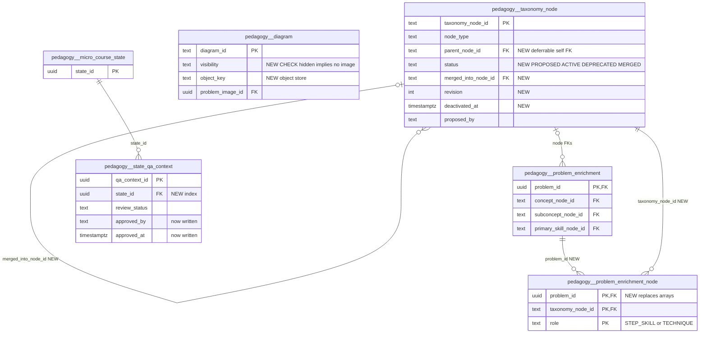

# `pedagogy` schema (part 1 of 5) — taxonomy, sources and enrichment

This part covers the 11 `pedagogy` tables that hold imported textbook provenance and the fine-grained teaching taxonomy. **Textbook provenance**: `source_book`, `chapter_section`, `problem_source_ref`, `solution_source_ref` and `diagram` map a content package (today only the Prasolov *Plane Geometry* package, `book_code = PRASOLOV_PGV1`) onto the canonical `core.problem` / `core.solution` / `core.problem_image` rows. **Package taxonomy**: `taxonomy_node` and `taxonomy_edge` keep the package's DOMAIN → CONCEPT → SUBCONCEPT / SKILL / TECHNIQUE vocabulary (plus nodes proposed by the route compiler), each node bridged to at most one curated `knowledge.*` row. `problem_enrichment` tags each textbook problem with those nodes. **Similarity cache**: `taxonomy_node_embedding` and `taxonomy_node_similarity` hold pgvector embeddings of the nodes and their precomputed nearest neighbours. **Micro-course Q&A grounding**: `state_qa_context` holds approved explanation snippets bound to one micro-course lesson state. The `pedagogy` schema is documented in several files: this one, [pedagogy-micro-courses.md](pedagogy-micro-courses.md) (micro-course releases, states, interventions), [pedagogy-routes-diagnosis.md](pedagogy-routes-diagnosis.md) (tutoring routes, gap diagnosis, recovery), [pedagogy-solutions-feedback.md](pedagogy-solutions-feedback.md) (solution parts/steps, learning items, feedback catalogs) and [pedagogy-video.md](pedagogy-video.md) (curated video layer).

Source of truth: migrations [010](../../../mathbank-db/sql/010_textbook_import.sql), [030](../../../mathbank-db/sql/030_ai_proposed_taxonomy.sql), [032](../../../mathbank-db/sql/032_micro_course_platform.sql), [040](../../../mathbank-db/sql/040_similarity_embeddings.sql), [041](../../../mathbank-db/sql/041_similarity_embeddings_hnsw_index.sql), [046](../../../mathbank-db/sql/046_theorem_catalog.sql). Catalog extracted 2026-11-01 from migrations 001–054; endpoint mapping traced from mathbank-rest source and manually verified.

## 1. Purpose, ownership and data flow

**Domain.** Two independent areas share this file.
1. *Textbook content packages* (requirements/18 Prasolov import, v2 pack docs 28 / runtime_extension 03–05). A textbook becomes a `core.competition` (level `TEXTBOOK`) with one `core.competition_edition`. Each chapter becomes a `core.paper` (`CHnn`), and each problem becomes a `core.problem` with `canonical_code = <book>_CHnn_Pnnn`. The `pedagogy` tables here keep everything the core tables cannot hold: printed ids, page numbers, sections, the package taxonomy, per-problem taxonomy tags, and every diagram, including the solution diagrams that must never reach a learner.
2. *Micro-course Q&A grounding* (`state_qa_context`, requirements [40](../../requirements/40_MICRO_COURSE_PLATFORM.md)). This is an authoring child of `pedagogy.micro_course_state` and belongs logically with [pedagogy-micro-courses.md](pedagogy-micro-courses.md). It is documented here because of how the tables were split across files.

**Write ownership.** No REST endpoint creates, edits or deletes any of these rows directly. The writers are:

| Writer | Kind | Tables written |
|---|---|---|
| [import_textbook_package.py](../../../mathbank-db/etl/import_textbook_package.py) `import_plan` (L783–1093) | Batch ETL, COPY into temp table + `INSERT … ON CONFLICT … DO UPDATE WHERE changed` | `source_book`, `chapter_section`, `taxonomy_node`, `taxonomy_edge`, `problem_source_ref`, `solution_source_ref`, `problem_enrichment`, `diagram` (C/U). It also writes `knowledge.concept/skill/technique`, `knowledge.skill_concept`, `knowledge.concept_relation`, `core.*`, and `ingest.*`. When it finishes it emits `pipeline.outbox_event` `CONTENT_PACKAGE_IMPORTED`. |
| [route_compiler.py](../../../mathbank-rest/src/mathbank_rest/route_compiler.py) `write_program` (L753–781) | Service code | `taxonomy_node` C (`ON CONFLICT DO NOTHING`) for nodes the LLM route compiler proposes. Called from the batch compiler ([route_batch.py](../../../mathbank-rest/src/mathbank_rest/route_batch.py) → `route_compiler.persist`, a CLI) and from the admin route `POST /v1/admin/tutoring-routes/{release_id}/edit` ([route_runtime.py](../../../mathbank-rest/src/mathbank_rest/route_runtime.py) `edit`, L330). |
| [relabel_taxonomy_buckets.py](../../../mathbank-rest/scripts/relabel_taxonomy_buckets.py) | One-off script (`--apply`) | `taxonomy_node.name` U. It appends a "(recurring category, N uses …)" suffix to fixed-code bucket nodes. |
| [generate_similarity_embeddings.py](../../../mathbank-rest/scripts/generate_similarity_embeddings.py) | Batch script (OpenAI embeddings) | `taxonomy_node_embedding` C/U; `taxonomy_node_similarity` TRUNCATE + C. |
| [micro_course_service.py](../../../mathbank-rest/src/mathbank_rest/micro_course_service.py) `review_release` (L2893) | Service code via `POST /v1/admin/micro-courses/releases/{release_id}/review` | `state_qa_context.review_status` U (bulk PENDING_REVIEW → APPROVED). **No code anywhere inserts `state_qa_context` rows.** |

**Readers.**
- *Admin textbook browser* [routers/admin_textbooks.py](../../../mathbank-rest/src/mathbank_rest/routers/admin_textbooks.py) → [db/textbook_admin.py](../../../mathbank-rest/src/mathbank_rest/db/textbook_admin.py). This is the read-only corpus inspector of requirements/24. It reads every table here except the embedding, similarity and Q&A tables.
- *Import review* [routers/admin_imports.py](../../../mathbank-rest/src/mathbank_rest/routers/admin_imports.py) → [db/import_admin.py](../../../mathbank-rest/src/mathbank_rest/db/import_admin.py). `GET /reconciliation` compares package counts with the database.
- *Student surfaces*.
  - `problem_source_ref` + `source_book` back the anonymous "original source" routes in [routers/step_runtime.py](../../../mathbank-rest/src/mathbank_rest/routers/step_runtime.py) L390–440, through [db/problem_sources.py](../../../mathbank-rest/src/mathbank_rest/db/problem_sources.py).
  - `diagram` is used only as a **negative filter** (`STUDENT_IMAGE_FILTER`, [db/problem_images.py](../../../mathbank-rest/src/mathbank_rest/db/problem_images.py)). It hides any `core.problem_image` linked to a non-`STUDENT_PROBLEM` diagram.
  - `taxonomy_node`/`taxonomy_edge`/`problem_enrichment` feed the topic planner ([db/topic_pedagogy.py](../../../mathbank-rest/src/mathbank_rest/db/topic_pedagogy.py)), concept search ([db/step_search.py](../../../mathbank-rest/src/mathbank_rest/db/step_search.py)), step diagnosis/recovery, and the LLM enrichment catalog filter ([enrichment.py](../../../mathbank-rest/src/mathbank_rest/enrichment.py) L379–395).
- *Graph and vectors*.
  - [route_projection.py](../../../mathbank-rest/src/mathbank_rest/route_projection.py) L503 turns `taxonomy_node_similarity` into Neo4j `SIMILAR_TO` edges (`POST /v1/admin/tutoring-routes/refresh-graph`).
  - [project_textbook_steps.py](../../../mathbank-graph/etl/project_textbook_steps.py) and [project_theorems.py](../../../mathbank-graph/etl/project_theorems.py) read `taxonomy_node`.
  - [embed_textbook_steps.py](../../../mathbank-db/etl/embed_textbook_steps.py) builds the **separate** `search.*` `TAXONOMY_NODE` representations from `taxonomy_node` + `taxonomy_edge`, and step chunks with `problem_source_ref` metadata.
  - [derive_step_techniques.py](../../../mathbank-db/etl/derive_step_techniques.py) reads `problem_enrichment.technique_ids`.
- *Micro-course runtime*: `state_qa_context` is read by the release validator, the reader/preview payload, the learner runtime, and the "Help me" assist ([micro_course_assist.py](../../../mathbank-rest/src/mathbank_rest/micro_course_assist.py) L190–223).

**Lifecycle.**
- Package rows are **idempotent upserts keyed by natural ids**. Re-importing changes only rows whose values differ (`IS DISTINCT FROM`). Rows are never deleted by the importer: a node or diagram removed from a newer package stays.
- `problem_source_ref`, `solution_source_ref`, `problem_enrichment` and `diagram` cascade with their `core.problem` / `core.solution`. Nothing cascades from `source_book` or `ingest.content_package`.
- Embeddings and similarity pairs are derived and rebuildable.
- `state_qa_context` follows its micro-course release: it is editable while the release is `DRAFT`, then frozen by the `guard_published_state_child` trigger once the release is `PUBLISHED`/`SUPERSEDED`/`RETIRED` (bypass: session setting `pedagogy.allow_purge=on`).

**Privacy class.** Shared curriculum and corpus metadata. There is no learner data. Two things need care:
- `diagram` rows with `visibility = SOLUTION_HIDDEN` are **answer-bearing**. The table comment says they must never be returned by student-facing endpoints.
- `diagram.local_path` and `problem_source_ref.source_pdf` are server filesystem paths.

## 2. Entity diagram — as-is

```mermaid
erDiagram
    ingest__content_package {
        uuid content_package_id PK
        text book_code
    }
    core__competition {
        uuid competition_id PK
    }
    core__competition_edition {
        uuid edition_id PK
    }
    core__paper {
        uuid paper_id PK
    }
    core__problem {
        uuid problem_id PK
        text canonical_code UK
    }
    core__solution {
        uuid solution_id PK
    }
    core__problem_image {
        uuid problem_image_id PK
    }
    knowledge__concept {
        uuid concept_id PK
    }
    knowledge__skill {
        uuid skill_id PK
    }
    knowledge__technique {
        uuid technique_id PK
    }
    knowledge__theorem {
        uuid theorem_id PK
    }
    knowledge__misconception {
        uuid misconception_id PK
    }
    pedagogy__micro_course_state {
        uuid state_id PK
    }
    pedagogy__source_book {
        text book_code PK "e.g. PRASOLOV_PGV1"
        text external_book_id UK "package book_id"
        text title
        uuid competition_id FK
        uuid edition_id FK
        jsonb metadata "never written"
    }
    pedagogy__chapter_section {
        text book_code PK, FK
        int chapter_number PK
        text section_number PK "dash when none"
        uuid paper_id FK "chapter paper"
        uuid content_package_id FK
    }
    pedagogy__problem_source_ref {
        text book_code PK, FK
        text source_problem_id PK "e.g. 1.23"
        uuid problem_id FK, UK
        int chapter_number
        text source_pdf
        int source_page_start
        uuid content_package_id FK
    }
    pedagogy__solution_source_ref {
        text book_code PK, FK
        text source_solution_id PK
        uuid solution_id FK, UK
        uuid problem_id FK
        uuid content_package_id FK
    }
    pedagogy__taxonomy_node {
        text taxonomy_node_id PK "package or compiler code"
        text node_type "DOMAIN to THEOREM"
        text name
        text parent_node_id "no FK"
        uuid concept_id FK "at most one bridge"
        uuid skill_id FK
        uuid technique_id FK
        uuid theorem_id FK
        uuid content_package_id FK
        text proposed_by "route_compiler version or NULL"
    }
    pedagogy__taxonomy_edge {
        text from_node_id PK, FK
        text to_node_id PK, FK
        text relationship_type PK "e.g. PART_OF"
        numeric confidence
        uuid content_package_id FK
    }
    pedagogy__problem_enrichment {
        uuid problem_id PK, FK
        text concept_node_id FK
        text subconcept_node_id FK
        text primary_skill_node_id FK
        text_array solution_step_skill_ids "node ids, no FK"
        text_array technique_ids "node ids, no FK"
        uuid content_package_id FK
    }
    pedagogy__diagram {
        text diagram_id PK "book slash source id"
        text source_diagram_id UK "with book_code"
        text book_code FK
        uuid problem_id FK
        text visibility "STUDENT_PROBLEM or SOLUTION_HIDDEN"
        uuid problem_image_id FK "student diagrams only"
        uuid content_package_id FK
    }
    pedagogy__taxonomy_node_embedding {
        text taxonomy_node_id PK, FK
        text model
        vector embedding "1536 dims, HNSW"
        text source_text_sha256
    }
    pedagogy__taxonomy_node_similarity {
        text taxonomy_node_id_a PK, FK
        text taxonomy_node_id_b PK, FK
        float similarity "cosine, at least 0.80"
        smallint rank "1 to 8"
    }
    pedagogy__state_qa_context {
        uuid qa_context_id PK
        uuid state_id FK
        text context_type "EXPLANATION FAQ ..."
        text approved_content
        uuid misconception_id FK
        text review_status "PENDING_REVIEW APPROVED REJECTED"
    }

    core__competition |o--o{ pedagogy__source_book : "competition_id"
    core__competition_edition |o--o{ pedagogy__source_book : "edition_id"
    pedagogy__source_book ||--o{ pedagogy__chapter_section : "book_code"
    core__paper |o--o{ pedagogy__chapter_section : "paper_id"
    pedagogy__source_book ||--o{ pedagogy__problem_source_ref : "book_code"
    core__problem ||--o| pedagogy__problem_source_ref : "problem_id CASCADE"
    pedagogy__source_book ||--o{ pedagogy__solution_source_ref : "book_code"
    core__solution ||--o| pedagogy__solution_source_ref : "solution_id CASCADE"
    core__problem ||--o{ pedagogy__solution_source_ref : "problem_id CASCADE"
    core__problem ||--o| pedagogy__problem_enrichment : "problem_id CASCADE"
    pedagogy__taxonomy_node |o--o{ pedagogy__problem_enrichment : "concept subconcept skill node"
    pedagogy__source_book ||--o{ pedagogy__diagram : "book_code"
    core__problem ||--o{ pedagogy__diagram : "problem_id CASCADE"
    core__problem_image |o--o| pedagogy__diagram : "problem_image_id SET NULL"
    pedagogy__taxonomy_node ||--o{ pedagogy__taxonomy_edge : "from_node_id"
    pedagogy__taxonomy_node ||--o{ pedagogy__taxonomy_edge : "to_node_id"
    knowledge__concept |o--o{ pedagogy__taxonomy_node : "concept_id"
    knowledge__skill |o--o{ pedagogy__taxonomy_node : "skill_id"
    knowledge__technique |o--o{ pedagogy__taxonomy_node : "technique_id"
    knowledge__theorem |o--o{ pedagogy__taxonomy_node : "theorem_id"
    ingest__content_package ||--o{ pedagogy__taxonomy_node : "content_package_id"
    ingest__content_package ||--o{ pedagogy__problem_source_ref : "content_package_id"
    pedagogy__taxonomy_node ||--o| pedagogy__taxonomy_node_embedding : "CASCADE"
    pedagogy__taxonomy_node ||--o{ pedagogy__taxonomy_node_similarity : "a CASCADE"
    pedagogy__taxonomy_node ||--o{ pedagogy__taxonomy_node_similarity : "b CASCADE"
    pedagogy__micro_course_state ||--o{ pedagogy__state_qa_context : "state_id CASCADE"
    knowledge__misconception |o--o{ pedagogy__state_qa_context : "misconception_id"
```

`content_package_id` → `ingest.content_package` also exists on `chapter_section`, `solution_source_ref`, `problem_enrichment`, `taxonomy_edge` and `diagram` (omitted for readability). `state_qa_context` also has optional FKs to `knowledge.concept`, `knowledge.technique` and `knowledge.skill`.

## 3. Tables

### `pedagogy.source_book`

**Role.** One row per imported textbook: the provenance anchor every other textbook table references. `import_plan` upserts it after creating or reusing the `core.competition` (`external_code = book_code`, level `TEXTBOOK`) and an edition labelled `English translation (<translator>)` ([import_textbook_package.py](../../../mathbank-db/etl/import_textbook_package.py) L857–880). Today it contains one book, `PRASOLOV_PGV1` (`BOOK_CODES` maps the package id `PRASOLOV_PLANE_GEOMETRY_V1`).

**Table type (§4).** Catalogue entity (import-owned reference data).

**Lifecycle.** Upsert on every import (`updated_at` touched only when a value changed). Never deleted. Every other textbook table's FK to it is NO ACTION, so a book cannot be removed while anything references it.

**Columns**

| Column | Type | Null | Default | Meaning |
|---|---|---|---|---|
| `book_code` | text | NO | — | Internal book code used across the textbook tables (e.g. `PRASOLOV_PGV1`). It is the `BOOK_CODES` mapping of the package's `book_id`, or the `book_id` itself when it has no mapping. |
| `external_book_id` | text | NO | — | Package `source_manifest.csv` `book_id` (e.g. `PRASOLOV_PLANE_GEOMETRY_V1`). |
| `title` | text | NO | — | Book title from the manifest. It is also written to `core.competition.name`. |
| `author` | text | YES | — | Author from the manifest (also `core.competition.organization`). Returned by the anonymous `/source` route as `book_author`. |
| `translator_editor` | text | YES | — | Translator/editor. Used to build the edition label. |
| `source_file` | text | YES | — | Manifest `source_file` (the original PDF file name in the package). |
| `competition_id` | uuid | YES | — | → `core.competition` (NO ACTION). Set by the importer. |
| `edition_id` | uuid | YES | — | → `core.competition_edition` (NO ACTION). Its chapters are `core.paper` rows under this edition. |
| `metadata` | jsonb | NO | `'{}'::jsonb` | Free-form extra metadata. **Never written** (not in the importer's column list), so it is always `{}`. |
| `updated_at` | timestamptz | NO | `now()` | Last time an import changed this row. |

**Keys, constraints, indexes.**
- PK `book_code`; UNIQUE `external_book_id`.
- FKs `competition_id` → `core.competition`, `edition_id` → `core.competition_edition` (both NO ACTION).
- No CHECKs, no triggers.

**REST operations today.**

| Op | Method & path | Auth | Handler | Notes |
|---|---|---|---|---|
| R | GET /v1/problems/by-code/{code}/source, …/source-pdf, …/source-highlight, …/source-marked-pdf | none | `source_record` ([db/problem_sources.py](../../../mathbank-rest/src/mathbank_rest/db/problem_sources.py) L16) | `LEFT JOIN` for `book_title`/`book_author`. |

Non-REST writer: `import_textbook_package.py` (C/U).

### `pedagogy.chapter_section`

**Role.** Table of contents of a book: one row per (chapter, section) from the package's `chapters_sections.csv`, linked to the chapter's `core.paper` (`CHnn`). Used by the admin coverage view and the problem detail view to show section titles.

**Table type (§4).** Catalogue entity (import-owned).

**Lifecycle.** Upsert per import (only rows in the chapter scope when run with `--chapter`). Never deleted.

**Columns**

| Column | Type | Null | Default | Meaning |
|---|---|---|---|---|
| `book_code` | text | NO | — | → `pedagogy.source_book`. |
| `chapter_number` | integer | NO | — | Chapter number. Rows with a non-integer chapter are rejected at staging. |
| `section_number` | text | NO | — | Section number as printed. The importer stores `'-'` when the CSV value is blank. |
| `chapter_title` | text | YES | — | Chapter title. |
| `section_title` | text | YES | — | Section title. |
| `paper_id` | uuid | YES | — | → `core.paper` of the chapter (`external_code = <book>_CHnn`, `paper_type = TEXTBOOK_CHAPTER`). |
| `content_package_id` | uuid | NO | — | → `ingest.content_package` that first created the row. **Not updated on re-import**: the importer's update list is title/paper only. |

**Keys, constraints, indexes.**
- PK `(book_code, chapter_number, section_number)`.
- FKs `book_code` → `source_book`, `paper_id` → `core.paper`, `content_package_id` → `ingest.content_package` (all NO ACTION).

**REST operations today.**

| Op | Method & path | Auth | Handler | Notes |
|---|---|---|---|---|
| R | GET /v1/admin/textbooks/coverage | Admin key (X-Admin-Api-Key) | `textbook_admin.coverage` | Section counts per chapter. |
| R | GET /v1/admin/textbooks/problems/{code} | Admin key (X-Admin-Api-Key) | `textbook_admin.problem_detail` | Section title for the problem. |
| R | GET /v1/admin/imports/reconciliation | Admin key (X-Admin-Api-Key) | `import_admin` reconciliation | Count only. |

Non-REST writer: `import_textbook_package.py` (C/U).

### `pedagogy.problem_source_ref`

**Role.** Maps each textbook problem's external id (`source_problem_id`, e.g. `1.23`) to the canonical `core.problem`. It holds the printed numbering, the page span and the diagram flags. It is also the de-facto "is this a textbook problem?" marker: [enrichment.py](../../../mathbank-rest/src/mathbank_rest/enrichment.py) L392 uses `NOT EXISTS (… problem_source_ref …)` to keep textbook-only taxonomy out of the contest LLM enrichment enum.

**Table type (§4).** Catalogue entity (one-to-one extension of `core.problem`).

**Lifecycle.** Inserted once per problem. On conflict the importer only reports the row as unchanged; it passes no update list. It is deleted only by cascade from `core.problem`. Duplicate source ids in `problems.csv` are resolved at staging (the numbered-section row wins) and logged as `ingest.import_conflict` `DUPLICATE_PROBLEM_ID`.

**Columns**

| Column | Type | Null | Default | Meaning |
|---|---|---|---|---|
| `book_code` | text | NO | — | → `pedagogy.source_book`. |
| `source_problem_id` | text | NO | — | Package problem id `<chapter>.<number>` (validated by regex `(\d+)\.(\d+)`; its chapter must equal `chapter_number`). |
| `problem_id` | uuid | NO | — | → `core.problem` (ON DELETE CASCADE). UNIQUE: a problem has at most one textbook source. |
| `chapter_number` | integer | NO | — | Chapter (also encoded in `canonical_code` `_CHnn_`). |
| `section_number` | text | YES | — | Section as printed in `problems.csv`. |
| `section_title` | text | YES | — | Section title copied from the problem row. |
| `source_printed_problem_id` | text | YES | — | The number exactly as printed when it differs from the normalised id. Returned by the `/source` routes. |
| `source_editorial_marker` | text | YES | — | Editorial marker from the source (e.g. a star or note) as supplied by the package. Uninterpreted. |
| `source_numbering_note` | text | YES | — | Free-text note about numbering anomalies. |
| `source_pdf` | text | YES | — | Package-relative path or file name of the source PDF. |
| `source_page_start` | integer | YES | — | First PDF page of the statement. |
| `source_page_end` | integer | YES | — | Last PDF page of the statement. |
| `problem_requires_diagram` | boolean | YES | — | Package flag: the statement needs a figure. |
| `solution_requires_diagram` | boolean | YES | — | Package flag: the solution needs a figure. |
| `difficulty_rank_in_section` | integer | YES | — | Position of the problem within its section in source order (the textbook's implicit difficulty). |
| `section_problem_count` | integer | YES | — | Number of problems in that section. |
| `content_package_id` | uuid | NO | — | → `ingest.content_package` that created the row. |

**Keys, constraints, indexes.**
- PK `(book_code, source_problem_id)`; UNIQUE `problem_id` (its index serves joins from `core.problem`).
- FKs `book_code` → `source_book`, `problem_id` → `core.problem` (CASCADE), `content_package_id` → `ingest.content_package`.
- No index on `(book_code, chapter_number)`, although the admin views filter on it.

**REST operations today.**

| Op | Method & path | Auth | Handler | Notes |
|---|---|---|---|---|
| R | GET /v1/problems/by-code/{code}/source, …/source-pdf, …/source-highlight, …/source-marked-pdf | none | `source_record` → `source_metadata` / `source_pdf` / `problem_location` | Public provenance plus the PDF page with the problem highlighted. |
| R | GET /v1/admin/textbooks/coverage, …/problems, …/problems/{code}, …/learning-items, …/taxonomy/{node_id} | Admin key (X-Admin-Api-Key) | `db/textbook_admin.*` | Chapter filter and code mapping. |
| R | GET /v1/admin/imports/reconciliation | Admin key (X-Admin-Api-Key) | `import_admin` | Joined with `problem_enrichment`. |
| R | GET /v1/tutor/learning-context/{problem_code}, POST /v1/tutor/coach, POST /v1/admin/pedagogy/reclassify | none (tutor) / Admin key | `enrichment.py` catalog filter | Indirect: decides which catalog nodes the LLM may choose. |

Non-REST: written by `import_textbook_package.py`; read by `embed_textbook_steps.py` (chunk metadata).

### `pedagogy.solution_source_ref`

**Role.** Maps the package solution id onto the canonical `core.solution` (`solution_kind = 'TEXTBOOK'`, `revision = 1`, `verification_status = 'UNVERIFIED'`) that the importer creates for each problem. It also keeps the solution's first step and page. Only one solution per problem is imported; a second one is rejected as `DUPLICATE_SOLUTION`.

**Table type (§4).** Catalogue entity (one-to-one extension of `core.solution`).

**Lifecycle.** Insert-once upsert, like `problem_source_ref`. Deleted by cascade from `core.solution` or `core.problem`.

**Columns**

| Column | Type | Null | Default | Meaning |
|---|---|---|---|---|
| `book_code` | text | NO | — | → `pedagogy.source_book`. |
| `source_solution_id` | text | NO | — | Package `solutions.csv` `solution_id`. |
| `solution_id` | uuid | NO | — | → `core.solution` (CASCADE). UNIQUE. |
| `problem_id` | uuid | NO | — | → `core.problem` (CASCADE). Redundant with `core.solution.problem_id`; nothing enforces that the two agree. |
| `solution_first_step` | text | YES | — | The package's first-step text (a hint seed). |
| `source_page` | integer | YES | — | PDF page where the solution starts. |
| `content_package_id` | uuid | NO | — | → `ingest.content_package`. |

**Keys, constraints, indexes.**
- PK `(book_code, source_solution_id)`; UNIQUE `solution_id`.
- FKs `book_code`, `solution_id` (CASCADE), `problem_id` (CASCADE), `content_package_id`.
- No index on `problem_id`.

**REST operations today.**

| Op | Method & path | Auth | Handler | Notes |
|---|---|---|---|---|
| R | GET /v1/admin/textbooks/coverage, …/problems, …/problems/{code} | Admin key (X-Admin-Api-Key) | `db/textbook_admin.*` | `has_solution` filter and detail. |
| R | GET /v1/admin/imports/reconciliation | Admin key (X-Admin-Api-Key) | `import_admin` | `RECONCILE_QUERIES["solution"]` keys on this table. |

Non-REST writer: `import_textbook_package.py` (C).

### `pedagogy.taxonomy_node`

**Role.** The fine-grained teaching vocabulary used by solution steps, learning items, tutoring-route requirements, misconception links, theorem links and search chunks. Its text ids come from the package (e.g. `GEO.C04.AREA`, `SKILL.X`) or from the route compiler. It has two origins:
1. **Package import.** `taxonomy_nodes.csv` is always imported in full ("shared vocabulary"). Each DOMAIN/CONCEPT/SUBCONCEPT node is bridged to a `knowledge.concept` (slug = lower-cased node id, `level` 0/1/2), each SKILL to a `knowledge.skill`, and each TECHNIQUE to a `knowledge.technique`. The matching `*_id` column is then set.
2. **Compiler proposal.** `write_program` inserts nodes the LLM route compiler proposes when no existing node fits a step. These set `proposed_by = 'route_compiler:<version>'` and `proposed_at`, have no `knowledge.*` bridge and no parent, and are anchored to the synthetic package `route-compiler-ai-proposed-taxonomy` (migration 030).

The relabel script reports 897 fixed-code rows matching `[A-Z]+\.C\d+\.[A-Z_]+`, with 70+ inconsistent domain prefixes ([relabel_taxonomy_buckets.py](../../../mathbank-rest/scripts/relabel_taxonomy_buckets.py) docstring).

**Table type (§4).** Catalogue entity. Package rows are import-owned; compiler rows are AI proposals awaiting curation.

**Lifecycle.**
- Re-import updates every column except the id and package. If an existing node's `name` differs from the incoming one, the importer **keeps the stored name** and logs `NAME_CONFLICT` (so relabels survive re-import).
- Compiler inserts are `ON CONFLICT DO NOTHING`.
- Nothing deletes nodes, and there is no active/retired flag.
- Migration 046 widened `node_type` to include `THEOREM` and added `theorem_id`, but **no code writes THEOREM nodes** (theorems link to existing nodes via `knowledge.theorem_taxonomy_link`).

**Columns**

| Column | Type | Null | Default | Meaning |
|---|---|---|---|---|
| `taxonomy_node_id` | text | NO | — | Natural id from the package or the compiler (e.g. `GEO.C04.AREA`). Used as the graph/search key everywhere. |
| `node_type` | text | NO | — | `DOMAIN`, `CONCEPT`, `SUBCONCEPT`, `SKILL`, `TECHNIQUE`, `THEOREM` (CHECK). The importer accepts only the first five. |
| `name` | text | NO | — | Display label. It may carry the relabel script's "(recurring category, N uses …)" suffix. |
| `parent_node_id` | text | YES | — | Parent node id from the package (hierarchy). **No FK**. NULL for compiler nodes. |
| `chapter_number` | integer | YES | — | Chapter the node was derived from (package nodes). |
| `section_number` | text | YES | — | Section the node was derived from. Used to choose between duplicate enrichment rows. |
| `source_basis` | text | YES | — | Package note on how the node was derived. Uninterpreted. |
| `description` | text | YES | — | Description; the embedding source text is `name || ' ' || description`. |
| `concept_id` | uuid | YES | — | → `knowledge.concept` bridge (DOMAIN/CONCEPT/SUBCONCEPT). |
| `skill_id` | uuid | YES | — | → `knowledge.skill` bridge (SKILL). |
| `technique_id` | uuid | YES | — | → `knowledge.technique` bridge (TECHNIQUE). |
| `content_package_id` | uuid | NO | — | → `ingest.content_package`: the textbook package, or the synthetic compiler package. The admin browser scopes nodes to a book through this column. |
| `updated_at` | timestamptz | NO | `now()` | Last import change. **Not bumped** by `relabel_taxonomy_buckets.py`. |
| `proposed_by` | text | YES | — | NULL for curated/imported nodes; `route_compiler:<generator_version>` for compiler proposals (column comment, migration 030). |
| `proposed_at` | timestamptz | YES | — | When the compiler proposed the node. |
| `theorem_id` | uuid | YES | — | → `knowledge.theorem` bridge for `THEOREM` nodes (migration 046). Unused today. |

**Keys, constraints, indexes.**
- PK `taxonomy_node_id`.
- CHECK `taxonomy_node_check`: `num_nonnulls(concept_id, skill_id, technique_id, theorem_id) <= 1`. CHECK `node_type` enumeration.
- FKs to `knowledge.concept/skill/technique/theorem` and `ingest.content_package` (NO ACTION).
- Referenced by many tables: `taxonomy_edge`, `problem_enrichment`, `pedagogy.solution_step`, `learning_item`, `solution_step_requirement`, `solution_step_technique`, `search.chunk` (SET NULL), `knowledge.misconception_taxonomy_link`, `knowledge.theorem_taxonomy_link`, plus the embedding and similarity tables (CASCADE).
- **No secondary indexes** (none on `parent_node_id`, `node_type`, the bridge ids or `content_package_id`).

**REST operations today.**

| Op | Method & path | Auth | Handler | Notes |
|---|---|---|---|---|
| C | POST /v1/admin/tutoring-routes/{release_id}/edit | Admin key (X-Admin-Api-Key) | `route_runtime.edit` → `route_compiler.write_program` | Side effect: an edited program with `proposed_node_type` requirements inserts new nodes. There is no dedicated taxonomy-node endpoint. |
| R | GET /v1/admin/textbooks/taxonomy, …/taxonomy/{node_id} | Admin key (X-Admin-Api-Key) | `textbook_admin.list_taxonomy` / `taxonomy_detail` | Book-scoped list with usage counts; detail with parent, children, edges and ≤50 problems. The `NodeType` Literal omits `THEOREM`. |
| R | GET /v1/admin/textbooks/coverage, …/problems, …/problems/{code} | Admin key (X-Admin-Api-Key) | `db/textbook_admin.*` | Node names for tags. |
| R | POST /v1/search/concepts | none | `step_search.search_taxonomy_nodes` | Uses `search.*` TAXONOMY_NODE vectors, not `taxonomy_node_embedding`. |
| R | GET /v1/tutor/topic-plan, POST /v1/tutor/topic-practice, GET /v1/tutor/learning-context/{problem_code}, POST /v1/tutor/coach, POST /v1/tutor/feedback | none / optional or required learner JWT | `db/topic_pedagogy.py`, `enrichment.py` | Topic resolution and the enrichment catalog filter. |
| R | POST /v1/attempts/{attempt_id}/steps/{step_id}/diagnose, …/responses, …/outcome; recovery-plan routes; GET /v1/solution-steps/{step_id}/practice | Learner JWT / Admin key | `step_diagnosis`, `step_recovery`, `step_search` | Skill/concept names of steps. |
| R | GET/PATCH /v1/admin/theorems/{slug} and sub-resources; GET /v1/theorems/{slug}… | Admin key / none | `theorem_service` | Validates `taxonomy_node_id` when linking theorems. |
| R | POST /v1/admin/tutoring-routes/{release_id}/review, …/refresh-graph; PATCH /v1/admin/imports/steps/{step_id}; GET /v1/admin/imports/reconciliation; GET /v1/learner/practice-progress | Admin key / Learner JWT | various | Lookups only. |

Non-REST: `import_textbook_package.py` (C/U), `route_batch.py` → `route_compiler.persist` (C), `relabel_taxonomy_buckets.py` (U name). Read by `embed_textbook_steps.py`, `derive_step_techniques.py`, `project_textbook_steps.py`, `project_theorems.py` and `generate_similarity_embeddings.py`.

### `pedagogy.taxonomy_edge`

**Role.** Directed relationships between package taxonomy nodes, from `taxonomy_edges.csv`. The importer also translates them into curated knowledge relations (`import_plan` L839–857):
- SKILL → concept-type edges become `knowledge.skill_concept`.
- Concept-type `PART_OF` edges become `knowledge.concept_relation` `HAS_SUBCONCEPT` (direction reversed).
- The edge's `confidence` is reused as the relation's confidence, with 0.9 as the fallback.

**Table type (§4).** Junction / link (between catalogue nodes), import-owned.

**Lifecycle.** Upsert (only `source_basis`/`confidence` are updated). Never deleted. Edges whose endpoint is missing from the same package, self-loops and edges without a type are rejected at staging.

**Columns**

| Column | Type | Null | Default | Meaning |
|---|---|---|---|---|
| `from_node_id` | text | NO | — | Source node → `taxonomy_node` (NO ACTION). For `PART_OF`, the child. |
| `to_node_id` | text | NO | — | Target node → `taxonomy_node`. For `PART_OF`, the parent. |
| `relationship_type` | text | NO | — | Package relation name. Free text (no CHECK). `PART_OF` is the only value with special handling. |
| `source_basis` | text | YES | — | Package note on the evidence for the edge. |
| `confidence` | numeric | YES | — | Package confidence (0–1 by convention; no CHECK). |
| `content_package_id` | uuid | NO | — | → `ingest.content_package`. |

**Keys, constraints, indexes.**
- PK `(from_node_id, to_node_id, relationship_type)`; CHECK `from_node_id <> to_node_id`.
- FKs to `taxonomy_node` (both ends) and `ingest.content_package`.
- No index leading on `to_node_id`, although `taxonomy_detail` and the usage counts filter `IN (from_node_id, to_node_id)`.

**REST operations today.**

| Op | Method & path | Auth | Handler | Notes |
|---|---|---|---|---|
| R | GET /v1/admin/textbooks/coverage, …/taxonomy, …/taxonomy/{node_id} | Admin key (X-Admin-Api-Key) | `db/textbook_admin.*` | Edge counts and lists. |
| R | GET /v1/admin/imports/reconciliation | Admin key (X-Admin-Api-Key) | `import_admin` | Count. |
| R | POST /v1/tutor/topic-practice | optional learner JWT | `db/topic_pedagogy.py` L142 | Expands a topic to its child nodes. |

Non-REST: written by `import_textbook_package.py`; read by `embed_textbook_steps.py` (neighbour text for TAXONOMY_NODE representations).

### `pedagogy.problem_enrichment`

**Role.** Per-problem taxonomy tags from the package's `problem_taxonomy_enriched.csv`: concept, subconcept, primary skill, the skills used in the solution steps, techniques, the problem form and the source-order difficulty. The migration labels it 'Spec "taxonomy.problem_enrichment"'. It drives the admin "problems by node" views, topic practice, step-technique derivation and recovery-plan item selection. When a problem has several rows, the importer keeps the one whose subconcept's section matches the problem's section (`DUPLICATE_TAXONOMY_ROW`, INFO).

**Table type (§4).** Catalogue entity (one-to-one extension of `core.problem`; import-owned tag set).

**Lifecycle.** Upsert with update on every column; `updated_at` is touched on change. Unknown node ids are dropped with a staging warning (single-valued columns become NULL; array members are filtered out). Deleted by cascade with the problem.

**Columns**

| Column | Type | Null | Default | Meaning |
|---|---|---|---|---|
| `problem_id` | uuid | NO | — | → `core.problem` (CASCADE). |
| `concept_node_id` | text | YES | — | → `taxonomy_node` (CONCEPT). |
| `subconcept_node_id` | text | YES | — | → `taxonomy_node` (SUBCONCEPT). |
| `primary_skill_node_id` | text | YES | — | → `taxonomy_node` (SKILL). |
| `solution_step_skill_ids` | text[] | NO | `'{}'::text[]` | Taxonomy node ids of skills used across the solution steps (package pipe-list). **No FK** on array members. |
| `technique_ids` | text[] | NO | `'{}'::text[]` | Taxonomy node ids of TECHNIQUE nodes. **No FK**. Read by `derive_step_techniques.py` to infer per-step techniques. |
| `problem_form` | text | YES | — | Package classification of the problem form (e.g. compute/prove). Free text. |
| `difficulty_band_source_order` | integer | YES | — | Difficulty band 1–5 by source order. Also rendered into `core.problem.difficulty_band` as `Textbook band n/5 (source order)`. |
| `solution_step_count` | integer | YES | — | Number of steps per the package. |
| `taxonomy_mapping_basis` | text | YES | — | How the package mapped the tags. Uninterpreted. |
| `taxonomy_confidence` | numeric | YES | — | Package confidence of the mapping. No CHECK. |
| `content_package_id` | uuid | NO | — | → `ingest.content_package`. |
| `updated_at` | timestamptz | NO | `now()` | Last change by import. |

**Keys, constraints, indexes.**
- PK `problem_id`.
- FKs to `core.problem` (CASCADE), three `taxonomy_node` FKs (NO ACTION), `ingest.content_package`.
- **No indexes** on the node columns or GIN indexes on the arrays. `list_taxonomy` runs a correlated `count(*) … WHERE id IN (…) OR id = ANY(technique_ids)` per node.

**REST operations today.**

| Op | Method & path | Auth | Handler | Notes |
|---|---|---|---|---|
| R | GET /v1/admin/textbooks/coverage, …/problems, …/problems/{code}, …/taxonomy, …/taxonomy/{node_id} | Admin key (X-Admin-Api-Key) | `db/textbook_admin.*` | Tag display and per-node usage counts. |
| R | GET /v1/admin/imports/reconciliation | Admin key (X-Admin-Api-Key) | `import_admin` | Count. |
| R | POST /v1/tutor/topic-practice | optional learner JWT | `db/topic_pedagogy.py` L99 | Pick problems for a topic. |
| R | POST /v1/attempts/{attempt_id}/recovery-plans, POST /v1/recovery-plans/{plan_id}/items/{item_id}/responses | Learner JWT | `step_recovery` | Candidate practice problems. |

Non-REST: written by `import_textbook_package.py`; read by `derive_step_techniques.py`.

### `pedagogy.taxonomy_node_embedding`

**Role.** One pgvector embedding per taxonomy node (requirements/51 ENR-2), produced by `embed_taxonomy_nodes` in [generate_similarity_embeddings.py](../../../mathbank-rest/scripts/generate_similarity_embeddings.py) L115–162. The source text is `name || ' ' || description`, truncated to 8,000 characters, and the model and dimensions come from `embedding_profile()` (text-embedding-3-small, 1536). It exists only to compute `taxonomy_node_similarity`. Concept search uses the separate `search.*` TAXONOMY_NODE vectors instead.

**Table type (§4).** Derived / cache / embedding.

**Lifecycle.**
- Without `--force`, only nodes that have **no** embedding are embedded. With `--force`, every node is re-embedded (upsert, `generated_at = now()`).
- `source_text_sha256` is stored but never compared, so a renamed node keeps a stale vector until `--force`.
- Rows cascade with the node.

**Columns**

| Column | Type | Null | Default | Meaning |
|---|---|---|---|---|
| `taxonomy_node_id` | text | NO | — | → `taxonomy_node` (CASCADE). |
| `model` | text | NO | — | Embedding model name. |
| `dimensions` | integer | NO | `1536` | Vector length. CHECK 1–8192, and must equal `vector_dims(embedding)`. |
| `source_text_sha256` | text | NO | — | SHA-256 of the embedded source text (for staleness detection; unused today). |
| `embedding` | vector(1536) | NO | — | The embedding. Migration 041 fixed the type to `vector(1536)` so an HNSW index can be built. |
| `generated_at` | timestamptz | NO | `now()` | When the vector was computed. |

**Keys, constraints, indexes.**
- PK `taxonomy_node_id`; FK → `taxonomy_node` ON DELETE CASCADE.
- CHECKs `dimensions BETWEEN 1 AND 8192`, `vector_dims(embedding) = dimensions`. Migration 041 runs `DROP CONSTRAINT IF EXISTS taxonomy_node_embedding_embedding_check`, but the catalog lists the dims CHECK as `taxonomy_node_embedding_check`. Whether it still exists in the live database depends on its generated name; unverified.
- `idx_taxonomy_node_embedding_hnsw` HNSW (`vector_cosine_ops`), used by the LATERAL top-K query.

**REST operations today.** None. Written and read only by `generate_similarity_embeddings.py` (C/U/R). [migrate_similarity_embeddings.py](../../../mathbank-rest/scripts/migrate_similarity_embeddings.py) lists it for migration checks.

### `pedagogy.taxonomy_node_similarity`

**Role.** Precomputed nearest neighbours between taxonomy nodes **of the same `node_type`**. For each node `a`, it stores up to `TOP_K = 8` neighbours `b` with cosine similarity ≥ `MIN_SIMILARITY = 0.80`, ranked 1..8 ([generate_similarity_embeddings.py](../../../mathbank-rest/scripts/generate_similarity_embeddings.py) L197–226). The admin graph refresh projects it into Neo4j `SIMILAR_TO` edges, but only between nodes that resolve to a curated `knowledge.*` id or were used by a published route ([route_projection.py](../../../mathbank-rest/src/mathbank_rest/route_projection.py) L490–520). It is directional: `(a,b)` does not imply `(b,a)`.

**Table type (§4).** Derived / cache.

**Lifecycle.** `TRUNCATE` and a full `INSERT … SELECT` in one transaction on every script run. Rows cascade with either node.

**Columns**

| Column | Type | Null | Default | Meaning |
|---|---|---|---|---|
| `taxonomy_node_id_a` | text | NO | — | Query node → `taxonomy_node` (CASCADE). |
| `taxonomy_node_id_b` | text | NO | — | Neighbour node → `taxonomy_node` (CASCADE). |
| `similarity` | double precision | NO | — | `1 - cosine distance`. CHECK −1..1; in practice ≥ 0.80. |
| `rank` | smallint | NO | — | Neighbour rank for `a` (1 = closest), CHECK > 0. `row_number()` is computed before the ≥ 0.80 filter, but because both follow distance order the filter removes only a tail, so ranks are contiguous from 1. |
| `computed_at` | timestamptz | NO | `now()` | Time of the rebuild. |

**Keys, constraints, indexes.**
- PK `(taxonomy_node_id_a, taxonomy_node_id_b)`; CHECK `a <> b`.
- FKs both → `taxonomy_node` CASCADE.
- `idx_taxonomy_node_similarity_a (taxonomy_node_id_a)` duplicates the PK's leading column. There is no index on `taxonomy_node_id_b`, which the `ON DELETE CASCADE` from the node needs.

**REST operations today.**

| Op | Method & path | Auth | Handler | Notes |
|---|---|---|---|---|
| R | POST /v1/admin/tutoring-routes/refresh-graph | Admin key (X-Admin-Api-Key) | `route_projection.project` | Full scan → `SIMILAR_TO` edges. |

Non-REST writer: `generate_similarity_embeddings.py` (TRUNCATE + C).

### `pedagogy.diagram`

**Role.** Every figure in a textbook package (`diagram_manifest.csv`), for both statements and solutions. `visibility` is derived at import: `usage = 'PROBLEM'` → `STUDENT_PROBLEM`; anything else → `SOLUTION_HIDDEN`. Only `STUDENT_PROBLEM` diagrams are also copied into `core.problem_image` (`source = 'TEXTBOOK_PACKAGE'`, same `local_path`, ordinal by diagram key) and linked back through `problem_image_id`. Solution diagrams therefore never enter `core.problem_image`; this is the design rule stated in migration 010. The table comment is: *"SOLUTION_HIDDEN diagrams must never be returned by student-facing problem endpoints."* Student routes use the table only negatively: `STUDENT_IMAGE_FILTER` excludes any `core.problem_image` linked to a non-`STUDENT_PROBLEM` diagram.

**Table type (§4).** Catalogue entity (import-owned asset metadata).

**Lifecycle.** Upsert with update of all descriptive columns (`updated_at` touched). Diagrams whose asset file is missing from the package are rejected at staging. Deleted by cascade with the problem. Deleting the `core.problem_image` sets `problem_image_id` to NULL.

**Columns**

| Column | Type | Null | Default | Meaning |
|---|---|---|---|---|
| `diagram_id` | text | NO | — | `<book_code>/<source_diagram_id>`. Referenced by `visual.asset.diagram_id` (SET NULL). |
| `source_diagram_id` | text | NO | — | Package diagram id. Used by the admin image route (`[A-Za-z0-9_.-]+`). |
| `book_code` | text | NO | — | → `pedagogy.source_book`. |
| `problem_id` | uuid | NO | — | → `core.problem` (CASCADE). |
| `usage` | text | NO | — | Upper-cased manifest `usage`. `PROBLEM` means statement figure; other values (e.g. solution figures) are package-defined. No CHECK. |
| `visibility` | text | NO | — | `STUDENT_PROBLEM` or `SOLUTION_HIDDEN` (CHECK). Derived from `usage`; it is not an independent input. |
| `source_pdf_page` | integer | YES | — | PDF page of the figure. |
| `source_figure_number` | text | YES | — | Printed figure number. |
| `source_caption` | text | YES | — | Printed caption. May describe the solution. |
| `asset_path` | text | NO | — | Package-relative path of the image file. |
| `local_path` | text | NO | — | **Absolute filesystem path** on the machine that ran the import (`package.root / asset_path`). The admin image route serves it only if it resolves inside the repository root. |
| `sha256` | text | YES | — | SHA-256 of the asset from the package file manifest. |
| `extraction_method` | text | YES | — | How the package extracted the figure (crop/vector …). Uninterpreted. |
| `validation_status` | text | YES | — | Package validation verdict. Free text; distinct from `visual.asset.validation_status`. |
| `problem_image_id` | uuid | YES | — | → `core.problem_image` (SET NULL). Set only for `STUDENT_PROBLEM` diagrams. |
| `content_package_id` | uuid | NO | — | → `ingest.content_package`. |
| `updated_at` | timestamptz | NO | `now()` | Last import change. |

**Keys, constraints, indexes.**
- PK `diagram_id`; UNIQUE `(book_code, source_diagram_id)`.
- CHECK `visibility`.
- FKs `book_code`, `problem_id` (CASCADE), `problem_image_id` (SET NULL), `content_package_id`.
- Index `diagram_problem_idx (problem_id, usage)`. There is no index on `problem_image_id`, which `STUDENT_IMAGE_FILTER`'s `NOT EXISTS` probes for every image row.

**REST operations today.**

| Op | Method & path | Auth | Handler | Notes |
|---|---|---|---|---|
| R | GET /v1/admin/textbooks/diagrams/{source_diagram_id}/image | Admin key (X-Admin-Api-Key) | `textbook_admin.diagram_path` | Streams **any** diagram, including SOLUTION_HIDDEN ones (`Cache-Control: private`). |
| R | GET /v1/admin/textbooks/problems/{code}, …/problems, …/coverage | Admin key (X-Admin-Api-Key) | `db/textbook_admin.*` | Detail includes solution-hidden diagrams. |
| R | GET /v1/admin/imports/reconciliation | Admin key (X-Admin-Api-Key) | `import_admin` | Count. |
| R | GET /v1/problems/by-code/{code}/diagrams, GET /v1/problems/by-code/{canonical_code}, GET /v1/problem-images/{image_id}, GET /v1/tutor/workspace/{problem_code}, GET /v1/tutor/practice/{problem_code}, GET /v1/tutor/learning-context/{problem_code}, POST /v1/tutor/coach, POST /v1/tutor/micro-check, POST /v1/tutor/decompose | none | `STUDENT_IMAGE_FILTER` ([db/problem_images.py](../../../mathbank-rest/src/mathbank_rest/db/problem_images.py) L7–17) | Negative filter only; no diagram columns are returned. |

Non-REST writer: `import_textbook_package.py` (C/U).

### `pedagogy.state_qa_context`

**Role.** Approved, pre-written answers ("Q&A context") attached to one micro-course lesson state (MCR in requirements/40, §11 of migration 032). The runtime and the scoped "Help me" assist may use only approved snippets to answer learner questions about the state; the assist consults them as tier 4 of its grounding order, after the item's own content. Each snippet can name the concept/technique/skill/misconception it addresses.

**Table type (§4).** Revisioned authoring object (a child of the micro-course release; frozen after publish).

**Lifecycle.**
1. **Create.** **There is no insert path** in mathbank-rest, the seed scripts or any ETL, so the table can only be filled by hand-written SQL.
2. **Review.** `review_release` (status `APPROVED`) bulk-sets every `PENDING_REVIEW` row of the release to `APPROVED`. It does **not** set `approved_by`/`approved_at`.
3. **Validation.** `validate_release(require_approved_children=True)` blocks publishing while any row is not `APPROVED`, which includes `REJECTED` rows.
4. **Publish.** After publish, the `state_qa_context_guard` trigger rejects INSERT/UPDATE/DELETE.
5. **New release.** `create_release` does not copy rows from the previous release.
6. **Delete.** Cascade from `micro_course_state`.

**Columns**

| Column | Type | Null | Default | Meaning |
|---|---|---|---|---|
| `qa_context_id` | uuid | NO | `gen_random_uuid()` | Surrogate id. |
| `state_id` | uuid | NO | — | → `pedagogy.micro_course_state` (CASCADE). |
| `context_type` | text | NO | — | `EXPLANATION`, `DEFINITION`, `FAQ`, `DERIVATION`, `EXAMPLE`, `COUNTEREXAMPLE`, `NOTATION`, `MISCONCEPTION_RESPONSE` (CHECK). |
| `question_pattern` | text | YES | — | Learner question the snippet answers (free text; not a regex in code). |
| `approved_content` | text | NO | — | The answer text shown to or paraphrased for learners. |
| `concept_id` | uuid | YES | — | → `knowledge.concept` addressed. |
| `technique_id` | uuid | YES | — | → `knowledge.technique` addressed. |
| `skill_id` | uuid | YES | — | → `knowledge.skill` addressed. |
| `misconception_id` | uuid | YES | — | → `knowledge.misconception`, for `MISCONCEPTION_RESPONSE`. Nothing ties the two together. |
| `priority` | integer | NO | `0` | Ordering; every reader sorts `priority DESC`. |
| `review_status` | text | NO | `'PENDING_REVIEW'` | `PENDING_REVIEW`, `APPROVED`, `REJECTED` (CHECK). Learner and anonymous reads filter `APPROVED`. |
| `created_by` | text | NO | — | Author identifier (free text). |
| `approved_by` | text | YES | — | Reviewer. Never set by code today. |
| `created_at` | timestamptz | NO | `now()` | Creation time. |
| `approved_at` | timestamptz | YES | — | Approval time. Never set by code today. |

**Keys, constraints, indexes.**
- PK `qa_context_id`.
- FKs `state_id` (CASCADE), `concept_id`, `technique_id`, `skill_id`, `misconception_id` (NO ACTION).
- CHECKs `context_type`, `review_status`.
- Trigger `state_qa_context_guard` BEFORE INSERT/UPDATE/DELETE → `pedagogy.guard_published_state_child()`.
- **No index on `state_id`**, although every read filters by it.

**REST operations today.**

| Op | Method & path | Auth | Handler | Notes |
|---|---|---|---|---|
| U | POST /v1/admin/micro-courses/releases/{release_id}/review | Admin key (X-Admin-Api-Key) | `review_release` (L2893) | Bulk approve on `APPROVED` decision. |
| R | POST /v1/admin/micro-courses/releases/{release_id}/validate, …/publish | Admin key (X-Admin-Api-Key) | `validate_release` (L2781), `_content_hash` (L2958) | Pending count; included in the release content hash. |
| R | GET /v1/admin/micro-courses/{canonical_code}/preview | Admin key (X-Admin-Api-Key) | `_assemble_course_reader_payload(approved_only=False)` | Shows unapproved rows. |
| R | GET /v1/micro-courses/{canonical_code} | none | `_assemble_course_reader_payload` (L424, approved only) | Public reader. |
| R | POST /v1/micro-courses/{canonical_code}/enroll, GET /v1/micro-courses/enrollments/{enrollment_id}, POST …/advance | Learner JWT | `get_enrollment_runtime` (L911) | Current state's approved snippets. |
| R | POST /v1/micro-courses/enrollments/{enrollment_id}/item-help | Learner JWT | `micro_course_assist._state_fallback_context` (L199) | Tier-4 grounding for the assist LLM. |

No non-REST writers.

## 4. CRUD coverage — as-is

✅ = REST endpoint; ⚙️ = batch/script only; ❌ = none; — = not applicable.

| Table | Type (§4) | Create | Read | Update | Delete | List | Notes |
|---|---|---|---|---|---|---|---|
| `pedagogy.source_book` | Catalogue | ⚙️ | ✅ (via `/problems/by-code/{code}/source`) | ⚙️ | ❌ | ❌ | No admin list of books; `book` is a query param defaulting to `PRASOLOV_PGV1`. |
| `pedagogy.chapter_section` | Catalogue | ⚙️ | ✅ admin (embedded) | ⚙️ | ❌ | ❌ | Only inside coverage and problem detail. |
| `pedagogy.problem_source_ref` | Catalogue (1:1 ext.) | ⚙️ | ✅ public + admin | ❌ | cascade | ✅ admin `/textbooks/problems` | Import never updates existing rows. |
| `pedagogy.solution_source_ref` | Catalogue (1:1 ext.) | ⚙️ | ✅ admin | ❌ | cascade | ✅ admin (embedded) | |
| `pedagogy.taxonomy_node` | Catalogue | ⚙️ + side effect of `POST /admin/tutoring-routes/{id}/edit` | ✅ admin `/textbooks/taxonomy/{node_id}` | ⚙️ (import, relabel script) | ❌ | ✅ admin `/textbooks/taxonomy` | No curation (rename, merge, link, retire) endpoint; compiler nodes invisible in the book-scoped list. |
| `pedagogy.taxonomy_edge` | Junction | ⚙️ | ✅ admin (embedded in node detail) | ⚙️ | ❌ | — | |
| `pedagogy.problem_enrichment` | Catalogue (tag set) | ⚙️ | ✅ admin (embedded) | ⚙️ | cascade | — | No admin re-tagging. |
| `pedagogy.taxonomy_node_embedding` | Derived / embedding | ⚙️ | ❌ | ⚙️ | cascade | ❌ | Script-only; no rebuild endpoint or job. |
| `pedagogy.taxonomy_node_similarity` | Derived / cache | ⚙️ | ✅ (graph refresh, full scan) | — | ⚙️ (TRUNCATE) | ❌ | No "similar nodes" lookup endpoint. |
| `pedagogy.diagram` | Catalogue (asset metadata) | ⚙️ | ✅ admin (+ image) | ⚙️ | cascade | ✅ admin (embedded) | Student routes use it only as a filter. |
| `pedagogy.state_qa_context` | Revisioned authoring child | ❌ | ✅ admin/public/learner | ✅ (bulk approve only) | ❌ | ❌ | **No create/edit/delete endpoint and no service function**; approval metadata never recorded. |

**Findings.**
1. **`state_qa_context` cannot be authored.** The release validator, reader, runtime and assist all read it, but no endpoint, service function, seed script or ETL inserts it. Bulk approval also skips `approved_by`/`approved_at` and writes no per-row audit.
2. **Taxonomy has no curation API.** AI-proposed nodes (`proposed_by` set) are documented as needing human curation (migration 030 comment), but there is no list, rename, merge, re-parent, bridge or retire endpoint. They are also invisible in `GET /v1/admin/textbooks/taxonomy`, which scopes by the package's `book_code`; the synthetic compiler package has none. Today the only rename path is a script (`relabel_taxonomy_buckets.py`), and it does not bump `updated_at` or write an audit row.
3. **Side-effect write inside a review edit.** `POST /v1/admin/tutoring-routes/{release_id}/edit` can insert permanent `taxonomy_node` rows (via `write_program`) without an audit entry. Rejecting or deleting the draft afterwards leaves them behind.
4. **Schema drift around THEOREM.** Migration 046 allows `node_type = 'THEOREM'` and `theorem_id`, but no writer creates them. The admin `NodeType` Literal (`DOMAIN…TECHNIQUE`) rejects `THEOREM`, which violates guide §6 (CHECK and Literal must match).
5. **Weak referential integrity.**
   - `taxonomy_node.parent_node_id` and the `problem_enrichment` id arrays have no FK.
   - `taxonomy_edge.relationship_type`, `diagram.usage`, `problem_form` and `validation_status` are unconstrained text.
   - `solution_source_ref.problem_id` can disagree with `core.solution.problem_id`.
6. **Solution-diagram exposure is admin-only but path-based.**
   - Students are protected by keeping solution figures out of `core.problem_image` and by `STUDENT_IMAGE_FILTER`.
   - The admin image route streams `SOLUTION_HIDDEN` files from the absolute `local_path`. That path is machine-specific, so the route breaks on any host other than the one that ran the import (e.g. Fargate). It also bypasses the object-store/signed-URL rule (guide §6).
7. **Stale embeddings.** `generate_similarity_embeddings.py` skips nodes that already have an embedding, even when their name or description changed (`source_text_sha256` is never compared). Taxonomy nodes also have **two** embedding stores (`taxonomy_node_embedding` and `search.*` TAXONOMY_NODE), built by different scripts.
8. **Missing indexes.**
   - `state_qa_context(state_id)`.
   - `taxonomy_node(parent_node_id)`, `(content_package_id)` and the bridge ids.
   - `taxonomy_edge(to_node_id)`.
   - `problem_enrichment` node columns and GIN on its arrays.
   - `diagram(problem_image_id)`.
   - `taxonomy_node_similarity(taxonomy_node_id_b)`.
9. **Anonymous reads trigger writes elsewhere.** `GET /v1/tutor/learning-context/{problem_code}` reads `problem_source_ref`/`taxonomy_node` inside an enrichment path that can write `knowledge.*` (guide §3 rule 3). The writes are not to these tables, but these tables gate them.

## 5. Target state — how it should be

### 5.1 Schema improvements

1. **P1: Make `state_qa_context` authorable and auditable.**
   - **Evidence.** There is no insert path (§4 finding 1). `review_release` bulk-approves without reviewer metadata ([micro_course_service.py](../../../mathbank-rest/src/mathbank_rest/micro_course_service.py) L2893).
   - **Fix.** Add service functions `add_state_qa_context`, `update_state_qa_context` and `delete_state_qa_context` that check `_editable_release`. Set `approved_by = :reviewer`, `approved_at = now()` in the bulk approval. Add `CREATE INDEX ON pedagogy.state_qa_context (state_id, priority DESC) WHERE review_status = 'APPROVED'`, plus `CHECK (context_type <> 'MISCONCEPTION_RESPONSE' OR misconception_id IS NOT NULL)`. Copy rows when a new draft release is cloned, if cloning is added.
2. **P1: Give taxonomy nodes a lifecycle.**
   - **Evidence.** There is no way to retire or merge nodes; compiler proposals accumulate (migration 030 comment); there is no `is_active`.
   - **Fix.** Add `status text NOT NULL DEFAULT 'ACTIVE' CHECK (status IN ('PROPOSED','ACTIVE','DEPRECATED','MERGED'))`, `merged_into_node_id text REFERENCES pedagogy.taxonomy_node`, `deactivated_at`, `deactivated_by` and `revision integer NOT NULL DEFAULT 1`. Backfill `PROPOSED` where `proposed_by IS NOT NULL`. Readers that pick nodes for new content filter `status = 'ACTIVE'`.
3. **P2: Enforce hierarchy and tag integrity.**
   - **Fix.** Add a deferrable FK `parent_node_id → taxonomy_node` (the importer inserts in one statement, so a deferrable FK is safe), and `CHECK (confidence BETWEEN 0 AND 1)` on `taxonomy_edge.confidence` and `problem_enrichment.taxonomy_confidence`.
   - Replace `problem_enrichment.solution_step_skill_ids`/`technique_ids` with a junction `pedagogy.problem_enrichment_node (problem_id, taxonomy_node_id, role CHECK IN ('STEP_SKILL','TECHNIQUE'))` with real FKs. Alternatively, keep the arrays and add a validation trigger plus GIN indexes.
   - Add `CHECK (relationship_type IN (…))` once the package vocabulary is enumerated (today only `PART_OF` is interpreted).
4. **P2: Align THEOREM support.** Either remove `THEOREM` from the CHECK and drop `theorem_id` (theorems already link via `knowledge.theorem_taxonomy_link`), or add a writer and extend the admin `NodeType` Literal. Pick one, and ship the migration and the model together (guide §6).
5. **P2: Move diagram files to object storage.**
   - **Evidence.** `diagram.local_path` is an absolute path on the import host.
   - **Fix.** Add `object_key text` and `object_sha256` (keep `sha256`), upload at import, and serve the admin image through a short-lived signed URL. Keep `local_path` only as import provenance (or drop it). Add `CHECK (visibility = 'STUDENT_PROBLEM' OR problem_image_id IS NULL)` so the database itself guarantees a solution diagram never becomes a `core.problem_image`.
6. **P2: Add missing indexes** (finding 8):
   - `taxonomy_node(parent_node_id)`, `taxonomy_node(content_package_id)`, `taxonomy_node(node_type)`;
   - `taxonomy_edge(to_node_id)`;
   - `problem_enrichment(concept_node_id)`, `(subconcept_node_id)`, `(primary_skill_node_id)`, and GIN on the arrays;
   - `diagram(problem_image_id) WHERE problem_image_id IS NOT NULL`;
   - `taxonomy_node_similarity(taxonomy_node_id_b)`; drop the redundant `idx_taxonomy_node_similarity_a`.
7. **P3: Refresh stale embeddings.** In `embed_taxonomy_nodes`, re-embed when `sha256(name || ' ' || description) <> source_text_sha256` instead of only when missing. Longer term, choose one taxonomy embedding store: either serve similarity from `search.embedding` TAXONOMY_NODE vectors or drop them in favour of this table.
8. **P3: Tidy provenance.**
   - Write `source_book.metadata` from the manifest, or drop the column.
   - Bump `taxonomy_node.updated_at` in `relabel_taxonomy_buckets.py`.
   - Add a composite FK `(solution_id, problem_id)` → `core.solution(solution_id, problem_id)` (requires a UNIQUE on `core.solution`) so `solution_source_ref.problem_id` cannot drift.
   - Add an index `problem_source_ref(book_code, chapter_number)`.

### 5.2 Entity diagram — target

Only the changed tables and columns are shown; everything else is unchanged.

### 5.3 Endpoints to build

Admin routes go under `/v1/admin/<domain>/…` with `require_admin_api_key`. Each mutation writes `audit.action_log` via `record_audit_event`, and list routes return `{items,total,limit,offset}` (guide §5).

| Priority | Method & path | Auth | Table(s) / op | Purpose | Notes (validation, concurrency, audit) |
|---|---|---|---|---|---|
| P1 | `POST /v1/admin/micro-courses/states/{state_id}/qa-contexts` | Admin key (X-Admin-Api-Key) | `state_qa_context` / C | Author an approved-answer snippet for a lesson state. | Revisioned-child pattern: `_editable_release` (409 if not DRAFT); `context_type` Literal matches CHECK; validate optional FKs → 422; returns 201 + Location; audit. |
| P1 | `PATCH /v1/admin/micro-courses/qa-contexts/{qa_context_id}` / `DELETE` same path | Admin key (X-Admin-Api-Key) | `state_qa_context` / U, D | Edit or remove a draft snippet. | Draft releases only; editing resets `review_status` to `PENDING_REVIEW`; DELETE 204; audit. |
| P1 | `GET /v1/admin/micro-courses/releases/{release_id}/qa-contexts?status=` | Admin key (X-Admin-Api-Key) | `state_qa_context` / list | Review queue per release. | Filter by `review_status`; ordered by state ordinal, priority. |
| P2 | `POST /v1/admin/micro-courses/qa-contexts/{qa_context_id}/approve` / `/reject` | Admin key (X-Admin-Api-Key) | `state_qa_context` / U | Per-row review instead of bulk-only. | Sets `approved_by/at`; `reason` on reject; audit. Keep the bulk path but make it set the same columns. |
| P1 | `GET /v1/admin/taxonomy/nodes?q=&node_type=&status=&proposed=true&book=&limit=&offset=` | Admin key (X-Admin-Api-Key) | `taxonomy_node` / list | Curation queue including compiler-proposed nodes (not book-scoped). | `node_type` Literal must match the CHECK; `q` on id/name (trigram); include usage counts as today. |
| P1 | `PATCH /v1/admin/taxonomy/nodes/{taxonomy_node_id}` | Admin key (X-Admin-Api-Key) | `taxonomy_node` / U | Rename, describe, re-parent, set `knowledge.*` bridge. | `expected_revision` → 409; enforce the single-bridge CHECK as 422; bump `updated_at`; audit. Replaces `relabel_taxonomy_buckets.py --apply`. |
| P1 | `POST /v1/admin/taxonomy/nodes/{taxonomy_node_id}/accept`, `/deprecate`, `/reactivate`, `/merge` (body `{into, reason}`) | Admin key (X-Admin-Api-Key) | `taxonomy_node` (+ referencing tables for merge) / U | Lifecycle for AI proposals and duplicates. | No hard DELETE (catalogue rule). Merge rewrites FK references (`solution_step*`, `solution_step_requirement`, `learning_item`, `problem_enrichment`, links) in one transaction, or enqueues a job if large; 409 on cycles. |
| P2 | `GET /v1/admin/taxonomy/nodes/{taxonomy_node_id}/edges`; `PUT` / `DELETE /v1/admin/taxonomy/nodes/{taxonomy_node_id}/edges/{to_node_id}?relationship_type=` | Admin key (X-Admin-Api-Key) | `taxonomy_edge` / R, C, D | Curate relations between nodes. | Junction pattern: idempotent PUT, DELETE detach; reject self-loops (422); audit. Re-derives `knowledge.skill_concept`/`concept_relation` only via an explicit sync job. |
| P2 | `GET /v1/admin/taxonomy/nodes/{taxonomy_node_id}/similar?limit=` | Admin key (X-Admin-Api-Key) | `taxonomy_node_similarity` / R | Show merge candidates in the curation UI. | Read-only; ordered by `rank`; limit ≤ 8 today. |
| P2 | `POST /v1/admin/taxonomy/embeddings/rebuild` | Admin key (X-Admin-Api-Key) | `taxonomy_node_embedding`, `taxonomy_node_similarity` / C,U,D via job | Replace the manual script run. | 202 + `pipeline.job` id; option `force`; re-embeds on sha mismatch; audit. |
| P2 | `PUT /v1/admin/textbooks/problems/{code}/enrichment` | Admin key (X-Admin-Api-Key) | `problem_enrichment` (+ junction) / U | Correct per-problem taxonomy tags. | Validate node ids and types (422); `expected_updated_at` or a revision for concurrency; importer must then respect human edits (add `approval_method`). Audit. |
| P3 | `GET /v1/admin/textbooks/books`, `GET /v1/admin/textbooks/books/{book_code}/sections` | Admin key (X-Admin-Api-Key) | `source_book`, `chapter_section` / list, R | Let the admin UI discover books instead of hard-coding `PRASOLOV_PGV1`. | Read-only; small result sets. |
| P3 | `GET /v1/admin/textbooks/diagrams/{source_diagram_id}` (metadata + signed URL) | Admin key (X-Admin-Api-Key) | `diagram` / R | Replace filesystem streaming once `object_key` exists (§5.1 #5). | Short-lived signed URL; never exposed on learner routes. |
