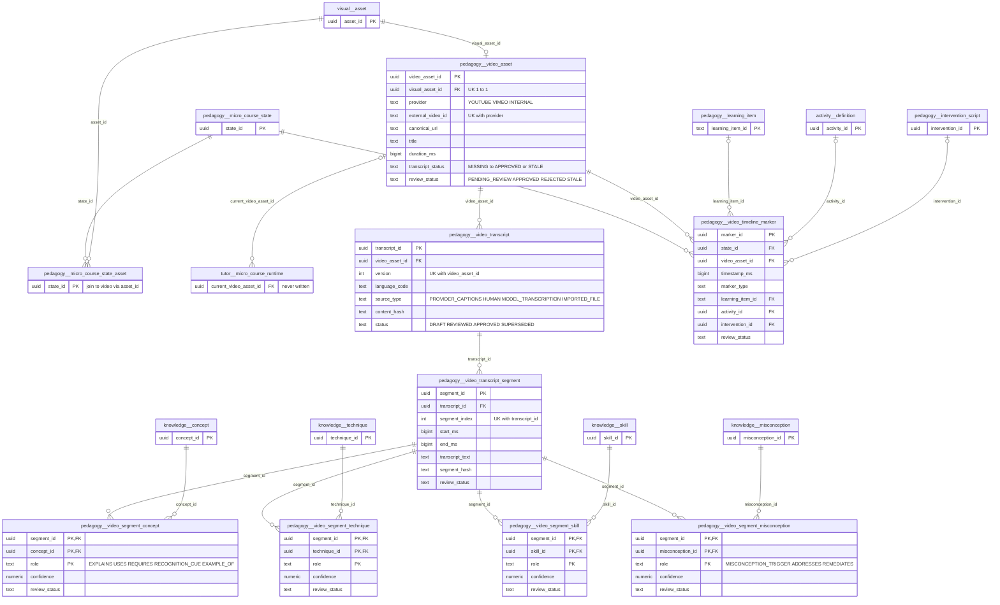
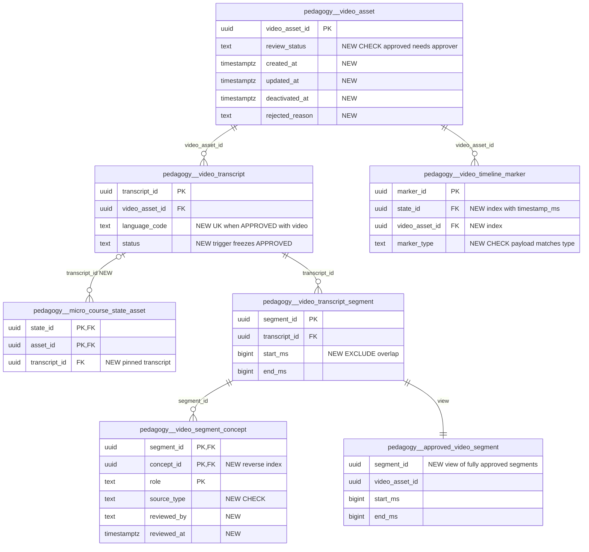

# `pedagogy` schema (part 5 of 5) — videos, transcripts and segment tags

This part covers the curated-video layer of the micro-course platform. It has 8 tables. A `video_asset` is a provider video (YouTube/Vimeo/internal) registered 1:1 against a `visual.asset`. It has versioned `video_transcript`s, and each transcript is cut into timestamped `video_transcript_segment`s. Each segment can be tagged with canonical concepts, techniques, skills and misconceptions (`video_segment_*`). Separately, `video_timeline_marker` pins pauses, quizzes, diagnostics and interventions to timestamps of a video inside one micro-course lesson state. The design comes from requirements [40](../../requirements/40_MICRO_COURSE_PLATFORM.md) MCR-7 (curated video ingestion), MCR-8 (transcript import and segmentation) and MCR-9 (timestamp-grounded Q&A gating). **Only the read side exists today:** no REST route, service function, ETL or script inserts, updates or deletes rows in any of these tables, apart from one bulk status update of timeline markers during release review. Sibling parts: [pedagogy-micro-courses.md](pedagogy-micro-courses.md) (micro-courses, states, interventions; its §2c draws the same video tables in context), [pedagogy-routes-diagnosis.md](pedagogy-routes-diagnosis.md) (tutoring routes, gap diagnosis, recovery), [pedagogy-taxonomy-sources.md](pedagogy-taxonomy-sources.md) (taxonomy, sources) and [pedagogy-solutions-feedback.md](pedagogy-solutions-feedback.md) (solution steps, hints, feedback, interventions).

Source of truth: migration [032](../../../mathbank-db/sql/032_micro_course_platform.sql) (§8 video asset/transcript/segments, §9 segment bindings, §10 timeline markers, §18 immutability guards). Catalog extracted 2026-11-01 from migrations 001–054; endpoint mapping traced from mathbank-rest source and manually verified.

## 1. Purpose, ownership and data flow

| Area | Tables | Writes owned by | Read by | Lifecycle | Privacy class |
|---|---|---|---|---|---|
| Video identity | `video_asset` | **No writer.** MCR-7 specifies an admin "paste a URL" workflow, but it is not implemented. [seed_reference_course_extras.py](../../../mathbank-rest/scripts/seed_reference_course_extras.py) (`ensure_video_asset`, L50) deliberately creates only a `visual.asset` row for its YouTube videos, with no `pedagogy.video_asset` row | Course reader and preview, learner runtime, publish validator and release `content_hash` in [micro_course_service.py](../../../mathbank-rest/src/mathbank_rest/micro_course_service.py). The item-help assist in [micro_course_assist.py](../../../mathbank-rest/src/mathbank_rest/micro_course_assist.py) | `review_status` `PENDING_REVIEW → APPROVED/REJECTED/STALE`. `transcript_status` `MISSING → IMPORTED/TRANSCRIBED → REVIEWED → APPROVED`, or `STALE`. Not release-scoped and not trigger-guarded | Public corpus once approved (canonical URL, title, creator) |
| Transcripts and segments | `video_transcript`, `video_transcript_segment` | **No writer** | Same readers. Learner paths filter `t.status='APPROVED' AND seg.review_status='APPROVED'` (MCR-9) | Transcript: `DRAFT → REVIEWED → APPROVED → SUPERSEDED`, with a new `version` per import. Segment: `PENDING_REVIEW → APPROVED/REJECTED` | Public corpus once approved. Drafts are staff-only |
| Segment semantic tags | `video_segment_concept`, `video_segment_technique`, `video_segment_skill`, `video_segment_misconception` | **No writer** | **No reader** anywhere in the repo: not REST, not the agents, not the Neo4j ETL | `review_status` `PENDING_REVIEW → APPROVED/REJECTED` | Public corpus (staff-reviewed) |
| Timeline markers | `video_timeline_marker` | **No insert path.** `review_release` bulk-approves pending markers (UPDATE only) | Publish validator (pending count) and release `content_hash`. **Not returned** by the reader, the preview or the learner runtime | `PENDING_REVIEW → APPROVED/REJECTED`. Frozen with the owning micro-course release (trigger `video_timeline_marker_guard`) | Staff-authored curriculum |

Data flow as designed (MCR-7…MCR-9), with today's state of each step:

1. **Register** (missing). An admin pastes a URL. The server normalises `(provider, external_video_id)`, creates `visual.asset` plus `video_asset` with `transcript_status='MISSING'` and `review_status='PENDING_REVIEW'`, and never publishes automatically.
2. **Transcribe and segment** (missing). Provider captions, a human transcript, a model transcription or an imported file becomes `video_transcript` version *n* (`DRAFT`). A Transcript Annotator splits, merges, retimes and edits segments, tags them through `video_segment_*`, and approves them.
3. **Attach** (exists, indirectly). A lesson state of `state_type='VIDEO'` uses a video by attaching its `visual.asset` through `pedagogy.micro_course_state_asset` (`POST /v1/admin/micro-courses/states/{state_id}/assets`, documented in [pedagogy-micro-courses.md](pedagogy-micro-courses.md)). The join to `video_asset` is `v.visual_asset_id = sa.asset_id`; there is no direct FK from state to video.
4. **Validate and publish** (exists). `validate_release` requires every *required* VIDEO state to have an `APPROVED` video with a `VALID` visual asset, plus at least one `APPROVED` segment of an `APPROVED` transcript ([micro_course_service.py:2650-2684](../../../mathbank-rest/src/mathbank_rest/micro_course_service.py)). Publish also requires every timeline marker of the release to be `APPROVED` (L2799-2808) and hashes video, transcript and marker rows into `micro_course_release.content_hash` (`_content_hash`, L2941-2967).
5. **Learn** (exists, read-only). The reader and runtime expose `video_url`/`duration_ms` for approved videos and the approved transcript segments of the current state. The "Help me" assist for an asset sends up to 30 approved segments to the LLM as grounding ([micro_course_assist.py:152-188](../../../mathbank-rest/src/mathbank_rest/micro_course_assist.py)). The web reader renders these segments ([page.jsx:347](../../../mathbank-web/app/learn/courses/[code]/page.jsx)).

Related but unused hooks: `tutor.micro_course_runtime.current_video_asset_id`/`current_video_time_ms` (FK → `video_asset`) are never written. `pipeline.projection_request.scope_type` accepts `'VIDEO_ASSET'`, but no projector consumes it. The MCR-18/19 `VideoAsset`/`VideoSegment` Neo4j projection does not exist.

## 2. Entity diagram — as-is

## 3. Tables

### `pedagogy.video_asset`

**Role.** One row is the curated-video identity of one `visual.asset`. It records the provider and provider ID, the canonical URL, title/creator/channel metadata, duration, and two review axes: the video itself (`review_status`) and the state of its transcript (`transcript_status`). Readers use it to turn a state's attached `visual.asset` into a playable `video_url` plus `duration_ms`. They return these only when `review_status='APPROVED'` (LEFT JOIN in [micro_course_service.py:495-509](../../../mathbank-rest/src/mathbank_rest/micro_course_service.py) and L760-772). The publish validator requires an approved row for every required VIDEO state.

**Table type** (guide §4): catalogue entity (governed, reviewed reference data).

**Lifecycle.** As designed: created `PENDING_REVIEW`/`MISSING`, then approved, rejected or marked `STALE` when the provider metadata changes (`metadata_hash`). No code sets any status today. There is no immutability trigger, so an approved video used by a `PUBLISHED` micro-course release can still be edited. Deleting it cascades to its transcripts and timeline markers. The delete fails in two cases: when a `tutor.micro_course_runtime` row points at the video (NO ACTION), or when a cascaded marker belongs to a published release, because `video_timeline_marker_guard` raises.

| Column | Type | Null | Default | Description |
|---|---|---|---|---|
| video_asset_id | uuid | NO | gen_random_uuid() | Surrogate PK. Referenced by transcripts, timeline markers and `tutor.micro_course_runtime.current_video_asset_id`. |
| visual_asset_id | uuid | NO | | → `visual.asset.asset_id` (ON DELETE RESTRICT). UNIQUE, so 1:1 with the stored or external asset that states attach. A state "uses" this video when `micro_course_state_asset.asset_id = visual_asset_id`. |
| provider | text | NO | | `YOUTUBE`, `VIMEO` or `INTERNAL` (CHECK). |
| external_video_id | text | NO | | Provider-side video ID, for example the YouTube 11-character ID. MCR-7 requires the server to normalise it from the pasted URL. UNIQUE with `provider`. |
| canonical_url | text | NO | | Normalised playback URL. Returned to learners as `video_url` when the video is APPROVED. |
| title | text | NO | | Provider title. Hashed into the release `content_hash` as `video_title`. |
| creator_name | text | yes | | Video author or creator (attribution). Not read by any code. |
| channel_name | text | yes | | Provider channel name. Not read by any code. |
| duration_ms | bigint | yes | | Video length in milliseconds. CHECK `> 0` when set. Returned to learners alongside `video_url`. |
| retrieved_at | timestamptz | yes | | When provider metadata was last fetched (MCR-7). |
| metadata_hash | text | yes | | Hash of the fetched provider metadata. Intended to detect drift, which would move the video to `STALE`. No code computes it. |
| transcript_status | text | NO | 'MISSING' | Roll-up of the transcript pipeline: `MISSING`, `IMPORTED`, `TRANSCRIBED`, `REVIEWED`, `APPROVED` or `STALE`. Indexed but never read or written by code. Readers check `video_transcript.status` directly instead. |
| review_status | text | NO | 'PENDING_REVIEW' | Video-level review: `PENDING_REVIEW`, `APPROVED`, `REJECTED` or `STALE`. Only `APPROVED` videos produce `video_url`/`duration_ms`, and only they satisfy the publish validator. |
| approved_by | text | yes | | Free-text reviewer identity that approved the video. No CHECK ties it to `review_status`. |
| approved_at | timestamptz | yes | | Approval time. |

**Keys, constraints, indexes.**
- PK `video_asset_id`. UNIQUE `visual_asset_id`. UNIQUE `(provider, external_video_id)`.
- FK `visual_asset_id` → `visual.asset` ON DELETE RESTRICT.
- CHECKs: `provider`, `transcript_status` and `review_status` enums; `duration_ms IS NULL OR duration_ms > 0`.
- Index `video_asset_transcript_status_idx (transcript_status, review_status)`, which no query uses.
- No `created_at`/`updated_at`, no triggers.
- Referenced by `video_transcript` (CASCADE), `video_timeline_marker` (CASCADE) and `tutor.micro_course_runtime` (NO ACTION).

**REST operations today.** Read-only. There is no create, update or delete route.

| Op | Method & path | Auth | Handler | Notes |
|---|---|---|---|---|
| R | GET /v1/micro-courses/{canonical_code} | Anonymous | `micro_courses.get_student_course` → `get_published_course` → `_assemble_course_reader_payload` | Per state asset: `video_url`, `duration_ms` (APPROVED only). Transcript segments are joined through this table. |
| R | GET /v1/admin/micro-courses/{canonical_code}/preview | Admin key (X-Admin-Api-Key) | `get_admin_course_preview` → `get_course_preview` | Same payload with `approved_only=False`. `video_url` still requires an APPROVED video. |
| R | POST /v1/micro-courses/{canonical_code}/enroll; GET /v1/micro-courses/enrollments/{enrollment_id}; POST …/{enrollment_id}/advance | Learner JWT | `start_enrollment` / `get_enrollment_runtime` / `advance_enrollment` | Current-state assets and transcript segments. |
| R | POST /v1/micro-courses/enrollments/{enrollment_id}/item-help | Learner JWT | `micro_course_assist.get_item_assist` → `_ground_asset` | `item_kind='asset'`: approved segments for the asset (≤ 30) as LLM grounding. |
| R | POST /v1/admin/micro-courses/releases/{release_id}/validate; POST …/review; POST …/publish | Admin key | `validate_release` (review/publish also); `_content_hash` (publish) | The required-VIDEO-state check. Publish hashes `provider, external_video_id, canonical_url, title`. |

Non-REST: none.

### `pedagogy.video_transcript`

**Role.** One versioned transcript of one video in one language. Each import, whether provider captions, a human transcript, a model transcription or an uploaded file, creates the next `version` as `DRAFT`. Reviewers move it to `REVIEWED` and `APPROVED`; a newer approved version should then mark the old one `SUPERSEDED`. Learner-facing readers use a transcript only when `status='APPROVED'`. `raw_text` keeps the unsegmented source text, while the segments carry the timestamped units.

**Table type:** revisioned authoring object (versioned by `version`, reviewed, then frozen by convention).

**Lifecycle.** `DRAFT → REVIEWED → APPROVED → SUPERSEDED`. There is no trigger, no REJECTED value and no rule allowing only one `APPROVED` version per `(video, language)`. Readers do not choose a version. If two versions are APPROVED, the reader and runtime return the segments of **both** interleaved by `start_ms` ([micro_course_service.py:545-557](../../../mathbank-rest/src/mathbank_rest/micro_course_service.py), L889-903). Rows are deleted only by cascade from `video_asset`.

| Column | Type | Null | Default | Description |
|---|---|---|---|---|
| transcript_id | uuid | NO | gen_random_uuid() | Surrogate PK. |
| video_asset_id | uuid | NO | | → `pedagogy.video_asset` (ON DELETE CASCADE). |
| version | integer | NO | | 1-based version per video (CHECK `>= 1`). UNIQUE with `video_asset_id`. Included in the release `content_hash`. |
| language_code | text | NO | | Transcript language, a free-text BCP-47-style code such as `en`. There is no CHECK. |
| source_type | text | NO | | `PROVIDER_CAPTIONS`, `HUMAN`, `MODEL_TRANSCRIPTION` or `IMPORTED_FILE` (CHECK). MCR-7 forbids treating a provider's chapter list as a transcript. |
| raw_text | text | yes | | Full unsegmented transcript text as imported. Not read by any code. |
| content_hash | text | NO | | Hash of the transcript content, used to detect a changed re-import. Included in the release `content_hash`. |
| status | text | NO | 'DRAFT' | `DRAFT`, `REVIEWED`, `APPROVED` or `SUPERSEDED`. Learner readers and the validator require `APPROVED`. |
| created_by | text | NO | | Free-text actor who imported the version. |
| reviewed_by | text | yes | | Free-text reviewer identity. |
| created_at | timestamptz | NO | now() | Import time. |
| reviewed_at | timestamptz | yes | | Review time. |

**Keys, constraints, indexes.**
- PK `transcript_id`. UNIQUE `(video_asset_id, version)`.
- FK `video_asset_id` → `video_asset` ON DELETE CASCADE.
- CHECKs: `version >= 1`; `source_type` and `status` enums.
- No partial unique index for "one APPROVED per video and language", and no triggers.
- Referenced by `video_transcript_segment` (CASCADE).

**REST operations today.** Read-only, through the same routes as `video_asset`.

| Op | Method & path | Auth | Handler | Notes |
|---|---|---|---|---|
| R | GET /v1/micro-courses/{canonical_code} | Anonymous | `_assemble_course_reader_payload` | `t.status='APPROVED'`. `video_asset.review_status` is **not** checked on this join. |
| R | GET /v1/admin/micro-courses/{canonical_code}/preview | Admin key | `_assemble_course_reader_payload(approved_only=False)` | Every version in every status, so DRAFT and SUPERSEDED segments appear together. |
| R | POST /v1/micro-courses/{canonical_code}/enroll; GET …/enrollments/{enrollment_id}; POST …/advance | Learner JWT | `get_enrollment_runtime` | `t.status='APPROVED'`. |
| R | POST /v1/micro-courses/enrollments/{enrollment_id}/item-help | Learner JWT | `_ground_asset` | `t.status='APPROVED'`. |
| R | POST /v1/admin/micro-courses/releases/{release_id}/validate; …/review; …/publish | Admin key | `validate_release`; `_content_hash` | Publish hashes `version, language_code, source_type, content_hash, status` for every version, not only APPROVED. |

Non-REST: none.

### `pedagogy.video_transcript_segment`

**Role.** One timestamped unit `[start_ms, end_ms)` of a transcript, with its text and optional speaker. This is the unit of MCR-9 timestamp-grounded Q&A: a learner may ask about a moment only when the segment covering it is `APPROVED` within an `APPROVED` transcript. The table comment states this. Segments are also the anchor for semantic tags (`video_segment_*`). Today they are returned as `transcript_segments` per state and used as assist grounding. No code resolves a segment from a learner's playback time.

**Table type:** child row of a revisioned authoring object (the transcript), reviewed per row.

**Lifecycle.** `PENDING_REVIEW → APPROVED | REJECTED`. MCR-8 designs split, merge, retime and edit operations, but none exists. Rows are deleted only by cascade from the transcript.

| Column | Type | Null | Default | Description |
|---|---|---|---|---|
| segment_id | uuid | NO | gen_random_uuid() | Surrogate PK. Returned to readers and referenced by the four tag tables. |
| transcript_id | uuid | NO | | → `pedagogy.video_transcript` (ON DELETE CASCADE). |
| segment_index | integer | NO | | 0-based order within the transcript (CHECK `>= 0`). UNIQUE per transcript. Secondary sort key after `start_ms`. |
| start_ms | bigint | NO | | Segment start offset in the video, in ms (CHECK `>= 0`). |
| end_ms | bigint | NO | | Exclusive end offset, in ms (CHECK `> start_ms`). Not checked against `video_asset.duration_ms`, and there is no non-overlap constraint. |
| transcript_text | text | NO | | What the speaker says in the segment. CHECK non-blank after trim. Shown to learners and passed to the assist LLM. |
| speaker | text | yes | | Optional speaker label. |
| segment_hash | text | NO | | Hash of the segment content (text and timing). Included in the release `content_hash`. |
| review_status | text | NO | 'PENDING_REVIEW' | `PENDING_REVIEW`, `APPROVED` or `REJECTED`. Learner paths and the validator require `APPROVED`. |

**Keys, constraints, indexes.**
- PK `segment_id`. UNIQUE `(transcript_id, segment_index)`.
- FK `transcript_id` → `video_transcript` ON DELETE CASCADE.
- CHECKs: `segment_index >= 0`, `start_ms >= 0`, `end_ms > start_ms`, non-blank `transcript_text`, `review_status` enum.
- Index `video_segment_time_idx (transcript_id, start_ms, end_ms)`, intended for the `start_ms <= :t < end_ms` lookup in MCR-9.
- Table comment: "Timestamp-grounded Q&A only resolves against APPROVED transcripts/segments (MCR-9)."
- Referenced by the four `video_segment_*` tables (CASCADE).

**REST operations today.** Read-only.

| Op | Method & path | Auth | Handler | Notes |
|---|---|---|---|---|
| R | GET /v1/micro-courses/{canonical_code} | Anonymous | `_assemble_course_reader_payload` | `state.transcript_segments` returns `segment_id, start_ms, end_ms, transcript_text, speaker, segment_index`. |
| R | GET /v1/admin/micro-courses/{canonical_code}/preview | Admin key | same, `approved_only=False` | All statuses. |
| R | POST /v1/micro-courses/{canonical_code}/enroll; GET …/enrollments/{enrollment_id}; POST …/advance | Learner JWT | `get_enrollment_runtime` | `current_state.transcript_segments` (APPROVED only). |
| R | POST /v1/micro-courses/enrollments/{enrollment_id}/item-help | Learner JWT | `_ground_asset` | All approved segments of the asset ordered by `start_ms`, `LIMIT 30`, not just the one nearest the playback time. The code comment documents this as a simplification. |
| R | POST /v1/admin/micro-courses/releases/{release_id}/validate; …/review; …/publish | Admin key | `validate_release`; `_content_hash` | Existence check for required VIDEO states. Publish hashes every segment of every version. |

Non-REST: none.

### `pedagogy.video_timeline_marker`

**Role.** A timestamped instruction on a video *within one lesson state*: start of a segment, a required or optional pause, a quiz or diagnostic (pointing at a learning item or activity), an intervention script, or a resume point. Markers belong to the state, and so to a micro-course release, not to the video. They are the only video table that is release-scoped and immutable after publish. The validator blocks publishing while any marker of the release is not `APPROVED`, and `review_release(APPROVED)` bulk-approves pending markers. **No learner-facing payload includes markers**, so learners never see the pauses or quizzes they describe.

**Table type:** child of a revisioned authoring object (`micro_course_state` → `micro_course_release`).

**Lifecycle.** Trigger `video_timeline_marker_guard` (`pedagogy.guard_published_state_child()`, BEFORE INSERT/UPDATE/DELETE) blocks every mutation once the owning release is `PUBLISHED`, `SUPERSEDED` or `RETIRED`. The bypass is the session setting `pedagogy.allow_purge=on`. `review_status` moves `PENDING_REVIEW → APPROVED` when the release review is `APPROVED`. No code sets `REJECTED`. Rows are deleted by cascade from the state or the video.

| Column | Type | Null | Default | Description |
|---|---|---|---|---|
| marker_id | uuid | NO | gen_random_uuid() | Surrogate PK. Used only as the final sort key in the content hash. |
| state_id | uuid | NO | | → `pedagogy.micro_course_state` (ON DELETE CASCADE). Owning lesson state, hence the release. |
| video_asset_id | uuid | NO | | → `pedagogy.video_asset` (ON DELETE CASCADE). Video the timestamp refers to. Nothing checks that this video is attached to `state_id`. |
| timestamp_ms | bigint | NO | | Offset in the video, in ms (CHECK `>= 0`). Not checked against `duration_ms`. |
| marker_type | text | NO | | `SEGMENT_START`, `REQUIRED_PAUSE`, `OPTIONAL_PAUSE`, `QUIZ`, `DIAGNOSTIC`, `INTERVENTION` or `RESUME_POINT` (CHECK). |
| learning_item_id | text | yes | | → `pedagogy.learning_item` (NO ACTION). Item asked at a `QUIZ`/`DIAGNOSTIC` marker. Nothing ties it to `marker_type`. |
| activity_id | uuid | yes | | → `activity.definition` (NO ACTION). Activity launched at the marker. |
| intervention_id | uuid | yes | | → `pedagogy.intervention_script` (NO ACTION; FK added after the script table, constraint `video_timeline_marker_intervention_fkey`). Script started at an `INTERVENTION` marker. Not checked to belong to the same release. |
| note | text | yes | | Author note shown to staff. Included in the content hash. |
| review_status | text | NO | 'PENDING_REVIEW' | `PENDING_REVIEW`, `APPROVED` or `REJECTED`. Publish requires all markers of the release to be `APPROVED`. |

**Keys, constraints, indexes.**
- PK `marker_id`. There is no natural-key UNIQUE, so two identical markers at the same timestamp are allowed.
- FKs: `state_id` (CASCADE), `video_asset_id` (CASCADE), `learning_item_id`, `activity_id` and `intervention_id` (NO ACTION).
- CHECKs: `timestamp_ms >= 0`; `marker_type` and `review_status` enums.
- Trigger `video_timeline_marker_guard`.
- Only the PK is indexed. The `state_id` joins used by the validator and review, and the `video_asset_id` FK, are unindexed.

**REST operations today.**

| Op | Method & path | Auth | Handler | Notes |
|---|---|---|---|---|
| R | POST /v1/admin/micro-courses/releases/{release_id}/validate | Admin key | `validate_release` | Counts non-APPROVED markers. Reported only when `require_approved_children` (publish). |
| U | POST /v1/admin/micro-courses/releases/{release_id}/review | Admin key | `review_release` ([micro_course_service.py:2900-2910](../../../mathbank-rest/src/mathbank_rest/micro_course_service.py)) | `status=APPROVED`: `UPDATE … SET review_status='APPROVED' WHERE review_status='PENDING_REVIEW'` for the release's markers. Audited only as part of the `RELEASE_REVIEW_APPROVED` event. |
| R | POST /v1/admin/micro-courses/releases/{release_id}/publish | Admin key | `validate_release(require_approved_children=True)`; `_content_hash` | Blocks publication on pending markers and hashes the markers. |

Not read by the reader, the preview, the runtime or the assist. Non-REST: none.

### `pedagogy.video_segment_concept`

**Role.** Semantic tag: "this transcript segment *explains / uses / requires / is a recognition cue for / is an example of* canonical concept C", with an optional confidence and a review status (MCR-8 binding panel). It was intended to drive concept-scoped video search, segment-level grounding and the `VideoSegment` graph projection (MCR-18). **No code reads or writes it.**

**Table type:** junction / link.

**Lifecycle.** `PENDING_REVIEW → APPROVED | REJECTED`. No trigger. Deleted by cascade from the segment. Deleting the concept is blocked (NO ACTION).

| Column | Type | Null | Default | Description |
|---|---|---|---|---|
| segment_id | uuid | NO | | → `pedagogy.video_transcript_segment` (ON DELETE CASCADE). Part of the PK. |
| concept_id | uuid | NO | | → `knowledge.concept` (NO ACTION). Part of the PK. |
| role | text | NO | | `EXPLAINS`, `USES`, `REQUIRES`, `RECOGNITION_CUE` or `EXAMPLE_OF` (CHECK). Part of the PK, so one segment can hold several roles for the same concept. |
| confidence | numeric(3,2) | yes | | Tagger confidence in [0, 1] (CHECK). NULL for unscored human tags. |
| source_type | text | NO | 'HUMAN' | Origin of the tag. Free text with no CHECK. Only `HUMAN` is implied by the default; a model tagger would use another value. |
| review_status | text | NO | 'PENDING_REVIEW' | `PENDING_REVIEW`, `APPROVED` or `REJECTED`. |

**Keys, constraints, indexes.**
- PK `(segment_id, concept_id, role)`.
- FKs: `segment_id` → `video_transcript_segment` (CASCADE); `concept_id` → `knowledge.concept`.
- CHECKs: `role` enum; `confidence` in [0, 1]; `review_status` enum.
- No index leading on `concept_id`, which the "videos for concept X" lookup would need.

**REST operations today.** None. No reader or writer in any service, script or ETL.

### `pedagogy.video_segment_technique`

**Role.** The same tag as `video_segment_concept`, targeting a canonical `knowledge.technique`. MCR-8 lists technique roles explicitly. It answers "where in this video is technique T demonstrated or used". **Unused.**

**Table type:** junction / link.

**Lifecycle.** As for `video_segment_concept`.

| Column | Type | Null | Default | Description |
|---|---|---|---|---|
| segment_id | uuid | NO | | → `pedagogy.video_transcript_segment` (ON DELETE CASCADE). Part of the PK. |
| technique_id | uuid | NO | | → `knowledge.technique` (NO ACTION). Part of the PK. |
| role | text | NO | | `EXPLAINS`, `USES`, `REQUIRES`, `RECOGNITION_CUE` or `EXAMPLE_OF` (CHECK). Part of the PK. |
| confidence | numeric(3,2) | yes | | Confidence in [0, 1] (CHECK). |
| source_type | text | NO | 'HUMAN' | Tag origin. Free text, no CHECK. |
| review_status | text | NO | 'PENDING_REVIEW' | `PENDING_REVIEW`, `APPROVED` or `REJECTED`. |

**Keys, constraints, indexes.**
- PK `(segment_id, technique_id, role)`.
- FKs: `segment_id` (CASCADE); `technique_id` → `knowledge.technique`.
- CHECKs: `role`, `confidence` and `review_status`.
- No index on `technique_id`.

**REST operations today.** None.

### `pedagogy.video_segment_skill`

**Role.** The same tag targeting a canonical `knowledge.skill`: "this segment teaches or requires skill S". It is the natural source for "watch this part" remediation from a skill-level knowledge gap. **Unused.**

**Table type:** junction / link.

**Lifecycle.** As for `video_segment_concept`.

| Column | Type | Null | Default | Description |
|---|---|---|---|---|
| segment_id | uuid | NO | | → `pedagogy.video_transcript_segment` (ON DELETE CASCADE). Part of the PK. |
| skill_id | uuid | NO | | → `knowledge.skill` (NO ACTION). Part of the PK. |
| role | text | NO | | `EXPLAINS`, `USES`, `REQUIRES`, `RECOGNITION_CUE` or `EXAMPLE_OF` (CHECK). Part of the PK. |
| confidence | numeric(3,2) | yes | | Confidence in [0, 1] (CHECK). |
| source_type | text | NO | 'HUMAN' | Tag origin. Free text, no CHECK. |
| review_status | text | NO | 'PENDING_REVIEW' | `PENDING_REVIEW`, `APPROVED` or `REJECTED`. |

**Keys, constraints, indexes.**
- PK `(segment_id, skill_id, role)`.
- FKs: `segment_id` (CASCADE); `skill_id` → `knowledge.skill`.
- CHECKs: `role`, `confidence` and `review_status`.
- No index on `skill_id`.

**REST operations today.** None.

### `pedagogy.video_segment_misconception`

**Role.** Links a segment to a canonical `knowledge.misconception` with a misconception-specific role. `MISCONCEPTION_TRIGGER` means the segment tends to provoke the misconception, `ADDRESSES` means it discusses it, and `REMEDIATES` means it corrects it. It was intended for intervention scripts and misconception-aware tutoring. **Unused.**

**Table type:** junction / link.

**Lifecycle.** As for `video_segment_concept`.

| Column | Type | Null | Default | Description |
|---|---|---|---|---|
| segment_id | uuid | NO | | → `pedagogy.video_transcript_segment` (ON DELETE CASCADE). Part of the PK. |
| misconception_id | uuid | NO | | → `knowledge.misconception` (NO ACTION). Part of the PK. |
| role | text | NO | | `MISCONCEPTION_TRIGGER`, `ADDRESSES` or `REMEDIATES` (CHECK). Part of the PK. |
| confidence | numeric(3,2) | yes | | Confidence in [0, 1] (CHECK). |
| source_type | text | NO | 'HUMAN' | Tag origin. Free text, no CHECK. |
| review_status | text | NO | 'PENDING_REVIEW' | `PENDING_REVIEW`, `APPROVED` or `REJECTED`. |

**Keys, constraints, indexes.**
- PK `(segment_id, misconception_id, role)`.
- FKs: `segment_id` (CASCADE); `misconception_id` → `knowledge.misconception`.
- CHECKs: `role`, `confidence` and `review_status`.
- No index on `misconception_id`.

**REST operations today.** None.

## 4. CRUD coverage — as-is

Legend: ✅ REST route exists · ❌ missing · — not applicable for this table type · R* read only indirectly, inside the micro-course reader, runtime or publish routes · ⚙️ side effect of another resource's action.

| Table | Type (guide §4) | Create | Read | List | Update | Delete / lifecycle | Notes |
|---|---|---|---|---|---|---|---|
| pedagogy.video_asset | Catalogue entity | ❌ | R* | ❌ | ❌ | ❌ (no approve/reject/stale action) | MCR-7 registration missing; seeds bypass the table. |
| pedagogy.video_transcript | Revisioned authoring object | ❌ | R* | ❌ | ❌ | ❌ (no review/approve/supersede) | MCR-8 import missing. |
| pedagogy.video_transcript_segment | Child of revisioned object | ❌ | R* | ❌ | ❌ | ❌ (no split/merge/retime/approve) | Read as `transcript_segments`; no time-indexed lookup. |
| pedagogy.video_timeline_marker | Child of revisioned object (release-scoped) | ❌ | ❌ (count and hash only) | ❌ | ⚙️ bulk approve in `POST …/releases/{id}/review` | ❌ | Publish gate exists, but learners never receive markers. |
| pedagogy.video_segment_concept | Junction / link | ❌ | ❌ | ❌ | — | ❌ | Dead table. |
| pedagogy.video_segment_technique | Junction / link | ❌ | ❌ | ❌ | — | ❌ | Dead table. |
| pedagogy.video_segment_skill | Junction / link | ❌ | ❌ | ❌ | — | ❌ | Dead table. |
| pedagogy.video_segment_misconception | Junction / link | ❌ | ❌ | ❌ | — | ❌ | Dead table. |

Findings:

1. **No write path at all.** None of the 8 tables can be populated through REST, a script or ETL. The only mutation is the bulk marker approval. In practice, a *required* VIDEO state can never be published. The reference seeds work around this by making their video states optional and attaching only a `visual.asset` ([seed_reference_course_extras.py:50-55](../../../mathbank-rest/scripts/seed_reference_course_extras.py)). That also means their videos never get the approved-only `video_url`, so the web reader falls back to `asset.source_url` ([page.jsx:285](../../../mathbank-web/app/learn/courses/[code]/page.jsx)).
2. **Published content can drift.** `video_asset`, `video_transcript` and segments are not release-scoped and not trigger-guarded. Once the write side exists, editing or approving a new transcript would silently change what a `PUBLISHED` release shows, even though `content_hash` was frozen at publish time and hashes every transcript version.
3. **Several APPROVED transcripts are merged.** Readers join every `APPROVED` transcript of the video with no `language_code`/`version` choice and no "latest approved" rule. Two approved versions would duplicate or interleave text.
4. **Inconsistent approval gates.** The transcript-segment queries do not require `video_asset.review_status='APPROVED'`, while the `video_url` join does. A rejected video can therefore still expose its approved transcript text to anonymous readers.
5. **Admin preview shows every version.** `approved_only=False` returns DRAFT, REVIEWED and SUPERSEDED segments of all versions in one list without a status or version field, so reviewers cannot tell them apart.
6. **Markers never reach learners.** They gate publication and are hashed, but `get_enrollment_runtime` and the reader omit them, so `REQUIRED_PAUSE`/`QUIZ`/`INTERVENTION` markers have no runtime effect. Nothing checks that a marker's `video_asset_id` is attached to its state, or that its `intervention_id` belongs to the same release.
7. **MCR-9 is only half implemented.** Approval filtering exists, but there is no "which segment is at time t" endpoint. The item-help assist sends up to 30 approved segments, not the segment at the learner's playback position, and `tutor.micro_course_runtime.current_video_time_ms` is never written.
8. **Tag tables and the projection hook are dead.** The four `video_segment_*` tables, `video_asset.transcript_status`, `creator_name`, `channel_name`, `raw_text`, `metadata_hash`, `retrieved_at` and the `VIDEO_ASSET` projection scope have no reader or writer.

## 5. Target state — how it should be

### 5.1 Schema improvements

1. **P1: Freeze what a published release shows.**
   - **Evidence.** Finding 2. Release children are trigger-guarded (`guard_published_state_child`), but the video tables they depend on are not.
   - **Fix.** Pin the exact transcript on the attachment: add `transcript_id uuid REFERENCES pedagogy.video_transcript` to `pedagogy.micro_course_state_asset`, set it while the release is DRAFT, and read only that transcript at runtime. Add a trigger on `video_transcript` and `video_transcript_segment` that blocks UPDATE/DELETE once the transcript is `APPROVED`, allowing only `APPROVED → SUPERSEDED` on `status`. This mirrors `pedagogy.guard_route_snapshot` in [pedagogy-routes-diagnosis.md](pedagogy-routes-diagnosis.md).
2. **P1: Allow one approved transcript per video and language.**
   - **Fix.** `CREATE UNIQUE INDEX video_transcript_one_approved ON pedagogy.video_transcript (video_asset_id, language_code) WHERE status='APPROVED'`. Approving a new version supersedes the previous one in the same transaction.
3. **P1: Use one approval predicate everywhere.**
   - **Fix.** Every learner-facing segment query must require `v.review_status='APPROVED' AND t.status='APPROVED' AND seg.review_status='APPROVED'`. Today only the transcript and segment conditions are applied ([micro_course_service.py:545-557, 889-903](../../../mathbank-rest/src/mathbank_rest/micro_course_service.py); [micro_course_assist.py:172-182](../../../mathbank-rest/src/mathbank_rest/micro_course_assist.py)). Put the predicate in one SQL view, for example `pedagogy.approved_video_segment`, so the reader, runtime, assist and validator cannot drift apart.
4. **P2: Make timeline markers consistent.**
   - **Fix.** Add CHECKs tying payload to type: `marker_type IN ('QUIZ','DIAGNOSTIC')` requires `learning_item_id IS NOT NULL OR activity_id IS NOT NULL`; `marker_type='INTERVENTION'` requires `intervention_id IS NOT NULL`; other types require all three to be NULL.
   - Validate in `validate_release` that the marker's video is attached to its state, that `intervention_script.release_id` equals the state's release, and that `timestamp_ms <= duration_ms`.
   - Add indexes `(state_id, timestamp_ms)` and `(video_asset_id)`.
5. **P2: Prevent overlapping segments.**
   - **Fix.** Add `EXCLUDE USING gist (transcript_id WITH =, int8range(start_ms, end_ms) WITH &&)` (needs `btree_gist`), so that MCR-9's `start_ms <= :t < end_ms` lookup returns at most one row per transcript.
6. **P2: Govern segment tags.**
   - **Fix.** Add `CHECK (source_type IN ('HUMAN','MODEL_SUGGESTED','IMPORTED'))`. The vocabulary is a proposal, because no writer exists to confirm one. Add `reviewed_by`, `reviewed_at` and `created_at` to all four tables, plus reverse indexes `(concept_id)`, `(technique_id)`, `(skill_id)` and `(misconception_id)` for "segments for X" lookups.
7. **P2: Fix review consistency on `video_asset`.**
   - **Fix.** Add `created_at`/`updated_at`, `CHECK (review_status <> 'APPROVED' OR (approved_by IS NOT NULL AND approved_at IS NOT NULL))`, `rejected_reason`, and `deactivated_at`/`deactivated_by` for retiring a video without a hard delete.
   - Either maintain `transcript_status` from transcript transitions in the service, or drop it together with its index.
8. **P3: Tidy small details.**
   - Constrain `language_code` with a BCP-47 pattern CHECK.
   - Decide whether `raw_text` is kept, since it is never read, and store large raw files through `visual.asset`/object storage instead.
   - Either write `tutor.micro_course_runtime.current_video_asset_id`/`current_video_time_ms` from a playback-position endpoint (5.3) or drop them.

### 5.2 Entity diagram — target

The diagram shows only new or changed columns and relationships. Unchanged tables are omitted.

The technique, skill and misconception tag tables receive the same changes as `video_segment_concept`.

### 5.3 Endpoints to build

Admin routes live under a new tag `admin-videos` (guide §7 step 4). All admin mutations write `audit.action_log` through `record_audit_event`.

| Priority | Method & path | Auth | Table(s) / op | Table type | Purpose | Notes (validation, concurrency, audit) |
|---|---|---|---|---|---|---|
| P1 | `POST /v1/admin/videos` | Admin key (X-Admin-Api-Key) | `visual.asset` + `video_asset` / C | Catalogue entity | MCR-7: register a curated video from a pasted URL. | Server normalises `(provider, external_video_id)`, so clients never send them. 409 on the UNIQUE pair (return the existing id). Creates `PENDING_REVIEW`/`MISSING`; never publishes. Fetching metadata is optional and must not block the request (enqueue a job). |
| P1 | `GET /v1/admin/videos?q=&review_status=&transcript_status=&limit=&offset=` | Admin key | `video_asset` / R list | Catalogue entity | Video library for authors. | `{items,total,limit,offset}`. `q` matches title, channel and external ID. |
| P1 | `GET /v1/admin/videos/{video_asset_id}` | Admin key | `video_asset`, `video_transcript` / R | Catalogue entity | Detail with transcript versions (without segment bodies). | 404 when unknown. |
| P2 | `PATCH /v1/admin/videos/{video_asset_id}` | Admin key | `video_asset` / U | Catalogue entity | Edit title, creator, channel and duration. | Use `updated_at` as a concurrency token until a `revision` column exists. Editing an APPROVED video sets it back to `PENDING_REVIEW`. |
| P1 | `POST /v1/admin/videos/{video_asset_id}/approve`, `/reject`, `/mark-stale` | Admin key | `video_asset` / U (lifecycle) | Catalogue entity | Video review. | Body `{reviewer, reason?}`. Approval requires `duration_ms`. Rejecting a video used by a PUBLISHED release returns 409 listing the blockers. |
| P1 | `POST /v1/admin/videos/{video_asset_id}/transcripts` | Admin key | `video_transcript` + `video_transcript_segment` / C | Revisioned authoring object | MCR-8 import: create the next version as DRAFT from captions (WebVTT/SRT), plain text or a segment array. | Server assigns `version = max+1`, computes `content_hash`/`segment_hash`, and validates non-overlapping segments within `duration_ms`. Large files go through `pipeline.job` (202). |
| P1 | `GET /v1/admin/video-transcripts/{transcript_id}` | Admin key | `video_transcript`, segments, tags / R | Revisioned authoring object | Annotator view. | Includes segments with their tags and `review_status`. |
| P1 | `PUT /v1/admin/video-transcripts/{transcript_id}/segments` | Admin key | `video_transcript_segment` / C+U+D (replace set) | Child of revisioned object | Save annotator edits (split, merge, retime, text). | DRAFT transcripts only (409 otherwise). Body includes `expected_content_hash`; 409 `revision_conflict` on mismatch. Keeps `segment_id` for unchanged segments so tags survive. |
| P1 | `POST /v1/admin/video-transcripts/{transcript_id}/review`, `/approve` | Admin key | `video_transcript`, segments, `video_asset.transcript_status` / U | Revisioned authoring object | DRAFT → REVIEWED → APPROVED. | Approve requires every segment to be APPROVED or REJECTED, supersedes the previous APPROVED version for the same language (5.1 #2), and updates `transcript_status`. One transaction plus an audit row. |
| P2 | `POST /v1/admin/video-segments/{segment_id}/approve`, `/reject` | Admin key | `video_transcript_segment` / U | Child of revisioned object | Per-segment review. | Only while the transcript is not APPROVED. |
| P2 | `GET /v1/admin/video-segments/{segment_id}/concepts` (likewise `/techniques`, `/skills`, `/misconceptions`) | Admin key | `video_segment_*` / R | Junction / link | List tags. | |
| P2 | `PUT /v1/admin/video-segments/{segment_id}/concepts/{concept_id}/roles/{role}` and `DELETE` on the same path (likewise for the other three kinds) | Admin key | `video_segment_*` / C, U, D | Junction / link | Idempotent attach or detach of one tag. Body `{confidence?, source_type?}`. | `role` validated against the per-kind `Literal`. 422 for an inactive or unknown canonical target. PUT on an existing tag updates `confidence` and resets `review_status` to PENDING_REVIEW. |
| P2 | `POST /v1/admin/video-segments/{segment_id}/tags/approve` | Admin key | `video_segment_*` / U | Junction / link | Bulk approve or reject the segment's pending tags. | Body `{reviewer, decisions:[{kind,id,role,status}]}`. |
| P1 | `GET`, `POST /v1/admin/micro-courses/states/{state_id}/timeline-markers` | Admin key | `video_timeline_marker` / R, C | Child of revisioned object | Author pauses, quizzes and interventions on a VIDEO state. Follows the existing `/states/{state_id}/bindings` pattern. | DRAFT release only (also enforced by the trigger; map its exception to 409). Validate 5.1 #4 rules. 201 + Location. |
| P2 | `PATCH`, `DELETE /v1/admin/micro-courses/timeline-markers/{marker_id}` | Admin key | `video_timeline_marker` / U, D | Child of revisioned object | Edit or remove a draft marker. | DRAFT release only. PATCH resets `review_status` to PENDING_REVIEW. |
| P1 | Extend `GET /v1/micro-courses/enrollments/{enrollment_id}` (and the reader payload) with `current_state.timeline_markers` | Learner JWT / anonymous | `video_timeline_marker` / R | — | Make markers effective at runtime. | APPROVED markers only. Never include `learning_item.correct_answer`; reference items by id and fetch them through the existing response flow. |
| P1 | `GET /v1/micro-courses/enrollments/{enrollment_id}/video-segment?video_asset_id=&time_ms=` | Learner JWT | `approved_video_segment` view / R | Derived | MCR-9: resolve "what does this part mean?" to exactly one approved segment. | Owner-scoped through the enrollment. The video must be attached to the current state. 404 when no approved segment covers `time_ms`, in which case questioning is disabled. |
| P2 | `PUT /v1/micro-courses/enrollments/{enrollment_id}/video-position` | Learner JWT | `tutor.micro_course_runtime` / U | Learner working state | Store `current_video_asset_id`/`current_video_time_ms` so item-help can ground on the nearest segment instead of 30. | Body includes `state_version`; 409 when stale. |
| P3 | `POST /v1/admin/videos/{video_asset_id}/projection-requests` | Admin key | `pipeline.projection_request` (scope `VIDEO_ASSET`) / C | Queue / job | Request a Neo4j `VideoAsset`/`VideoSegment` projection (MCR-18/19). | 202 + job id. The projector itself is still to be written in mathbank-graph. |
