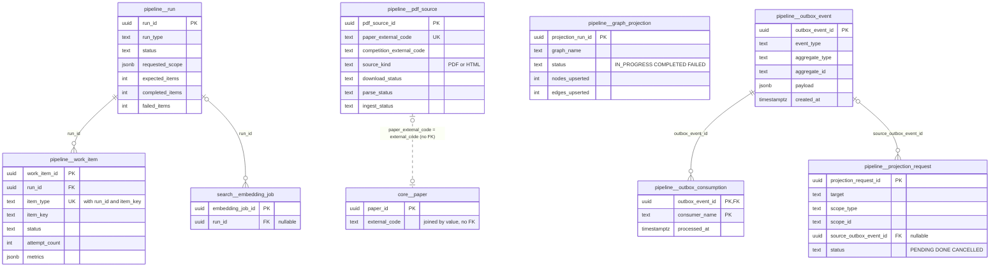
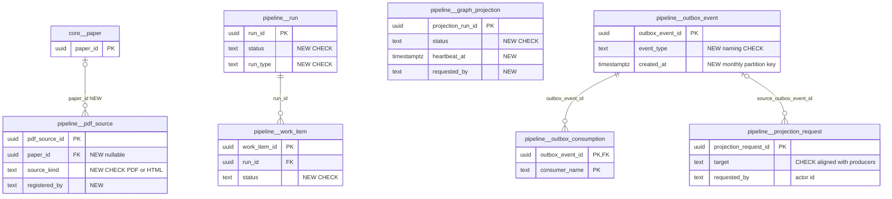

# `pipeline` schema — ingestion runs, projections and the transactional outbox

The `pipeline` schema holds the operational bookkeeping of MathBank's batch and asynchronous work. It has three parts. **Corpus ingestion tracking**: `pdf_source` is the per-paper download → parse → ingest tracker, and `run`/`work_item` are generic batch runs and their items. **Neo4j projection runs**: `graph_projection`. **The transactional outbox**: `outbox_event`, its per-consumer dedupe log `outbox_consumption`, and the `projection_request` queue that the outbox consumer fills. Nothing in the schema is learner-facing. Most rows are written by ETL scripts and the `outbox_worker` CLI rather than by REST.

Source of truth: migrations [001](../../../mathbank-db/sql/001_schema.sql), [004](../../../mathbank-db/sql/004_admin_pipeline.sql), [012](../../../mathbank-db/sql/012_step_runtime.sql), [018](../../../mathbank-db/sql/018_outbox_consumers.sql), [019](../../../mathbank-db/sql/019_admin_import_review.sql), [032](../../../mathbank-db/sql/032_micro_course_platform.sql), [033](../../../mathbank-db/sql/033_interaction_template_library.sql). Catalog extracted 2026-11-01 from migrations 001–054; endpoint mapping traced from mathbank-rest source and manually verified.

## 1. Purpose, ownership and data flow

**Corpus ingestion (batch).**
- `pdf_source` rows are created from `paper_registry.csv` by `pdf_pipeline.py discover`, by [purple_comet.py](../../../mathbank-db/etl/purple_comet.py), or by an admin through `POST /v1/admin/papers` (the mathbank-web admin home page form).
- [pdf_pipeline.py](../../../mathbank-db/etl/pdf_pipeline.py) moves each paper through `download_status` → `parse_status` → `ingest_status` (`fetch`, `fetch_html`, `reconcile`, `ingest`). [paper_batches.py](../../../mathbank-db/etl/paper_batches.py) and [arml_queue.py](../../../mathbank-db/etl/arml_queue.py) drive end-to-end batches.
- Each script records a `pipeline.run` with `pipeline.work_item` children. [load_corpus.py](../../../mathbank-db/etl/load_corpus.py) and [embed_corpus.py](../../../mathbank-db/etl/embed_corpus.py) also record runs; embedding runs are referenced by `search.embedding_job.run_id`.
- Admins can only read this state, retry failed papers, and register new ones ([routers/admin.py](../../../mathbank-rest/src/mathbank_rest/routers/admin.py), [db/admin.py](../../../mathbank-rest/src/mathbank_rest/db/admin.py), [db/pipeline_jobs.py](../../../mathbank-rest/src/mathbank_rest/db/pipeline_jobs.py)).

**Neo4j projections.** Every projector writes one `graph_projection` row per run (`IN_PROGRESS` → `COMPLETED`/`FAILED`):

| `graph_name` | Writer | Trigger |
|---|---|---|
| `corpus_graph` | [mathbank-graph/etl/project_from_postgres.py](../../../mathbank-graph/etl/project_from_postgres.py) | CLI / Makefile |
| `textbook_step_graph` | [mathbank-graph/etl/project_textbook_steps.py](../../../mathbank-graph/etl/project_textbook_steps.py) | `make textbook-graph-remote`, `run_projection_requests.py` |
| `tutoring_routes` | [route_projection.py](../../../mathbank-rest/src/mathbank_rest/route_projection.py) | `POST /v1/admin/tutoring-routes/refresh-graph` (synchronous, inside the request) |
| `interaction_templates` | [interaction_template_projection.py](../../../mathbank-rest/src/mathbank_rest/interaction_template_projection.py) | `POST /v1/admin/interaction-templates/graph/rebuild` (synchronous) |

**Transactional outbox** (runtime_extension/16).
- **Producers.** Services insert a `pipeline.outbox_event` in the same transaction as the business change. The producers are:
  - [step_runtime.py](../../../mathbank-rest/src/mathbank_rest/step_runtime.py) `_outbox`, also used by [step_diagnosis.py](../../../mathbank-rest/src/mathbank_rest/step_diagnosis.py) and [step_recovery.py](../../../mathbank-rest/src/mathbank_rest/step_recovery.py)
  - [db/import_admin.py](../../../mathbank-rest/src/mathbank_rest/db/import_admin.py) `_outbox`
  - [live_runtime.py](../../../mathbank-rest/src/mathbank_rest/live_runtime.py) `emit`
  - [micro_course_service.py](../../../mathbank-rest/src/mathbank_rest/micro_course_service.py)
  - [socratic_service.py](../../../mathbank-rest/src/mathbank_rest/socratic_service.py)
  - [attempt_media.py](../../../mathbank-rest/src/mathbank_rest/attempt_media.py)
  - the ETL [import_textbook_package.py](../../../mathbank-db/etl/import_textbook_package.py)
- **Consumers.** [outbox_worker.py](../../../mathbank-rest/src/mathbank_rest/outbox_worker.py) is a CLI (`make outbox-drain | outbox-watch | outbox-status` in [mathbank-rest/Makefile](../../../mathbank-rest/Makefile)). It is not deployed in mathbank-infra-aws; nothing in the repo schedules it. It defines two consumers:
  - `learner_analytics`: 8 learner event types → `analytics.learner_daily_activity`.
  - `projection_requests`: 4 content event types → `pipeline.projection_request`.
- **Dedupe.** Each handled event writes `(outbox_event_id, consumer_name)` to `outbox_consumption` in the same transaction (`FOR UPDATE … SKIP LOCKED` batches of 200, a savepoint per event).
- **Draining projection requests.** [run_projection_requests.py](../../../mathbank-db/etl/run_projection_requests.py) (`make projection-queue-run-remote`) runs the projectors and marks requests `DONE`.

**Privacy class.** Operational data. `outbox_event.payload` carries learner UUIDs (`student_id`) for step-runtime and learner-signal events, so treat it as **internal/pseudonymous**; it must not be exposed to learners. attempt-media deliberately sends only identifiers and versions ([attempt_media.py:62](../../../mathbank-rest/src/mathbank_rest/attempt_media.py)).

## 2. Entity diagram — as-is

## 3. Tables

### `pipeline.run`

**Role.** One row per batch execution of an ETL script: corpus load, PDF ingest, paper batch, ARML archive or embedding backfill. It is the container for `work_item` rows and for `search.embedding_job` rows, and the admin "Pipeline runs" panel reads it. Rows are the record of what ran; they are not authoritative for any job's correctness (66A: K/O).

**Lifecycle.** There is no CHECK on `status`, and the values differ by writer: `QUEUED` (arml) → `IN_PROGRESS` (or `RUNNING` in load_corpus) → `COMPLETED` / `FAILED`. Long-running scripts update `heartbeat_at`. Rows are never deleted.

**Columns**

| Column | Type | Null | Default | Description |
|---|---|---|---|---|
| `run_id` | uuid | NO | `gen_random_uuid()` | Run identity. Scripts accept `--resume RUN_UUID` (arml_queue, paper_batches). |
| `run_type` | text | NO | — | Free text: `load_corpus`, `PDF_INGEST`, `PAPER_BATCH`, `ARML_ARCHIVE`, `EMBEDDING_BACKFILL` (embed_corpus `embed_pending_chunks`) and `EMBED_BACKFILL` (embed_corpus CLI `backfill`). The last two are the same job under two spellings, and the casing is inconsistent. |
| `requested_scope` | jsonb | NO | `'{}'` | Input scope, e.g. `{"after_run": …, "volumes": [...]}` (ARML) or the paper/competition selection (paper_batches). |
| `status` | text | NO | — | `QUEUED`, `RUNNING`, `IN_PROGRESS`, `COMPLETED`, `FAILED` (see Lifecycle). No CHECK. |
| `started_at` | timestamptz | yes | — | Start time. NULL for ARML runs created as `QUEUED`; these sort first in the admin list (`ORDER BY started_at DESC`, nulls first). |
| `completed_at` | timestamptz | yes | — | End time (COMPLETED or FAILED); cleared on resume. |
| `heartbeat_at` | timestamptz | yes | — | Liveness, updated by arml_queue and paper_batches during long stages. Nothing detects stale heartbeats. |
| `worker_id` | text | yes | — | Never written. |
| `expected_items` | integer | yes | — | Planned item count (papers or volumes). |
| `completed_items` | integer | NO | `0` | Count of completed items, recomputed from `work_item` by paper_batches. |
| `failed_items` | integer | NO | `0` | Count of failed items. |
| `metadata` | jsonb | NO | `'{}'` | Free-form context, e.g. `{"target": "<pg host>"}` (load_corpus) or `{"error": "incomplete embedding provider batch"}` (embed_corpus). |

**Keys, constraints, indexes.**
- PK `run_id`.
- Index `idx_run_status (status, started_at DESC)`.
- Inbound FKs: `work_item.run_id` (CASCADE) and `search.embedding_job.run_id` (NO ACTION).
- No CHECKs, no triggers.

**REST operations today.**

| Op | Method & path | Auth | Handler | Notes |
|---|---|---|---|---|
| R | GET /v1/admin/pipeline/runs?limit= | Admin key (X-Admin-Api-Key) | `admin.pipeline_runs` → `admin_db.list_pipeline_runs` | Latest ≤ 200 by `started_at DESC`, returned together with `graph_projections`. No filters or total. |
| R | GET /v1/admin/pipeline/jobs | Admin key | `pipeline_jobs.list_jobs` | Joins the latest `work_item` per paper to its run for `run_status`/`heartbeat_at`. |

Non-REST writers: load_corpus.py, pdf_pipeline.py, paper_batches.py, arml_queue.py, embed_corpus.py (C/U). Also read by `make progress` / `progress-remote` in [mathbank-db/Makefile](../../../mathbank-db/Makefile).

### `pipeline.work_item`

**Role.** One unit of work inside a run: a paper, an ARML volume stage, or an ingest step. The unique `(run_id, item_type, item_key)` key makes re-running a stage an upsert, which is what lets `--resume` work. The admin papers views join the most recent item per paper to show batch progress and per-stage timing.

**Lifecycle.** `status` values written: `IN_PROGRESS`, `COMPLETED`, `FAILED` (the default `PENDING` is never used explicitly). `attempt_count` increments when an item re-enters `IN_PROGRESS`. Deleted only with its run (CASCADE). The lease columns from the original design (`lease_owner`, `lease_expires_at`) are never used: work is claimed by a single process, not by competing workers.

**Columns**

| Column | Type | Null | Default | Description |
|---|---|---|---|---|
| `work_item_id` | uuid | NO | `gen_random_uuid()` | Identity. |
| `run_id` | uuid | NO | — | → `pipeline.run` (ON DELETE CASCADE). |
| `item_type` | text | NO | — | Stage/kind: `paper_end_to_end` (paper_batches), `pdf_paper` (pdf_pipeline ingest), and `download`, `ingest`, `watcher`, `volume` plus per-stage names (arml_queue `record`). Free text. |
| `item_key` | text | NO | — | Natural key of the item, usually a `paper_external_code` or an ARML volume code. Not an FK. |
| `status` | text | NO | `'PENDING'` | `PENDING`, `IN_PROGRESS`, `COMPLETED`, `FAILED`. No CHECK. |
| `attempt_count` | integer | NO | `0` | Times the item entered `IN_PROGRESS`. |
| `lease_owner` | text | yes | — | Never written. |
| `lease_expires_at` | timestamptz | yes | — | Never written; still indexed (`idx_work_claim`). |
| `started_at` | timestamptz | yes | — | Start of the latest attempt. |
| `completed_at` | timestamptz | yes | — | End of the latest attempt (cleared on retry). |
| `last_error` | text | yes | — | Latest failure message. |
| `input_hash` | text | yes | — | Never written. |
| `output_hash` | text | yes | — | Never written. |
| `metrics` | jsonb | NO | `'{}'` | Stage telemetry, merged with `||`: `{"stage", "<stage>_log", "stage_times": {<stage>: {"started_at", "finished_at"}}, "classification_status", "questions", "solutions", "codes", "graph_verified", …}`. Returned to admins as `batch_metrics`. |

**Keys, constraints, indexes.**
- PK `work_item_id`; UNIQUE `(run_id, item_type, item_key)`, which is the upsert target.
- FK `run_id` → `pipeline.run` CASCADE.
- Index `idx_work_claim (status, lease_expires_at)` (claim index for leases that are not used).
- No index on `item_key`, although both admin readers filter by it (`WHERE item_key = …` / `= ANY(...)`).

**REST operations today.**

| Op | Method & path | Auth | Handler | Notes |
|---|---|---|---|---|
| R | GET /v1/admin/papers | Admin key | `admin_db.list_papers` | LATERAL latest `paper_end_to_end` item per paper. |
| R | GET /v1/admin/pipeline/jobs | Admin key | `pipeline_jobs.list_jobs` | Latest item of any type per paper, plus all items for the page's papers. |

Non-REST writers: pdf_pipeline.py, paper_batches.py, arml_queue.py.

### `pipeline.pdf_source`

**Role.** The per-paper source tracker for the PDF/HTML ingestion pipeline: one row per `PAPER_*` link in `paper_registry.csv` or per admin-registered paper. Three independent stage statuses record how far the paper has gone. The row also gives the anonymous problem-source endpoints the original PDF location (`crawl_dir`, `problem_url`, `link_scope`).

**Lifecycle.** Each stage moves `PENDING` → `DOWNLOADED`/`PARSED`/`INGESTED` or `FAILED`. `POST …/retry` resets only the `FAILED` stages to `PENDING`. Registering a paper again upserts its URLs. Rows are never deleted.

**Columns**

| Column | Type | Null | Default | Description |
|---|---|---|---|---|
| `pdf_source_id` | uuid | NO | `gen_random_uuid()` | Identity (not used by any API; the natural key is used instead). |
| `paper_external_code` | text | NO | — | `paper_registry.csv` `Paper_ID`, e.g. `PAPER_SMT_2027_TEAM`. The admin API requires `^[A-Z0-9_]+$`. UNIQUE. Joined by value to `core.paper.external_code` and, with the `_Qnn` suffix stripped, to `core.problem.canonical_code`. |
| `competition_external_code` | text | NO | — | Competition code (`core.competition.external_code` by value; no FK and no existence check in `register_paper`). |
| `crawl_dir` | text | NO | — | Directory under `data/crawl_pdf/`. Files live at `<crawl_dir>/<paper_external_code>/`. The admin API sets it to the lower-cased competition code. |
| `problem_url` | text | yes | — | Problem PDF or HTML URL. |
| `solution_url` | text | yes | — | Solution URL, if separate. |
| `link_scope` | text | yes | — | Registry link type: `DIRECT_PROBLEM_AND_SOLUTION`, `DIRECT_PROBLEM_ONLY`, `DIRECT_PROBLEM_PDF`, `AGGREGATE_MULTI_EXAM_PDF` (accepted by `discover`), or another registry value or free text from the admin API. |
| `download_status` | text | NO | `'PENDING'` | `PENDING`, `DOWNLOADED`, `FAILED`. No CHECK; the REST `PaperStatus` Literal mirrors it. |
| `downloaded_at` | timestamptz | yes | — | Set by `reconcile`/`fetch`/`fetch_html`. |
| `parse_status` | text | NO | `'PENDING'` | `PENDING`, `PARSED`, `FAILED`. |
| `parsed_at` | timestamptz | yes | — | Parse time. |
| `questions_found` | integer | NO | `0` | Number of `questions/Qnn/problem.md` files found on disk. |
| `ingest_status` | text | NO | `'PENDING'` | `PENDING`, `INGESTED`, `FAILED`. `cmd_ingest` picks up `parse_status='PARSED' AND ingest_status <> 'INGESTED'`. |
| `ingested_at` | timestamptz | yes | — | Ingest time. |
| `questions_ingested` | integer | NO | `0` | Problems upserted into `core.problem`. |
| `solutions_ingested` | integer | NO | `0` | Solutions upserted into `core.solution`. |
| `last_error` | text | yes | — | Latest stage error; cleared on success or retry. |
| `created_at` | timestamptz | NO | `now()` | Registration time (admin list order). |
| `updated_at` | timestamptz | NO | `now()` | Set explicitly by each writer (no trigger). |
| `source_kind` | text | NO | `'PDF'` | Added by 004. `PDF` (Docling parse) or `HTML` (generic fetch). Validated only by the REST Literal; migration 004 deliberately added no CHECK. |

**Keys, constraints, indexes.**
- PK `pdf_source_id`; UNIQUE `paper_external_code`.
- Indexes `idx_pdf_source_status (download_status, parse_status, ingest_status)` and `idx_pdf_source_kind (source_kind, download_status)`.
- No FKs, CHECKs or triggers.

**REST operations today.**

| Op | Method & path | Auth | Handler | Notes |
|---|---|---|---|---|
| C,U | POST /v1/admin/papers | Admin key | `admin.register_paper` → `admin_db.register_paper` | `INSERT … ON CONFLICT (paper_external_code) DO UPDATE` of URLs/kind/scope. Returns 201 even when it only updated. Body `year` is validated but ignored. No audit row. |
| C,U | POST /v1/admin/papers/batch | Admin key | `register_papers_batch` | Loops `_register_one`, one transaction per paper, so a mid-batch error leaves a partial batch. |
| R | GET /v1/admin/papers?competition=&status=&limit=&offset= | Admin key | `admin_db.list_papers` | `status` matches any of the three stages. Limit ≤ 500; no `total`. |
| U | POST /v1/admin/papers/{paper_external_code}/retry | Admin key | `admin_db.retry_paper` | Resets FAILED stages; 404 if unknown. No audit row. |
| R | GET /v1/admin/pipeline/jobs | Admin key | `pipeline_jobs.list_jobs` | `core.paper` FULL JOIN `pdf_source` coverage view. |
| R | GET /v1/problems/by-code/{code}/source, …/source-pdf, …/source-highlight, …/source-marked-pdf | None (anonymous) | `step_runtime.get_problem_source*` → `problem_sources.source_record` | Joined by regex on `canonical_code`; serves files from `crawl_dir`. The routers open `engine.connect()` themselves. |

Non-REST writers: pdf_pipeline.py (discover/reconcile/fetch/fetch_html/ingest), purple_comet.py; read by paper_batches.py and arml_queue.py.

### `pipeline.graph_projection`

**Role.** One row per Neo4j projection run (graph/03): which graph was projected, when, how many nodes and edges were upserted, and whether it succeeded. Admins see it in the pipeline-runs panel. The two REST projectors also hold a Postgres advisory lock so that only one run per graph executes at a time.

**Lifecycle.** Inserted as `IN_PROGRESS` in its own committed transaction, then updated to `COMPLETED` (with counts) or `FAILED` (with `error`). `project_textbook_steps` marks a run `FAILED` with "graph/postgres count mismatch" when reconciliation fails. A crashed process leaves the row `IN_PROGRESS` forever. Rows are never deleted.

**Columns**

| Column | Type | Null | Default | Description |
|---|---|---|---|---|
| `projection_run_id` | uuid | NO | `gen_random_uuid()` | Identity; returned by the REST rebuild endpoints. |
| `graph_name` | text | NO | — | `corpus_graph`, `textbook_step_graph`, `tutoring_routes`, `interaction_templates` (see §1). Free text. |
| `source_watermark` | timestamptz | NO | `now()` | Intended as the Postgres change watermark the projection reflects. Never set explicitly, so it equals the insert time. |
| `started_at` | timestamptz | NO | `now()` | Run start. |
| `completed_at` | timestamptz | yes | — | Run end. |
| `nodes_upserted` | integer | NO | `0` | Nodes merged (for the textbook graph: actual `SolutionPart`+`SolutionStep`+`LearningItem` counts after the run). |
| `edges_upserted` | integer | NO | `0` | Relationships merged. |
| `status` | text | NO | `'IN_PROGRESS'` | `IN_PROGRESS`, `COMPLETED`, `FAILED`. No CHECK. |
| `error` | text | yes | — | Failure text. ETL stores `str(exc)` (≤ 2000 chars in the textbook projector); REST stores only the exception class name. |

**Keys, constraints, indexes.**
- PK `projection_run_id`.
- No secondary index (the admin list sorts by `started_at`), no CHECKs, no triggers.

**REST operations today.**

| Op | Method & path | Auth | Handler | Notes |
|---|---|---|---|---|
| C,U | POST /v1/admin/tutoring-routes/refresh-graph | Admin key | `tutoring_routes.refresh_graph` → `route_projection.project` | Runs the whole Neo4j projection inside the HTTP request. Advisory lock 390027. A concurrent run raises `ValueError`, which the router maps (with any SQL or Neo4j error) to 503 "Graph refresh failed". |
| C,U | POST /v1/admin/interaction-templates/graph/rebuild | Admin key | `interaction_templates.rebuild_graph` → `interaction_template_projection.project` | Same pattern, with its own advisory lock; errors become 503 with the exception class name. |
| R | GET /v1/admin/pipeline/runs | Admin key | `admin_db.list_graph_projections` | Latest ≤ 200. |

Non-REST writers: mathbank-graph `project_from_postgres.py`, `project_textbook_steps.py`.

### `pipeline.outbox_event`

**Role.** The transactional outbox: an immutable record that "something happened to aggregate X", written in the same transaction as the canonical change. Consumers use it to update derived stores (analytics, the projection queue) without dual writes. Each consumer subscribes to a fixed list of `event_type`s.

**Lifecycle.** Insert-only (no UPDATE or DELETE anywhere, though nothing enforces it). Never purged. Events whose type no consumer subscribes to stay in the table permanently and never appear in `--status` lag.

**Event vocabulary today** (`event_type` / `aggregate_type`, producer, consumer):

| event_type | aggregate_type | Producer | Consumer |
|---|---|---|---|
| `ATTEMPT_STARTED`, `STEP_EVALUATED`, `ATTEMPT_COMPLETED`, `ATTEMPT_ABANDONED` | `solve_attempt` | step_runtime.py | `learner_analytics` |
| `GAP_DIAGNOSED` / `KNOWLEDGE_GAP_CREATED` | `solve_attempt` / `knowledge_gap` | step_diagnosis.py | `learner_analytics` |
| `RECOVERY_PLAN_CREATED`, `RECOVERY_PLAN_COMPLETED` | `recovery_plan` | step_recovery.py | `learner_analytics` |
| `RECOVERY_PLAN_EXHAUSTED`, `RECOVERY_PLAN_ABORTED` | `recovery_plan` | step_recovery.py | **none** |
| `CONTENT_PACKAGE_IMPORTED` | `content_package` | import_textbook_package.py (ETL) | `projection_requests` |
| `SOLUTION_STEP_CHANGED` | `solution_step` | db/import_admin.py | `projection_requests` |
| `LEARNING_ITEM_PUBLISHED`, `LEARNING_ITEM_WITHDRAWN` | `learning_item` | db/import_admin.py | `projection_requests` |
| `LIVE_EVENT` | `live_session` | live_runtime.py `emit` | **none** |
| `LEARNER_SIGNAL` | `ENROLLMENT` | micro_course_service.py `record_interaction_event` | **none** (documented as "not-yet-implemented consumer") |
| `MICRO_COURSE_PUBLISHED` | `COURSE_RELEASE` | micro_course_service.py publish | **none** |
| `SOCRATIC_DRAFT_SAVED` | `SOCRATIC_WORKFLOW` | socratic_service.py | **none** |
| `attempt.*` (e.g. `attempt.transcription.ready`, `attempt.analysis.complete`, `attempt.processing.failed`) | `MULTIMODAL_ATTEMPT` | attempt_media.py `event` | **none** |

**Columns**

| Column | Type | Null | Default | Description |
|---|---|---|---|---|
| `outbox_event_id` | uuid | NO | `gen_random_uuid()` | Event identity; referenced by `outbox_consumption` and `projection_request.source_outbox_event_id`. |
| `event_type` | text | NO | — | See the vocabulary table. No CHECK; naming mixes `UPPER_SNAKE` and dotted lower-case. |
| `aggregate_type` | text | NO | — | Kind of the changed aggregate. Casing is inconsistent (`solve_attempt` vs `COURSE_RELEASE`). |
| `aggregate_id` | text | NO | — | Aggregate key as text (uuid or text pedagogy id). `projection_requests` uses it as `scope_id` when no payload key is configured. |
| `payload` | jsonb | NO | `'{}'` | Event data. Learner events carry `student_id` (and `result` for `STEP_EVALUATED`), content events carry `book_code`, live events carry `{event_type, sequence, event_id}`, attempt-media events carry `{submission_id, sequence, transcription_version}`. |
| `created_at` | timestamptz | NO | `clock_timestamp()` | Insert wall-clock time; consumer order and the analytics UTC day. |

**Keys, constraints, indexes.**
- PK `outbox_event_id`.
- Indexes `outbox_event_created_idx (created_at)` and `outbox_event_type_idx (event_type, created_at)` (018), which serves the consumer scan `event_type = ANY(...) ORDER BY created_at`.
- No CHECKs, triggers or partitioning.

**REST operations today.**

| Op | Method & path | Auth | Handler | Notes |
|---|---|---|---|---|
| C | POST /v1/students/{student_id}/problems/{problem_ref}/attempts; POST /v1/attempts/{attempt_id}/steps/{step_id}/responses, …/diagnose; POST /v1/attempts/{attempt_id}/recovery-plans; POST /v1/recovery-plans/{plan_id}/items/{item_id}/responses, …/abort, …/resume | Learner JWT | step_runtime / step_diagnosis / step_recovery `_outbox` | Learner event types. |
| C | POST /v1/attempts/{attempt_id}/steps/{step_id}/outcome | Admin key | step_runtime | |
| C | POST /v1/admin/imports/learning-items/{id}/review, PATCH /v1/admin/imports/steps/{step_id}, PUT /v1/admin/imports/dependencies, POST /v1/admin/imports/dependencies/reject | Admin key | `import_admin._outbox` | Content events. |
| C | All live command routes (see [live.md](./live.md)) | Admin key / learner JWT | `live_runtime.emit` | `LIVE_EVENT`. |
| C | POST /v1/micro-courses/enrollments/{enrollment_id}/interaction-events | Learner JWT | `micro_course_service` | `LEARNER_SIGNAL`. |
| C | POST /v1/admin/micro-courses/releases/{release_id}/publish | Admin key | `micro_course_service` | `MICRO_COURSE_PUBLISHED`. |
| C | POST /v1/admin/socratic/workflows, PUT /v1/admin/socratic/workflows/{workflow_id} | Staff cookie + CSRF | `socratic_service` | `SOCRATIC_DRAFT_SAVED`. |
| C | /v1/attempt-media/submissions/{sid}/… (assets, process, analyse, transcription, approve, override, …) | Staff or owning learner | `attempt_media.event` | `attempt.*`. |
| R | — | — | — | No REST read. Inspect with `make outbox-status`. |

Non-REST: written by import_textbook_package.py; read by outbox_worker.py.

### `pipeline.outbox_consumption`

**Role.** The idempotency log of outbox consumers: one row means consumer X has applied event Y. Because the row commits in the same transaction as the consumer's side effect, replays are no-ops, and each consumer's lag is "events of my types with no row for me".

**Lifecycle.** Insert-only by the worker (`ON CONFLICT DO NOTHING`). Cascades with its event. No rebuild path: resetting a consumer means deleting its rows by hand (see [analytics.md](./analytics.md) §5.1 #4).

**Columns**

| Column | Type | Null | Default | Description |
|---|---|---|---|---|
| `outbox_event_id` | uuid | NO | — | → `pipeline.outbox_event` (ON DELETE CASCADE). |
| `consumer_name` | text | NO | — | `learner_analytics` or `projection_requests` (the `CONSUMERS` tuple in outbox_worker.py). Free text. |
| `processed_at` | timestamptz | NO | `now()` | When the consumer applied the event. |

**Keys, constraints, indexes.**
- PK `(outbox_event_id, consumer_name)`, which also serves the `NOT EXISTS` lag probe.
- FK → `outbox_event` CASCADE. No CHECK on `consumer_name`.

**REST operations today.** None. Written and read only by [outbox_worker.py](../../../mathbank-rest/src/mathbank_rest/outbox_worker.py) (`drain`, `status`).

### `pipeline.projection_request`

**Role.** A coalescing work queue of "re-project this scope into Neo4j / re-embed it" requests. They come from the `projection_requests` outbox consumer (content events) and from admins ("reproject missing"). A partial unique index keeps at most one `PENDING` row per `(target, scope_type, scope_id)`, so bursts of changes collapse into one request. Operators drain the queue with [run_projection_requests.py](../../../mathbank-db/etl/run_projection_requests.py): graph targets run `make textbook-graph-remote` once for all pending requests; paid embedding targets run only with `--allow-paid`.

**Lifecycle.** `PENDING` → `DONE` (drainer, `completed_by='run_projection_requests:graph|vector'`). `CANCELLED` is never set. A new event for the same scope after `DONE` creates a fresh `PENDING` row.

**Columns**

| Column | Type | Null | Default | Description |
|---|---|---|---|---|
| `projection_request_id` | uuid | NO | `gen_random_uuid()` | Identity. |
| `target` | text | NO | — | CHECK (033): `GRAPH_TEXTBOOK_STEPS`, `STEP_EMBEDDINGS`, `LEARNING_ITEM_EMBEDDINGS`, `GRAPH_LEARNING_ITEMS`, `GRAPH_MICRO_COURSES`, `GRAPH_INTERACTION_TEMPLATES`, `GRAPH_INTERACTION_INSTANCES`, `GRAPH_SCENE_SPECS`, `GRAPH_FEEDBACK_RULES`. Only the first four are produced or drained; the five added in 032/033 are dead vocabulary. |
| `scope_type` | text | NO | — | CHECK: `BOOK`, `PACKAGE`, `PROBLEM`, `STEP`, `LEARNING_ITEM`, `MICRO_COURSE`, `COURSE_RELEASE`, `VIDEO_ASSET`, `INTERACTION_TEMPLATE`, `INTERACTION_INSTANCE`, `SCENE_SPEC`, `MICRO_COURSE_RELEASE`. Produced: `BOOK`, `STEP`, `LEARNING_ITEM`; the admin API also allows `PACKAGE`, `PROBLEM`. |
| `scope_id` | text | NO | — | Book code, step id or learning-item id (≤ 200 chars from the API). |
| `reason` | text | NO | — | Source `event_type` (consumer) or `ADMIN_REPROJECT`. |
| `source_outbox_event_id` | uuid | yes | — | → `pipeline.outbox_event` (ON DELETE SET NULL). The first event that opened the request; later coalesced events are not linked. |
| `status` | text | NO | `'PENDING'` | CHECK `PENDING`, `DONE`, `CANCELLED`. |
| `requested_at` | timestamptz | NO | `now()` | Enqueue time; list order. |
| `completed_at` | timestamptz | yes | — | Set when marked `DONE`. |
| `completed_by` | text | yes | — | Drainer identity, e.g. `run_projection_requests:graph`. |
| `requested_by` | text | yes | — | Added by 019. Always `'admin'` for admin requests (the actor is not passed through); NULL for consumer rows. |

**Keys, constraints, indexes.**
- PK `projection_request_id`.
- FK `source_outbox_event_id` → `outbox_event` SET NULL.
- CHECKs `target`, `scope_type`, `status`.
- Partial UNIQUE `projection_request_open_uq (target, scope_type, scope_id) WHERE status = 'PENDING'`, which is the `ON CONFLICT … WHERE status='PENDING' DO NOTHING` target for both writers.

**REST operations today.**

| Op | Method & path | Auth | Handler | Notes |
|---|---|---|---|---|
| C,R | POST /v1/admin/imports/projection-requests | Admin key | `admin_imports.request_projection` → `import_admin.request_projection` | 202. Coalesces with an open request (returns `created: false`). Writes the import audit row. The Literal allows only the first four targets and five scope types. |
| R | GET /v1/admin/imports/projection-requests?status=&limit= | Admin key | `list_projection_requests` | Limit ≤ 500; no offset or total. |
| R | GET /v1/admin/imports/packages | Admin key | `list_packages` | Pending BOOK-scope targets per package. |
| R | GET /v1/admin/imports/reconciliation | Admin key | `reconciliation` | Includes the pending queue. |

Non-REST writers: outbox_worker.py `_projection` (C); run_projection_requests.py (U → `DONE`).

## 4. CRUD coverage — as-is

✅ REST endpoint · ⚙️ non-REST writer only · ❌ missing · — not applicable to the table type.

| Table | Type (guide §4) | Create | Read | Update | Delete | List | Notes |
|---|---|---|---|---|---|---|---|
| `pipeline.run` | Queue / job / run | ⚙️ ETL | ❌ single GET | ⚙️ ETL | — | ✅ GET /v1/admin/pipeline/runs | No enqueue, cancel or retry endpoint; runs are started from a shell. |
| `pipeline.work_item` | Queue / job / run (child) | ⚙️ ETL | ✅ embedded in papers/jobs | ⚙️ ETL | — | ❌ per run | No `GET /runs/{id}/items`. |
| `pipeline.pdf_source` | Queue / job (source tracker) | ✅ POST /v1/admin/papers | ✅ GET /v1/admin/papers, anonymous source routes | ✅ retry | ❌ | ✅ (no total) | Register/retry are not audited; no deactivate for a bad link. |
| `pipeline.graph_projection` | Queue / job / run | ✅ refresh/rebuild (synchronous) | ❌ single GET | ✅ same | — | ✅ in /pipeline/runs | GETs are fine; the two POSTs run Neo4j work inline. |
| `pipeline.outbox_event` | Learner/system event (append-only) | ✅ side effect of ~30 routes | ❌ | — | — | ❌ | Ops visibility is CLI only. |
| `pipeline.outbox_consumption` | Internal dedupe log | ⚙️ worker | ❌ | — | — | ❌ | Correctly internal; lag is not exposed. |
| `pipeline.projection_request` | Queue / job | ✅ POST (202) | ❌ single GET | ⚙️ drainer | — | ✅ GET | No cancel, although `CANCELLED` exists. |

**Findings.**
1. **The outbox is a write-only sink for most producers.** Six producer families (`LIVE_EVENT`, `LEARNER_SIGNAL`, `MICRO_COURSE_PUBLISHED`, `SOCRATIC_DRAFT_SAVED`, `attempt.*`, `RECOVERY_PLAN_EXHAUSTED/ABORTED`) have no consumer and no retention. `LIVE_EVENT` alone adds one row per classroom event. The worker is also not deployed (no infra or scheduler references `outbox_worker`), so even subscribed events are processed only when someone runs `make outbox-drain`.
2. **Projection vocabulary drift.** Migrations 032/033 extended `projection_request.target`/`scope_type` with micro-course and interaction-template values, but no consumer maps any event to them and the drainer ignores them. `MICRO_COURSE_PUBLISHED` is emitted but projects nothing. The REST Literal and `PROJECTION_TARGETS` (import_admin.py:23) list only the original four.
3. **Synchronous Neo4j projections inside HTTP requests.** `refresh-graph` and `graph/rebuild` violate guide §5 "Bulk and jobs". A crashed request leaves `graph_projection` `IN_PROGRESS` forever (no heartbeat or reaper), and REST stores only the exception class name in `error`.
4. **Uncontrolled status and type vocabularies.** `run.status` uses both `RUNNING` and `IN_PROGRESS`, `run_type` has both `EMBED_BACKFILL` and `EMBEDDING_BACKFILL`, `event_type`/`aggregate_type` casing is mixed, and there are no CHECKs on `run`, `work_item`, `pdf_source` or `graph_projection` statuses. Lease, hash and worker columns (`lease_owner`, `lease_expires_at`, `input_hash`, `output_hash`, `run.worker_id`) are never written.
5. **Admin pipeline mutations are unaudited and partly non-atomic.** `register_paper`, the batch registration and `retry_paper` write no `audit.action_log`, and the batch runs one transaction per paper. Admin projection requests record `requested_by='admin'` regardless of the caller.
6. **Anonymous source routes have inline SQL.** The `/v1/problems/by-code/{code}/source*` handlers in [routers/step_runtime.py](../../../mathbank-rest/src/mathbank_rest/routers/step_runtime.py) open `engine.connect()` in the router (guide §2 drift) and join `pdf_source` with a regex over `canonical_code` instead of an FK.

## 5. Target state — how it should be

### 5.1 Schema improvements

1. **P1: Close the outbox loop.**
   - **Evidence.** Finding 1.
   - **Fix.** Either stop emitting events that nobody consumes (keep `LIVE_EVENT` in `live.session_event` only), or add consumers. Add `retain_until timestamptz` or a nightly purge of events older than N days that every subscribed consumer has processed: `DELETE … WHERE created_at < now() - interval 'N days' AND NOT EXISTS (consumer lag)`. Partition `outbox_event` by month on `created_at` once volume warrants it. Deploy the worker as a scheduled task (EventBridge → Fargate/Lambda) in mathbank-infra-aws.

2. **P1: Constrain vocabularies.**
   - **Evidence.** Finding 4.
   - **Fix.** Add CHECKs:
     - `run.status IN ('QUEUED','IN_PROGRESS','COMPLETED','FAILED','CANCELLED')`, after migrating `RUNNING` → `IN_PROGRESS`
     - `work_item.status IN ('PENDING','IN_PROGRESS','COMPLETED','FAILED','SKIPPED')`
     - `graph_projection.status IN ('IN_PROGRESS','COMPLETED','FAILED')`
     - each `pdf_source.*_status` against its stage values, and `pdf_source.source_kind IN ('PDF','HTML')` via `ADD CONSTRAINT … NOT VALID` + `VALIDATE`, which is idempotent with a `DO $$` guard
     - `run.run_type` against a lookup list (merge `EMBED_BACKFILL` into `EMBEDDING_BACKFILL`)
     - an `outbox_event.event_type` naming rule, e.g. `^[A-Z][A-Z0-9_]+$`, after renaming the `attempt.*` events

3. **P2: Align projection targets with producers.** Drop the unused `GRAPH_MICRO_COURSES`/`GRAPH_INTERACTION_*`/`GRAPH_SCENE_SPECS`/`GRAPH_FEEDBACK_RULES` targets, or add the `MICRO_COURSE_PUBLISHED → GRAPH_MICRO_COURSES/COURSE_RELEASE` mapping to `PROJECTIONS` and teach the drainer to run `interaction_template_projection`/`route_projection`. Define `target`/`scope_type` in one Python module that both the API Literal and the worker import.

4. **P2: Make projection runs recoverable.** Add `heartbeat_at` and `requested_by` to `graph_projection`, and a reaper that marks `IN_PROGRESS` rows with a stale heartbeat as `FAILED`. Set `source_watermark` to the max `updated_at` read, or drop the column. Index `(graph_name, started_at DESC)`.

5. **P2: Remove or implement leases.** Either drop `lease_owner`, `lease_expires_at`, `input_hash`, `output_hash`, `worker_id` and `idx_work_claim`, or implement `SELECT … FOR UPDATE SKIP LOCKED` claiming with leases if multiple workers are planned. Add an index `work_item (item_key, started_at DESC)` for the admin readers.

6. **P3: Link `pdf_source` to the corpus.** Add `paper_id uuid NULL REFERENCES core.paper ON DELETE SET NULL`, filled at ingest. Replace the regex join in `problem_sources.source_record` with `core.problem.paper_id → pdf_source.paper_id`. Validate `competition_external_code` against `core.competition` in `register_paper` (422).

7. **P3: Record actors on admin queue writes.** Pass the admin actor into `request_projection` (`requested_by`) and `register_paper`/`retry_paper` (new `registered_by`, `retried_at`), and write `audit.action_log` rows.

### 5.2 Entity diagram — target

Only changed columns and relationships are shown.

### 5.3 Endpoints to build

| Priority | Method & path | Auth | Table(s) / op | Purpose | Notes (validation, concurrency, audit) |
|---|---|---|---|---|---|
| P1 | (change) POST /v1/admin/tutoring-routes/refresh-graph and POST /v1/admin/interaction-templates/graph/rebuild | Admin key (X-Admin-Api-Key) | `graph_projection` C | Enqueue instead of running inline. | Return `202 {projection_run_id}` with status `QUEUED`; a worker performs the projection. Keep the advisory lock in the worker; audit row. |
| P1 | GET /v1/admin/pipeline/outbox/status | Admin key | `outbox_event`, `outbox_consumption`, `projection_request` R | Consumer lag, unconsumed types, oldest event age. | Same queries as `outbox_worker.status`, moved into a service function; read-only. |
| P2 | GET /v1/admin/pipeline/runs/{run_id} and GET /v1/admin/pipeline/runs/{run_id}/items?status=&limit=&offset= | Admin key | `run`, `work_item` R | Run detail and item drill-down. | Guide §5 list contract with `total`; `status` Literal from the new CHECK. |
| P2 | GET /v1/admin/pipeline/runs?run_type=&status=&limit=&offset= | Admin key | `run` R | Replace the combined runs+projections list. | Separate `GET /v1/admin/pipeline/graph-projections?graph_name=&status=`. |
| P2 | POST /v1/admin/imports/projection-requests/{id}/cancel | Admin key | `projection_request` U | Reach `CANCELLED`. | Only from `PENDING` (409 otherwise); `reason` optional; audit row. |
| P2 | GET /v1/admin/imports/projection-requests/{id} | Admin key | `projection_request` R | Detail including the source event. | 404 if unknown. |
| P2 | (change) POST /v1/admin/papers, /papers/batch, /papers/{code}/retry | Admin key | `pdf_source` C/U | Atomic batch and auditing. | One transaction for the whole batch (all or nothing, 422 listing bad rows). Return 201 for new and 200 for updated. Write `audit.action_log`. Validate the competition exists. |
| P3 | POST /v1/admin/pipeline/runs | Admin key | `run` C | Enqueue an ETL run (`PDF_INGEST`, `PAPER_BATCH`, `EMBEDDING_BACKFILL`) for a worker. | 202 + `run_id`, `requested_scope` validated per `run_type`, status `QUEUED`. Paid types require an explicit `max_cost_usd`. |
| P3 | POST /v1/admin/pipeline/runs/{run_id}/cancel | Admin key | `run` U | Cooperative cancel. | Sets `status='CANCELLED'`; workers check it between items. |
| P3 | POST /v1/admin/pipeline/outbox/consumers/{name}/replay | Admin key | `outbox_consumption` D | Rebuild a derived store. | Deletes the consumer's rows in a bounded window and enqueues a drain; 202 + audit. |
