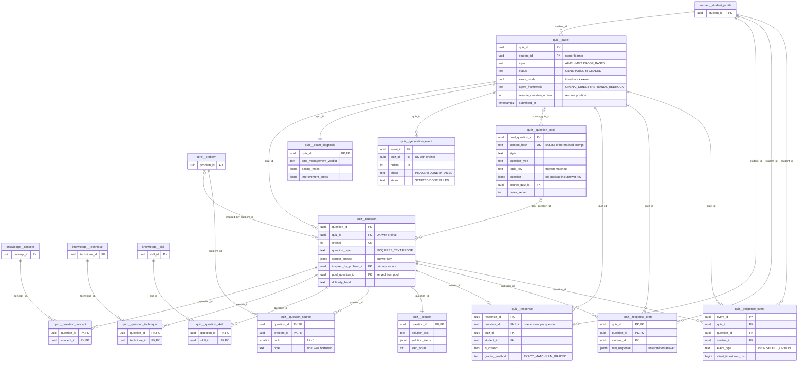
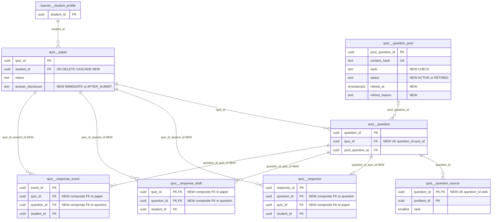

# `quiz` schema — AI-generated quizzes and mock exams

The `quiz` schema stores learner-specific, AI-generated question papers: the self-paced practice quizzes that mathbank-rest drafts itself with OpenAI (requirements/53), and the timed mock exams that `mathbank-exam-agent` (AWS Strands/Bedrock, requirements/64) drafts and critic-reviews before importing them over the admin-key integration API. It holds the paper and its questions, their concept/skill/technique tags and corpus inspiration sources, worked solutions, the learner's graded responses, unsubmitted answer drafts, interaction and generation-progress telemetry, a post-exam diagnosis, and a shared pool of reusable, critic-approved questions. It is deliberately separate from `core.problem`, `activity.*` and `learner.attempt`. Quiz responses still feed learner mastery through the `question_concept`/`question_technique` junctions.

Source of truth: migrations [042](../../../mathbank-db/sql/042_quiz_generation.sql), [047](../../../mathbank-db/sql/047_mock_exam_extensions.sql), [048](../../../mathbank-db/sql/048_mock_exam_event_timeline.sql), [050](../../../mathbank-db/sql/050_exam_generation_sources_and_progress.sql), [051](../../../mathbank-db/sql/051_exam_resume_state.sql), [052](../../../mathbank-db/sql/052_quiz_question_pool.sql). Catalog extracted 2026-11-01 from migrations 001–054; endpoint mapping traced from mathbank-rest source and manually verified.

## 1. Purpose, ownership and data flow

**Domain.** The schema covers personalised assessment: generating a paper for one learner, letting the learner take it (self-paced or timed `exam_mode`), grading each answer, and explaining the result afterwards.

**Write ownership.** All writes go through mathbank-rest. The main module is [quiz_runtime.py](../../../mathbank-rest/src/mathbank_rest/quiz_runtime.py), and two routers expose it:

| Path family | Router | Caller | Auth |
|---|---|---|---|
| `/v1/quiz/*` | [routers/quiz_runtime.py](../../../mathbank-rest/src/mathbank_rest/routers/quiz_runtime.py) | Learner browser via the mathbank-web proxy `app/api/rest/quiz/[[...path]]` | Learner JWT (`get_current_student_id`) |
| `/v1/quiz-integration/*` | [routers/exam_integration.py](../../../mathbank-rest/src/mathbank_rest/routers/exam_integration.py) | `mathbank-exam-agent` only ([rest_client.py](../../../mathbank-exam-agent/src/mathbank_exam_agent/rest_client.py)), which sends the learner's `student_id` in the body or query | Admin key (X-Admin-Api-Key) at router level |

`mathbank-exam-agent` never connects to Postgres directly. No ETL script, worker or other service writes to `quiz.*`.

**Readers outside the schema.** [db/learner.py](../../../mathbank-rest/src/mathbank_rest/db/learner.py) (`get_attempts_for_concept` and `get_attempts_for_technique`, lines ~255–305) uses `UNION ALL` to merge `quiz.response` with `learner.attempt` when it recomputes concept/technique mastery. Every mastery recompute therefore reads `quiz.response`, `quiz.question_concept`, `quiz.question_technique` and `quiz.paper`. That includes recomputes triggered by `/v1/learner/attempts` and the step runtime. Two ML stubs, `mathbank-ml-training` `postgres_extract.py` and `success_labels.py`, name `quiz.response` as a future source but have no SQL yet.

**Lifecycle.**
1. **Practice path (`OPENAI_DIRECT`).** `POST /v1/quiz/generate` inserts the paper as `GENERATING`. It then drafts each question synchronously, persists the questions, solutions and tags, and sets the paper to `READY`. On error it sets `FAILED` and stores `error_message`.
2. **Exam path (`STRANDS_BEDROCK`).**
   - `POST /papers/start` creates a shell paper with status `GENERATING`.
   - The agent appends `quiz.generation_event` rows while it works.
   - It calls `POST /question-pool/match` to reuse questions from the pool.
   - `POST /papers/{id}/finalize` inserts the questions, solutions, tags, sources and pool links, then sets `READY`.
   - `/fail` sets `FAILED`.
   - `POST /papers` is a one-shot wrapper that runs start + finalize.
3. **Taking the paper.**
   - `PUT /progress` upserts `quiz.response_draft` and `resume_question_ordinal` and changes `READY` to `IN_PROGRESS`.
   - `respond` grades the answer, inserts `quiz.response`, deletes the draft for that question, and recomputes mastery.
   - `events` appends `quiz.response_event` rows. A `SKIP` event also deletes the draft.
   - `submit` sets `SUBMITTED` and deletes all drafts.
4. **Review.** `GET review` sets `GRADED` when the paper is `SUBMITTED` or every question has an answer. The diagnosis agent then reads `diagnosis-input` and upserts `quiz.exam_diagnosis`. That upsert requires the paper to be `GRADED`.

**Privacy class.** Papers, responses, drafts, events and diagnoses are **learner-private**: every read goes through `_require_owned_paper` (`quiz_id` + `student_id`). `quiz.question.correct_answer`, `quiz.solution` and `quiz.question_pool.question` hold **answer keys**. They must not reach a learner before that learner answers or, in `exam_mode`, before the paper is submitted. `quiz.question_pool` is a **shared, staff-only cache**, and `quiz.generation_event` is **operational** data.

## 2. Entity diagram — as-is

## 3. Tables

### `quiz.paper`

**Role.** Each row is one generated question paper (a practice quiz or a mock exam) owned by one learner. The practice generator (`generate_quiz`) creates the row as a `GENERATING` shell, as does the exam agent through `start_paper` or `import_paper`. Every other table in the schema hangs off this row. It tracks the request parameters, which agent framework produced the paper, the exam settings, and the position needed to resume an exam.

**Lifecycle.** `status` moves through these transitions in `quiz_runtime.py`:

| From | To | Trigger |
|---|---|---|
| — | `GENERATING` | Row insert |
| `GENERATING` | `READY` | `_persist_questions` or `finalize_paper` |
| `GENERATING` | `FAILED` | Generation exception or `fail_paper` (`fail_paper` only acts while `GENERATING`) |
| `READY` | `IN_PROGRESS` | `save_exam_progress` or the first `submit_response` |
| `GENERATING`, `READY`, `IN_PROGRESS` | `SUBMITTED` | `submit_exam` |
| `SUBMITTED` (or every question answered) | `GRADED` | `get_review` |

Defects in these transitions:
- `submit_response` sets `IN_PROGRESS` unconditionally, so answering a remaining question after submission reopens a `SUBMITTED` or `GRADED` paper. See §5.1 #2.
- `GET review` writes `GRADED` even though it is a GET request.

Rows are never deleted by the application. Deleting a paper cascades to its questions, responses, drafts, events, generation events and diagnosis, and sets `question_pool.source_quiz_id` to NULL. There is no retention policy.

**Columns**

| Column | Type | Null | Default | Description |
|---|---|---|---|---|
| quiz_id | uuid | NO | gen_random_uuid() | Paper identity. Application code supplies a `uuid4()` explicitly. |
| student_id | uuid | NO | | Owning learner → learner.student_profile.student_id (ON DELETE NO ACTION). Every read checks ownership against this column. |
| style | text | NO | | Paper style. CHECK: `AIME`, `HMMT`, `PROOF_BASED`, `TOPIC_BASED`, `SKILL_BASED`, `MIXED`. `AIME`/`HMMT` restrict the practice generator's retrieval examples to that competition. |
| title | text | NO | | Display title. The practice path generates it as "<Style> Practice Set"; the exam agent supplies its own (≤200 chars). |
| instructions | text | NO | '' | Instructions shown to the learner (exam path only). |
| requested_question_count | integer | NO | | Number of questions requested. CHECK 1–20. |
| requested_question_types | text[] | NO | | Requested types, a subset of `MCQ`/`FREE_TEXT`/`PROOF`. Validated in Python only; the generator assigns them round-robin. |
| target_skill_slugs | text[] | NO | '{}' | `knowledge.skill.slug` values requested as targets. Stored as slugs, with no FK. |
| target_concept_slugs | text[] | NO | '{}' | `knowledge.concept.slug` values requested as targets. With no targets, the practice path falls back to `mastery.build_improvement_plan` weakest areas. |
| difficulty_band | text | yes | | Requested paper-level difficulty. Free text; the exam agent uses `easy`/`medium`/`hard`/`very_hard`. Mastery blending uses this paper-level value as the difficulty of every quiz response. |
| generated_by | text | NO | 'gpt-4o-mini' | Model or agent identifier that produced the paper. The exam path overwrites it in start/finalize. |
| object_key | text | yes | | Object-store key of the full JSON paper snapshot. Practice path only. |
| object_sha256 | text | yes | | SHA-256 of that snapshot. |
| status | text | NO | 'GENERATING' | Lifecycle state. CHECK: `GENERATING`, `READY`, `FAILED`, `IN_PROGRESS`, `SUBMITTED`, `GRADED` (transitions above). |
| error_message | text | yes | | Failure reason (≤500 chars) when `FAILED`. |
| created_at | timestamptz | NO | now() | Creation time. Learner lists sort by this column. |
| started_at | timestamptz | yes | | First save-progress or first response (set with `coalesce`, so it never moves). |
| submitted_at | timestamptz | yes | | Set by `submit_exam`, or by `get_review` when it auto-grades. |
| graded_at | timestamptz | yes | | Set when `get_review` transitions the paper to `GRADED`. |
| exam_mode | boolean | NO | false | Added by 047. `true` means a timed mock exam: review stays blocked until the paper is `SUBMITTED` or `GRADED`. The exam API defaults it to `true`. |
| time_limit_seconds | integer | yes | | Added by 047. Exam time limit (API accepts 60–36000). Enforced client-side through auto-submit. |
| agent_framework | text | NO | 'OPENAI_DIRECT' | Added by 047. CHECK: `OPENAI_DIRECT` (practice generator in mathbank-rest) or `STRANDS_BEDROCK` (mathbank-exam-agent). |
| resume_question_ordinal | integer | yes | | Added by 051. Ordinal of the question the learner was last on. CHECK NULL or > 0. |

**Keys, constraints, indexes.**
- PK `quiz_id`.
- FK `student_id` → `learner.student_profile` (NO ACTION). Because of this FK, a learner profile with any paper cannot be deleted.
- CHECKs: `style`, `status` and `agent_framework` enumerations; `requested_question_count` between 1 and 20; `resume_question_ordinal` NULL or positive.
- Index `idx_quiz_paper_student (student_id, created_at DESC)`, used by the "my papers" lists.
- No triggers.

**REST operations today.**

| Op | Method & path | Auth | Handler | Notes |
|---|---|---|---|---|
| C,U | POST /v1/quiz/generate | Learner JWT | `quiz_runtime.generate` → `generate_quiz` | Inserts as `GENERATING`, then sets `READY` (with snapshot key) or `FAILED`. Synchronous LLM generation. |
| R | GET /v1/quiz/mine | Learner JWT | `quiz_runtime.mine` → `list_my_quizzes` | Latest 20, with question and correct counts. |
| R | GET /v1/quiz/{quiz_id} | Learner JWT | `quiz_runtime.get_quiz` | Owner check. Answer keys are never returned. |
| R,U | POST /v1/quiz/{quiz_id}/questions/{question_id}/respond | Learner JWT | `quiz_runtime.respond` → `submit_response` | Sets `IN_PROGRESS` and `started_at`. |
| R,U | GET /v1/quiz/{quiz_id}/review | Learner JWT | `quiz_runtime.review` → `get_review` | May set `GRADED`, `graded_at` and `submitted_at` (state change on a GET). |
| C,U | POST /v1/quiz-integration/papers | Admin key (X-Admin-Api-Key) | `exam_integration.import_paper` | One-shot start + finalize. |
| C | POST /v1/quiz-integration/papers/start | Admin key (X-Admin-Api-Key) | `exam_integration.start_paper` | Shell paper: `GENERATING`, `STRANDS_BEDROCK`. |
| R,U | POST /v1/quiz-integration/papers/{quiz_id}/finalize | Admin key (X-Admin-Api-Key) | `exam_integration.finalize_paper` | Requires `GENERATING`. Sets `READY`, or `FAILED` on error. |
| R,U | POST /v1/quiz-integration/papers/{quiz_id}/fail | Admin key (X-Admin-Api-Key) | `exam_integration.fail_paper` | `SELECT … FOR UPDATE`. Acts only while `GENERATING`. |
| R | POST /v1/quiz-integration/question-pool/match | Admin key (X-Admin-Api-Key) | `exam_integration.match_question_pool` | Joins `paper` to exclude pool questions already served to this learner. |
| R | GET /v1/quiz-integration/papers/{quiz_id}/generation-events | Admin key (X-Admin-Api-Key) | `exam_integration.get_generation_events` | Owner check only. |
| R | GET /v1/quiz-integration/papers/mine | Admin key (X-Admin-Api-Key) | `exam_integration.list_my_papers` | `student_id` comes from the query string. |
| R | GET /v1/quiz-integration/papers/{quiz_id} | Admin key (X-Admin-Api-Key) | `exam_integration.get_paper` | |
| R,U | PUT /v1/quiz-integration/papers/{quiz_id}/progress | Admin key (X-Admin-Api-Key) | `exam_integration.save_exam_progress` | Requires `READY` or `IN_PROGRESS` (409 otherwise). Sets resume ordinal, `started_at`, `IN_PROGRESS`. |
| R,U | POST /v1/quiz-integration/papers/{quiz_id}/questions/{question_id}/respond | Admin key (X-Admin-Api-Key) | `exam_integration.respond` | Same `submit_response` as the learner route. |
| R,U | GET /v1/quiz-integration/papers/{quiz_id}/review | Admin key (X-Admin-Api-Key) | `exam_integration.review` | Exam-mode gate: 409 until submitted. |
| R,U | POST /v1/quiz-integration/papers/{quiz_id}/submit | Admin key (X-Admin-Api-Key) | `exam_integration.submit_exam` | Sets `SUBMITTED`, then returns `get_review`, which sets `GRADED`. |
| R | GET /v1/quiz-integration/papers/{quiz_id}/diagnosis-input | Admin key (X-Admin-Api-Key) | `exam_integration.diagnosis_input` | |
| R | POST /v1/quiz-integration/papers/{quiz_id}/diagnosis | Admin key (X-Admin-Api-Key) | `exam_integration.write_diagnosis` | Requires `GRADED`. |
| R | GET /v1/quiz-integration/papers/{quiz_id}/diagnosis | Admin key (X-Admin-Api-Key) | `exam_integration.get_diagnosis` | |
| R | POST /v1/quiz-integration/papers/{quiz_id}/questions/{question_id}/events | Admin key (X-Admin-Api-Key) | `exam_integration.log_event` | Owner check. |
| R | GET /v1/quiz-integration/papers/{quiz_id}/events | Admin key (X-Admin-Api-Key) | `exam_integration.get_events` | Owner check. |
| R | POST /v1/learner/attempts; POST /v1/attempts/{attempt_id}/steps/{step_id}/responses (Learner JWT); POST /v1/attempts/{attempt_id}/steps/{step_id}/outcome (Admin key) | as listed | mastery recompute → `db/learner.get_attempts_for_*` | Indirect read: the quiz-response blend joins `paper` for `difficulty_band`. |

### `quiz.question`

**Role.** Each row is one question on one paper, at a 1-based `ordinal`. Rows are created in a single transaction by `_persist_questions` (practice path) or `finalize_paper` (exam path). A question carries the stem, the MCQ options, the private answer key, per-option explanations, the generator↔critic revision history, computed complexity signals, and links to its corpus inspiration and to the question pool entry it came from or was written back to.

**Lifecycle.** Effectively immutable after insert. No code updates questions; they are removed only by cascade when the paper is deleted.

**Columns**

| Column | Type | Null | Default | Description |
|---|---|---|---|---|
| question_id | uuid | NO | gen_random_uuid() | Question identity (application supplies `uuid4()`). |
| quiz_id | uuid | NO | | Parent paper → quiz.paper.quiz_id (ON DELETE CASCADE). |
| ordinal | integer | NO | | 1-based position in the paper. CHECK > 0; UNIQUE with `quiz_id`. |
| question_type | text | NO | | CHECK: `MCQ`, `FREE_TEXT`, `PROOF`. Determines grading: MCQ is exact-match; the other two are LLM-graded. |
| prompt_text | text | NO | | Question stem as plain text/Markdown. Shown to the learner. |
| prompt_latex | text | yes | | Optional LaTeX rendering of the stem. |
| options | jsonb | yes | | MCQ options only: `[{"key":"A","text":"..."}, ...]`. NULL for written types. |
| correct_answer | jsonb | NO | | **Answer key.** MCQ: `{"correct_key":"A"}`. FREE_TEXT/PROOF: `{"expected_answer":...,"grading_rubric":...}`. Returned only by review endpoints. |
| points | numeric | NO | 1 | Score weight. CHECK > 0. Neither path sets it, and `get_review` scores by count of correct answers, not by points. |
| inspired_by_problem_id | uuid | yes | | Primary corpus inspiration → core.problem.problem_id (NO ACTION). Matches `question_source` rank 1 on the exam path. |
| diagram_object_key | text | yes | | Object-store key of a rendered diagram (practice path renders via the artifact pipeline; the exam path supplies `diagram.object_key`). |
| diagram_sha256 | text | yes | | SHA-256 of the diagram object. |
| created_at | timestamptz | NO | now() | Insert time. |
| revision_log | jsonb | NO | '[]' | Added by 047. Every generator↔critic round: `[{"round":n,"verdict":"APPROVE\|REVISE","feedback":"...","prompt_text":"..."}]`. Not returned to learners. |
| difficulty_band | text | yes | | Added by 047. The generator's per-question difficulty estimate (`easy`/`medium`/`hard`/`very_hard` from the exam agent), used for diagnosis pacing analysis. |
| option_explanations | jsonb | NO | '{}' | Added by 048. MCQ map `{"A":"why A is right/wrong", ...}`. Returned only after review is allowed. |
| complexity_signals | jsonb | NO | '{}' | Added by 050. Computed at finalize: `{"step_count","concept_count","technique_count","solution_length_chars"}`. |
| pool_question_id | uuid | yes | | Added by 052. Pool entry this question was served from or written back to → quiz.question_pool.pool_question_id (ON DELETE SET NULL). Used to avoid serving a learner the same pooled question twice. |

**Keys, constraints, indexes.**
- PK `question_id`; UNIQUE `(quiz_id, ordinal)`.
- FKs: `quiz_id` → `paper` (CASCADE); `inspired_by_problem_id` → `core.problem` (NO ACTION); `pool_question_id` → `question_pool` (SET NULL).
- CHECKs: `ordinal > 0`, `question_type` enumeration, `points > 0`.
- Partial index `idx_quiz_question_pool_question (pool_question_id) WHERE pool_question_id IS NOT NULL`.

**REST operations today.**

| Op | Method & path | Auth | Handler | Notes |
|---|---|---|---|---|
| C,R | POST /v1/quiz/generate | Learner JWT | `quiz_runtime.generate` → `_persist_questions` | Practice path. Writes no `revision_log`, `option_explanations` or `complexity_signals`. |
| R | GET /v1/quiz/mine | Learner JWT | `quiz_runtime.mine` | Count only. |
| R | GET /v1/quiz/{quiz_id} | Learner JWT | `quiz_runtime.get_quiz` | Stem and options only; no answer key. |
| R | POST /v1/quiz/{quiz_id}/questions/{question_id}/respond | Learner JWT | `quiz_runtime.respond` | Reads the answer key to grade. |
| R | GET /v1/quiz/{quiz_id}/review | Learner JWT | `quiz_runtime.review` | Returns `correct_answer`, `option_explanations`, `complexity_signals` (after the exam-mode gate). |
| C,R | POST /v1/quiz-integration/papers, POST …/papers/{quiz_id}/finalize | Admin key (X-Admin-Api-Key) | `import_paper` / `finalize_paper` | Exam path. All columns populated. |
| R | POST …/papers/{quiz_id}/fail, GET …/papers/mine, GET …/papers/{quiz_id}, PUT …/progress, POST …/respond, GET …/review, POST …/submit, GET …/diagnosis-input, POST …/questions/{question_id}/events, GET …/events | Admin key (X-Admin-Api-Key) | `exam_integration.*` | `fail` returns `get_quiz`. `events` validates question membership and joins `ordinal`. |
| R | POST /v1/quiz-integration/question-pool/match | Admin key (X-Admin-Api-Key) | `match_question_pool` | Anti-join on `pool_question_id` for this learner. |

### `quiz.question_concept`

**Role.** Junction tagging a question with the `knowledge.concept` rows it exercises. It mirrors `knowledge.problem_concept`. On every graded response, `_absorb_mastery_feedback` recomputes `learner.concept_mastery` for each tagged concept, and `db/learner.get_attempts_for_concept` merges these responses into the mastery evidence. The practice path writes one row when the generation target was a concept; the exam path writes one row per `concept_slugs` entry it can resolve.

**Lifecycle.** Insert-only (`ON CONFLICT DO NOTHING`). Removed by cascade with the question. Deleting a concept is blocked (NO ACTION).

**Columns**

| Column | Type | Null | Default | Description |
|---|---|---|---|---|
| question_id | uuid | NO | | Tagged question → quiz.question.question_id (ON DELETE CASCADE). |
| concept_id | uuid | NO | | Concept → knowledge.concept.concept_id (NO ACTION). Resolved from slug at insert. Unknown slugs are silently dropped. |

**Keys, constraints, indexes.** PK `(question_id, concept_id)`. FKs as above. There is no index leading on `concept_id`, which the mastery query filters by (see §5.1 #9).

**REST operations today.**

| Op | Method & path | Auth | Handler | Notes |
|---|---|---|---|---|
| C | POST /v1/quiz/generate | Learner JWT | `_persist_questions` | Only when the target kind is `concept`. |
| C | POST /v1/quiz-integration/papers, POST …/papers/{quiz_id}/finalize | Admin key (X-Admin-Api-Key) | `finalize_paper` | `INSERT … SELECT FROM knowledge.concept WHERE slug=…` |
| R | POST /v1/quiz/{quiz_id}/questions/{question_id}/respond; POST /v1/quiz-integration/papers/{quiz_id}/questions/{question_id}/respond | Learner JWT / Admin key | `_absorb_mastery_feedback` | Fan-out to the mastery recompute. |
| R | GET /v1/quiz-integration/papers/{quiz_id}/diagnosis-input | Admin key (X-Admin-Api-Key) | `get_paper_for_diagnosis` | Concept slugs per question. |
| R | POST /v1/learner/attempts; POST /v1/attempts/{attempt_id}/steps/{step_id}/responses; …/outcome | Learner JWT / Admin key | mastery recompute → `get_attempts_for_concept` | Indirect. |

### `quiz.question_technique`

**Role.** Junction tagging a question with the `knowledge.technique` rows it exercises. It mirrors `knowledge.problem_technique` and drives `learner.technique_mastery` recomputation in the same way `question_concept` drives concept mastery. Only the exam path (`finalize_paper`) writes rows; practice-path questions never get technique tags.

**Lifecycle.** Insert-only. Removed by cascade with the question.

**Columns**

| Column | Type | Null | Default | Description |
|---|---|---|---|---|
| question_id | uuid | NO | | Tagged question → quiz.question.question_id (ON DELETE CASCADE). |
| technique_id | uuid | NO | | Technique → knowledge.technique.technique_id (NO ACTION). Resolved from `technique_slugs`. |

**Keys, constraints, indexes.** PK `(question_id, technique_id)`. FKs as above. No index leading on `technique_id`.

**REST operations today.**

| Op | Method & path | Auth | Handler | Notes |
|---|---|---|---|---|
| C | POST /v1/quiz-integration/papers, POST …/papers/{quiz_id}/finalize | Admin key (X-Admin-Api-Key) | `finalize_paper` | |
| R | POST /v1/quiz/{quiz_id}/questions/{question_id}/respond; POST /v1/quiz-integration/papers/{quiz_id}/questions/{question_id}/respond | Learner JWT / Admin key | `_absorb_mastery_feedback` | |
| R | GET /v1/quiz-integration/papers/{quiz_id}/diagnosis-input | Admin key (X-Admin-Api-Key) | `get_paper_for_diagnosis` | |
| R | POST /v1/learner/attempts; POST /v1/attempts/{attempt_id}/steps/{step_id}/responses; …/outcome | Learner JWT / Admin key | mastery recompute → `get_attempts_for_technique` | Indirect. |

### `quiz.question_skill`

**Role.** Junction tagging a question with `knowledge.skill` rows. It is written on both paths: practice when the target kind is `skill`, exam from `skill_slugs`. No code reads it today, so skill tags do not affect mastery, review or diagnosis.

**Lifecycle.** Insert-only. Removed by cascade with the question.

**Columns**

| Column | Type | Null | Default | Description |
|---|---|---|---|---|
| question_id | uuid | NO | | Tagged question → quiz.question.question_id (ON DELETE CASCADE). |
| skill_id | uuid | NO | | Skill → knowledge.skill.skill_id (NO ACTION). |

**Keys, constraints, indexes.** PK `(question_id, skill_id)`. FKs as above.

**REST operations today.**

| Op | Method & path | Auth | Handler | Notes |
|---|---|---|---|---|
| C | POST /v1/quiz/generate | Learner JWT | `_persist_questions` | Target kind `skill` only. |
| C | POST /v1/quiz-integration/papers, POST …/papers/{quiz_id}/finalize | Admin key (X-Admin-Api-Key) | `finalize_paper` | |

### `quiz.question_source`

**Role.** The ranked set (1–5) of real corpus problems a generated question drew on. Each entry carries a note on what was borrowed or changed, which turns "inspired by, never copied" into something a learner can check. Rank 1 is the same problem as `question.inspired_by_problem_id`. `finalize_paper` writes rows from `inspiration_sources[].canonical_code` and silently skips codes it cannot resolve. Review endpoints read the rows and enrich them with competition, year and source URL.

**Lifecycle.** Insert-only. Removed by cascade with the question. Deleting a core problem is blocked (NO ACTION).

**Columns**

| Column | Type | Null | Default | Description |
|---|---|---|---|---|
| question_id | uuid | NO | | Generated question → quiz.question.question_id (ON DELETE CASCADE). |
| problem_id | uuid | NO | | Corpus inspiration → core.problem.problem_id (NO ACTION). |
| rank | smallint | NO | | 1 = primary, up to 5, taken from list order. CHECK 1–5. Not unique per question. |
| note | text | NO | '' | What was borrowed from the source and what changed (≤500 chars at the API). |

**Keys, constraints, indexes.** PK `(question_id, problem_id)`. FKs as above. CHECK `rank` 1–5. Index `idx_question_source_question (question_id, rank)`.

**REST operations today.**

| Op | Method & path | Auth | Handler | Notes |
|---|---|---|---|---|
| C | POST /v1/quiz-integration/papers, POST …/papers/{quiz_id}/finalize | Admin key (X-Admin-Api-Key) | `finalize_paper` | `ON CONFLICT DO NOTHING`. |
| R | GET /v1/quiz/{quiz_id}/review | Learner JWT | `get_review` → `_inspiration_sources_by_question` | |
| R | GET /v1/quiz-integration/papers/{quiz_id}/review, POST …/papers/{quiz_id}/submit | Admin key (X-Admin-Api-Key) | `get_review` | `submit` returns the review. |

### `quiz.solution`

**Role.** The worked solution for one question (1:1, PK = FK), written in the same transaction as the question. It is private until review: `submit_response` returns `solution_text` and `key_insight` after each answer, and `get_review` returns everything including `solution_steps`. Migration 050 added structured steps so that `step_count` can feed `complexity_signals`.

**Lifecycle.** Immutable after insert. Removed by cascade with the question.

**Columns**

| Column | Type | Null | Default | Description |
|---|---|---|---|---|
| question_id | uuid | NO | | Question → quiz.question.question_id (ON DELETE CASCADE). Also the PK. |
| solution_text | text | NO | | Full worked solution (Markdown/LaTeX). |
| solution_latex | text | yes | | Optional LaTeX-only rendering. Neither path writes it. |
| key_insight | text | yes | | One-line key idea of the solution. Exam path defaults it to ''. |
| object_key | text | yes | | Object-store key of a JSON snapshot `{solution_text,key_insight}`. Practice path only. |
| object_sha256 | text | yes | | SHA-256 of that snapshot. |
| created_at | timestamptz | NO | now() | Insert time. |
| solution_steps | jsonb | NO | '[]' | Added by 050. Ordered list of step strings (≤30 at the API). |
| step_count | integer | yes | | Added by 050. `len(solution_steps)`. NULL on practice-path rows. |

**Keys, constraints, indexes.** PK and FK `question_id` → `question` (CASCADE).

**REST operations today.**

| Op | Method & path | Auth | Handler | Notes |
|---|---|---|---|---|
| C | POST /v1/quiz/generate | Learner JWT | `_persist_questions` | |
| C | POST /v1/quiz-integration/papers, POST …/papers/{quiz_id}/finalize | Admin key (X-Admin-Api-Key) | `finalize_paper` | |
| R | POST /v1/quiz/{quiz_id}/questions/{question_id}/respond; POST /v1/quiz-integration/papers/{quiz_id}/questions/{question_id}/respond | Learner JWT / Admin key | `submit_response` | Returned immediately after answering, including in `exam_mode` (see §5.1 #1). |
| R | GET /v1/quiz/{quiz_id}/review; GET /v1/quiz-integration/papers/{quiz_id}/review; POST …/submit | Learner JWT / Admin key | `get_review` | |
| R | GET /v1/quiz-integration/papers/{quiz_id}/diagnosis-input | Admin key (X-Admin-Api-Key) | `get_paper_for_diagnosis` | |

### `quiz.response`

**Role.** The learner's single, final, graded answer to one question (UNIQUE `question_id`; resubmission is out of scope). `submit_response` inserts it after grading:
- MCQ answers are graded by exact match against `correct_key`, which writes `EXACT_MATCH` with confidence 1.0.
- Written answers are graded by gpt-4o-mini at temperature 0 against the expected answer or rubric, which writes `LLM_GRADED`.

The row is the authoritative mastery evidence for quiz work; `db/learner.get_attempts_for_*` merges it with `learner.attempt`. A JSON snapshot of the graded answer goes to the object store.

**Lifecycle.** Append-only in practice: no update or delete code exists. The insert is followed by deleting the question's draft and moving the paper to `IN_PROGRESS`. A UNIQUE violation from a race is mapped to 409 `ALREADY_ANSWERED`. `PENDING_HUMAN_REVIEW` is allowed by CHECK but never written.

**Columns**

| Column | Type | Null | Default | Description |
|---|---|---|---|---|
| response_id | uuid | NO | gen_random_uuid() | Response identity (application `uuid4()`). |
| question_id | uuid | NO | | Answered question → quiz.question.question_id (ON DELETE CASCADE). UNIQUE: one response per question. |
| quiz_id | uuid | NO | | Paper → quiz.paper.quiz_id (ON DELETE CASCADE). Denormalised; nothing in the database enforces that it matches the question's paper. |
| student_id | uuid | NO | | Responding learner → learner.student_profile.student_id (NO ACTION). Equals `paper.student_id` by application check only. |
| response_type | text | NO | | Copy of `question.question_type`. CHECK `MCQ`/`FREE_TEXT`/`PROOF`. |
| raw_response | jsonb | NO | | The learner's answer: `{"selected_key":"B"}` (MCQ) or `{"response_text":"..."}` (≤10000 chars). |
| object_key | text | yes | | Object-store key of the JSON snapshot `{raw_response,is_correct,feedback}`. |
| object_sha256 | text | yes | | SHA-256 of that snapshot. |
| is_correct | boolean | yes | | Grading verdict. NULL is allowed for a future human-review state; the mastery blend ignores NULLs. |
| grading_method | text | NO | | CHECK `EXACT_MATCH`, `LLM_GRADED`, `PENDING_HUMAN_REVIEW` (the last is unused). |
| grading_confidence | numeric | yes | | Grader confidence. CHECK NULL or 0–1. Always 1.0 for exact match. |
| grading_feedback | text | yes | | Per-question feedback text. For a wrong MCQ answer it names the correct key. |
| time_spent_seconds | integer | yes | | Client-reported time on the question (0–36000 at the API). The diagnosis uses it for pacing. |
| submitted_at | timestamptz | NO | now() | Answer time. Becomes `attempted_at` in mastery evidence. |

**Keys, constraints, indexes.**
- PK `response_id`; UNIQUE `question_id`.
- FKs: `question_id` → `question` (CASCADE); `quiz_id` → `paper` (CASCADE); `student_id` → `learner.student_profile` (NO ACTION).
- CHECKs: `response_type`, `grading_method`, `grading_confidence` range.
- Index `idx_quiz_response_student (student_id, submitted_at DESC)`.

**REST operations today.**

| Op | Method & path | Auth | Handler | Notes |
|---|---|---|---|---|
| C,R | POST /v1/quiz/{quiz_id}/questions/{question_id}/respond | Learner JWT | `submit_response` | Existence pre-check, then INSERT. |
| C,R | POST /v1/quiz-integration/papers/{quiz_id}/questions/{question_id}/respond | Admin key (X-Admin-Api-Key) | `submit_response` | Same function. |
| R | POST /v1/quiz/generate, GET /v1/quiz/mine, GET /v1/quiz/{quiz_id}, GET /v1/quiz/{quiz_id}/review | Learner JWT | `get_quiz` / `list_my_quizzes` / `get_review` | The learner's own answers and scores. |
| R | POST …/papers, POST …/finalize, POST …/fail, GET …/papers/mine, GET …/papers/{quiz_id}, GET …/review, POST …/submit, GET …/diagnosis-input | Admin key (X-Admin-Api-Key) | `get_quiz` / `list_my_quizzes` / `get_review` / `get_paper_for_diagnosis` | |
| R | POST /v1/learner/attempts; POST /v1/attempts/{attempt_id}/steps/{step_id}/responses; …/outcome | Learner JWT / Admin key | mastery recompute | Indirect (`UNION ALL` blend). |

### `quiz.response_draft`

**Role.** Holds an unsubmitted, in-progress answer for one question, so a learner can resume an exam on another device or after a reload. It is never graded and never counts as mastery evidence. `save_exam_progress` writes it with an upsert. It is deleted when the question is answered, when a `SKIP` event is logged, or when the whole paper is submitted.

**Lifecycle.** Mutable scratch state that is deleted on completion. At most one row per `(quiz_id, question_id)`.

**Columns**

| Column | Type | Null | Default | Description |
|---|---|---|---|---|
| quiz_id | uuid | NO | | Paper → quiz.paper.quiz_id (ON DELETE CASCADE). |
| question_id | uuid | NO | | Question → quiz.question.question_id (ON DELETE CASCADE). The code checks that it belongs to `quiz_id`; the database does not. |
| student_id | uuid | NO | | Learner → learner.student_profile.student_id (NO ACTION). Denormalised from the paper. |
| raw_response | jsonb | NO | | Exactly `{"selected_key":"<option key>"}` for MCQ, or `{"response_text":"..."}` (≤10000 chars), validated by `_validate_exam_draft`. |
| updated_at | timestamptz | NO | now() | Last save time. Explicitly reset to now() on upsert. |

**Keys, constraints, indexes.** PK `(quiz_id, question_id)`. FKs as above. Index `idx_quiz_response_draft_student (student_id, updated_at DESC)`.

**REST operations today.**

| Op | Method & path | Auth | Handler | Notes |
|---|---|---|---|---|
| C,U | PUT /v1/quiz-integration/papers/{quiz_id}/progress | Admin key (X-Admin-Api-Key) | `save_exam_progress` | `ON CONFLICT DO UPDATE`. Requires paper `READY`/`IN_PROGRESS`. |
| D | POST /v1/quiz/{quiz_id}/questions/{question_id}/respond; POST /v1/quiz-integration/papers/{quiz_id}/questions/{question_id}/respond | Learner JWT / Admin key | `submit_response` | Deletes that question's draft. |
| D | POST /v1/quiz-integration/papers/{quiz_id}/submit | Admin key (X-Admin-Api-Key) | `submit_exam` | Deletes all drafts on the paper. The trace's extra R was wrong. |
| D | POST /v1/quiz-integration/papers/{quiz_id}/questions/{question_id}/events | Admin key (X-Admin-Api-Key) | `log_response_event` | Only when `event_type = 'SKIP'`. The trace's extra R was wrong. |
| R | POST /v1/quiz/generate, GET /v1/quiz/{quiz_id} | Learner JWT | `get_quiz` | Returned as `draft_response`. |
| R | POST …/papers, POST …/finalize, POST …/fail, GET /v1/quiz-integration/papers/{quiz_id} | Admin key (X-Admin-Api-Key) | `get_quiz` | |

There is no learner-JWT route that writes drafts. The `/v1/quiz/*` practice UI has no resume support.

### `quiz.response_event`

**Role.** An append-only interaction timeline for each question. Typical rows: "viewed at T0", "selected option A at T1", "skipped at T2". `mathbank-exam-web` posts these events through the exam agent. The table is raw telemetry for the "attempted so far" view and for pacing analysis, and is never used for grading.

**Lifecycle.** Append-only (no update or delete code, but no trigger enforcing it). Removed by cascade with the paper or question.

**Columns**

| Column | Type | Null | Default | Description |
|---|---|---|---|---|
| event_id | uuid | NO | gen_random_uuid() | Event identity (application `uuid4()`). |
| quiz_id | uuid | NO | | Paper → quiz.paper.quiz_id (ON DELETE CASCADE). |
| question_id | uuid | NO | | Question → quiz.question.question_id (ON DELETE CASCADE). Membership in `quiz_id` is checked in code. |
| student_id | uuid | NO | | Learner → learner.student_profile.student_id (NO ACTION). |
| event_type | text | NO | | CHECK `VIEW`, `SELECT_OPTION`, `DESELECT_OPTION`, `TEXT_CHANGE`, `SKIP`, `FINAL_SUBMIT`. |
| option_key | text | yes | | MCQ option key for select/deselect events (≤10 chars). |
| client_timestamp_ms | bigint | yes | | Client clock in epoch milliseconds, kept for accurate ordering and pacing. Not validated. |
| created_at | timestamptz | NO | now() | Server receipt time. Reads order by this column. |

**Keys, constraints, indexes.** PK `event_id`. FKs as above. CHECK `event_type`. Index `idx_response_event_quiz_question (quiz_id, question_id, created_at)`.

**REST operations today.**

| Op | Method & path | Auth | Handler | Notes |
|---|---|---|---|---|
| C | POST /v1/quiz-integration/papers/{quiz_id}/questions/{question_id}/events | Admin key (X-Admin-Api-Key) | `log_response_event` | Validates `event_type` and ownership. |
| R | GET /v1/quiz-integration/papers/{quiz_id}/events | Admin key (X-Admin-Api-Key) | `get_response_events` | Joined to question `ordinal`. |

### `quiz.generation_event`

**Role.** An append-only progress log for a paper that is still being generated, with one row per meaningful agent step (for example, "drafting question 3 of 10"). The web UI polls it while `mathbank-exam-agent` drafts, critiques and runs its aggregate diversity pass. Rows exist before the paper has any questions, so the table is keyed by `(quiz_id, ordinal)` rather than by question.

**Lifecycle.** Append-only. A retried POST with the same ordinal is ignored (`ON CONFLICT DO NOTHING`). Removed by cascade with the paper.

**Columns**

| Column | Type | Null | Default | Description |
|---|---|---|---|---|
| event_id | uuid | NO | gen_random_uuid() | Event identity. |
| quiz_id | uuid | NO | | Paper being generated → quiz.paper.quiz_id (ON DELETE CASCADE). |
| ordinal | integer | NO | | Agent-assigned, monotonically increasing sequence number (≥1 at the API). UNIQUE with `quiz_id`. Pollers read `ordinal > since_ordinal`. |
| phase | text | NO | | CHECK (as revised by 052): `INTAKE`, `TOPIC_RESOLVE`, `DIFFICULTY_SIGNAL`, `POOL_LOOKUP`, `DRAFT_QUESTION`, `CRITIC_REVIEW`, `AGGREGATE_DIVERSITY_CHECK`, `AGGREGATE_FIX`, `PERSIST`, `DONE`, `FAILED`. |
| status | text | NO | | CHECK `STARTED`, `DONE`, `FAILED`. |
| question_ordinal | integer | yes | | Which paper slot the step concerns (per-question phases only). |
| detail | text | NO | '' | Human-readable step detail, e.g. "critic: REVISE (round 2)" (≤500 chars). |
| created_at | timestamptz | NO | now() | Insert time. |

**Keys, constraints, indexes.**
- PK `event_id`; UNIQUE `(quiz_id, ordinal)`.
- FK `quiz_id` → `paper` (CASCADE).
- CHECKs on `phase` and `status`.
- Index `idx_generation_event_quiz (quiz_id, ordinal)` duplicates the UNIQUE index.

**REST operations today.**

| Op | Method & path | Auth | Handler | Notes |
|---|---|---|---|---|
| C | POST /v1/quiz-integration/papers/{quiz_id}/generation-events | Admin key (X-Admin-Api-Key) | `post_generation_event` | No ownership or paper check, and a CHECK or FK violation surfaces as 500 (not wrapped in `_call`). |
| R | GET /v1/quiz-integration/papers/{quiz_id}/generation-events | Admin key (X-Admin-Api-Key) | `list_generation_events` | Owner check. `since_ordinal` supports incremental polling. |

### `quiz.exam_diagnosis`

**Role.** One holistic post-exam report per paper (1:1 with `paper`), written by the exam agent's diagnosis agent after the paper is `GRADED`. Its input comes from `diagnosis-input`: per-question correctness, timing, difficulty and tags, plus the learner's mastery before the exam. It is intentionally separate from the per-question `response.grading_feedback`.

**Lifecycle.** Upserted: re-running the diagnosis overwrites every field and resets `created_at`, and no history is kept. Removed by cascade with the paper.

**Columns**

| Column | Type | Null | Default | Description |
|---|---|---|---|---|
| quiz_id | uuid | NO | | Diagnosed paper → quiz.paper.quiz_id (ON DELETE CASCADE). Also the PK. |
| time_management_verdict | text | NO | | Short judgment of pacing, grounded in per-question times. |
| pacing_notes | jsonb | NO | '[]' | `[{"question_ordinal","time_spent_seconds","difficulty_band","note"}]` for questions with unusually high or low time. |
| reasoning_guidance | jsonb | NO | '[]' | `[{"question_ordinal","guidance"}]`: the kind of thinking that reaches the approach, without the solution itself. |
| improvement_areas | jsonb | NO | '[]' | `[{"concept_or_technique","current_mastery_tier","evidence"}]`. |
| generated_by | text | NO | | Diagnosis model or agent identifier (≤100 chars). |
| created_at | timestamptz | NO | now() | Time of the latest write (reset on every upsert). |

**Keys, constraints, indexes.** PK and FK `quiz_id` → `paper` (CASCADE).

**REST operations today.**

| Op | Method & path | Auth | Handler | Notes |
|---|---|---|---|---|
| C,U,R | POST /v1/quiz-integration/papers/{quiz_id}/diagnosis | Admin key (X-Admin-Api-Key) | `write_diagnosis` | 409 unless the paper is `GRADED`. `ON CONFLICT (quiz_id) DO UPDATE`. |
| R | GET /v1/quiz-integration/papers/{quiz_id}/diagnosis | Admin key (X-Admin-Api-Key) | `get_diagnosis` | 404 when absent. |

No learner-JWT route exposes the diagnosis; learners see it only through the exam agent.

### `quiz.question_pool`

**Role.** A shared, growing cache of critic-approved, corpus-inspired questions with full solutions, deduplicated by a hash of the normalised prompt. Before drafting, the exam agent calls `question-pool/match` to fill slots. A match requires the same style, one of the requested question types, and the same difficulty, plus either a similar topic phrase (pg_trgm similarity ≥ 0.5) or an overlapping concept slug. Questions already served to the learner are excluded. At finalize, a reused entry has `times_served` incremented, and a new question with `add_to_pool=true` is written back. The table is not learner-scoped: one learner's paper can seed questions that are served to other learners.

**Lifecycle.**
- Insert-or-touch: `ON CONFLICT (content_hash) DO UPDATE SET content_hash = EXCLUDED.content_hash` is a no-op update that only returns the existing id.
- `times_served` and `last_served_at` are mutable counters.
- There is no retire, quarantine or edit flow, so a bad pooled question keeps being served.

**Columns**

| Column | Type | Null | Default | Description |
|---|---|---|---|---|
| pool_question_id | uuid | NO | gen_random_uuid() | Pool entry identity. |
| content_hash | text | NO | | SHA-256 hex of the lower-cased, whitespace-collapsed `prompt_text`. UNIQUE, so the same question is never pooled twice. |
| style | text | NO | | Paper style the question was generated for. Same vocabulary as `paper.style`, but **no CHECK**. |
| question_type | text | NO | | CHECK `MCQ`, `FREE_TEXT`, `PROOF`. |
| difficulty_band | text | yes | | Paper-level requested difficulty. Matched with `IS NOT DISTINCT FROM`. |
| topic_key | text | NO | '' | Lower-cased, whitespace-collapsed topic phrase from the request (≤200 chars), matched by trigram similarity. |
| concept_slugs | text[] | NO | '{}' | Union of the question's and the request's concept slugs. Matched with array overlap `&&`. |
| technique_slugs | text[] | NO | '{}' | Technique slugs of the question (stored, not used for matching). |
| question | jsonb | NO | | Full finalize payload minus `revision_log`/`pool_question_id`/`add_to_pool`: prompt, options, **correct_answer**, option_explanations, solution_text/steps, key_insight, tags, inspiration_sources, diagram. Lets a pooled question be copied with zero LLM calls. |
| source_quiz_id | uuid | yes | | Paper that first produced the question → quiz.paper.quiz_id (ON DELETE SET NULL). |
| generated_by | text | yes | | Model or agent that generated it. |
| times_served | integer | NO | 0 | Number of reuses. Matching prefers least-served entries. |
| last_served_at | timestamptz | yes | | Time of the latest reuse. |
| created_at | timestamptz | NO | now() | Pool insert time. |

**Keys, constraints, indexes.**
- PK `pool_question_id`; UNIQUE `content_hash`.
- FK `source_quiz_id` → `paper` (SET NULL).
- CHECK `question_type`.
- Indexes: `idx_question_pool_lookup (style, question_type, difficulty_band)`; GIN `idx_question_pool_concepts (concept_slugs)`; GIN trigram `idx_question_pool_topic_trgm (topic_key gin_trgm_ops)`. The trigram index requires `pg_trgm`.

**REST operations today.**

| Op | Method & path | Auth | Handler | Notes |
|---|---|---|---|---|
| R | POST /v1/quiz-integration/question-pool/match | Admin key (X-Admin-Api-Key) | `match_pool_questions` | Returns the full `question` payload, including answer keys, to the agent. |
| C,U | POST /v1/quiz-integration/papers, POST …/papers/{quiz_id}/finalize | Admin key (X-Admin-Api-Key) | `_link_pool_question` | UPDATE `times_served` for reused entries; INSERT … ON CONFLICT for write-back. |

## 4. CRUD coverage — as-is

| Table | Create | Read | Update | Delete | Notes |
|---|---|---|---|---|---|
| quiz.paper | ✅ | ✅ | ✅ | ❌ | Status changes only through workflow actions. No admin list or search across learners, and no way to purge a learner's papers (FK blocks profile deletion). |
| quiz.question | ✅ | ✅ | — | — | Immutable once finalized; cascades with the paper. |
| quiz.question_concept | ✅ | ✅ | — | — | Written at finalize/generate only. |
| quiz.question_technique | ✅ | ✅ | — | — | Exam path only. |
| quiz.question_skill | ✅ | ❌ | — | — | Written but never read. |
| quiz.question_source | ✅ | ✅ | — | — | Read in review. |
| quiz.solution | ✅ | ✅ | — | — | Immutable. |
| quiz.response | ✅ | ✅ | — | — | One graded answer per question. Regrade/human-review not implemented. |
| quiz.response_draft | ✅ | ✅ | ✅ | ✅ | Scratch state; exam path only (admin key). |
| quiz.response_event | ✅ | ✅ | — | — | Append-only telemetry. |
| quiz.generation_event | ✅ | ✅ | — | — | Append-only progress log. |
| quiz.exam_diagnosis | ✅ | ✅ | ✅ | — | Upsert. No learner-JWT read. |
| quiz.question_pool | ✅ | ✅ | ✅ | ❌ | Agent-only access. No staff list, inspect or retire. |

## 5. Target state — how it should be

### 5.1 Schema improvements

1. **P1: Stop leaking answer keys during an exam.**
   - **Evidence.** `submit_response` ([quiz_runtime.py](../../../mathbank-rest/src/mathbank_rest/quiz_runtime.py) ~L555–624) always returns `feedback` and `solution`. For MCQ the feedback contains `"The correct answer was X"`. It does this even when `paper.exam_mode = true`, and the exam agent passes the result straight through ([main.py](../../../mathbank-exam-agent/src/mathbank_exam_agent/main.py) `respond`). Only `get_review` enforces the exam-mode gate (requirements/64 §6).
   - **Fix.** When `exam_mode` is set and the status is not `SUBMITTED`/`GRADED`, return only `{saved: true}` and defer correctness, feedback and solution to review. Make the policy explicit, either as a documented service invariant or as an `answer_disclosure` column (`IMMEDIATE`/`AFTER_SUBMIT`) on `quiz.paper` set from `exam_mode`.

2. **P1: Enforce paper-status transitions.**
   - **Evidence.** `submit_response` never checks `paper.status`, then runs `UPDATE quiz.paper SET status='IN_PROGRESS'` unconditionally (~L597). Answering a remaining question after `submit` therefore re-opens a `SUBMITTED` or `GRADED` exam and lets the learner answer after the time limit. Responding to a `GENERATING` or `FAILED` paper is also possible.
   - **Fix.** Reject responses unless the status is `READY`/`IN_PROGRESS` (409), and make the UPDATE conditional (`WHERE status IN ('READY','IN_PROGRESS')`). Optionally add a BEFORE UPDATE trigger that enforces the transition table in §3. Also block `submit_exam` from `GENERATING`, which is currently allowed.

3. **P2: Bind child rows to the owning paper in the database.**
   - **Evidence.** `response`, `response_draft` and `response_event` each store `quiz_id`, `question_id` and `student_id` independently. Consistency is checked only in Python (`_require_owned_paper` plus `question_id`/`quiz_id` lookups).
   - **Fix.** Add `UNIQUE (quiz_id, student_id)` on `paper` and `UNIQUE (question_id, quiz_id)` on `question`, then composite FKs: `(quiz_id, student_id)` → `paper` and `(question_id, quiz_id)` → `question` on all three tables. This makes cross-learner or cross-paper rows impossible.

4. **P2: Define a learner-erasure path.**
   - **Evidence.** `paper.student_id`, `response.student_id`, `response_draft.student_id` and `response_event.student_id` reference `learner.student_profile` with NO ACTION, so no learner who ever generated a quiz can be deleted.
   - **Fix.** Make `paper.student_id` ON DELETE CASCADE (children already cascade from the paper), or provide an explicit admin purge action that writes `audit.action_log`. Also delete the object-store snapshots (`object_key` columns).

5. **P2: Add governance and a style CHECK to `quiz.question_pool`.**
   - **Evidence.** Pooled questions are shared across learners but have no `status`, `retired_at`, or reviewer column, and no CHECK on `style` (migration 052 vs `paper_style_check`).
   - **Fix.** Add `status text NOT NULL DEFAULT 'ACTIVE' CHECK (status IN ('ACTIVE','RETIRED'))`, `retired_at`, `retired_reason`, and the same `style` CHECK as `paper`. Filter `match_pool_questions` on `status='ACTIVE'`.

6. **P2: Constrain the difficulty vocabulary.**
   - **Evidence.** `paper.difficulty_band`, `question.difficulty_band` and `question_pool.difficulty_band` are free text. The exam agent emits `easy|medium|hard|very_hard` ([schemas.py](../../../mathbank-exam-agent/src/mathbank_exam_agent/schemas.py) L25, L84). Pool matching uses exact equality, so `Hard` ≠ `hard`.
   - **Fix.** Add a shared CHECK, or reuse `core.problem`'s band vocabulary if it is the same.

7. **P3: Use per-question difficulty in mastery blending.**
   - **Evidence.** [db/learner.py](../../../mathbank-rest/src/mathbank_rest/db/learner.py) L270/L296 select `qp.difficulty_band` (paper-level) even though migration 047 added `question.difficulty_band` precisely because papers mix difficulties.
   - **Fix.** Use `coalesce(q.difficulty_band, qp.difficulty_band)`.

8. **P3: Move the GRADED transition out of GET.**
   - **Evidence.** `get_review` writes `status='GRADED'` (~L707) on `GET …/review`.
   - **Fix.** Perform the transition in `submit_exam`, and in `submit_response` when the last question is answered, so that reads are side-effect-free and cacheable.

9. **P3: Clean up indexes.**
   - **Evidence.** `idx_generation_event_quiz` duplicates the UNIQUE `(quiz_id, ordinal)` index (migration 050). Mastery blending filters `question_concept.concept_id` and `question_technique.technique_id`, but both junctions are indexed only by their PK, which leads on `question_id`.
   - **Fix.** Drop the duplicate. Add `(concept_id, question_id)` and `(technique_id, question_id)` indexes.

10. **P3: Make `question_source` rank unique.**
    - **Evidence.** Nothing prevents two rank-1 rows, and `question.inspired_by_problem_id` duplicates rank 1.
    - **Fix.** Add `UNIQUE (question_id, rank)`.

11. **P3: Harden `post_generation_event`.**
    - **Evidence.** It does not verify that the paper exists or is `GENERATING`. Invalid `phase`/`status` values, or an unknown `quiz_id`, raise IntegrityError and return 500.
    - **Fix.** Validate against Literal enums and the paper state, and map errors to 404/409/422.

12. **P3: Keep diagnosis history.**
    - **Evidence.** `write_diagnosis` overwrites the row and resets `created_at`.
    - **Fix.** Add `updated_at` and keep `created_at` stable, or make the table versioned (`PRIMARY KEY (quiz_id, version)`) if regenerated reports must be auditable.

### 5.2 Entity diagram — target

The target diagram shows only the changed relationships and columns from §5.1 #3, #5 and #10. Everything else is unchanged.

### 5.3 Endpoints to build

| Priority | Method & path | Auth | Table(s) / op | Purpose | Notes (validation, concurrency, audit) |
|---|---|---|---|---|---|
| P2 | GET /v1/admin/quiz/papers | Admin key (X-Admin-Api-Key) | paper R (+ question/response counts) | Operational search across learners: find stuck `GENERATING` and `FAILED` papers, filter by `status`, `agent_framework`, `exam_mode`, `student_id`, created range. | `{items,total,limit,offset}`, `limit ≤ 200`. Uses `idx_quiz_paper_student`; consider a `(status, created_at)` index. |
| P2 | GET /v1/admin/quiz/papers/{quiz_id} | Admin key (X-Admin-Api-Key) | paper, question, solution, response, generation_event, exam_diagnosis R | Staff support view with answer keys, `revision_log` and the generation timeline, without needing the learner's `student_id`. | Read-only. Never routed to learners. |
| P2 | POST /v1/admin/quiz/papers/{quiz_id}/fail | Admin key (X-Admin-Api-Key) | paper U | Close out papers stuck in `GENERATING` after an agent crash (the existing `/quiz-integration/.../fail` requires the learner's `student_id`). | Only from `GENERATING`. `SELECT … FOR UPDATE`. Writes `audit.action_log`. |
| P2 | GET /v1/admin/quiz/question-pool | Admin key (X-Admin-Api-Key) | question_pool R | Staff list with `q` (topic/prompt), `style`, `question_type`, `difficulty_band`, `status` filters. | `{items,total,limit,offset}`. Include `times_served`. |
| P2 | GET /v1/admin/quiz/question-pool/{pool_question_id} | Admin key (X-Admin-Api-Key) | question_pool R | Inspect one pooled question, including its payload and source paper. | |
| P2 | POST /v1/admin/quiz/question-pool/{pool_question_id}/retire · /reactivate | Admin key (X-Admin-Api-Key) | question_pool U (needs §5.1 #5) | Stop a wrong or low-quality pooled question from being reused. | Requires `reason`. Writes `audit.action_log`. `match_pool_questions` filters `ACTIVE`. |
| P2 | POST /v1/admin/learners/{student_id}/quiz-data/purge | Admin key (X-Admin-Api-Key) | paper D (cascade) | Learner erasure, which the NO ACTION FKs currently block. | Two-step confirmation token. Writes `audit.action_log`. Deletes object-store snapshots. Pool entries keep `source_quiz_id = NULL`. |
| P3 | GET /v1/quiz/{quiz_id}/diagnosis | Learner JWT | exam_diagnosis R | Show the post-exam report in mathbank-web (today it is reachable only through the exam agent). | Owner check. 404 if none. |
| P3 | PUT /v1/quiz/{quiz_id}/progress | Learner JWT | response_draft C/U, paper U | Resume support for self-paced practice (currently exam-path only). | Same validation as `save_exam_progress`. `Idempotency-Key` optional because the upsert is idempotent. |
| P3 | POST /v1/admin/quiz/responses/{response_id}/regrade | Admin key (X-Admin-Api-Key) | response U | Human override for LLM-graded written answers (`PENDING_HUMAN_REVIEW` exists but is unused). | Requires a reason. Writes `audit.action_log`. Recompute mastery for the question's concepts and techniques. |
