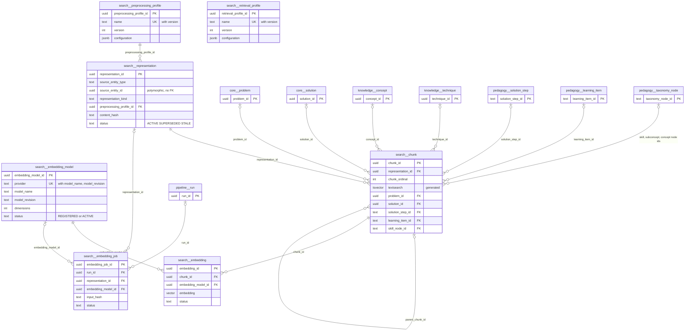
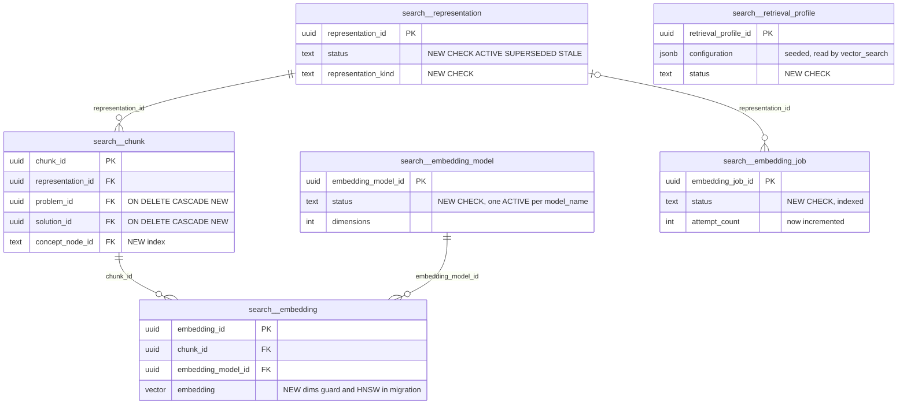

# `search` schema — retrieval representations, chunks and embeddings

The `search` schema is the pgvector + full-text retrieval layer for semantic and lexical search. Canonical content (`core.problem`, `core.solution`, `pedagogy.solution_step`, `pedagogy.learning_item`, `pedagogy.taxonomy_node`) is rendered into versioned **representations**, split into **chunks** that carry a generated `tsvector` and the canonical hard-filter ids, and embedded per **embedding model**. Batch scripts write every table; mathbank-rest only reads them (hybrid RRF search, step practice, admin coverage), except for one status flip on representations. All rows are derived and can be rebuilt from the canonical tables, apart from the small configuration catalogs.

Source of truth: migrations [002](../../../mathbank-db/sql/002_vector_schema.sql), [011](../../../mathbank-db/sql/011_step_vector_metadata.sql). Catalog extracted 2026-11-01 from migrations 001–054; endpoint mapping traced from mathbank-rest source and manually verified.

## 1. Purpose, ownership and data flow

**Domain.** Hybrid retrieval ("find problems like this", "which taxonomy node is this topic", "similar steps from other problems"). The pipeline is `source entity → representation (rendered text + content hash, per preprocessing profile) → chunk(s) (text, tsvector, filter ids) → embedding (vector per model)`.

**Writers (batch only).**

| Writer | Tables | Scope |
|---|---|---|
| [mathbank-db/etl/embed_corpus.py](../../../mathbank-db/etl/embed_corpus.py) (`build`, `backfill`, `index`, `status`; Makefile `vector-backfill[-remote]`, `vector-index[-remote]`, `vector-status[-remote]`) | `embedding_model` (registers/activates `openai/text-embedding-3-small/v1`, 1536-d, COSINE), `preprocessing_profile` (`default` v1), `representation`, `chunk`, `embedding`, `embedding_job`, `pipeline.run` | Problems (`PROBLEM`/`PROBLEM_STATEMENT`) and solutions (`SOLUTION`/`SOLUTION_FULL`). Creates the per-model partial HNSW index. Paid OpenAI calls. |
| [mathbank-db/etl/embed_textbook_steps.py](../../../mathbank-db/etl/embed_textbook_steps.py) (`make textbook-vector-remote`) | `preprocessing_profile` (`pedagogy_step_v2` v1, also seeded by 011), `representation`, `chunk`; `embedding`/`embedding_job` through `embed_corpus.embed_pending_chunks` | Published solution steps, approved learning items (question + skill signature) and taxonomy nodes. Uses uuid5 surrogates for text ids. |
| [corpus_authoring.py](../../../mathbank-rest/src/mathbank_rest/corpus_authoring.py) `review` (REST) | `representation` U | Marks `PROBLEM_STATEMENT` representations `STALE` when an admin text edit is approved. |

**Readers.**
- [db/vector_search.py](../../../mathbank-rest/src/mathbank_rest/db/vector_search.py) problem search, wrapped by [db/hybrid_search.py](../../../mathbank-rest/src/mathbank_rest/db/hybrid_search.py) (used by `POST /v1/search/problems` and the quiz generator).
- [db/step_search.py](../../../mathbank-rest/src/mathbank_rest/db/step_search.py) for steps, learning items and taxonomy nodes.
- Admin coverage: [db/pipeline_jobs.py](../../../mathbank-rest/src/mathbank_rest/db/pipeline_jobs.py), [db/textbook_admin.py](../../../mathbank-rest/src/mathbank_rest/db/textbook_admin.py), [db/import_admin.py](../../../mathbank-rest/src/mathbank_rest/db/import_admin.py) `reconciliation`.
- ETL checks in `arml_queue.py` and `repair_question_text.py`.
- mathbank-agent reaches this data only through REST tools ([agent.py](../../../mathbank-agent/agents/mathbank_tutor/agent.py) docstring); no other service connects directly.

**Queueing.** Content changes reach this schema through `pipeline.projection_request` targets `STEP_EMBEDDINGS`/`LEARNING_ITEM_EMBEDDINGS`, drained manually with `--allow-paid` (see [pipeline.md](./pipeline.md)). Problem and solution edits do not enqueue anything: they only mark the representation `STALE`.

**Privacy class.** Public or published corpus content only. Learning items are re-checked against the live row (APPROVED, student-visible, no-proof) at query time, and problem search requires `r.rendered_text` to equal the live rendering, so stale or unpublished text never surfaces. No learner data.

**Related but separate.** `knowledge.misconception_embedding`, `pedagogy.taxonomy_node_embedding` and the `*_similarity` tables (migration 040) and `artifact_runtime.artifact_embedding` follow the same model and dimensions but live in their own schemas.

## 2. Entity diagram — as-is

## 3. Tables

### `search.embedding_model`

**Role.** Catalog of embedding models. Every vector row references one, so multiple models or revisions can coexist and be switched without dropping data (vector/06). Queries pick the single `ACTIVE` row named `text-embedding-3-small` (`vector_search._active_model_id`, cached for the life of the process with `lru_cache`).

**Lifecycle.** Registered and activated in one step by `embed_corpus.ensure_model_and_profile` (`INSERT … status='ACTIVE' ON CONFLICT DO UPDATE SET status='ACTIVE'`). `REGISTERED` (the default) and retirement are never used.

**Columns**

| Column | Type | Null | Default | Description |
|---|---|---|---|---|
| `embedding_model_id` | uuid | NO | `gen_random_uuid()` | Identity. Also embedded in the WHERE clause of the HNSW index name/predicate. |
| `provider` | text | NO | — | `openai` today. |
| `model_name` | text | NO | — | `text-embedding-3-small`. The REST code hard-codes this name (`EMBEDDING_MODEL_NAME`). |
| `model_revision` | text | NO | — | Local revision label, `v1`. |
| `dimensions` | integer | NO | — | Vector length, `1536`. CHECK > 0. Not enforced against `embedding.embedding`. |
| `distance_metric` | text | NO | `'COSINE'` | Intended operator family. Queries use `<=>` (cosine) regardless of this value. |
| `normalization` | text | yes | — | Never written. |
| `status` | text | NO | `'REGISTERED'` | `REGISTERED`, `ACTIVE` (written), `RETIRED` (intended). No CHECK and no "one ACTIVE per name" guard; `_active_model_id` uses `LIMIT 1`. |
| `activated_at` | timestamptz | yes | — | Set on first registration only (not refreshed on re-activation). |
| `retired_at` | timestamptz | yes | — | Never written. |
| `metadata` | jsonb | NO | `'{}'` | Never written. |

**Keys, constraints, indexes.**
- PK `embedding_model_id`; UNIQUE `(provider, model_name, model_revision)`.
- CHECK `dimensions > 0`.

**REST operations today.**

| Op | Method & path | Auth | Handler | Notes |
|---|---|---|---|---|
| R | POST /v1/search/problems, POST /v1/search/concepts | None (anonymous) | `vector_search._active_model_id` | Cached id. |
| R | GET /v1/solution-steps/{step_id}/practice | Learner JWT | `similar_steps_for_step` | |
| R | POST /v1/quiz/generate | Learner JWT | `hybrid_search.search_problems` | Retrieval examples. |
| R | GET /v1/admin/pipeline/jobs, GET /v1/admin/imports/reconciliation | Admin key (X-Admin-Api-Key) | `pipeline_jobs.list_jobs`, `import_admin.reconciliation` | Active model and counts. |

Non-REST writer: embed_corpus.py.

### `search.preprocessing_profile`

**Role.** Versioned description of how source content was rendered and chunked. Representations are unique per profile, so a new rendering rule means a new profile version, and old vectors stay addressable until superseded.

**Lifecycle.** Insert-only seeds: `default` v1 `{"normalize_unicode": true, "preserve_latex": true, "prepend_entity_type": true}` (embed_corpus) and `pedagogy_step_v2` v1 (migration 011 seeds the units/prefix/eligibility configuration; embed_textbook_steps inserts `'{}'` if missing). Never updated or deleted.

**Columns**

| Column | Type | Null | Default | Description |
|---|---|---|---|---|
| `preprocessing_profile_id` | uuid | NO | `gen_random_uuid()` | Identity. |
| `name` | text | NO | — | `default` (problems/solutions) or `pedagogy_step_v2` (steps, learning items, taxonomy). `step_search` filters on `pp.name = 'pedagogy_step_v2'` and ignores `version`. |
| `version` | integer | NO | — | Profile version (1). |
| `configuration` | jsonb | NO | `'{}'` | Rendering rules, documentation only. The 011 seed: `{"units": ["SOLUTION_STEP","LEARNING_ITEM_QUESTION","LEARNING_ITEM_SKILL_SIGNATURE"], "prefix": "...", "metadata_source": "canonical taxonomy ids only", "learning_items": "APPROVED + student_visible + no_proof only"}`. Code does not read it. |
| `code_revision` | text | yes | — | Never written (intended to be the git SHA of the renderer). |
| `created_at` | timestamptz | NO | `now()` | Seed time. |

**Keys, constraints, indexes.**
- PK `preprocessing_profile_id`; UNIQUE `(name, version)`.
- Inbound FK from `representation` (NO ACTION).

**REST operations today.**

| Op | Method & path | Auth | Handler | Notes |
|---|---|---|---|---|
| R | POST /v1/search/concepts, GET /v1/solution-steps/{step_id}/practice | Anonymous / Learner JWT | `step_search.build_search_sql` | Profile-name filter. |
| R | GET /v1/admin/imports/reconciliation | Admin key | `import_admin._metadata_profile` | ACTIVE representations per profile. |

Non-REST writers: embed_corpus.py, embed_textbook_steps.py, migration 011 seed.

### `search.representation`

**Role.** One rendered text of one source entity under one profile, identified by its content hash. It is the unit of staleness: when the source text changes, a new representation is inserted and the old one becomes `SUPERSEDED`, so embeddings are never silently stale.

**Lifecycle.**

| From | To | Trigger |
|---|---|---|
| — | `ACTIVE` | ETL upsert (`ON CONFLICT (…, content_hash) DO UPDATE SET status='ACTIVE'`) |
| `ACTIVE` | `SUPERSEDED` | ETL finds a different hash for the same entity/kind/profile, or the entity left the eligible set (embed_textbook_steps) |
| `ACTIVE` | `STALE` | Admin approves a `TEXT_EDIT` corpus draft (corpus_authoring.py:250) |
| `SUPERSEDED`/`STALE` | `ACTIVE` | The same content hash reappears in a later ETL run |

Rows are never deleted. Superseded representations keep their chunks and embeddings forever.

**Columns**

| Column | Type | Null | Default | Description |
|---|---|---|---|---|
| `representation_id` | uuid | NO | `gen_random_uuid()` | Identity. |
| `source_entity_type` | text | NO | — | `PROBLEM`, `SOLUTION` (embed_corpus); `SOLUTION_STEP`, `LEARNING_ITEM`, `TAXONOMY_NODE` (embed_textbook_steps). The 002 comment lists only the first two. No CHECK. |
| `source_entity_id` | uuid | NO | — | `core.problem.problem_id` / `core.solution.solution_id`, or for text-keyed pedagogy entities `uuid5(7d0c5f3e-…, "<TYPE>:<id>")`. Polymorphic, no FK; the real ids are on `chunk`. |
| `representation_kind` | text | NO | — | `PROBLEM_STATEMENT`, `SOLUTION_FULL`, `SOLUTION_STEP`, `LEARNING_ITEM_QUESTION`, `LEARNING_ITEM_SKILL_SIGNATURE`, `TAXONOMY_NODE`. No CHECK. |
| `preprocessing_profile_id` | uuid | NO | — | → `search.preprocessing_profile` (NO ACTION). |
| `rendered_text` | text | NO | — | Full rendered text, e.g. `"[Problem] <statement>"`. Problem search requires it to equal the live rendering (`r.rendered_text = ep.rendered`). |
| `content_hash` | text | NO | — | sha256 of `rendered_text`; part of the natural key. |
| `source_updated_at` | timestamptz | yes | — | Never written. |
| `generated_at` | timestamptz | NO | `now()` | First insert time (not refreshed on reactivation). |
| `status` | text | NO | `'ACTIVE'` | `ACTIVE`, `SUPERSEDED`, `STALE`. No CHECK; `STALE` is undocumented in the migration. |
| `metadata` | jsonb | NO | `'{}'` | embed_textbook_steps writes canonical filter metadata (book, chapter, node ids); embed_corpus leaves `{}`. |

**Keys, constraints, indexes.**
- PK `representation_id`.
- UNIQUE `(source_entity_type, source_entity_id, representation_kind, preprocessing_profile_id, content_hash)`.
- FK `preprocessing_profile_id` → `preprocessing_profile`.
- Index `idx_representation_source (source_entity_type, source_entity_id, status)`.
- No index on `(representation_kind, status)`, which every query filters on.

**REST operations today.**

| Op | Method & path | Auth | Handler | Notes |
|---|---|---|---|---|
| R | POST /v1/search/problems, POST /v1/quiz/generate | Anonymous / Learner JWT | `vector_search.search_problems` | `status='ACTIVE' AND representation_kind='PROBLEM_STATEMENT'`. |
| R | POST /v1/search/concepts, GET /v1/solution-steps/{step_id}/practice | Anonymous / Learner JWT | `step_search` | |
| U | POST /v1/admin/corpus/drafts/{draft_id}/review | Admin key | `corpus_authoring.review` | Sets `STALE`; no outbox/projection request, so re-embedding waits for the next manual `embed_corpus` run. |
| R | GET /v1/admin/textbooks/coverage, /problems, /problems/{code}; GET /v1/admin/pipeline/jobs; GET /v1/admin/imports/reconciliation | Admin key | textbook_admin, pipeline_jobs, import_admin | Coverage counts and "embedded" flags. |

Non-REST writers: embed_corpus.py, embed_textbook_steps.py.

### `search.chunk`

**Role.** The retrievable unit. Each chunk holds a slice of a representation (usually one `FULL` chunk; `WINDOW` chunks when text exceeds about 6000 chars), a generated English `tsvector` for lexical ranking, and denormalised canonical ids. Hard filters apply on these ids *before* ranking (runtime_extension/07). Migration 011 added the pedagogy step, learning-item and taxonomy columns.

**Lifecycle.** Upserted by `(representation_id, chunk_ordinal)` in ETL. embed_corpus refreshes text/hash/counts; embed_textbook_steps refreshes filter ids and metadata. Deleted only by representation cascade (which never happens) or by cascades from `pedagogy.solution_step` / `learning_item` deletes.

**Columns**

| Column | Type | Null | Default | Description |
|---|---|---|---|---|
| `chunk_id` | uuid | NO | `gen_random_uuid()` | Identity; joined by `embedding`. |
| `representation_id` | uuid | NO | — | → `search.representation` (ON DELETE CASCADE). |
| `chunk_ordinal` | integer | NO | — | 0-based position within the representation. Pedagogy chunks are always 0. |
| `chunk_kind` | text | NO | — | `FULL` (single chunk) or `WINDOW` (paragraph-split piece). No CHECK. |
| `chunk_text` | text | NO | — | Chunk content. Not read by mathbank-rest (results join back to canonical tables). |
| `chunk_hash` | text | NO | — | sha256 of `chunk_text`; used as `embedding_job.input_hash`. |
| `token_count` | integer | yes | — | tiktoken (`cl100k_base`) token count. |
| `char_count` | integer | NO | — | Character length. |
| `parent_chunk_id` | uuid | yes | — | → `search.chunk` (self, NO ACTION). Never written. |
| `problem_id` | uuid | yes | — | → `core.problem` (NO ACTION). Set for problem/solution chunks and, by embed_textbook_steps, for step chunks. Problem search joins on it. |
| `solution_id` | uuid | yes | — | → `core.solution` (NO ACTION). |
| `concept_id` | uuid | yes | — | → `knowledge.concept` (NO ACTION). Never written. |
| `technique_id` | uuid | yes | — | → `knowledge.technique` (NO ACTION). Never written. |
| `metadata` | jsonb | NO | `'{}'` | Filter metadata copied from the representation (pedagogy chunks), GIN-indexed. |
| `textsearch` | tsvector | yes | generated | `GENERATED ALWAYS AS (to_tsvector('english', coalesce(chunk_text,''))) STORED`. Lexical ranking uses `websearch_to_tsquery` + `ts_rank_cd`. |
| `created_at` | timestamptz | NO | `now()` | Insert time. |
| `solution_step_id` | text | yes | — | Added by 011. → `pedagogy.solution_step` (ON DELETE CASCADE). |
| `learning_item_id` | text | yes | — | Added by 011. → `pedagogy.learning_item` (ON DELETE CASCADE). |
| `skill_node_id` | text | yes | — | Added by 011. → `pedagogy.taxonomy_node` (ON DELETE SET NULL). Step/item hard filter. |
| `subconcept_node_id` | text | yes | — | Added by 011. → `pedagogy.taxonomy_node` (SET NULL). |
| `concept_node_id` | text | yes | — | Added by 011. → `pedagogy.taxonomy_node` (SET NULL). Filterable in `step_search` but **not indexed**. |

**Keys, constraints, indexes.**
- PK `chunk_id`; UNIQUE `(representation_id, chunk_ordinal)`.
- FKs as listed. `problem_id`, `solution_id`, `concept_id`, `technique_id` and `parent_chunk_id` are NO ACTION, so deleting a problem or solution that has chunks fails.
- CHECK `chunk_single_pedagogy_owner`: `solution_step_id IS NULL OR learning_item_id IS NULL`.
- Indexes:
  - GIN `idx_search_chunk_fts (textsearch)`
  - GIN trigram `idx_search_chunk_trgm (chunk_text gin_trgm_ops)` (no query uses trigram operators on `chunk_text`)
  - B-tree `idx_search_chunk_problem`, `idx_search_chunk_solution`
  - partial B-tree on `solution_step_id`, `learning_item_id`, `skill_node_id`, `subconcept_node_id` (`WHERE … IS NOT NULL`)
  - GIN `idx_search_chunk_metadata (metadata jsonb_path_ops)`

**REST operations today.**

| Op | Method & path | Auth | Handler | Notes |
|---|---|---|---|---|
| R | POST /v1/search/problems, POST /v1/quiz/generate | Anonymous / Learner JWT | `vector_search.search_problems` | Lexical CTE on `textsearch`; joins `problem_id` back to `core.*`. |
| R | POST /v1/search/concepts | Anonymous | `step_search.search_taxonomy_nodes` | `TAXONOMY_NODE` kind. |
| R | GET /v1/solution-steps/{step_id}/practice | Learner JWT | `step_search.similar_steps_for_step` | Uses the step's own vector as the query. |
| R | POST /v1/admin/corpus/drafts/{draft_id}/review | Admin key | `corpus_authoring.review` | Sub-select to find representations to mark STALE. |
| R | Admin coverage routes (see `representation`) | Admin key | | |

Non-REST writers: embed_corpus.py, embed_textbook_steps.py.

### `search.embedding`

**Role.** One vector per `(chunk, model)`. The column is an unconstrained `vector`, so different models can coexist. Each model's ANN index casts to its fixed dimension. Problem search uses the HNSW index; step and taxonomy search compute exact distances over the hard-filtered candidates on purpose (step_search.py docstring).

**Lifecycle.** Upserted by `embed_pending_chunks` (`ON CONFLICT (chunk_id, embedding_model_id) DO UPDATE SET embedding, status='ACTIVE', generated_at`). Always `ACTIVE`; nothing sets another status. Vectors of superseded representations remain.

**Columns**

| Column | Type | Null | Default | Description |
|---|---|---|---|---|
| `embedding_id` | uuid | NO | `gen_random_uuid()` | Identity. |
| `chunk_id` | uuid | NO | — | → `search.chunk` (ON DELETE CASCADE). |
| `embedding_model_id` | uuid | NO | — | → `search.embedding_model` (NO ACTION). |
| `embedding` | vector | NO | — | pgvector value, 1536 floats today. Dimensions are not constrained (no `vector_dims` CHECK, unlike migration 040's tables); the writer rejects mismatches before insert. Queries cast to `public.vector(1536)` and use `OPERATOR(public.<=>)` because Neon's empty `search_path` breaks unqualified operators. |
| `embedding_hash` | text | yes | — | Never written. |
| `generated_at` | timestamptz | NO | `now()` | Last (re)generation. |
| `status` | text | NO | `'ACTIVE'` | Only `ACTIVE` is written. All readers filter on it. No CHECK. |
| `metadata` | jsonb | NO | `'{}'` | Never written. |

**Keys, constraints, indexes.**
- PK `embedding_id`; UNIQUE `(chunk_id, embedding_model_id)`.
- FKs as listed.
- Index `idx_embedding_model_status (embedding_model_id, status)`.
- **Not in migrations:** `embed_corpus.py index` creates `idx_search_embedding_text_embedding_3_small_hnsw ON search.embedding USING hnsw ((embedding::vector(1536)) vector_cosine_ops) WHERE embedding_model_id = '<id>' AND status = 'ACTIVE'`. A fresh database built from migrations alone has no ANN index.

**REST operations today.**

| Op | Method & path | Auth | Handler | Notes |
|---|---|---|---|---|
| R | POST /v1/search/problems, POST /v1/quiz/generate | Anonymous / Learner JWT | `vector_search.search_problems` | Each semantic request makes one paid OpenAI `embeddings.create` call for the query. |
| R | POST /v1/search/concepts | Anonymous | `step_search` | Paid query embedding as well; falls back to lexical-only on failure. |
| R | GET /v1/solution-steps/{step_id}/practice | Learner JWT | `similar_steps_for_step` | Reads the stored vector (`embedding::text`); no OpenAI call. |
| R | Admin coverage routes | Admin key | textbook_admin, pipeline_jobs, import_admin | Counts and "embedded" flags. |

Non-REST writers: embed_corpus.py (also via embed_textbook_steps.py).

### `search.embedding_job`

**Role.** Per-(representation, model, input hash) outcome of an embedding attempt, grouped by `pipeline.run`. It records failures with `last_error`, so admin coverage can show "failed" and "vector_error" per paper. Despite the name it is a result log, not a claimable queue: rows are written after the provider call.

**Lifecycle.** Written as `COMPLETED` or `FAILED` (upsert on the unique key; `FAILED` → `COMPLETED` on a later success). `PENDING` (default) and `IN_PROGRESS` are never written, although `pipeline_jobs` counts `IN_PROGRESS` as "active".

**Columns**

| Column | Type | Null | Default | Description |
|---|---|---|---|---|
| `embedding_job_id` | uuid | NO | `gen_random_uuid()` | Identity. |
| `run_id` | uuid | yes | — | → `pipeline.run` (NO ACTION). The run whose upsert last touched the row is not tracked; this keeps the first run. |
| `representation_id` | uuid | yes | — | → `search.representation` (NO ACTION). |
| `embedding_model_id` | uuid | yes | — | → `search.embedding_model` (NO ACTION). |
| `status` | text | NO | `'PENDING'` | `COMPLETED` or `FAILED` in practice. No CHECK. |
| `attempt_count` | integer | NO | `0` | Never incremented. |
| `input_hash` | text | NO | — | The **chunk** hash (`chunk.chunk_hash`), so a multi-chunk representation gets one row per distinct chunk. |
| `started_at` | timestamptz | yes | — | Never written. |
| `heartbeat_at` | timestamptz | yes | — | Never written. |
| `completed_at` | timestamptz | yes | — | Outcome time. |
| `worker_id` | text | yes | — | Never written. |
| `last_error` | text | yes | — | Provider exception text or `dimension mismatch: got N, expected 1536`; cleared on success. |
| `metrics` | jsonb | NO | `'{}'` | Never written. |

**Keys, constraints, indexes.**
- PK `embedding_job_id`; UNIQUE `(representation_id, embedding_model_id, input_hash)`, which is the upsert target.
- FKs as listed (all NO ACTION; nullable).
- No index on `status`, although admin reconciliation groups by it.

**REST operations today.**

| Op | Method & path | Auth | Handler | Notes |
|---|---|---|---|---|
| R | GET /v1/admin/pipeline/jobs | Admin key | `pipeline_jobs.list_jobs` | Failed/active counts and latest error per entity. |
| R | GET /v1/admin/imports/reconciliation | Admin key | `import_admin.reconciliation` | `GROUP BY status` across the whole table. |

Non-REST writer: embed_corpus.py.

### `search.retrieval_profile`

**Role.** Intended as the versioned catalog of ranking configurations (RRF constant, candidate limits, filters) from vector/10, so retrieval behaviour could be changed and audited without a deploy. **It is unused**: no migration seeds it, no script writes it, and no code reads it. The live parameters are hard-coded (RRF k = 60 in `vector_search`, `PROFILE_NAME` in `step_search`).

**Lifecycle.** None (empty table).

**Columns**

| Column | Type | Null | Default | Description |
|---|---|---|---|---|
| `retrieval_profile_id` | uuid | NO | `gen_random_uuid()` | Identity. |
| `name` | text | NO | — | Profile name (intended, e.g. `problem_hybrid`). |
| `version` | integer | NO | — | Profile version. |
| `configuration` | jsonb | NO | — | Ranking parameters (no default, so a value is required). |
| `status` | text | NO | `'ACTIVE'` | Intended `ACTIVE`/`RETIRED`. No CHECK. |
| `created_at` | timestamptz | NO | `now()` | Insert time. |

**Keys, constraints, indexes.**
- PK `retrieval_profile_id`; UNIQUE `(name, version)`.

**REST operations today.** None, and no non-REST reader or writer.

## 4. CRUD coverage — as-is

✅ REST endpoint · ⚙️ non-REST writer only · ❌ missing · — not applicable to the table type.

| Table | Type (guide §4) | Create | Read | Update | Delete | List | Notes |
|---|---|---|---|---|---|---|---|
| `search.embedding_model` | Catalogue entity (config) | ⚙️ ETL | ✅ internal reads only | ⚙️ ETL | — | ❌ | No admin view or activate/retire action. |
| `search.preprocessing_profile` | Catalogue entity (immutable config) | ⚙️ ETL/migration | ✅ in reconciliation | — | — | ✅ in reconciliation | |
| `search.representation` | Derived / cache | ⚙️ ETL | ✅ search, coverage | ✅ STALE flip (admin review) | — | ❌ | The only REST write is a side effect. |
| `search.chunk` | Derived / cache | ⚙️ ETL | ✅ search | ⚙️ ETL | — | — | |
| `search.embedding` | Derived / cache (embedding) | ⚙️ ETL | ✅ search | ⚙️ ETL | — | — | Matches guide §4: read-only, no client writes. |
| `search.embedding_job` | Queue / job (result log) | ⚙️ ETL | ✅ aggregated | ⚙️ ETL | — | ❌ | No failed-job list or retry. |
| `search.retrieval_profile` | Catalogue entity | ❌ | ❌ | ❌ | — | ❌ | Dead table. |

**Findings.**
1. **Anonymous endpoints spend money.** `POST /v1/search/problems` and `POST /v1/search/concepts` have no auth dependency and call OpenAI embeddings for every semantic request ([db/vector_search.py](../../../mathbank-rest/src/mathbank_rest/db/vector_search.py) `embed_query`). There is no rate limit or query-embedding cache.
2. **The ANN index lives outside migrations.** The HNSW index is created by `embed_corpus.py index` with the model UUID inlined in its predicate. A database rebuilt from `mathbank-db/sql` alone runs problem search as a sequential scan until someone remembers to run that command.
3. **Rebuild triggers are partial.** Admin problem edits set `representation.status='STALE'` (a value outside the documented vocabulary) without enqueueing anything. Superseded and stale representations keep their chunks and vectors forever: there is no garbage collection, and `chunk.problem_id`/`solution_id` NO ACTION FKs block problem deletion.
4. **Many columns are dead.** Never written: `retrieval_profile` (whole table); `chunk.parent_chunk_id`, `concept_id`, `technique_id`; `embedding.embedding_hash`, `metadata`; `embedding_model.normalization`, `retired_at`, `metadata`; `representation.source_updated_at`; `preprocessing_profile.code_revision`; and `embedding_job.attempt_count`, `started_at`, `heartbeat_at`, `worker_id`, `metrics`. No `status` column in the schema has a CHECK.
5. **Model selection is implicit.** There is no "one ACTIVE model per name" constraint. `_active_model_id` is `lru_cache`d for the process lifetime, so activating a new model requires a REST restart. `distance_metric` is ignored (`<=>` is hard-coded).
6. **Missing indexes for real filters.** `chunk.concept_node_id` is filterable but unindexed. `representation (representation_kind, status)` and `embedding_job (status)` are filtered or grouped on every admin/search call. The trigram index on `chunk_text` serves no query.

## 5. Target state — how it should be

### 5.1 Schema improvements

1. **P1: Put the ANN index in a migration.**
   - **Evidence.** Finding 2.
   - **Fix.** Add a migration that creates a partial HNSW index per registered model. Because the predicate needs the model id, either key it on `embedding_model_id` through a stable seeded UUID for `openai/text-embedding-3-small/v1`, or add a generated `dims int` column and index `WHERE dims = 1536`. Keep `embed_corpus.py index` as an idempotent re-assert.

2. **P1: Constrain vocabularies.** Add CHECKs (`NOT VALID` + `VALIDATE`):
   - `representation.status IN ('ACTIVE','SUPERSEDED','STALE')`
   - `representation.source_entity_type` / `representation_kind` against the six kinds in §3
   - `chunk.chunk_kind IN ('FULL','WINDOW')`
   - `embedding.status IN ('ACTIVE','SUPERSEDED')`
   - `embedding_job.status IN ('PENDING','IN_PROGRESS','COMPLETED','FAILED')`
   - `embedding_model.status IN ('REGISTERED','ACTIVE','RETIRED')`, plus a partial UNIQUE `(provider, model_name) WHERE status = 'ACTIVE'`

3. **P2: Garbage-collect superseded content.** A job (`pipeline.run` type `SEARCH_GC`) deletes representations that are `SUPERSEDED`/`STALE` and older than N days (chunks and embeddings cascade). Change `chunk.problem_id` and `solution_id` to ON DELETE CASCADE, so that deleting canonical content removes its derived rows (they are rebuildable).

4. **P2: Turn problem edits into queued re-embeds.** When `corpus_authoring.review` marks `STALE`, also emit `PROBLEM_STATEMENT_CHANGED` to `pipeline.outbox_event`, map it to a new `pipeline.projection_request` target (`PROBLEM_EMBEDDINGS`, scope `PROBLEM`), and teach the drainer to run `embed_corpus backfill --paper/--problem`.

5. **P2: Drop dead columns or start using them.** Drop `retrieval_profile`, or seed it with the current RRF parameters (`{"rrf_k": 60, "candidate_limit": …}`) and have `vector_search` read it. Drop `parent_chunk_id`, `concept_id`, `technique_id`, `embedding_hash`, and the never-written job/worker columns, or populate them: `code_revision` from `git rev-parse` and `attempt_count` on every upsert are cheap.

6. **P3: Add a dimension guard.** `CHECK (vector_dims(embedding) > 0)` on `embedding`, plus a trigger (or writer assertion) that `vector_dims(embedding) = (SELECT dimensions FROM embedding_model …)`, mirroring migration 040's `vector_dims(embedding) = dimensions` check.

7. **P3: Fix the indexes.** Add a partial index on `chunk (concept_node_id) WHERE concept_node_id IS NOT NULL`, plus `representation (representation_kind, status)` and `embedding_job (status)`. Drop `idx_search_chunk_trgm` unless a fuzzy search on `chunk_text` is planned.

### 5.2 Entity diagram — target

Changed tables only; `retrieval_profile` is shown as used (option b in §5.1 #5).

### 5.3 Endpoints to build

| Priority | Method & path | Auth | Table(s) / op | Purpose | Notes (validation, concurrency, audit) |
|---|---|---|---|---|---|
| P1 | (change) POST /v1/search/problems, POST /v1/search/concepts | Learner JWT or per-service credential; anonymous allowed only with `semantic=false` | `embedding`, `chunk` R | Stop anonymous paid embedding calls. | Rate limit per caller. Cache query embeddings (`sha256(query)` → vector, TTL) so repeated queries are free. |
| P2 | GET /v1/admin/search/coverage?entity=&book= | Admin key (X-Admin-Api-Key) | `representation`, `chunk`, `embedding`, `embedding_job` R | One coverage view instead of three ad-hoc ones. | Return expected/represented/embedded/failed per entity type and profile; read-only. |
| P2 | GET /v1/admin/search/embedding-jobs?status=FAILED&limit=&offset= | Admin key | `embedding_job` R | List failures with `last_error`. | Guide §5 list contract; `status` Literal from the new CHECK. |
| P2 | POST /v1/admin/search/rebuild | Admin key | all derived tables via job | Enqueue a re-embed for a scope (`problem`, `paper`, `book`, `kind`). | 202 + `pipeline.run` id. Writes a `pipeline.projection_request` (new `PROBLEM_EMBEDDINGS` target). Paid, so require `max_cost_usd`; audit row. |
| P2 | GET /v1/admin/search/models and POST /v1/admin/search/models/{id}/activate, …/retire | Admin key | `embedding_model` R/U | Make model switching explicit. | Activation enforces one ACTIVE per name (409), requires a complete backfill (409 with the missing count), and busts the `_active_model_id` cache. Audit row. |
| P3 | POST /v1/admin/search/gc | Admin key | `representation` D (cascade) | Purge superseded/stale derived rows older than N days. | 202 + job id; never inline. |
| P3 | GET /v1/admin/search/profiles and POST /v1/admin/search/retrieval-profiles | Admin key | `preprocessing_profile`, `retrieval_profile` R/C | Versioned retrieval tuning. | New versions only, never PATCH (immutable config); activation via `status`. |
