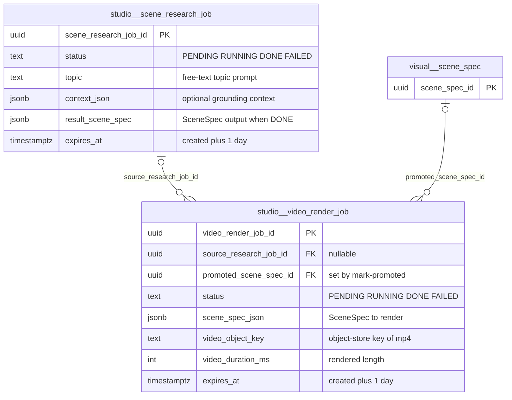
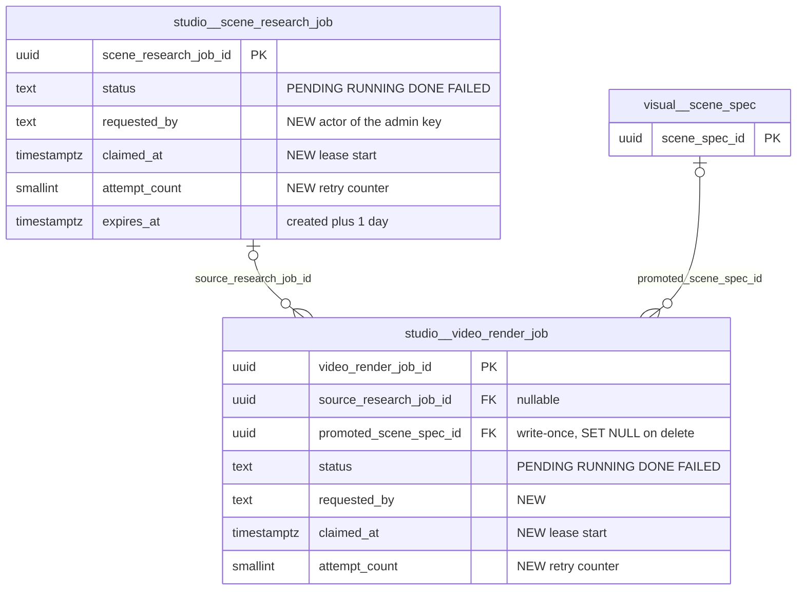

# `studio` schema — Manim Video Studio job queues

The `studio` schema holds the two short-lived job queues of the **Manim Video Studio** (requirements/60): a *research job* turns a topic (plus optional context) into a SceneSpec JSON and explanation using an OpenAI tool-calling loop grounded in `mathbank-mcp-competitions`. A *render job* compiles a SceneSpec into Manim Python and renders a real `.mp4` into the shared object store. Rows are disposable drafts with a one-day TTL. The only durable outcome is when an admin **promotes** a finished render job into the canonical `visual.scene_spec` catalog through `mathbank-rest`.

> **REST-boundary exception.** Everywhere else in MathBank, `mathbank-rest` is the only service that connects to PostgreSQL. `studio.*` is the exception. It is owned, read and written **only** by the separate [`mathbank-manim-studio`](../../../mathbank-manim-studio) FastAPI service and its worker, through [db.py](../../../mathbank-manim-studio/src/mathbank_manim_studio/db.py) and [jobs.py](../../../mathbank-manim-studio/src/mathbank_manim_studio/jobs.py). `mathbank-rest` never reads `studio.*` tables. It calls the studio's HTTP API instead ([scene_spec_promotion.py](../../../mathbank-rest/src/mathbank_rest/scene_spec_promotion.py)). The one cross-schema coupling is the FK `studio.video_render_job.promoted_scene_spec_id → visual.scene_spec`, which is possible because both services share one physical database.

Source of truth: migrations [044_manim_studio_jobs.sql](../../../mathbank-db/sql/044_manim_studio_jobs.sql), [045_scene_spec_promotion.sql](../../../mathbank-db/sql/045_scene_spec_promotion.sql). Catalog extracted 2026-11-01 from migrations 001–054; endpoint mapping traced from mathbank-rest source and manually verified.

## 1. Purpose, ownership and data flow

- **Domain:** AI-assisted authoring of animated math explainer videos (SceneSpec → Manim).
- **Owner of writes:** `mathbank-manim-studio` only.
  - The API process (`main.py`; on AWS this is the Mangum `api_handler` behind a Lambda Function URL) inserts jobs and records promotion.
  - The worker claims and completes jobs. Locally this is the in-process asyncio loop in [worker.py](../../../mathbank-manim-studio/src/mathbank_manim_studio/worker.py). On AWS it is `lambda_handler.worker_handler`, run every minute by an EventBridge schedule ([manim_studio_service_stack.py](../../../mathbank-infra-aws/stacks/manim_studio_service_stack.py)).
  - Expired rows are deleted by [scripts/cleanup_expired_jobs.py](../../../mathbank-manim-studio/scripts/cleanup_expired_jobs.py) (`make cleanup` or an external cron).
- **Readers:** the studio's own HTTP API. `mathbank-rest` reads it indirectly over HTTP: `GET /v1/render-jobs?status=DONE&unpromoted_only=true`, `GET /v1/render-jobs/{id}`, `GET /v1/render-jobs/{id}/video`, `POST /v1/render-jobs/{id}/mark-promoted`. `mathbank-web`'s admin page `/admin/manim-studio` only talks to `mathbank-rest`'s `/v1/admin/interaction-templates/scenes/*` endpoints. No first-party UI creates research/render jobs; they are created via the API directly (the requirement says "API/CLI-first").
- **Lifecycle:** queue with an atomic claim (`UPDATE … WHERE id = (SELECT … FOR UPDATE SKIP LOCKED LIMIT 1)`). Allowed status transitions: `PENDING → RUNNING → DONE | FAILED`. `expires_at = created_at + 1 day`. TTL is enforced only by the cleanup script, not by a database job.
- **Data flow:**
  1. `POST /v1/research-jobs` → worker → `result_scene_spec`.
  2. `POST /v1/render-jobs` (from a DONE research job or a raw SceneSpec) → worker renders the video → `video_object_key`.
  3. An admin in `mathbank-rest` promotes the job. This copies the video into rest's own object-store key, inserts `visual.asset` and `visual.scene_spec` (DRAFT), then calls `mark-promoted`, which sets `promoted_scene_spec_id`.
- **Privacy class:** operational / staff-only drafts. Topics and contexts are admin-supplied; there is no learner data.

## 2. Entity diagram — as-is

## 3. Tables

### `studio.scene_research_job`

**Role.** One row is one request to the research agent ([research_agent.py](../../../mathbank-manim-studio/src/mathbank_manim_studio/research_agent.py)) to turn a topic into a grounded SceneSpec JSON and a short explanation. Rows are created by `POST /v1/research-jobs` and processed by the worker. When the job is `DONE`, its `result_scene_spec` can seed a render job (`POST /v1/render-jobs {research_job_id}`). Nothing outside the studio reads this table.

**Lifecycle.**
- `PENDING` → `RUNNING`: `claim_pending_research_job`, using `FOR UPDATE SKIP LOCKED` so that concurrent workers are safe.
- `RUNNING` → `DONE` (`complete_research_job`) or `FAILED` (`fail_research_job`, which truncates `error_message` to 4000 characters).
- There is no lease or heartbeat. A job whose worker dies stays `RUNNING` until the cleanup script deletes it.
- Rows are hard-deleted once `expires_at < now()`.

**Columns**

| Column | Type | Null | Default | Description |
|---|---|---|---|---|
| `scene_research_job_id` | uuid | NO | `gen_random_uuid()` | Job identifier; returned as `id` by the studio API. |
| `status` | text | NO | `'PENDING'` | Queue state. CHECK: `PENDING`, `RUNNING`, `DONE`, `FAILED`. |
| `topic` | text | NO | — | Admin-supplied topic prompt (API enforces 1–500 characters). |
| `context_json` | jsonb | NO | `'{}'` | Optional free-form grounding context passed to the research agent, e.g. a problem or concept hint. |
| `result_scene_spec` | jsonb | yes | — | SceneSpec JSON produced on success (doc 41 ITL-4 shape: `scene_key`, `scene_version`, `objects[]{id,type}`, `timeline[]{at_ms,action}`). Validated by [scene_spec_validation.py](../../../mathbank-manim-studio/src/mathbank_manim_studio/scene_spec_validation.py). |
| `result_explanation` | text | yes | — | Short natural-language explanation written by the agent alongside the scene. |
| `error_message` | text | yes | — | Failure reason, at most 4000 characters, set when `status='FAILED'`. |
| `created_at` | timestamptz | NO | `now()` | Enqueue time; also the FIFO claim order. |
| `updated_at` | timestamptz | NO | `now()` | Last status change. Maintained by application `UPDATE`s; there is no trigger. |
| `expires_at` | timestamptz | NO | `now() + 1 day` | TTL deadline. The cleanup script deletes rows past this time. |

**Keys, constraints, indexes.**
- PK `scene_research_job_id`.
- CHECK `status IN (PENDING, RUNNING, DONE, FAILED)`.
- Index `idx_scene_research_job_expires (expires_at)` supports the cleanup sweep.
- No index on `status`. The claim query scans `WHERE status='PENDING' ORDER BY created_at`.
- Referenced by `studio.video_render_job.source_research_job_id` (ON DELETE SET NULL).

**REST operations today.** No `mathbank-rest` endpoint. The CRUD surface is `mathbank-manim-studio`'s own HTTP API:

| Op | Method & path | Auth | Handler | Notes |
|---|---|---|---|---|
| C, R | `POST /v1/research-jobs` | Anonymous (Function URL `auth_type=NONE`) | `main.post_research_job` → `jobs.create_research_job` | Body `{topic, context}`. Triggers a paid OpenAI + MCP run on the next worker tick. |
| R | `GET /v1/research-jobs/{job_id}` | Anonymous | `main.get_research_job` | Poll for the result. Returns 404 if the job is unknown or expired. |
| R | `POST /v1/render-jobs` (with `research_job_id`) | Anonymous | `main.post_render_job` | Reads the job and requires `status='DONE'` (otherwise 409). |
| U | (worker) | — | `jobs.claim_pending_research_job`, `complete_research_job`, `fail_research_job` | Not HTTP. |
| D | (script) | — | `scripts/cleanup_expired_jobs.py` | Deletes rows where `expires_at < now()`. |

### `studio.video_render_job`

**Role.** One row is one request to compile a SceneSpec into Manim and render an `.mp4` ([manim_compiler.py](../../../mathbank-manim-studio/src/mathbank_manim_studio/manim_compiler.py), [video_render_agent.py](../../../mathbank-manim-studio/src/mathbank_manim_studio/video_render_agent.py)). The SceneSpec is either copied from a DONE research job or supplied directly. On success the video is written to the shared object store and its key is stored in `video_object_key`. `DONE` rows that are not yet promoted form the candidate queue for `mathbank-rest`'s "promote to canonical catalog" workflow. After promotion, `promoted_scene_spec_id` records the resulting `visual.scene_spec`, so the studio's candidate list can hide the job.

**Lifecycle.**
- Same queue states as research jobs: `PENDING → RUNNING → DONE | FAILED`.
- `promoted_scene_spec_id` is set once by `POST /v1/render-jobs/{id}/mark-promoted`. The code does not check that the job is DONE, or that it was not already promoted.
- Rows and their video objects are deleted by the cleanup script after `expires_at`. Deletion is independent of status or promotion: the promoted video has already been copied into `mathbank-rest`'s own object-store key, and `visual.scene_spec.source_studio_job_id` is plain text with no FK.

**Columns**

| Column | Type | Null | Default | Description |
|---|---|---|---|---|
| `video_render_job_id` | uuid | NO | `gen_random_uuid()` | Job identifier; returned as `id`. `visual.scene_spec.source_studio_job_id` stores this value as text. |
| `status` | text | NO | `'PENDING'` | Queue state. CHECK: `PENDING`, `RUNNING`, `DONE`, `FAILED`. |
| `source_research_job_id` | uuid | yes | — | Research job whose `result_scene_spec` was rendered. → `studio.scene_research_job.scene_research_job_id` (ON DELETE SET NULL). NULL when a raw SceneSpec was posted. |
| `scene_spec_json` | jsonb | NO | — | Snapshot of the SceneSpec that is rendered. It is copied, not referenced, so it survives research-job expiry. |
| `video_object_key` | text | yes | — | Object-store key of the rendered `.mp4`, set on DONE. The API exposes it as `video_url = /v1/render-jobs/{id}/video`. |
| `video_duration_ms` | integer | yes | — | Rendered video length in milliseconds, set on DONE. |
| `error_message` | text | yes | — | Render/compile failure reason (at most 4000 characters). |
| `created_at` | timestamptz | NO | `now()` | Enqueue time; FIFO claim order and list sort key (DESC). |
| `updated_at` | timestamptz | NO | `now()` | Last status or promotion change (set by the application). |
| `expires_at` | timestamptz | NO | `now() + 1 day` | TTL deadline enforced by the cleanup script, which also deletes the video object. |
| `promoted_scene_spec_id` | uuid | yes | — | Added by migration 045. Canonical scene created from this job. → `visual.scene_spec.scene_spec_id` (default NO ACTION on delete). NULL means not yet promoted. |

**Keys, constraints, indexes.**
- PK `video_render_job_id`.
- FK `source_research_job_id` → `studio.scene_research_job` ON DELETE SET NULL.
- FK `promoted_scene_spec_id` → `visual.scene_spec` (NO ACTION). Deleting a DRAFT scene that a live job still points to fails. Approved scenes cannot be deleted anyway (trigger `visual.scene_spec_guard`).
- CHECK on `status`.
- Indexes: `idx_video_render_job_expires (expires_at)` and `idx_video_render_job_source (source_research_job_id)`.

**REST operations today.** No `mathbank-rest` endpoint touches the table. The studio's HTTP API:

| Op | Method & path | Auth | Handler | Notes |
|---|---|---|---|---|
| C, R | `POST /v1/render-jobs` | Anonymous | `main.post_render_job` → `jobs.create_render_job` | Exactly one of `research_job_id` or `scene_spec_json`. The SceneSpec is not validated at enqueue time. |
| R | `GET /v1/render-jobs/{job_id}` | Anonymous | `main.get_render_job` | Called by `mathbank-rest` `promote_render_job`. |
| R | `GET /v1/render-jobs/{job_id}/video` | Anonymous | `main.get_render_job_video` | Streams the mp4 from the object store. Returns 409 until DONE. |
| R | `GET /v1/render-jobs?status=&unpromoted_only=` | Anonymous | `main.list_render_jobs` | Fixed `LIMIT 50`, no offset or total. Used by `mathbank-rest` `list_promotable_candidates`. |
| U | `POST /v1/render-jobs/{job_id}/mark-promoted` | Admin key (X-Admin-Api-Key, the studio's own `ADMIN_API_KEY` setting) | `main.mark_render_job_promoted` | Sets `promoted_scene_spec_id`. Called best-effort by `mathbank-rest` after its own commit. |
| U | (worker) | — | `jobs.claim_pending_render_job`, `complete_render_job`, `fail_render_job` | Not HTTP. |
| D | (script) | — | `scripts/cleanup_expired_jobs.py` | Deletes the object, then the row. |

`mathbank-rest` endpoints that reach this table **through the studio HTTP API** (not SQL):

| Method & path | Auth | Studio call |
|---|---|---|
| `GET /v1/admin/interaction-templates/scenes/promotable-candidates` | Admin key (X-Admin-Api-Key) | `GET /v1/render-jobs?status=DONE&unpromoted_only=true`. Also filters out jobs already present in `visual.scene_spec.source_studio_job_id`. |
| `POST /v1/admin/interaction-templates/scenes/promote` | Admin key (X-Admin-Api-Key) | `GET /v1/render-jobs/{id}`, `GET …/video`, then `POST …/mark-promoted` |

## 4. CRUD coverage — as-is

| Table | Create | Read | Update | Delete | Notes |
|---|---|---|---|---|---|
| `studio.scene_research_job` | ⚙️ | ⚙️ | ⚙️ | ⚙️ | All via `mathbank-manim-studio` HTTP, worker and cleanup script. There is no listing endpoint and no cancel endpoint. |
| `studio.video_render_job` | ⚙️ | ⚙️ | ⚙️ | ⚙️ | Same. `mathbank-rest` reaches it only over HTTP for promotion. There is no cancel/retry endpoint. |

(⚙️ = served by the separate studio service rather than `mathbank-rest`. This is by design under the REST-boundary exception.)

## 5. Target state — how it should be

### 5.1 Schema improvements

1. **P1 — Close the anonymous write surface.** `POST /v1/research-jobs` and `POST /v1/render-jobs` have no auth dependency ([main.py:97,114](../../../mathbank-manim-studio/src/mathbank_manim_studio/main.py)), and the AWS Function URL uses `FunctionUrlAuthType.NONE` ([manim_studio_service_stack.py:151](../../../mathbank-infra-aws/stacks/manim_studio_service_stack.py)). Anyone who knows the URL can enqueue paid OpenAI and Manim work and read all job outputs.
   - Require the same `X-Admin-Api-Key` that already guards `mark-promoted` on every route.
   - Add a nullable `requested_by text` column so jobs are attributable.
2. **P1 — Schedule the TTL.** Requirement 60 says the TTL is enforced by `cleanup_expired_jobs.py`, but the CDK stack schedules only `worker_handler` (`Schedule.rate(1 minute)`). No cleanup schedule exists, so expired rows and videos accumulate on AWS.
   - Add a scheduled cleanup function, or let `worker_handler` run the sweep.
   - This is not a schema change, but it is the only thing that makes `expires_at` meaningful.
3. **P2 — Recover crashed claims.** A worker that dies after claiming leaves the job `RUNNING` forever: there is no lease and no retry ([jobs.py](../../../mathbank-manim-studio/src/mathbank_manim_studio/jobs.py) `claim_pending_*`).
   - Add `claimed_at timestamptz` and `attempt_count smallint NOT NULL DEFAULT 0`.
   - Let the claim also pick `RUNNING` rows whose `claimed_at < now() - interval '15 minutes'` and `attempt_count < 3`.
4. **P2 — Partial index for the claim query.** Add `CREATE INDEX … ON studio.<table> (created_at) WHERE status = 'PENDING'` on both tables. The claim currently filters on an unindexed `status`.
5. **P2 — Make promotion write-once.** `mark_render_job_promoted` overwrites `promoted_scene_spec_id` unconditionally and does not check that the job is DONE.
   - Add `CHECK (promoted_scene_spec_id IS NULL OR status = 'DONE')`.
   - Make the UPDATE conditional: `WHERE promoted_scene_spec_id IS NULL`.
6. **P3 — FK behaviour on `promoted_scene_spec_id`.** It is NO ACTION. Make it `ON DELETE SET NULL` explicitly so that discarding a DRAFT scene in `visual` never fails because of an expiring studio row.
7. **P3 — Cascade-safety for in-flight jobs.** Cleanup deletes rows regardless of status, so a `RUNNING` job past its TTL is deleted under the worker, whose final `UPDATE` then silently affects 0 rows. Restrict the delete to `status IN ('DONE','FAILED') OR updated_at < expires_at - …`, or extend `expires_at` on claim.
8. **P3 — Keep the boundary explicit.** Document `studio` in `create_app_db.sql` or the ops grants with a dedicated DB role that may write only `studio.*` and run `SELECT` on `visual.scene_spec(scene_spec_id)`. This turns the REST-boundary exception into an enforced least-privilege grant instead of a convention.

### 5.2 Entity diagram — target

Structure is unchanged; new columns only (see 5.1 items 1, 3 and 5).

### 5.3 Endpoints to build

These belong in `mathbank-manim-studio`, not `mathbank-rest`. The studio keeps its own API under the REST-boundary exception. If an admin UI needs them, it should go through a thin `mathbank-rest` proxy under `/v1/admin/interaction-templates/studio/*` that calls the studio over HTTP, mirroring `scene_spec_promotion.py`.

| Priority | Method & path | Auth | Table(s) / op | Purpose | Notes (validation, concurrency, audit) |
|---|---|---|---|---|---|
| P1 | *(existing)* `POST /v1/research-jobs`, `POST /v1/render-jobs`, all `GET`s | Admin key (X-Admin-Api-Key) | both / C, R | Add auth to the existing routes. | The dependency already exists (`require_admin_api_key`). Record `requested_by` from `X-Actor-Id`. |
| P2 | `GET /v1/research-jobs?status=&limit=&offset=` | Admin key (X-Admin-Api-Key) | `scene_research_job` / R | List research jobs; today a caller must remember IDs. | `{items,total,limit,offset}`, limit ≤ 200, sorted by `created_at DESC`. |
| P2 | `POST /v1/research-jobs/{id}/cancel`, `POST /v1/render-jobs/{id}/cancel` | Admin key (X-Admin-Api-Key) | both / U | Stop a PENDING job before it costs money. | Allowed only from `PENDING` (409 otherwise). Needs a new `CANCELLED` status in the CHECK. |
| P2 | `POST /v1/render-jobs/{id}/retry` (and the research equivalent) | Admin key (X-Admin-Api-Key) | both / U | Re-queue a `FAILED` (or stale `RUNNING`) job. | `FAILED → PENDING`, increments `attempt_count`, clears `error_message`. |
| P3 | `GET /v1/render-jobs` — add `offset`, `total` | Admin key (X-Admin-Api-Key) | `video_render_job` / R | Align with the list convention. | Currently a hard-coded `LIMIT 50`. |
| P3 | `DELETE /v1/render-jobs/{id}` | Admin key (X-Admin-Api-Key) | `video_render_job` / D | Discard an unpromoted job early. | 204 only when `promoted_scene_spec_id IS NULL`. Also deletes the object-store video. |
