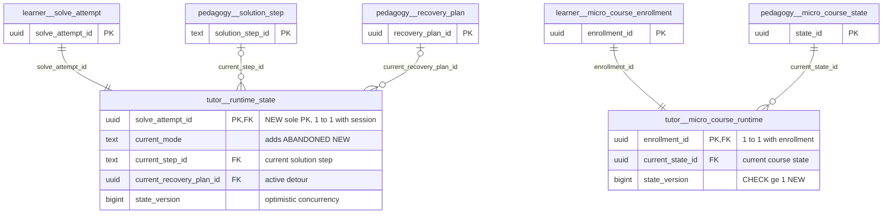

# `tutor` schema — live tutoring runtime pointers

The `tutor` schema holds the mutable "where is the learner right now" checkpoint for each active tutoring session. It has two independent pointer tables. `tutor.runtime_state` covers the step-by-step problem-solving runtime: current step, mode (solving / recovery / review) and the optimistic-concurrency `state_version`. `tutor.micro_course_runtime` covers the micro-course runtime: current state of the pinned release, plus its own `state_version`. The two must never be overloaded onto each other (MCR-14). Both are 1:1 extensions of a learner-owned session row and are written only by mathbank-rest.

Source of truth: migrations [012](../../../mathbank-db/sql/012_step_runtime.sql), [015](../../../mathbank-db/sql/015_recovery_runtime.sql) (recovery-plan FK), [032](../../../mathbank-db/sql/032_micro_course_platform.sql). Catalog extracted 2026-11-01 from migrations 001–054; endpoint mapping traced from mathbank-rest source and manually verified.

## 1. Purpose, ownership and data flow

- **Domain:** tutoring session state, the read model the UI and agent poll to know what to present next.
- **Owners:**
  - `tutor.runtime_state`: [step_runtime.py](../../../mathbank-rest/src/mathbank_rest/step_runtime.py) creates it in `start_attempt` and advances it through `_set_position` / `_bump_version` / `submit_attempt`. [step_recovery.py](../../../mathbank-rest/src/mathbank_rest/step_recovery.py) switches it into and out of `RECOVERY` (`_set_runtime_plan`, `resume_from_recovery`, `abort`).
  - `tutor.micro_course_runtime`: [micro_course_service.py](../../../mathbank-rest/src/mathbank_rest/micro_course_service.py) creates it in `enroll` and moves it in `advance_enrollment`. [micro_course_assist.py](../../../mathbank-rest/src/mathbank_rest/micro_course_assist.py) reads it for scoped help.
- **Readers:** the same modules; `routers.geometry_interpretation` (through `step_runtime.get_runtime`); the ADK agent indirectly through REST tools ([step_runtime_tools.py](../../../mathbank-agent/agents/mathbank_tutor/tools/step_runtime_tools.py) maps `current_mode` to response modes).
- **Lifecycle:** one row per session, created with the session, updated in place under a row lock (`_lock_attempt` … `FOR UPDATE`). Every mutation increments `state_version`; clients send the version they saw, and a mismatch raises 409 (`StateVersionConflict`). The row is deleted only by cascade from its session.
- **Privacy class:** learner-private operational state.

## 2. Entity diagram — as-is

```mermaid
erDiagram
    learner__student_profile {
        uuid student_id PK
    }
    learner__solve_attempt {
        uuid solve_attempt_id PK
    }
    learner__micro_course_enrollment {
        uuid enrollment_id PK
    }
    core__problem {
        uuid problem_id PK
    }
    pedagogy__solution_step {
        text solution_step_id PK
    }
    pedagogy__recovery_plan {
        uuid recovery_plan_id PK
    }
    pedagogy__micro_course_state {
        uuid state_id PK
    }
    pedagogy__video_asset {
        uuid video_asset_id PK
    }
    pedagogy__intervention_script {
        uuid intervention_id PK
    }
    tutor__runtime_state {
        uuid student_id PK, FK "owner"
        uuid solve_attempt_id PK, FK "session"
        text current_mode "SOLVING DIAGNOSING RECOVERY REVIEW COMPLETED"
        uuid current_problem_id FK "problem being solved"
        text current_step_id FK "current solution step"
        uuid current_recovery_plan_id FK "active detour"
        bigint state_version "optimistic concurrency"
    }
    tutor__micro_course_runtime {
        uuid enrollment_id PK, FK "1 to 1 with enrollment"
        uuid current_state_id FK "current course state"
        uuid current_video_asset_id FK "unused today"
        uuid active_intervention_id FK "unused today"
        bigint state_version "optimistic concurrency"
    }
    learner__student_profile ||--o{ tutor__runtime_state : "student_id"
    learner__solve_attempt ||--|| tutor__runtime_state : "solve_attempt_id"
    core__problem ||--o{ tutor__runtime_state : "current_problem_id"
    pedagogy__solution_step |o--o{ tutor__runtime_state : "current_step_id"
    pedagogy__recovery_plan |o--o{ tutor__runtime_state : "current_recovery_plan_id"
    learner__micro_course_enrollment ||--|| tutor__micro_course_runtime : "enrollment_id"
    pedagogy__micro_course_state ||--o{ tutor__micro_course_runtime : "current_state_id"
    pedagogy__video_asset |o--o{ tutor__micro_course_runtime : "current_video_asset_id"
    pedagogy__intervention_script |o--o{ tutor__micro_course_runtime : "active_intervention_id"
```

## 3. Tables

### `tutor.micro_course_runtime`

**Role.** One row = the live position of one micro-course enrollment: the `pedagogy.micro_course_state` the learner is on, within the release pinned by `learner.micro_course_enrollment.release_id`. `enroll_in_course` creates it at enrollment time, pointing at the release's entry state (lowest `ordinal`). `POST …/advance` moves it along approved transitions. `get_enrollment`, `submit_response`, `submit_activity_response`, `record_interaction_event` and `item-help` read it to scope what the learner may see.

**Lifecycle.** Created with the enrollment, never deleted except by cascade. `state_version` starts at 1 and increases on every advance, including the final `COMPLETED` step, which bumps the version but keeps `current_state_id`. `advance_enrollment` requires `expected_state_version` to match ([micro_course_service.py:1244](../../../mathbank-rest/src/mathbank_rest/micro_course_service.py)). No trigger.

**Columns**

| Column | Type | Null | Default | Description |
|---|---|---|---|---|
| `enrollment_id` | uuid | NO | — | Enrollment this pointer belongs to (1:1) → `learner.micro_course_enrollment.enrollment_id` (ON DELETE CASCADE). |
| `current_state_id` | uuid | NO | — | Current course state → `pedagogy.micro_course_state.state_id` (NO ACTION). Must belong to the enrollment's pinned release; the service enforces this, the schema does not. |
| `current_video_asset_id` | uuid | yes | — | Video being watched in the current state → `pedagogy.video_asset.video_asset_id`. Reserved for timestamp-grounded video Q&A (MCR-9); **no code writes it today**. |
| `current_video_time_ms` | bigint | yes | — | Playback position in milliseconds within `current_video_asset_id`. Reserved; never written. |
| `active_intervention_id` | uuid | yes | — | Intervention script currently running → `pedagogy.intervention_script.intervention_id`. Reserved; never written. |
| `state_version` | bigint | NO | `1` | Optimistic-concurrency counter, incremented on every advance; clients echo it as `expected_state_version`. |
| `updated_at` | timestamptz | NO | `now()` | Last time the pointer moved. |

**Keys, constraints, indexes.**
- PK `enrollment_id` (= FK, so 1:1 with the enrollment).
- FKs: `enrollment_id` → `learner.micro_course_enrollment` ON DELETE CASCADE; `current_state_id` → `pedagogy.micro_course_state`; `current_video_asset_id` → `pedagogy.video_asset`; `active_intervention_id` → `pedagogy.intervention_script` (all NO ACTION).
- No CHECKs (unlike `runtime_state`, there is no `state_version >= 1`). No secondary indexes, no triggers.

**REST operations today.**

| Op | Method & path | Auth | Handler | Notes |
|---|---|---|---|---|
| C, R | `POST /v1/micro-courses/{canonical_code}/enroll` | Learner JWT | `routers.micro_courses.enroll_in_course` | Inserts the pointer at the entry state, or returns the existing IN_PROGRESS enrollment. |
| R | `GET /v1/micro-courses/enrollments/{enrollment_id}` | Learner JWT | `routers.micro_courses.get_enrollment` | Owner-scoped join enrollment ⨝ runtime. |
| R, U | `POST /v1/micro-courses/enrollments/{enrollment_id}/advance` | Learner JWT | `routers.micro_courses.advance_enrollment` | Moves `current_state_id` and bumps `state_version`; 409 on version mismatch. |
| R | `POST /v1/micro-courses/enrollments/{enrollment_id}/responses` | Learner JWT | `routers.micro_courses.submit_response` | Reads the current state to validate the learning item. |
| R | `POST /v1/micro-courses/enrollments/{enrollment_id}/interaction-events` | Learner JWT | `routers.micro_courses.record_interaction_event_endpoint` | Takes `course_state_id` for the telemetry row from the runtime. |
| R | `POST /v1/micro-courses/enrollments/{enrollment_id}/item-help` | Learner JWT | `routers.micro_courses.get_item_help` | Scopes help to the current state ([micro_course_assist.py:43](../../../mathbank-rest/src/mathbank_rest/micro_course_assist.py)). |

### `tutor.runtime_state`

**Role.** One row = the tutoring checkpoint of one step-by-step solve session (`learner.solve_attempt`). `start_attempt` creates it in the same transaction as the session ([step_runtime.py:343](../../../mathbank-rest/src/mathbank_rest/step_runtime.py)). Every step presentation, response, hint, outcome, detour and submit updates it. `get_runtime` joins it to the session to build the student-safe runtime view. Its `state_version` is the concurrency token that all mutating step-runtime endpoints require in the request body.

**Lifecycle.** `current_mode` transitions:
- `SOLVING` → `RECOVERY`: a recovery plan opens (`_set_runtime_plan(..., "RECOVERY")`).
- `RECOVERY` → `SOLVING`: resume or abort.
- `SOLVING` → `COMPLETED`: the last step is done (`_set_position(..., "COMPLETED")`).
- `SOLVING` → `REVIEW`: the learner hands in early (`submit_attempt`).

`DIAGNOSING` is allowed by the CHECK but never written. When the stale-attempt job marks a session `ABANDONED`, `current_mode` is left unchanged. `state_version` only increases. Rows are deleted only by cascade from the session or student.

**Columns**

| Column | Type | Null | Default | Description |
|---|---|---|---|---|
| `student_id` | uuid | NO | — | Owner → `learner.student_profile.student_id` (ON DELETE CASCADE). Redundant with `learner.solve_attempt.student_id`. |
| `solve_attempt_id` | uuid | NO | — | Session this checkpoint belongs to → `learner.solve_attempt.solve_attempt_id` (ON DELETE CASCADE). Unique in practice (one row per session), but only `(student_id, solve_attempt_id)` is declared unique. |
| `current_mode` | text | NO | `'SOLVING'` | Tutor mode (CHECK): `SOLVING`, `DIAGNOSING` (unused), `RECOVERY`, `REVIEW`, `COMPLETED`. Mutations are refused in `RECOVERY` (submit) or outside it (resume). |
| `current_problem_id` | uuid | NO | — | Problem being solved → `core.problem.problem_id`. Equal to `solve_attempt.problem_id`. |
| `current_step_id` | text | yes | — | Solution step currently presented → `pedagogy.solution_step.solution_step_id`. NULL when all steps are done. Mirrors `solve_attempt.current_solution_step_id`. |
| `current_recovery_plan_id` | uuid | yes | — | Active detour → `pedagogy.recovery_plan.recovery_plan_id` (ON DELETE SET NULL). Set when entering `RECOVERY`; kept after the plan ends so the UI can offer "return". |
| `last_agent_turn_id` | text | yes | — | Intended pointer to the ADK agent turn that last acted on the session. **Never written by any code.** |
| `state_version` | bigint | NO | `1` | Optimistic-concurrency counter (CHECK `>= 1`); returned in every runtime response and required in mutation bodies. |
| `updated_at` | timestamptz | NO | `now()` | Last checkpoint change. |

**Keys, constraints, indexes.**
- PK `(student_id, solve_attempt_id)`. Every query filters by `solve_attempt_id` alone (e.g. [step_runtime.py:232-241](../../../mathbank-rest/src/mathbank_rest/step_runtime.py), [step_recovery.py:443-465](../../../mathbank-rest/src/mathbank_rest/step_recovery.py)), and no index leads with it.
- FKs: `student_id` → `learner.student_profile` CASCADE; `solve_attempt_id` → `learner.solve_attempt` CASCADE; `current_problem_id` → `core.problem`; `current_step_id` → `pedagogy.solution_step`; `current_recovery_plan_id` → `pedagogy.recovery_plan` SET NULL.
- CHECKs: `current_mode` enumeration; `state_version >= 1`.
- No triggers.

**REST operations today.** All learner routes call `_same_student` / owner-scoped `_lock_attempt`.

| Op | Method & path | Auth | Handler | Notes |
|---|---|---|---|---|
| C, R, U | `POST /v1/students/{student_id}/problems/{problem_ref}/attempts` | Learner JWT | `routers.step_runtime.start_attempt` | Creates the checkpoint with the session, or resumes the open one. Idempotency-Key supported. |
| R | `GET /v1/attempts/{attempt_id}` · `GET /v1/attempts/{attempt_id}/runtime` | Learner JWT | `routers.step_runtime.get_runtime` | Same handler, two paths. |
| R, U | `POST /v1/attempts/{attempt_id}/steps/{step_id}/responses` | Learner JWT | `submit_step_response` | Bumps `state_version`; may advance `current_step_id`. |
| R, U | `POST /v1/attempts/{attempt_id}/steps/{step_id}/hint` | Learner JWT | `request_hint` | Bumps version. |
| R | `GET /v1/attempts/{attempt_id}/steps/{step_id}/hints` | Learner JWT | `list_hints` | Ownership and version read. |
| R, U | `POST /v1/attempts/{attempt_id}/steps/{step_id}/outcome` | Admin key (X-Admin-Api-Key) | `record_step_outcome` | Evaluator/agent records a verdict and advances; may set `COMPLETED`. |
| R | `POST /v1/attempts/{attempt_id}/steps/{step_id}/diagnose` | Learner JWT | `diagnose_step` | Reads mode/version. |
| R, U | `POST /v1/attempts/{attempt_id}/recovery-plans` | Learner JWT | `create_recovery_plan` | Mode → `RECOVERY`. |
| R, U | `POST /v1/recovery-plans/{plan_id}/items/{item_id}/responses` | Learner JWT | `answer_recovery_item` | Bumps version; may branch the plan pointer. |
| R, U | `POST /v1/recovery-plans/{plan_id}/resume` · `/abort` | Learner JWT | `resume_from_recovery` · `abort_recovery` | Mode → `SOLVING`, step pointer restored. |
| R, U | `POST /v1/attempts/{attempt_id}/submit` | Learner JWT | `submit_attempt` | Mode → `REVIEW`. |
| R | `POST /v1/geometry-scenes/interpret` | Staff cookie or Learner JWT | `routers.geometry_interpretation.interpret_scene` | Reads the runtime only when `solve_attempt_id` is supplied (owner-checked). |

## 4. CRUD coverage — as-is

| Table | Create | Read | Update | Delete | Notes |
|---|---|---|---|---|---|
| `tutor.micro_course_runtime` | ✅ | ✅ | ✅ | — | Created on enroll, moved on advance; delete only by enrollment cascade (intended). No admin "reset learner position" action. |
| `tutor.runtime_state` | ✅ | ✅ | ✅ | — | Fully driven by the step-runtime endpoints; delete only by session cascade. Admin has no direct read except through `/v1/admin/recovery-plans` summaries. |

## 5. Target state — how it should be

### 5.1 Schema improvements

1. **P1 — Index `tutor.runtime_state` by `solve_attempt_id`.** Make `solve_attempt_id` the PK (it is 1:1 with the session) or add `UNIQUE (solve_attempt_id)`. Every runtime mutation (`_bump_version`, `_set_position`, `_set_runtime_plan`, `submit_attempt`) filters on `solve_attempt_id` only, so the current PK `(student_id, solve_attempt_id)` cannot serve those lookups efficiently, and nothing stops a second row per session.
2. **P2 — Drop the redundant `student_id` and `current_problem_id` from `tutor.runtime_state`, or constrain them.** Both duplicate `learner.solve_attempt` (written together at [step_runtime.py:338-345](../../../mathbank-rest/src/mathbank_rest/step_runtime.py)). If kept for query convenience, add a composite FK `(solve_attempt_id, student_id)` → `learner.solve_attempt (solve_attempt_id, student_id)` (needs a matching UNIQUE there) so they cannot diverge.
3. **P2 — Set `current_mode` on abandonment.** `abandon_stale_attempts` ([step_runtime.py:470-490](../../../mathbank-rest/src/mathbank_rest/step_runtime.py)) updates `solve_attempt.status` and aborts plans but leaves the checkpoint in `SOLVING` / `RECOVERY`. Either add `ABANDONED` to the mode CHECK and set it, or derive mode from the session status.
4. **P3 — Remove or implement dead columns.** These are never written by any code: `runtime_state.last_agent_turn_id`, `micro_course_runtime.current_video_asset_id`, `current_video_time_ms`, `active_intervention_id`, and the `DIAGNOSING` mode value. Either implement the video/intervention tracking (MCR-9) or drop them to keep the read model honest.
5. **P3 — Add `CHECK (state_version >= 1)` and `CHECK (current_video_time_ms IS NULL OR current_video_time_ms >= 0)` to `tutor.micro_course_runtime`**, for parity with `tutor.runtime_state`.
6. **P3 — Enforce release membership of `current_state_id`.** Today only the service checks that the state belongs to the enrollment's pinned release. A composite FK `(release_id, current_state_id)` → `pedagogy.micro_course_state (release_id, state_id)` would require denormalising `release_id` onto the runtime row.

### 5.2 Entity diagram — target

### 5.3 Endpoints to build

| Priority | Method & path | Auth | Table(s) / op | Purpose | Notes (validation, concurrency, audit) |
|---|---|---|---|---|---|
| P2 | `GET /v1/admin/attempts/{attempt_id}/runtime` | Admin key (X-Admin-Api-Key) | `tutor.runtime_state` + `learner.solve_attempt` / R | Support staff can inspect a learner's live checkpoint (mode, step, version) without impersonating the learner. | Admin response model may include `current_step_id`; no canonical step text. |
| P2 | `POST /v1/admin/micro-courses/enrollments/{enrollment_id}/reset` | Admin key (X-Admin-Api-Key) | `tutor.micro_course_runtime` / U, `learner.micro_course_state_event` / C | Move a stuck learner back to the release's entry state (or a chosen state). | Body `{expected_state_version, to_state_id?}`; 409 on mismatch; validates the state is in the pinned release; appends a `STATE_CHANGED` event with `actor=ADMIN`; writes `audit.action_log`. |
| P3 | `GET /v1/admin/micro-courses/enrollments/{enrollment_id}` | Admin key (X-Admin-Api-Key) | `tutor.micro_course_runtime` + enrollment / R | Per-enrollment drill-down from the existing course activity view. | Read-only. |
