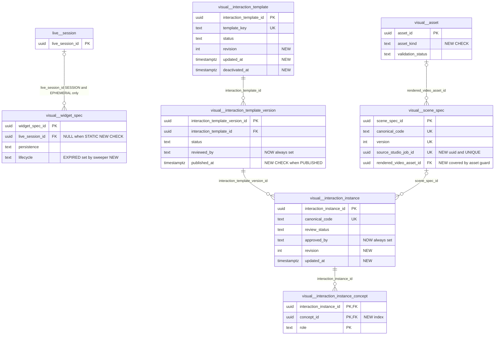

# `visual` schema — widgets, assets, interaction templates and scenes

The `visual` schema stores everything MathBank *shows* rather than *teaches*. It has three families. (1) **Live widgets** (migration 020): `widget_spec` holds validated, declarative widget JSON (geometry diagrams, poll results, formula cards …) composed for a live classroom or stored as a reusable library item, and `widget_state` mirrors which widget instance is on stage in a `live.session`. (2) **Binary asset metadata**: `asset` points at bytes in the private object store (or at an external URL) for micro-courses, theorem diagrams and Manim explainer videos. (3) **Interaction template library** (migration 033, requirements [41](../../requirements/41_INTERACTION_TEMPLATE_LIBRARY.md)): a governed vocabulary of controls, icons and animations; versioned interaction templates with JSON-Schema contracts; SceneSpecs (animated scene JSON, optionally promoted from the Manim Video Studio); and concrete, reviewed interaction instances that micro-course states attach, with FK-backed concept/technique/skill/misconception bindings. The schema has no learner-private rows: learner interaction events live in `learner.interaction_event`.

Source of truth: migrations [020](../../../mathbank-db/sql/020_live_fluid_platform.sql), [032](../../../mathbank-db/sql/032_micro_course_platform.sql) (asset presentation columns), [033](../../../mathbank-db/sql/033_interaction_template_library.sql), [034](../../../mathbank-db/sql/034_micro_course_template_bindings.sql) (asset size, published-course guards), [045](../../../mathbank-db/sql/045_scene_spec_promotion.sql) (scene video + studio lineage). Catalog extracted 2026-11-01 from migrations 001–054; endpoint mapping traced from mathbank-rest source and manually verified.

## 1. Purpose, ownership and data flow

**Domain.** Presentation content: what a learner sees and manipulates in the live classroom, in micro-course lessons and on theorem pages. Grading, mastery and misconception evidence are owned by other schemas (`learner.*`, `pedagogy.*`).

**Write ownership.** All runtime writes go through mathbank-rest, in five modules:

| Path family | Router | Service module(s) | Tables written | Auth |
|---|---|---|---|---|
| `/v1/admin/interaction-templates/*` | [routers/interaction_templates.py](../../../mathbank-rest/src/mathbank_rest/routers/interaction_templates.py) (**contains inline SQL**: publish, approve-instance, list/get scenes, video, approve-scene) | [interaction_catalog.py](../../../mathbank-rest/src/mathbank_rest/interaction_catalog.py), [interaction_validators.py](../../../mathbank-rest/src/mathbank_rest/interaction_validators.py), [scene_spec_promotion.py](../../../mathbank-rest/src/mathbank_rest/scene_spec_promotion.py), [interaction_template_projection.py](../../../mathbank-rest/src/mathbank_rest/interaction_template_projection.py) | template, template_version, control/icon/animation templates, scene_spec, interaction_instance, instance_concept, instance_technique, asset | Admin key (X-Admin-Api-Key), router level |
| `/v1/widgets/*` | [routers/fluid.py](../../../mathbank-rest/src/mathbank_rest/routers/fluid.py) (inline SQL for list/get/review) | [live_runtime.py](../../../mathbank-rest/src/mathbank_rest/live_runtime.py) `store_widget_spec` | widget_spec | Admin key, or `staff_or_student` (admin key **or** any learner JWT) |
| `/v1/live/sessions/{sid}/…`, `/v1/instructor/live/{sid}/…`, `/v1/tutor/sessions/{sid}/…` | [routers/live.py](../../../mathbank-rest/src/mathbank_rest/routers/live.py) | `live_runtime.execute_command` → `_show_widget`/`_update_widget`/`_hide_widget`/`_close_activity` | widget_spec, widget_state | `staff_actor` (admin key) for widget commands; AI tutor via admin key |
| `/v1/admin/micro-courses/states/{state_id}/assets` | [routers/micro_courses.py](../../../mathbank-rest/src/mathbank_rest/routers/micro_courses.py) | [micro_course_service.py](../../../mathbank-rest/src/mathbank_rest/micro_course_service.py) `register_uploaded_asset` | asset | Admin key |

**Non-REST writers.**
- [interactions_cli.py](../../../mathbank-rest/src/mathbank_rest/interactions_cli.py) (`python -m mathbank_rest.interactions_cli templates load-seeds|publish …`, `instances approve …`, `graph rebuild`) duplicates the router's publish/approve SQL rather than sharing it.
- [scripts/seed_reference_courses.py](../../../mathbank-rest/scripts/seed_reference_courses.py) (`ensure_template_version_published` L423–469, `ensure_interaction_instance` L472–513) overwrites seed placeholder schemas on DRAFT template versions, publishes them, and inserts + approves reference interaction instances.
- [scripts/seed_reference_course_extras.py](../../../mathbank-rest/scripts/seed_reference_course_extras.py) `ensure_video_asset` inserts external YouTube `asset` rows (`uri = source_url`, `mime_type = 'video/youtube'`, `validation_status = 'VALID'`).
- [scripts/migrate_micro_course_template_bindings.py](../../../mathbank-rest/scripts/migrate_micro_course_template_bindings.py) applies migration 034 (DDL only).
- No ETL in `mathbank-db/etl` or `mathbank-graph/etl` touches `visual.*`. `mathbank-manim-studio` never writes `visual.*`; it only holds an FK from `studio.video_render_job.promoted_scene_spec_id` and receives the new id through `POST /v1/render-jobs/{id}/mark-promoted`.

**Readers outside the schema.**
- Micro-course runtime ([micro_course_service.py](../../../mathbank-rest/src/mathbank_rest/micro_course_service.py) `_assemble_course_reader_payload` L416, `get_enrollment_runtime`, `get_published_asset` L2146, `validate_release`, `_content_hash`, `attach_interaction` L2254, `get_widget_library` L2211, `list_approved_interactions` L2189) and [micro_course_assist.py](../../../mathbank-rest/src/mathbank_rest/micro_course_assist.py) (item help grounding) read asset, interaction_instance, template, template_version and scene_spec. These reads strip `asset.uri` before returning to learners.
- [theorem_service.py](../../../mathbank-rest/src/mathbank_rest/theorem_service.py) `get_theorem` (L221) joins `knowledge.theorem_asset` → `asset` and returns `uri`, `mime_type`; `add_theorem_asset` (L574) checks the asset exists.
- The Neo4j projection ([interaction_template_projection.py](../../../mathbank-rest/src/mathbank_rest/interaction_template_projection.py)) reads templates, PUBLISHED versions, control/icon/animation vocabularies, APPROVED scenes, APPROVED instances on PUBLISHED versions, and all four instance junctions via dynamic SQL (`FROM visual.{table}`, L270–275). It is triggered only by `POST …/graph/rebuild` or the CLI.
- Callers of the admin scene endpoints: the mathbank-web proxy [lib/adminManimStudioProxy.mjs](../../../mathbank-web/lib/adminManimStudioProxy.mjs) and MCP tools in [mathbank-mcp-competitions server.py](../../../mathbank-mcp-competitions/src/mathbank_mcp_competitions/server.py) (`list_promotable_scenes`, `promote_scene_to_catalog`, `validate_scene_in_catalog`, `approve_scene_in_catalog`).

**Lifecycle (interaction library).**
1. `POST …/load-seed-catalog` upserts the bundled vocabulary from [data/interaction_catalog/](../../../mathbank-rest/src/mathbank_rest/data/interaction_catalog) (25 icon tokens, 11 controls, 29 animations, 20 templates) with **placeholder** JSON schemas `{"$placeholder": true, …}` and DRAFT template versions.
2. Real schemas are authored (today only by the seed script, which updates DRAFT rows in SQL; there is no PATCH endpoint).
3. `POST …/versions/{id}/publish` validates (no placeholders, known controls/icons, non-empty accessibility policy) and sets `PUBLISHED`.
4. Instances are created (scene path: `POST …/scenes/{id}/create-instance`; seed script) as `PENDING_REVIEW`, validated, then approved.
5. `POST /v1/admin/micro-courses/states/{state_id}/interactions` attaches only APPROVED instances on PUBLISHED versions. Publishing a micro-course release then freezes the instance and its assets through the 034 triggers.

**Lifecycle (scene path, requirements [60](../../requirements/60_MANIM_VIDEO_STUDIO_RESEARCH_AND_RENDER_AGENTS.md) §7).** Studio render job `DONE` → `POST …/scenes/promote` (copies the mp4 into the object store, inserts `asset` `PENDING` + `scene_spec` `DRAFT`) → `…/validate` → `…/approve` (scene `APPROVED`, asset `VALID`) → `…/create-instance` (`VIDEO_EXPLAINER_V1` instance, `PENDING_REVIEW`) → `…/instances/{id}/approve`.

**Lifecycle (live widgets).** A widget spec is validated and inserted as `VALIDATED` (EPHEMERAL specs get `expires_at = now() + 1 day`), set to `SHOWN` when first put on stage, and may be nominated (`PROMOTION_CANDIDATE`) and promoted (`PROMOTED_TO_TEMPLATE`, persistence `STATIC`) or `REJECTED` by an admin. No code ever sets `REQUESTED`, `SPEC_GENERATED`, `READY` or `EXPIRED`, and nothing deletes expired rows.

**Privacy class.** Shared, staff-governed content. `asset.uri` is an internal object-store key (`object-store:<key>`) and must not be returned to learners (guide §6). `widget_spec`/`widget_state` rows of a live session may embed poll aggregates and the revealed correct option, but no learner identity.

## 2. Entity diagram — as-is

```mermaid
erDiagram
    live__session {
        uuid live_session_id PK
    }
    core__problem {
        uuid problem_id PK
    }
    pedagogy__diagram {
        text diagram_id PK
    }
    pedagogy__feedback_policy {
        uuid feedback_policy_id PK
    }
    pedagogy__feedback_template {
        uuid feedback_template_id PK
        uuid icon_token_id FK
        uuid animation_template_id FK
    }
    pedagogy__misconception_evidence_rule {
        uuid evidence_rule_id PK
        uuid interaction_template_version_id FK
    }
    pedagogy__micro_course_state_interaction {
        uuid state_id PK
        uuid interaction_instance_id PK, FK "RESTRICT"
    }
    pedagogy__micro_course_state_asset {
        uuid state_id PK
        uuid asset_id PK, FK "RESTRICT"
    }
    pedagogy__video_asset {
        uuid video_asset_id PK
        uuid visual_asset_id FK, UK
    }
    pedagogy__intervention_step {
        uuid intervention_step_id PK
        uuid asset_id FK
    }
    knowledge__theorem_asset {
        uuid theorem_id PK
        uuid asset_id PK, FK "CASCADE"
    }
    studio__video_render_job {
        uuid video_render_job_id PK
        uuid promoted_scene_spec_id FK
    }
    learner__interaction_event {
        uuid interaction_event_id PK
        uuid interaction_instance_id FK
    }
    knowledge__concept {
        uuid concept_id PK
    }
    knowledge__technique {
        uuid technique_id PK
    }
    knowledge__skill {
        uuid skill_id PK
    }
    knowledge__misconception {
        uuid misconception_id PK
    }
    visual__widget_spec {
        uuid widget_spec_id PK
        text widget_type "GEOMETRY_DIAGRAM POLL_RESULT ..."
        jsonb spec "normalised widget JSON"
        text lifecycle "VALIDATED SHOWN PROMOTION_CANDIDATE ..."
        text persistence "STATIC SESSION EPHEMERAL"
        uuid live_session_id FK "nullable CASCADE"
        text source_type
        text content_hash
    }
    visual__widget_state {
        uuid live_session_id PK, FK
        text widget_instance_id PK
        uuid widget_spec_id FK
        jsonb state
        bigint state_version
        bool visible
    }
    visual__asset {
        uuid asset_id PK
        text uri "object-store key or URL"
        text mime_type
        text content_hash "sha256"
        text asset_kind "IMAGE VIDEO MANIM_VIDEO ..."
        text validation_status "PENDING VALID REJECTED"
        text persistence_mode
        uuid source_problem_id FK
        text diagram_id FK
    }
    visual__interaction_template {
        uuid interaction_template_id PK
        text template_key UK
        text interaction_family
        text status "ACTIVE DEPRECATED"
    }
    visual__interaction_template_version {
        uuid interaction_template_version_id PK
        uuid interaction_template_id FK, UK "with version"
        int version UK
        jsonb input_schema
        jsonb state_schema
        jsonb event_schema
        jsonb output_schema
        text status "DRAFT REVIEWED PUBLISHED DEPRECATED"
    }
    visual__control_template {
        uuid control_template_id PK
        text control_key UK
        text control_type "BUTTON SLIDER ..."
        text status
    }
    visual__icon_token {
        uuid icon_token_id PK
        text token_key UK
        text icon_class "SEMANTIC CONTEXTUAL DECORATIVE"
        uuid asset_id FK
        text status
    }
    visual__animation_template {
        uuid animation_template_id PK
        text animation_key UK
        jsonb reduced_motion_behavior
        text status
    }
    visual__scene_spec {
        uuid scene_spec_id PK
        text canonical_code UK "with version"
        int version UK
        jsonb scene_json "objects and timeline"
        text status "DRAFT APPROVED SUPERSEDED"
        uuid rendered_video_asset_id FK
        text source_studio_job_id "no FK"
    }
    visual__interaction_instance {
        uuid interaction_instance_id PK
        uuid interaction_template_version_id FK
        text canonical_code UK
        jsonb instance_config
        jsonb success_criteria
        uuid feedback_policy_id FK
        uuid scene_spec_id FK
        text review_status "PENDING_REVIEW APPROVED REJECTED"
    }
    visual__interaction_instance_concept {
        uuid interaction_instance_id PK, FK
        uuid concept_id PK, FK
        text role PK "TEACHES REQUIRES ..."
    }
    visual__interaction_instance_technique {
        uuid interaction_instance_id PK, FK
        uuid technique_id PK, FK
        text role PK
    }
    visual__interaction_instance_skill {
        uuid interaction_instance_id PK, FK
        uuid skill_id PK, FK
        text role PK
    }
    visual__interaction_instance_misconception {
        uuid interaction_instance_id PK, FK
        uuid misconception_id PK, FK
        text role PK
    }

    live__session |o--o{ visual__widget_spec : "live_session_id"
    live__session ||--o{ visual__widget_state : "live_session_id"
    visual__widget_spec ||--o{ visual__widget_state : "widget_spec_id"
    core__problem |o--o{ visual__asset : "source_problem_id"
    pedagogy__diagram |o--o{ visual__asset : "diagram_id"
    visual__asset |o--o{ visual__icon_token : "asset_id"
    visual__asset |o--o{ visual__scene_spec : "rendered_video_asset_id"
    visual__asset ||--o{ pedagogy__micro_course_state_asset : "asset_id"
    visual__asset ||--o| pedagogy__video_asset : "visual_asset_id"
    visual__asset |o--o{ pedagogy__intervention_step : "asset_id"
    visual__asset ||--o{ knowledge__theorem_asset : "asset_id"
    visual__interaction_template ||--o{ visual__interaction_template_version : "interaction_template_id"
    visual__interaction_template_version ||--o{ visual__interaction_instance : "interaction_template_version_id"
    visual__interaction_template_version |o--o{ pedagogy__misconception_evidence_rule : "interaction_template_version_id"
    visual__scene_spec |o--o{ visual__interaction_instance : "scene_spec_id"
    visual__scene_spec |o--o{ studio__video_render_job : "promoted_scene_spec_id"
    pedagogy__feedback_policy |o--o{ visual__interaction_instance : "feedback_policy_id"
    visual__icon_token |o--o{ pedagogy__feedback_template : "icon_token_id"
    visual__animation_template |o--o{ pedagogy__feedback_template : "animation_template_id"
    visual__interaction_instance ||--o{ visual__interaction_instance_concept : "interaction_instance_id"
    visual__interaction_instance ||--o{ visual__interaction_instance_technique : "interaction_instance_id"
    visual__interaction_instance ||--o{ visual__interaction_instance_skill : "interaction_instance_id"
    visual__interaction_instance ||--o{ visual__interaction_instance_misconception : "interaction_instance_id"
    knowledge__concept ||--o{ visual__interaction_instance_concept : "concept_id"
    knowledge__technique ||--o{ visual__interaction_instance_technique : "technique_id"
    knowledge__skill ||--o{ visual__interaction_instance_skill : "skill_id"
    knowledge__misconception ||--o{ visual__interaction_instance_misconception : "misconception_id"
    visual__interaction_instance ||--o{ pedagogy__micro_course_state_interaction : "interaction_instance_id"
    visual__interaction_instance ||--o{ learner__interaction_event : "interaction_instance_id"
```

`visual.control_template`, `visual.icon_token` and `visual.animation_template` are linked to template versions only by **key strings** inside `interaction_template_version.allowed_controls` / `allowed_icons` / `animation_slots` (no FK).

## 3. Tables

### `visual.widget_spec`

**Role.** Each row is one validated, declarative widget specification (fluid widget pack 08–12/19/20): a JSON document with `widget_type`, `version`, `title`, `data_refs`, `config`, `interaction`, `persistence`, `source_lineage`, checked by [widgets.py](../../../mathbank-rest/src/mathbank_rest/widgets.py) `validate` (registry of 13 widget types, forbidden HTML/script keys and values, ≤64 KB, ≤300 elements, data refs resolved against `core.problem`/`core.problem_image`). Rows are created by `live_runtime.store_widget_spec` (L297): when an instructor or the AI tutor shows an inline spec on a live stage, when a poll is revealed (`POLL_RESULT` spec, source `PRECOMPILED`, actor `system`), or when an admin stores a spec for reuse. A spec with `live_session_id = NULL` is a library item; a spec with a session id belongs to that classroom and is deleted with it.

**Table type.** Mixed: session-scoped **derived/cache** rows (EPHEMERAL/SESSION) plus a small **catalogue entity** subset once promoted to `STATIC` / `PROMOTED_TO_TEMPLATE`.

**Lifecycle.**

| From | To | Trigger |
|---|---|---|
| — | `VALIDATED` | `store_widget_spec` insert (the column default is also `VALIDATED`) |
| `VALIDATED`, `READY` | `SHOWN` | `_show_widget` (L338) |
| any | `PROMOTION_CANDIDATE` | `POST /v1/widgets/specs/{id}/review` `NOMINATE` (no source-state check) |
| `PROMOTION_CANDIDATE` | `PROMOTED_TO_TEMPLATE` (+ persistence `STATIC`, `expires_at` NULL) | review `PROMOTE` |
| any | `REJECTED` | review `REJECT` (no source-state check) |

`REQUESTED`, `SPEC_GENERATED`, `READY` and `EXPIRED` are allowed by the CHECK but never written. `_show_widget` refuses `REJECTED`/`EXPIRED` specs (404).

**Columns**

| Column | Type | Null | Default | Meaning |
|---|---|---|---|---|
| `widget_spec_id` | uuid | NO | `gen_random_uuid()` | Identity; returned as text. |
| `widget_type` | text | NO | — | Registry type from the normalised spec: `GEOMETRY_DIAGRAM`, `GEOMETRY_OVERLAY`, `COORDINATE_GRAPH`, `KNOWLEDGE_GRAPH`, `REASONING_DAG`, `NUMBER_LINE`, `TABLE`, `FORMULA_CARD`, `TIMELINE`, `BAR_CHART`, `POLL_RESULT`, `STEP_PROGRESS`, `COMPARISON`. Validated in Python only; no CHECK. |
| `spec_version` | text | NO | `'1'` | Widget spec format version (`widgets.SPEC_VERSION = "1"`); other versions fail validation. |
| `title` | text | yes | — | Display title (normalised spec `title`, defaulting to the registry label). |
| `spec` | jsonb | NO | — | Full normalised spec `{widget_type, version, title, data_refs, config, interaction, persistence, source_lineage}`. `config` keys are restricted per type (e.g. geometry: `elements`, `operations`, `view_box`, `caption`). |
| `lifecycle` | text | NO | `'VALIDATED'` | CHECK: `REQUESTED`, `SPEC_GENERATED`, `VALIDATED`, `READY`, `SHOWN`, `EXPIRED`, `REJECTED`, `PROMOTION_CANDIDATE`, `PROMOTED_TO_TEMPLATE` (transitions above). |
| `persistence` | text | NO | `'SESSION'` | CHECK: `STATIC` (library), `SESSION` (lives as long as the session), `EPHEMERAL` (expires after one day). Taken from the spec; `PROMOTE` forces `STATIC`. |
| `live_session_id` | uuid | yes | — | Owning live session → `live.session` (ON DELETE CASCADE). NULL for admin-stored library specs and `POST /v1/widgets/generate` stores. |
| `source_type` | text | NO | — | CHECK: `PRECOMPILED` (system/poll result), `CORPUS_DERIVED`, `LIVE_AGENT_CREATED` (AI tutor), `INSTRUCTOR_CREATED`. |
| `source_lineage` | jsonb | NO | `'{}'` | Provenance from the spec, e.g. `{"intent": "..."}` from the composer or `{"activity_instance_id": "..."}` for poll results. |
| `validation` | jsonb | NO | `'{}'` | Validation report at insert: `{"errors": [], "warnings": [...]}`. Invalid specs are never stored (422). |
| `content_hash` | text | NO | — | SHA-256 of the canonical JSON of the normalised spec (`widgets.content_hash`). Not unique; identical specs are stored repeatedly. |
| `created_by` | text | NO | — | Actor string: `instructor:<id>`, `agent:mathbank_tutor`, `system`, `composer`, `X-Actor-Id` header or `admin`. |
| `created_at` | timestamptz | NO | `now()` | Insert time; list sort key. |
| `expires_at` | timestamptz | yes | — | `now() + 1 day` for EPHEMERAL specs, cleared on promotion. Nothing enforces or purges it. |
| `reviewed_by` | text | yes | — | Reviewer from the review body (default `"admin"`, client-supplied). |
| `reviewed_at` | timestamptz | yes | — | Time of the last review decision. |

**Keys, constraints, indexes.**
- PK `widget_spec_id`.
- FK `live_session_id` → `live.session` ON DELETE CASCADE (also deletes promoted library specs that still carry a session id — see §5.1 #6).
- CHECKs on `lifecycle`, `persistence`, `source_type`.
- Indexes `widget_spec_session_idx (live_session_id, created_at DESC)`, `widget_spec_lifecycle_idx (lifecycle, created_at DESC)`.
- No triggers.

**REST operations today.**

| Op | Method & path | Auth | Handler | Notes |
|---|---|---|---|---|
| C | POST /v1/widgets/specs | Admin key (X-Admin-Api-Key) | `fluid.widget_store` → `store_widget_spec` | 201; optional `live_session_id`. |
| C | POST /v1/widgets/generate (`store=true`) | Admin key (403 for learner JWT when `store`) | `fluid.widget_generate` | Deterministic composer; stores only if valid. Learners may compose without storing. |
| R | GET /v1/widgets/specs | Admin key | `fluid.widget_specs` (inline SQL) | Filters `lifecycle`, `persistence`; `limit ≤ 200`; no offset/total. |
| R | GET /v1/widgets/specs/{spec_id} | `staff_or_student` (admin key or **any** learner JWT) | `fluid.widget_spec` (inline SQL) | Not scoped to session membership. |
| R,U | POST /v1/widgets/specs/{spec_id}/review | Admin key | `fluid.widget_review` (inline SQL, `FOR UPDATE`) | `NOMINATE`/`PROMOTE`/`REJECT`; no audit row. |
| C,R,U | POST /v1/live/sessions/{sid}/widgets | `staff_actor` (admin key) | `live.show_widget` → `SHOW_WIDGET` → `_show_widget` | By `widget_spec_id`, inline `spec` or composer `intent`; sets `SHOWN`. |
| C,R,U | POST /v1/live/sessions/{sid}/commands (`SHOW_WIDGET`) | `live_actor`; learners are rejected for this command (403) | `live_runtime.execute_command` | Generic command endpoint. |
| C,R,U | POST /v1/instructor/live/{sid}/commands | `staff_actor` | `live_runtime.instructor_nl` | "show/draw/display …" compiles to `SHOW_WIDGET`. |
| C,R,U | POST /v1/instructor/live/{sid}/recommendations/{rid}; POST /v1/tutor/sessions/{sid}/actions | `staff_actor`; admin key | `decide_recommendation`; `propose_ai_action` | Accepting/auto-applying an AI `SHOW_WIDGET` proposal. |
| C | POST /v1/live/sessions/{sid}/activities/{aid}/reveal | `staff_actor` | `_close_activity(reveal=True)` | Stores a `POLL_RESULT` spec (includes `correct_option`). |

The static matrix also lists `/transition`, `/pause`, `/resume`, `/activities`, `/responses`, `/close`, `/overrides` and `/tutor/sessions/{sid}/messages` because they share `execute_command`; those commands do not touch `widget_spec`.

### `visual.widget_state`

**Role.** One row per widget instance on the stage of one live session: which spec it shows, its accumulated operation state and whether it is visible. It shadows the authoritative `live.session.stage.widgets` JSON, which is what clients read through `/v1/live/sessions/{sid}/state` and events. **No code reads this table**; it is written on every show/update/hide/reveal.

**Table type.** Learner working state (session-scoped, staff-written); effectively a write-only mirror today.

**Columns**

| Column | Type | Null | Default | Meaning |
|---|---|---|---|---|
| `live_session_id` | uuid | NO | — | Session → `live.session` (ON DELETE CASCADE). |
| `widget_instance_id` | text | NO | — | Stage-local instance id: client-supplied, `w-<10 hex>` generated, or `poll-<8 chars of activity_instance_id>` for revealed polls. |
| `widget_spec_id` | uuid | NO | — | Spec shown → `visual.widget_spec` (ON DELETE CASCADE). Re-showing an instance id swaps the spec. |
| `state` | jsonb | NO | `'{}'` | `{"operations": [ {op, targets…}, … ], …extra state}`; operations are validated against the spec (`HIGHLIGHT`, `DIM`, `SHOW`, `HIDE`, `PULSE`, `TRACE`, `MARK_EQUAL`, `MARK_PARALLEL`, `MARK_PERPENDICULAR`, `SHOW_RATIO`). Reset to `{}` only on insert (re-show keeps old state). |
| `state_version` | bigint | NO | `1` | Incremented on re-show and each update; not incremented on hide or on poll re-reveal. Not used for concurrency (the session's `state_version` is). |
| `visible` | boolean | NO | `true` | `false` after `HIDE_WIDGET`; `true` again on re-show. |
| `updated_at` | timestamptz | NO | `now()` | Last change. |

**Keys, constraints, indexes.** PK `(live_session_id, widget_instance_id)` (upsert target). FKs as above. No CHECKs, no secondary index on `widget_spec_id` (cascade from spec delete scans the table), no triggers.

**REST operations today.**

| Op | Method & path | Auth | Handler | Notes |
|---|---|---|---|---|
| C,U | POST /v1/live/sessions/{sid}/widgets (and `SHOW_WIDGET` via /commands, instructor NL, accepted AI recommendations) | `staff_actor` | `_show_widget` L318 | Upsert. |
| U | PATCH /v1/live/sessions/{sid}/widgets/{wid}/state | `staff_actor` | `_update_widget` L349 | Requires the instance on stage; validates operations (422). |
| U | DELETE /v1/live/sessions/{sid}/widgets/{wid} | `staff_actor` | `_hide_widget` L371 | Soft hide (`visible=false`); the row is never deleted. |
| C,U | POST /v1/live/sessions/{sid}/activities/{aid}/reveal | `staff_actor` | `_close_activity` L486 | Upserts `poll-…` instance. |
| R | — | — | — | None. |

### `visual.asset`

**Role.** Metadata for one binary or external media object; bytes live in the private object store ([object_store.py](../../../mathbank-rest/src/mathbank_rest/object_store.py)) and `uri` holds `object-store:<key>`, or an external URL for curated YouTube videos. It is the single asset registry reused by micro-course states (`pedagogy.micro_course_state_asset`), video metadata (`pedagogy.video_asset`), intervention steps, theorem diagrams (`knowledge.theorem_asset`), icon tokens and rendered SceneSpec videos.

**Table type.** Catalogue entity (object metadata), immutable once referenced by a published micro-course release.

**Lifecycle.** `validation_status`: micro-course uploads insert `VALID` directly (the uploader must confirm review); seed YouTube rows insert `VALID`; promoted Manim videos insert `PENDING` and become `VALID` when the scene is approved (`approve_scene_and_validate_asset`). `REJECTED` is never written. Learner-facing reads require `VALID`. Rows are never deleted by the application.

**Columns**

| Column | Type | Null | Default | Meaning |
|---|---|---|---|---|
| `asset_id` | uuid | NO | `gen_random_uuid()` | Identity; appears in learner URLs `/v1/micro-courses/{code}/assets/{asset_id}/content`. |
| `uri` | text | NO | — | `object-store:<object_key>` for private bytes, or the external URL (`seed_reference_course_extras`). Stripped from micro-course learner payloads but **returned raw** by `GET /v1/theorems/{slug}`. |
| `mime_type` | text | NO | — | Upload whitelist: `image/png`, `image/jpeg`, `image/webp`, `application/pdf`, `text/plain`, `video/mp4`, `audio/mpeg`, `audio/mp4`; plus `video/youtube` (seed) and `video/mp4` (Manim). No CHECK. |
| `content_hash` | text | NO | — | SHA-256 hex of the bytes (verified on every learner download, 503 on mismatch); for external videos a synthetic `extra:<32 hex>` hash. Indexed, not unique. |
| `source_problem_id` | uuid | yes | — | Problem the asset illustrates → `core.problem` (ON DELETE SET NULL). Never written by current code. |
| `diagram_id` | text | yes | — | Corpus diagram → `pedagogy.diagram` (ON DELETE SET NULL). Never written by current code. |
| `created_by_agent` | text | yes | — | Producer: `micro-course-admin-api`, the promoting admin's `created_by`, or the seed author. |
| `persistence_mode` | text | NO | `'SESSION'` | CHECK `STATIC`, `SESSION`, `EPHEMERAL`. Every current writer uses `STATIC`; no code acts on the value. |
| `validation_status` | text | NO | `'PENDING'` | CHECK `PENDING`, `VALID`, `REJECTED`. Learner reads (`get_published_asset`, reader payload) require `VALID`. |
| `created_at` | timestamptz | NO | `now()` | Insert time. |
| `expires_at` | timestamptz | yes | — | Intended expiry for non-STATIC assets; never set or enforced. |
| `asset_kind` | text | yes | — | Added by 032. `IMAGE`, `DOCUMENT`, `VIDEO`, `AUDIO` (upload MIME map), `MANIM_VIDEO` (promotion). No CHECK. |
| `title` | text | yes | — | Added by 032. Display title (required for uploads). |
| `source_url` | text | yes | — | Added by 032. Original public URL (YouTube seed rows; used as their dedup key). |
| `rights_note` | text | yes | — | Added by 032. Licence/attribution note. |
| `reviewed_by` | text | yes | — | Added by 032. Reviewer recorded at upload or scene approval (client-supplied string). |
| `reviewed_at` | timestamptz | yes | — | Added by 032. Review time. |
| `object_size_bytes` | bigint | yes | — | Added by 034. Byte size (CHECK NULL or > 0); verified on download. Upload limit 25 MB (`object_store.MAX_OBJECT_BYTES`). |

**Keys, constraints, indexes.**
- PK `asset_id`.
- FKs `source_problem_id` → `core.problem` and `diagram_id` → `pedagogy.diagram`, both ON DELETE SET NULL.
- Incoming FKs: `pedagogy.micro_course_state_asset` and `pedagogy.video_asset` (RESTRICT), `pedagogy.intervention_step`, `visual.icon_token`, `visual.scene_spec` (NO ACTION), `knowledge.theorem_asset` (CASCADE — deleting an asset silently detaches theorem diagrams).
- CHECKs: `persistence_mode`, `validation_status`, `visual_asset_object_size_positive`.
- Index `asset_hash_idx (content_hash)`.
- Trigger `micro_course_published_asset_guard` (BEFORE UPDATE OR DELETE, migration 034): if the asset is attached via `micro_course_state_asset` to a release in `PUBLISHED`/`SUPERSEDED`/`RETIRED`, DELETE is refused and UPDATE may not change `uri`, `mime_type`, `content_hash`, `object_size_bytes`, `validation_status`, `asset_kind`, `title`, `source_url`, `rights_note`. It does not cover assets reached through a scene's `rendered_video_asset_id`.

**REST operations today.**

| Op | Method & path | Auth | Handler | Notes |
|---|---|---|---|---|
| C | POST /v1/admin/micro-courses/states/{state_id}/assets | Admin key | `micro_courses` upload → `register_uploaded_asset` L1979 | Streams bytes to the object store, inserts `VALID` asset + state link; state's release must be editable. |
| C | POST /v1/admin/interaction-templates/scenes/promote | Admin key | `promote_render_job` | Inserts `MANIM_VIDEO` asset `PENDING`. |
| U | POST /v1/admin/interaction-templates/scenes/{scene_spec_id}/approve | Admin key | `approve_scene_and_validate_asset` | Sets `VALID`, `reviewed_by/at` (runs even if the scene UPDATE matched no row). |
| R | GET /v1/admin/interaction-templates/scenes/{scene_spec_id}; …/video | Admin key | inline SQL in router | Returns `uri`, `mime_type`, `object_size_bytes`; `/video` streams the bytes as `video/mp4`. |
| R | GET /v1/micro-courses/{canonical_code}/assets/{asset_id}/content | None (public) | `get_published_asset` L2146 | Only assets of a PUBLISHED release (directly or via an APPROVED scene), `VALID`, `object-store:`; hash/size verified. |
| R | GET /v1/micro-courses/{canonical_code}; POST …/enroll; GET/POST /v1/micro-courses/enrollments/{enrollment_id}[/advance, /item-help] | None / Learner JWT | reader payload, `get_enrollment_runtime`, `micro_course_assist` | `VALID` only; `uri` stripped. |
| R | GET /v1/admin/micro-courses/{canonical_code}/preview; GET /v1/admin/micro-courses/releases/{release_id}; POST …/releases/{release_id}/validate, /review, /publish | Admin key | `micro_course_service` | Release content hash includes asset metadata. |
| R | GET /v1/theorems/{slug}, GET /v1/theorems/{slug}/prerequisites | None (public) | `theorem_service.get_theorem` | Returns `uri` and `mime_type`; no `validation_status` filter. |
| R | GET/PATCH /v1/admin/theorems/{slug}, POST /v1/admin/theorems/{slug}/assets (and other theorem admin routes that re-read the theorem) | Admin key | `get_theorem`, `add_theorem_asset` | Existence check only. |
| C | `seed_reference_course_extras.py` | script | `ensure_video_asset` | External YouTube rows. |

### `visual.interaction_template`

**Role.** Registry row for one interaction template family member (e.g. `SINGLE_SELECT_V1`, `VIDEO_EXPLAINER_V1`), identified by `template_key`. It carries only identity and family; the executable contract lives in its versions. Seeded from [interaction_templates.json](../../../mathbank-rest/src/mathbank_rest/data/interaction_catalog/interaction_templates.json) (20 keys) and created on demand by the scene path.

**Table type.** Catalogue entity.

**Columns**

| Column | Type | Null | Default | Meaning |
|---|---|---|---|---|
| `interaction_template_id` | uuid | NO | `gen_random_uuid()` | Identity. |
| `template_key` | text | NO | — | Natural key (UNIQUE), upper snake case with a version suffix by convention. |
| `name` | text | NO | — | Display name; the seed loader sets it equal to `template_key`. |
| `interaction_family` | text | NO | — | Grouping; free text. Seed rows are `'UNCATEGORIZED'`, the scene path uses `'VIDEO_EXPLAINER'`. Projected to Neo4j and returned in the micro-course reader payload. |
| `description` | text | yes | — | Optional description (only set for `VIDEO_EXPLAINER_V1`). |
| `status` | text | NO | `'ACTIVE'` | CHECK `ACTIVE`, `DEPRECATED`. Never changed by code; not filtered by any reader. |
| `created_at` | timestamptz | NO | `now()` | Insert time. |

**Keys, constraints, indexes.** PK `interaction_template_id`; UNIQUE `template_key`; CHECK `status`. No triggers. Versions cascade on delete.

**REST operations today.**

| Op | Method & path | Auth | Handler | Notes |
|---|---|---|---|---|
| C,U | POST /v1/admin/interaction-templates/load-seed-catalog | Admin key | `interaction_catalog.load_all` | `ON CONFLICT (template_key) DO UPDATE SET template_key=…` (no-op used to return the id). |
| C,R | POST /v1/admin/interaction-templates/scenes/{scene_spec_id}/create-instance | Admin key | `_ensure_video_explainer_template` | Creates `VIDEO_EXPLAINER_V1` on first use. |
| R | GET /v1/admin/interaction-templates | Admin key | `interaction_catalog.list_templates` | Template × version rows; no filters or pagination. |
| R | GET /v1/admin/micro-courses/templates; GET /v1/admin/micro-courses/interactions | Admin key | `get_widget_library`, `list_approved_interactions` | Authoring UI pickers. |
| R | Micro-course reader/runtime, release get/preview (see `visual.asset`) | public / Learner JWT / Admin key | `micro_course_service` | `template_key`, `interaction_family`. |
| R | POST …/graph/rebuild, GET …/graph/verify | Admin key | `interaction_template_projection` | Neo4j `InteractionTemplate` nodes. |

### `visual.interaction_template_version`

**Role.** One immutable-once-published version of a template's contract: JSON Schemas for instance input, runtime state, emitted events and output, plus the allowed controls/icons (by key), diagnostic capabilities, animation slots and the accessibility policy. Micro-course states may only attach instances bound to a `PUBLISHED` version, and `pedagogy.misconception_evidence_rule` rows are keyed by version.

**Table type.** Revisioned authoring object (new `version` row per change; immutable once `PUBLISHED`).

**Lifecycle.** `DRAFT` (seed) → `PUBLISHED` via `POST …/versions/{id}/publish` (accepted from `DRAFT` or `REVIEWED`) → `DEPRECATED` (allowed by the trigger, never written). No code writes `REVIEWED`. The scene path inserts `VIDEO_EXPLAINER_V1` v1 directly as `PUBLISHED` without running the validator.

**Columns**

| Column | Type | Null | Default | Meaning |
|---|---|---|---|---|
| `interaction_template_version_id` | uuid | NO | `gen_random_uuid()` | Identity; referenced by instances and evidence rules. |
| `interaction_template_id` | uuid | NO | — | Parent → `visual.interaction_template` (ON DELETE CASCADE). |
| `version` | integer | NO | — | Version number, CHECK ≥ 1; UNIQUE with the template. Seed and scene paths use 1. |
| `input_schema` | jsonb | NO | — | JSON Schema for `interaction_instance.instance_config`. Seed value is the placeholder `{"$placeholder": true, "note": "schema not yet authored"}`; publishing rejects placeholders. |
| `state_schema` | jsonb | NO | — | JSON Schema of the runtime state (e.g. `{"watched": boolean}` for video). Placeholder check as above. |
| `event_schema` | jsonb | NO | — | JSON Schema of learner events (e.g. `{"event_type": {"const": "VIDEO_WATCHED"}}`). Placeholder check. |
| `output_schema` | jsonb | NO | — | JSON Schema of the evaluated output. Placeholder check. |
| `default_layout` | jsonb | NO | `'{}'` | Layout hints returned to the micro-course player. |
| `allowed_controls` | jsonb | NO | `'[]'` | Array of `control_template.control_key` strings; validated against the table at publish (no FK). |
| `allowed_icons` | jsonb | NO | `'[]'` | Array of `icon_token.token_key` strings; validated at publish. |
| `diagnostic_capabilities` | jsonb | NO | `'[]'` | Array describing which error signatures the template can detect (requirements/41 ITL-9). Not validated or read by REST beyond selection. |
| `animation_slots` | jsonb | NO | `'[]'` | Array of `animation_template.animation_key` slots. Not validated. |
| `accessibility_policy` | jsonb | NO | `'{}'` | Object with keyboard / screen_reader / reduced_motion / touch / color_only_feedback policies; must be non-empty to publish. |
| `content_hash` | text | NO | — | SHA-256 of the schemas (`schema:<32 hex>` in the seed script, `seed:<key>:<version>` for placeholders). Not verified. |
| `status` | text | NO | `'DRAFT'` | CHECK `DRAFT`, `REVIEWED`, `PUBLISHED`, `DEPRECATED`. |
| `created_by` | text | NO | — | `seed-loader`, the scene promoter's `created_by`, or seed author. |
| `reviewed_by` | text | yes | — | Set only by the seed script at publish; the REST publish does not record who published. |
| `created_at` | timestamptz | NO | `now()` | Insert time. |
| `reviewed_at` | timestamptz | yes | — | Never set by any code. |
| `published_at` | timestamptz | yes | — | Set on publish. |

**Keys, constraints, indexes.**
- PK `interaction_template_version_id`; UNIQUE `(interaction_template_id, version)`; FK to template ON DELETE CASCADE.
- CHECKs: `version >= 1`, `status` enumeration.
- Trigger `interaction_template_version_guard` → `visual.guard_published_template_version()`: refuses DELETE of a `PUBLISHED` row and any UPDATE of a `PUBLISHED` row unless `NEW.status = 'DEPRECATED'`. Bypassed when the session setting `visual.allow_purge = 'on'`. The PUBLISHED→DEPRECATED update may still change every other column, and DEPRECATED rows are fully mutable/deletable.
- No index on `interaction_template_id` alone (covered by the UNIQUE index).

**REST operations today.**

| Op | Method & path | Auth | Handler | Notes |
|---|---|---|---|---|
| C | POST /v1/admin/interaction-templates/load-seed-catalog | Admin key | `load_interaction_templates` | `ON CONFLICT DO NOTHING`; placeholders. |
| R | POST /v1/admin/interaction-templates/versions/{version_id}/validate | Admin key | `validate_interaction_template_version` | Returns `VALID`/`REJECTED` + errors. |
| R,U | POST /v1/admin/interaction-templates/versions/{version_id}/publish | Admin key | **inline SQL** in router L86–102 | Validates, then `UPDATE … WHERE status IN ('DRAFT','REVIEWED')`. Returns `PUBLISHED` even if 0 rows matched; no audit row. |
| C,R | POST /v1/admin/interaction-templates/scenes/{scene_spec_id}/create-instance | Admin key | `_ensure_video_explainer_template` | Inserts a `PUBLISHED` version without validation. |
| R | GET /v1/admin/interaction-templates; GET /v1/admin/micro-courses/templates, /interactions | Admin key | catalog/library reads | |
| R | POST /v1/admin/interaction-templates/instances/{instance_id}/validate, /approve; POST /v1/admin/micro-courses/states/{state_id}/interactions | Admin key | validators, `attach_interaction` | Requires `PUBLISHED`. |
| R | Micro-course reader/runtime/release endpoints (see `visual.asset`) | public / Learner JWT / Admin key | `micro_course_service` | Returns `default_layout`, `allowed_controls`, `allowed_icons`, `accessibility_policy`. |
| R | POST …/graph/rebuild, GET …/graph/verify | Admin key | projection | PUBLISHED only. |
| U | CLI `interactions_cli templates publish`; `seed_reference_courses.py` | script | duplicated SQL | The seed script rewrites schemas of DRAFT rows in place. |

### `visual.control_template`

**Role.** Vocabulary of reusable UI controls (slider, stepper, video timeline …) an interaction template may allow. Keys are referenced from `interaction_template_version.allowed_controls`. Seeded from [control_templates.json](../../../mathbank-rest/src/mathbank_rest/data/interaction_catalog/control_templates.json) (11 rows).

**Table type.** Catalogue entity (controlled vocabulary).

**Columns**

| Column | Type | Null | Default | Meaning |
|---|---|---|---|---|
| `control_template_id` | uuid | NO | `gen_random_uuid()` | Identity (unused by references, which use the key). |
| `control_key` | text | NO | — | Natural key (UNIQUE), e.g. `REAL_SLIDER`, `VIDEO_TIMELINE`. |
| `control_type` | text | NO | — | CHECK: `BUTTON`, `SLIDER`, `STEPPER`, `TOGGLE`, `RADIO`, `CHECKBOX`, `DROPDOWN`, `NUMBER_INPUT`, `TEXT_INPUT`, `DRAG_HANDLE`, `TIMELINE`, `PLAYBACK`, `MATRIX_CELL`, `VECTOR_HANDLE`, `GRAPH_POINT`. |
| `config_schema` | jsonb | NO | — | JSON Schema of the control's configuration. Seed: placeholder plus `{"semantic": "<meaning>"}`. |
| `accessibility_schema` | jsonb | NO | — | Accessibility contract for the control. Seed: placeholder. |
| `status` | text | NO | `'ACTIVE'` | CHECK `ACTIVE`, `DEPRECATED`. Never changed; the publish validator accepts DEPRECATED keys. |

**Keys, constraints, indexes.** PK `control_template_id`; UNIQUE `control_key`; CHECKs `control_type`, `status`. No triggers, no incoming FKs.

**REST operations today.**

| Op | Method & path | Auth | Handler | Notes |
|---|---|---|---|---|
| C,U | POST /v1/admin/interaction-templates/load-seed-catalog | Admin key | `load_control_templates` | Upsert updates only `control_type`. |
| R | POST /v1/admin/interaction-templates/versions/{version_id}/validate, /publish | Admin key | validator | Key existence. |
| R | GET /v1/admin/micro-courses/templates | Admin key | `get_widget_library` | |
| R | POST …/graph/rebuild, GET …/graph/verify | Admin key | projection | |

### `visual.icon_token`

**Role.** Approved semantic icon registry (play, hint, misconception, video …). Keys are referenced from `interaction_template_version.allowed_icons`; `pedagogy.feedback_template.icon_token_id` references rows by FK. Seeded from [icon_tokens.json](../../../mathbank-rest/src/mathbank_rest/data/interaction_catalog/icon_tokens.json) (25 rows).

**Table type.** Catalogue entity (controlled vocabulary).

**Columns**

| Column | Type | Null | Default | Meaning |
|---|---|---|---|---|
| `icon_token_id` | uuid | NO | `gen_random_uuid()` | Identity; FK target for `pedagogy.feedback_template`. |
| `token_key` | text | NO | — | Natural key (UNIQUE), e.g. `PLAY`, `HINT`, `MISCONCEPTION`, `VIDEO`. |
| `icon_class` | text | NO | — | CHECK `SEMANTIC` (carries meaning), `CONTEXTUAL`, `DECORATIVE`. |
| `semantic_role` | text | yes | — | Optional role description; never written. |
| `asset_id` | uuid | yes | — | Optional custom glyph → `visual.asset` (NO ACTION); never written. |
| `accessible_label` | text | NO | — | Screen-reader label (e.g. "play media"). |
| `allowed_contexts` | jsonb | NO | `'[]'` | Array of contexts where the icon may appear; never written or checked. |
| `status` | text | NO | `'ACTIVE'` | CHECK `ACTIVE`, `DEPRECATED`. Never changed. |

**Keys, constraints, indexes.** PK `icon_token_id`; UNIQUE `token_key`; FK `asset_id` → `visual.asset`; CHECKs `icon_class`, `status`. No triggers.

**REST operations today.**

| Op | Method & path | Auth | Handler | Notes |
|---|---|---|---|---|
| C,U | POST /v1/admin/interaction-templates/load-seed-catalog | Admin key | `load_icon_tokens` | Upsert of `icon_class`, `accessible_label`. |
| R | POST …/versions/{version_id}/validate, /publish | Admin key | validator | Key existence. |
| R | GET /v1/admin/micro-courses/templates | Admin key | `get_widget_library` | |
| R | POST …/graph/rebuild, GET …/graph/verify | Admin key | projection | |

### `visual.animation_template`

**Role.** Vocabulary of named animations (show, highlight, transform …) with their input contract, the semantic events they emit and the reduced-motion fallback. Referenced by key from `interaction_template_version.animation_slots` and by FK from `pedagogy.feedback_template.animation_template_id`. Seeded from [animation_templates.json](../../../mathbank-rest/src/mathbank_rest/data/interaction_catalog/animation_templates.json) (29 rows).

**Table type.** Catalogue entity (controlled vocabulary).

**Columns**

| Column | Type | Null | Default | Meaning |
|---|---|---|---|---|
| `animation_template_id` | uuid | NO | `gen_random_uuid()` | Identity; FK target for feedback templates. |
| `animation_key` | text | NO | — | Natural key (UNIQUE), e.g. `ANIM_SHOW`. |
| `name` | text | NO | — | Display name; seed sets it to the key. |
| `input_schema` | jsonb | NO | — | JSON Schema of animation parameters. Seed: placeholder. |
| `semantic_output_events` | jsonb | NO | `'[]'` | Array of semantic events emitted when the animation runs; never written. |
| `reduced_motion_behavior` | jsonb | NO | — | `{"required": bool, "fallback": "NOT_YET_AUTHORED"}` from the seed. |
| `status` | text | NO | `'ACTIVE'` | CHECK `ACTIVE`, `DEPRECATED`. Never changed. |

**Keys, constraints, indexes.** PK `animation_template_id`; UNIQUE `animation_key`; CHECK `status`. No triggers.

**REST operations today.**

| Op | Method & path | Auth | Handler | Notes |
|---|---|---|---|---|
| C,U | POST /v1/admin/interaction-templates/load-seed-catalog | Admin key | `load_animation_templates` | Upsert updates `reduced_motion_behavior` only. |
| R | GET /v1/admin/micro-courses/templates | Admin key | `get_widget_library` | |
| R | POST …/graph/rebuild, GET …/graph/verify | Admin key | projection | |

### `visual.scene_spec`

**Role.** One version of a declarative animated scene (SceneSpec JSON: `objects[]` with unique `id`s, `timeline[]` entries with `targets`/`from`/`to` object references, optional `scene_key`), identified by `(canonical_code, version)`. Today every row comes from promoting a Manim Video Studio render job; it then optionally carries the rendered mp4 as `rendered_video_asset_id`. Interaction instances reference an APPROVED scene to play it.

**Table type.** Revisioned authoring object (new version per change; immutable once `APPROVED`).

**Lifecycle.** `DRAFT` (promotion) → `APPROVED` (`POST …/scenes/{id}/approve`, also validates the video asset) → `SUPERSEDED` (allowed by trigger, never written). Re-promoting the same `canonical_code` creates the next `version` (`MAX(version)+1`, not race-safe).

**Columns**

| Column | Type | Null | Default | Meaning |
|---|---|---|---|---|
| `scene_spec_id` | uuid | NO | `gen_random_uuid()` | Identity. |
| `canonical_code` | text | NO | — | Admin-chosen stable scene code; UNIQUE with `version`. |
| `version` | integer | NO | — | CHECK ≥ 1. |
| `scene_schema_version` | text | NO | — | SceneSpec format version; promotion writes `'v1'`. |
| `scene_json` | jsonb | NO | — | The SceneSpec copied from the render job (`objects`, `timeline`, `scene_key`, …). Validator checks unique object ids and timeline references only. |
| `content_hash` | text | NO | — | SHA-256 of canonical `scene_json`. Not unique. |
| `status` | text | NO | `'DRAFT'` | CHECK `DRAFT`, `APPROVED`, `SUPERSEDED`. Learner reads join only `APPROVED`. |
| `created_by` | text | NO | — | Request `created_by` (default `"admin"`, client-supplied). |
| `approved_by` | text | yes | — | `approved_by` query parameter of the approve call (default `"admin"`). |
| `created_at` | timestamptz | NO | `now()` | Insert time; list sort key. |
| `approved_at` | timestamptz | yes | — | Approval time. |
| `rendered_video_asset_id` | uuid | yes | — | Added by 045. Rendered mp4 → `visual.asset` (NO ACTION). |
| `source_studio_job_id` | text | yes | — | Added by 045. `studio.video_render_job.video_render_job_id` it was promoted from, stored as text **without FK** because studio jobs expire; used as the idempotency key (`promote` refuses a second promotion of the same job, 409). |

**Keys, constraints, indexes.**
- PK `scene_spec_id`; UNIQUE `(canonical_code, version)`; FK `rendered_video_asset_id` → `visual.asset`.
- CHECKs `version >= 1`, `status`.
- Partial index `scene_spec_source_studio_job_idx (source_studio_job_id) WHERE source_studio_job_id IS NOT NULL` — not UNIQUE, so two concurrent promotions of one job can both succeed.
- Trigger `scene_spec_guard` → `visual.guard_approved_scene_spec()`: refuses DELETE of `APPROVED` rows and UPDATE of `APPROVED` rows unless `NEW.status = 'SUPERSEDED'`; bypassed by `visual.allow_purge = 'on'`.
- Incoming FKs: `visual.interaction_instance.scene_spec_id`, `studio.video_render_job.promoted_scene_spec_id`.

**REST operations today.**

| Op | Method & path | Auth | Handler | Notes |
|---|---|---|---|---|
| R | GET /v1/admin/interaction-templates/scenes/promotable-candidates | Admin key | `list_promotable_candidates` | Calls the studio `GET /v1/render-jobs?status=DONE&unpromoted_only=true`, filters out jobs already in `source_studio_job_id`. |
| C,R | POST /v1/admin/interaction-templates/scenes/promote | Admin key | `promote_render_job` | Own transaction; downloads the mp4 over HTTP inside the open DB transaction, inserts asset + scene, commits, then best-effort `mark-promoted`. Unique-violation races surface as 503. |
| R | GET /v1/admin/interaction-templates/scenes | Admin key | **inline SQL** L140 | All versions, no filters or pagination. |
| R | GET /v1/admin/interaction-templates/scenes/{scene_spec_id} | Admin key | **inline SQL** L157 | `SELECT *` plus `rendered_video` metadata; 404. |
| R | GET /v1/admin/interaction-templates/scenes/{scene_spec_id}/video | Admin key | **inline SQL** L179 | Streams the bytes; no range support. |
| R | POST /v1/admin/interaction-templates/scenes/{scene_spec_id}/validate | Admin key | `validate_scene_spec` | |
| R,U | POST /v1/admin/interaction-templates/scenes/{scene_spec_id}/approve | Admin key | **inline SQL** L219 + `approve_scene_and_validate_asset` | `WHERE status='DRAFT'`; reports `APPROVED` even when nothing changed; approver is a query parameter; no audit row. |
| R | POST /v1/admin/interaction-templates/scenes/{scene_spec_id}/create-instance | Admin key | `create_video_explainer_instance` | Requires `APPROVED`. |
| R | POST /v1/admin/interaction-templates/instances/{instance_id}/validate, /approve | Admin key | `validate_interaction_instance` | Attached scene must be `APPROVED`. |
| R | Micro-course reader/runtime, preview and published-asset endpoints (see `visual.asset`) | public / Learner JWT / Admin key | `micro_course_service` | `scene_json`, `rendered_video_asset_id` of APPROVED scenes. |
| R | POST …/graph/rebuild, GET …/graph/verify | Admin key | projection | APPROVED only. |

### `visual.interaction_instance`

**Role.** One concrete, reviewed configuration of a template version that a micro-course state can attach: title, learning objective, `instance_config` (validated against the version's `input_schema` only by convention), initial state, success criteria, optional feedback policy and scene. Learner interaction events (`learner.interaction_event`) and course bindings (`pedagogy.micro_course_state_interaction`) reference it.

**Table type.** Catalogue entity with a review gate (`PENDING_REVIEW` → `APPROVED`), frozen once used by a published micro-course.

**Lifecycle.** Inserted `PENDING_REVIEW` (scene path; seed script) → `APPROVED` via `POST …/instances/{id}/approve` after validation. `REJECTED` is never written. Approval does not record `approved_by` (REST/CLI); the seed script does. There is no edit endpoint; an APPROVED instance not yet in a published release can still be changed by SQL.

**Columns**

| Column | Type | Null | Default | Meaning |
|---|---|---|---|---|
| `interaction_instance_id` | uuid | NO | `gen_random_uuid()` | Identity. |
| `interaction_template_version_id` | uuid | NO | — | Contract → `visual.interaction_template_version` (NO ACTION). Must be `PUBLISHED` to approve/attach. |
| `canonical_code` | text | NO | — | Natural key (UNIQUE); duplicate codes on `create-instance` currently surface as 503. |
| `title` | text | NO | — | Display title. |
| `instance_config` | jsonb | NO | — | Template-specific configuration, e.g. `{"scene_key": "..."}` for video explainers. Not schema-validated. |
| `initial_state` | jsonb | NO | `'{}'` | Starting runtime state (e.g. `{"watched": false}`). |
| `learning_objective` | text | NO | — | What the learner should achieve; also the text alternative for videos. |
| `success_criteria` | jsonb | NO | — | Completion rule, e.g. `{"type": "WATCHED", "description": "..."}`; must be non-empty to approve. |
| `feedback_policy_id` | uuid | yes | — | → `pedagogy.feedback_policy` (NO ACTION); must be `APPROVED` to approve the instance. Never set by current writers. |
| `scene_spec_id` | uuid | yes | — | → `visual.scene_spec` (NO ACTION); must be `APPROVED`. |
| `content_hash` | text | NO | — | SHA-256 over version/scene/config (scene path) or config/objective (seed). Not verified; included in the release content hash. |
| `review_status` | text | NO | `'PENDING_REVIEW'` | CHECK `PENDING_REVIEW`, `APPROVED`, `REJECTED`. Learner reads require `APPROVED` (reader payload with `approved_only`). |
| `created_by` | text | NO | — | Client-supplied creator (default `"admin"`) or seed author. |
| `approved_by` | text | yes | — | Seed script only. |
| `created_at` | timestamptz | NO | `now()` | Insert time. |
| `approved_at` | timestamptz | yes | — | Approval time. |

**Keys, constraints, indexes.**
- PK `interaction_instance_id`; UNIQUE `canonical_code`.
- FKs to template version, `pedagogy.feedback_policy`, `visual.scene_spec` (all NO ACTION).
- CHECK `review_status`.
- Index `interaction_instance_template_version_idx (interaction_template_version_id)`.
- Trigger `micro_course_published_interaction_guard` (034): if bound to a release in `PUBLISHED`/`SUPERSEDED`/`RETIRED`, DELETE is refused and UPDATE may not change any content column (version, code, title, config, state, objective, criteria, feedback policy, scene, hash, review status).
- Incoming FKs: the four junctions (CASCADE), `pedagogy.micro_course_state_interaction` (RESTRICT), `learner.interaction_event` (NO ACTION).

**REST operations today.**

| Op | Method & path | Auth | Handler | Notes |
|---|---|---|---|---|
| C | POST /v1/admin/interaction-templates/scenes/{scene_spec_id}/create-instance | Admin key | `create_video_explainer_instance` | Video explainers only; returns `PENDING_REVIEW`. |
| R | POST /v1/admin/interaction-templates/instances/{instance_id}/validate | Admin key | `validate_interaction_instance` | |
| R,U | POST /v1/admin/interaction-templates/instances/{instance_id}/approve | Admin key | **inline SQL** L111–127 | `WHERE review_status='PENDING_REVIEW'`; no `approved_by`; reports `APPROVED` even if nothing changed; no audit. |
| R | GET /v1/admin/micro-courses/interactions | Admin key | `list_approved_interactions` | APPROVED + PUBLISHED, `limit` 1–250. |
| R | POST /v1/admin/micro-courses/states/{state_id}/interactions | Admin key | `attach_interaction` | Requires APPROVED + PUBLISHED. |
| R | Release get/diff/validate/review/publish, preview; learner course, enroll, enrollment, advance, item-help | Admin key / public / Learner JWT | `micro_course_service`, `micro_course_assist` | |
| R | POST /v1/micro-courses/enrollments/{enrollment_id}/interaction-events | Learner JWT | `record_interaction_event` L1128 | Existence check before appending `learner.interaction_event`. |
| R | POST …/graph/rebuild, GET …/graph/verify | Admin key | projection | APPROVED on PUBLISHED versions. |
| C,U | CLI `instances approve`; `seed_reference_courses.py` | script | duplicated SQL | Seed inserts and approves reference instances. |

### `visual.interaction_instance_concept`

**Role.** FK-backed semantic binding of an interaction instance to a `knowledge.concept`, with the pedagogical `role` (requirements/41 ITL-5). It is projected to Neo4j as `(:InteractionInstance)-[:<ROLE>]->(:Concept)`. The scene path writes `TEACHES` rows for `concept_slugs`; nothing else writes it.

**Table type.** Junction / link.

**Columns**

| Column | Type | Null | Default | Meaning |
|---|---|---|---|---|
| `interaction_instance_id` | uuid | NO | — | → `visual.interaction_instance` (ON DELETE CASCADE). |
| `concept_id` | uuid | NO | — | → `knowledge.concept` (NO ACTION). Resolved from slug; unknown slugs raise 409. |
| `role` | text | NO | — | CHECK `TEACHES`, `REQUIRES`, `PRACTICES`, `ASSESSES`, `CAN_REVEAL`, `REMEDIATES`. Part of the PK, so one concept may have several roles. |

**Keys, constraints, indexes.** PK `(interaction_instance_id, concept_id, role)`; FKs above; CHECK `role`. No index leading on `concept_id` ("which interactions teach concept X" scans). Not covered by the published-course guard: links of a frozen instance can still be added/removed.

**REST operations today.**

| Op | Method & path | Auth | Handler | Notes |
|---|---|---|---|---|
| C | POST /v1/admin/interaction-templates/scenes/{scene_spec_id}/create-instance | Admin key | `create_video_explainer_instance` | `concept_slugs` → `TEACHES`. |
| R | POST …/graph/rebuild, GET …/graph/verify | Admin key | projection (dynamic `FROM visual.{table}`) | Not listed in the static matrix. |

### `visual.interaction_instance_technique`

**Role.** Same as `interaction_instance_concept`, for `knowledge.technique`. The scene path writes `TEACHES` rows for `technique_slugs`.

**Table type.** Junction / link.

**Columns**

| Column | Type | Null | Default | Meaning |
|---|---|---|---|---|
| `interaction_instance_id` | uuid | NO | — | → `visual.interaction_instance` (ON DELETE CASCADE). |
| `technique_id` | uuid | NO | — | → `knowledge.technique` (NO ACTION). Resolved from slug; unknown slugs raise 409. |
| `role` | text | NO | — | CHECK `TEACHES`, `REQUIRES`, `PRACTICES`, `ASSESSES`, `CAN_REVEAL`, `REMEDIATES`. |

**Keys, constraints, indexes.** PK `(interaction_instance_id, technique_id, role)`; FKs above; CHECK `role`. No index leading on `technique_id`.

**REST operations today.**

| Op | Method & path | Auth | Handler | Notes |
|---|---|---|---|---|
| C | POST /v1/admin/interaction-templates/scenes/{scene_spec_id}/create-instance | Admin key | `create_video_explainer_instance` | `technique_slugs` → `TEACHES`. |
| R | POST …/graph/rebuild, GET …/graph/verify | Admin key | projection (dynamic SQL) | |

### `visual.interaction_instance_skill`

**Role.** Same binding for `knowledge.skill`. **No code writes this table**; it is only read by the Neo4j projection.

**Table type.** Junction / link.

**Columns**

| Column | Type | Null | Default | Meaning |
|---|---|---|---|---|
| `interaction_instance_id` | uuid | NO | — | → `visual.interaction_instance` (ON DELETE CASCADE). |
| `skill_id` | uuid | NO | — | → `knowledge.skill` (NO ACTION). |
| `role` | text | NO | — | CHECK `TEACHES`, `REQUIRES`, `PRACTICES`, `ASSESSES`, `CAN_REVEAL`, `REMEDIATES`. |

**Keys, constraints, indexes.** PK `(interaction_instance_id, skill_id, role)`; FKs above; CHECK `role`. No index leading on `skill_id`.

**REST operations today.**

| Op | Method & path | Auth | Handler | Notes |
|---|---|---|---|---|
| R | POST …/graph/rebuild, GET …/graph/verify | Admin key | projection (dynamic SQL) | Only reader. No writer anywhere. |

### `visual.interaction_instance_misconception`

**Role.** Binding of an instance to a `knowledge.misconception` it can reveal, diagnose or remediate. `CAN_REVEAL` rows matter at approval: `validate_interaction_instance` refuses approval unless every `CAN_REVEAL` misconception has an `APPROVED` `pedagogy.misconception_evidence_rule` for the instance's template version, so runtime evaluation can always resolve evidence (ITL-9). **No code writes this table.**

**Table type.** Junction / link.

**Columns**

| Column | Type | Null | Default | Meaning |
|---|---|---|---|---|
| `interaction_instance_id` | uuid | NO | — | → `visual.interaction_instance` (ON DELETE CASCADE). |
| `misconception_id` | uuid | NO | — | → `knowledge.misconception` (NO ACTION). |
| `role` | text | NO | — | CHECK `TEACHES`, `REQUIRES`, `PRACTICES`, `ASSESSES`, `CAN_REVEAL`, `REMEDIATES`; only `CAN_REVEAL` has behaviour today. |

**Keys, constraints, indexes.** PK `(interaction_instance_id, misconception_id, role)`; FKs above; CHECK `role`. No index leading on `misconception_id`.

**REST operations today.**

| Op | Method & path | Auth | Handler | Notes |
|---|---|---|---|---|
| R | POST /v1/admin/interaction-templates/instances/{instance_id}/validate, /approve | Admin key | `validate_interaction_instance` | `CAN_REVEAL` evidence-rule check. |
| R | POST …/graph/rebuild, GET …/graph/verify | Admin key | projection (dynamic SQL) | |

## 4. CRUD coverage — as-is

Legend: ✅ REST endpoint exists · ⚙️ only via script/CLI/side effect · ❌ missing · — not applicable for this table type.

| Table | Type | Create | Read | Update | Delete | List | Notes |
|---|---|---|---|---|---|---|---|
| `visual.widget_spec` | Derived/session cache + promoted catalogue | ✅ `POST /v1/widgets/specs`, live `SHOW_WIDGET` | ✅ `GET /v1/widgets/specs/{id}` | ✅ review, `SHOWN` side effect | ⚙️ cascade from `live.session` | ✅ `GET /v1/widgets/specs` (no offset/total) | No expiry job; learner can read any spec by id. |
| `visual.widget_state` | Session working state | ✅ via live commands | ❌ (stage JSON is read instead) | ✅ via live commands | ⚙️ cascade | ❌ | Write-only shadow of `live.session.stage`. |
| `visual.asset` | Catalogue (object metadata) | ✅ micro-course upload, scene promote; ⚙️ seed | ✅ via course/theorem/scene reads | ⚙️ scene approve side effect | ❌ | ❌ | No standalone asset admin (list, inspect, reject, retire). |
| `visual.interaction_template` | Catalogue entity | ⚙️ seed load, scene path | ✅ `GET /v1/admin/interaction-templates` | ❌ | ❌ | ✅ (template × version) | No create/PATCH/deactivate. |
| `visual.interaction_template_version` | Revisioned authoring object | ⚙️ seed load, scene path | ⚙️ only inside list/library | ✅ publish only | ❌ | ✅ (joined) | No draft create/PATCH/new-version/deprecate endpoints; schemas only editable by seed script SQL. |
| `visual.control_template` | Catalogue (vocabulary) | ⚙️ seed load | ✅ `GET /v1/admin/micro-courses/templates` | ⚙️ seed upsert | ❌ | ✅ (library) | |
| `visual.icon_token` | Catalogue (vocabulary) | ⚙️ seed load | ✅ library | ⚙️ seed upsert | ❌ | ✅ (library) | |
| `visual.animation_template` | Catalogue (vocabulary) | ⚙️ seed load | ✅ library | ⚙️ seed upsert | ❌ | ✅ (library) | |
| `visual.scene_spec` | Revisioned authoring object | ✅ promote | ✅ get, video | ✅ approve | ❌ | ✅ (no filters/pagination) | Only Manim-promoted scenes; no supersede/reject. |
| `visual.interaction_instance` | Catalogue with review gate | ✅ video explainers only; ⚙️ seed | ❌ (no get-by-id; only approved list) | ✅ approve | ❌ | ✅ approved only | No generic create, PATCH, reject, or pending-review queue. |
| `visual.interaction_instance_concept` | Junction | ✅ at create-instance only | ❌ | — | ❌ | ❌ | |
| `visual.interaction_instance_technique` | Junction | ✅ at create-instance only | ❌ | — | ❌ | ❌ | |
| `visual.interaction_instance_skill` | Junction | ❌ | ⚙️ projection | — | ❌ | ❌ | Never written. |
| `visual.interaction_instance_misconception` | Junction | ❌ | ⚙️ validator, projection | — | ❌ | ❌ | Never written, so the CAN_REVEAL gate is never exercised. |

**Findings.**
1. **Inline SQL in routers.** [routers/interaction_templates.py](../../../mathbank-rest/src/mathbank_rest/routers/interaction_templates.py) has 7 statements (publish L94, approve-instance L119, list scenes L146, get scene L161/L169, video L183, approve scene L227) and [routers/fluid.py](../../../mathbank-rest/src/mathbank_rest/routers/fluid.py) 4 (`widget_specs`, `widget_spec`, `widget_review` ×2). Publish/approve SQL is duplicated in [interactions_cli.py](../../../mathbank-rest/src/mathbank_rest/interactions_cli.py) despite its docstring promising shared service functions.
2. **Approvals are anonymous and unaudited.** Template publish and instance approve record no actor (`reviewed_by`/`approved_by` stay NULL); scene approve and widget review take the actor from a client-supplied string (default `"admin"`). None write `audit.action_log`. All four report success even when the conditional UPDATE matched no row (wrong state).
3. **Immutability gaps.** The PUBLISHED→DEPRECATED and APPROVED→SUPERSEDED transitions may change content columns in the same UPDATE; DEPRECATED/SUPERSEDED rows are mutable and deletable; `visual.allow_purge` bypasses everything. Junction rows of a frozen (published-course) instance are unguarded, and a scene's video asset is not covered by the asset guard (only `micro_course_state_asset` links are).
4. **Answer/key leaks.** `GET /v1/theorems/{slug}` (public) returns raw `asset.uri` (`object-store:<key>`) without a `validation_status = 'VALID'` filter, contrary to guide §6. `GET /v1/widgets/specs/{id}` lets any learner JWT read any widget spec (including other sessions' revealed poll results with `correct_option`).
5. **Errors map to 503.** `_call` in the template router turns every `SQLAlchemyError` (including unique violations on `canonical_code` or concurrent scene promotion) into 503 instead of 409/422.
6. **Promotion holds a DB transaction across HTTP.** `promote_render_job` downloads the video (30 s timeout) and uploads to the object store inside `engine.begin()`; the version is computed with `MAX(version)+1` and `source_studio_job_id` is not UNIQUE, so concurrent promotions race.
7. **Dead lifecycle values and columns.** `widget_spec.lifecycle` `REQUESTED`/`SPEC_GENERATED`/`READY`/`EXPIRED`, `template_version.status` `REVIEWED`, `interaction_instance.review_status` `REJECTED`, `asset.validation_status` `REJECTED`, every `status = 'DEPRECATED'`, and columns `asset.source_problem_id`, `diagram_id`, `expires_at`, `icon_token.semantic_role/asset_id/allowed_contexts`, `animation_template.semantic_output_events` are never written. `widget_spec.expires_at` is set but never enforced.
8. **Promoted widget templates can be cascade-deleted.** `PROMOTE` sets `persistence='STATIC'` but keeps `live_session_id`, so deleting the source session deletes the "template" and its states.
9. **Placeholder schemas are the default.** The seed loader inserts placeholder schemas; the only way to author real ones is the seed script's direct `UPDATE` on DRAFT rows. The scene path inserts a PUBLISHED version without running the validator.

## 5. Target state — how it should be

### 5.1 Schema improvements

1. **P1: Record and audit every approval.**
   - **Evidence.** Router L94/L119 and CLI `_publish_version`/`_approve_instance` do not set `reviewed_by`/`approved_by`; scene approve takes `approved_by` from a query string; no `audit.action_log` row anywhere in `visual.*` writers.
   - **Fix.** Move the SQL into an `interaction_template_service.py` shared by router and CLI; take the actor from the authenticated principal (`X-Actor-Id` for the admin key, staff identity later); set `reviewed_by/reviewed_at`, `approved_by/approved_at`; call `record_audit_event`; return 409 when the conditional UPDATE affects 0 rows. Optionally add `CHECK (status <> 'PUBLISHED' OR published_at IS NOT NULL)` and `CHECK (review_status <> 'APPROVED' OR approved_at IS NOT NULL)`.

2. **P1: Stop exposing raw object keys publicly.**
   - **Evidence.** `theorem_service.get_theorem` L245–252 returns `a.uri` and ignores `validation_status`.
   - **Fix.** Filter `a.validation_status = 'VALID'`, drop `uri`, and serve bytes through a `GET /v1/theorems/{slug}/assets/{asset_id}/content` route modelled on `get_published_asset` (hash + size verification).

3. **P2: Tighten the immutability triggers.**
   - **Evidence.** `guard_published_template_version` / `guard_approved_scene_spec` (migration 033) only compare `status`; content can change during the deprecate/supersede UPDATE.
   - **Fix.** When `OLD.status IN ('PUBLISHED','APPROVED')`, require `ROW(NEW.<content cols>) IS NOT DISTINCT FROM ROW(OLD.<content cols>)`; also guard DEPRECATED/SUPERSEDED rows. Extend the 034 asset guard to assets referenced by an APPROVED `scene_spec.rendered_video_asset_id`, and add a guard on the four instance junctions that mirrors `guard_published_micro_course_interaction`.

4. **P2: Make scene promotion race-safe.**
   - **Evidence.** `promote_render_job` uses `MAX(version)+1` and a non-unique `scene_spec_source_studio_job_idx`; the HTTP download runs inside the DB transaction.
   - **Fix.** Make the partial index UNIQUE (`WHERE source_studio_job_id IS NOT NULL`), store the job id as `uuid`, download/upload before opening the transaction, and translate `IntegrityError` to 409.

5. **P2: Bound widget data growth and fix promoted templates.**
   - **Evidence.** EPHEMERAL specs get `expires_at` but nothing expires them; `PROMOTE` leaves `live_session_id` set, so the session's ON DELETE CASCADE removes the promoted template.
   - **Fix.** On `PROMOTE`, clear `live_session_id` (or copy into a new library row). Add a sweeper (outbox-worker style CLI) that sets `lifecycle='EXPIRED'` and deletes EPHEMERAL rows past `expires_at` that no `widget_state` references. Add `CHECK (persistence <> 'STATIC' OR live_session_id IS NULL)` once data is clean.

6. **P2: Decide the fate of `visual.widget_state`.**
   - **Evidence.** Never read; `live.session.stage.widgets` is the source of truth.
   - **Fix.** Either drop it (and its writes) or make it authoritative (read it in `/state` and replay) — keeping both invites drift. If kept, add an index on `widget_spec_id`.

7. **P2: Add natural-key and reverse-lookup indexes on junctions.**
   - **Evidence.** All four junction PKs lead on `interaction_instance_id`; authoring and graph queries by concept/technique/skill/misconception scan.
   - **Fix.** Add `(concept_id)`, `(technique_id)`, `(skill_id)`, `(misconception_id)` indexes.

8. **P3: Constrain free-text vocabularies.**
   - **Evidence.** `asset.asset_kind`, `asset.mime_type`, `interaction_template.interaction_family`, `widget_spec.widget_type` have no CHECK although code uses closed sets.
   - **Fix.** Add CHECKs (`asset_kind IN ('IMAGE','DOCUMENT','VIDEO','AUDIO','MANIM_VIDEO')`, `widget_type` = the 13 registry types) and keep the Pydantic `Literal`s in sync (guide §6).

9. **P3: Use or drop dead columns and states.**
   - **Evidence.** See §4 finding 7.
   - **Fix.** Either wire them (e.g. `REJECTED` via reject endpoints, `DEPRECATED` via deactivate endpoints, `icon_token.allowed_contexts` checked in the validator) or drop them in a migration; drop `asset.persistence_mode`/`expires_at` if assets are always STATIC.

10. **P3: Add `updated_at`/`revision` to editable catalogue rows.**
    - **Evidence.** `interaction_template`, `control_template`, `icon_token`, `animation_template`, `interaction_instance` lack `updated_at` and a revision column, so PATCH endpoints cannot use `expected_revision` (guide §5).
    - **Fix.** Add `revision integer NOT NULL DEFAULT 1`, `updated_at timestamptz NOT NULL DEFAULT now()`, plus `deactivated_at`, `deactivated_by` on the vocabulary tables.

### 5.2 Entity diagram — target

Only changed tables and columns are shown (§5.1 #1, #4, #5, #10). Relationships are unchanged except that a promoted widget spec no longer belongs to a session.

### 5.3 Endpoints to build

All admin routes use the admin key (X-Admin-Api-Key) and the `admin-interaction-templates` tag, live in a service module (no router SQL), return `{items,total,limit,offset}` for lists, and write `audit.action_log` for every mutation.

| Priority | Method & path | Auth | Table(s) / op | Purpose | Notes (validation, concurrency, audit) |
|---|---|---|---|---|---|
| P1 | (refactor) existing `POST …/versions/{id}/publish`, `…/instances/{id}/approve`, `…/scenes/{id}/approve`, `POST /v1/widgets/specs/{id}/review` | Admin key | template_version, interaction_instance, scene_spec, asset, widget_spec / U | Record actor, audit, 409 on wrong state. | Move SQL to service; share with CLI; map `IntegrityError` to 409/422 instead of 503. |
| P1 | GET /v1/theorems/{slug}/assets/{asset_id}/content | None (public) | asset / R | Serve theorem diagrams without leaking `uri`. | Requires APPROVED theorem and `VALID` asset; verify hash/size. |
| P2 | GET /v1/admin/interaction-templates/{template_key} · POST /v1/admin/interaction-templates · PATCH /v1/admin/interaction-templates/{template_key} · POST …/{template_key}/deactivate, /reactivate | Admin key | interaction_template / CRUD (catalogue) | Manage templates beyond the seed. | PATCH `name`, `interaction_family`, `description` with `expected_revision`; deactivate instead of DELETE. |
| P2 | POST /v1/admin/interaction-templates/{template_key}/versions · GET …/versions/{version_id} · PATCH …/versions/{version_id} · POST …/versions/{version_id}/deprecate | Admin key | interaction_template_version / C,R,U (revisioned) | Author real JSON Schemas through the API (today only the seed script can). | Create copies the latest version as `DRAFT` (`version = max+1`); PATCH only while `DRAFT`/`REVIEWED` with `expected_revision`; deprecate only from `PUBLISHED`. |
| P2 | GET /v1/admin/interaction-templates/instances?review_status=&template_key=&q= · GET …/instances/{instance_id} · POST …/instances · PATCH …/instances/{instance_id} · POST …/instances/{instance_id}/reject | Admin key | interaction_instance / C,R,U,list | Review queue and generic instance authoring (today video explainers only). | Validate `instance_config` against the version's `input_schema`; PATCH only while `PENDING_REVIEW`/`REJECTED`; 409 if bound to a published release. |
| P2 | GET /v1/admin/interaction-templates/instances/{instance_id}/{concepts\|techniques\|skills\|misconceptions} · PUT …/{kind}/{child_slug}?role= · DELETE …/{kind}/{child_slug}?role= · PUT …/{kind} | Admin key | four instance junctions / C,R,D | Maintain semantic bindings (skill and misconception links are unwritable today, so the CAN_REVEAL gate is untested). | Idempotent attach; resolve slugs (422 on unknown); block on published-course instances (409). |
| P2 | GET /v1/admin/assets?kind=&validation_status=&q= · GET /v1/admin/assets/{asset_id} · POST /v1/admin/assets/{asset_id}/reject · GET /v1/admin/assets/{asset_id}/content | Admin key | asset / R,U,list | Asset library and moderation across courses, theorems and scenes. | Show referencing rows (states, theorems, scenes, icons); reject blocked by the published guard (409). |
| P2 | GET /v1/admin/interaction-templates/scenes?status=&canonical_code= (add filters + pagination) · POST …/scenes/{scene_spec_id}/supersede | Admin key | scene_spec / R,U | Usable scene list; retire old versions. | Supersede only `APPROVED`; record actor. |
| P2 | GET /v1/admin/interaction-templates/{controls\|icons\|animations} · PATCH …/{kind}/{key} · POST …/{kind}/{key}/deactivate, /reactivate | Admin key | control_template, icon_token, animation_template / R,U | Author real `config_schema`/`accessibility_schema`/`reduced_motion_behavior`. | `expected_revision`; deactivated keys rejected by the publish validator. |
| P2 | POST /v1/admin/widgets/specs/expire | Admin key | widget_spec / U,D via job | Expire EPHEMERAL specs past `expires_at`. | Returns 202 + job id; also runnable from the outbox-worker CLI. |
| P3 | GET /v1/live/sessions/{sid}/widgets/{widget_spec_id} (replace learner access to `GET /v1/widgets/specs/{id}`) | `live_actor` with participant check | widget_spec / R | Session-scoped spec read for learners. | 403 unless the caller joined the session and the spec belongs to it or is STATIC. |
