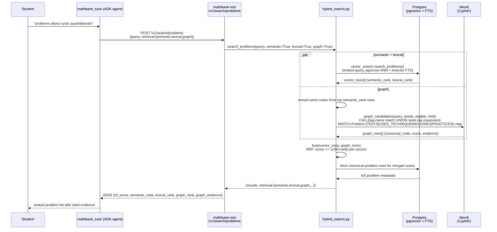
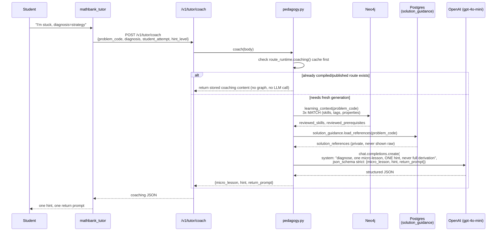

# 52. Hybrid RAG architecture audit: how much graph are we really using, and do we need domain sub-agents?

## 0. Status and scope

| | |
|---|---|
| Status | **RESEARCH ONLY — nothing implemented in this document.** Every claim below is traced to a specific file/line read live in this session (not inferred from naming or prior assumptions); no code was changed to produce this document. |
| Trigger | User asked to (1) check, with the Postgres and Neo4j skills, how much the already-built tutor agent actually uses a "hybrid RAG" model against both databases; (2) document the live Cypher query paths with sequence diagrams and propose improvements; (3) research which parts of the graph schema are used at which tier; (4) research whether domain-specific sub-agents (e.g. a Geometry Problem Solver, a Combinatorics Solver) are warranted, flagging that such specialists may need a cached/persistent memory service. |
| Grounding | Every file/function/line cited was opened and read in this session. Every "touches Neo4j" / "Postgres-only" claim was confirmed by grepping that exact module for `driver`/`neo4j`/Cypher syntax, not assumed from the file's name or docstring. |
| Scope boundary | Covers `mathbank-agent` (the ADK tutor) and the `mathbank-rest` endpoints it calls. Does **not** re-cover `mathbank-web`'s admin `/graph/*` browsing UI (fully covered already in [doc 50](50_NEO4J_KNOWLEDGE_GRAPH_QUALITY_BUGS.md)/[doc 51](51_POSTGRES_METADATA_ENRICHMENT_FOR_GRAPH_CLUSTERING.md)) except where it matters for the "schema used at every tier" comparison in §3. |

### Progress tracker

| ID | Item | Status |
|---|---|---|
| HRA-1 | Add graph retrieval to `/v1/search/concepts` (parallel to `/v1/search/problems`'s existing 3-way fusion) | ⏳ NOT IMPLEMENTED — proposed in §5 |
| HRA-2 | Reconcile `/v1/concepts/{slug}/neighbors` (Postgres-only) against the richer Neo4j taxonomy edges | ⏳ NOT IMPLEMENTED — proposed in §5 |
| HRA-3 | Add a short-TTL cache to the three live Cypher call sites (`hybrid_search.graph_candidates`, `pedagogy.learning_context/prerequisite_path/easier_practice`) | ⏳ NOT IMPLEMENTED — proposed in §5 |
| HRA-4 | Decide whether to build domain-specific problem-**solving** sub-agents (not just today's artifact-**drawing** sub-agents) | ⏳ NOT IMPLEMENTED — research and recommendation in §6, needs explicit user decision |
| HRA-5 | If HRA-4 is approved, choose and wire a persistent memory/cache service for sub-agent state | ⏳ NOT IMPLEMENTED — two concrete options compared in §6.3 |

## 1. Executive summary

The tutor **is** a genuine hybrid RAG system, not a label — three real Neo4j Cypher query sites back five of roughly twenty agent tools, fused with Postgres pgvector/full-text via Reciprocal Rank Fusion (RRF), and one of those sites (`coach`) is a textbook retrieve-then-generate loop. But the "hybrid" coverage is **uneven and, in one concrete case, actually behind this session's own graph-enrichment work**: `/v1/search/concepts` (the taxonomy/topic search tool) and `/v1/concepts/{slug}/neighbors` are **Postgres-only today**, despite taxonomy relationships being exactly what docs 50/51 spent this session enriching (`RELATES_TO`, `SIMILAR_TO`, `PART_OF`, `PREREQUISITE_OF`, `BUILDS_ON`). The brand-new `SIMILAR_TO` edges (ENR-2, 308,799 of them) are not yet consumed by any live tutor-facing endpoint — they exist only for the admin graph-browsing UI today.

On sub-agents: a real, working sub-agent pattern already exists (`artifact_agents.py` — four domain specialists: geometry/algebra/combinatorics/number_theory), but it is scoped **only to visual-artifact generation** (diagrams, SVG/LaTeX cards), not problem-solving reasoning, and its own code comment confirms the gap the user's instinct anticipated: *"AgentTool creates a new Runner; session creation does not retain `temp:` state"* — these specialists are stateless, re-briefed from scratch on every single call. Building full problem-**solving** domain specialists (not just artifact-drawing ones) on the same pattern would inherit that same statelessness, which is a real, named justification for a memory/cache layer, not a hypothetical one.

## 2. Methodology

Traced every ADK tool registered on `root_agent` (`agent.py`'s `tools=[...]` list) to its backing REST endpoint, then to that endpoint's Python implementation, then checked each implementation file for `from mathbank_rest.db.graph import driver` / `neo4j` / literal Cypher (`MATCH (`) versus pure SQLAlchemy/Postgres. No file was skipped on the assumption that its name implied its backing store.

## 3. Schema usage by tier — the full live map

### 3.1 Agent tools that touch Neo4j (5 of ~20 REST-backed tools)

| Agent tool (`rest_tools.py`) | REST endpoint | Backing function | Cypher shape | Neo4j labels/rels actually read |
|---|---|---|---|---|
| `search_problems` | `POST /v1/search/problems` | [`hybrid_search.graph_candidates`](/Volumes/External/Developer/knowledge-bank-ingestion/mathbank-rest/src/mathbank_rest/db/hybrid_search.py) | Two-stage `CALL {...} UNION ALL` — tag-name text match **and** seed-problem tag expansion, then a `Problem-[TESTS\|USES_TECHNIQUE\|REQUIRES\|PRACTICES]->tag` join, scored and ranked | `Problem`, `Concept`, `Technique`, `Skill` (REVIEWED-only), 4 relationship types |
| `get_problem_learning_context` | `GET /v1/tutor/learning-context/{code}` | [`pedagogy.learning_context`](/Volumes/External/Developer/knowledge-bank-ingestion/mathbank-rest/src/mathbank_rest/pedagogy.py) | 3 separate single-hop `OPTIONAL MATCH` reads (skills+edge properties; concept/technique tags; problem's own pedagogy properties) | `Problem`, `Skill`, `Concept`, `Technique` |
| `get_prerequisite_path` | `GET /v1/tutor/prerequisites/{slug}` | [`pedagogy._prerequisites`](/Volumes/External/Developer/knowledge-bank-ingestion/mathbank-rest/src/mathbank_rest/pedagogy.py) | **Variable-length traversal**, `(target)<-[:PREREQUISITE_OF*1..N]-(prior:Skill)`, with per-path evidence-chain extraction (`reduce`/`collect` over `relationships(path)`) — the single most "graph-native" query in the whole system, not reproducible as a clean Postgres join | `Skill`, `PREREQUISITE_OF` |
| `get_next_hint` | `POST /v1/tutor/coach` | [`pedagogy.coach`](/Volumes/External/Developer/knowledge-bank-ingestion/mathbank-rest/src/mathbank_rest/pedagogy.py) | Calls `learning_context` (graph) internally, **then** feeds the result + Postgres solution references into an LLM `chat.completions.create` call | Same as `learning_context`, plus Postgres `solution_guidance.load_references` |
| `find_easier_same_skill_problems` | `GET /v1/tutor/practice/{code}` | [`pedagogy.easier_practice`](/Volumes/External/Developer/knowledge-bank-ingestion/mathbank-rest/src/mathbank_rest/pedagogy.py) | 2-hop `Problem->Skill<-Problem` join comparing `required_level` between original and candidate | `Problem`, `Skill`, `Competition`, `Paper` |

### 3.2 Agent tools that are Postgres-only (confirmed, not assumed)

| Agent tool | REST endpoint | Backing module | Why it's notable |
|---|---|---|---|
| `search_concepts` | `POST /v1/search/concepts` | [`db/step_search.py`](/Volumes/External/Developer/knowledge-bank-ingestion/mathbank-rest/src/mathbank_rest/db/step_search.py) | **Zero Neo4j usage** (grepped the whole file for `driver`/`neo4j` — no match). Semantic (pgvector) + lexical only, despite this being conceptually the most graph-shaped query in the system — a topic search that could legitimately use `RELATES_TO`/`SIMILAR_TO`/`PART_OF` to broaden recall, exactly parallel to how `search_problems` already does with its tag graph. See HRA-1. |
| `get_problems_for_concept` / `get_problems_for_technique` | `GET /v1/concepts/{slug}/problems`, `GET /v1/techniques/{slug}/problems` | [`db/queries.py`](/Volumes/External/Developer/knowledge-bank-ingestion/mathbank-rest/src/mathbank_rest/db/queries.py) | Postgres-only (no `driver` import anywhere in `queries.py`) — reads `knowledge.problem_concept`/`problem_technique` joins directly, bypassing the graph entirely. |
| (not an agent tool, but same file) `get_concept_neighbors` | `GET /v1/concepts/{slug}/neighbors` | `db/queries.py` | **The clearest architectural gap found in this audit.** This is literally "what is this concept related to" — served from `knowledge.concept_relation` in Postgres, a parallel, independently-maintained relationship table that has **no connection at all** to the Neo4j `CONCEPT_RELATION`/`RELATES_TO`/`SIMILAR_TO`/`PART_OF`/`PREREQUISITE_OF`/`BUILDS_ON` edges this whole session (docs 50/51) was spent enriching. Two parallel "concept relationship" systems exist and have likely diverged — see HRA-2. |
| `decompose_problem`, `check_subproblem_answer` | `POST /v1/tutor/decompose`, `POST /v1/tutor/check-subproblem` | [`tutor.py`](/Volumes/External/Developer/knowledge-bank-ingestion/mathbank-rest/src/mathbank_rest/tutor.py) | Postgres problem statement + LLM generation only; no graph at all (confirmed, zero `driver`/`neo4j` references in the file). |
| `get_improvement_plan` | `GET /v1/learner/mastery/improvement-plan` | `learner_db`/mastery module | Postgres-only — mastery tracking is inherently a `learner.*` relational concept (per-student scores), not graph-shaped. Correctly Postgres-only, not a gap. |
| `get_practice_problem`, `list_competitions`, `get_corpus_coverage`, `list_concepts` | various `/v1/*` | `db/queries.py` | All Postgres-only; all correctly so (simple catalog/listing queries, no relationship traversal involved). |

### 3.3 Non-agent tiers, for completeness

| Tier | What it reads | Neo4j? |
|---|---|---|
| `mathbank-web` admin `/graph/*` browsing UI | Every label/relationship this session enriched (docs 50/51) — `RELATES_TO`, `SIMILAR_TO`, `EXPLAINS`, `PRACTICES`, etc. | **Yes, exclusively** — this UI is 100% Neo4j, 0% Postgres (confirmed in prior session work: `app/api/graph/relationship/[rel]/route.js` only calls `lib/neo4jClient.js`). |
| `route_projection.py` / `project_from_postgres.py` / `project_textbook_steps.py` (ETL) | Write Postgres → Neo4j; never read Neo4j to answer a live request | Write-path only, not a RAG consumer. |
| `mathbank-rest` admin routers (`pedagogy_admin.py`, `textbook_admin.py`) | Mixed — some admin CRUD endpoints read/write Neo4j directly for moderation UIs | Admin-only, not student/tutor-facing, out of scope for this RAG audit. |

**Net picture:** of the full taxonomy graph this session spent building/fixing (misconception canonicalization, `RELATES_TO`, `SIMILAR_TO`, broadened `EXPLAINS`/`PRACTICES`), **none of it is consumed by the live tutor agent yet** — it is currently 100% an admin/visualization asset. The live tutor's graph usage is older and narrower: `Problem`-centric tag matching (`search_problems`) and `Skill`-centric prerequisite/practice traversal (`pedagogy.py`'s three functions). This is the single most important finding for prioritizing §5's proposals.

## 4. Sequence diagrams — how Cypher is actually used today

### 4.1 `search_problems` — 3-way RRF fusion (the primary hybrid RAG loop)



**Key property:** graph retrieval degrades gracefully — `Neo4jError`/`ServiceUnavailable`/`SessionExpired` are caught, a warning is appended, and semantic+lexical results still return (confirmed in [`hybrid_search.search_problems`](/Volumes/External/Developer/knowledge-bank-ingestion/mathbank-rest/src/mathbank_rest/db/hybrid_search.py), the `try/except` around `graph_candidates`). This is the only one of the three live Cypher call sites with this resilience; §5 proposes extending it.

### 4.2 `get_next_hint` (`coach`) — the clearest retrieve-then-generate loop



**Key property:** the graph retrieval here has **no cache and no fallback** — unlike `search_problems`, a `learning_context` graph failure propagates as an uncaught exception (no `try/except Neo4jError` wrapping this call site, confirmed by reading the full function body). §5 (HRA-3) proposes closing this gap.

### 4.3 `get_prerequisite_path` — variable-length graph traversal (no Postgres equivalent exists)

```mermaid
sequenceDiagram
    participant Student
    participant Tutor as mathbank_tutor
    participant REST as /v1/tutor/prerequisites/{slug}
    participant Ped as pedagogy.py
    participant Neo as Neo4j

    Student->>Tutor: "what do I need before ratio manipulation?"
    Tutor->>REST: GET /v1/tutor/prerequisites/ratio-manipulation?max_depth=4
    REST->>Ped: prerequisite_path(slug, max_depth)
    Ped->>Neo: MATCH (s:Skill {slug, review_status:'REVIEWED'})<br/>RETURN properties(s)
    Neo-->>Ped: target skill
    Ped->>Neo: MATCH path=(target)&lt;-[:PREREQUISITE_OF*1..4]-(prior:Skill)<br/>WHERE all nodes/rels REVIEWED<br/>RETURN prior, depth, evidence (reduce over relationships(path))
    Neo-->>Ped: prerequisite chain + per-edge evidence
    Ped->>Neo: boundary check — does a 5-hop path exist beyond max_depth?<br/>(so "truncated" can be reported honestly)
    Neo-->>Ped: boundary result
    Ped-->>REST: {skill, prerequisites[], truncated, warnings}
    REST-->>Tutor: JSON
    Tutor-->>Student: "Before that, you need: ... (with evidence chain)"
```

**Why this one matters for the "how much hybrid RAG" question:** this is the one query in the entire system that is **not meaningfully replicable as a flat Postgres join** — recursive variable-length traversal with per-path evidence extraction is exactly Neo4j's design center. It is also the **only** live Cypher call site with an honest truncation signal (the boundary check). It's a strong existence proof that the graph is earning its keep here, even while §3.2 shows two adjacent, conceptually similar queries (`search_concepts`, `get_concept_neighbors`) don't use it at all.

## 5. Concrete improvement proposals

### HRA-1 — Add graph retrieval to `/v1/search/concepts`

`search_problems` already proves the pattern (3-way RRF). `search_concepts`/`step_search.py` currently has none. With ENR-2's `SIMILAR_TO` edges now live (300,013 Misconception, 1,704 Concept, 6,512 Skill, 1,170 Technique pairs, all ≥0.80 cosine similarity, confirmed in this session), a `search_concepts` graph lane could: (a) seed from the top semantic-rank taxonomy nodes, (b) traverse one hop of `SIMILAR_TO`/`RELATES_TO`/`PART_OF` to broaden recall to related-but-not-textually-similar concepts, (c) fuse via the same RRF helper `hybrid_search.fuse()` already provides (generic over any `vector_rows`/`graph_rows` shape — reusable as-is, not a rewrite).

### HRA-2 — Reconcile `/v1/concepts/{slug}/neighbors` (Postgres) vs. Neo4j's richer concept-relationship graph

Two independent systems currently answer "what is this concept related to": `knowledge.concept_relation` (Postgres, used live) and the Neo4j graph's `CONCEPT_RELATION`/`PART_OF`/`PREREQUISITE_OF`/`BUILDS_ON`/`RELATES_TO`/`SIMILAR_TO` edges (used only by the admin UI). **Before changing anything**, a live diff is needed: do they agree? (Not measured in this audit — flagged as the first concrete follow-up, not assumed.) If they've diverged, decide whether Postgres should become a materialized view of the graph's richer edge set, or whether the live endpoint should read Neo4j directly, the way `search_problems` already does for its own tag graph.

### HRA-3 — Add caching + failure-resilience to the three uncached live Cypher call sites

`hybrid_search.graph_candidates()` and all three `pedagogy.py` graph functions run a fresh Cypher query on every single call, with no TTL cache — in contrast to `mathbank-web`'s own `/api/graph/relationship/[rel]` route, which already has an explicit 5-minute cache (`withCache(...)`, confirmed in prior session work). `pedagogy.coach()`'s `learning_context()` call additionally has **no** `try/except` around it (unlike `hybrid_search`'s graceful degradation) — a transient Neo4j hiccup (the exact `MemoryPoolOutOfMemoryError`/`AdminShutdown` class of errors this session hit repeatedly against this same Aura instance, see [GOTCHAS.md §23-25](/Volumes/External/Developer/knowledge-bank-ingestion/documentation/GOTCHAS.md)) would surface as a raw 500 to a student mid-hint, not a graceful fallback. Recommend: (a) a short-TTL (same 5-min precedent) cache keyed on `(function, args)` for all four call sites, (b) wrap `learning_context()`'s graph call in the same `Neo4jError/ServiceUnavailable/SessionExpired` catch `hybrid_search` already uses, falling back to Postgres-only problem statement + a `warnings` entry rather than a hard failure.

## 6. Sub-agent research: do we need domain problem-solvers (Geometry, Combinatorics, ...)?

### 6.1 What already exists (read in full before proposing anything new)

[`artifact_agents.py`](/Volumes/External/Developer/knowledge-bank-ingestion/mathbank-agent/agents/mathbank_tutor/artifact_agents.py) already implements exactly this pattern — **for visual artifact generation only**: `geometry_artifact_agent`, `algebra_artifact_agent`, `combinatorics_artifact_agent`, `number_theory_artifact_agent`, plus a `subject_planning_agent` router and shared refinement specialists (LaTeX/SVG/overlay/annotation/validation), composed via ADK's `AgentTool`. Confirmed properties:
- **Domain routing already works**: `subject_planning_agent` interprets context and delegates to exactly one subject specialist; direct subject calls bypass the planner when the tutor already knows the subject.
- **Each specialist is stateless across calls, by current design, not by oversight** — the code's own comment says it plainly: *"AgentTool creates a new Runner; session creation does not retain `temp:` state"* ([artifact_agents.py line 30](/Volumes/External/Developer/knowledge-bank-ingestion/mathbank-agent/agents/mathbank_tutor/artifact_agents.py)). A `_restore_invocation_state` callback + `_DELEGATED_STATE` contextvar exists specifically to re-inject the **current turn's** caller context (student token, etc.) into the fresh sub-agent Runner — this re-briefs the specialist every call, it does not give the specialist its own persistent memory across calls.
- **Contrast**: tools that live directly on the root agent (not `AgentTool`-wrapped) — e.g. `geometry_scene_tools.py`'s `generate_geometry_scene` — **do** get cross-turn continuity for free, via ADK's own session `state` dict (`tool_context.state["geometry:last_scene"]`, confirmed read/write in that file). The statelessness gap is specific to the `AgentTool` sub-agent pattern, not a limitation of ADK itself.

### 6.2 Should we build full problem-*solving* domain specialists?

**Assessment, not a decision** — this needs the user's explicit go-ahead before any implementation:

| For | Against |
|---|---|
| Different domains genuinely have different graph-traversal shapes: geometry needs scene/diagram state (`SceneSpec`, construction history) and dense spatial-relationship reasoning; combinatorics needs chained counting-technique selection; number theory needs modular-arithmetic chains. A specialist's system prompt and tool subset could be meaningfully narrower and more accurate per domain than one generalist prompt covering all of them (today's `agent.py` `INSTRUCTION` is already ~250 lines covering every domain at once). | The *generic* tools already in place (`decompose_problem`, `get_next_hint`, `get_prerequisite_path`, `step_runtime_tools`) are domain-agnostic by construction — they take a `problem_code`/`skill_slug` and work identically regardless of subject. Splitting by domain wouldn't unlock new *capability* unless paired with memory (below); without memory, it's prompt-partitioning with the same net capability as the current single prompt, similar to how the artifact specialists today don't do anything the root agent's own instruction text couldn't express directly. |
| The existing `artifact_agents.py` pattern is proven, tested, and cheap to extend by analogy (same `AgentTool`/`build_artifact_agents`-style factory). | Multi-turn problem-*solving* (unlike single-shot diagram generation) inherently needs to remember what's already been tried/explained across several turns — exactly the state the current pattern is confirmed **not** to retain. Building N solver specialists on the unmodified pattern would just reproduce N copies of the same known gap. |

**Recommendation:** don't build four solver specialists speculatively. If this is pursued, **pilot exactly one** (Geometry is the strongest candidate — it already has the richest supporting infrastructure: `SceneSpec`/`geometry_scene_tools.py`, Prasolov step-by-step solution data, dedicated construction/validation tooling) paired with a real memory answer from §6.3, measure whether it actually improves hint quality or step-completion rate over the current generalist tutor + `decompose_problem`, and only then decide whether to replicate for Combinatorics/Algebra/Number Theory.

### 6.3 If pursued: memory/cache options for a stateful domain specialist

| Option | What it buys | Cost/complexity | Fit |
|---|---|---|---|
| **`neo4j-agent-memory-skill` / hosted NAMS** (already installed under `.agents/skills/`, confirmed ADK-compatible per its own README) | Graph-native episodic + long-term memory (POLE+O entity model), reasoning-trace storage, works with the *same* Neo4j instance this project already operates — no new infrastructure vendor. | New dependency (`neo4j-agent-memory` package or hosted API key); a second write path into the same AuraDB instance that would need the same discipline this session's `route_projection.py` work enforced (don't let an uncoordinated writer corrupt the `tutoring_routes` layer — a dedicated memory label/database separation would be needed). | Best if the memory itself should be queryable/explorable as a graph (e.g. "what misconceptions has this student hit across sessions, and how do they relate") — genuinely plays to Neo4j's strength, not just key-value recall. |
| **Postgres-backed session-state cache**, following the *exact* existing `step_runtime`/`route_runtime` convention (attempt-scoped state machine rows, already proven in production this session's entire step-tutoring flow) | Zero new infrastructure — reuses the project's single existing source-of-truth database and its established migration/testing conventions. Simple key-value or small-schema recall (e.g. "last 3 hints given for this problem/session"). | Less expressive for genuinely relational memory ("which misconceptions cluster for this student") — would need hand-rolled joins where NAMS would give that natively. | Best if the memory need is really just "don't re-ask what was already asked this session" — simpler, cheaper, consistent with this project's stated single-source-of-truth principle (Postgres canonical, Neo4j a derived projection) for everything **except** graph-native memory that explicitly wants relationship recall. |

Both are legitimate; this document does not pick one — that choice depends on what "memory" concretely needs to recall, which isn't yet specified. Recommend deciding this **after** the HRA-4 pilot above produces a concrete list of "what did the Geometry specialist need to remember that it didn't have."

## 7. Requirement inventory (HRA-*) — summary

| ID | Requirement | Status | Next step |
|---|---|---|---|
| HRA-1 | `/v1/search/concepts` gains a graph retrieval lane, fused via the existing `hybrid_search.fuse()` | ⏳ NOT IMPLEMENTED | Needs approval; reuses ENR-2's `SIMILAR_TO` edges directly |
| HRA-2 | Live diff of `knowledge.concept_relation` (Postgres) vs. Neo4j's concept-relationship edges; reconcile or formally document the divergence | ⏳ NOT IMPLEMENTED | First step is measurement, not a fix — no live diff has been run yet |
| HRA-3 | Cache + failure-resilience for the four uncached live Cypher call sites | ⏳ NOT IMPLEMENTED | Needs approval; low-risk, follows an existing precedent (`mathbank-web`'s 5-min cache) |
| HRA-4 | Decide whether to pilot one domain problem-solving sub-agent (Geometry recommended) | ⏳ NOT IMPLEMENTED | Needs explicit user decision — this document does not recommend building without a pilot |
| HRA-5 | If HRA-4 proceeds, choose NAMS vs. Postgres-backed memory per §6.3 | ⏳ NOT IMPLEMENTED | Decide after the pilot identifies concrete recall needs, not before |

## Cross-document relationship

- Builds directly on [doc 50](50_NEO4J_KNOWLEDGE_GRAPH_QUALITY_BUGS.md)/[doc 51](51_POSTGRES_METADATA_ENRICHMENT_FOR_GRAPH_CLUSTERING.md)'s graph-quality and ENR-2 similarity work — §3's central finding is that none of that enrichment is consumed by the live tutor yet, only by the admin UI those docs targeted.
- Independent of docs 45-49 (REST/quiz-authoring/student-navigation/UX-audit/MCP) — no file or endpoint overlap.
