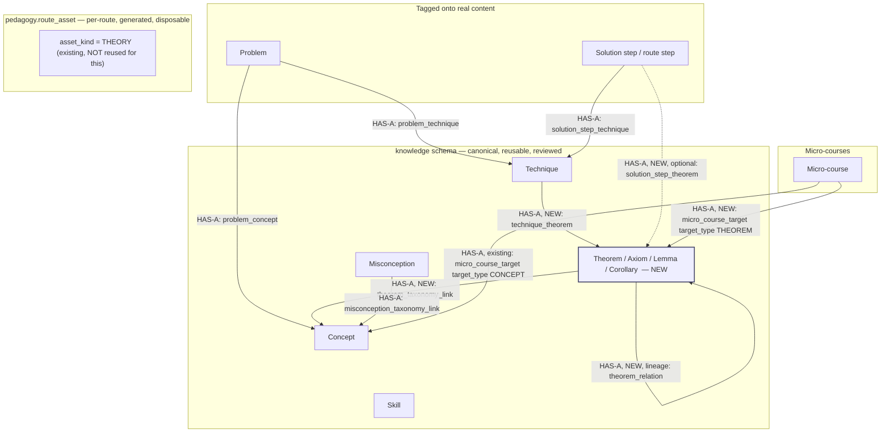
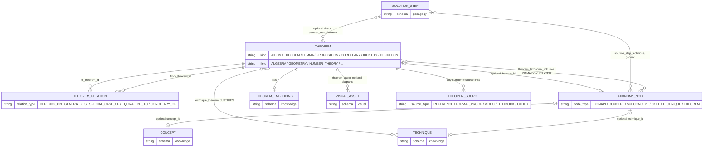
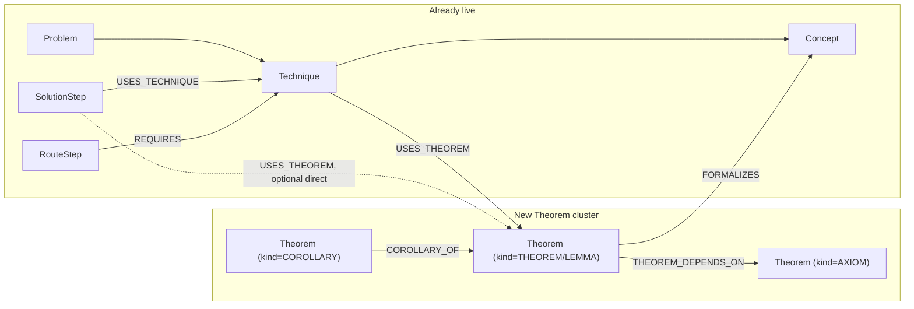
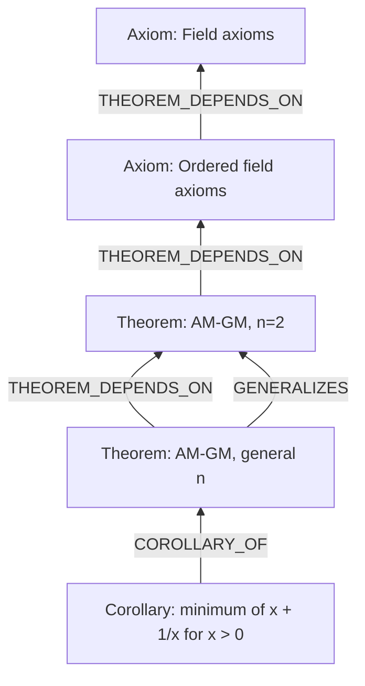
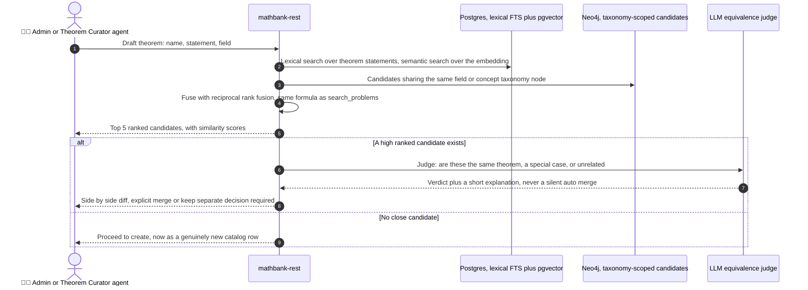
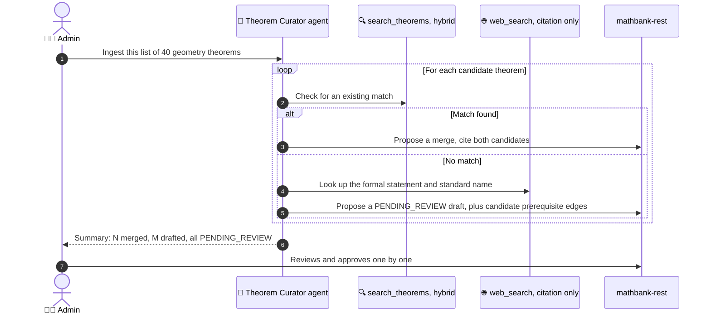
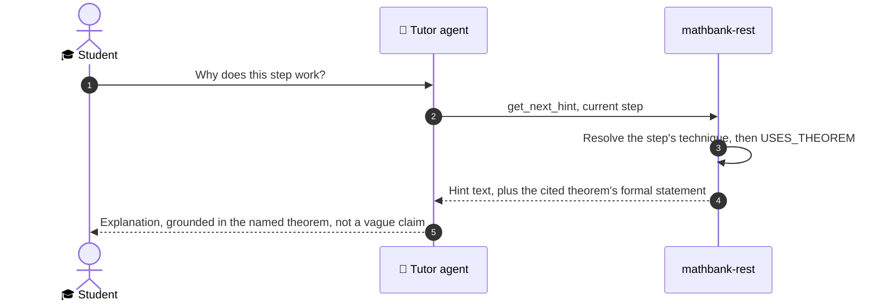
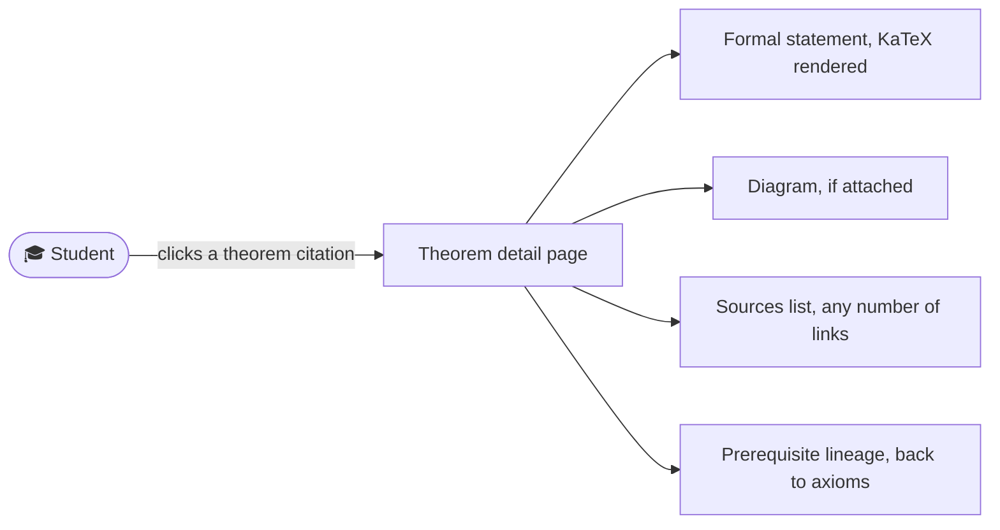
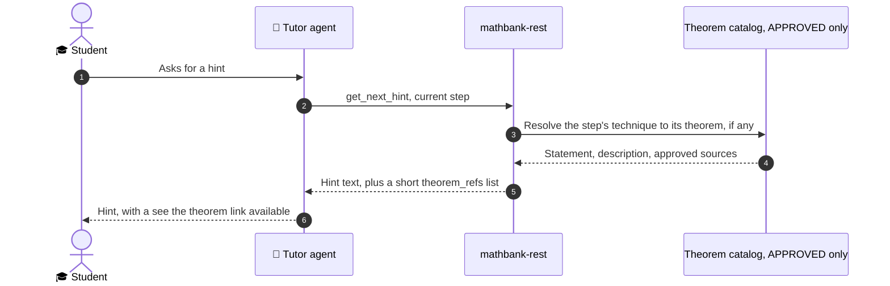

# 61. Theorem, Lemma, Axiom and Corollary catalog — schema, graph wiring, deduplication and agentic search

## 0. Status and scope

| | |
|---|---|
| Status | **IMPLEMENTED and live-verified (this session).** Migration 046 applied to the live Neon Postgres instance; `mathbank-rest/src/mathbank_rest/theorem_service.py` + `routers/theorems.py` (17 endpoints) live; `mathbank-graph/etl/project_theorems.py` run against the live Neo4j AuraDB and confirmed idempotent; 3 new tutor agent tools registered and called live end to end. 21 new pytest tests passing (`test_theorem_service.py`, `test_theorem_router.py`), plus 63/63 passing across every file touched (no regressions) and all 858 collectible tests in the suite still import cleanly. Not yet built: the Theorem Curator sub-agent (§10), the `THEOREM_REFERENCE_V1` interaction template and the `theorem_refs` hint field (§13.2-§13.3), semantic/embedding search (the `search.representation`/pgvector half of THM-2), and any dedicated UI page — tracked honestly below, not glossed over. |
| Trigger | User is introducing a large number of theorems and axioms (with descriptions) across various branches of mathematics into the knowledge graph, and asked where these fit relative to the existing `technique`/step model, how to insert them as an admin, how to detect/avoid duplicates with hybrid search, how to express their sequential/prerequisite ("derived from axioms") nature, how they connect to concepts and solution steps, and how agents should use and help curate them — then, in follow-up, added that entries need LaTeX and optional diagrams and may belong to a wider area/concept/subconcept (§4.1/§4.4/§4.5), then that students must be able to see a theorem and every admin-entered source (plural, not one link), and that agents should use this as grounding metadata for summaries, micro-courses and hints (§4.9, §12, §13), then asked for the entity relationships to be made conceptually unambiguous (§3) — then asked to implement it. |
| Grounding | Every table/file/function cited was opened and read in this session (`mathbank-db/sql/001_schema.sql`, `006_pedagogy.sql`, `010_textbook_import.sql`, `017_step_techniques.sql`, `026_tutoring_routes.sql`, `039_misconception_catalog.sql`, `040_similarity_embeddings.sql`; `mathbank-rest/src/mathbank_rest/route_projection.py`, `taxonomy_service.py`, `routers/admin_taxonomy.py`, `db/hybrid_search.py`; `mathbank-graph/etl/project_from_postgres.py`; `mathbank-agent/agents/mathbank_tutor/tools/rest_tools.py`; live Neo4j `db.schema.visualization()`/label counts from this session's README work). Implementation claims are grounded the same way: every live-verification command/query in this status line was actually run this session, not assumed. |
| Scope boundary | Covers Postgres schema, Neo4j graph wiring, the admin authoring/dedup workflow, and agent tool integration — all now implemented. Does **not** cover a specific UI implementation (follows [modern-ui-design](../../.github/skills/modern-ui-design/SKILL.md) when built) or a specific external-API integration contract for Wikipedia/MathWorld (§10 gives the pattern, not a vendor choice) — both still pending, see the progress tracker. |

### Progress tracker

| ID | Item | Status |
|---|---|---|
| THM-1 | `knowledge.theorem` + `theorem_relation` + `technique_theorem` + `theorem_taxonomy_link` tables; extend `pedagogy.taxonomy_node.node_type` with `THEOREM` | ✅ IMPLEMENTED — migration `046_theorem_catalog.sql`, applied and verified live; schema in §4 |
| THM-2 | `knowledge.theorem_embedding` / `theorem_similarity`, and `search.representation` extended with `source_entity_type='THEOREM'` | ◐ PARTIAL — `theorem_embedding`/`theorem_similarity` tables exist (migration 046); no embedding-generation job or `search.representation` registration wired yet, so dedup search (§9) is lexical-only for now; schema in §4.7-4.8 |
| THM-3 | Neo4j `Theorem` label + `THEOREM_DEPENDS_ON`/`GENERALIZES`/`SPECIAL_CASE_OF`/`EQUIVALENT_TO`/`COROLLARY_OF`/`USES_THEOREM`/`FORMALIZES` relationship types + projector | ✅ IMPLEMENTED — `mathbank-graph/etl/project_theorems.py`, run against live AuraDB, idempotent re-run confirmed with identical counts; §6 |
| THM-4 | Admin CRUD: dedicated `theorem_service.py`/`routers/theorems.py` (not folded into `admin_taxonomy.py`'s generic Kind literal — see the service module's own docstring for why); mandatory live similarity search before submit | ✅ IMPLEMENTED — 12 admin endpoints live-tested via REST (create/update/approve/reject/relations/techniques/taxonomy-links/sources/assets/search); §8 |
| THM-5 | Cycle-safe prerequisite/lineage validation for `theorem_relation` (the DAG invariant) | ✅ IMPLEMENTED — live-verified: axiom-cannot-depend rejected, a real 2-edge cycle rejected, non-lineage relation types correctly exempt; §7 |
| THM-6 | Theorem Curator sub-agent: hybrid-search-before-insert, classification proposal, external-reference-assisted drafting | ⏳ NOT IMPLEMENTED — §9-10 |
| THM-7 | Tutor-facing agent tools: `search_theorems`, `get_theorem`, `get_theorem_prerequisites` | ✅ IMPLEMENTED — registered on `root_agent.tools` (55 total), called live against a running `mathbank-rest`; extending `get_problem_learning_context`/`get_next_hint` to surface step-justifying theorems is the remaining, not-yet-built half of §11 |
| THM-8 | LaTeX support reusing the existing KaTeX/`check_latex` pipeline (no new renderer); optional diagrams via `knowledge.theorem_asset` → `visual.asset`; `theorem_taxonomy_link.role` for linking one theorem to a wider domain and a specific concept/subconcept at once | ✅ IMPLEMENTED — `check_latex` reuse live-verified (a broken-LaTeX create is rejected with a real test); §4.1, §4.4, §4.5 |
| THM-9 | `knowledge.theorem_source` — any number of admin/agent-entered source links per theorem, each reviewed before going live | ✅ IMPLEMENTED — live-verified a theorem with 2 simultaneous sources, and that a `PENDING_REVIEW` source stays invisible until approved; §4.9 |
| THM-10 | Student-facing read-only REST (`GET /v1/theorems/{slug}`, taxonomy/search listing) | ✅ IMPLEMENTED — 5 student endpoints live-tested, including the PENDING_REVIEW-invisible-to-students round trip; a dedicated UI detail page (§12.2) is **not yet built** |
| THM-11 | Agent grounding integration: retrieve-then-generate summaries, a `THEOREM_REFERENCE_V1` micro-course template, and a `theorem_refs` field on generated hints | ⏳ NOT IMPLEMENTED — §13; THM-7's agent tools are the prerequisite this depends on, now done |
| THM-12 | Extend `pedagogy.micro_course_target` with `target_type='THEOREM'` so a course can target a theorem (and its corollaries/prerequisites) directly | ✅ IMPLEMENTED — live-verified: created a real course targeted at a theorem, confirmed the generic name/slug resolution join picks it up correctly; §3.3 |

## 1. Executive summary


The system already has **two** things that look like "theorems" and neither is the right
home for what you're describing:

1. `pedagogy.route_asset` with `asset_kind='THEORY'` (projected to Neo4j as `TheoryItem`,
   alongside a parallel `CLAIM`/`Claim` kind) — this is **generated per solution route**,
   not a reusable catalog entity. Its live Neo4j count (80,168 `TheoryItem` nodes, almost
   exactly matching `RouteStep`'s 80,168 and `Claim`'s 80,168) proves this: it is
   essentially one ad-hoc, free-text "theory blurb" manufactured per route *step*, never
   deduplicated, with no global identity, no prerequisite structure, and no link back to
   the concept/technique taxonomy. Reusing this label for your catalog would silently
   merge two structurally different things and break the existing per-route rendering
   path (`route_projection.py`'s `_display_properties`, keyed by `route_release_id`).
2. `knowledge.technique.description` — free text on a technique sometimes informally
   states the theorem behind it (e.g. a "Vieta's formulas" technique's description might
   restate the formula), but there is no separate, addressable node for the theorem
   itself, no way to say "these three techniques all rely on the same theorem," and no
   way to express "this theorem is a special case of that one."

**Recommendation:** add theorems/axioms/lemmas/corollaries as a **new, first-class,
reusable catalog** in the `knowledge` schema — `knowledge.theorem` — sitting exactly
alongside `knowledge.concept`/`skill`/`technique`/`misconception`, reusing every
established pattern in this codebase (slug identity, `review_status` approval gate,
a generic relation table for the prerequisite DAG, a generic taxonomy-link join table,
precomputed similarity via embeddings, and live hybrid search via the existing
`search.*` pipeline). Each entry supports **inline LaTeX** (via the same KaTeX pipeline
and `check_latex` validator already used everywhere else) and **optional diagrams**
(reusing `visual.asset`, the same mechanism problems/videos already use), and can be
linked to **more than one level of the taxonomy at once** — a wider domain and a
specific concept/subconcept, not a single forced choice. Nothing here is invented from
scratch; every table shape below mirrors a sibling table that already exists and is
already live.

## 2. Taxonomy of "theory item" kinds

| Kind | What it is | Can it have prerequisites (`DEPENDS_ON`)? |
|---|---|---|
| **Axiom** | A foundational statement accepted without proof within a chosen system (e.g. field axioms, Peano axioms). | No — by definition, an axiom is a root of the dependency DAG. |
| **Theorem** | A proved, named mathematical result (e.g. Pythagorean theorem, AM-GM inequality). | Yes — depends on axioms and/or other theorems/lemmas. |
| **Lemma** | A theorem proved mainly as a stepping stone toward a larger theorem. | Yes — same as Theorem; typically has few or no corollaries of its own. |
| **Proposition** | A minor or routine theorem, lower-stakes than a headline "Theorem." | Yes. |
| **Corollary** | A result that follows *directly and immediately* from one specific parent theorem, with little independent proof work. | Yes, but always includes exactly one `COROLLARY_OF` edge to its parent theorem (in addition to any ordinary `DEPENDS_ON` edges). |
| **Identity** | A theorem stated as an always-true equation (e.g. a trigonometric or algebraic identity). | Yes — modeled identically to Theorem; kept as a separate `kind` only because it is usually searched for and displayed differently (as a formula, not a paragraph). |
| **Definition** | Not a "provable" item, but included in the same catalog so a technique/step can cite *why a term means what it means*, not only *why a result is true*. | No semantic prerequisite requirement, but may still cite earlier definitions it builds on. |

All seven kinds share one schema (`knowledge.theorem.kind`), because structurally they
are identical — a name, a formal statement, a description, a field, and a position in
one shared dependency graph. Splitting them into separate tables would just duplicate
every join/embedding/search mechanism seven times for no benefit.

## 3. Entity relationship contract: IS-A vs HAS-A, unambiguously defined

This section exists specifically to remove any ambiguity about how `Theorem` relates to
everything else — every relationship in this document is one of exactly two kinds, and
they are never interchangeable:

- **IS-A** (subtype/inheritance — "a Corollary is a Theorem") — used **exactly once** in
  this entire design, and nowhere else (§3.1).
- **HAS-A** (association/reference via a join table, with a role) — used for **every
  other relationship** in this document: Concept↔Theorem, Technique↔Theorem,
  Theorem↔Theorem lineage, Step↔Theorem, Course↔Theorem, Theorem↔Source,
  Theorem↔Diagram. None of these is inheritance, and a row on either side can exist,
  change, or be deleted without the other row changing identity.

### 3.1 The one real IS-A in this design

`kind` (AXIOM/THEOREM/LEMMA/PROPOSITION/COROLLARY/IDENTITY/DEFINITION, §2) **is** a true
IS-A relationship — every row in `knowledge.theorem` IS-A theorem-shaped entity, and
`kind` just says which flavor. That is why all seven kinds share one table (§2's closing
paragraph) rather than seven separate ones: splitting them would be modeling the same
IS-A hierarchy as seven unrelated tables, which is the anti-pattern, not the fix.

Everything else below is explicitly **not** an IS-A relationship, including one place
that is easy to mistake for one:

> **`pedagogy.taxonomy_node` is not a "Concept IS-A Theorem" mechanism.** It is a narrow,
> purely technical addressing convenience: `Concept`, `Subconcept`, `Skill`,
> `Technique`, and now `Theorem` each get wrapped by **at most one**
> `taxonomy_node` row (`num_nonnulls(concept_id, skill_id, technique_id, theorem_id) <=
> 1`, §4.4), so the textbook-import step-tagging pipeline can reference any of them with
> one generic `taxonomy_node_id` column instead of five separate ones. A `Theorem`
> wrapped this way is still, unambiguously, a `knowledge.theorem` row — it does not
> become a `Concept`, inherit any `Concept` columns, or share a primary key with one.
> Read "wrapped by `taxonomy_node`" as "is addressable through the shared taxonomy
> index," never as "is a kind of."

### 3.2 Direct answers to the three questions asked

1. **Can a Concept be a Theorem (IS-A)? → No.** `knowledge.concept` and
   `knowledge.theorem` are separate tables, separate primary keys, separate lifecycles,
   with no shared row and no inheritance mechanism between them. A Concept is a
   topic/subject-area classification ("Inequalities"); a Theorem is a specific, citable,
   provable-or-axiomatic statement ("AM-GM Inequality"). This is categorical, not a
   matter of degree. (The same non-IS-A rule already applies one level down in the
   existing schema: a `Subconcept` is likewise never "a Concept" by inheritance — it is
   PART-OF a concept, confirmed by `pedagogy.taxonomy_node.parent_node_id`'s hierarchy
   and Neo4j's `Subconcept -[PART_OF]-> Concept` edge, not a subtype of it.)

2. **Can a Concept have theorems (HAS-A)? → Yes — this is the primary relationship.**
   `knowledge.theorem_taxonomy_link` (§4.4) is exactly a HAS-A join: a Concept (or
   Subconcept, Domain, Skill, Technique) can be linked to any number of theorems, each
   tagged `PRIMARY` (its main home) or `RELATED` (a secondary association). Many-to-many,
   with a role, never ownership.

3. **Can we have a mini-course on a theorem, or on theorems and corollaries? → Yes.**
   See §3.3 — this reuses the existing `pedagogy.micro_course_target` mechanism
   (already live, HAS-A by design) with one new `target_type`.

### 3.3 A micro-course that targets a theorem (and its corollaries) directly

`pedagogy.micro_course_target` (migration 032, already live) is itself a HAS-A table —
"a micro-course HAS a target, of type CONCEPT/TECHNIQUE/SKILL, with a role." Extending it
with a fourth type costs one migration, not a new mechanism:

```sql
ALTER TABLE pedagogy.micro_course_target DROP CONSTRAINT micro_course_target_target_type_check;
ALTER TABLE pedagogy.micro_course_target ADD CONSTRAINT micro_course_target_target_type_check
    CHECK (target_type IN ('CONCEPT','TECHNIQUE','SKILL','THEOREM'));
ALTER TABLE pedagogy.micro_course_target ADD COLUMN IF NOT EXISTS theorem_id uuid REFERENCES knowledge.theorem;
ALTER TABLE pedagogy.micro_course_target DROP CONSTRAINT micro_course_target_check;
ALTER TABLE pedagogy.micro_course_target ADD CONSTRAINT micro_course_target_check CHECK (
    (target_type = 'CONCEPT'   AND concept_id   IS NOT NULL AND technique_id IS NULL AND skill_id IS NULL AND theorem_id IS NULL) OR
    (target_type = 'TECHNIQUE' AND technique_id IS NOT NULL AND concept_id   IS NULL AND skill_id IS NULL AND theorem_id IS NULL) OR
    (target_type = 'SKILL'     AND skill_id     IS NOT NULL AND concept_id   IS NULL AND technique_id IS NULL AND theorem_id IS NULL) OR
    (target_type = 'THEOREM'   AND theorem_id   IS NOT NULL AND concept_id   IS NULL AND technique_id IS NULL AND skill_id IS NULL)
);
CREATE INDEX IF NOT EXISTS micro_course_target_theorem_idx ON pedagogy.micro_course_target (theorem_id) WHERE theorem_id IS NOT NULL;
```

No new role vocabulary needed either — the existing `PRIMARY`/`SECONDARY`/
`PREREQUISITE` roles already say exactly what "a theorem and its corollaries" needs:

**Worked example** — a course called "Mastering AM-GM and Its Corollaries":

| `target_type` | `theorem_id` → | `role` | `ordinal` | Meaning |
|---|---|---|---|---|
| `THEOREM` | AM-GM (general n) | `PRIMARY` | 0 | The headline theorem the course is about. |
| `THEOREM` | AM-GM, n=2 | `PREREQUISITE` | 0 | A simpler case the course reviews first. |
| `THEOREM` | Ordered field axioms | `PREREQUISITE` | 1 | The axioms AM-GM ultimately rests on (§7's lineage). |
| `THEOREM` | Minimum of x + 1/x corollary | `SECONDARY` | 0 | One of possibly several corollaries covered after the main proof. |

A course can mix target types freely (e.g. `CONCEPT` "Inequalities" as `PRIMARY` plus a
specific `THEOREM` as `SECONDARY`) — this extension only adds a new *kind* of target, it
does not replace or restrict the existing three.

### 3.4 Where this sits relative to what already exists



### 3.5 Full entity relationship contract — every pair, labeled

| Entity A | Entity B | Relationship kind | Mechanism | Notes |
|---|---|---|---|---|
| `Theorem` kinds (Axiom/Theorem/Lemma/Proposition/Corollary/Identity/Definition) | `Theorem` | **IS-A** | `knowledge.theorem.kind` | The one true IS-A in this design (§3.1). |
| `Concept` | `Theorem` | HAS-A | `theorem_taxonomy_link`, role PRIMARY/RELATED | Many-to-many; a concept has zero or more theorems, a theorem can belong to several concepts at once (§4.4). |
| `Subconcept` | `Concept` | PART-OF, not IS-A | `taxonomy_node.parent_node_id`; Neo4j `PART_OF` | Pre-existing pattern, included for contrast. |
| `Subconcept`/`Skill`/`Domain` | `Theorem` | HAS-A | Same `theorem_taxonomy_link`, via `taxonomy_node` | Identical mechanism as Concept↔Theorem — the wrapper is generic. |
| `Technique` | `Theorem` | HAS-A | `technique_theorem`, role JUSTIFIES/APPLIES | A technique can rely on several theorems; a theorem can justify several techniques. |
| `Theorem` | `Theorem` | HAS-A (a lineage edge, not inheritance) | `theorem_relation`, DEPENDS_ON/GENERALIZES/SPECIAL_CASE_OF/EQUIVALENT_TO/COROLLARY_OF | Even `COROLLARY_OF` — easy to mistake for IS-A — is an edge between two independent rows, not a shared identity (§7). |
| `SolutionStep`/`RouteStep` | `Theorem` | USES (a HAS-A read, not ownership) | `solution_step_theorem` (direct) or transitively via `solution_step_technique` → `technique_theorem` | A step does not "own" a theorem; many steps can cite the same one. |
| `Micro-course` | `Theorem` | HAS-A (target) | `micro_course_target`, `target_type='THEOREM'`, role PRIMARY/SECONDARY/PREREQUISITE | §3.3 — a course can target a theorem directly, including "the theorem plus its corollaries." |
| `Theorem` | `visual.asset` (diagram) | HAS-A | `theorem_asset`, ordered | §4.5. |
| `Theorem` | External source | HAS-A | `theorem_source`, any number | §4.9. |
| `Misconception` | `Theorem` | **Not modeled** | — | Out of scope for this document; if needed later, add a `misconception_theorem_link` mirroring `misconception_taxonomy_link` rather than overloading an existing table — flagged, not silently assumed. |

## 4. Postgres schema


### 4.1 `knowledge.theorem` — the canonical catalog entry

Mirrors `knowledge.technique`/`knowledge.misconception` exactly (slug identity,
`review_status` gate, `source` provenance).

```sql
CREATE TABLE IF NOT EXISTS knowledge.theorem (
    theorem_id      uuid PRIMARY KEY DEFAULT gen_random_uuid(),
    slug            text NOT NULL UNIQUE,         -- e.g. "am-gm-inequality"
    name            text NOT NULL,                -- "AM-GM Inequality"
    kind            text NOT NULL
                        CHECK (kind IN ('AXIOM','THEOREM','LEMMA','PROPOSITION',
                                        'COROLLARY','IDENTITY','DEFINITION')),
    field           text NOT NULL
                        CHECK (field IN ('ALGEBRA','GEOMETRY','NUMBER_THEORY',
                                         'COMBINATORICS','PROBABILITY','ANALYSIS',
                                         'LOGIC_AND_SET_THEORY','OTHER')),
    statement_text  text NOT NULL,                -- authoritative formal statement; may contain
                                                   -- inline LaTeX ($...$/$$...$$), see "LaTeX support" below
    statement_latex text,                         -- optional pure-LaTeX rendering (export/PDF/Manim narration)
    description     text,                         -- plain-language explanation/intuition; inline LaTeX allowed
    proof_sketch    text,                         -- optional short proof outline, not a full proof; inline LaTeX allowed
    source          text NOT NULL DEFAULT 'HUMAN'
                        CHECK (source IN ('HUMAN','LLM_DRAFT','LLM_REVIEWED')),
    review_status   text NOT NULL DEFAULT 'PENDING_REVIEW'
                        CHECK (review_status IN ('PENDING_REVIEW','APPROVED','REJECTED')),
    approval_method text CHECK (approval_method IS NULL OR approval_method IN ('automatic','human')),
    approved_at     timestamptz,
    created_at      timestamptz NOT NULL DEFAULT now(),
    updated_at      timestamptz NOT NULL DEFAULT now(),
    CHECK (kind <> 'AXIOM' OR statement_text IS NOT NULL)
);
CREATE INDEX IF NOT EXISTS theorem_kind_field_idx ON knowledge.theorem(kind, field);
```

No single `external_reference_url` column — a theorem routinely has *several* source
links (a Wikipedia overview, a MathWorld formal statement, a textbook citation, a full
written proof). That is a one-to-many relationship, so it gets its own table, §4.9.

`field` reuses the exact branch vocabulary already used informally across the corpus
(see [documentation/requirements/17_DOMAIN_AND_TECHNICAL_GLOSSARY.md](17_DOMAIN_AND_TECHNICAL_GLOSSARY.md)
§1: Algebra/Geometry/Number theory/Combinatorics/Probability), plus two additions
(Analysis, Logic and set theory) needed once axioms are included.

#### LaTeX support (no new mechanism — reuse what already exists)

Every text field above follows the **exact same convention already used everywhere
else in this app** (`core.problem.statement_text`, `core.solution_step.explanation`,
the student `MathComposer`): plain text that may contain inline `$...$`/display
`$$...$$` LaTeX, rendered client-side through the **same KaTeX pipeline** already shared
by `mathbank-widgets`/`mathbank-web`. Nothing new needs to be built for rendering.

At write time (admin form submit, or an agent-proposed draft in §10), run
**`mathbank_rest.math_format.check_latex(text)`** — the same light structural validator
already shared between the web composer and REST (`mathbank-widgets`, mirrored
server-side) that catches unbalanced braces, unbalanced `$` delimiters and disallowed
commands — against `statement_text`, `statement_latex`, `description` and
`proof_sketch`. This is a **validation gate, not a renderer**: it stops obviously broken
LaTeX from being saved, the same way it already stops it in a student's composer input.
`statement_latex` stays optional because `statement_text`'s inline LaTeX is already
renderable; populate it only when a pure-LaTeX export is specifically needed (PDF
generation, or narration text fed into the Manim SceneSpec pipeline, which expects plain
LaTeX, not `$`-delimited prose).

### 4.2 `knowledge.theorem_relation` — the prerequisite / lineage DAG

Mirrors `knowledge.concept_relation` (free-text `relation_type` + provenance columns),
not `knowledge.skill_relation`'s hardcoded enum, because the relation vocabulary here is
richer and may grow (§7 explains why this must stay an acyclic DAG, enforced at the
application layer, not by this table alone).

```sql
CREATE TABLE IF NOT EXISTS knowledge.theorem_relation (
    relation_id      uuid PRIMARY KEY DEFAULT gen_random_uuid(),
    from_theorem_id  uuid NOT NULL REFERENCES knowledge.theorem ON DELETE CASCADE,
    to_theorem_id    uuid NOT NULL REFERENCES knowledge.theorem ON DELETE CASCADE,
    relation_type    text NOT NULL
                         CHECK (relation_type IN ('DEPENDS_ON','GENERALIZES',
                                                   'SPECIAL_CASE_OF','EQUIVALENT_TO',
                                                   'COROLLARY_OF')),
    assertion_source text NOT NULL,              -- "human:<name>" | "llm:<model>:<version>"
    confidence       numeric(5,4) CHECK (confidence BETWEEN 0 AND 1),
    review_status    text NOT NULL DEFAULT 'PENDING'
                         CHECK (review_status IN ('PENDING','REVIEWED','REJECTED')),
    created_at       timestamptz NOT NULL DEFAULT now(),
    CHECK (from_theorem_id <> to_theorem_id),
    UNIQUE (from_theorem_id, to_theorem_id, relation_type)
);
CREATE INDEX IF NOT EXISTS theorem_relation_to_idx ON knowledge.theorem_relation(to_theorem_id);
```

Read `from_theorem_id DEPENDS_ON to_theorem_id` as "`from` relies on `to`" (so an axiom
only ever appears as a `to_theorem_id`, never a `from_theorem_id`, for `DEPENDS_ON`/
`COROLLARY_OF` — enforced in §7, not by a `CHECK` here, because validating "is this
`to_theorem_id` row's `kind = 'AXIOM'`" needs a lookup, which plain-SQL `CHECK`
constraints cannot do against another table).

### 4.3 `knowledge.technique_theorem` — which techniques rely on which theorems

Mirrors `knowledge.problem_technique` exactly.

```sql
CREATE TABLE IF NOT EXISTS knowledge.technique_theorem (
    technique_id     uuid NOT NULL REFERENCES knowledge.technique ON DELETE CASCADE,
    theorem_id       uuid NOT NULL REFERENCES knowledge.theorem ON DELETE CASCADE,
    role             text NOT NULL DEFAULT 'JUSTIFIES' CHECK (role IN ('JUSTIFIES','APPLIES')),
    confidence       numeric(5,4) CHECK (confidence BETWEEN 0 AND 1),
    assertion_source text NOT NULL,
    review_status    text NOT NULL DEFAULT 'PENDING'
                         CHECK (review_status IN ('PENDING','REVIEWED','REJECTED')),
    PRIMARY KEY (technique_id, theorem_id, role)
);
```

### 4.4 `knowledge.theorem_taxonomy_link` — connecting to a wider area, a concept, or a subconcept

A theorem is rarely tied to exactly one narrow idea — the Pythagorean theorem belongs to
the broad **Geometry** domain *and* the specific **right triangles** subconcept; AM-GM
belongs to **Algebra** broadly and the **inequalities** subconcept specifically. Rather
than one fixed "the" concept per theorem, this is a **many-to-many link with a role**,
mirroring `knowledge.problem_concept`'s `role` pattern (`'PRIMARY'` default, free text so
new roles don't need a migration) and reusing `pedagogy.taxonomy_node` as the **one**
generic taxonomy-id wrapper — so a single link table reaches `DOMAIN` (the "wider area"),
`CONCEPT`, `SUBCONCEPT`, `SKILL` and `TECHNIQUE` uniformly, rather than five separate
`theorem_concept`/`theorem_subconcept`/... tables:

```sql
ALTER TABLE pedagogy.taxonomy_node DROP CONSTRAINT IF EXISTS taxonomy_node_node_type_check;
ALTER TABLE pedagogy.taxonomy_node ADD CONSTRAINT taxonomy_node_node_type_check
    CHECK (node_type IN ('DOMAIN','CONCEPT','SUBCONCEPT','SKILL','TECHNIQUE','THEOREM'));
ALTER TABLE pedagogy.taxonomy_node ADD COLUMN IF NOT EXISTS theorem_id uuid REFERENCES knowledge.theorem;
ALTER TABLE pedagogy.taxonomy_node DROP CONSTRAINT IF EXISTS taxonomy_node_num_nonnulls;
ALTER TABLE pedagogy.taxonomy_node ADD CONSTRAINT taxonomy_node_num_nonnulls
    CHECK (num_nonnulls(concept_id, skill_id, technique_id, theorem_id) <= 1);

CREATE TABLE IF NOT EXISTS knowledge.theorem_taxonomy_link (
    theorem_id       uuid NOT NULL REFERENCES knowledge.theorem ON DELETE CASCADE,
    taxonomy_node_id text NOT NULL REFERENCES pedagogy.taxonomy_node,
    role             text NOT NULL DEFAULT 'PRIMARY',   -- 'PRIMARY' (one, the main home) | 'RELATED' (any number)
    derived_via      text NOT NULL DEFAULT 'admin_curation',
    created_at       timestamptz NOT NULL DEFAULT now(),
    PRIMARY KEY (theorem_id, taxonomy_node_id)
);
```

**Worked example** — the Pythagorean theorem, linked at three different levels of the
same hierarchy in one pass:

| `taxonomy_node_id` (node_type) | `role` | Why |
|---|---|---|
| `DOMAIN:geometry` | `RELATED` | The wider area it belongs to. |
| `SUBCONCEPT:right-triangles` | `PRIMARY` | Its single, most specific, most useful home. |
| `CONCEPT:triangle-properties` | `RELATED` | A broader concept worth surfacing in "related theorems" browsing. |

A theorem search or browse view (admin or tutor-facing) can then show "theorems for
this concept" at whatever level the student/admin is browsing — domain-wide, concept-
level or subconcept-level — without duplicating rows per level, and without forcing a
single, falsely-exclusive "the one true concept" choice.

This one small extension also means the **existing** textbook-import step-tagging
pipeline (`pedagogy.solution_step_technique`, which already references
`taxonomy_node_id` generically) can tag a step with a theorem using the *exact same*
mechanism it already uses for techniques — no separate code path needed for that
pipeline.

### 4.5 Optional diagrams — `knowledge.theorem_asset`

Mirrors how `visual.asset` already attaches an image to a problem (`source_problem_id`)
or a diagram (`diagram_id`) — a theorem gets the same generic, already-proven asset
mechanism rather than a new storage path, via one small join table (several diagrams per
theorem, ordered, each with its own caption, exactly like `core.problem_image`'s
`ordinal`):

```sql
CREATE TABLE IF NOT EXISTS knowledge.theorem_asset (
    theorem_id uuid NOT NULL REFERENCES knowledge.theorem ON DELETE CASCADE,
    asset_id   uuid NOT NULL REFERENCES visual.asset ON DELETE CASCADE,
    ordinal    int NOT NULL DEFAULT 1,
    caption    text,
    PRIMARY KEY (theorem_id, asset_id)
);
CREATE UNIQUE INDEX IF NOT EXISTS theorem_asset_ordinal_idx
    ON knowledge.theorem_asset(theorem_id, ordinal);
```

A diagram is optional and can be produced three ways, all of which end up as one
`visual.asset` row regardless of origin (the join table doesn't care which path was
used):

1. **Plain upload** — the admin attaches a static PNG/SVG at entry time (e.g. a scanned
   textbook figure), stored via `object-store:` URI like every other asset in this
   codebase.
2. **Deterministic geometry scene** — for theorems with a precise geometric figure (e.g.
   "the Pythagorean theorem" or "the inscribed angle theorem"), author it once as a
   `geometry_scene` (bounded solver + SVG renderer — see the
   [mathbank-geometry-engine skill](../../.github/skills/mathbank-geometry-engine/SKILL.md)),
   then save its rendered SVG output as the `visual.asset`.
3. **Manim-rendered** — reuse the existing video-explainer pipeline (doc 60) to render a
   short animated figure and attach the resulting video asset the same way.

All three converge on the same table, so the admin UI (§8) and the tutor-facing display
(§11) only ever need to know "does this theorem have any `theorem_asset` rows?" — not
which of the three paths produced them.

### 4.6 Direct step citation (optional, higher precision)

Where a step cites a theorem *directly* (not just "this step's technique relies on
theorem X" transitively), add a table mirroring `pedagogy.solution_step_technique`:

```sql
CREATE TABLE IF NOT EXISTS pedagogy.solution_step_theorem (
    solution_step_id text NOT NULL REFERENCES pedagogy.solution_step ON DELETE CASCADE,
    theorem_id       uuid NOT NULL REFERENCES knowledge.theorem,
    confidence       numeric(3,2) NOT NULL CHECK (confidence BETWEEN 0 AND 1),
    source_type      text NOT NULL CHECK (source_type IN ('LLM','RUNTIME','HUMAN')),
    evidence         text,
    review_status    text NOT NULL DEFAULT 'PENDING_REVIEW'
                         CHECK (review_status IN ('PENDING_REVIEW','APPROVED','REJECTED')),
    PRIMARY KEY (solution_step_id, theorem_id)
);
```

Start with §4.3+§4.4 (technique-level + taxonomy-level linkage) — transitively, every
step already reachable from a technique that cites a theorem gets that theorem "for
free" via a two-hop graph traversal (§6.3). Add this table only if a specific step needs
a *more specific* citation than its technique provides (e.g. a multi-technique step
where only one sub-part uses the theorem).

### 4.7 Similarity — precomputed "related theorems"

Mirrors `knowledge.misconception_embedding`/`misconception_similarity` exactly, for a
"you might also want to see..." feature independent of live search:

```sql
CREATE TABLE IF NOT EXISTS knowledge.theorem_embedding (
    theorem_id uuid PRIMARY KEY REFERENCES knowledge.theorem ON DELETE CASCADE,
    model text NOT NULL,
    dimensions integer NOT NULL DEFAULT 1536 CHECK (dimensions BETWEEN 1 AND 8192),
    source_text_sha256 text NOT NULL,
    embedding public.vector NOT NULL CHECK (vector_dims(embedding) = dimensions),
    generated_at timestamptz NOT NULL DEFAULT now()
);

CREATE TABLE IF NOT EXISTS knowledge.theorem_similarity (
    theorem_id_a uuid NOT NULL REFERENCES knowledge.theorem ON DELETE CASCADE,
    theorem_id_b uuid NOT NULL REFERENCES knowledge.theorem ON DELETE CASCADE,
    similarity double precision NOT NULL CHECK (similarity BETWEEN -1 AND 1),
    rank smallint NOT NULL CHECK (rank > 0),
    computed_at timestamptz NOT NULL DEFAULT now(),
    PRIMARY KEY (theorem_id_a, theorem_id_b),
    CHECK (theorem_id_a <> theorem_id_b)
);
```

### 4.8 Live hybrid search — the dedup-before-insertion backbone

**No new tables needed here.** `search.representation.source_entity_type` is already a
free-text discriminator (`'PROBLEM'`/`'SOLUTION'` today) feeding the *same* generic
`search.chunk`/`search.embedding` pipeline that backs `/v1/search/problems`'s live RRF
fusion. Registering theorems is just a new value:

```sql
-- No DDL change. At write time:
INSERT INTO search.representation
    (source_entity_type, source_entity_id, representation_kind, preprocessing_profile_id, rendered_text, content_hash)
VALUES ('THEOREM', :theorem_id, 'THEOREM_STATEMENT', :profile_id, :statement_text, :hash);
-- then the existing embedding_job pipeline chunks + embeds it exactly like a problem/solution.
```

This is what makes "hybrid search before insertion" (§9) possible without inventing a
second search stack.

### 4.9 `knowledge.theorem_source` — multiple source links (student-visible)

One theorem routinely has several legitimate sources — a general overview, a formal
statement, a full written proof, a video explanation. Mirrors the `ordinal`-per-entity
pattern already used by `core.problem_image`/`knowledge.theorem_asset`, with its own
light review gate so an agent-proposed link (§10) doesn't go live unreviewed:

```sql
CREATE TABLE IF NOT EXISTS knowledge.theorem_source (
    theorem_source_id uuid PRIMARY KEY DEFAULT gen_random_uuid(),
    theorem_id      uuid NOT NULL REFERENCES knowledge.theorem ON DELETE CASCADE,
    url             text NOT NULL,
    label           text NOT NULL,              -- "Wikipedia", "Wolfram MathWorld", "AoPS Wiki", "Evan Chen's EGMO notes"
    source_type     text NOT NULL DEFAULT 'REFERENCE'
                        CHECK (source_type IN ('REFERENCE','FORMAL_PROOF','VIDEO','TEXTBOOK','OTHER')),
    ordinal         int NOT NULL DEFAULT 1,
    added_by        text NOT NULL,              -- "human:<name>" | "llm:<model>:<version>", same convention as §4.2
    review_status   text NOT NULL DEFAULT 'PENDING_REVIEW'
                        CHECK (review_status IN ('PENDING_REVIEW','APPROVED','REJECTED')),
    created_at      timestamptz NOT NULL DEFAULT now(),
    UNIQUE (theorem_id, url)
);
CREATE INDEX IF NOT EXISTS theorem_source_theorem_idx ON knowledge.theorem_source(theorem_id);
```

Only `review_status = 'APPROVED'` rows are ever shown to a student or fed to an agent as
grounding context (§12-§13) — the same "AI proposes, human approves" gate as everything
else in this document. Storing only the `url` (plus a short admin-entered `label`), never
the source's full text, follows the exact policy already written down in
[documentation/CREDITS.md](../CREDITS.md).

### 4.10 Migration plan

Next free migration number is **`046_theorem_catalog.sql`** (last is
`045_scene_spec_promotion.sql`), containing §4.1-§4.7 and §4.9 (catalog, relation,
technique link, taxonomy link, asset link, step citation, embedding/similarity, source
links) plus the `pedagogy.taxonomy_node` `ALTER` statements in §4.4. §4.8 needs no
migration (it is a data-insertion pattern against existing tables).

## 5. Entity-relationship diagram



## 6. Neo4j graph wiring

### 6.1 New node label

```
(:Theorem {canonical_id, slug, name, kind, field, statement_text, statement_latex})
```

Projected from `knowledge.theorem` where `review_status = 'APPROVED'`, exactly like
`project_concepts`/`project_techniques` in `mathbank-graph/etl/project_from_postgres.py`
only project `review_status`-gated rows.

### 6.2 New relationship types

| Type | From → To | Why a new name, not an existing one |
|---|---|---|
| `THEOREM_DEPENDS_ON` | `Theorem` → `Theorem` | The existing `DEPENDS_ON` type is already used for `RouteStep`/`SolutionStep` dependency chains (different semantics — "this tutoring step must come after that one" vs. "this theorem's proof relies on that one"). Reusing the same type name would make every "trace dependencies" Cypher query ambiguous without an extra label filter. |
| `GENERALIZES` / `SPECIAL_CASE_OF` | `Theorem` → `Theorem` | New — mirrors `theorem_relation.relation_type`; `SPECIAL_CASE_OF` is the inverse direction of `GENERALIZES`, kept as two directed types (not one bidirectional one) so Cypher traversal direction stays explicit, consistent with how `PREREQUISITE_OF` is already modeled one-directionally for `Concept`. |
| `EQUIVALENT_TO` | `Theorem` ↔ `Theorem` | New — symmetric by convention (write both directions, as `SIMILAR_TO` already does for the taxonomy). |
| `COROLLARY_OF` | `Theorem` → `Theorem` | New — a specialized `DEPENDS_ON` kept distinct because exactly one must exist per Corollary (validated in §7), useful to query directly ("show me every corollary of the Pythagorean theorem"). |
| `USES_THEOREM` | `Technique` → `Theorem`, `SolutionStep`/`RouteStep` → `Theorem` | New — parallels the existing `USES_TECHNIQUE`/`USES_CONCEPT`/`USES_SKILL` family exactly. |
| `FORMALIZES` | `Theorem` → `Concept`/`Subconcept` | New — the inverse direction of `theorem_taxonomy_link`; parallels the existing `TheoryItem -[EXPLAINS]-> Concept` pattern, but for the new, reusable `Theorem` label rather than the disposable `TheoryItem`. |

### 6.3 Where this plugs into the existing live graph

The live graph already has 100+ distinct `(label)-[type]->(label)` triples (documented
in the README's Data model section). This adds a new, clearly-separated cluster that
connects at exactly two existing points — `Technique` and `Concept`/`Subconcept` — so
nothing else needs to change:



### 6.4 Projector

Add `mathbank-graph/etl/project_theorems.py` (new file, mirroring
`project_misconception_relations.py`'s shape — a focused, additive script, not a change
to the large `project_from_postgres.py`), with three functions: `project_theorems`
(`MERGE (t:Theorem {canonical_id: row.id}) SET t += {...}`), `project_theorem_relations`
(one `MERGE` per `theorem_relation` row, typed by `relation_type`), and
`project_technique_theorem`/`project_theorem_taxonomy_link` for the two connection
points in §6.3.

## 7. Sequential nature: prerequisites and "derived from axioms"

The `theorem_relation` table (§4.2) is, by mathematical necessity, a **directed acyclic
graph (DAG)** on `DEPENDS_ON`/`COROLLARY_OF` edges — a theorem cannot (even
transitively) depend on itself, because that would mean its proof assumes its own
conclusion. This is validated the same way the existing `pedagogy.route_step.depends_on`
DAG is treated in this codebase (see
[documentation/requirements/17_DOMAIN_AND_TECHNICAL_GLOSSARY.md](17_DOMAIN_AND_TECHNICAL_GLOSSARY.md)
§2, "DAG... not every relationship in the entire graph belongs to one DAG" — the
caution there is that the *whole* knowledge graph isn't one DAG, but this specific
subgraph must be):

- **At write time** (the admin API endpoint that creates a `theorem_relation` row, §8),
  run a cycle check: a recursive CTE walking `DEPENDS_ON`/`COROLLARY_OF` from the
  proposed `to_theorem_id` back toward `from_theorem_id`; reject with `409` if a path
  exists.
- **Axiom invariant**: an `AXIOM`-kind theorem must never appear as `from_theorem_id` on
  a `DEPENDS_ON`/`COROLLARY_OF` row (axioms are roots). Validated in the same endpoint,
  not a `CHECK` constraint (checking another row's `kind` needs a lookup).
- **Corollary invariant**: a `COROLLARY`-kind theorem must have **exactly one**
  `COROLLARY_OF` edge (its one parent theorem), though it may additionally have ordinary
  `DEPENDS_ON` edges to other supporting results.

**Worked example** (illustrative, not seed data to insert verbatim):



A tutor "why is this true" query becomes a plain Cypher traversal down
`THEOREM_DEPENDS_ON`/`COROLLARY_OF` edges to the axioms (§11's
`get_theorem_prerequisites`), giving the student (or the admin curating the catalog) a
full, inspectable lineage rather than a single flat "trust me" statement.

## 8. Admin insertion workflow

### 8.1 Manual entry — reuse the existing generic taxonomy CRUD router

`mathbank-rest/src/mathbank_rest/routers/admin_taxonomy.py` already implements
`GET/{kind}`, `GET/{kind}/{code}`, `PATCH/{kind}/{code}`, `.../deactivate`,
`.../reactivate` and `.../aliases` generically over
`Kind = Literal["concepts","techniques","skills","misconceptions"]`, backed by a
registry dict in `taxonomy_service.py`. Extending `Kind` with `"theorems"` and adding one
entry to that registry gets the entire list/update/activate/deactivate/alias surface for
free — no new router needed for basic CRUD. A dedicated `POST /v1/admin/taxonomy/theorems`
(create) and `POST /v1/admin/taxonomy/theorems/{code}/relations` (add a
`theorem_relation` edge, running the §7 cycle check) are the two genuinely new
endpoints.

### 8.2 The entry form: LaTeX, diagrams, sources and taxonomy linking

Following [modern-ui-design](../../.github/skills/modern-ui-design/SKILL.md)'s
`MathComposer` convention, the "propose a theorem" form is one page with four parts:

- **Statement** — a `MathComposer` field (the same component students already use) for
  `statement_text`, with its live KaTeX preview, so the admin sees the rendered formula
  while typing inline `$...$` LaTeX — no separate "preview" step needed. `description`
  and `proof_sketch` get the same component. `statement_latex` is a collapsed, optional
  "pure LaTeX export" field, hidden unless explicitly opened.
- **Diagram (optional)** — an upload control for a static image, or a "generate from a
  geometry scene" / "generate with Manim" action that hands off to the relevant existing
  pipeline and attaches its output as a `theorem_asset` row (§4.5) once rendered. Zero or
  more diagrams; each gets a caption field.
- **Sources (any number)** — a repeatable row list (`Icon name="link"` plus URL, label
  and a `source_type` pill: Reference / Formal proof / Video / Textbook / Other),
  backed by `knowledge.theorem_source` (§4.9). Every new row starts `PENDING_REVIEW`
  (same default regardless of who entered it, matching `misconception`/
  `theorem_relation`'s convention) — for an admin's own entry, the form offers a
  one-click "approve now" right next to each row, so self-authored sources don't need a
  second trip through a review queue; agent-proposed rows from §10 instead show up as
  pending chips for the admin to approve or reject at their own pace.
- **Taxonomy** — a multi-select against `pedagogy.taxonomy_node` (the same
  concept/subconcept/skill/technique/domain picker already used elsewhere in the admin
  UI), with one entry markable as `PRIMARY` and the rest defaulting to `RELATED` (§4.4) —
  this is where the admin expresses "this belongs to Geometry broadly, and specifically
  to right triangles."

### 8.3 The mandatory dedup gate in the UI

Per [modern-ui-design](../../.github/skills/modern-ui-design/SKILL.md): the "propose a
theorem" form is not a blind create button. As the admin types the name/statement, a
live `GET /v1/admin/taxonomy/theorems/search?q=...` call (hybrid search, §9) populates a
`Callout tone="insight"` panel of the top-5 closest existing theorems *before* the
"Create" action is enabled — the admin must explicitly dismiss ("none of these match")
or pick ("this is the same as...") before a new row can be created. This makes dedup a
UX gate, not just a background nice-to-have.

### 8.4 Agent-assisted entry

See §10 for the full Theorem Curator sub-agent design — it sits behind the same form as
an optional "draft this for me" action, never bypassing the human-approval gate.

## 9. Similarity and deduplication — hybrid search before insertion

Pure embedding cosine similarity is **not sufficient** for theorems specifically, for two
opposite failure modes:

- **False negatives**: the same theorem phrased very differently (a textbook's formal
  statement vs. a competition-math shorthand name) can have low cosine similarity.
- **False positives**: genuinely different theorems in the same family are textually
  very similar (e.g. "AM-GM for 2 variables" vs. "AM-GM for n variables" vs. "weighted
  AM-GM" — near-identical wording, different formal content and different prerequisite
  theorems).

**Recommended 3-stage pipeline**, reusing the exact RRF pattern already proven in
`hybrid_search.search_problems`:



The LLM equivalence judge is a **classification aid only** — the system never
auto-merges or auto-rejects on its verdict alone; a human (admin, or the automatic
approval policy already used for low-risk metadata elsewhere in this codebase, if and
when extended to theorems) makes the final call. This mirrors every other
AI-assists/human-approves pattern already in this repo (misconception review,
`concept_relation`/`skill_relation` review_status, the Manim video-promotion workflow).

## 10. Agentic collaboration: wiki search and manual ingestion

A new **Theorem Curator** sub-agent (same tool-calling shape as the Manim studio's
research agent) assists both manual admin entry and bulk ingestion of "a large number of
theorems":

| Tool | Purpose |
|---|---|
| `search_theorems(query, field, kind)` | The §9 hybrid search, used first on every new candidate. |
| `web_search(query)` | Looks up Wikipedia/Wolfram MathWorld/nLab for a formal statement, standard name and canonical references — **classification/citation assistance only**. |
| `propose_theorem_draft(name, statement, field, kind)` | Writes a `PENDING_REVIEW` row; never self-approves. |
| `propose_theorem_sources(theorem_slug, sources: [{url, label, source_type}])` | Writes one or more `knowledge.theorem_source` rows (§4.9), each `PENDING_REVIEW` — the agent can attach *several* links to one theorem in a single call (a general overview plus a formal-proof link plus a video, say), never just one. |
| `propose_theorem_relations(theorem_slug, candidate_relations)` | Proposes `DEPENDS_ON`/`GENERALIZES`/... edges as `PENDING` rows, running the §7 cycle check before even proposing (rejecting impossible edges early rather than at admin-review time). |

**Guardrails** (non-negotiable, consistent with this repo's established policy, most
recently documented in [documentation/CREDITS.md](../CREDITS.md)):

- External sources are stored as **citation URLs only** (`knowledge.theorem_source.url`,
  one row per link, any number of rows per theorem) — never bulk-copied full text,
  exactly like the competition-corpus ingestion policy.
- The agent **never** flips `review_status` to `APPROVED` itself, on a theorem row, a
  `theorem_relation` row, or a `theorem_source` row — every draft, every proposed edge
  and every proposed source link waits for a human admin action, mirroring
  `misconception`/`concept_relation` review workflows.
- If `search_theorems` surfaces a high-confidence existing match, the agent's
  recommended action is **"propose merge,"** never "create anyway" — it cannot be
  configured to skip the dedup gate.



## 11. Agent runtime usage: expanding a step with theorems

New tutor-facing tools (`mathbank-agent/agents/mathbank_tutor/tools/rest_tools.py`),
following the exact shape of the existing `search_concepts`/`get_prerequisite_path`:

| New tool | Mirrors | Purpose |
|---|---|---|
| `search_theorems(query, field="", kind="", limit=10)` | `search_concepts` | "What theorem explains X?" style questions. |
| `get_theorem(slug)` | `get_problem_by_code` | Fetch one theorem's full formal statement for display. |
| `get_theorem_prerequisites(theorem_slug, max_depth=4)` | `get_prerequisite_path(skill_slug, max_depth)` | Walk `THEOREM_DEPENDS_ON`/`COROLLARY_OF` back toward axioms — the §7 lineage chain, for "why is this actually true" follow-ups. |

And one extension to an existing tool: `get_problem_learning_context`/`get_next_hint`
additionally resolves `SolutionStep`/`RouteStep -[USES_THEOREM]-> Theorem` (directly, or
transitively via the step's technique) so that when a student asks *"why does this step
work?"*, the tutor can cite the exact formal theorem — not a vague "this is a known
result" — the same grounding discipline already required everywhere else in this
codebase (`Grounding` entry, glossary §6). `get_theorem(slug)` returns its `APPROVED`
`theorem_source` rows alongside the statement, so the agent can offer "want to read the
full proof?" with a real link, not an invented one (§12-§13 cover this in depth).



## 12. Student-facing display: theorem detail page and sources

The student must be able to see a theorem's full detail — statement, description,
proof sketch, any diagrams, and every admin-approved source link — not just a passing
mention inside a chat answer.

### 12.1 New read-only REST surface

| Endpoint | Returns |
|---|---|
| `GET /v1/theorems/{slug}` | Full detail of one `APPROVED` theorem: name, kind, field, `statement_text`/`statement_latex`, `description`, `proof_sketch`, its `theorem_asset` diagrams (§4.5), and every `APPROVED` `theorem_source` row (§4.9) — `url`, `label`, `source_type`. `PENDING_REVIEW`/`REJECTED` rows are never returned here, student or admin view alike (a student-facing endpoint has no "show me the drafts" mode). |
| `GET /v1/concepts/{slug}/theorems` or `GET /v1/taxonomy/{kind}/{code}/theorems` | Theorems linked to a taxonomy node (§4.4), for browsing "what theorems relate to this concept" — reuses `theorem_taxonomy_link`, ordered `PRIMARY` first. |
| `GET /v1/search/theorems?q=...` | The same hybrid search used for admin dedup (§9), exposed read-only and `APPROVED`-only, for a student-facing "search theorems" box. |

No new REST module needed — this is the same shape as the existing
`GET /v1/problems/{code}`/`GET /v1/concepts/{slug}` read endpoints, just for the new
entity.

### 12.2 UI: a theorem detail page

Following [modern-ui-design](../../.github/skills/modern-ui-design/SKILL.md): a new
route (e.g. `/learn/theorems/[slug]`), reachable from (a) a tutor chat citation link,
(b) a concept/technique page's "related theorems" list, and (c) a micro-course step that
references one (§13.2):

- `PageHeader` with the theorem's `name`, a `Pill` for `kind` (Theorem/Lemma/Axiom/...)
  and a `Pill` for `field`.
- The formal statement rendered through the existing KaTeX pipeline (same renderer as
  everywhere else — no special-casing needed).
- `description` and, if present, `proof_sketch` as `Callout tone="insight"` blocks —
  proof sketches are explicitly labeled "sketch, not a full proof" so students don't
  mistake it for complete rigor.
- Any `theorem_asset` diagrams rendered inline, same as a problem's `problem_image`.
- A **"Sources"** list — one row per `theorem_source`, each a plain external link with
  its `label` and a small icon keyed to `source_type` (book icon for Textbook, play icon
  for Video, etc.) — exactly the multi-link requirement: a theorem can show as many
  source rows as the admin (or an agent, once approved) attached.
- A **"Prerequisites"** panel showing the §7 lineage (via `get_theorem_prerequisites`)
  so a curious student can click back toward the underlying axioms.



## 13. Agent use as grounding metadata: summaries, micro-courses and hints

A theorem row (plus its sources) is not only something a student can browse to — it is
**retrievable context an agent uses to stay grounded**, the same role `core.problem`/
`core.solution` already play for the hybrid-RAG tutor loop (doc 52).

### 13.1 Summarizing / explaining

When the tutor agent answers "why is this true" or "explain this concept," it calls
`get_theorem`/`search_theorems` (§11) and uses the returned `statement_text`,
`description` and `proof_sketch` as **grounding context for its generated explanation**
— the same retrieve-then-generate pattern `coach` already uses for step hints (doc 52
§4.2) — rather than letting the model restate a theorem from its own training data
(which risks a subtly wrong statement). If `theorem_source` rows exist, the agent can
offer them as a "want to go deeper?" link, always citing the stored URL, never
paraphrasing the external page's full text as if it were the theorem's own
`description`.

### 13.2 Guiding a micro-course

Two complementary mechanisms, covering the two different things "a mini-course on a
theorem" can mean:

- **The course's subject is a theorem** — `micro_course_target` with
  `target_type='THEOREM'` (§3.3), e.g. a whole course called "Mastering AM-GM and Its
  Corollaries." This is a HAS-A declaration at the course level, not a content step.
- **A step inside a broader course references a theorem** — a new, minimal,
  **passive-reference** interaction template, `THEOREM_REFERENCE_V1`, mirroring
  `VIDEO_EXPLAINER_V1` (doc 60 §8) exactly: an `interaction_instance` that points at one
  `theorem_id` and renders the §12.2 detail view inline inside a step, instead of a
  video. An authoring-time helper (admin-facing, agent-assisted) can also *suggest*
  this: while building a course step around a technique that has a `technique_theorem`
  link (§4.3), the authoring UI offers "this step's technique relies on {theorem name} —
  attach it as a reference step?" — a one-click accept, never an automatic insert.

A course can use both at once — targeted at a theorem overall (§3.3) and composed of
several `THEOREM_REFERENCE_V1` steps for the theorem itself plus each corollary.

### 13.3 Hints

For the generative hint loop (`/v1/tutor/coach`, behind `get_next_hint`), the step's
technique's theorem(s) (§4.3, transitively) are added to the retrieval context passed to
the hint-generation prompt, and the structured hint response gains an optional
`theorem_refs: [{slug, name, source_urls: [...]}]` field — small enough that the hint
text itself stays concise (per doc 39/coach's existing hint-ladder discipline: directional
→ conceptual → strategic, never the full solution), while the UI can still render a
"see the theorem" `IconButton` next to the hint for a student who wants the full formal
statement.



## 14. Requirement inventory (THM-*) — summary

See the progress tracker in §0; all items are proposed, none implemented. §3 (the
ontology contract) and §4-§6 (schema + graph) have no prerequisites among themselves
beyond ordinary migration order — §3.3's `micro_course_target` extension is independent
of §4's new tables and can ship on its own. §8 (admin CRUD) depends on §4. §9-§10 (dedup
+ curator agent) depend on §4.8 (live search registration). §11 (tutor tools) depends on
§4.3/§4.6 (technique/step linkage) and §6 (graph projection). §12 (student display)
depends on §4.1/§4.5/§4.9 and §11's `get_theorem`. §13 (agent grounding/micro-course/
hints) depends on §11, §12.1 and §3.3.

## 15. Open questions and risks

- **Axiom system depth**: should axioms be modeled at a rigorous foundational level
  (e.g. ZFC, Peano) or at an informal "high-school-accepted" level (e.g. "the real
  numbers are an ordered field")? Recommendation: informal, matching this corpus's
  audience — a formal foundations project is out of scope.
- **LLM equivalence judgment reliability**: §9's judge step needs a held-out evaluation
  set of known-duplicate and known-distinct theorem pairs before it is trusted enough to
  pre-rank candidates in the admin UI; start with it as a *ranking aid* only, not a gate.
- **Volume**: "a large number of theorems" ingested via §10 in bulk risks swamping the
  admin review queue; consider a confidence/risk-based auto-approval policy for
  low-ambiguity cases (well-known, uniquely-named theorems with no close search
  candidates) later, mirroring the existing automatic-metadata-approval policy — but only
  after the manual workflow is proven, not from day one.

## Cross-document relationship

Builds directly on the schema conventions documented in
[17_DOMAIN_AND_TECHNICAL_GLOSSARY.md](17_DOMAIN_AND_TECHNICAL_GLOSSARY.md) (taxonomy,
hybrid RAG, DAG terms) and the hybrid-RAG/sub-agent research in
[52_HYBRID_RAG_ARCHITECTURE_AND_SUBAGENT_RESEARCH.md](52_HYBRID_RAG_ARCHITECTURE_AND_SUBAGENT_RESEARCH.md)
(the Theorem Curator in §10 is a new domain-specific sub-agent of exactly the kind doc 52
§6 asked whether this project needs). Should be read alongside
[39_PRECOMPILED_TUTORING_ROUTES.md](39_PRECOMPILED_TUTORING_ROUTES.md) before touching
`pedagogy.route_asset`/`TheoryItem`, to avoid conflating the two theorem-shaped things
this document explicitly separates in §1-§2.
