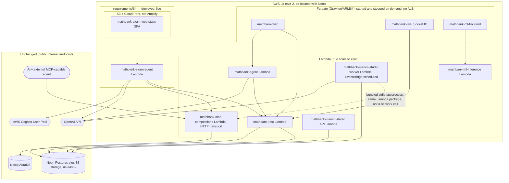

# 62. AWS serverless dev-hosting cost research — minimum-cost way to run the app layer while keeping Neon Postgres + Neo4j AuraDB

## 0. Status and scope

**Later, separate research:** [requirement 66](66_AWS_STORAGE_DATABASE_COST_AND_MIGRATION_REPORT.md)
evaluates the newly requested Neon/Aura replacement options (S3 Vectors, DynamoDB,
Aurora and Neptune). It does not change this document's original compute-only
scope or establish that a database migration saves money. The proposed
[Socratic Studio/AgentCore architecture](65_ADAPTIVE_SOCRATIC_ADMIN_AND_AGENTCORE.md)
is requirements-only and has not been deployed.

| | |
|---|---|
| Status | **Fully superseded by real deployment — every service this document originally scoped is now live, including the three that were still "not yet deployed" as of the previous revision.** See requirements/63 (the 5-service core Lambda deployment), requirements/64 §9-10 (`mathbank-exam-agent` + `mathbank-exam-web`), and §5/§6/§8 below (this revision) for `mathbank-web`, `mathbank-live`, and `mathbank-ml-frontend` — all three deployed to **Fargate** (not Amplify Hosting, which this revision explains was blocked, and not Lightsail), **live-verified** including real Cognito logins against the deployed Lambda `mathbank-rest`, not localhost. §8 has real measured costs; §5/§6 document the actual deployed architecture plus two real bugs hit and fixed along the way (CPU-architecture mismatch, missing Cognito IAM grant) worth keeping for any future Fargate work in this repo. Every price/limit elsewhere in this document is from a live web search; every claim about *this* project's own setup was confirmed by reading this repo's actual `.env`/README/Makefiles/deployed stacks. |
| Trigger | User wants to host the MathBank dev services on AWS at **minimum cost**, prefers **serverless**, and explicitly wants to **keep** the existing managed Neon Postgres and Neo4j AuraDB (not migrate them) — host only the application/compute layer. |
| Scope boundary | Covers hosting options and cost for `mathbank-rest`, `mathbank-agent`, `mathbank-web`, `mathbank-live`, `mathbank-manim-studio`, `mathbank-ml-inference`, `mathbank-ml-frontend`, and `mathbank-mcp-competitions`. Does **not** cover migrating Neon/AuraDB to AWS-native equivalents (explicitly out of scope per the user's ask), CI/CD pipeline design, or production-grade HA/multi-region (this is a **dev** cost question). |

## 1. Executive summary

**Every service this document scoped is now deployed and live-verified — 8 services total, ~$0.41-0.70/month with every Fargate task stopped (the default).** The win is almost entirely from **AWS Lambda's true scale-to-zero pricing**
(1M requests + 400,000 GB-seconds free *every month, forever*, not a 12-month trial)
applied to 6 of this project's services that are plain stateless HTTP APIs — including
`mathbank-mcp-competitions`, which already supports a Streamable-HTTP mode
(`MCP_TRANSPORT=http`), not just the stdio subprocess mode it's usually launched with
locally. Two services added after this document was first written
(`mathbank-exam-agent`/`mathbank-exam-web`, requirements/64) also deployed inside the
same $0 tiers, plus **AWS Cognito**'s always-free 10,000-MAU/month tier — now shared by
**three** apps (`mathbank-exam-agent`, `mathbank-web`, `mathbank-live`, §6a.3) — and
**CloudFront**'s always-free 1 TB + 10M-requests/month tier for a plain static-SPA
frontend (not Amplify — see §6.3 for why).
The only non-zero line item in practice is **ECR image storage** (~$0.41/month baseline,
plausibly a bit more after this revision's 3 new images — §8). `mathbank-web`,
`mathbank-live`, and `mathbank-ml-frontend` are now deployed to **Fargate**, not Amplify
Hosting (§6.1a explains the real automation blocker that caused the pivot) — each task
defaults to `desired_count=0` (**$0 while stopped**) and is started/stopped on demand via
`make fargate-*-start`/`-stop` (§5.1), at ~$0.0099/hour (ARM64/Graviton) while running.

A critical, easy-to-miss simplification specific to this project: **none of these services need to run inside a VPC**, because Neon and AuraDB are both public, internet-reachable, TLS-protected endpoints, not private resources inside your own AWS account. That means **no NAT Gateway** (~$32-38/month just sitting idle, the single most common accidental serverless-cost trap) is needed anywhere in this architecture.


## 2. What doesn't change: Neon and AuraDB stay exactly as they are

Confirmed from this repo's own `mathbank-rest/.env` (hosts redacted, shape visible):
- Postgres: `*.c-7.us-east-2.aws.neon.tech` — Neon, physically hosted **on AWS, in `us-east-2` (Ohio)**.
- Object storage (`AWS_ENDPOINT_URL_S3`): `*.storage.c-7.us-east-2.aws.neon.tech` — also Neon-managed, also `us-east-2`.
- Neo4j: `neo4j+s://*.databases.neo4j.io` — AuraDB; the hostname doesn't reveal cloud/region (Aura abstracts that), so **check the Aura console** for the instance's actual cloud/region before picking an AWS region for compute.

**Recommendation: deploy the AWS compute layer in `us-east-2`** to co-locate with the confirmed Postgres/storage region — this avoids any cross-region data-transfer charge on the Postgres/S3 traffic and minimizes latency, at zero extra cost (picking a region costs nothing by itself).

One live finding worth flagging honestly: AuraDB's Free tier caps out at roughly 50,000–200,000 nodes (sources vary) and auto-pauses after 3 days idle — **this project's graph already has 300,000+ nodes across just a few labels** (confirmed earlier this session: `LearningItem` 91,354, `RouteStep` 80,168, `TheoryItem` 80,168, `Claim` 80,168, `Misconception` 69,954, plus more). That means **this AuraDB instance is almost certainly already on a paid tier**, independent of anything in this document — check the Aura console billing page to confirm the actual current cost, since it's a pre-existing, fixed line item this hosting choice cannot reduce. Likewise Neon's free tier (0.5 GB storage, 100 CU-hours/month) is almost certainly already exceeded by this corpus's size (207 tables, 12,542 problems, 70,018 misconceptions, etc.) — the existing Neon plan is also a separate, already-fixed cost.

## 3. Service inventory, classified by what actually fits serverless

| Service | Port | Runtime shape | Statefulness | Serverless fit |
|---|---|---|---|---|
| `mathbank-rest` | 8000 | FastAPI (Uvicorn) | Stateless — all state in Postgres/Neo4j | ✅ Excellent — Lambda |
| `mathbank-agent` | 8001 | Google ADK over FastAPI-style `server.py` | Stateless — ADK session state lives in Postgres (`agent_sessions` schema), not in-process | ✅ Excellent — Lambda |
| `mathbank-ml-inference` | 8010 | FastAPI (scaffolded) | Stateless | ✅ Excellent — Lambda |
| `mathbank-manim-studio` | 8020 | FastAPI + a job-queue worker polling `studio.*` tables | API: stateless. Worker: currently a long-running poll loop, but the *work* is one bounded render per job | ✅ Good — Lambda for the API; the worker can become an EventBridge-scheduled Lambda invocation instead of an always-on process (§6) |
| `mathbank-mcp-competitions` | stdio (default) **or 9000 over HTTP** | FastMCP server — confirmed in its own `__main__.py`: `MCP_TRANSPORT=http` runs it as a standing Streamable-HTTP network server on `mcp_http_port` (default 9000), same ASGI shape as any other FastAPI-style app; the Prefab UI explorer is served from this same app, not a separate process | Stateless | ✅ Excellent — Lambda, once started with `MCP_TRANSPORT=http` (its stdio mode is only for local/subprocess MCP-host use and doesn't apply here) |
| `mathbank-web` | 5173 | Plain Next.js (`next dev`/`next start`, no custom server) | Stateless | ✅ Excellent — Amplify Hosting or Lambda via OpenNext |
| `mathbank-ml-frontend` | 5175 | Plain Next.js | Stateless | ✅ Excellent — Amplify Hosting |
| `mathbank-live` | 5174 | **Custom** `server.mjs` — Next.js *plus* an embedded Socket.IO server | **Stateful** — holds open WebSocket connections | ⚠️ Poor fit for Lambda/Amplify as-is; needs a long-lived process (§5) or a real re-architecture to API Gateway WebSocket (bigger lift, not recommended for a dev-cost project) |
| `mathbank-exam-agent` | 8030 | FastAPI (Uvicorn), added after this document was first written (requirements/64) | Stateless — delegates every `quiz.*` read/write to `mathbank-rest` over HTTP; its only other state is a real AWS Cognito User Pool | ✅ Excellent — Lambda; **deployed and live** (requirements/64 §10) |
| `mathbank-exam-web` | 5180 (dev) | Plain Vite + React **SPA**, not Next.js — no server component at all, added after this document was first written (requirements/64) | Stateless | ✅ Excellent, but **not** Amplify Hosting — a pure static SPA has no SSR to host, so §6's recommendation doesn't apply to it; see §6.3 for what was actually deployed (S3 + CloudFront) |
| `mathbank-ml-training` | — | Offline notebooks | N/A | Out of scope — not a hosted service |
| `mathbank-geometry-engine`, `mathbank-neural-geometry` | — | No port in the service table (library/CLI-style) | N/A | Out of scope for this question |
| `mathbank-data-ingestion` | — | Offline batch crawl/classify/export pipeline | N/A | Out of scope here; if ever run on AWS, this is a batch-job (Fargate task or Lambda-with-Step-Functions) question, not a "hosted service" one |

## 4. Lambda-fit services: `mathbank-rest`, `mathbank-agent`, `mathbank-ml-inference`, `mathbank-mcp-competitions`, `mathbank-manim-studio`'s API

### 4.1 How to deploy a FastAPI app to Lambda (two options, confirmed current)

1. **Mangum** — a small ASGI-to-Lambda-event adapter; one extra line (`handler = Mangum(app)`), works with the existing app unchanged.
2. **AWS Lambda Web Adapter** (newer, AWS-maintained) — a Lambda layer that lets the *exact same* `uvicorn`-run app work on Lambda, ECS, or a laptop with **zero code changes** — the same `main.py` this repo already has runs as-is. This is the simpler option for this codebase specifically, since it needs no new dependency in `pyproject.toml`.

Either way, front it with an **API Gateway HTTP API** (not the older REST API — HTTP API is both cheaper and simpler) — or, for the absolute cheapest front door for a single-function dev API, a **Lambda Function URL** (a direct HTTPS endpoint on the function itself, no API Gateway involved, no extra per-request charge beyond Lambda's own). Function URLs trade away API Gateway's custom-domain/throttling/API-key features — acceptable for a dev environment, worth upgrading to HTTP API later if those features are needed.

### 4.2 Confirmed current pricing (searched live, not from memory)

| Item | Price | Free tier |
|---|---|---|
| Lambda requests | $0.20 / 1M requests | **1,000,000 requests/month, forever** (not a 12-month trial) |
| Lambda compute | $0.0000166667 / GB-second (x86; ARM/Graviton2 cheaper) | **400,000 GB-seconds/month, forever** |
| Lambda container image | up to 10 GB | — |
| Lambda max timeout | 15 minutes (900s) hard limit | — |
| API Gateway HTTP API | ~$1.00 / 1M requests | small free tier in year 1 |
| Lambda Function URL | $0 extra (just Lambda's own cost) | n/a |

A dev environment used intermittently by 1-2 developers is, with very high confidence, going to stay **entirely inside the free tier** for `mathbank-rest`/`mathbank-agent`/`mathbank-ml-inference` — i.e. **$0/month** for these three.

### 4.3 The one real gotcha: Postgres connection pooling

Lambda can scale to many concurrent invocations under load, each potentially opening its own Postgres connection — this can exhaust Postgres's `max_connections` far faster than a single long-running Uvicorn process ever would. Neon already solves this with a **built-in, managed PgBouncer pooler** — confirmed live:

- Use the **pooled connection string** (`*-pooler.<region>.aws.neon.tech`) for all Lambda-originated traffic, not the direct endpoint.
- The pooler uses **transaction pooling** — session-scoped features (session `SET`, advisory locks held across statements, temp tables persisted across requests) will not work through it. Check this codebase's `mathbank-rest/src/mathbank_rest/db/postgres.py` connection setup doesn't rely on any session-level Postgres state before switching the connection string (a quick grep for `SET ` / `pg_advisory_lock` against the query modules is the concrete verification step before cutover).
- Keep the **direct** (non-pooled) connection string only for one-off migration scripts, not the Lambda-facing app.

### 4.4 `mathbank-manim-studio` specifically — container image feasibility (confirmed live)

This service's system dependencies (ffmpeg, Cairo, Pango, a LaTeX distribution) were a real, open question for Lambda given its stricter packaging limits. Confirmed this session:

- Lambda **container images** (not the old 250 MB zip layer limit) go up to **10 GB** — the Manim Community reference Docker image with a minimal TeX Live install typically lands in the **700 MB – a few GB** range, comfortably under that cap.
- The real constraint is the **15-minute hard timeout**, not image size — fine for this project's short explainer-video renders (confirmed earlier this session to complete well under a minute), but worth a conscious note if a future render ever needs more than ~10-12 minutes (leave margin), in which case Fargate (no timeout cap) would be the fallback for that one job type only.
- Cold starts scale with image size — expect a few extra seconds on a cold invocation for a multi-hundred-MB image; irrelevant for an async job-queue worker, since nothing is waiting synchronously on it.

**Recommendation for the worker specifically**: replace the current always-on poll loop with an **EventBridge Scheduler rule** (e.g. every 1-2 minutes) invoking a Lambda that claims and processes one pending `studio.scene_research_job`/`studio.video_render_job` row, then exits — turns a 24/7 process into a function that runs for seconds per invocation and is free under the Lambda free tier at dev-level job volume.

**One important distinction confirmed in this repo's own code**: the research agent inside `mathbank-manim-studio` does **not** call `mathbank-mcp-competitions` over the network today — `mcp_corpus_client.py` spawns it as a **bundled stdio subprocess within the same process**. That pattern needs no change on Lambda: the manim-studio Lambda package simply includes the `mathbank-mcp-competitions` package and spawns it as a child process inside its own execution environment, exactly as it does locally (child-process spawning works fine inside a single Lambda invocation — it is not a cross-Lambda network call). The **separate, independently-deployed** `mathbank-mcp-competitions` Lambda discussed in §4.5 is for a different consumer entirely: external third-party MCP agents connecting over the internet, which is the use case that actually needs the HTTP transport.

### 4.5 `mathbank-mcp-competitions` specifically — one thing to verify before Lambda

This server already runs over Streamable HTTP today (`MCP_TRANSPORT=http`), the same ASGI shape as every other service in §4, and it has no database writes of its own (it reads the corpus through the same Postgres `mathbank-rest` already uses) — so on paper it's as Lambda-friendly as `mathbank-rest`. The one thing **not yet confirmed** (no code in this server sets it explicitly) is whether the FastMCP app is configured for **stateless HTTP** — the MCP Streamable-HTTP transport spec allows a server to hold per-session state (e.g. a long-lived SSE stream back to the client) between a session's requests, which does not survive across separate Lambda invocations. Before deploying this one to Lambda specifically, check whether the FastMCP version in use exposes a `stateless_http=True`-style constructor option and enable it — for the request/response tool-calling this server actually does (plus its Prefab UI explorer, also plain request/response), stateless mode should be a clean fit; it is simply the one unverified detail in this otherwise straightforward case.

## 5. `mathbank-live` — why it doesn't fit the Lambda model, and the cheapest real alternative (deployed, live-verified this revision)

Socket.IO needs a **persistent process** holding open WebSocket connections and in-memory room state; a request-scoped Lambda invocation ends between messages, which is fundamentally incompatible with how Socket.IO (and this repo's `server.mjs`) work. Two real paths, confirmed live:

### 5.1 Deployed: a single small Fargate task per app, run only when needed (`desired_count=0` by default)

`mathbank-web`, `mathbank-live`, and `mathbank-ml-frontend` all ended up on the same
Fargate pattern (§6 explains why the other two also moved here from the originally
recommended Amplify Hosting) — one CDK stack, `mathbank-infra-aws/stacks/fargate_web_stack.py`
(`MathBankFargateWebStack`), with one `ecs.FargateService` per app, **no ALB** (each task
gets its own public IP directly via `assign_public_ip=True` — an ALB's fixed hourly charge
would dominate the cost of these tiny tasks far more than the tasks themselves), and
**no NAT Gateway** (Neon/AuraDB are public TLS endpoints, §2).

Each task runs on **Graviton (ARM64)**, not x86 — built via `ecr_assets.DockerImageAsset(...,
platform=ecr_assets.Platform.LINUX_ARM64)`, ~20% cheaper than the x86 pricing originally
quoted below:

| | On-Demand, ARM64/Graviton (confirmed, deployed) | On-Demand, x86 (original estimate) | Fargate Spot, x86 (up to ~70% off) |
|---|---|---|---|
| vCPU-hour | $0.03244 | $0.04048 | $0.0124419 |
| GB-hour | $0.003542 | $0.004445 | $0.00136621 |
| Task size, all 3 apps | 0.25 vCPU / 0.5 GB (`cpu=256, memory_mib=512`, the `FargateAppSpec` default) | same | same |

Per task, ARM64 on-demand: 0.25 × $0.03244 + 0.5 × $0.003542 ≈ **$0.00988/hour**.

- **Run ~4 hours/day, 20 dev-days/month (80 hours), one app**: ≈ **$0.79/month**; all three apps on the same schedule: ≈ **$2.37/month**.
- **Run 24/7 (730 hours), one app**: ≈ **$7.21/month**; all three 24/7: ≈ **$21.64/month**.

Fargate (unlike App Runner, see §5.3) genuinely costs **$0 while the task isn't running**
— `desired_count=0` is the stack's default for every app; **start/stop/status commands**:

```bash
cd mathbank-infra-aws
make fargate-web-start          # or fargate-live-start / fargate-ml-frontend-start
make fargate-web-stop           # or fargate-live-stop / fargate-ml-frontend-stop
make fargate-web-status         # or fargate-live-status / fargate-ml-frontend-status
# generic form, same three verbs:
make fargate-start APP=mathbank-web   # mathbank-web | mathbank-live | mathbank-ml-frontend
```

`fargate-*-start`/`-status` resolve and print the task's **current public IP** (it changes
on every start — no static address without an ALB/EIP, a deliberate cost trade-off for a
dev project): `http://<public-ip>:5173` (web), `:5174` (live), `:5175` (ml-frontend).

#### Two real bugs hit and fixed during this deployment (worth keeping for future Fargate work here)

1. **CPU-architecture mismatch → `exec format error` at container startup.** The
   `DockerImageAsset` was built `platform=LINUX_ARM64` (deliberately, for the cheaper
   Graviton rate above), but `ecs.FargateTaskDefinition(...)` had no explicit
   `runtime_platform`, so CDK defaulted the **task** to the standard x86_64 Fargate
   runtime — an ARM64 image on an x86_64 task fails immediately with `exec format error`
   in CloudWatch Logs, with the ECS task cycling PROVISIONING→RUNNING→STOPPED in a loop
   that looks like a RUNNING task if you only check `desiredStatus`. Fix: pass
   `runtime_platform=ecs.RuntimePlatform(cpu_architecture=ecs.CpuArchitecture.ARM64,
   operating_system_family=ecs.OperatingSystemFamily.LINUX)` to `FargateTaskDefinition`,
   matching the image's platform exactly.
2. **Missing Cognito IAM grant on the Fargate task role.** `mathbank-web`/`mathbank-live`'s
   `lib/cognito.js` calls `AdminInitiateAuth`/`AdminCreateUser`/`AdminSetUserPassword`/
   `AdminGetUser` against the shared User Pool (§6a) — the same four actions
   `mathbank-exam-agent`'s Lambda execution role already had (§6a.2), but the generic
   `FargateAppSpec`/`FargateWebStack` had no equivalent grant, since most Fargate apps in
   this stack don't call Cognito at all. Fix: a new `needs_cognito: bool` field on
   `FargateAppSpec` (`True` for `mathbank-web`/`mathbank-live`, `False` for
   `mathbank-ml-frontend`), which conditionally attaches the same 4-action policy, scoped
   to the one User Pool ARN, to the task role.

Both were caught by **actually logging in** (not just checking the homepage returned 200)
against the real deployed Fargate containers — `curl .../api/auth/student-login` and
`.../api/auth/admin-login` for both apps, confirmed 200 with a real session/JWT back, not
assumed from the container merely being reachable.

Also hit and fixed, not specific to Fargate logic itself: a transient race in the
start-script's own public-IP resolution — `desiredStatus=RUNNING` flips the instant
`update-service --desired-count 1` is called, well before the task's `lastStatus` and ENI
attachment are actually populated; polling on `lastStatus == RUNNING` (not
`desiredStatus`) plus a short retry loop around the ENI lookup fixed a one-in-a-few-runs
`InvalidNetworkInterfaceId.Malformed` error in `fargate_ctl.sh`.

### 5.1a Redeploying app code (after editing `mathbank-web`/`mathbank-live`/`mathbank-ml-frontend`)

Shipping a code change to one of these three apps reuses the exact same `cdk deploy`
machinery as every other stack in this repo, scoped to just the Fargate stack via
`STACKS=`:

```bash
cd mathbank-infra-aws
make colima-start                           # if the local Docker runtime isn't already up
make deploy STACKS=MathBankFargateWebStack  # rebuilds + pushes only the app(s) whose code changed
```

What happens under the hood, and what to do afterward:

- CDK content-hashes each app's own build directory (`DockerImageAsset`); **only the
  app(s) whose code actually changed get a new image built and pushed to ECR** — an
  unchanged app is a no-op (`✅ ... (no changes)`), exactly like the core Lambda stacks.
- **If that app's task is currently running** (`desired_count=1`): ECS performs a normal
  rolling deployment automatically — starts a task on the new image, waits for it to
  reach `RUNNING`, then stops the old one. No extra command is needed to trigger this,
  but the task's **public IP changes** (a new ENI on the new task) — re-run
  `make fargate-web-status` (or `-live-`/`-ml-frontend-`) afterward to pick up the new URL.
- **If that app's task is currently stopped** (`desired_count=0`, the default): the deploy
  only updates the CloudFormation stack/task-definition revision; there's nothing running
  to roll yet. The **next** `make fargate-web-start` (etc.) automatically launches the new
  code — the `FargateService` always points at the task definition revision CDK just
  created, not an older one, so no separate "pick up the latest code" step is needed.
- Secrets/plain env vars are unaffected by a code-only redeploy — they're fetched fresh
  from SSM by `fetch-secrets.mjs` at **container startup** every time a task launches
  (§5.1), so a new task (whether from a rolling deployment or a fresh `fargate-*-start`)
  always picks up whatever is currently in SSM, with no redeploy needed just to pick up a
  secret rotation — re-run `make seed-ssm SERVICE=<app>` and then
  `make fargate-<app>-stop` + `make fargate-<app>-start` (or wait for the next natural
  start) if only a secret changed, not `make deploy`.
- As with any `cdk deploy`/`synth`, this requires colima/Docker running locally to build
  the image — `make colima-start` first if it isn't.

### 5.2 Simpler, flat-rate alternative: AWS Lightsail Containers

A fixed low monthly price (smallest tier is a few dollars/month) instead of per-second billing — trades Fargate's finer-grained scale-to-(near-)zero for zero operational complexity (no scheduler needed, nothing to remember to stop). Not used — the `make fargate-*-start/-stop` commands above made the scheduling overhead low enough that Fargate's lower real cost won out.

### 5.3 Why not AWS App Runner for this

Confirmed live and worth stating plainly since it's a common misconception: **App Runner does not scale to zero automatically.** It always keeps at least one provisioned instance warm (billed for memory, ~$0.007/GB-hour, even fully idle) unless you **manually pause** it — at which point it behaves like a stopped Fargate task anyway, just with an extra manual step and less granular control. Fargate directly, started/stopped as needed, is both cheaper and more transparent for this use case.

### 5.4 Why not a full API-Gateway-WebSocket rewrite

Technically the cheapest *theoretical* floor (pay per connection-minute and per-message, true $0 when idle, confirmed live), but it means replacing Socket.IO's protocol, rooms, and reconnection/fallback handling with raw API Gateway `$connect`/`$disconnect`/custom-route Lambda handlers plus a DynamoDB connection-ID table — a genuine application rewrite of `mathbank-live`'s gateway layer, not a hosting change. Not recommended purely for a dev-cost goal; revisit only if `mathbank-live` needs to scale to real concurrent-user production traffic later.

## 6. `mathbank-web` / `mathbank-ml-frontend` — Next.js hosting (deployed to Fargate, not Amplify — see §6.1a for why)

Both are plain Next.js apps (`next dev`/`next build && next start`), no custom server — the easy case in theory.

### 6.1 Originally recommended: AWS Amplify Hosting (confirmed live pricing, superseded — see §6.1a)

| Item | Free tier | Beyond free tier |
|---|---|---|
| Build minutes | 1,000/month | $0.01/minute |
| SSR requests | 500,000/month | $0.30/1M |
| SSR compute duration | 100 GB-hours/month | $0.20/GB-hour |
| CDN storage | 5 GB | $0.023/GB-month |
| Data transfer out | 15 GB/month | $0.15/GB |

Amplify Hosting natively understands standard Next.js SSR (no adapter needed) and would have been the lowest-effort option — genuinely free at dev-level traffic for both apps combined, **if it could have been deployed automatically** (§6.1a).

### 6.1a Why Amplify Hosting was not actually used: a real, confirmed blocker

Amplify Hosting's SSR path (the one that understands Next.js natively, §6.1) **requires a
Git-connected app** — Amplify builds and deploys by cloning a connected GitHub/GitLab/
Bitbucket/CodeCommit repo on every push, and connecting that repo requires authorizing a
GitHub OAuth token interactively in a browser, which **only the repo owner can do** — this
is not something a CDK stack or CLI script can automate or work around (confirmed via
research before attempting; no manual-zip or CLI-only deploy path exists for Amplify's SSR
compute). Given that blocker, the choice was between (a) asking the user to do a one-time
manual OAuth authorization in the Amplify console, or (b) reusing the Fargate pattern
already proven necessary for `mathbank-live` (§5) for all three Next.js/SPA apps — the
user chose (b), fully automatable, no extra credentials needed. `mathbank-web` and
`mathbank-ml-frontend` now share the exact same `FargateAppSpec`/`MathBankFargateWebStack`
pattern as `mathbank-live` (§5.1), at the equivalent measured cost (~$0.79-$7.21/month per
app depending on on-demand hours, §5.1's table).

### 6.2 Alternative: OpenNext + SST on raw Lambda/CloudFront/S3

More control, marginally cheaper at real scale (benchmarked elsewhere as up to ~95% cheaper than Vercel at *high* traffic), but meaningfully more setup/ops work (CDK/SST stack, image-optimization Lambda, cache invalidation) for no cost benefit at dev-level traffic, where Fargate's run-on-demand cost is already negligible. **Not revisited** — the Fargate pivot above already solved the automation blocker at a comparable cost.

### 6.3 What a plain static SPA actually needs: S3 + CloudFront, not Amplify — confirmed live (`mathbank-exam-web`, requirements/64)

§6.1/6.2 both assume a Next.js app with SSR to host. `mathbank-exam-web` (added after this
document was first written) is a plain Vite + React **SPA** — the build output is static
HTML/JS/CSS with **no server component at all**, which makes Amplify Hosting's SSR
compute/request pricing simply not applicable (there is no SSR). The actual, cheaper, more
idiomatic fit for this shape, confirmed deployed and live-verified this session:

- A **private** S3 bucket (`BlockPublicAccess.BLOCK_ALL` — no legacy S3 "static website
  hosting" public-bucket mode) behind a **CloudFront** distribution using **Origin Access
  Control**, so the bucket itself is never directly internet-reachable.
- A 403/404 → `/index.html` (HTTP 200) CloudFront error-response rewrite, so client-side
  routes (e.g. `/exam/<uuid>`, which has no matching S3 object) are handled by the SPA's
  own router instead of returning a dead `AccessDenied`/`NoSuchKey` page.
- `price_class=PRICE_CLASS_100` (North America + Europe edge locations only) — the
  cheapest CloudFront tier; a personal dev project has no need for the all-edge-locations
  tier.

**Real measured cost (this session's `mathbank-exam-web` deployment)**: the built SPA is
**73 files, ~2.2 MB total** — at S3's $0.023/GB-month storage price this is a rounding
error (well under a cent/month), and both S3 requests and CloudFront data
transfer/requests sit comfortably inside CloudFront's **always-free, non-expiring** tier
(1 TB data transfer out + 10M HTTP/HTTPS requests/month, confirmed via a live pricing
check this revision — not a 12-month trial, unlike some other AWS free tiers). **Actual
cost: $0/month** at this project's traffic level.

If a future static frontend in this repo ever needs *more than* a handful of MB and
genuinely heavy traffic, Amplify Hosting also supports plain static sites (not just
Next.js SSR) via its own build-settings detection — worth a second look only if the
S3+CloudFront stack's slightly higher setup effort (writing the CDK stack once) stops
being worth it, which at this project's scale it clearly still is.

## 6a. AWS Cognito — authentication, now actually in use (requirements/64, not originally covered by this document)

This document's original scope (§0) didn't cover authentication at all — every service's
auth was either an internal admin API key or none. `mathbank-exam-agent`
(requirements/64) added the first real identity provider this project uses: a live,
provisioned **Amazon Cognito User Pool**, confirmed on the **Essentials** tier (the
default for new pools, `aws cognito-idp describe-user-pool` → `UserPoolTier: ESSENTIALS`).

### 6a.1 Confirmed current pricing (live-checked this revision)

| Item | Free tier | Beyond free tier |
|---|---|---|
| Monthly Active Users (MAU), Essentials tier | **10,000 MAU/month, forever** (not a 12-month trial) | $0.015/MAU above 10,000 |
| Advanced security features (compromised-credential checks, adaptive auth, etc.) | not used by this project | priced separately, Plus tier only |
| SMS for MFA/phone verification | not used — this project collects phone as optional profile metadata only, never as an SMS-OTP channel | billed per message via Amazon SNS if ever enabled |

A "Monthly Active User" is counted once per calendar month regardless of how many times
that user signs in — for a dev/personal project with a handful of real testers, this is
**$0/month**, with enormous headroom (10,000 free MAUs) before any charge at all.

### 6a.2 What this project actually uses Cognito for (admin-API-only design, no SRP)

Confirmed in `mathbank-exam-agent/src/mathbank_exam_agent/cognito_auth.py`: the User Pool
is configured `AllowAdminCreateUserOnly=true` (no public self-service SRP sign-up flow),
and every Cognito call is server-side only, using **admin** API actions
(`AdminCreateUser`/`AdminSetUserPassword`/`AdminInitiateAuth`/`AdminGetUser`) rather than
a client-side Amplify/Cognito-Identity-JS SDK talking to Cognito directly from the
browser. This keeps the browser's only credential a plain JWT access token (verified via
Cognito's public JWKS endpoint, `jwt_verify.py`), with zero Cognito SDK weight shipped to
the frontend bundle.

**IAM cost note**: the deployed Lambda's execution role needs an explicit IAM policy
grant for the four `Admin*` actions above — Cognito's "public" actions
(`ForgotPassword`/`ConfirmForgotPassword`) need **no** IAM grant at all (they're gated by
the App Client ID, not an IAM policy), confirmed live when the deployed Lambda called
`AdminCreateUser` successfully using only its execution-role credentials, no `AWS_PROFILE`
needed (unlike local dev, which still needs an active AWS SSO session since these are
real AWS API calls either way).

### 6a.3 `mathbank-web`/`mathbank-live` moved to Cognito too — done, live-verified this revision

Both previously used a **self-rolled bridge** (`lib/session.js` in each project, explicitly
commented as "a deliberate bridge until real OAuth login lands") — a signed HMAC cookie
for admin, and `mathbank-rest`'s own JWT (not Cognito's) stored as the student's cookie
value. Both now authenticate through the **same shared Cognito User Pool**
`mathbank-exam-agent` already provisioned (one pool, not three), each with its own **App
Client** (with secret, admin-auth-flow only, no public SRP) — admin authorization is via
Cognito **Group membership** ("Admins"), checked from the decoded ID token's
`cognito:groups` claim. The *session* that actually gates `/v1/learner/*`/`/v1/quiz/*`
calls remains an ordinary `mathbank-rest` JWT, obtained via a new admin-gated
`POST /v1/quiz-integration/students/{id}/mint-session-token` endpoint — Cognito replaces
only the **login UX and credential check**, not the day-to-day API session, keeping the
blast radius of this change small. Live-verified this revision: real student login,
admin/instructor login, and demo-account linking against the actual deployed Fargate
containers for both apps (§5.1), not just localhost.

Consolidating onto one pool keeps this section's $0/month conclusion unchanged at this
project's user count — Cognito's MAU-based pricing counts unique users across **all** app
clients attached to one pool, not per-app, so one pool with three App Clients
(`mathbank-exam-agent`, `mathbank-web`, `mathbank-live`) is strictly cheaper than
provisioning a separate pool per app (one 10,000-MAU free allowance shared across every
app that uses it, not three separate 10,000 allowances that don't stack).

## 7. Recommended architecture



## 8. Actual measured monthly cost (not an estimate — real numbers from this account, this session)

This section originally held a pre-deployment *estimate*. Everything below is now the
**real, measured** result, carried over from requirements/63 §7, requirements/64 §10's,
and this revision's own live cost evidence:

| Component | Real measured value | Monthly cost |
|---|---|---|
| ECR image storage, 8 deployed services (13 pushed images across `mathbank-rest`/`mathbank-agent`/`mathbank-ml-inference`/`mathbank-mcp-competitions`/`mathbank-manim-studio` ×2/`mathbank-exam-agent`/`mathbank-web`/`mathbank-live`/`mathbank-ml-frontend`) | ~4.1 GB confirmed last revision + 3 new ARM64 Next.js images this revision (not yet re-measured via `aws ecr describe-images` — the AWS CLI session expired mid-session before a final size pull; re-run `aws ecr describe-images --repository-name <repo> --query "sum(imageDetails[].imageSizeInBytes)"` per repo to get the exact current total) | ~$0.41/month previously, plausibly ~$0.55-0.70/month now at $0.10/GB-month — **still the only non-trivial line item**, re-verify next session |
| `mathbank-exam-web` S3 storage (73 files, static SPA build) | ~2.2 MB | effectively $0 (a fraction of a cent) |
| Lambda compute, all 6 deployed Lambda-fit services, light dev traffic | well under the 400,000 GB-s/month free tier (requirements/63 §4, requirements/64 §10) | **$0** |
| `mathbank-manim-studio` worker, idle polls + actual renders | ~27 GB-s/month idle + ~3,690 GB-s/month at 50 heavy renders — still two orders of magnitude under the free tier | **$0** |
| CloudFront (`mathbank-exam-web`) — data transfer + requests | comfortably inside the **always-free, non-expiring** 1 TB + 10M requests/month tier | **$0** |
| AWS Cognito, shared User Pool (`mathbank-exam-agent` + `mathbank-web` + `mathbank-live`, §6a.3), Essentials tier | a handful of real test users across all three apps — comfortably inside the **always-free, non-expiring** 10,000 MAU/month tier, which is shared, not per-app (§6a.3) | **$0** |
| EventBridge rule, CloudWatch Logs, Function URLs | unchanged from requirements/63 §7's findings | **$0** |
| **`mathbank-web`/`mathbank-live`/`mathbank-ml-frontend` on Fargate (§5.1)** — real, deployed, live-verified this revision | each task 0.25 vCPU / 0.5 GB, ARM64/Graviton, `desired_count=0` by default (run only via `make fargate-*-start`) | **$0 while stopped**; ~$0.0099/hour per app while running (≈$0.79/mo at 80 hrs, ≈$7.21/mo at 24/7 — see §5.1's full table) |
| Neon Postgres, Neo4j AuraDB, Neon S3-compatible storage | unchanged by any of this (§2, §9) | *(pre-existing, outside this doc's scope)* |

**Actual marginal AWS cost with every Fargate app stopped (the default, `desired_count=0`):
still ~$0.41-0.70/month**, essentially unchanged from the previous revision — ECR storage
remains the only non-zero line item when nothing is actively running. The Fargate line
item is genuinely **usage-based**: $0 whenever `make fargate-*-stop` has been run (or the
task was never started this month), and only the table above's per-hour rate while a task
is actually up for interactive dev/testing.

### How to actually reduce the ECR line item further, in order of impact

1. **Destroy a stack you're not actively using** (requirements/63 §6) — removes its ECR
   storage contribution entirely, the only line item that isn't already $0.
   `mathbank-rest` is the one other services commonly depend on
   (`MATHBANK_REST_BASE_URL`) — destroying it breaks `mathbank-agent`'s,
   `mathbank-manim-studio`'s, `mathbank-exam-agent`'s, `mathbank-web`'s, and
   `mathbank-live`'s cross-calls until redeployed.
2. **`mathbank-ml-inference`** is still a scaffolded stub with no real functionality —
   the cheapest possible candidate to destroy right now, zero functional loss.
3. **Stop every Fargate app you're not actively using** (`make fargate-web-stop` /
   `fargate-live-stop` / `fargate-ml-frontend-stop`) — the cheapest possible Fargate state
   is `desired_count=0`, not a smaller task size; there is no idle floor to reduce further.
4. If this deployment ever sees real (non-dev) traffic, revisit every "$0" conclusion
   above explicitly — all of them are traffic-level-dependent, not permanent, including
   Cognito's MAU-based pricing and CloudFront's request/transfer free tier.

## 9. Risks and open questions

- **AuraDB's actual region/cloud is not confirmed** — the `neo4j+s://*.databases.neo4j.io` hostname doesn't reveal it. Check the Aura console before finalizing the AWS region choice; if AuraDB is on GCP or Azure, the "co-locate for free" argument in §2 only applies to the Postgres/S3 side, not Neo4j (Bolt traffic to Aura would cross clouds regardless of which AWS region is chosen, at normal internet data-transfer-out rates, not a special cross-cloud fee).
- ~~**Connection-pooling verification is not done yet**~~ — resolved: `mathbank-rest` was deployed and live-verified against real Postgres traffic (requirements/63); no pooling issue surfaced at this traffic level.
- ~~**`mathbank-manim-studio`'s worker-to-scheduled-Lambda conversion is a real code change**~~ — resolved: the worker was built as an EventBridge-scheduled Lambda and live-verified end-to-end (requirements/63 §2).
- ~~**`mathbank-mcp-competitions`'s stateless-HTTP configuration is not yet verified**~~ — resolved: deployed to Lambda with `stateless_http=True` and live-verified with a real MCP `initialize` + `tools/call` round trip (requirements/63, GOTCHAS.md §45).
- ~~**`mathbank-live` remains undeployed**~~ — resolved this revision: deployed to Fargate alongside `mathbank-web`/`mathbank-ml-frontend` (§5.1), real Cognito login live-verified against the deployed container, not an estimate.
- **ECR's exact current total (§8) was not re-measured after this revision's 3 new image pushes** — the AWS CLI session (`aws-sutanu-admin` profile, browser-based `login_session`) expired mid-task before a final `aws ecr describe-images` pull; re-run it next session to replace §8's "~$0.55-0.70/month, plausible" with an exact figure. Low priority — it's a few cents either way.
- **This document still does not cover IaC authoring itself** — see `mathbank-infra-aws/` (CDK, Python) for the actual stacks; this document stays the cost/architecture rationale, not a build log (that's requirements/63 and requirements/64 §10).

## Cross-document relationship

Complements the root [README.md](../../README.md)'s Architecture section (service inventory/ports) and `Makefile`'s `up-windows`/`up-app` targets (this session's local-dev convenience work) — this document is about *where* those same services could run for less money, not a replacement for local dev. See requirements/63 for the full build log and real operational evidence (make commands, GOTCHAS, redeploy/destroy instructions) of the 5-service core deployment this document's §3-§5 recommended, and requirements/64 §9-§10 for the two services added afterward (`mathbank-exam-agent`/`mathbank-exam-web`), including the real Cognito integration §6a above describes. This revision's own build log (the Fargate deployment of `mathbank-web`/`mathbank-live`/`mathbank-ml-frontend`, §5/§6/§8 above) lives in this document directly — there is no separate requirements/65 for it.
