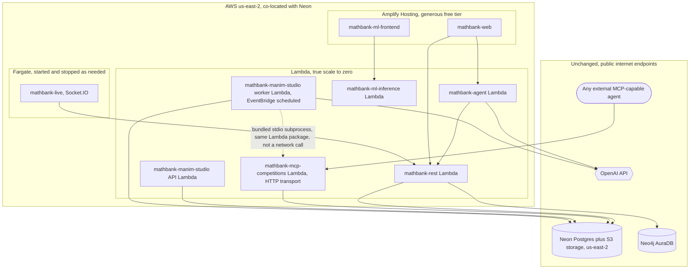

# 62. AWS serverless dev-hosting cost research — minimum-cost way to run the app layer while keeping Neon Postgres + Neo4j AuraDB

## 0. Status and scope

| | |
|---|---|
| Status | **RESEARCH ONLY — nothing deployed, no infrastructure created.** Every price/limit below is from a live web search done this session (not from training-data memory, which is often stale for cloud pricing); every claim about *this* project's own setup (ports, runtimes, region) was confirmed by reading this repo's actual `.env`/README/Makefiles. |
| Trigger | User wants to host the MathBank dev services on AWS at **minimum cost**, prefers **serverless**, and explicitly wants to **keep** the existing managed Neon Postgres and Neo4j AuraDB (not migrate them) — host only the application/compute layer. |
| Scope boundary | Covers hosting options and cost for `mathbank-rest`, `mathbank-agent`, `mathbank-web`, `mathbank-live`, `mathbank-manim-studio`, `mathbank-ml-inference`, `mathbank-ml-frontend`, and `mathbank-mcp-competitions`. Does **not** cover migrating Neon/AuraDB to AWS-native equivalents (explicitly out of scope per the user's ask), CI/CD pipeline design, or production-grade HA/multi-region (this is a **dev** cost question). |

## 1. Executive summary

**Realistic estimate for light dev usage: $0–$5/month for the compute layer**, on top of whatever Neon/AuraDB already cost (separate, unaffected by this choice — see §2). The win is almost entirely from **AWS Lambda's true scale-to-zero pricing** (1M requests + 400,000 GB-seconds free *every month, forever*, not a 12-month trial) applied to the 5 of 8 services that are plain stateless HTTP APIs — including `mathbank-mcp-competitions`, which already supports a Streamable-HTTP mode (`MCP_TRANSPORT=http`), not just the stdio subprocess mode it's usually launched with locally — plus **AWS Amplify Hosting's** generous free tier (500,000 SSR requests/month) for the 2 plain Next.js apps. The one service that doesn't fit this model cleanly — `mathbank-live`'s Socket.IO server — gets a tiny Fargate task that costs roughly **$1–9/month** depending on how many hours/day it actually runs, because WebSocket servers fundamentally need a long-lived process, not a request-scoped function.

A critical, easy-to-miss simplification specific to this project: **none of these services need to run inside a VPC**, because Neon and AuraDB are both public, internet-reachable, TLS-protected endpoints, not private resources inside your own AWS account. That means **no NAT Gateway** (~$32-38/month just sitting idle, the single most common accidental serverless-cost trap) is needed anywhere in this architecture.

## 2. What doesn't change: Neon and AuraDB stay exactly as they are

Confirmed from this repo's own `mathbank-rest/.env` (hosts redacted, shape visible):
- Postgres: `*.c-7.us-east-2.aws.neon.tech` — Neon, physically hosted **on AWS, in `us-east-2` (Ohio)**.
- Object storage (`AWS_ENDPOINT_URL_S3`): `*.storage.c-7.us-east-2.aws.neon.tech` — also Neon-managed, also `us-east-2`.
- Neo4j: `neo4j+s://*.databases.neo4j.io` — AuraDB; the hostname doesn't reveal cloud/region (Aura abstracts that), so **check the Aura console** for the instance's actual cloud/region before picking an AWS region for compute.

**Recommendation: deploy the AWS compute layer in `us-east-2`** to co-locate with the confirmed Postgres/storage region — this avoids any cross-region data-transfer charge on the Postgres/S3 traffic and minimizes latency, at zero extra cost (picking a region costs nothing by itself).

One live finding worth flagging honestly: AuraDB's Free tier caps out at roughly 50,000–200,000 nodes (sources vary) and auto-pauses after 3 days idle — **this project's graph already has 300,000+ nodes across just a few labels** (confirmed earlier this session: `LearningItem` 91,354, `RouteStep` 80,168, `TheoryItem` 80,168, `Claim` 80,168, `Misconception` 69,954, plus more). That means **this AuraDB instance is almost certainly already on a paid tier**, independent of anything in this document — check the Aura console billing page to confirm the actual current cost, since it's a pre-existing, fixed line item this hosting choice cannot reduce. Likewise Neon's free tier (0.5 GB storage, 100 CU-hours/month) is almost certainly already exceeded by this corpus's size (207 tables, 12,542 problems, 70,018 misconceptions, etc.) — the existing Neon plan is also a separate, already-fixed cost.

## 3. Service inventory, classified by what actually fits serverless

| Service | Port | Runtime shape | Statefulness | Serverless fit |
|---|---|---|---|---|
| `mathbank-rest` | 8000 | FastAPI (Uvicorn) | Stateless — all state in Postgres/Neo4j | ✅ Excellent — Lambda |
| `mathbank-agent` | 8001 | Google ADK over FastAPI-style `server.py` | Stateless — ADK session state lives in Postgres (`agent_sessions` schema), not in-process | ✅ Excellent — Lambda |
| `mathbank-ml-inference` | 8010 | FastAPI (scaffolded) | Stateless | ✅ Excellent — Lambda |
| `mathbank-manim-studio` | 8020 | FastAPI + a job-queue worker polling `studio.*` tables | API: stateless. Worker: currently a long-running poll loop, but the *work* is one bounded render per job | ✅ Good — Lambda for the API; the worker can become an EventBridge-scheduled Lambda invocation instead of an always-on process (§6) |
| `mathbank-mcp-competitions` | stdio (default) **or 9000 over HTTP** | FastMCP server — confirmed in its own `__main__.py`: `MCP_TRANSPORT=http` runs it as a standing Streamable-HTTP network server on `mcp_http_port` (default 9000), same ASGI shape as any other FastAPI-style app; the Prefab UI explorer is served from this same app, not a separate process | Stateless | ✅ Excellent — Lambda, once started with `MCP_TRANSPORT=http` (its stdio mode is only for local/subprocess MCP-host use and doesn't apply here) |
| `mathbank-web` | 5173 | Plain Next.js (`next dev`/`next start`, no custom server) | Stateless | ✅ Excellent — Amplify Hosting or Lambda via OpenNext |
| `mathbank-ml-frontend` | 5175 | Plain Next.js | Stateless | ✅ Excellent — Amplify Hosting |
| `mathbank-live` | 5174 | **Custom** `server.mjs` — Next.js *plus* an embedded Socket.IO server | **Stateful** — holds open WebSocket connections | ⚠️ Poor fit for Lambda/Amplify as-is; needs a long-lived process (§5) or a real re-architecture to API Gateway WebSocket (bigger lift, not recommended for a dev-cost project) |
| `mathbank-ml-training` | — | Offline notebooks | N/A | Out of scope — not a hosted service |
| `mathbank-geometry-engine`, `mathbank-neural-geometry` | — | No port in the service table (library/CLI-style) | N/A | Out of scope for this question |
| `mathbank-data-ingestion` | — | Offline batch crawl/classify/export pipeline | N/A | Out of scope here; if ever run on AWS, this is a batch-job (Fargate task or Lambda-with-Step-Functions) question, not a "hosted service" one |

## 4. Lambda-fit services: `mathbank-rest`, `mathbank-agent`, `mathbank-ml-inference`, `mathbank-mcp-competitions`, `mathbank-manim-studio`'s API

### 4.1 How to deploy a FastAPI app to Lambda (two options, confirmed current)

1. **Mangum** — a small ASGI-to-Lambda-event adapter; one extra line (`handler = Mangum(app)`), works with the existing app unchanged.
2. **AWS Lambda Web Adapter** (newer, AWS-maintained) — a Lambda layer that lets the *exact same* `uvicorn`-run app work on Lambda, ECS, or a laptop with **zero code changes** — the same `main.py` this repo already has runs as-is. This is the simpler option for this codebase specifically, since it needs no new dependency in `pyproject.toml`.

Either way, front it with an **API Gateway HTTP API** (not the older REST API — HTTP API is both cheaper and simpler) — or, for the absolute cheapest front door for a single-function dev API, a **Lambda Function URL** (a direct HTTPS endpoint on the function itself, no API Gateway involved, no extra per-request charge beyond Lambda's own). Function URLs trade away API Gateway's custom-domain/throttling/API-key features — acceptable for a dev environment, worth upgrading to HTTP API later if those features are needed.

### 4.2 Confirmed current pricing (searched live, not from memory)

| Item | Price | Free tier |
|---|---|---|
| Lambda requests | $0.20 / 1M requests | **1,000,000 requests/month, forever** (not a 12-month trial) |
| Lambda compute | $0.0000166667 / GB-second (x86; ARM/Graviton2 cheaper) | **400,000 GB-seconds/month, forever** |
| Lambda container image | up to 10 GB | — |
| Lambda max timeout | 15 minutes (900s) hard limit | — |
| API Gateway HTTP API | ~$1.00 / 1M requests | small free tier in year 1 |
| Lambda Function URL | $0 extra (just Lambda's own cost) | n/a |

A dev environment used intermittently by 1-2 developers is, with very high confidence, going to stay **entirely inside the free tier** for `mathbank-rest`/`mathbank-agent`/`mathbank-ml-inference` — i.e. **$0/month** for these three.

### 4.3 The one real gotcha: Postgres connection pooling

Lambda can scale to many concurrent invocations under load, each potentially opening its own Postgres connection — this can exhaust Postgres's `max_connections` far faster than a single long-running Uvicorn process ever would. Neon already solves this with a **built-in, managed PgBouncer pooler** — confirmed live:

- Use the **pooled connection string** (`*-pooler.<region>.aws.neon.tech`) for all Lambda-originated traffic, not the direct endpoint.
- The pooler uses **transaction pooling** — session-scoped features (session `SET`, advisory locks held across statements, temp tables persisted across requests) will not work through it. Check this codebase's `mathbank-rest/src/mathbank_rest/db/postgres.py` connection setup doesn't rely on any session-level Postgres state before switching the connection string (a quick grep for `SET ` / `pg_advisory_lock` against the query modules is the concrete verification step before cutover).
- Keep the **direct** (non-pooled) connection string only for one-off migration scripts, not the Lambda-facing app.

### 4.4 `mathbank-manim-studio` specifically — container image feasibility (confirmed live)

This service's system dependencies (ffmpeg, Cairo, Pango, a LaTeX distribution) were a real, open question for Lambda given its stricter packaging limits. Confirmed this session:

- Lambda **container images** (not the old 250 MB zip layer limit) go up to **10 GB** — the Manim Community reference Docker image with a minimal TeX Live install typically lands in the **700 MB – a few GB** range, comfortably under that cap.
- The real constraint is the **15-minute hard timeout**, not image size — fine for this project's short explainer-video renders (confirmed earlier this session to complete well under a minute), but worth a conscious note if a future render ever needs more than ~10-12 minutes (leave margin), in which case Fargate (no timeout cap) would be the fallback for that one job type only.
- Cold starts scale with image size — expect a few extra seconds on a cold invocation for a multi-hundred-MB image; irrelevant for an async job-queue worker, since nothing is waiting synchronously on it.

**Recommendation for the worker specifically**: replace the current always-on poll loop with an **EventBridge Scheduler rule** (e.g. every 1-2 minutes) invoking a Lambda that claims and processes one pending `studio.scene_research_job`/`studio.video_render_job` row, then exits — turns a 24/7 process into a function that runs for seconds per invocation and is free under the Lambda free tier at dev-level job volume.

**One important distinction confirmed in this repo's own code**: the research agent inside `mathbank-manim-studio` does **not** call `mathbank-mcp-competitions` over the network today — `mcp_corpus_client.py` spawns it as a **bundled stdio subprocess within the same process**. That pattern needs no change on Lambda: the manim-studio Lambda package simply includes the `mathbank-mcp-competitions` package and spawns it as a child process inside its own execution environment, exactly as it does locally (child-process spawning works fine inside a single Lambda invocation — it is not a cross-Lambda network call). The **separate, independently-deployed** `mathbank-mcp-competitions` Lambda discussed in §4.5 is for a different consumer entirely: external third-party MCP agents connecting over the internet, which is the use case that actually needs the HTTP transport.

### 4.5 `mathbank-mcp-competitions` specifically — one thing to verify before Lambda

This server already runs over Streamable HTTP today (`MCP_TRANSPORT=http`), the same ASGI shape as every other service in §4, and it has no database writes of its own (it reads the corpus through the same Postgres `mathbank-rest` already uses) — so on paper it's as Lambda-friendly as `mathbank-rest`. The one thing **not yet confirmed** (no code in this server sets it explicitly) is whether the FastMCP app is configured for **stateless HTTP** — the MCP Streamable-HTTP transport spec allows a server to hold per-session state (e.g. a long-lived SSE stream back to the client) between a session's requests, which does not survive across separate Lambda invocations. Before deploying this one to Lambda specifically, check whether the FastMCP version in use exposes a `stateless_http=True`-style constructor option and enable it — for the request/response tool-calling this server actually does (plus its Prefab UI explorer, also plain request/response), stateless mode should be a clean fit; it is simply the one unverified detail in this otherwise straightforward case.

## 5. `mathbank-live` — why it doesn't fit the Lambda model, and the cheapest real alternative

Socket.IO needs a **persistent process** holding open WebSocket connections and in-memory room state; a request-scoped Lambda invocation ends between messages, which is fundamentally incompatible with how Socket.IO (and this repo's `server.mjs`) work. Two real paths, confirmed live:

### 5.1 Recommended for dev: a single small Fargate task, run only when needed

| | On-Demand | Fargate Spot (up to ~70% off) |
|---|---|---|
| vCPU-hour | $0.04048 | $0.0124419 |
| GB-hour | $0.004445 | $0.00136621 |
| Minimum task size | 0.25 vCPU / 0.5 GB | same |

For a 0.25 vCPU / 0.5 GB task (this service's actual footprint is tiny):
- **Run ~4 hours/day, 20 dev-days/month (80 hours)**: ≈ $0.81 (vCPU) + $0.18 (memory) ≈ **~$1/month** on-demand, **~$0.30/month** on Spot.
- **Run 24/7 (730 hours)**: ≈ $7.39 + $1.62 ≈ **~$9/month** on-demand, **~$2.80/month** on Spot.

Fargate (unlike App Runner, see §5.3) genuinely costs **$0 while the task isn't running** — stop the task (or let a scheduled EventBridge rule stop/start it around your actual working hours) and the charge stops immediately, no idle floor.

### 5.2 Simpler, flat-rate alternative: AWS Lightsail Containers

A fixed low monthly price (smallest tier is a few dollars/month) instead of per-second billing — trades Fargate's finer-grained scale-to-(near-)zero for zero operational complexity (no scheduler needed, nothing to remember to stop). Worth considering if the Fargate stop/start scheduling feels like more ops overhead than the savings justify for a solo dev.

### 5.3 Why not AWS App Runner for this

Confirmed live and worth stating plainly since it's a common misconception: **App Runner does not scale to zero automatically.** It always keeps at least one provisioned instance warm (billed for memory, ~$0.007/GB-hour, even fully idle) unless you **manually pause** it — at which point it behaves like a stopped Fargate task anyway, just with an extra manual step and less granular control. Fargate directly, started/stopped as needed, is both cheaper and more transparent for this use case.

### 5.4 Why not a full API-Gateway-WebSocket rewrite

Technically the cheapest *theoretical* floor (pay per connection-minute and per-message, true $0 when idle, confirmed live), but it means replacing Socket.IO's protocol, rooms, and reconnection/fallback handling with raw API Gateway `$connect`/`$disconnect`/custom-route Lambda handlers plus a DynamoDB connection-ID table — a genuine application rewrite of `mathbank-live`'s gateway layer, not a hosting change. Not recommended purely for a dev-cost goal; revisit only if `mathbank-live` needs to scale to real concurrent-user production traffic later.

## 6. `mathbank-web` / `mathbank-ml-frontend` — Next.js hosting

Both are plain Next.js apps (`next dev`/`next build && next start`), no custom server — the easy case.

### 6.1 Recommended: AWS Amplify Hosting (confirmed live, 2025 pricing)

| Item | Free tier | Beyond free tier |
|---|---|---|
| Build minutes | 1,000/month | $0.01/minute |
| SSR requests | 500,000/month | $0.30/1M |
| SSR compute duration | 100 GB-hours/month | $0.20/GB-hour |
| CDN storage | 5 GB | $0.023/GB-month |
| Data transfer out | 15 GB/month | $0.15/GB |

Amplify Hosting natively understands standard Next.js SSR (no adapter needed) and is the lowest-effort option — genuinely free at dev-level traffic for both apps combined.

### 6.2 Alternative: OpenNext + SST on raw Lambda/CloudFront/S3

More control, marginally cheaper at real scale (benchmarked elsewhere as up to ~95% cheaper than Vercel at *high* traffic), but meaningfully more setup/ops work (CDK/SST stack, image-optimization Lambda, cache invalidation) for no cost benefit at dev-level traffic, where Amplify's free tier already covers everything. **Not recommended for this specific goal** — the extra ops time has its own cost, and this is a dev environment, not a scale target.

## 7. Recommended architecture

## 8. Estimated total monthly cost (light dev usage)

| Component | Estimate |
|---|---|
| `mathbank-rest` Lambda | $0 (within free tier) |
| `mathbank-agent` Lambda | $0 (within free tier) |
| `mathbank-ml-inference` Lambda | $0 (within free tier) |
| `mathbank-mcp-competitions` Lambda (HTTP transport) | $0 (within free tier) |
| `mathbank-manim-studio` API + scheduled worker Lambda | $0 (within free tier) |
| `mathbank-web` + `mathbank-ml-frontend` on Amplify Hosting | $0 (within free tier) |
| `mathbank-live` on Fargate, ~80 hrs/month | ~$0.30 (Spot) – $1 (on-demand) |
| CloudWatch Logs, minor data transfer | a few cents |
| **Total app-layer cost** | **≈ $0–$5/month** |
| Neon Postgres (existing plan, unaffected by this choice) | not estimated here — check the Neon console for the current plan |
| Neo4j AuraDB (existing plan, unaffected by this choice) | not estimated here — check the Aura console for the current plan |

## 9. Risks and open questions

- **AuraDB's actual region/cloud is not confirmed** — the `neo4j+s://*.databases.neo4j.io` hostname doesn't reveal it. Check the Aura console before finalizing the AWS region choice; if AuraDB is on GCP or Azure, the "co-locate for free" argument in §2 only applies to the Postgres/S3 side, not Neo4j (Bolt traffic to Aura would cross clouds regardless of which AWS region is chosen, at normal internet data-transfer-out rates, not a special cross-cloud fee).
- **Connection-pooling verification is not done yet** — §4.3's "must use the pooled connection string, must not rely on session-level Postgres features" needs a real grep-and-check pass over `mathbank-rest`'s query modules before cutover, not just this document's assumption.
- **`mathbank-manim-studio`'s worker-to-scheduled-Lambda conversion is a real code change**, not just an infrastructure change — turning a poll loop into "claim one job, process it, exit" needs the job-claiming logic to be safely callable that way (idempotent claim with `FOR UPDATE SKIP LOCKED` or similar), not assumed to already be structured for it.
- **`mathbank-mcp-competitions`'s stateless-HTTP configuration is not yet verified** (§4.5) — confirm the FastMCP version in use supports and is configured for `stateless_http=True` before deploying it to Lambda specifically.
- **This document does not cover IaC** (CDK/SAM/Terraform) — once the approach is approved, the next step is writing the actual deployment stack, not included here since this was a cost-research request, not an implementation one.

## Cross-document relationship

Complements the root [README.md](../../README.md)'s Architecture section (service inventory/ports) and `Makefile`'s `up-windows`/`up-app` targets (this session's local-dev convenience work) — this document is about *where* those same services could run for less money, not a replacement for local dev.
