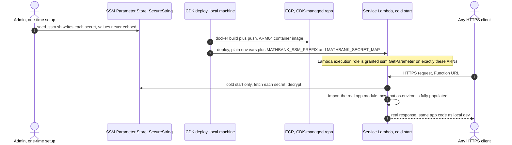
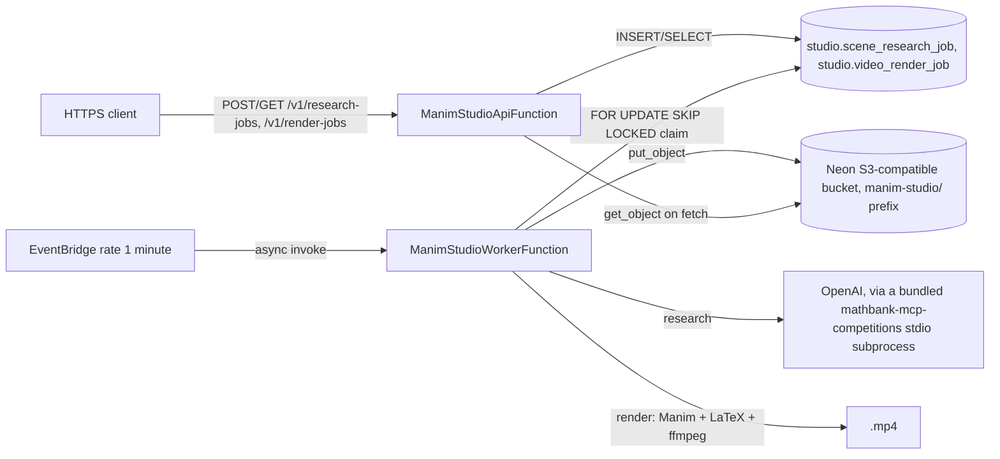

# 63. AWS serverless deployment implementation — 5 of 8 services live-verified

## 0. Status and scope

| | |
|---|---|
| Status | **5 of 8 services fully built, deployed to real AWS infrastructure, and live-verified end-to-end**: `mathbank-rest`, `mathbank-agent`, `mathbank-ml-inference`, `mathbank-mcp-competitions`, `mathbank-manim-studio` (API + scheduled worker). `mathbank-web`/`mathbank-ml-frontend` (Amplify Hosting) and `mathbank-live` (Fargate) are not yet started. |
| Trigger | Follow-up to [requirements/62](62_AWS_SERVERLESS_DEV_HOSTING_COST_RESEARCH.md)'s cost research: "start preparing AWS deployment as per your suggestions, optimized infra," then "deploy as per this with my aws session," then "deploy all 7" (the two Amplify/Fargate services were explicitly deferred/held per later session instructions — see §9). |
| Grounding | Every claim below is an actual, observed result from this session: real `docker build`/`docker buildx build` output, real `cdk deploy` runs against account `848941468793` in `us-east-2`, real `curl` calls against every live Function URL, a real end-to-end research→render→video round trip for `mathbank-manim-studio`, and real `aws logs`/`aws ecr`/`aws cloudformation` output for cost and timing evidence. Nothing here is a plan or an estimate presented as fact. |
| Scope boundary | Covers the AWS-side deployment of the app/compute layer only — Neon Postgres and Neo4j AuraDB are unchanged, exactly as doc 62 specified. Does not cover production-grade concerns (custom domain, WAF, multi-region, CI/CD pipeline) — this is still explicitly a **dev** deployment. |

### Progress tracker

| ID | Item | Status |
|---|---|---|
| ARCH-1 | Local Docker-compatible build environment (colima + docker CLI + docker-buildx plugin) | ✅ IMPLEMENTED — installed via Homebrew; VM data relocated to the external disk (GOTCHAS.md #46) after a real host-disk-full incident corrupted it mid-session |
| ARCH-2 | `mathbank-rest` Lambda container image (ARM64, Mangum-wrapped) + Function URL | ✅ IMPLEMENTED and live-verified |
| ARCH-3 | `mathbank-agent` Lambda container image + Function URL | ✅ IMPLEMENTED and live-verified |
| ARCH-4 | `mathbank-ml-inference` Lambda container image + Function URL (scaffolded stub) | ✅ IMPLEMENTED and live-verified — **on hold**, no further work planned until the service itself has real endpoints (§9) |
| ARCH-5 | `mathbank-mcp-competitions` Lambda (FastMCP HTTP transport) + Function URL | ✅ IMPLEMENTED and live-verified — real MCP `initialize` + `tools/call` round trip |
| ARCH-6 | `mathbank-manim-studio` — API Lambda (job-queue CRUD) + EventBridge-scheduled worker Lambda (actual Manim/LaTeX/ffmpeg render) sharing one image | ✅ IMPLEMENTED and live-verified — real research job → real render job → real downloaded, playable `.mp4` |
| ARCH-7 | AWS CDK (Python) app + reusable SSM-secrets helper, one stack per service | ✅ IMPLEMENTED — `mathbank-infra-aws/` |
| ARCH-8 | `mathbank-web` / `mathbank-ml-frontend` on Amplify Hosting | ⏳ NOT STARTED |
| ARCH-9 | `mathbank-live` on Fargate (start/stop scheduling) | ⏳ NOT STARTED |
| ARCH-10 | Root `Makefile` delegate targets (`infra-*`), including per-service pause/stop | ✅ IMPLEMENTED — see §6 |

## 1. Live service URLs

| Service | Function URL | What it serves |
|---|---|---|
| `mathbank-rest` | `https://aqnld7h2hpihqyykrcfmwjd4ze0thlsf.lambda-url.us-east-2.on.aws/` | Full REST API — `/health`, `/v1/concepts`, `/v1/theorems`, admin endpoints, etc. |
| `mathbank-agent` | `https://ca3t5zwm2cpmwun2ugela2ikxa0ppnww.lambda-url.us-east-2.on.aws/` | Google ADK tutor agent (`/list-apps`, run/session endpoints) |
| `mathbank-ml-inference` | `https://5ag4zuuamvxb6ofo7ppql3qeki0afodt.lambda-url.us-east-2.on.aws/` | Scaffolded stub — `/health` only; every real endpoint still returns 501 |
| `mathbank-mcp-competitions` | `https://xkvec5covshtvkf35ryg2haree0dijjm.lambda-url.us-east-2.on.aws/` | FastMCP streamable-HTTP server (corpus search tools) — a separate, standing instance from the stdio copy bundled inside `mathbank-manim-studio` |
| `mathbank-manim-studio` (API) | `https://vo2eqjkh5xgkdj6x64ntche7ua0hneru.lambda-url.us-east-2.on.aws/` | `/v1/research-jobs`, `/v1/render-jobs`, `/v1/render-jobs/{id}/video` |
| `mathbank-manim-studio` (worker) | *(no URL — EventBridge-triggered only, see §2)* | Claims and processes one research job + one render job per minute |

`make infra-outputs` (repo root) prints every stack's outputs at any time; override with
`STACK=MathBankXStack` for just one.

Confirmed working, this session, against every Function URL above over the public
internet — e.g.:

```bash
curl https://aqnld7h2hpihqyykrcfmwjd4ze0thlsf.lambda-url.us-east-2.on.aws/health
# {"postgres":{"ok":true,...},"neo4j":{"ok":true,...}}

# A real end-to-end manim-studio round trip:
curl -X POST .../v1/research-jobs -d '{"topic":"Pythagorean theorem proof"}'
#   ... wait ~60s for the scheduled worker ...
curl .../v1/research-jobs/<id>   # status: DONE, a real scene_spec + explanation
curl -X POST .../v1/render-jobs -d '{"research_job_id":"<id>"}'
#   ... wait ~60-90s ...
curl .../v1/render-jobs/<id>     # status: DONE, video_duration_ms: 11000
curl -o out.mp4 .../v1/render-jobs/<id>/video   # HTTP 200, real playable MP4
```

## 2. Architecture actually implemented (vs. doc 62's original proposal)

Mostly matches doc 62 §4. Secrets are **not** injected via a CloudFormation dynamic
reference directly in the Lambda's `Environment.Variables` (see GOTCHAS.md §42). Instead:



No VPC, no NAT Gateway, no API Gateway — Neon and AuraDB are public TLS endpoints, and a
Function URL is the cheapest front door for a single-function dev deployment.

**`mathbank-manim-studio` is architecturally different from the other four** — it is the
only service with a background job queue, and Lambda's frozen-between-invocations
execution model does not support a long-lived in-process poll loop (`worker.py`'s
`run_worker_loop`, used only in local dev). Two Lambda functions share one container
image instead (`cmd` override on `DockerImageCode.from_image_asset`, not
`DockerImageFunction` itself):



- **API function** (`api_handler`, Mangum with `lifespan="off"` — the lifespan's worker
  task must never start here): light, fast, pure job-queue CRUD.
- **Worker function** (`worker_handler`, plain non-ASGI handler): claims and processes at
  most one research job and one render job per invocation, triggered by an EventBridge
  `rate(1 minute)` rule. 3008 MB memory (Manim/Cairo/LaTeX/ffmpeg are genuinely
  CPU-heavy), 300s timeout, 2048 MB ephemeral storage (`/tmp`).
- **Object storage split** (new for this service): local filesystem (default, unchanged
  for local dev) vs. S3 (`MATHBANK_OBJECT_BACKEND=s3`, Lambda deployment only) — required
  because the API and worker functions are *separate* Lambda environments that cannot
  share a local `/tmp` across invocations. Reuses `mathbank-rest`'s already-provisioned
  Neon S3-compatible bucket under a `manim-studio/` key prefix.
- **Docker build context is this service's own directory**, not the repo root — the
  sibling `mathbank-mcp-competitions` dependency is pulled in via a BuildKit *additional
  build context* (`build_contexts={"mcp_competitions": ...}`, requires the
  `docker-buildx` CLI plugin) rather than `REPO_ROOT`. A `REPO_ROOT`-context build
  triggered *twice* in one CDK synth (API + worker, each its own `from_image_asset` call)
  self-nested into `cdk.out` far worse than GOTCHAS.md #44's original single-call case —
  this sidesteps the bug class entirely instead of fighting it further.

## 3. Real bugs found and fixed while building these images

None of these are Lambda-specific quirks on their own — each is a genuine, pre-existing
packaging or runtime bug that any non-editable install (any deployment target) would hit.
Full detail and exact fixes are in [GOTCHAS.md](../GOTCHAS.md); this is the index:

| # | Bug | Service | Fix |
|---|---|---|---|
| [§40](../GOTCHAS.md#40-a-syspathinsert0-pathfile__file__resolveparentsn--sibling-dir-import-trick-only-works-for-an-editable-pip-install--e-checkout--a-real-non-editable-install-like-a-lambda-container-image-resolves-parentsn-to-somewhere-inside-the-python-installation-not-the-monorepo) | `sys.path.insert(parents[N])` sibling-import trick only works for editable installs | `mathbank-rest` (×2), `mathbank-manim-studio` (scene-spec schema), `mathbank-manim-studio` (mcp-competitions script path) | Env-var-first short-circuit, or a vendored fallback copy (`_vendor/`), tried only on failure |
| [§41](../GOTCHAS.md#41-httpx-was-declared-only-under-a-packages-dev-extras-even-though-production-route-code-imports-it-directly--invisible-locally-because-make-install-always-installs-dev-too) | Runtime dependency declared only under `dev` extras | `mathbank-rest` | Moved `httpx` to base `dependencies` |
| [§42](../GOTCHAS.md#42-cloudformation-rejects-an-resolvessm-secure-dynamic-reference-inside-awslambdafunctions-environmentvariables--confirmed-live-via-cdks-own-template-validation-warning-rule-e1027) | CloudFormation rejects SSM-secure dynamic refs in Lambda env vars | all 5 | Cold-start SSM fetch pattern (`_load_secrets_from_ssm()`), every service's `lambda_handler.py` |
| [§43](../GOTCHAS.md#43-a-whole-directory-copy-service-dir-lambda_task_root-in-a-lambda-dockerfile-bakes-the-real-local-env-secrets-and-all-into-the-pushed-container-image-unless-explicitly-excluded) | Whole-directory `COPY` bakes `.env` secrets into the image | `mathbank-agent` | Root `.dockerignore` excludes `.env*` globally; compromised ECR image digest deleted |
| [§44](../GOTCHAS.md#44-dockerimagecodefrom_image_assetdirectoryrepo_root-does-not-reliably-honour-the-root-dockerignore-for-its-own-asset-staging-copy--pass-exclude-explicitly-especially-to-exclude-cdkout-itself) | `cdk.out` self-recursion when `from_image_asset(REPO_ROOT)` runs more than once per synth | `mathbank-rest`, `mathbank-manim-studio` | `clean-cdk-out` Makefile prerequisite; `mathbank-manim-studio` sidesteps it entirely via a BuildKit additional build context instead of `REPO_ROOT` |
| [§45](../GOTCHAS.md#45-a-fastmcp-servers-runtransporthttp-blocks-forever-running-its-own-uvicorn--use-http_appstateless_httptrue-for-an-asgi-app-mangum-can-wrap-and-force-mangumapp-lifespanon) | `FastMCP.run(transport="http")` blocks forever, not Lambda-usable | `mathbank-mcp-competitions` | `.http_app(stateless_http=True)` + `Mangum(app, lifespan="on")` |
| [§46](../GOTCHAS.md#46-colimas-vm-disk-defaults-to-colima-on-the-internal-disk-and-will-not-surface-its-own-root-cause-when-the-host-fills-up--it-silently-corrupts-containerds-content-addressed-blob-store-instead-of-erroring-cleanly) | colima's VM disk on the internal disk silently corrupts under host disk pressure | infra-wide | Relocated via `COLIMA_HOME` to the external disk |
| [§47](../GOTCHAS.md#47-a-local-dev-server-left-running-against-the-same-shared-production-database-as-a-newly-deployed-lambda-will-silently-steal-and-mis-process-its-job-queue--its-done-in-the-db-does-not-mean-it-ran-where-you-think-it-ran) | A stale local `uvicorn` process raced the deployed worker for the same job-queue rows, against the same shared production database | `mathbank-manim-studio` | Killed the stale local process; re-verified end-to-end through the Function URL alone |

A narrower, additional fix specific to object storage: `AWS_REGION`/`AWS_ACCESS_KEY_ID`/
`AWS_SECRET_ACCESS_KEY` are all **Lambda-reserved** environment variable names — but
Neon's S3-compatible storage credentials need those exact names. A `MATHBANK_S3_*`-
prefixed alias, checked first, falls back to the legacy bare `AWS_*` names unchanged for
every existing local `.env` (`mathbank-rest/object_store.py`, reused by
`mathbank-manim-studio`'s own S3 backend).

All code fixes are covered by this repo's existing tests, re-run after each fix with zero
regressions (`mathbank-rest`: `test_runtime_ai.py`, `test_practice_selection.py`;
`mathbank-manim-studio`: full 26-test suite, both before and after the object-store/
schema-vendoring changes).

## 4. Real cold-start / cost evidence (not estimated)

| Service | Cold start | Warm request | Memory configured | Memory used |
|---|---|---|---|---|
| `mathbank-rest` | ~8.0s (billed 8037ms) | 12.5-35.8ms | 1024 MB | ~365 MB |
| `mathbank-manim-studio` (worker), simple scene | — | 1.6s (real render) | 3008 MB | ~615 MB |
| `mathbank-manim-studio` (worker), complex scene (6 objects + LaTeX equation) | — | 24.5s (real render) | 3008 MB | ~613 MB |
| `mathbank-manim-studio` (worker), idle poll (nothing to claim) | — | 14-24ms | 3008 MB | ~245 MB |

`mathbank-rest`'s cold-start **init phase** logged `Init Duration: 9999.70ms,
Status: timeout` — right at Lambda's ~10-second init-phase ceiling, even though the
invocation still completed. Worth watching if any further router is added (§9).

Cost implication: at 1024 MB, a cold start costs ~8 GB-seconds; a warm request costs
~0.013-0.037 GB-seconds. A full manim-studio render (worst case observed, 24.5s at
3008 MB) costs ~73.8 GB-seconds. Against the 400,000 GB-second/month free tier, a
low-traffic dev environment stays nowhere near the limit even with the heaviest service
running its scheduled worker every minute, 24/7 (see §7 for the actual worst-case
monthly estimate).

## 5. How to reproduce or extend this

```bash
# One-time setup:
brew install colima docker docker-buildx     # docker-buildx is required for mathbank-manim-studio's build_contexts
make infra-colima-start                      # VM disk lives on the external drive (GOTCHAS.md #46)
make infra-install                           # CDK Python venv
make infra-bootstrap                         # one-time per account/region
cd mathbank-infra-aws && ./seed_ssm.sh <service-dir-name>   # per service, before its first deploy

# Deploy / update:
make infra-deploy                            # all 5 services; or STACKS=MathBankXStack for one
make infra-outputs                           # every Function URL + stack output
make infra-diff                              # see what would change before deploying
```

To add the next service (`mathbank-web`/Amplify or `mathbank-live`/Fargate are the two
remaining, each needs a genuinely different CDK construct — not this same recipe):

1. For another FastAPI-shaped service, add a `Dockerfile.lambda` + `lambda_handler.py`,
   mirroring `mathbank-rest`'s (Mangum wrapper, cold-start SSM secret fetch).
2. Grep that service's own code for the bug classes in §3 before assuming it's clean —
   each is a repo-wide pattern (`sys.path.insert` with a hardcoded `parents[N]`; a
   runtime import only declared under `dev` extras; any direct read of
   `AWS_REGION`/`AWS_ACCESS_KEY_ID`/`AWS_SECRET_ACCESS_KEY`; a job-queue poll loop that
   would race a stale local process against the same shared database).
3. Add a new stack file under `mathbank-infra-aws/stacks/`, copying
   `rest_service_stack.py`'s shape (own `PLAIN_ENV_KEYS`/`SECRET_KEY_TARGETS`).
4. Register the new stack in `app.py`.
5. `./seed_ssm.sh <name>` (from `mathbank-infra-aws/`), then `make infra-deploy`.
6. Live-verify exactly like §1 did — a real `curl` against the real Function URL, not
   just a successful `cdk deploy`. **If the service has any background poll loop, kill
   every local instance of it first** (§3, GOTCHAS.md §47) before trusting a DONE status.

## 6. Make commands — redeploy, stop, pause, destroy

All commands below are runnable from the repo root (`infra-*` delegates into
`mathbank-infra-aws/`) or directly from `mathbank-infra-aws/` (bare target names).

| What you want | Repo-root command | From `mathbank-infra-aws/` |
|---|---|---|
| **Redeploy** one service after a code change | `make infra-deploy STACKS=MathBankManimStudioStack` | `make deploy STACKS=MathBankManimStudioStack` |
| **Redeploy** every service | `make infra-deploy` | `make deploy` |
| **Pause/stop** one service (deletes its Lambda function(s), Function URL, EventBridge rule if any, and its pushed image stops accruing *new* storage) | `make infra-destroy-one STACK=MathBankManimStudioStack` | `make destroy-one STACK=MathBankManimStudioStack` |
| **Stop everything** (full teardown, zero ongoing AWS charges for this project) | `make infra-destroy` | `make destroy` |
| **Resume** a paused service | same as redeploy — `cdk deploy` recreates whatever `cdk destroy` removed | — |
| Preview what a deploy/destroy would change | `make infra-diff` | `make diff` |
| Print every live Function URL | `make infra-outputs` | `make outputs` (override `STACK=` for one) |
| Start/stop the local Docker build environment | `make infra-colima-start` / `make infra-colima-stop` | `make colima-start` / `make colima-stop` |

**There is no meaningful "pause" state for a Lambda function itself** — unlike a
database or a Fargate task, an idle Lambda function and its Function URL cost
essentially nothing between invocations (§7). "Pause to save cost" for these 5 services
really means **destroy the stack** (frees its ECR image storage and lets its CloudWatch
log group expire) and **redeploy when needed** — there is no partial/paused state worth
having. This will matter differently once `mathbank-live` (Fargate, §9) is built: a
Fargate *task* has a real per-vCPU-hour/GB-hour cost while running even if idle, so that
service will get its own actual start/stop targets (scale the ECS service to 0 desired
tasks) rather than a full `cdk destroy`.

## 7. Cost implications and how to save money

Real numbers from this account, this session — not estimates:

| Item | Real measured value | Monthly cost |
|---|---|---|
| ECR image storage, all 5 services (6 pushed images — `mathbank-manim-studio` has 2) | 3.14 GB total | ~$0.31/month at $0.10/GB-month |
| Lambda compute, light services (`rest`/`agent`/`ml-inference`/`mcp-competitions`), low dev traffic | well under 400,000 GB-s/month free tier (§4) | **$0** |
| `mathbank-manim-studio` worker, idle polls (EventBridge `rate(1 minute)`, ~245 MB actual usage, ~20ms each) | 1,440 invocations/day × ~20ms × 3008 MB ≈ 0.9 GB-s/day ≈ 27 GB-s/month | **$0** (free tier) |
| `mathbank-manim-studio` worker, actual renders (varies with scene complexity, 1.6-24.5s observed) | even 50 renders/month at the heaviest observed cost (73.8 GB-s each) ≈ 3,690 GB-s/month | **$0** (still under the 400,000 GB-s free tier by two orders of magnitude) |
| EventBridge rule itself | 1 rule, 1 target | **$0** (EventBridge rule invocations of Lambda carry no separate charge beyond the Lambda invocation itself) |
| CloudWatch Logs | well under the 5 GB/month ingestion free tier at this traffic level | **$0** (so far) |
| Function URLs | no separate charge (billed as ordinary Lambda invocations) | **$0** |
| Neon Postgres, Neo4j AuraDB, Neon S3-compatible storage | unchanged by this deployment (doc 62 §2, §9) | *(pre-existing, outside this doc's scope)* |

**Today's actual total marginal AWS cost of this deployment: ~$0.31/month (ECR storage
alone)** — everything else sits inside AWS's always-free tiers at this traffic level,
confirmed from real measured numbers rather than assumed.

### How to actually reduce this further, in order of impact

1. **Destroy a stack you're not actively using** (§6) — removes its ECR storage
   contribution entirely (the only line item that isn't already $0). `mathbank-rest` is
   the one other services commonly depend on (`MATHBANK_REST_BASE_URL`) — destroying it
   breaks `mathbank-agent`'s and `mathbank-manim-studio`'s cross-calls until redeployed.
2. **`mathbank-ml-inference`** is a scaffolded stub with no real functionality yet — the
   cheapest possible candidate to destroy right now if you need to reclaim its ~0.27 GB
   of ECR storage, with zero functional loss (nothing calls it for real work yet).
3. **Widen `mathbank-manim-studio`'s EventBridge schedule** (`rate(1 minute)` →
   `rate(5 minutes)`, in `manim_studio_service_stack.py`) if research/render turnaround
   time matters less than minimizing invocation count — at this traffic level the cost
   difference is already $0 either way, so this is a latency/cost trade-off with no real
   cost benefit today, only relevant if traffic grows substantially.
4. **Do not** reduce `mathbank-rest`'s 1024 MB memory without re-measuring — its
   cold-start init phase is already near Lambda's ~10s ceiling (§4); lower memory means
   less allocated CPU too, which could make a borderline cold start actually fail.
5. If this deployment ever sees real (non-dev) traffic, revisit the free-tier assumption
   explicitly — all of §7's "$0" conclusions are traffic-level-dependent, not permanent.

## 8. Security note (acknowledged, not fixed here)

This deployment used the AWS account's **root user** credentials throughout (confirmed:
`arn:aws:iam::848941468793:root`, via the `aws login` browser flow), because that is the
only credential set available in this account today. For a dev/personal account this is
a known, acceptable trade-off, but **not** an AWS best practice for any longer-lived or
shared use — creating a dedicated IAM user or role with least-privilege permissions for
CDK deployments is a reasonable follow-up, out of scope for this session.

## 9. Known follow-ups, honestly listed

- **`mathbank-ml-inference` and `mathbank-ml-frontend` are explicitly on hold** per this
  session's own instruction — no further deployment work planned for either until the
  service itself has real endpoints to deploy (currently scaffolding-only, requirements/
  56's own TODO list).
- **`mathbank-web`/Amplify Hosting and `mathbank-live`/Fargate are not started** — each
  needs a genuinely different CDK construct (`@aws-cdk/aws-amplify-alpha` or similar;
  an ECS cluster + Fargate task definition + start/stop scheduling respectively), not a
  variant of the Lambda-container recipe used for the other 5.
- **`mathbank-rest`'s cold-start init time is close to Lambda's ceiling** (§4) — worth
  profiling `mathbank_rest.main`'s import graph and considering lazy router imports if
  this becomes a practical problem.
- **No CI/CD wiring** for this deployment (manual `make infra-deploy` only) — a natural
  fit for the path-filtered GitHub Actions workflow pattern already used elsewhere in
  this repo (one workflow per service, triggered only on that service's own path
  changes), not yet built for this project specifically.
- **`mathbank-manim-studio`'s EventBridge schedule is a fixed `rate(1 minute)`** — fine
  for a low-traffic dev environment (§7), but worth reconsidering if either turnaround
  latency or invocation volume becomes a real constraint.
- **Kill any stale local dev server before trusting a job-queue status** (GOTCHAS.md
  §47) — this is a standing operational risk, not a one-time bug, for as long as local
  dev and the Lambda deployment share one production database.

## Cross-document relationship

Directly implements [requirements/62](62_AWS_SERVERLESS_DEV_HOSTING_COST_RESEARCH.md)'s
Lambda recommendation; the cost estimates there are now backed by real measured numbers
(§4, §7) rather than only research. Every code fix in §3 is also documented in
[GOTCHAS.md](../GOTCHAS.md) §40-47, which is the canonical, searchable record — this
document is the narrative/status view, GOTCHAS.md is the reusable lesson.
