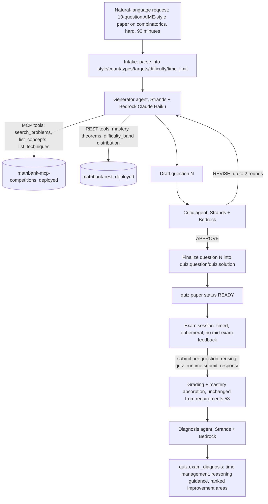

# 64. AWS Bedrock mock-exam agent — natural-language paper generation, timed exam sessions, and post-exam diagnosis

## 0. Status and scope

| | |
|---|---|
| Status | **Fully deployed to AWS and live-verified end-to-end** (EXM-1 through EXM-12 all done). Every item below — local dev *and* the deployed Lambda/S3/CloudFront stacks — was exercised live: signup/login via real AWS Cognito → natural-language request → intake parsing → generator↔critic loop (real critic-caught math errors, real bounded revision) → persisted paper → timed accordion exam-taking with a full interaction-event timeline → explicit submit → auto-grading → per-option explanations → diagnosis report → print/export, run both locally (Playwright, desktop+mobile) and against the real deployed Function URL + CloudFront URL. **Deviations from the original design, confirmed live and necessary**: (1) Bedrock model invocation is blocked account-wide on this AWS account (`ValidationException: Error 002: Access to Bedrock models is not allowed for this account`, reproduced with two different models) — the Strands Agents SDK itself (the actual "AWS agent, not Google ADK" requirement) is unchanged, only the model provider is OpenAI for now (`llm_models.py`, a one-line swap back once Bedrock access is resolved); (2) local dev of this service needs a live AWS SSO session (`aws login`) even though it never touches Bedrock, since Cognito admin-API calls (signup/login/forgot-password) are real AWS calls too — documented in the project `README.md` and `Makefile`'s `run` target (the *deployed* Lambda needs no such thing — its execution role supplies credentials automatically); (3) the frontend deploys to S3+CloudFront, not Amplify Hosting (doc 62/63's recommendation is for this repo's Next.js apps specifically — this is a plain static Vite SPA with no server, a better fit for S3+CloudFront's near-zero cost). |
| Trigger | User request: a new, independent agent that creates a mock-exam question paper from a natural-language request ("how many questions, what kind of paper"), built on an **AWS-native agentic framework with an AWS-provisioned model** (explicitly **not** Google ADK), reusing the **existing MCP server** as a tool source and the **existing quiz generation/grading service** as a data layer, but as a **separate project with its own independent UI** — not a feature bolted onto `mathbank-agent`/`mathbank-web`. Exam answers stay hidden until after submission; a **critic agent** reviews/revises generated questions; a post-exam **diagnosis** step reports time spent, reasoning guidance, and ranked improvement areas; the paper must be **exportable**; deployment is Lambda, "pay-as-you-go least cost," reusing this repo's own proven AWS deployment patterns (requirements/62, requirements/63). |
| Grounding | Every architectural claim below is checked against this repo's actual code, not assumed: `quiz.*` schema (migration 042) and `quiz_runtime.py`'s real function signatures (§2), the real MCP tool list already exposed by `mathbank-mcp-competitions/server.py` (§3), `mastery.py`'s real difficulty/mastery functions (§5), and the AWS Strands Agents SDK's real, current Bedrock + MCP integration shape (§1, confirmed via web research this session **and then by direct, live code inspection** — `strands.models.openai.OpenAIModel`/`strands.models.bedrock.BedrockModel`, `strands.tools.mcp.mcp_client.MCPClient(url=...)`, and `agent(prompt, structured_output_model=YourPydanticModel)` as the current, non-deprecated structured-output API — deployable directly on Lambda with no additional managed runtime required). `AWS_BEARER_TOKEN_BEDROCK` already exists in the repo-root `.env` (confirmed via `grep`) but Bedrock invocation itself is blocked account-wide (see Status row above). |
| Scope boundary | This is an **additive, parallel** project — it does not modify `mathbank-agent` (Google ADK), `mathbank-web`'s existing student quiz UI (requirements/53's `QZ-9`), or any currently-deployed Lambda stack. It reuses the `quiz.*` Postgres schema and grading/mastery-absorption code as a **shared data layer**, and the already-deployed `mathbank-mcp-competitions` Function URL as a **shared tool source** — both by calling them, never by copying or forking their logic. `mathbank-exam-agent` never connects to Postgres/Neo4j directly, confirmed in the real code (`rest_client.py` is its one database boundary). |

### Progress tracker

| ID | Item | Status |
|---|---|---|
| EXM-1 | New project `mathbank-exam-agent` — Strands Agents SDK, three agent roles (generator, critic, diagnoser) | ✅ IMPLEMENTED and live-verified — model backend is OpenAI for now, not Bedrock (see Status row) |
| EXM-2 | Migration `047_mock_exam_extensions.sql` — additive columns on `quiz.paper`/`quiz.question`, new `quiz.exam_diagnosis` table | ✅ IMPLEMENTED — applied live to Neon |
| EXM-3 | Natural-language intake → generation parameters (style, count, question types, topic/skill targets, difficulty, time limit) | ✅ IMPLEMENTED and live-verified (`intake.py`) |
| EXM-4 | Generator agent: drafts questions via MCP tools (corpus grounding) + direct REST calls (mastery/theorem/difficulty data) | ✅ IMPLEMENTED and live-verified (`generator_agent.py`, `exam_service.py`'s topic/difficulty resolution) |
| EXM-5 | Critic agent: reviews each drafted question (correctness, difficulty match, clarity, solvability); bounded revise-and-recheck loop | ✅ IMPLEMENTED and live-verified — caught two real mathematical errors in a live run, correctly triggering REVISE; exhausted-without-APPROVE cases are flagged `needs_human_review`, never silently accepted |
| EXM-6 | Exam session lifecycle: ephemeral timed session, per-question time tracking, zero mid-exam feedback, answers revealed only after final submission | ✅ IMPLEMENTED and live-verified (`quiz_runtime.get_review`'s exam-mode gate, `submit_exam()`); extended with migration `048` to add a full interaction-event timeline (`quiz.response_event`: VIEW/SELECT_OPTION/DESELECT_OPTION/TEXT_CHANGE/SKIP, each with a server timestamp) and per-option explanations (`quiz.question.option_explanations`), both surfaced in `get_review()` |
| EXM-7 | Diagnosis agent: post-exam holistic report — time management, reasoning-strategy guidance, ranked improvement areas (tied to real mastery deltas) | ✅ IMPLEMENTED and live-verified (`diagnosis_agent.py`) |
| EXM-8 | Export: browser-native print/PDF view of the generated paper (and, separately, the post-exam report) | ✅ IMPLEMENTED — `mathbank-exam-web`'s `Review.jsx` page (`window.print()` + `@media print` CSS in `theme.css`), covering every question's full solution, every MCQ option's explanation, and the diagnosis report in one printable view |
| EXM-9 | Independent UI — `mathbank-exam-web`, a separate deployable frontend, not inside `mathbank-web` | ✅ IMPLEMENTED and live-verified in a real browser (Playwright, desktop 1280px + mobile 390px) — landing/signup/login/forgot-password, natural-language paper request, accordion-based timed exam-taking with full event-timeline logging and per-question answer-locking (`quiz.response`'s `UNIQUE(question_id)` constraint), submit-warning modal, full review with per-option explanations and diagnosis, print/export |
| EXM-10 | Lambda deployment — new `mathbank-infra-aws` stack(s), reusing the proven cold-start-SSM-secret pattern, Bedrock IAM/bearer-token wiring | ✅ IMPLEMENTED and live-verified — see §10's full rewrite for what was actually built (OpenAI, not Bedrock, so no bearer-token wiring; a Cognito IAM policy instead); backend at `https://rp4tfkonnswyn72i7dvvijao3i0amwxw.lambda-url.us-east-2.on.aws/`, frontend (S3+CloudFront, not Amplify — a plain static SPA, no Next.js) at `https://d1zj6erbhmlgyk.cloudfront.net`; `mathbank-rest` itself was also redeployed (it predated this feature's schema/routes entirely) |
| EXM-11 | Tests: NL-intake parsing, generator→critic loop, exam session gating, diagnosis synthesis, grading/mastery-absorption reuse | ✅ PARTIAL — 8 fast unit tests (schemas, deterministic topic-resolution logic) + 12 passing `mathbank-rest` tests (5 new, live against Neon, covering import/exam-mode-gate/submit/diagnosis); the full agent↔critic↔diagnosis live flow and the full browser UI flow were both run manually/live, not yet automated pytest/Playwright cases (each run costs real OpenAI tokens and 60-120+ seconds) |
| EXM-12 | AWS Cognito-backed onboarding (signup, login, forgot-password) — real User Pool, admin-API-only flows, anonymous-or-StudentId identity | ✅ IMPLEMENTED and live-verified — real Cognito User Pool `us-east-2_wQePckX1G`; `cognito_auth.py`/`jwt_verify.py`/`auth_dependency.py`; migration `049_cognito_student_identity.sql`; a real signup → generated-username flow → logout → login-with-generated-username round trip was verified in a live browser |

## 1. Why a new, separate AWS-native agent project (not Google ADK, not `mathbank-agent`)

`mathbank-agent` is built on Google's Agent Development Kit (ADK) and Google/LiteLLM model
routing (requirements/9, requirements/53 QZ-8's `quiz_generator_agent` lives there). The
user explicitly wants this new capability on an **AWS agentic framework with an
AWS-provisioned model** — a genuinely different stack, not a Google ADK sub-agent wearing
different clothes. Confirmed live (web research, this session) that the right AWS-native
choice is the **Strands Agents SDK** (`strands-agents`, open source, AWS-maintained):

- **Model-first, protocol-driven**: an `Agent(tools=[...], model=BedrockModel(...))` is
  the whole orchestration loop — no bespoke tool-calling plumbing to write, matching the
  existing project's bias toward reusing proven libraries over hand-rolled agent loops.
- **Native Bedrock support**: `strands.models.bedrock.BedrockModel(model_id=..., boto3_client=...)`
  — the `boto3_client` can be constructed from `AWS_BEARER_TOKEN_BEDROCK` (the Bedrock API
  key already present in this repo's root `.env`), so no new IAM role/credential class is
  needed, only env-var distribution (§9).
- **Native MCP tool support**: `strands.tools.mcp.mcp_client.MCPClient(url).list_tools_sync()`
  turns *any* MCP server's tools into Strands tools with zero custom adapter code — this is
  exactly the "must use the existing MCP" requirement, pointed at
  `mathbank-mcp-competitions`'s already-deployed Function URL
  (`https://xkvec5covshtvkf35ryg2haree0dijjm.lambda-url.us-east-2.on.aws/`, requirements/63
  §1), not a new or forked MCP server.
- **Deployable as a plain Lambda function, no extra managed runtime required**: confirmed
  live that Bedrock AgentCore (AWS's optional managed agent-runtime service) is **not**
  required — a Strands `Agent` can run inside an ordinary Lambda handler exactly like every
  other service this repo has already deployed (requirements/63), which is the cheapest
  option and keeps this project's deployment story consistent with every other service.

**Model choice (cost-driven, per the "least cost" instruction):** originally planned as
**Anthropic Claude 3.5 Haiku via Bedrock** for the generator and critic roles, with a
slightly stronger model for the one-call-per-exam diagnosis agent. **Confirmed live this
session that Bedrock invocation is blocked account-wide** (`ValidationException: Error
002: Access to Bedrock models is not allowed for this account`, reproduced with both
`anthropic.claude-haiku-4-5-20251001-v1:0` and `amazon.nova-2-lite-v1:0` — not a model-ID
or region issue, a genuine account-level restriction; `aws bedrock list-foundation-models`
succeeds, only actual invocation is rejected). Per the user's explicit instruction,
implementation proceeded with **`strands.models.openai.OpenAIModel`** (`gpt-4o-mini`) for
all three roles instead — confirmed live to work identically through the same `Agent`/
`structured_output_model=` interface. `llm_models.py` isolates this choice to three small
factory functions; swapping back to `BedrockModel` once account access is resolved touches
no other file.

## 2. Reuse boundary — what comes from requirements/53, what's new

Requirements/53 already built a real, tested, live-verified quiz subsystem. This project
reuses it as a **shared data layer and shared grading/mastery engine**, and adds a new
**generation/critique/diagnosis agent layer** on top — it does **not** fork or duplicate
the schema, and does **not** re-implement grading or mastery absorption.

| Reused as-is | New in this project |
|---|---|
| `quiz.paper`/`quiz.question`/`quiz.solution`/`quiz.response` schema (migration 042) | Additive columns only (§4) — no breaking change to requirements/53's existing rows or code |
| `quiz_runtime.submit_response()` (grading: exact-match for MCQ, LLM-graded for free-text/proof) | Unchanged — reused by REST call, not reimplemented. (The LLM-graded path still calls OpenAI internally today; swapping its model provider is explicitly **out of scope** here — see §13 open question 3.) |
| `quiz_runtime._absorb_mastery_feedback()` → `mastery.py`'s `recompute_concept_mastery`/`recompute_technique_mastery` | Unchanged — the diagnosis agent (§7) *reads* the resulting mastery deltas, it doesn't recompute them differently |
| `mastery.py`'s `normalized_difficulty`/`difficulty_weight`/`mastery_tier`/`build_improvement_plan` | Reused for difficulty calibration (§5) and as an input to the diagnosis agent's "areas to improve" ranking |
| `mathbank-mcp-competitions`'s existing MCP tools (`search_problems`, `get_problem`, `list_concepts`, `list_techniques`, `list_competitions`) | Reused via Strands' `MCPClient`, pointed at the already-deployed Function URL — **not** a new/forked MCP server |
| `object_store` (S3/filesystem abstraction) | Reused for the generated-paper JSON and per-response snapshots, exactly as requirements/53 already does it |
| **New**: question generation itself | A new Strands/Bedrock generator agent (§4) — `quiz_runtime.generate_quiz()` is OpenAI-hardcoded (`_client()`) and is **not** called by this project; generation is new code, writing into the same `quiz.*` tables so every downstream reuse above keeps working unchanged |
| **New**: critic/revision loop | Not present anywhere in requirements/53 |
| **New**: exam-mode session semantics (timed, ephemeral, zero mid-exam feedback) | requirements/53's existing flow allows per-question review as soon as a response is submitted (`QZ-5`/`QZ-9`) — exam mode deliberately withholds this (§6) |
| **New**: post-exam diagnosis (time management, reasoning guidance, ranked improvement areas) | Not present anywhere in requirements/53 — its "review" (`get_review`) returns grading + solutions, not a holistic qualitative report |
| **New**: export/print view, independent UI, Lambda deployment for this project | All new (§8, §9, §10) |

## 3. Tool surface

| Tool | Source | Used by |
|---|---|---|
| `search_problems`, `get_problem`, `list_competitions` | MCP (`mathbank-mcp-competitions`, existing, already deployed) | Generator agent — "inspired by" grounding, exactly like requirements/53's `hybrid_search.search_problems()` call, but as an agent-visible tool rather than an inline Python call |
| `list_concepts`, `list_techniques` | MCP (same server) | Generator agent — topic/skill resolution from a natural-language request |
| A new, small **direct REST tool set** (plain HTTP calls the Strands agent treats as tools, not MCP) — mastery lookup, theorem lookup, problem `difficulty_band` distribution | `mathbank-rest` (existing endpoints: requirements/61's theorem endpoints, student mastery endpoints) | Generator agent — difficulty calibration (§5); honestly scoped as **not yet MCP tools** (requirements/61's theorem catalog was never added to `mathbank-mcp-competitions`'s tool list) rather than pretending otherwise |
| `generate_quiz`-shaped question persistence (a new, thin write path into `quiz.question`/`quiz.solution`, **not** a call to `quiz_runtime.generate_quiz()` itself — see §2) | New code in `mathbank-exam-agent`, calling `mathbank-rest` over REST (never a direct DB connection — keeps the one-database-boundary rule this repo already follows) | Generator agent's final "commit the paper" step, after the critic loop (§4, §5) approves it |

## 4. Agent architecture — generator, critic, diagnoser



- **Generator agent**: given the parsed intake, drafts one question at a time (matching
  requirements/53's own per-question loop shape), grounding each draft with 2-3 MCP
  `search_problems` results for the resolved topic (never copying them — same "inspired
  by, not copied" rule as requirements/53 §4) plus a difficulty-calibration pass (§5).
- **Critic agent**: reviews each draft against a fixed rubric — mathematical
  correctness, difficulty-band match (not accidentally easier/harder than requested),
  clarity/unambiguous phrasing, and (for MCQ) distractor quality (no two options
  equivalent, no "all of the above" unless deliberately requested). Returns either
  `APPROVE` or `REVISE` with specific, structured feedback; the generator incorporates
  feedback and resubmits, capped at **2 revision rounds** per question (then the best
  version so far is kept with a `NEEDS_HUMAN_REVIEW` flag rather than looping forever —
  a bounded, observable failure mode, not a silent infinite retry).
- Every round (generator draft → critic verdict → revision, if any) is appended to
  `quiz.question.revision_log` (§4 schema) — not just the final approved version — so an
  admin can audit *why* a question looks the way it does, mirroring this repo's existing
  "audit, don't just store the final state" bias (`record_audit_event`, used throughout
  `micro_course_service.py`/`quiz_service.py`).

## 5. Difficulty determination — reusing real signals, not inventing a new model

"Use graph data and Postgres data to identify difficulty" is implemented as a **composite
signal the generator consults before drafting and the critic checks after**, built
entirely from data already computed by this repo, not a new ML model:

1. **Postgres**: `core.problem`/`pedagogy` rows' existing `difficulty_band` distribution
   for the resolved topic (same column `mastery.py`'s `normalized_difficulty`/
   `difficulty_weight` already consume) — gives a real, corpus-grounded prior for what
   "hard" means for this specific topic, not a guessed absolute scale.
2. **Postgres (student-specific, when a student_id is supplied)**: the student's current
   `concept_mastery`/`technique_mastery` scores (via `mastery.py`'s `mastery_tier`) —
   lets the generator aim slightly above the student's current tier (desirable
   difficulty) rather than a context-free "hard," when the request implies
   personalization rather than a fixed, student-agnostic mock exam.
3. **Neo4j graph**: prerequisite depth of the resolved concept/technique (how many
   `REQUIRES`/`PREREQUISITE_OF`-type edges deep it sits from foundational concepts,
   using the existing graph projection — requirements/7's own schema, no new Neo4j
   writes) — a concept requiring a longer prerequisite chain is treated as a structural
   difficulty signal independent of any one student's mastery, useful for the
   student-agnostic "generate a standard AIME-style paper" case.
4. The critic agent is given all three signals explicitly in its review prompt (not left
   to infer difficulty from the question text alone) and is instructed to flag a
   mismatch (e.g., "this reads as `easy` despite being requested as `hard`") as a
   `REVISE` verdict, not merely a note.

## 6. Exam-mode session lifecycle — ephemeral, timed, zero mid-exam feedback

Requirements/53's existing `quiz.response` flow permits viewing `get_review` (grading +
solutions) as soon as a response is submitted — appropriate for self-paced practice, but
**wrong for a mock exam**, where revealing one question's correct answer mid-exam lets a
student infer grading patterns or simply stop practicing retrieval under pressure. Exam
mode therefore adds a **session gate**, not a schema fork:

- `quiz.paper.exam_mode = true` papers reject `GET /{quiz_id}/review` with `409
  EXAM_IN_PROGRESS` until `status = 'SUBMITTED'` or later — a small, additive guard in
  the existing REST router, not new grading logic.
- The client-side "ephemeral" requirement is satisfied by **never fetching
  `quiz.solution` rows for an in-progress exam at all** (not merely hiding them in the
  UI) — the same server-side withholding principle requirements/53 §5 already uses for
  practice quizzes, just with the trigger moved from "this question has a response" to
  "this whole paper has been submitted."
- **Per-question timing**: `quiz.response.time_spent_seconds` (already exists, migration
  042) is populated client-side exactly as requirements/53 already does — this project
  adds nothing new to *capture* per-question time, only to *report on* it afterward
  (§7). A visible, client-side countdown against `quiz.paper.time_limit_seconds` (new
  column, §4) auto-submits the paper (not merely warns) when the limit is reached —
  matching real exam conditions.
- Nothing about "ephemeral" implies the data itself is deleted — `quiz.paper`'s existing
  1-day-adjacent TTL conventions elsewhere in this repo (e.g. `mathbank-manim-studio`'s
  `studio.*` tables) are **not** applied here by default, since a student's exam history
  and diagnosis report are exactly the kind of record worth keeping; "ephemeral" is
  scoped specifically to *mid-exam answer visibility*, not data retention.

## 7. Diagnosis agent — the post-exam report

A new `quiz.exam_diagnosis` row (§4 schema) is generated **once**, after `submit_response`
has been called for every question and each has been graded (reusing requirements/53's
existing grading path unchanged). The diagnosis agent is given, as structured input (not
asked to re-derive from scratch):

- Per-question: `is_correct`, `time_spent_seconds`, `difficulty_band`, the question's
  tagged concepts/techniques, and (for incorrect responses) the student's actual
  `raw_response` alongside the correct answer/solution.
- Paper-level: total time spent vs. `time_limit_seconds`, per-question time distribution
  (flagging questions that took disproportionately long relative to their difficulty
  band — a real pacing signal, not a guess).
- The student's **pre-exam** `concept_mastery`/`technique_mastery` scores for every
  tagged concept/technique (so the report can say "this confirms a known gap" vs. "this
  is a new, previously-unflagged gap," not just restate what was already known).

It produces a structured report (persisted, not just streamed):

| Field | Content |
|---|---|
| `time_management_verdict` | e.g. "well-paced," "rushed the last third," "spent 40% of total time on 2 of 10 questions" — grounded in the actual per-question time distribution, not generic advice |
| `reasoning_guidance` | For each **missed** question: a short note on the *kind* of thinking that would have reached the correct approach (e.g. "look for an invariant before attempting direct casework"), not a restated solution — the solution itself is already shown via the reused `quiz.solution` reveal |
| `improvement_areas` | A ranked list (jsonb), each entry `{concept_or_technique, current_mastery_tier, evidence: "missed 2 of 3 questions tagged here"}` — built from `mastery.py`'s real `mastery_tier()`/`build_improvement_plan()`, not an LLM free-associating topics |

## 7a. Implementation notes (this session) — real deviations from the design above

The service layer (EXM-1 through EXM-7) was fully built and live-verified this session.
Two things turned out differently from §1-§7's original design, both confirmed live,
not assumed:

- **Model backend is OpenAI, not Bedrock** — see §1's updated model-choice paragraph.
  No other architectural change follows from this; `Agent`/`MCPClient`/
  `structured_output_model=` usage is identical regardless of which `Model` backs it.
- **The corpus difficulty signal (§5 point 1) needed one new, small `mathbank-rest`
  endpoint**, not a reuse of `mastery.py` or the existing `search_problems` MCP tool as
  originally assumed. Confirmed live: neither `hybrid_search.search_problems()` (used
  internally by `quiz_runtime.generate_quiz`) nor the `mathbank-mcp-competitions`
  `search_problems` MCP tool projects `core.problem.difficulty_band` at all — it exists
  as a real column (confirmed via `information_schema.columns`) but neither retrieval
  path surfaces it. Added `GET /v1/quiz-integration/difficulty-distribution`
  (admin-gated, additive-only) instead of modifying either already-audited retrieval
  path. Also surfaced a second, real finding: the real `difficulty_band` vocabulary in
  this corpus is competition-tier labels (e.g. `"AIME D3 / Entry (Q1-5)"`,
  `"HMMT Guts / elite"`), not the simple `easy/medium/hard/very_hard` enum §5/§11
  assumed — the critic agent is given these real labels directly, not a translated or
  invented simplification.
- **A second small new endpoint**, `GET /v1/quiz-integration/students/{student_id}/
  mastery-summary`, was needed for the same reason as the difficulty-distribution one:
  the existing `/v1/learner/mastery` endpoint derives `student_id` from the caller's
  *own* bearer token (`get_current_student_id`), which doesn't fit a backend service
  acting on behalf of a specific, different student — admin-key-gated, mirroring the
  same pattern as every other `/v1/quiz-integration/*` endpoint.
- **A real, live-caught critic finding, not a hypothetical**: in one live run, the
  critic agent correctly flagged two consecutive mathematical errors in generator
  drafts (a miscounted committee-selection combinatorics problem) across 2 revision
  rounds before the bounded loop exhausted — confirmed the question was then correctly
  flagged `needs_human_review` in its `revision_log` rather than silently persisted,
  exactly matching §4's design intent (a fix made live, mid-session, after the first
  end-to-end run surfaced the gap: the original loop accepted the last draft
  unconditionally at the round cap with no flag at all).
- **Real files**: `mathbank-exam-agent/src/mathbank_exam_agent/{config,llm_models,
  rest_client,mcp_tools,schemas,intake,generator_agent,critic_agent,diagnosis_agent,
  exam_service,main}.py`; `mathbank-rest/src/mathbank_rest/routers/exam_integration.py`
  and four new functions in `quiz_runtime.py` (`import_paper`, `submit_exam`,
  `write_diagnosis`, `get_diagnosis`, `get_paper_for_diagnosis`); migration
  `mathbank-db/sql/047_mock_exam_extensions.sql` (applied live to Neon).

## 8. Export

**V1, zero new server-side dependency** (deliberately avoiding this repo's own
hard-won lesson from requirements/63 about native-dependency Lambda image bloat —
Cairo/Pango/LaTeX for `mathbank-manim-studio` was a multi-hour undertaking (GOTCHAS.md
§46) for a genuinely different, video-rendering need; a question paper is plain
text/LaTeX/diagrams, which a browser already renders perfectly well):

- A dedicated `/exam/{quiz_id}/print` route in `mathbank-exam-web` renders the full
  paper (questions only, no answers, matching the exam-mode gate in §6) with a
  `@media print` stylesheet; `window.print()` → "Save as PDF" is the export mechanism.
  Same approach for the post-exam diagnosis report at `/exam/{quiz_id}/report/print`.
- **V2 (explicitly deferred, not this implementation)**: a real server-generated PDF
  (e.g. via `weasyprint` or `reportlab`) if a "download PDF without the browser's print
  dialog" requirement emerges later — flagged here so it isn't silently forgotten, not
  built speculatively now.

## 9. Independent UI — `mathbank-exam-web`

✅ **IMPLEMENTED and live-verified** — a separate deployable frontend, not a new route
inside `mathbank-web`, per the user's explicit "independent UI" instruction. What was
actually built, differing from the plan below in two ways (static hosting target; actual
page count):

- A plain Vite + React SPA (not Next.js) — six screens in the end (`Landing`, `Signup`,
  `Login`, `ForgotPassword`, `RequestPaper`, `TakeExam`, `Review`), still noticeably
  lighter than `mathbank-web`'s full app-shell since there is no sidebar/breadcrumbs/
  admin surface. Follows the **modern-ui-design** skill's token/component contract (own
  `theme.css` with the same `--mb-*` token values, `PageHeader`/`Pill`/`Callout`/`Button`/
  `Field`, no hard-coded colors) as an independent copy, not an import, of
  `mathbank-web`'s tokens — this project has no dependency on `mathbank-web` at all.
- Calls `mathbank-exam-agent`'s own REST surface exclusively (`src/api.js`), never
  `mathbank-rest` directly — the same "one service owns its own write path" boundary
  already established across this repo.
- Live-verified in a real browser (Playwright): real Cognito signup → generated-username
  flow → logout → login; anonymous session → natural-language paper request → real
  LLM-generated MCQ paper → accordion exam-taking with event-timeline logging and
  per-question answer-locking → submit-warning modal → full review with per-option
  explanations (including specifically *why* each wrong answer is wrong) → diagnosis
  report → print/export view. Verified at both 1280px and 390px viewports, zero console
  errors. Two real bugs were caught and fixed by this testing, not left as known issues:
  a missing `started_at`/`status` guard that let a finished exam's page be revisited as
  if still in progress, and a response-submission race between confirming a question and
  immediately submitting the whole exam that could trip `quiz.response`'s
  `UNIQUE(question_id)` constraint as a raw 500 (fixed on both the frontend, with an
  in-flight-request-aware submit sweep, and the backend, converting the resulting
  `IntegrityError` into the same clean `409 ALREADY_ANSWERED` the non-racing path already
  returns).
- Deployed to **S3 + CloudFront**, not Amplify Hosting — doc 62/63's Amplify
  recommendation is specifically for this repo's *Next.js* apps (SSR); this is a plain
  static SPA with no server component at all, for which a private S3 bucket (Origin
  Access Control, no public bucket website hosting) behind CloudFront is both cheaper and
  the more idiomatic fit, with a 403/404 → `/index.html` (HTTP 200) error-response
  rewrite for client-side routing. See §10 for the full stack/URL.

## 10. Lambda deployment

✅ **IMPLEMENTED and live-verified this session** — both `mathbank-exam-agent` (backend)
and `mathbank-exam-web` (frontend) are deployed and were exercised end-to-end (real
Cognito signup, real OpenAI generation, real event-timeline logging, real diagnosis)
against their live URLs, not just localhost. Deviates from the plan originally sketched
below in two ways: this service never touches Postgres directly (all `quiz.*` data goes
through `mathbank-rest`'s REST surface, confirmed in `rest_client.py` — there is no
`PLAIN_ENV_KEYS` Postgres entry), and the model provider is OpenAI, not Bedrock (§0's
Status row), so there is no `AWS_BEARER_TOKEN_BEDROCK` secret either.

- **Backend** — `mathbank-exam-agent/Dockerfile.lambda` (own-directory build context,
  pip-installs the package + its `lambda` extra, mirroring `mathbank-rest`'s
  pip-install-then-`rm -rf` pattern rather than `mathbank-agent`'s whole-directory copy,
  since this is a proper src-layout package) + `lambda_handler.py` (Mangum-wrapped
  FastAPI app, identical cold-start-SSM-secret pattern to every other service,
  GOTCHAS.md §42). Function URL:
  `https://rp4tfkonnswyn72i7dvvijao3i0amwxw.lambda-url.us-east-2.on.aws/`.
- `mathbank-infra-aws/stacks/exam_agent_service_stack.py` — `PLAIN_ENV_KEYS` (model IDs,
  `COGNITO_USER_POOL_ID`/`COGNITO_CLIENT_ID`), `SECRET_KEY_TARGETS`
  (`OPENAI_API_KEY`, `ADMIN_API_KEY`, `COGNITO_CLIENT_SECRET`) fetched from SSM at cold
  start, plus an explicit IAM policy granting exactly
  `cognito-idp:AdminCreateUser`/`AdminSetUserPassword`/`AdminInitiateAuth`/`AdminGetUser`
  on this one User Pool's ARN (`ForgotPassword`/`ConfirmForgotPassword` need no IAM grant
  at all — they're Cognito's "public" API actions, gated by the App Client, not IAM).
  Live-verified: a real signup via the deployed Lambda succeeded using only its
  execution-role credentials, no `AWS_PROFILE` needed (unlike local dev, where the
  `aws-sutanu-admin` SSO profile must be active — README.md's own caveat).
- **Frontend** — `mathbank-exam-web` is a plain Vite/React SPA, not a Next.js app, so it
  does **not** use doc 62/63's Amplify Hosting recommendation (that's for this repo's
  Next.js apps, which need SSR). Instead: `mathbank-infra-aws/stacks/
  exam_web_static_stack.py` — a private S3 bucket (`BLOCK_ALL` public access, no
  website-hosting config) behind a CloudFront distribution using Origin Access Control,
  with 403/404 rewritten to `/index.html` (HTTP 200) for client-side routing, deployed
  via `BucketDeployment` straight from the built `dist/`. URL:
  `https://d1zj6erbhmlgyk.cloudfront.net`. `VITE_EXAM_AGENT_BASE_URL` is baked in at
  build time via `.env.production`, pointed at the backend's Function URL above.
- Two real bugs surfaced only once both services were actually deployed and called each
  other for the first time (both documented in full as GOTCHAS.md §49/§50, not repeated
  here): (1) this service's `.env` uses lowercase keys, unlike every other service's —
  the CDK stack's own case-sensitive lookup silently wired zero secrets until fixed, with
  no synth/deploy error at all, just a clean-looking-but-wrong `401` at request time; (2)
  the first request after deploying both Lambdas paid for two simultaneous cold starts,
  tripping a 15s httpx client timeout tuned for warm steady-state — raised to 30s.
- `mathbank-rest` itself was also redeployed this session (`make deploy
  STACKS="MathBankRestStack"`) — it had been deployed once, earlier in this overall AWS
  work, **before** any of requirements/64's `quiz.*` schema/router additions existed, so
  the live Lambda was stale and missing every `/v1/quiz-integration/*` route entirely
  until redeployed.

## 11. Schema (migration `047_mock_exam_extensions.sql`, additive only)

```sql
ALTER TABLE quiz.paper
    ADD COLUMN IF NOT EXISTS exam_mode boolean NOT NULL DEFAULT false,
    ADD COLUMN IF NOT EXISTS time_limit_seconds integer,
    ADD COLUMN IF NOT EXISTS agent_framework text NOT NULL DEFAULT 'OPENAI_DIRECT'
        CHECK (agent_framework IN ('OPENAI_DIRECT', 'STRANDS_BEDROCK'));

ALTER TABLE quiz.question
    ADD COLUMN IF NOT EXISTS revision_log jsonb NOT NULL DEFAULT '[]'::jsonb;

CREATE TABLE IF NOT EXISTS quiz.exam_diagnosis (
    quiz_id uuid PRIMARY KEY REFERENCES quiz.paper(quiz_id) ON DELETE CASCADE,
    time_management_verdict text NOT NULL,
    pacing_notes jsonb NOT NULL DEFAULT '[]'::jsonb,
    reasoning_guidance jsonb NOT NULL DEFAULT '[]'::jsonb,
    improvement_areas jsonb NOT NULL DEFAULT '[]'::jsonb,
    generated_by text NOT NULL,
    created_at timestamptz NOT NULL DEFAULT now()
);
```

No existing row, column, or constraint from migration 042 is altered or dropped —
every requirements/53 code path continues to work unchanged against
`agent_framework = 'OPENAI_DIRECT'`, `exam_mode = false` rows exactly as before.

## 12. Secrets/env wiring

- Add a `sync-bedrock-key.mjs` (mirrors `sync-openai-key.mjs` exactly): copies
  `AWS_BEARER_TOKEN_BEDROCK` from the root `.env` only into `mathbank-exam-agent/.env`,
  never echoing the value, wired into `sync-env.sh`/`make sync-keys` alongside the
  existing OpenAI/ElevenLabs/Neon syncs.
- `seed_ssm.sh mathbank-exam-agent` (existing script, no changes needed — already
  generic over `SECRET_KEYS`, just needs `AWS_BEARER_TOKEN_BEDROCK` added to that list
  in `mathbank-infra-aws/seed_ssm.sh`, the one small, explicit edit required there).

## 13. Testing plan

- NL-intake parsing: a table of real example requests ("a 10-question AIME-style paper
  on combinatorics, hard, 90 minutes" → `{style: AIME, question_count: 10,
  target_concept_slugs: [combinatorics], difficulty_band: hard, time_limit_seconds:
  5400}`) — asserted directly, not just "the agent seemed to understand."
- Generator→critic loop: a deliberately-flawed draft (wrong difficulty, ambiguous MCQ
  distractors) fed through a test double of the critic step, asserting a `REVISE`
  verdict and a bounded (≤2) revision count, never an infinite loop.
- Exam-session gating: `GET /{quiz_id}/review` on an `exam_mode=true`, still-`IN_PROGRESS`
  paper returns `409`; the same call after `SUBMITTED` succeeds — a direct port of
  requirements/53's own existing REST test style (`test_quiz_runtime.py`).
- Diagnosis synthesis: a fixture with known `is_correct`/`time_spent_seconds`/mastery
  values, asserting the report's `improvement_areas` matches what `mastery.py`'s own
  `build_improvement_plan()` would independently compute for the same input — the
  diagnosis agent's ranking must agree with the existing, trusted mastery engine, not
  contradict it.
- A real end-to-end live run (mirroring this session's own "never just unit tests"
  discipline): one real natural-language request → a real Bedrock-generated,
  critic-reviewed paper → a real timed exam session → a real diagnosis report, run
  against the live Neon Postgres instance exactly like every other project in this repo.

## Open questions to resolve before implementation starts

1. **Phasing**: this is a genuinely large build (new agent service + new independent UI
   + new Lambda stack), comparable in scope to the entire requirements/63 deployment
   arc. Recommended phasing: (a) service layer + generator/critic agents + REST API,
   live-tested without a UI first (matching this session's own established "service
   layer first" pattern), (b) exam-session + diagnosis logic, (c) `mathbank-exam-web`,
   (d) Lambda deployment. Confirm this order, or a different priority, before starting.
2. **Student identity**: should `mathbank-exam-agent` require an authenticated
   `student_id` (full personalization, per §5 point 2) or support an anonymous/guest
   mock-exam mode (student-agnostic, corpus-difficulty-only calibration, per §5 point
   3)? Both are designed for above, but v1 scope should pick one as the default.
3. **`submit_response`'s free-text/proof grading still calls OpenAI internally**
   (requirements/53, unchanged by this project per §2) — confirm this is acceptable for
   v1 (grading quality is already proven and live-verified) rather than a hard
   requirement to also move grading to Bedrock, which would be a separate, larger change
   to requirements/53's own code, not this project's.

## Cross-document relationship

Builds on [requirements/53](53_AI_GENERATED_QUIZ_SUBAGENT.md) (schema, grading, mastery
absorption — reused, not forked), [requirements/61](61_THEOREM_AXIOM_LEMMA_CATALOG.md)
(theorem data, consulted as a difficulty/grounding signal via direct REST, not yet an
MCP tool), and [requirements/62](62_AWS_SERVERLESS_DEV_HOSTING_COST_RESEARCH.md)/
[requirements/63](63_AWS_SERVERLESS_DEPLOYMENT_IMPLEMENTATION.md) (the Lambda deployment
pattern this project's §10 reuses directly, including every GOTCHAS.md lesson learned
there). The [modern-ui-design](/Volumes/External/Developer/knowledge-bank-ingestion/.github/skills/modern-ui-design/SKILL.md)
skill governs `mathbank-exam-web`'s visual contract even though it is a separate app from
`mathbank-web`.
