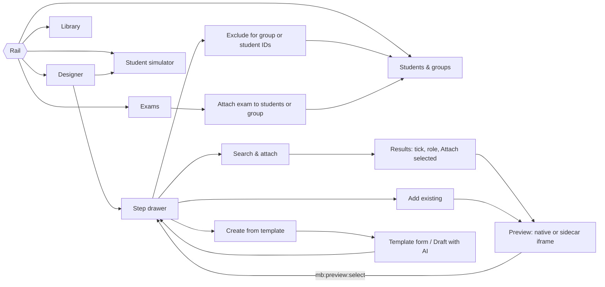

# 68. Unified Studio portal: quizzes, videos, exams, student feature access, AI search and assistant — plan for review

> **Status: PLAN FOR REVIEW — nothing in this document is implemented yet.** It inventories what
> exists (with file evidence), names the gaps and proposes a phased plan to make the Socratic
> Studio (`mathbank-socratic-admin`) the **single staff portal**. Decisions marked **D-n** in §13
> need your answer before implementation starts. Implementation progress will be tracked in
> [ledger 67](67_SOCRATIC_IMPLEMENTATION_HANDOFF.md) as new steps, using the same
> "update before and after each step" rule.

Diagrams (architecture, deployment and one sequence per capability, marked done/partial/pending):
[STUDIO_PLATFORM_ARCHITECTURE.md](../architecture/STUDIO_PLATFORM_ARCHITECTURE.md).

## 0. What you asked for

From one admin app, staff must be able to:

1. **Quizzes** — see quizzes listed **by topic** (AI-assisted), create a **new** quiz (manual,
   semi-automatic with AI, or automatic), and **link** an existing or new quiz to a workflow step
   or course.
2. **Videos** — **create** a video (Manim research → render) or **add an existing** video (upload,
   YouTube/Vimeo), and attach it.
3. **Exams** — create or connect an **exam** and link it to a workflow/course, reusing the existing
   exam generation process.
4. **Student features** — **APPLY or EXCLUDE** features (tutor chat, hints, reveal, voice, video,
   exams, AI quiz generation, live class …) for students, groups or courses, and **EXCLUDE content**
   (exam questions, exams, videos, workflow steps, course items) for a student group or a list of
   student IDs — everything else is included by default (separate audience module, §4.8).
5. **AI-assisted search** — find any existing artifact (problem, solution, concept, quiz, video,
   exam question, course, workflow) with strong, AI-assisted search.
6. **Question bank during workflow preparation** — from the step being edited, search the question
   bank by similar concept or similar question and fetch/link questions (§4.5a).
7. **A smart AI assistant** — integrated across all of the above, proposing changes that staff
   accept explicitly.

## 1. Summary of findings

| Area | Exists today | Main gap |
|---|---|---|
| Quiz storage | **Three separate stores**: `activity.definition` (instructor/live/course quizzes), `pedagogy.learning_item` (textbook-derived, review-gated), `quiz.*` (AI-generated exam papers + reusable `quiz.question_pool`) | No unified view; no link between stores; activities have no review state and only a free-text/`skill` tag |
| Quiz authoring API | `/v1/admin/activities` CRUD, skill/source mapping, attach/detach to micro-course states (req 46, **implemented**) | No topic/concept filter; shared admin key only; no AI generation of activities |
| AI quiz generation | Automatic student-owned papers (`quiz_runtime.generate_quiz`) and the exam agent generator→critic loop | Generated questions are critic-approved only; no staff review; cannot be attached to courses/workflows |
| Videos | Manim research/render service; promote → validate → approve → interaction instance; MP4 upload ≤ 25 MB and YouTube embed in course Media tab; `pedagogy.video_asset` schema (YouTube/Vimeo/Internal) | Admin UI cannot start a render; no provider-aware "register existing video"; no list-by-topic; transcripts manual |
| Exams | Full student exam flow (exam-agent + exam-web); question pool; grading in `quiz_runtime` | Papers are student-owned; no staff exam, pool curation, assignment, scheduling or course/workflow link |
| Student features | Enrollment, live `control_mode`, auth roles | **No feature catalog, cohort model or entitlement policy anywhere**; UIs show features unconditionally |
| Search | pgvector + tsvector/trigram + Neo4j hybrid search for **problems/solutions/steps/learning items** and taxonomy concepts | Quizzes, videos, exams, courses, theorems-in-index and workflows are not indexed; no staff cross-artifact search |
| AI assistant | Plan-patch authoring chat, AI corpus drafts with review, Studio "Ask AI" UI (job endpoints not built) | No assistant with tools across artifacts; AgentCore steps 04–05 pending |
| Staff auth | Studio staff cookie session (Cognito/local, CSRF, capabilities) | Legacy admin routes use one shared `X-Admin-Api-Key`, which must never reach a browser |

## 2. Inventory — what exists (evidence)

### 2.1 Quizzes and activities

- `activity.definition`: types `MCQ, MULTISELECT, NUMERIC, SHORT_RESPONSE, SUBPROBLEM, STEP_ORDERING,
  ERROR_DIAGNOSIS, CONFIDENCE_CHECK, LIVE_POLL`, prompt/options/`correctness_policy`, free-text
  `target_skill` ([020:261-277](../../mathbank-db/sql/020_live_fluid_platform.sql)); migration 037 adds
  `target_skill_id → knowledge.skill`, `source_problem_id → core.problem`, `status ACTIVE/INACTIVE`
  ([037:3-20](../../mathbank-db/sql/037_quiz_authoring.sql)). **No review state, no revisions.**
  Live data today: 26 MCQ, 1 NUMERIC, 10 LIVE_POLL (read-only check, 2026-10-25).
- `pedagogy.learning_item`: import-derived, `review_status` PENDING_REVIEW/APPROVED/REJECTED/NEEDS_REVISION,
  `student_visible` requires APPROVED ([010:289-320](../../mathbank-db/sql/010_textbook_import.sql));
  concept/subconcept/skill links. Review API `POST /v1/admin/imports/learning-items/{id}/review`
  ([admin_imports.py:120-128](../../mathbank-rest/src/mathbank_rest/routers/admin_imports.py)); no create/edit API.
- Course attachment: `micro_course_state_activity` / `_learning_item` with ordinal, purpose, required
  ([032:302-321](../../mathbank-db/sql/032_micro_course_platform.sql)).
- REST (admin key): `POST/GET/PATCH /v1/admin/activities`, deactivate/reactivate, skill-mapping,
  source-mapping; attach/detach/patch/sequence on states
  ([admin_activities.py:113-255](../../mathbank-rest/src/mathbank_rest/routers/admin_activities.py)).
  List filters: `q, activity_type, source_type, status` only — **no topic filter**
  ([quiz_service.py:93-135](../../mathbank-rest/src/mathbank_rest/quiz_service.py)).
- Requirement 46 is **implemented** (the [index](00_INDEX.md) line still says planning-only).
- Admin UI: micro-course workspace **Quizzes** tab (create/attach/deactivate/detach), Content,
  Activity (stats) and Versions tabs (`mathbank-web/app/admin/(protected)/micro-courses/[code]/*`).
- Scoring: shared deterministic [activity_scoring.py](../../mathbank-rest/src/mathbank_rest/activity_scoring.py)
  used by micro-courses and Socratic previews (step 03), including Assertion–Reason and MULTISELECT.

### 2.2 AI quiz and exam generation

- `quiz.paper` is **student-owned** (`student_id` required), lifecycle `GENERATING→READY→IN_PROGRESS→SUBMITTED→GRADED|FAILED`
  ([042:12-35](../../mathbank-db/sql/042_quiz_generation.sql)); exam extensions, resume, events,
  diagnosis (migrations 047, 048, 050, 051).
- `quiz.question` (MCQ/FREE_TEXT/PROOF) with concept/technique/skill junctions and ranked corpus
  sources ([042:37-76](../../mathbank-db/sql/042_quiz_generation.sql), [050:9-22](../../mathbank-db/sql/050_exam_generation_sources_and_progress.sql)).
- `quiz.question_pool`: reusable, "critic-approved" questions keyed by prompt hash with topic and
  concept/technique slugs — **no staff approval column** ([052:5-45](../../mathbank-db/sql/052_quiz_question_pool.sql)).
- Exam agent: NL intake → topic resolution → pool reuse → generator/critic (≤ 4 rounds) →
  aggregate diversity critic → persist → diagnosis; **fully automatic, no staff step**
  ([exam-agent README:34-49](../../mathbank-exam-agent/README.md), [exam_service.py:157-394](../../mathbank-exam-agent/src/mathbank_exam_agent/exam_service.py)).
- REST: student `/v1/quiz/*` (bearer) and service-only `/v1/quiz-integration/*` (admin key)
  ([exam_integration.py:1-465](../../mathbank-rest/src/mathbank_rest/routers/exam_integration.py)).
  **No staff route** to build, curate, assign, schedule or link an exam.
- Grading: `quiz_runtime.submit_response` — exact match for MCQ, LLM grading for free text/proof
  ([quiz_runtime.py:496-620](../../mathbank-rest/src/mathbank_rest/quiz_runtime.py)); **not** the shared activity scorer.
- Migration 042 deliberately does not reuse `activity.*` ([042:1-10](../../mathbank-db/sql/042_quiz_generation.sql)).

### 2.3 Videos

- Manim studio: `POST /v1/research-jobs` (topic → SceneSpec, OpenAI + MCP grounding, paid) and
  `POST /v1/render-jobs` (SceneSpec → MP4, local Manim), 1-day TTL job tables, S3-compatible Neon
  object storage, 200 MB cap ([main.py:42-168](../../mathbank-manim-studio/src/mathbank_manim_studio/main.py),
  [044](../../mathbank-db/sql/044_manim_studio_jobs.sql)). Research/render endpoints are **unauthenticated**.
- REST catalog (admin key): promotable candidates, list scenes (unfiltered), promote → `visual.scene_spec`
  DRAFT, validate, approve (APPROVED + asset VALID), create `VIDEO_EXPLAINER_V1` interaction instance
  ([interaction_templates.py:133-276](../../mathbank-rest/src/mathbank_rest/routers/interaction_templates.py)).
- Existing video: `pedagogy.video_asset` supports `YOUTUBE/VIMEO/INTERNAL`, transcripts and
  timestamped segments with review states, concept bindings
  ([032:169-266](../../mathbank-db/sql/032_micro_course_platform.sql)); the course **Media** tab uploads
  files ≤ 25 MB and only *advises* pasting a YouTube URL; AI transcription "not yet available"
  (`MediaTab.jsx:74-132`). Student reader renders private MP4 and YouTube embeds.
- `/admin/manim-studio` reviews/promotes/approves but **cannot start research or render jobs**.

### 2.4 Student features, cohorts and admin surfaces

- No feature catalog, entitlement, cohort or class/section model in `mathbank-db` or `mathbank-rest`.
  Closest: micro-course enrollment ([032:389-418](../../mathbank-db/sql/032_micro_course_platform.sql)),
  live participant `group_id` and `control_mode` ([020:162-175](../../mathbank-db/sql/020_live_fluid_platform.sql)).
- Student UIs (`mathbank-web`, `mathbank-exam-web`) show features without any entitlement check.
- Admin pages are spread across `mathbank-web/app/admin/**` (corpus, imports, textbooks, knowledge
  gaps, pipeline, micro-courses, pedagogy, tutoring routes, manim studio, geometry scenes, widgets,
  attempt media, conversations), the `mathbank-live` instructor console and `mathbank-ml-frontend`.
- Auth: web admin = Cognito `Admins` group + server-side shared REST key (`lib/restClient.js:49-58`);
  REST legacy admin = one shared `X-Admin-Api-Key` ([security.py:66-76](../../mathbank-rest/src/mathbank_rest/security.py));
  learner JWT; Studio = staff cookie session with capabilities `author, review_mathematics,
  review_pedagogy, publish` ([socratic_auth.py:22-42,202-213](../../mathbank-rest/src/mathbank_rest/socratic_auth.py)).

### 2.5 Search and AI

- `search.*`: representation → chunk → embedding (OpenAI `text-embedding-3-small`, 1536-d), tsvector +
  trigram GIN indexes, retrieval profiles ([002](../../mathbank-db/sql/002_vector_schema.sql)).
  Indexed: problems, solutions, solution steps, learning items. Not indexed: activities, pool
  questions, videos/transcripts, courses, Socratic workflows.
- `POST /v1/search/problems` fuses semantic + lexical + Neo4j reviewed concept/technique/skill
  evidence with RRF ([hybrid_search.py:18-151](../../mathbank-rest/src/mathbank_rest/db/hybrid_search.py));
  `POST /v1/search/concepts`; theorem search; similar-step search.
- Embedding freshness is outbox-driven but paid runs stay pending unless `--allow-paid`
  ([run_projection_requests.py:59-83](../../mathbank-db/etl/run_projection_requests.py)).
- AI authoring patterns to reuse: validated plan patches with apply/reject
  ([authoring.py:1-81](../../mathbank-rest/src/mathbank_rest/authoring.py)); AI corpus drafts with
  provenance and review ([025](../../mathbank-db/sql/025_corpus_authoring.sql)). Providers: OpenAI via
  LiteLLM (agent, exam agent, manim), DeepSeek V3.2 selected for Socratic AgentCore (ledger 67).

## 3. Structural problems the plan must solve

1. **Three question stores.** Staff think of "a quiz"; the system has activities, learning items and
   generated questions with different review rules, scorers and attachment paths.
2. **No canonical topic on most artifacts.** Activities carry one optional skill; pool questions carry
   slugs; videos have concept bindings that no API filters on.
3. **The shared admin key.** Every legacy admin route assumes a trusted server holding one secret.
   The Studio is a browser SPA, so it must use the per-user staff session — never the key.
4. **No access-policy model.** Apply/exclude needs a feature vocabulary, an audience model
   (cohort) and server-side enforcement, not UI hiding.
5. **Generation without staff review.** Exam and pool generation are critic-only; anything shown to
   students through a course or workflow needs staff mathematical/pedagogical review (req 65).
6. **Search covers the corpus, not the artifacts staff build.**

## 4. Target design

### 4.1 Principles

- **One portal, one boundary.** All staff work happens in the Studio, calling
  `/v1/admin/studio/*` routes with the staff cookie session, CSRF and per-capability checks. These
  routes **wrap existing services** (`quiz_service`, `micro_course_service`, scene/interaction
  services, `quiz_runtime`, exam integration); no logic is duplicated and the admin key never
  leaves the server.
- **REST stays the only database boundary**; the Studio never talks to manim-studio or exam-agent
  directly — REST calls them server-to-server with their existing service credentials.
- **Reuse, then extend.** Keep the three question stores (no big-bang migration). Add a typed
  artifact reference, a catalog read model, conversions and review states.
- **AI proposes, staff decide.** Every AI output is a typed draft with provenance (model, prompt
  version, sources) that a person accepts, edits or rejects; nothing AI-generated reaches students
  without the review state the target store requires.
- **Additive, reversible migrations** in the `orchestration`, `studio`, `learner`, `quiz` schemas;
  existing consumers (mathbank-web admin, exam-web, live) keep working until retired.

### 4.2 Typed artifact reference

Replace the free-string `activity_ref` on workflow nodes with a typed reference (backward
compatible: a bare UUID keeps meaning `activity`):

```json
{ "kind": "activity | learning_item | pool_question | exam | video | interaction | course",
  "id": "uuid", "revision": "sha256 or integer, pinned at preview/publish" }
```

Node types gain **`EXAM`** (and `VIDEO` stays `LESSON`/`INTERACTION` with a video ref). The preview
and (later) student runtimes resolve refs through one resolver per kind.

Because a step can hold **several** attached items (e.g. a video, then a check question, then a
hint question), each node gets an ordered **content list** instead of a single reference:

```json
"content": [
  { "ref": { "kind": "video", "id": "…", "revision": "…" }, "role": "PRESENT", "order": 1 },
  { "ref": { "kind": "activity", "id": "…", "revision": "…" }, "role": "CHECK", "order": 2 },
  { "ref": { "kind": "activity", "id": "…", "revision": "…" }, "role": "PRACTICE", "order": 3 }
]
```

Roles: `PRESENT` (video, lesson, interaction), `CHECK` (the scored activity whose outcome drives the
step's rules — at most one per step), `PRACTICE` (optional, unscored for routing), `HINT_SUPPORT`,
`EXAM`. The existing `activity_ref` is migrated to a single `CHECK` item; the preview keeps using the
shared scorer for the `CHECK` item. Exclusion rules (§4.8) can target any content item.

### 4.3 Unified artifact catalog (read model)

A view-backed `studio.artifact` read model (materialized where needed) with one row per artifact:
`kind, id, title, summary, status (draft/review/approved/active/retired), review_state, topics[]
(concept/technique/skill ids), difficulty, source_problem, owner, created/updated, usage counts
(courses, workflows, exams), revision hash`. Sources: `activity.definition`, `pedagogy.learning_item`,
`quiz.question_pool`, `visual.scene_spec`/`pedagogy.video_asset`/`visual.asset` (video kind),
`visual.interaction_instance`, exam templates (new), `pedagogy.micro_course`, `orchestration.socratic_workflow`,
plus read-only `core.problem`/`knowledge.*` for linking.

Topic tagging is unified on canonical `knowledge.concept`, `knowledge.technique`, `knowledge.skill`
ids via a single `studio.artifact_topic(kind, id, topic_kind, topic_id, source MANUAL|AI|IMPORTED,
confidence, review_state)` junction, backfilled from existing skill ids, slugs and video concept
bindings. AI-suggested tags are proposals until accepted.

### 4.4 Studio information architecture

```
Rail:  Designer · Library · Exams · Students & groups · Rules · Student simulator · (Assistant)
Top:   ⌘K "Search everything" · Ask AI · settings · account
```

- **Library** (master–detail, same drawer pattern as today): tabs **Quizzes · Videos · Sources ·
  Strategies**. A left facet column filters by **topic tree** (concept → technique → skill),
  kind, status, difficulty, usage ("unused", "in this workflow"). Each list shows counts per topic,
  and an **AI coverage** strip ("Inclusion–Exclusion: 0 approved quizzes, 1 video") with
  "Generate drafts" actions.
- **Detail drawer** for any artifact: preview (student-safe and staff views), topics, review state,
  usage, revisions, actions: *Link to current step*, *Add to exam*, *Edit*, *Duplicate*,
  *Send for review*, *Approve* (capability-gated), *Retire*.
- **Designer** step drawer: a **Step content** section (see §4.5b) listing attached items as
  reorderable chips with role, review badge and *Remove*, and three actions for every content kind
  (question, video, exam): **Search & attach**, **Add existing**, **Create new from template**.
  The flow card shows the attached items as small chips under the step title.
- **Exams**: exam templates (blueprint + fixed questions), pool curation queue, assignments,
  results.
- **Students & groups**: student groups and membership (search, import ID list), exclusions across
  exams, questions, videos, steps and course items, feature policies, and a per-student effective
  view ("what student X sees and can use, and why").
- **Search everything (⌘K)**: one box, natural language allowed, grouped results across kinds.
- **Assistant**: the existing *Ask AI* drawer becomes the general assistant (§4.9).

### 4.5 Quizzes — create, find by topic, link

| Capability | Plan |
|---|---|
| List by topic | `GET /v1/admin/studio/artifacts?kind=quiz&topic=…` over the catalog, including all three stores, with per-topic counts |
| Manual create | Typed forms for MCQ, MULTISELECT, NUMERIC, Assertion–Reason (five fixed options, truth/entailment judgments), SHORT_RESPONSE; hints (≤ 5) and explanation; math preview; writes `activity.definition` through existing `quiz_service` |
| Review state | Additive columns on `activity.definition`: `review_status DRAFT/PENDING_REVIEW/APPROVED/REJECTED/NEEDS_REVISION`, `approved_by/at`, `origin MANUAL/AI/IMPORTED/CONVERTED`, `provenance jsonb`; existing rows backfilled as APPROVED (they are live today) |
| Revisions | `activity.definition_revision` immutable snapshots + content hash; workflow and course bindings pin a revision (closes req 65 §4.2 "mutable activity rows" gap; preview snapshots already do this) |
| **Semi-automatic AI** | Staff picks topic(s), kind, difficulty, count, optional source problem → generator (reuse exam-agent generator/critic agents as a library or via a new `/v1/generate/activity-drafts` agent endpoint) → drafts with critic notes, corpus sources and duplicate check → staff edits/approves individually |
| **Automatic AI (gap filling)** | Scheduled or on-demand job: for topics in a course/workflow with fewer than N approved quizzes, generate drafts into the **review queue** only (never auto-approve); budgeted per run |
| Convert | *Promote pool question → activity* (and learning item → activity) creating a linked, review-pending activity with provenance |
| Link | *Link existing* to a workflow node (typed ref) or micro-course state (existing attach API) from the same drawer; the scorer for all linked activities is `activity_scoring` |
| Duplicate detection | Embedding + normalized-prompt hash check before saving a manual or AI quiz |

### 4.5a Question bank search during Socratic workflow preparation (admin)

**Requirement (2026-10-25):** while preparing a workflow, the admin must be able to **search the
question bank for similar concepts or similar questions and fetch questions from it** without
leaving the step being edited.

**Where it appears.** A *Question bank* panel in the step drawer (*Find in question bank…*), the
Library *Quizzes* tab, the ⌘K search and as the assistant's `search_question_bank` tool.

**How a search starts.**
- **From the step (default):** pre-filled with the step's topics, prompt text, linked source problem
  and current difficulty — one click gives "questions like this step".
- **Similar to a question:** *More like this* on any result or linked quiz.
- **Similar concept:** pick or type a concept/technique/skill; the panel also offers **related
  concepts** (taxonomy similarity embeddings from migration 040 and reviewed Neo4j neighbourhoods:
  prerequisites, sub-concepts, techniques that use it) so staff can widen or narrow the topic.
- **Free text / natural language**, e.g. "AR question on bijections, medium".

**What it searches** (one result list, grouped by source with badges):

| Source | Store | Notes |
|---|---|---|
| Course/live quizzes | `activity.definition` | Linkable directly once APPROVED |
| Textbook questions | `pedagogy.learning_item` | Only APPROVED + student_visible are linkable |
| Exam question bank | `quiz.question_pool` | Fetch = convert to a review-pending activity (keeps provenance), or add to an exam |
| Competition corpus | `core.problem` (+ solutions) | Inspiration; *Use as template* creates a draft quiz |

**Ranking.** Hybrid: lexical (tsvector/trigram) + semantic (pgvector over question text) + topic
match/expansion (canonical tags and graph neighbours), fused with reciprocal-rank fusion; filters for
kind, review state, difficulty, source, "not already used in this workflow", and excluded-for-group
awareness (§4.8). Duplicates (same prompt hash / near-identical embedding) are collapsed.

**Result view.** Staff-only preview showing question, options, answer key and explanation (never
sent to students), review state, topics, difficulty, usage (courses, workflows, exams) and source.

**Actions.** Results are **selectable** (single or multi-select) and *Attach selected to this step*
adds them to the step's content list with a role (§4.5b). Per item: *Link to this step* (typed ref with pinned revision — APPROVED items only),
*Fetch as draft* (copy/convert into a new review-pending activity the staff can edit),
*Add to exam*, *More like this*, *Show related concepts*. Every fetch records provenance
(source store, id, revision).

**Delivery.** Ships in two increments: **P2** — panel, lexical + topic search across all four
sources, existing learning-item/problem vectors and existing concept search; **P8** — new embeddings
for activities and pool questions, concept-similarity expansion and natural-language query parsing.
API: `POST /v1/admin/studio/question-bank/search` and `GET /v1/admin/studio/concepts/{id}/related`.

### 4.5b Step content: search & attach, add existing, create new from template

**Requirement (2026-10-25):** every workflow step leads to three ways of giving it content, and staff
must be able to **select results and attach them to the step**:

| Path | What staff do | Result |
|---|---|---|
| **Search & attach** | Open the question bank / video search pre-filled from the step (§4.5a), tick one or more results, choose a role, *Attach selected* | Approved items attach immediately with pinned revisions; non-approved items are offered as *Fetch as draft* first |
| **Add existing** | Browse the Library (by topic, kind, status, "used in this course") or paste an ID/URL (YouTube/Vimeo for video) and *Attach* | Same as above; an existing exam attaches as an `EXAM` item |
| **Create new from template** | Pick a template, fill it in the drawer (math preview), optionally *Draft with AI* | New draft artifact created **and attached** to the step in one action; it stays `DRAFT`/`PENDING_REVIEW` until approved (preview works with drafts, publishing requires approval) |

**Templates offered from a step** (filtered by the step type and strategy phase):

- **Question templates:** single choice, multiple select, numeric, Assertion–Reason (five fixed
  options, truth/entailment judgments), short written reasoning, error identification, ordering;
  strategy-phase templates seeded from the 20 Socratic strategies (e.g. "Discover: notice a
  pattern", "Justify: AR on the key claim", "Transfer: same idea, new context").
- **From an existing question:** *Use as template* on any search result (clone into a new draft,
  provenance kept) — this is how corpus problems and pool questions become step questions.
- **Video templates:** register YouTube/Vimeo, upload file, or *Generate explainer* (Manim research
  pre-filled from the step prompt and topics); interaction templates come from the existing
  `visual.interaction_template` library.
- **Exam template:** *Create exam for this content* (§4.7) from the step's or workflow's topics.

**Focus mode (2026-10-25).** *Search & attach*, *Add existing* and the Library's *Select quizzes &
attach* open a **full-width focus view** so the editor can concentrate: the sidebar and drawer are
hidden, the search box receives keyboard focus, filters sit in a left facet column (topic, kind,
status, source, "hide items already used here", related concepts) and results use the remaining
width with a preview sidecar on demand. A sticky **selection tray** at the bottom shows the count,
the role (for steps) or the **target** (for the Library) and the single primary action. When staff
attach — or press **Back / Esc** to leave without changes — the Studio returns to exactly where they
started (step drawer or Library) and **restores keyboard focus** there (the step's *Step content*
heading, or the Library's launch button). Selecting inside a preview sidecar adds to the tray
rather than attaching immediately.

**Quiz section → attach to a course.** From the Library, staff select one or more quizzes (or create
one from a template), choose *Attach to…* — a course and its lesson state, a workflow step or an exam
— and *Attach selected*. Course-state attachment uses the existing micro-course attach service
through the Studio adapter; the same review rules apply (approved items attach directly, others
are fetched as review drafts first).

**Rules the Studio enforces when attaching:** one `CHECK` item per step (attaching a second asks
whether to replace it or add as `PRACTICE`); kind must suit the step type (e.g. an `EXAM` item on an
`EXAM` step); cross-source items are blocked (same rule as preview binding today); duplicates are
flagged; every attach/detach is part of the unsaved draft and saved with the normal
expected-hash/idempotency rules. Attached items show review state so staff can see what still needs
approval before publishing.

**API:** `POST /v1/admin/studio/links` accepts a list
`[{ref, role, order}]` for one workflow step (validated server-side);
`GET /v1/admin/studio/templates?step_type&strategy&kind`;
`POST /v1/admin/studio/templates/{id}/instantiate` (creates the draft artifact and returns its ref).

### 4.6 Videos — create or add existing, find by topic, link

| Capability | Plan |
|---|---|
| Add existing — upload | Presigned direct upload to the existing object store (removes the 25 MB proxy limit; cap e.g. 500 MB), creates `visual.asset` + `pedagogy.video_asset(provider=INTERNAL)`, rights confirmation |
| Add existing — YouTube/Vimeo | Provider form: URL → provider id parse, oEmbed title/duration fetch (server side), `pedagogy.video_asset(provider=YOUTUBE/VIMEO)`; review state PENDING_REVIEW |
| Create with AI | From a step or topic: *Generate explainer* → REST enqueues manim research job (topic + step prompt + source context) → staff reviews SceneSpec (editable JSON + narrative) → render job → preview → promote → approve → interaction instance — the whole existing pipeline driven from one drawer with progress |
| Transcripts | Manual/imported (exists); later AI transcription and AI concept tagging of segments as review-pending proposals |
| List by topic | Catalog query over video concept bindings and `artifact_topic` |
| Link | Typed ref on workflow nodes; existing `micro_course_state_asset` / `_interaction` attach for courses |
| Security fix | Put manim-studio research/render endpoints behind the service key (only REST calls them) |

### 4.7 Exams — connect to the existing process

**Decided (D-3, 2026-10-25):** staff prepare an exam **from the content they are preparing** for a
specific student or group (the workflow/course, its topics and its linked quizzes), approve it, and
**attach it** for those students to take. Each targeted student receives **their own paper**
(`quiz.paper` with their `student_id`), so attempts, resume state, grading, diagnosis and mastery stay
per student exactly as today.

Staff journey in the Studio:

1. **Start from content.** In a workflow or course, *Create exam for this content*. The Studio
   pre-fills a **blueprint** from that content: its topics (concept/technique/skill tags on steps and
   linked quizzes), suggested counts per topic, kinds and difficulty mix, and candidate questions —
   the content's own approved quizzes first, then APPROVED pool questions on the same topics.
2. **Shape the exam.** Staff add/remove/reorder questions, adjust points, time limit and attempts.
   Missing slots can be generated by the existing exam agent as **drafts** that staff must approve
   (D-7: never auto-approved).
3. **Choose who takes it.** One student, a list of student IDs, a student group, or everyone enrolled in
   the course; set opens/due dates.
4. **Attach.** The exam appears for those students (assigned exams in exam-web/mathbank-web and,
   when linked, as an `EXAM` step in their workflow or course). On start, REST materializes that
   student's paper from the approved template.
5. **Review results** per student and per group, with the manual-grading queue.

**Decided (D-3a, 2026-10-25):** by default **every student in the assignment gets every approved
question** (same paper content, fair comparison). Staff can then **filter and EXCLUDE** individual
questions — or the whole exam — for a **student group** or an explicit **list of student IDs**; an
excluded student's paper is materialized without those questions (points re-totalled), and an
excluded student does not see the exam at all. Exclusions are not exam-specific: they come from the
separate **Audience & exclusion module** (§4.8), which applies the same way to videos, workflow
steps and course content. Per-student random variation remains an optional, off-by-default switch.

| Capability | Plan |
|---|---|
| Staff exam template | New `quiz.exam_template` (staff-owned: title, **source content ref** (workflow or course, revision), blueprint {topics, counts, kinds, difficulty mix}, time limit, attempt policy, review_state) and `quiz.exam_template_item` (fixed question refs: pool question or activity, ordinal, points) |
| Build | Blueprint **derived from the source content** (topics of its steps and linked quizzes). Three modes: **manual** (pick from the content's quizzes and APPROVED pool by topic), **semi-automatic** (content blueprint → pool matching + exam-agent generation of missing slots as drafts into the template, staff approves), **varied** (approved blueprint; each student's questions drawn from APPROVED items at start — opt-in, off by default) |
| Pool curation | Add `review_state`, `reviewed_by/at`, `retired` to `quiz.question_pool`; review queue by topic; only APPROVED pool items are used for staff exams; existing student self-serve generation unchanged |
| Assign (attach to students) | `quiz.exam_assignment(template, audience = audience-module ref (student list, group or course enrollment), opens_at, due_at, attempts, variation off/on)` + `quiz.exam_assignment_student` (resolved recipients, status assigned/started/submitted/graded); question- and exam-level EXCLUDE rules from §4.8 are applied when each recipient's `quiz.paper` is materialized on start (paper keeps `student_id`; add nullable `exam_template_id`, `assignment_id`); students see assigned exams in exam-web and mathbank-web |
| Link to course/workflow | `EXAM` workflow node with typed ref; course state attachment via a new `micro_course_state_exam` binding |
| Results | Staff results per assignment and per group; manual-grading queue for `PENDING_HUMAN_REVIEW` responses |
| Grading | Keep `quiz_runtime`; route MCQ/NUMERIC through `activity_scoring` helpers so one deterministic scorer exists (LLM grading stays for free text/proof) |

### 4.8 Audience & exclusion module (separate, reusable) — groups, content EXCLUDE, feature access

**Decided (2026-10-25):** content is **included for everyone by default**; staff narrow it with
**EXCLUDE** rules targeted at a **student group** or an explicit **list of student IDs**. This is
built as **one separate module** (own schema, service, router and Studio screen) that every runtime
asks — exams, videos, workflow steps, course content and student features — instead of each
feature implementing its own filtering.

**Student groups.** `audience.student_group` (name, description, owner, optional course scope,
archived) and `audience.student_group_member` (group, student, added_by/at). Staff create groups
in the Studio, add students by search, paste/import a list of student IDs or emails, or create a
group from a course enrollment or a filter (e.g. students who scored below X on an exam — a
snapshot, recorded with its query). Membership changes are audited.

**Exclusion rules.** `audience.exclusion_rule(target_kind, target_id, target_scope, audience_kind
GROUP|STUDENTS, audience_ids[], reason, valid_from/to, created_by)` where:

| `target_kind` | Effect for excluded students |
|---|---|
| `EXAM` | Exam not shown or startable |
| `EXAM_QUESTION` (scoped to an exam template) | Question omitted from that student's paper; points re-totalled |
| `VIDEO` (asset/interaction, optionally scoped to a course state or workflow step) | Video not shown; attached step keeps its other content |
| `WORKFLOW_STEP` (scoped to a workflow release) | Step skipped: runtime follows the step's ALWAYS rule, else its first SUCCESS rule, else the fallback (D-13) |
| `COURSE_ITEM` (state asset/interaction/activity/learning item) | Item hidden in the course reader |
| `FEATURE` | Feature disabled (see below) |

**Feature access** keeps APPLY *and* EXCLUDE because some features are off by default:
`audience.feature` catalog (D-5 list) and `audience.feature_policy(scope GLOBAL|COURSE|GROUP|STUDENT,
scope_ids, feature_key, effect APPLY|EXCLUDE, …)`. Resolution (D-6): most specific wins (student >
group > course > global > catalog default); EXCLUDE beats APPLY at the same level; expired rules
ignored. Content rules are exclusion-only, so there is no precedence to resolve: a student is
excluded if **any** active rule covers them.

**One evaluator, enforced server-side.** `audience.service`:
`members(group)`, `is_excluded(student, target, context)`, `filter_items(student, items)`,
`effective_features(student, context)` and `explain(student, target)` (which rule/group caused it).
Consumers: exam assignment + paper materialization, Socratic preview ("preview as group/student")
and future student workflow runtime, micro-course reader, video/content delivery, and every
feature-guarded REST endpoint. UI hiding is never the enforcement point. Student apps read
`GET /v1/me/features` and receive already-filtered content.

**Safety and validation.** Saving an exclusion re-validates affected workflows: excluding a step
that is the only path to completion or a mandatory assessment raises a warning that needs explicit
confirmation; excluding every question of an exam for a student is blocked (exclude the exam
instead). Rules carry an audit trail and outbox event; the Studio shows **impact before save**
("affects 12 students in 2 groups; 1 workflow step skipped").

**Studio screens.** *Students & groups* (create, membership, import list), an **Exclude…** action
in every drawer (exam question, exam, video, step, course item) with a group/student-ID picker and
impact preview, a per-student **effective view** ("what this student sees and why") and the feature
policy editor. Capability `manage_access`.

### 4.9 AI-assisted search and the Studio assistant

**Search everything**

1. Extend `search.representation` to new source types: `ACTIVITY`, `POOL_QUESTION`, `VIDEO`
   (title + transcript segments), `COURSE`, `COURSE_STATE`, `WORKFLOW`, `EXAM_TEMPLATE`, `THEOREM`.
   Rendered text includes topics and status; chunks carry `kind/id/revision`.
2. Freshness: outbox events from every write path → embedding requests; a small **budgeted
   auto-run** for staff artifacts (low volume) instead of manual `--allow-paid` batches; lexical
   results are immediate so new items are findable before embedding completes.
3. `POST /v1/admin/studio/search`: hybrid lexical (tsvector/trigram) + semantic (pgvector) + graph
   topic expansion (Neo4j reviewed neighbourhoods), reciprocal-rank fusion, facets (kind, topic,
   status, difficulty, course, owner, usage), pagination, highlighted snippets, permission-filtered.
4. **AI query understanding** (optional per query): an LLM turns "unused hard AR quizzes on
   inclusion–exclusion" into structured filters + a semantic query, shown to staff as editable chips;
   falls back to plain hybrid search when the model is unavailable.
5. *Find similar* and duplicate warnings everywhere an artifact is created.
6. The current sidebar quick search ([search.ts](../../mathbank-socratic-admin/src/search.ts)) stays
   as an instant local filter; ⌘K uses the server search.

**Assistant ("very smart AI")**

- One assistant drawer, context-aware (current workflow, step, selection, filters).
- Tools (all read tools are server-side REST calls; all write tools return **typed proposals**):
  `search_artifacts`, `search_question_bank`, `related_concepts`, `topic_coverage(course|workflow)`, `explain_artifact`, `propose_quiz_drafts`,
  `propose_rule` (existing step-04 scope), `propose_video_scene`, `propose_exam_blueprint`,
  `propose_topic_tags`, `propose_links` (attach existing quizzes/videos to steps), `propose_feature_policy`.
- Grounding: every answer cites artifact ids/revisions; proposals carry a base revision and are
  rejected if stale (same CAS model as drafts).
- Guardrails: per-staff and per-day token budgets, metering table, prompt/model versioning,
  audit of accepted/rejected proposals, evaluation set (e.g. 50 staff tasks) before enabling writes.
- Provider (**D-8**): OpenAI (already used everywhere) vs DeepSeek V3.2 on Bedrock AgentCore
  (ledger 67 step 04 choice). Recommendation: a provider-neutral tool layer in REST; run the
  assistant on the step-04 AgentCore path for Socratic proposals and allow OpenAI for search
  query understanding until the AgentCore path is verified.

### 4.10 Staff boundary and capabilities

- Generalize `socratic_auth` into a **Studio staff boundary** (same cookies/CSRF; path prefix
  `/v1/admin/studio` plus existing `/v1/admin/socratic`).
- Capabilities (Cognito groups → capabilities, as today): `author`, `review_mathematics`,
  `review_pedagogy`, `publish`, **new** `manage_exams`, `manage_access`, `ai_generate` (spend).
- Hosted Studio stays the isolated `MathBankSocraticStack` (renamed later); REST adapters for legacy
  services are added to the isolated app, keeping the shared REST stack untouched until **D-9**.

## 5. Automation levels

| Artifact | Manual | Semi-automatic (AI drafts + staff review) | Automatic |
|---|---|---|---|
| Quiz (activity) | Typed forms | Topic/kind/count → drafts → review | Gap-filling drafts into review queue only |
| Topic tags | Picker | AI suggestions → accept | Bulk backfill suggestions → review |
| Video | Upload / YouTube / Vimeo | Manim research → staff edits SceneSpec → render → approve | Not proposed (render cost + review needed) |
| Exam | Pick questions | Blueprint → pool + generated slots → review | Per-student draw from approved pool at start (existing behaviour, now only approved items) |
| Links | Drawer *Link existing* | Assistant `propose_links` | No |
| Feature access | Policy editor | Assistant proposes policies | No |

## 6. Data model changes (all additive; numbering provisional)

| Migration | Change |
|---|---|
| 055 studio catalog | `studio` schema; `artifact_topic`; catalog views; activity review/origin/provenance columns; `activity.definition_revision` |
| 056 videos | object-upload records; provider registration constraints/indexes; manim job → artifact provenance link |
| 057 exams | `quiz.exam_template`, `exam_template_item`, `exam_assignment`; pool `review_state`; paper `exam_template_id`, `assignment_id`; `micro_course_state_exam` |
| 058 audience | `audience` schema: `student_group`, `student_group_member`, `exclusion_rule`, `feature`, `feature_policy`, audit/outbox (separate module) |
| 059 search | new representation source types/kinds; search indexes on catalog; assistant proposal + metering tables |
| 060 workflow refs | typed artifact refs in Socratic IR (`socratic.prototype.v2` or additive `activity` object) with v1 compatibility |

## 7. API contract — which call each screen makes

### 7.1 Rules that apply to every Studio call

| Rule | Detail |
|---|---|
| Who calls | **Only the Studio browser app**, same origin, `credentials: include`, `cache: no-store`. The Studio never calls manim-studio, exam-agent, Cognito or the legacy `/v1/admin/*` key routes directly. |
| Prefixes | `/v1/admin/socratic/*` — sessions, workflows, previews (**exists**). `/v1/admin/studio/*` — everything new in this plan. Student apps only use `/v1/me/*` and their existing routes. |
| Auth | HttpOnly staff cookie from `POST /v1/admin/socratic/session`. Every route re-checks the session and the listed **capability**; denial = 403. |
| Mutations | Header `X-CSRF-Token` (from the session response) and exact `Origin`. Creates also send `Idempotency-Key`; edits send `expected_hash` (artifacts, drafts) or `expected_version` (previews, assignments). Stale = 409, replay with same key + body = same result. |
| Errors | `{"detail": {"code", "message", "correlation_id", "retryable"}}` — never raw input, answers or provider bodies. |
| Paging | `limit` (≤ 100, default 25) + `offset`; responses `{items, has_more}`. |
| Server-to-server | Adapters inside REST call existing services with their service credentials (§7.4). Browser never sees those credentials. |

### 7.2 Calls by screen and action

Status: **E** = exists today, **N** = new in this plan (phase in brackets).

**Sign-in and shell**

| UI action | Call | Status |
|---|---|---|
| Sign in / restore / sign out | `POST` / `GET` / `DELETE /v1/admin/socratic/session` | E |
| Sidebar list of workflows | `GET /v1/admin/socratic/workflows` | E |
| Strategy templates in sidebar search | `GET /v1/admin/socratic/strategies` | E |

**Designer — workflow and step editing**

| UI action | Call | Status |
|---|---|---|
| Open / create / save / validate a workflow | `GET` / `POST` / `PUT /workflows/{id}`, `POST /workflows/{id}/validate` (socratic prefix) | E |
| Link canonical source (problem, solution revision, route) | `GET /v1/admin/socratic/resources?q=` then `PUT /workflows/{id}` | E |
| Save step content list (attach / reorder / remove items) | `POST /v1/admin/studio/workflows/{id}/steps/{key}/content` body `{expected_hash, items:[{ref, role, order}]}` → new draft revision | N (P2) |

**Step content → Search & attach** (§4.5a–b)

| UI action | Call | Status |
|---|---|---|
| Open panel (pre-filled from the step) | `POST /v1/admin/studio/question-bank/search` body `{from_step:{workflow_id, key}, query?, topics?, kinds?, status?, difficulty?, exclude_used_in?, limit, offset}` | N (P2; semantic P8) |
| *More like this* | same call with `similar_to:{kind, id}` | N (P2/P8) |
| *Show related concepts* | `GET /v1/admin/studio/concepts/{id}/related` | N (P2) |
| Open a result's staff preview | `GET /v1/admin/studio/artifacts/{kind}/{id}?view=staff` | N (P2) |
| Preview as the student sees it | `GET /v1/admin/studio/artifacts/{kind}/{id}?view=student` (native render) or a preview sidecar (§7.3) | N (P2) |
| *Fetch as draft* (pool question / corpus problem / not yet approved) | `POST /v1/admin/studio/convert` `{source:{kind,id,revision}, target_kind:"activity"}` → `{ref}` | N (P3) |
| *Attach selected* | client adds `{ref, role, order}` items, then the step-content call above | N (P2) |

**Step content → Add existing**

| UI action | Call | Status |
|---|---|---|
| Browse by topic / kind / status | `GET /v1/admin/studio/artifacts?kind&topic&status&usage&q&limit&offset` | N (P2) |
| Paste YouTube / Vimeo URL | `POST /v1/admin/studio/videos/external` `{url}` → `{ref}` | N (P5) |
| Upload a video file | `POST /v1/admin/studio/videos/uploads` → presigned URL; browser `PUT`s the file to object storage; `POST …/uploads/{id}/complete` → `{ref}` | N (P5) |
| Attach | step-content call | N (P2) |

**Step content → Create new from template**

| UI action | Call | Status |
|---|---|---|
| List templates for this step | `GET /v1/admin/studio/templates?step_type&strategy&kind` | N (P3) |
| Create from template (fill form) | `POST /v1/admin/studio/templates/{template_id}/instantiate` `{fields}` → `{ref}` (draft, PENDING_REVIEW) | N (P3) |
| *Draft with AI* | `POST /v1/admin/studio/quizzes/generate` → `{job_id}`; poll `GET /v1/admin/studio/jobs/{job_id}` | N (P4) |
| *Generate explainer video* | `POST /v1/admin/studio/videos/generate` → `{job_id}`; poll jobs; approve via `POST /v1/admin/studio/videos/{id}/review` | N (P5) |
| *Create exam for this content* | `POST /v1/admin/studio/exams` `{source:{kind, id, revision}}` → draft exam | N (P6) |

**Library, review and exams**

| UI action | Call | Status |
|---|---|---|
| Quizzes by topic with counts | `GET /v1/admin/studio/artifacts?kind=quiz&topic=…&facets=topic` | N (P2) |
| Select quizzes and attach to a course lesson, step or exam | `POST /v1/admin/studio/links` `{target:{kind: course_state \| workflow_step \| exam, id}, items:[{ref, role}]}` — course state wraps existing `micro_course_service.attach_activity` | N (P2) |
| Edit / send for review / approve / retire a quiz | `PATCH /v1/admin/studio/quizzes/{id}`, `POST …/{id}/review {decision}`, `POST …/{id}/retire` | N (P3) |
| Exam items, assignment to students or a group | `PUT /v1/admin/studio/exams/{id}/items`, `POST /v1/admin/studio/exams/{id}/assignments` | N (P6) |
| Exam results | `GET /v1/admin/studio/exams/{id}/assignments/{aid}/results` | N (P6) |

**Students & groups (audience module)**

| UI action | Call | Status |
|---|---|---|
| Create group / add or import members | `POST /v1/admin/studio/groups`, `POST /groups/{id}/members` `{student_ids[]}` | N (P7) |
| Impact preview, then save an exclusion | `POST /v1/admin/studio/exclusions/impact` (dry run), `POST /v1/admin/studio/exclusions` | N (P7) |
| Feature policies | `GET` / `POST` / `DELETE /v1/admin/studio/feature-policies` | N (P7) |
| What one student sees and why | `GET /v1/admin/studio/students/{id}/effective` | N (P7) |

**Simulator, search and assistant**

| UI action | Call | Status |
|---|---|---|
| Start preview / answer / hint / reveal / test routing | `POST /workflows/{id}/simulate`, `POST /previews/{id}/respond` · `/assist` · `/reveal` · `/transition`, `GET /previews/{id}` (socratic prefix) | E (local; deploy pending) |
| Preview as a group or student (exclusions applied) | `POST /workflows/{id}/simulate` `{expected_hash, as:{group_id or student_id}}` | N (P7) |
| Search everything (⌘K) | `POST /v1/admin/studio/search` | N (P8) |
| Ask AI / assistant proposal | `POST /v1/admin/studio/assistant` → `{job_id}`; `GET /jobs/{id}`; accept via the normal write call with the proposal's base hash | N (P9; rule proposals = ledger 04–05) |

**Student apps (not Studio)**

| Action | Call | Status |
|---|---|---|
| Effective features for UI gating | `GET /v1/me/features` (learner bearer) | N (P7) |
| Content | Existing course/exam/workflow routes return already-filtered content | E routes, filtering N (P7) |

### 7.3 Embedding existing UIs for preview (native first, sidecar iframe second)

Staff need to **see an artifact exactly as a student would** and sometimes **select from inside an
existing UI**. Two mechanisms, chosen per artifact:

| Mechanism | Use for | How |
|---|---|---|
| **Native render (default)** | Single questions, AR options, numeric/written inputs, widgets, videos, math | Studio renders with the shared packages it already uses: `MathText` (exam-web), `WidgetHost`/`MathComposer` (`mathbank-widgets`), a plain `<video>`/YouTube-nocookie embed. Data comes from `GET …/artifacts/{kind}/{id}?view=student`, the same safe serializer students get. No iframe, no second login. |
| **Preview sidecar (iframe)** | Whole student surfaces that already exist: course reader page (`mathbank-web /learn/courses/[code]`), exam paper (`mathbank-exam-web`), live classroom view | A right-side panel (or full-screen on mobile) hosting `<iframe sandbox="allow-scripts allow-same-origin allow-forms">` pointed at a **`/preview/*` route** in that app. |

**Sidecar flow**

1. Studio calls `POST /v1/admin/studio/preview-sessions` `{surface: "course" | "exam" | "workflow", target:{kind,id,revision}, as:{synthetic | group_id | student_id}, mode: "view" | "select"}` → `{preview_url, expires_at}`. REST mints a **short-lived (≤ 10 min), single-surface, read-only preview token** for a **synthetic** learner (or "as student X" for staff with `manage_access`, still read-only).
2. Studio sets `iframe.src = preview_url` (e.g. `https://web…/preview/course/{code}?t=…`). The student app exchanges the token server-side; it never receives staff cookies.
3. Preview routes render the normal student components in **preview mode**: banner "Staff preview", all writes disabled or routed to synthetic previews, no learner/mastery writes.

**Selection protocol (postMessage)** — used when `mode = "select"` (e.g. *Add existing* from inside a
course page, or picking a question inside an exam paper):

| Direction | Message | Payload |
|---|---|---|
| Studio → frame | `mb:preview:init` | `{mode, accept: ["activity","video",…], nonce}` |
| frame → Studio | `mb:preview:ready` | `{nonce, height}` |
| frame → Studio | `mb:preview:select` | `{nonce, items:[{kind, id, revision, title}]}` |
| frame → Studio | `mb:preview:resize` / `mb:preview:close` | `{height}` / `{}` |

The Studio accepts messages **only** from the exact preview origin and matching nonce, validates the
payload schema, then performs the attach itself through `POST …/steps/{key}/content` — the framed
app never calls admin APIs and never decides what is attached.

**Security headers to add** (gaps found 2026-10-25): Studio CSP gains `frame-src` for the configured
preview origins only (today `default-src 'self'` would block them). Student apps send
`Content-Security-Policy: frame-ancestors <studio origin>` **only on `/preview/*`**, and
`frame-ancestors 'none'` / `X-Frame-Options: DENY` everywhere else — `mathbank-web` currently sends
no framing header at all, so its normal pages are frameable by any site today (fix with P1).

### 7.4 Server-to-server calls behind the adapters (never from the browser)

| Studio route (new) | REST adapter calls | Existing target |
|---|---|---|
| quizzes, convert, links (course states) | `quiz_service`, `micro_course_service.attach_*` | in-process (today behind `/v1/admin/activities`, admin key) |
| `quizzes/generate` | exam-agent generator/critic as a library or service endpoint | `mathbank-exam-agent` |
| `videos/generate` | `POST /v1/research-jobs`, `POST /v1/render-jobs`, promote/approve services | `mathbank-manim-studio` (secure with service key) + `interaction_templates` services |
| `exams/*` | `quiz_runtime`, exam integration services, exam-agent for missing slots | in-process + `mathbank-exam-agent` |
| `question-bank/search`, `search` | `hybrid_search`, concept search, pool match, new catalog queries | in-process + Neo4j |
| `assistant`, rule proposals | Step Functions → AgentCore (ledger 04–05) | AWS |

### 7.5 Example: search, select and attach (P2)

```http
POST /v1/admin/studio/question-bank/search
X-CSRF-Token: …
{"from_step": {"workflow_id": "…", "key": "quiz"}, "kinds": ["activity","pool_question"], "status": ["APPROVED"], "limit": 25}

200 {"items": [{"ref": {"kind": "activity", "id": "…", "revision": "3f2…"}, "title": "Stars and bars AR",
      "kind_label": "Assertion–Reason", "review_state": "APPROVED", "topics": ["Bijections"], "score": 0.82,
      "attachable": true}, …], "has_more": true, "related_concepts": [{"id": "…", "label": "Bijections"}]}

POST /v1/admin/studio/workflows/{id}/steps/quiz/content
X-CSRF-Token: …   Idempotency-Key: 6f1c…
{"expected_hash": "a91…", "items": [{"ref": {"kind": "activity", "id": "…", "revision": "3f2…"}, "role": "CHECK", "order": 1}]}

200 → updated workflow draft (new revision + content_hash); 409 if the draft changed; 422 if the item is not approved, wrong kind for the step, or a second CHECK.
```

### 7.6 Navigation prototype

A clickable, static prototype of this navigation (no backend, fake data) is in
[studio-unified-navigation.html](../architecture/prototype/studio-unified-navigation.html): rail
views, searchable sidebar, step cards with content chips, the step drawer's three paths,
full-width focus mode for search / add existing / Library with a selection tray and focus return,
multi-select results with *Attach to step & return* or *Attach selected* to a course lesson, a preview sidecar using the postMessage
selection protocol, exams and students & groups with exclusions.



## 8. Phased roadmap (to be added to ledger 67 as steps)

| Phase | Ledger step | Scope | Depends on | Exit evidence |
|---|---|---|---|---|
| P0 | 03 ✔ | Synthetic preview + shared scorer (done) | — | — |
| P1 | 11 | Studio staff boundary generalization; capability additions; adapter pattern; manim/exam endpoints secured | D-1, D-9 | auth/CSRF/capability tests; legacy routes unchanged |
| P2 | 12 | Artifact catalog + topic junction + backfill; **Library: Quizzes by topic**; **step content section** (ordered content list on nodes, search & attach with multi-select, add existing) and **question bank panel** (lexical + topic search across activities, learning items, pool, corpus; fetch/link); link existing quiz to node/course state; typed refs | P1 | catalog counts reconcile with source tables; link round-trip tests |
| P3 | 13 | Quiz manual create/edit/review/revisions in Studio (all kinds incl. AR); **create new from template on a step** (question + strategy-phase templates, *Use as template*); conversions | P2 | review gating tests; revision pinning; e2e create→link→preview |
| P4 | 14 | AI quiz drafts (semi-auto) + gap-filling queue; duplicate detection | P3, D-7, D-8 | golden prompts; critic + staff review; budget limits |
| P5 | 15 | Videos: register existing (upload/YouTube/Vimeo), Manim generate from step, list by topic, link | P2 | upload/oEmbed tests; render pipeline e2e with fixture; approval gating |
| P6 | 16 | Exams: content-derived templates, pool review, attach to student/group, per-student papers with exclusions applied, EXAM node, results | P3, **P7**, D-4 | assignment window/attempt tests; student flow regression in exam-web |
| P7 | 17 | **Audience & exclusion module**: student groups, exclusion rules (exam, question, video, step, course item), feature catalog/policies, evaluator, `/v1/me/features`, server-side enforcement, impact preview, effective view | P1, D-5, D-6, D-13 | exclusion + feature enforcement tests per consumer, skip-step routing tests, impact dry-run tests |
| P8 | 18 | Search everything: indexing new kinds (incl. activity + pool question embeddings for question-bank similarity), similar-concept expansion, staff hybrid search, AI query understanding, ⌘K | P2 | recall/precision eval on staff query set; freshness SLA tests |
| P9 | 04–05 + 19 | Assistant with tools on the AgentCore path; proposals for quizzes/links/videos/exams/policies | P4, P8, step 04/05 | eval set pass rate; zero unreviewed writes; cost metering |
| P10 | 20 | Retire duplicate admin pages (micro-course Quizzes/Media tabs, `/admin/manim-studio`) with redirects to Studio | parity of P2–P7 | parity checklist; no dead links |

P7 (audience module) is delivered **before** P6 exams and can run in parallel with P3–P5. Existing ledger steps 06–10 (live acceptance, full
inspector, review cockpit, visuals, pilot) continue and consume these capabilities.

## 9. Testing and acceptance

- REST: unit + rolled-back Postgres integration per phase (same pattern as steps 02–03);
  capability/CSRF denial tests for every new route; no learner writes from previews.
- Studio: vitest for each new view + Playwright at 1440/390 with intercepted APIs, and the real
  local-auth suite; live browser acceptance against local API + Neon.
- AI: golden-set evaluations stored in repo, cost per run recorded; no auto-approval paths.
- Regression: mathbank-web admin, exam-web and live flows keep passing until P10.

## 10. Risks

| Risk | Mitigation |
|---|---|
| Three-store complexity leaks into the UI | Catalog + typed refs; convert-on-link where a store cannot be attached |
| Shared admin key exposure | Adapters run in REST with the staff session; no key in browser |
| AI-generated mathematics shown unreviewed | Review states enforced at attach/assign/publish time, not only in UI |
| Feature policies only hidden in UI | Server-side evaluator on every guarded endpoint; tests per feature |
| Embedding cost/freshness | Lexical-first results, budgeted incremental embedding, metering |
| Exam semantics change for existing students | Student self-serve generation unchanged; staff exams are a new path |
| Scope size | Phased; each phase independently shippable and recorded in the ledger |

## 11. Cost notes

- Search indexing of staff artifacts is small (hundreds to low thousands of items) — embedding
  cost is cents; the corpus re-embed is out of scope.
- AI quiz drafts and Manim research are per-request paid calls; both get per-staff/day budgets and a
  monthly cap setting. Rendering is local/Lambda compute.
- Feature access and catalog add negligible database cost.

## 12. Out of scope (for now)

Full LMS (grades export, parent portal), real-time proctoring, automatic approval of AI content,
replacing `quiz.*` with a single new question bank, and migrating the corpus ingestion admin pages
(corpus/imports/textbooks/pipeline) — those can move in a later phase if you want the Studio to be
the only admin app (**D-10**).

## 13. Decisions needed for review

| # | Decision | Recommendation |
|---|---|---|
| D-1 | Studio becomes the single staff portal and new admin work stops in `mathbank-web/admin` | Yes; keep old pages until P10 parity |
| D-2 | Keep three question stores with catalog + conversion (vs one new bank) | Keep three stores |
| D-3 | ✅ **Decided:** staff build an exam from the content they are preparing and attach it to a student or group; each student gets their own paper from the approved template | — |
| D-3a | ✅ **Decided:** everyone gets all approved questions by default; staff EXCLUDE questions/exams for a group or student-ID list; random variation optional, off by default | — |
| D-4 | Only staff-APPROVED pool items in staff exams; student self-serve unchanged | Yes |
| D-5 | Initial feature list (§4.8) | Confirm/edit list |
| D-6 | Feature precedence: most specific wins, EXCLUDE beats APPLY at the same level (content rules are exclusion-only: any matching rule excludes) | Yes |
| D-7 | AI quiz automation ceiling: drafts to review queue only, never auto-approve | Yes |
| D-8 | Assistant/model provider: OpenAI vs DeepSeek V3.2 on AgentCore | Provider-neutral tools; AgentCore for proposals |
| D-9 | Host new staff routes in the isolated Studio stack (not shared REST) until stable | Yes |
| D-10 | Should corpus/ingestion admin also move into the Studio later? | Later phase, after P10 |
| D-11 | Budgets: per-staff daily AI spend and monthly cap values | Set before P4 |
| D-12 | Video upload size cap and allowed providers (YouTube, Vimeo, internal) | 500 MB; YouTube + Vimeo + internal |
| D-13 | Excluded workflow step routing | Follow its ALWAYS rule, else first SUCCESS rule, else fallback; warn when it bypasses a mandatory assessment |
