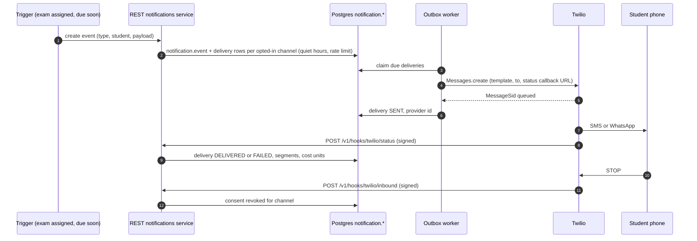

# 69A. Mobile, voice, cost metering, Twilio and native app — technical specification (API + schema)

**Status:** design for review (2026-10-26). Nothing here is implemented. Companion to the requirements
in [69](69_MOBILE_TABLET_VOICE_STUDENT_EXPERIENCE.md); wireframes in
[student-mobile-voice-wireframes.html](../architecture/prototype/student-mobile-voice-wireframes.html).
Decisions recorded on 2026-10-26 are in 69 §12.

**Evidence basis:** checked-in code only. Provider prices, language lists and limits could **not** be
verified on 2026-10-26 (web search returned HTTP 504); every such value below is a placeholder marked
**[verify]** and is filled in by the assessment spike (§2), never hard-coded.

Contents: 1 conventions · 2 provider assessment · 3 voice sessions · 4 cost metering and abuse
prevention · 5 Twilio notifications · 6 native app, local database and on-device models · 7 API
reference · 8 schema changes · 9 configuration and secrets · 10 phases and tests.

## 1. Conventions

- **REST stays the only database boundary.** Browser/native apps call same-origin web routes (web,
  exam-web) or REST with the student bearer token (`get_current_student_id`,
  [security.py](../../mathbank-rest/src/mathbank_rest/security.py)); provider and Twilio keys live
  only on servers.
- Student routes: `/v1/me/...`. Staff routes: `/v1/admin/studio/...` (staff session + CSRF +
  capability, plan 68 §4.10). Provider/Twilio webhooks: `/v1/hooks/...` (signature-verified, no cookies).
- Money is stored as **integer micro-USD** (`cost_usd_micros`, 1 USD = 1,000,000) to avoid floats.
- Every mutating call takes an `idempotency_key` (UUID); replays return the stored result.
- Errors use the existing shape `{detail: {code, message, ...}}`; codes listed per endpoint.
- Times are `timestamptz` (UTC). Migration numbers continue after plan 68's provisional 055–062.

## 2. Provider assessment (D-V1 decided: assess all three; preference ElevenLabs → Nova Sonic → OpenAI)

### 2.1 Candidates and integration shape

| Rank (preference) | Provider | Transport from the device | Server role | Why preferred |
|---|---|---|---|---|
| 1 | **ElevenLabs Agents** (conversational agents, multilingual) | WebRTC / WebSocket via their SDK, session started with a **server-minted signed URL / conversation token** [verify name] | Mint token; serve tools via our relay; receive post-call webhook | Already our STT/TTS vendor (key, voice, `speech.mjs`); multilingual voices; one vendor for read-aloud + conversation |
| 2 | **Amazon Nova Sonic** (Bedrock bidirectional streaming) | WebSocket from device to **our `mathbank-voice` relay** (Fargate), relay ↔ Bedrock stream | Relay owns the stream, executes tools in-process, meters tokens exactly | AWS-native IAM, data stays in our AWS account, exact token usage per stream |
| 3 | **OpenAI Realtime** | WebRTC direct, server-minted **ephemeral client secret** | Mint secret; tools via relay | Tutor/search already on OpenAI; mature function calling |
| Fallback | **Cascade**: existing ElevenLabs STT → tutor agent → ElevenLabs TTS | HTTPS (existing `/api/voice/stt`, `/tts`) | Existing routes | Works today; exams use it for deterministic read-aloud |

All three sit behind one **provider adapter interface** (server) and one **`VoiceSessionClient`**
interface (client), so switching is configuration, not code:

```ts
interface VoiceSessionClient {          // browser / native
  start(init: SessionStartResponse): Promise<void>;   // connects using provider-specific init
  onEvent(cb: (e: VoiceEvent) => void): void;         // transcript, state, tool_call, usage, error
  sendToolResult(callId: string, result: object): void;
  setMuted(m: boolean): void; end(reason: EndReason): Promise<void>;
}
```

```python
class VoiceProviderAdapter(Protocol):   # mathbank-rest / mathbank-voice
    name: Literal["elevenlabs", "nova_sonic", "openai_realtime", "cascade"]
    def create_session(self, policy: VoicePolicy, lang: str) -> ProviderInit: ...   # token/URL/relay ticket
    def tool_schemas(self, policy: VoicePolicy) -> list[dict]: ...                  # provider-specific format
    def parse_usage(self, raw: dict) -> UsageUnits: ...                             # normalise to §4.2 units
    def verify_webhook(self, headers: dict, body: bytes) -> bool: ...
```

### 2.2 Assessment criteria and weights

| # | Criterion | Weight | How measured in the spike |
|---|---|---|---|
| C1 | **Multilingual quality** (ASR accuracy + natural voice) for the D-V10 languages (English, Spanish, Hindi, Bengali, French) incl. code-switching and spoken maths | 20 | 50 scripted utterances × language; word error rate; 5-point listener rating by 3 staff |
| C2 | Latency: end-of-speech → first audio (p50/p95) on 4G and Wi-Fi | 15 | 100 turns per provider from a phone; logged timestamps |
| C3 | Cost per **student-minute** (all-in: audio in/out, LLM, tools) | 15 | Metered spike sessions ÷ minutes, using §4 normalisation |
| C4 | Tool calling reliability (correct tool + args, no hallucinated grading) | 15 | 60 scripted tasks across practice/tutor/exam policies |
| C5 | Privacy for minors: zero/low retention options, DPA, region, training opt-out | 10 | Contract/console review; pass/fail gate |
| C6 | Barge-in and echo handling on phone speaker + earbuds | 8 | Manual matrix (iOS Safari, Android Chrome) |
| C7 | Usage reporting granularity (per session tokens/credits available to us) | 7 | Can we reconcile per student? yes/partial/no |
| C8 | Mobile/native SDK maturity (web + React Native) | 5 | SDK review + prototype |
| C9 | Operational fit (quotas, concurrency, regions us-east-1/2, status history) | 5 | Docs + quota requests |

**Decision rule:** the preferred provider (ElevenLabs) is selected if it passes the C5 gate and
scores within **10%** of the top weighted score; otherwise the next in preference order is tested
against the same rule. Results go into `billing.voice_provider_assessment` (§8) and a dated section
in 69.

### 2.3 Spike protocol (1 week, budget-capped)

1. Configure each provider with the **same** instructions (practice policy), tool schemas
   (`read_item`, `record_answer_draft`, `submit_answer`, `request_hint`) and voice per language.
2. Run the scripted set on iPhone (Safari) and Android (Chrome), Wi-Fi and 4G, earbuds and speaker.
3. Meter every session through the real §4 pipeline (this also tests metering).
4. Hard spend cap per provider for the spike: **USD 50** [adjust]; spike sessions use synthetic
   student ids only.

## 3. Voice sessions

### 3.1 Lifecycle and states

```
REQUESTED → (budget + feature + consent checks) → ACTIVE ⇄ PAUSED → ENDED
                                     └─ denied → REJECTED (code: BUDGET_EXHAUSTED | FEATURE_DISABLED | CONSENT_REQUIRED | CONCURRENT_SESSION | RATE_LIMITED)
ACTIVE → FALLBACK (provider failure; continues as cascade, same session id) → ENDED
ENDED reasons: STUDENT | IDLE | BUDGET | POLICY | PROVIDER_ERROR | NETWORK | ADMIN
```

- One ACTIVE session per student (any device). A new start ends the old one (`reason=SUPERSEDED`).
- Server-side watchdog ends sessions with no heartbeat for 60 s and enforces the hard stop at the
  budget boundary (§4.4).
- Default mode on phones is **push-to-talk** (D-V2 decided); hands-free is one tap away.

### 3.2 Policy object (returned at start, stored with the session)

```json
{
  "policy_version": "voice_policy.v1",
  "context": { "kind": "quiz_item", "id": "uuid", "revision": "sha256" },
  "modes_allowed": ["READ_ALOUD", "PUSH_TO_TALK", "HANDS_FREE"],
  "default_mode": "PUSH_TO_TALK",
  "tools": ["read_item", "record_answer_draft", "submit_answer", "request_hint", "explain_after_submit"],
  "language": "en", "languages_allowed": ["en"],
  "limits": { "session_max_seconds": 900, "idle_pause_seconds": 20, "remaining_today_seconds": 1080,
              "remaining_today_cost_usd_micros": 450000 },
  "instructions_version": "practice.v3",
  "retention": { "audio": "NONE", "transcript_days": 365 }
}
```

Policies per context (tutor, course step, practice, exam, live) are defined in 69 §5.1. The exam
policy's tool list is `read_item, record_answer_draft, navigate, time_left` only.

### 3.3 Tool relay contract

The device (or relay) forwards a provider tool call:

```json
POST /v1/me/voice/sessions/{session_id}/tools/{tool_name}
{ "call_id": "provider-call-id", "args": { "choice": "B" }, "idempotency_key": "uuid" }
→ 200 { "call_id": "…", "result": { "status": "DRAFT_SAVED", "say": "You chose B. Shall I submit?" },
        "ui": { "confirm_card": { "label": "B", "text": "Both true; R does not explain A" } } }
```

- 403 `TOOL_NOT_ALLOWED` if the tool is not in the session policy; 409 `SESSION_NOT_ACTIVE`.
- `submit_answer` requires a prior confirm (`confirmed_at` set by `POST …/confirm`, the tap or the
  spoken "yes, submit" relayed as `confirm` tool) — otherwise 409 `CONFIRM_REQUIRED`.
- Results never contain answer keys before submission; `explain_after_submit` only after a scored attempt.

## 4. Cost metering and abuse prevention (token cost per student, recorded)

### 4.1 Principles

- **Every billable unit is recorded per student, per session, per provider** at the time it happens
  (append-only), priced with a **versioned rate card**, rolled up daily, and **reconciled** against
  provider invoices/usage APIs.
- Enforcement uses **both** time (20 min/day, D-V3 decided) and **money** (daily and monthly USD caps)
  so a cheap-minute provider change or a token-heavy session can't bypass limits.
- Limits are checked **before** a session starts, **during** the session (every usage event and a
  30 s heartbeat) and enforced server-side (relay disconnect / token expiry), never only in the UI.

### 4.2 Usage units (normalised)

| Unit key | Meaning | Typical source |
|---|---|---|
| `audio_in_seconds`, `audio_out_seconds` | Streamed audio duration | All providers; cascade STT seconds |
| `audio_in_tokens`, `audio_out_tokens` | Model audio tokens | Nova Sonic, OpenAI Realtime usage events |
| `text_in_tokens`, `text_out_tokens`, `cached_text_in_tokens` | LLM text tokens | Realtime usage, tutor agent (LiteLLM), ElevenLabs LLM if reported [verify] |
| `tts_characters` | Synthesised characters | ElevenLabs TTS / cascade |
| `provider_credits` | Vendor credits/minutes as billed | ElevenLabs agent minutes/credits [verify] |
| `tool_calls` | Count of tool calls | Our relay |
| `sms_segments`, `whatsapp_messages`, `voice_call_seconds` | Twilio | Twilio status callbacks (§5) |

### 4.3 Cost computation

`cost_usd_micros = Σ units[k] × rate_card[provider, model, k].micros_per_unit` using the rate card row
**effective at the event time**. Unknown units → cost 0 + `pricing_gap` flag (alert), never silently
dropped. The rate card is staff-edited (capability `manage_billing`), versioned, never updated in place.

### 4.4 Budgets and enforcement

| Limit | Default | Scope override (most specific wins: student > group > course > global) |
|---|---|---|
| Voice seconds per day | 1,200 (20 min, D-V3) | yes |
| Voice cost per day | USD 0.75 (D-V13; revisit after spike) | yes |
| Voice cost per month | USD 10 (D-V13; revisit after spike) | yes |
| Max session length | 900 s | yes |
| Session starts per hour | 12 | global |
| Concurrent sessions | 1 | global |
| Tool calls per minute | 30 | global |
| Notifications (SMS/WhatsApp) per student per day | 3 | yes |

Behaviour: at **80%** the device shows a warning pill; at **100%** the session gets a spoken
"time's up for today" and ends (`reason=BUDGET`); new starts return `429 BUDGET_EXHAUSTED`
with `resets_at`. Text tutoring remains available (separate tutor budget, plan 68 D-11).

### 4.5 Abuse signals (flag → staff review; automatic soft-block only for hard signals)

| Signal | Rule (initial) | Action |
|---|---|---|
| Cost spike | Student daily cost > 3× their 14-day median and > USD 0.50 | Flag |
| Idle streaming | > 60% of session seconds with no speech detected | Flag; shorten idle pause |
| Off-context use | > 40% turns rejected by policy guard | Flag |
| Rapid restarts | > 12 starts/hour | Soft-block 1 h |
| Shared account | Same student active from > 2 devices/IPs per hour | Flag |
| Pricing gap | Any usage with no rate card | Alert ops |
| Reconciliation drift | Our daily total vs provider usage differs > 5% | Alert ops |

### 4.6 Reconciliation

Nightly job: pulls provider usage (ElevenLabs usage/history API, Bedrock CloudWatch/Cost Explorer by
tag, OpenAI usage API, Twilio usage records) [verify endpoints], writes
`billing.provider_usage_daily`, compares with `billing.usage_daily` and raises drift alerts. Staff see
per-student, per-group and per-provider cost in the Studio **Usage** view (§7.4).

## 5. Twilio notifications (D-V7 decided: Twilio, beyond email)

### 5.1 Scope

| Use | Twilio product | Priority |
|---|---|---|
| Exam opening/due, assignment, streak/practice reminders, results ready | Programmable Messaging — **SMS** and **WhatsApp** (approved templates) | M |
| Email channel | Twilio SendGrid [if on the subscription; else existing email] | S |
| Phone number verification (student/guardian) | Twilio Verify | M |
| Delivery status, STOP/HELP, inbound replies | Messaging status callbacks + inbound webhook | M |
| Guardian notifications for minors | SMS/WhatsApp to guardian contact | M |
| **Dial-in voice tutor** (no data / feature phone, "call the tutor") | Programmable Voice + Media Streams → voice relay | C (later, D-V12 accepted, phase V8) |

In-app notifications stay in `notification.event` ([043](../../mathbank-db/sql/043_notifications.sql));
Twilio adds **delivery channels** and the deferred preference table (043's TODO).

### 5.2 Rules

- **Opt-in required** per channel and per contact; minors' contacts need the school consent flag
  (D-V4) and a guardian for SMS/WhatsApp; STOP/UNSUBSCRIBE handled automatically and recorded.
- Quiet hours per recipient time zone (default 21:00–07:30), rate limit 3/day/student, digesting of
  same-type events.
- Templates are versioned and localised (same language set as voice); WhatsApp templates require
  Twilio/Meta approval before use.
- Every send is metered (§4.2 Twilio units) and charged to the recipient student's usage ledger.
- Webhooks verify `X-Twilio-Signature`; idempotent on `MessageSid`.

### 5.3 Flow



## 6. Native app, local database and on-device models (D-V6 updated)

**Decision (2026-10-26):** PWA first for reach (V0–V5), **plus a native app track (N0–N4)** because
camera/gesture video tutoring, reliable background audio, a local database and small on-device models
are hard or impossible on the mobile web.

### 6.1 Why native (capability gaps on the web)

| Need | Mobile web | Native |
|---|---|---|
| Voice continues with screen locked / app in background | iOS suspends mic/WebRTC | Background audio session |
| Camera video tutoring with gesture recognition | Possible but heavy; battery/thermal limits | Native camera pipeline + on-device vision |
| Large offline content + local DB | IndexedDB quotas/eviction | SQLite with initializer and sync |
| Small on-device models (VAD, STT, keyword spotting) | WASM, slow on low-end phones | Native/NPU acceleration |
| Push notifications | Web push (iOS limits) | APNs/FCM (plus Twilio SMS fallback) |

### 6.2 Recommended stack (to confirm in N0)

| Layer | Recommendation | Alternatives |
|---|---|---|
| App framework | **React Native + Expo** (TypeScript) — **decided D-V11** — shares React skills and pure modules (`speech.mjs` mapping, scorer port, API types) with web | Capacitor (wraps the PWA; quickest, but still a WebView for camera/ML), Flutter |
| Math rendering | KaTeX in a lightweight WebView component, or a native math renderer [evaluate] | MathJax SVG |
| Local DB | **SQLite** (Expo SQLite or op-sqlite) + migration runner + **initializer** | WatermelonDB on SQLite |
| Voice | Provider RN SDK (ElevenLabs first) or WebRTC (`react-native-webrtc`) | — |
| On-device models | VAD (Silero-class), **small STT** (whisper.cpp tiny/base via native binding) for offline dictation and push-to-talk pre-processing, keyword spotting ("submit", "next", "repeat"), OS TTS for offline read-aloud | Platform speech APIs |
| Later: camera/gesture | MediaPipe-class hand/pose landmarks on device; WebRTC video to tutor (LiveKit or provider video) | — |

**Rule:** on-device models never grade and never generate new mathematical content; offline practice
uses the **ported deterministic scorer** and server re-validates every synced attempt.

### 6.3 Local database initializer and sync

```
First launch / new course download
 1. GET /v1/me/device/bootstrap        → schema_version, packs available, feature flags, budgets
 2. Create/upgrade SQLite schema (local migrations 1..N)
 3. GET /v1/me/content-packs/{pack_id} → signed URL to a compressed SQLite/NDJSON bundle (course,
    lessons, approved items WITHOUT answer keys for exam items, practice keys encrypted per device),
    media manifest
 4. Verify sha256 + signature, import in one transaction, record pack version
 5. Download media lazily (Wi-Fi only by default)
Ongoing
 - Writes (attempts, drafts, preferences) go to a local outbox table with idempotency keys
 - POST /v1/me/sync {cursor, outbox[]} → {accepted[], rejected[], changes[], next_cursor}
 - Conflicts: server wins for content; attempts are append-only (no conflict)
```

Local tables (device): `meta(schema_version, device_id)`, `pack(pack_id, version, sha256)`,
`course`, `lesson`, `item` (no exam keys), `media_asset`, `attempt_local`, `outbox`, `sync_state`,
`voice_turn_cache` (text only, purged after sync), `preference`.

Practice answer keys offline: encrypted with a per-device key from `bootstrap`, decrypted only by the
scorer module; exam items are **online-only** (no keys on device).

### 6.4 Native-specific security

Device registration with attestation where available (App Attest / Play Integrity) [verify], refresh
tokens in the OS keychain/keystore, remote wipe of content packs on logout or device revocation.

## 7. API reference (new and changed)

Status for every row: **N** (new, not implemented). Auth: **S** = student bearer
(`get_current_student_id`), **W** = same-origin web route (session cookie → REST with the student
token), **A** = staff session + CSRF + capability, **H** = signed webhook.

### 7.1 Voice

| Method & path | Auth | Request | Response (200 unless noted) | Errors |
|---|---|---|---|---|
| `POST /api/voice/session` (web, exam-web) | W | `{context:{kind,id}, mode?, language?}` | `{session_id, provider, init:{…provider-specific token/url/relay_ticket}, policy, expires_at}` | as REST below |
| `POST /v1/me/voice/sessions` | S | `{context:{kind,id,revision?}, mode?, language?, device:{class:"phone"\|"tablet"\|"desktop", platform:"web"\|"ios"\|"android", app_version?}, idempotency_key}` | `201 {session_id, provider, policy, provider_request:{…server-only, not returned to web}}` | 403 `FEATURE_DISABLED`, 403 `CONSENT_REQUIRED`, 429 `BUDGET_EXHAUSTED {resets_at}`, 429 `RATE_LIMITED`, 409 `CONCURRENT_SESSION` |
| `GET /v1/me/voice/sessions/{id}` | S | — | `{session_id, state, mode, language, started_at, seconds, cost_usd_micros, policy}` | 404 |
| `POST /v1/me/voice/sessions/{id}/heartbeat` | S | `{state:"ACTIVE"\|"PAUSED", client_seconds}` | `{remaining_today_seconds, remaining_today_cost_usd_micros, warn:boolean, stop:boolean}` | 409 `SESSION_NOT_ACTIVE` |
| `POST /v1/me/voice/sessions/{id}/tools/{tool}` | S | `{call_id, args, idempotency_key}` | `{call_id, result, ui?}` | 403 `TOOL_NOT_ALLOWED`, 409 `CONFIRM_REQUIRED` |
| `POST /v1/me/voice/sessions/{id}/confirm` | S | `{draft_id, via:"TAP"\|"VOICE"}` | `{confirmed_at}` | 409 |
| `POST /v1/me/voice/sessions/{id}/turns` | S | `{turns:[{seq, role:"STUDENT"\|"AGENT", text, lang, started_at, ended_at}]}` (batched ≤ 50) | `{stored}` | 413 |
| `POST /v1/me/voice/sessions/{id}/usage` | S (relay: service) | `{events:[{provider_event_id, units:{…§4.2}, at}]}` | `{session_cost_usd_micros, remaining…}` | 409 duplicate ignored |
| `POST /v1/me/voice/sessions/{id}/end` | S | `{reason, client_seconds}` | `{seconds, cost_usd_micros}` | — |
| `POST /v1/hooks/voice/{provider}` | H | provider post-call / usage webhook | `204` | 401 bad signature |
| `GET /v1/me/voice/usage?period=day\|month` | S | — | `{seconds, cost_usd_micros, limits, resets_at, by_day:[…]}` | — |
| `GET /v1/me/preferences/voice` / `PUT` | S | `{voice_id?, speed:0.8..1.3, auto_listen, captions, language, data_saver, default_mode}` | same | 422 |
| `GET /v1/me/features` (plan 68 P7) | S | — | `{features:{voice_agent:{enabled, modes}, voice_exam_readaloud:{enabled}}, budgets:{…}}` | — |

### 7.2 Twilio notifications

| Method & path | Auth | Request | Response | Errors |
|---|---|---|---|---|
| `GET /v1/me/contacts` | S | — | `[{contact_id, kind:"PHONE"\|"EMAIL"\|"WHATSAPP", value_masked, verified, owner:"STUDENT"\|"GUARDIAN"}]` | — |
| `POST /v1/me/contacts` | S | `{kind, value, owner}` | `201 {contact_id, verification:"SENT"}` (Twilio Verify) | 422 invalid number, 429 |
| `POST /v1/me/contacts/{id}/verify` | S | `{code}` | `{verified:true}` | 400 `CODE_INVALID` |
| `DELETE /v1/me/contacts/{id}` | S | — | `204` | — |
| `GET /v1/me/notification-preferences` / `PUT` | S | `{channels:{IN_APP:true, SMS:bool, WHATSAPP:bool, EMAIL:bool}, types:{EXAM_ASSIGNED:[…channels], DUE_SOON:[…], REMINDER:[…], RESULTS:[…]}, quiet_hours:{start:"21:00", end:"07:30", tz}}` | same | 403 `CONSENT_REQUIRED` |
| `POST /v1/hooks/twilio/status` | H | Twilio form (`MessageSid`, `MessageStatus`, `NumSegments`, `ErrorCode`…) | `204` | 401 |
| `POST /v1/hooks/twilio/inbound` | H | Twilio form (`From`, `Body`) — STOP/START/HELP | TwiML `200` | 401 |
| `GET /v1/admin/studio/notifications/templates` / `POST` / `PUT {id}` | A (`manage_notifications`) | `{key, channel, language, body, whatsapp_template_sid?}` | template | 409 version |
| `POST /v1/admin/studio/notifications/send` | A | `{template_key, audience:{group_id\|student_ids[]}, variables, dry_run}` | `{recipients, skipped:{no_consent, quiet_hours, rate_limited}, est_cost_usd_micros}` | — |

### 7.3 Native device, content packs and sync

| Method & path | Auth | Request | Response |
|---|---|---|---|
| `POST /v1/me/devices` | S | `{platform, model, os_version, app_version, push_token?, attestation?}` | `201 {device_id, device_key (wrapped)}` |
| `DELETE /v1/me/devices/{id}` | S | — | `204` (remote wipe on next contact) |
| `GET /v1/me/device/bootstrap` | S | `?device_id` | `{schema_version, min_app_version, features, budgets, packs:[{pack_id, course_code, version, size_bytes}]}` |
| `GET /v1/me/content-packs/{pack_id}` | S | `?version` | `{url (signed, 10 min), sha256, signature, encrypted_keys_for_device}` |
| `POST /v1/me/sync` | S | `{device_id, cursor, outbox:[{op:"ATTEMPT"\|"DRAFT"\|"PREFERENCE"\|"VOICE_TURNS", idempotency_key, payload}]}` | `{accepted:[keys], rejected:[{key, code}], changes:[…], next_cursor}` |

### 7.4 Staff (Studio) — usage, budgets, providers

| Method & path | Auth (capability) | Purpose |
|---|---|---|
| `GET /v1/admin/studio/usage?scope=student\|group\|course&id&from&to&group_by=day\|provider` | A (`view_usage`) | Seconds, units, cost per student/group/provider; top spenders |
| `GET /v1/admin/studio/usage/flags?status=OPEN` / `POST /flags/{id}/resolve` | A (`manage_access`) | Abuse signals (§4.5) |
| `GET/POST/DELETE /v1/admin/studio/budgets` | A (`manage_access`) | Budget overrides per scope (§4.4) |
| `GET/POST /v1/admin/studio/rate-cards` | A (`manage_billing`) | Versioned prices per provider/model/unit (append-only) |
| `GET/POST /v1/admin/studio/voice/providers` | A (`manage_billing`) | Active provider, fallback order, language → voice mapping |
| `GET/POST /v1/admin/studio/voice/assessments` | A (`manage_billing`) | Spike scorecards (§2.2) |
| `GET /v1/admin/studio/reconciliation?date` | A (`view_usage`) | Our totals vs provider/Twilio totals, drift |

## 8. Schema changes (additive; numbering provisional after plan 68's 055–062)

### 8.1 Migration 063 — voice sessions (`learner` schema)

```sql
CREATE TABLE learner.voice_session (
  session_id        uuid PRIMARY KEY DEFAULT gen_random_uuid(),
  student_id        uuid NOT NULL,                       -- logical link to the student (existing identity)
  context_kind      text NOT NULL CHECK (context_kind IN ('TUTOR','COURSE_STEP','SOCRATIC_STEP','QUIZ_ITEM','EXAM_ITEM','LIVE')),
  context_id        text,
  context_revision  text,
  provider          text NOT NULL CHECK (provider IN ('elevenlabs','nova_sonic','openai_realtime','cascade')),
  provider_session_ref text,
  mode              text NOT NULL CHECK (mode IN ('READ_ALOUD','PUSH_TO_TALK','HANDS_FREE')),
  language          text NOT NULL DEFAULT 'en',
  policy            jsonb NOT NULL,                      -- §3.2 snapshot
  device_class      text NOT NULL CHECK (device_class IN ('phone','tablet','desktop')),
  platform          text NOT NULL CHECK (platform IN ('web','ios','android')),
  device_id         uuid,                                -- learner.device when native
  state             text NOT NULL DEFAULT 'ACTIVE' CHECK (state IN ('ACTIVE','PAUSED','FALLBACK','ENDED','REJECTED')),
  end_reason        text,
  started_at        timestamptz NOT NULL DEFAULT now(),
  last_heartbeat_at timestamptz,
  ended_at          timestamptz,
  seconds           integer NOT NULL DEFAULT 0 CHECK (seconds >= 0),
  cost_usd_micros   bigint  NOT NULL DEFAULT 0 CHECK (cost_usd_micros >= 0),
  idempotency_key   uuid NOT NULL UNIQUE
);
CREATE UNIQUE INDEX voice_session_one_active ON learner.voice_session(student_id) WHERE state IN ('ACTIVE','PAUSED','FALLBACK');
CREATE INDEX voice_session_student_time ON learner.voice_session(student_id, started_at DESC);

CREATE TABLE learner.voice_turn (                         -- text only; audio never stored (D-V4)
  session_id uuid NOT NULL REFERENCES learner.voice_session ON DELETE CASCADE,
  seq        integer NOT NULL,
  role       text NOT NULL CHECK (role IN ('STUDENT','AGENT','SYSTEM')),
  text       text NOT NULL,
  language   text NOT NULL,
  started_at timestamptz NOT NULL, ended_at timestamptz,
  PRIMARY KEY (session_id, seq)
);

CREATE TABLE learner.voice_tool_call (
  session_id uuid NOT NULL REFERENCES learner.voice_session ON DELETE CASCADE,
  call_id    text NOT NULL,
  tool       text NOT NULL,
  args_hash  text NOT NULL,
  status     text NOT NULL CHECK (status IN ('OK','DENIED','ERROR','CONFIRM_REQUIRED')),
  result     jsonb,                                       -- exact replay result (no answer keys)
  latency_ms integer,
  created_at timestamptz NOT NULL DEFAULT now(),
  PRIMARY KEY (session_id, call_id)
);

CREATE TABLE learner.voice_preference (
  student_id uuid PRIMARY KEY,
  voice_id text, speed numeric(3,2) NOT NULL DEFAULT 1.00 CHECK (speed BETWEEN 0.8 AND 1.3),
  language text NOT NULL DEFAULT 'en', default_mode text NOT NULL DEFAULT 'PUSH_TO_TALK',
  auto_listen boolean NOT NULL DEFAULT false, captions boolean NOT NULL DEFAULT true,
  data_saver boolean NOT NULL DEFAULT false, updated_at timestamptz NOT NULL DEFAULT now()
);
```

Retention job: delete `voice_turn` rows older than 365 days (D-V4); sessions keep aggregates.

### 8.2 Migration 064 — billing and metering (`billing` schema)

```sql
CREATE SCHEMA IF NOT EXISTS billing;

CREATE TABLE billing.rate_card (                          -- append-only, versioned prices
  rate_card_id   uuid PRIMARY KEY DEFAULT gen_random_uuid(),
  provider       text NOT NULL,                           -- elevenlabs | nova_sonic | openai_realtime | openai | twilio | ...
  model          text NOT NULL,                           -- e.g. agent tier, model id, 'sms-US', 'whatsapp-utility'
  unit_key       text NOT NULL,                           -- §4.2
  micros_per_unit numeric(18,6) NOT NULL CHECK (micros_per_unit >= 0),
  effective_from timestamptz NOT NULL,
  source_note    text NOT NULL,                           -- where the price came from + date verified
  created_by     text NOT NULL, created_at timestamptz NOT NULL DEFAULT now(),
  UNIQUE (provider, model, unit_key, effective_from)
);

CREATE TABLE billing.usage_event (                        -- append-only ledger, one row per provider usage report
  usage_event_id    uuid PRIMARY KEY DEFAULT gen_random_uuid(),
  student_id        uuid NOT NULL,
  feature           text NOT NULL CHECK (feature IN ('VOICE','TUTOR_TEXT','TTS','STT','NOTIFICATION','MICRO_CHAT')),
  session_id        uuid,                                 -- voice_session / tutor session / notification delivery
  provider          text NOT NULL, model text NOT NULL,
  provider_event_id text,                                 -- dedupe key from provider
  units             jsonb NOT NULL,                       -- {"audio_in_seconds": 12.4, "text_out_tokens": 310, ...}
  cost_usd_micros   bigint NOT NULL CHECK (cost_usd_micros >= 0),
  rate_card_ids     uuid[] NOT NULL DEFAULT '{}',
  pricing_gap       boolean NOT NULL DEFAULT false,
  occurred_at       timestamptz NOT NULL,
  recorded_at       timestamptz NOT NULL DEFAULT now(),
  UNIQUE (provider, provider_event_id)
);
CREATE INDEX usage_event_student_day ON billing.usage_event(student_id, occurred_at);

CREATE TABLE billing.usage_daily (                        -- rollup used for fast budget checks
  student_id uuid NOT NULL, day date NOT NULL, feature text NOT NULL, provider text NOT NULL,
  seconds integer NOT NULL DEFAULT 0, units jsonb NOT NULL DEFAULT '{}',
  cost_usd_micros bigint NOT NULL DEFAULT 0,
  PRIMARY KEY (student_id, day, feature, provider)
);

CREATE TABLE billing.budget_policy (
  budget_policy_id uuid PRIMARY KEY DEFAULT gen_random_uuid(),
  scope       text NOT NULL CHECK (scope IN ('GLOBAL','COURSE','GROUP','STUDENT')),
  scope_id    text,                                       -- NULL for GLOBAL
  feature     text NOT NULL,
  limit_key   text NOT NULL CHECK (limit_key IN ('SECONDS_PER_DAY','COST_PER_DAY','COST_PER_MONTH','SESSION_MAX_SECONDS','STARTS_PER_HOUR','MESSAGES_PER_DAY')),
  limit_value bigint NOT NULL CHECK (limit_value >= 0),
  active      boolean NOT NULL DEFAULT true,
  created_by  text NOT NULL, created_at timestamptz NOT NULL DEFAULT now(),
  UNIQUE (scope, scope_id, feature, limit_key)
);

CREATE TABLE billing.abuse_flag (
  flag_id uuid PRIMARY KEY DEFAULT gen_random_uuid(),
  student_id uuid NOT NULL, signal text NOT NULL, details jsonb NOT NULL,
  status text NOT NULL DEFAULT 'OPEN' CHECK (status IN ('OPEN','RESOLVED','DISMISSED')),
  action text CHECK (action IN ('NONE','SOFT_BLOCK','BUDGET_REDUCED')),
  created_at timestamptz NOT NULL DEFAULT now(), resolved_by text, resolved_at timestamptz
);

CREATE TABLE billing.provider_usage_daily (                -- reconciliation input
  provider text NOT NULL, day date NOT NULL, units jsonb NOT NULL, cost_usd_micros bigint NOT NULL,
  pulled_at timestamptz NOT NULL DEFAULT now(), PRIMARY KEY (provider, day)
);

CREATE TABLE billing.voice_provider_assessment (
  assessment_id uuid PRIMARY KEY DEFAULT gen_random_uuid(),
  provider text NOT NULL, language text NOT NULL, criterion text NOT NULL,   -- C1..C9
  score numeric(5,2) NOT NULL, weight integer NOT NULL, evidence jsonb NOT NULL,
  assessed_by text NOT NULL, assessed_at timestamptz NOT NULL DEFAULT now()
);
```

Budget check (single query at session start / heartbeat): sum `usage_daily` for today and month for
the student + effective `budget_policy` (most specific scope wins) → remaining seconds/cost.

### 8.3 Migration 065 — notification channels (extends `notification` schema from 043)

```sql
CREATE TABLE notification.contact (
  contact_id uuid PRIMARY KEY DEFAULT gen_random_uuid(),
  student_id uuid NOT NULL,
  owner      text NOT NULL CHECK (owner IN ('STUDENT','GUARDIAN')),
  kind       text NOT NULL CHECK (kind IN ('PHONE','WHATSAPP','EMAIL')),
  value_enc  bytea NOT NULL,                             -- encrypted E.164 / email
  value_hash text NOT NULL,                              -- lookup for inbound STOP
  verified_at timestamptz, created_at timestamptz NOT NULL DEFAULT now(),
  UNIQUE (student_id, kind, value_hash)
);
CREATE TABLE notification.preference (                     -- closes 043's deferred TODO
  student_id uuid NOT NULL, notification_type text NOT NULL,
  channels text[] NOT NULL DEFAULT '{IN_APP}',
  quiet_start time NOT NULL DEFAULT '21:00', quiet_end time NOT NULL DEFAULT '07:30', tz text NOT NULL DEFAULT 'UTC',
  updated_at timestamptz NOT NULL DEFAULT now(), PRIMARY KEY (student_id, notification_type)
);
CREATE TABLE notification.consent (
  contact_id uuid NOT NULL REFERENCES notification.contact ON DELETE CASCADE,
  channel text NOT NULL CHECK (channel IN ('SMS','WHATSAPP','EMAIL','VOICE_CALL')),
  status  text NOT NULL CHECK (status IN ('OPTED_IN','OPTED_OUT')),
  source  text NOT NULL,                                  -- UI, STOP reply, school import
  at timestamptz NOT NULL DEFAULT now(), PRIMARY KEY (contact_id, channel, at)
);
CREATE TABLE notification.template (
  template_id uuid PRIMARY KEY DEFAULT gen_random_uuid(),
  key text NOT NULL, channel text NOT NULL, language text NOT NULL, version integer NOT NULL,
  body text NOT NULL, provider_template_sid text, approved boolean NOT NULL DEFAULT false,
  UNIQUE (key, channel, language, version)
);
CREATE TABLE notification.delivery (
  delivery_id uuid PRIMARY KEY DEFAULT gen_random_uuid(),
  notification_event_id uuid NOT NULL,                   -- notification.event (043)
  contact_id uuid REFERENCES notification.contact,
  channel text NOT NULL, template_id uuid REFERENCES notification.template,
  status text NOT NULL DEFAULT 'PENDING' CHECK (status IN ('PENDING','SKIPPED','SENT','DELIVERED','FAILED','UNDELIVERED')),
  skip_reason text, provider text NOT NULL DEFAULT 'twilio', provider_message_sid text UNIQUE,
  segments integer, error_code text, cost_usd_micros bigint,
  scheduled_for timestamptz NOT NULL DEFAULT now(), sent_at timestamptz, updated_at timestamptz NOT NULL DEFAULT now()
);
```

The school-level consent flag (D-V4) lives with the audience module (plan 68 migration 058) as
`audience.school_policy(allow_voice, allow_sms, allow_whatsapp, minors_require_guardian)`.

### 8.4 Migration 066 — devices, content packs, sync (`learner` + `content` schemas)

```sql
CREATE TABLE learner.device (
  device_id uuid PRIMARY KEY DEFAULT gen_random_uuid(),
  student_id uuid NOT NULL, platform text NOT NULL CHECK (platform IN ('ios','android')),
  model text, os_version text, app_version text, push_token_enc bytea,
  attestation_status text, wrapped_device_key bytea NOT NULL,
  revoked_at timestamptz, last_seen_at timestamptz, created_at timestamptz NOT NULL DEFAULT now()
);
CREATE SCHEMA IF NOT EXISTS content;
CREATE TABLE content.pack (
  pack_id uuid PRIMARY KEY DEFAULT gen_random_uuid(),
  course_code text NOT NULL, version integer NOT NULL, schema_version integer NOT NULL,
  object_key text NOT NULL, sha256 text NOT NULL, size_bytes bigint NOT NULL,
  built_from jsonb NOT NULL,                             -- source revisions (course, items)
  created_at timestamptz NOT NULL DEFAULT now(), UNIQUE (course_code, version)
);
CREATE TABLE learner.sync_cursor (
  device_id uuid PRIMARY KEY REFERENCES learner.device ON DELETE CASCADE,
  cursor text NOT NULL, updated_at timestamptz NOT NULL DEFAULT now()
);
CREATE TABLE learner.sync_receipt (                        -- idempotent outbox acceptance
  device_id uuid NOT NULL, idempotency_key uuid NOT NULL, op text NOT NULL,
  result jsonb NOT NULL, received_at timestamptz NOT NULL DEFAULT now(),
  PRIMARY KEY (device_id, idempotency_key)
);
```

### 8.5 Feature catalog rows (plan 68 migration 058)

`voice_agent`, `voice_hands_free`, `voice_exam_readaloud`, `sms_notifications`,
`whatsapp_notifications`, `offline_packs`, `native_app` — all resolved through `GET /v1/me/features`.

## 9. Configuration and secrets

| Name | Where | Notes |
|---|---|---|
| `ELEVEN_API_KEY`, `ELEVEN_AGENT_ID`, `ELEVEN_WEBHOOK_SECRET` | SSM → REST, web | Key already synced for STT/TTS (`make sync-eleven-key`) |
| `VOICE_PROVIDER_ORDER` | REST config | `elevenlabs,nova_sonic,openai_realtime,cascade` |
| `BEDROCK_NOVA_SONIC_MODEL_ID`, region | SSM → mathbank-voice relay | IAM role on the Fargate task, no static keys |
| `OPENAI_API_KEY` (existing) | SSM → REST | Ephemeral client secrets minted server-side |
| `TWILIO_ACCOUNT_SID`, `TWILIO_AUTH_TOKEN` (or API key/secret), `TWILIO_MESSAGING_SERVICE_SID`, `TWILIO_VERIFY_SERVICE_SID`, `TWILIO_WHATSAPP_FROM` | SSM → REST worker | Webhook signature uses the auth token |
| `CONTACT_ENCRYPTION_KEY` (KMS) | KMS | Encrypts contact values and push tokens |

Never in `.env` committed files, never sent to browsers or apps. Cost of SSM/KMS: negligible.

## 10. Phases and tests (adds to 69 §10)

| Phase | Scope | Exit tests |
|---|---|---|
| V3a | Metering ledger, rate cards, budgets, abuse flags, staff Usage view (before any paid voice goes live) | Unit tests for cost math (micro-USD), budget resolution order, idempotent usage ingest, flag rules; reconciliation dry-run |
| V3b | **Provider spike** (§2.3) for ElevenLabs, Nova Sonic, OpenAI; scorecards stored | Scorecards complete for every language in D-V10 |
| V3c | Voice sessions on the chosen provider + cascade fallback | Tool allowlist tests, confirm-required tests, budget stop at 100%, one-active-session constraint |
| V7 | Twilio: contacts + Verify, preferences, templates, outbox delivery, status/inbound webhooks, quiet hours | Signature verification tests, STOP flow, quiet-hours scheduling, rate limit, cost metering per message |
| N0 | Native decision + skeleton (Expo), auth, device registration | App runs on iOS/Android test devices |
| N1 | Local DB initializer, content packs, sync outbox | Airplane-mode practice, sync idempotency, pack signature failure path |
| N2 | Native voice (provider RN SDK), background audio, push (APNs/FCM) + Twilio fallback | Screen-lock test passes |
| N3 | On-device VAD/STT/keyword spotting; OS TTS offline read-aloud | Accuracy ≥ cascade baseline on the spoken-maths set; battery budget |
| N4 | Camera/gesture video tutoring (design + prototype) | Separate requirement before build |
| V8 | Twilio dial-in voice tutor (D-V12) | Verified caller → session with phone policy; metering per call second; budget stop speaks and hangs up |
