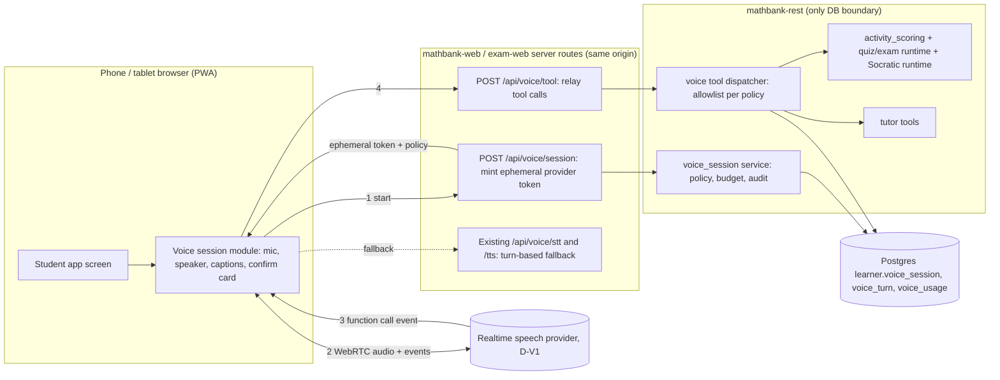
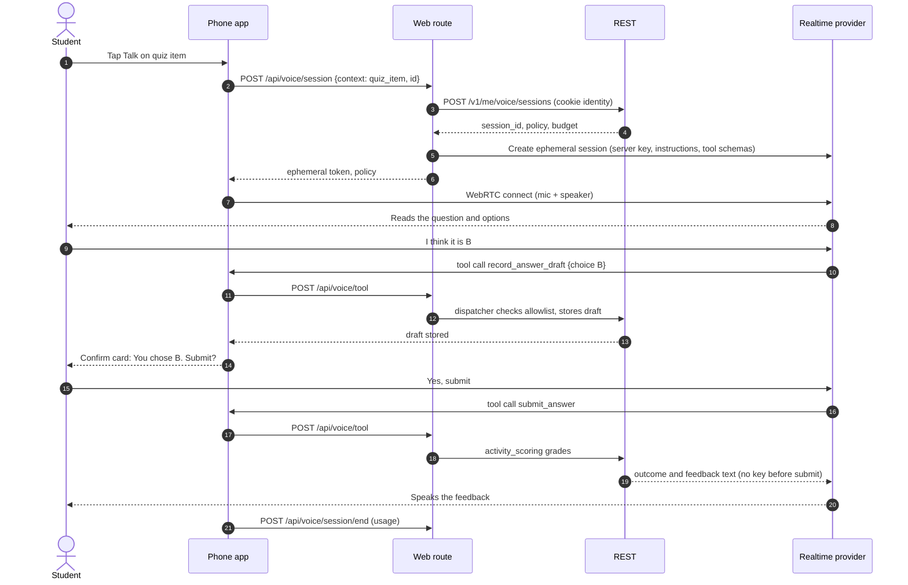

# 69. Mobile and tablet student experience with a real-time voice agent — requirements for review

**Status:** plan for review (2026-10-26). Nothing here is implemented unless marked ✅/🟨.
**Related:** [68 unified Studio plan](68_UNIFIED_STUDIO_PORTAL_PLAN.md) (audience & feature access §4.8,
micro chat §4.11), [29 student input add-ons](29_STUDENT_INPUT_ADDONS.md) (existing voice),
[30 design system](30_MODERN_UI_DESIGN_SYSTEM.md) (UI-29, UI-30), UI standard
[WORKSPACE_SHELL §2b and §8a](../../.github/skills/modern-ui-design/WORKSPACE_SHELL.md),
wireframes [student-mobile-voice-wireframes.html](../architecture/prototype/student-mobile-voice-wireframes.html).
**Technical spec (API schemas, DDL, metering, Twilio, native):** [69A](69A_MOBILE_VOICE_TECH_SPEC.md).

## 0. What you asked for

Students must be able to **practise quizzes, talk to the AI tutor and take exams while on the move**
on phones, tablets and other small devices, with **real-time voice agent** support. Identify the
business requirements (BR) and functions across the whole workspace, with **actual wireframes**,
**separate phone and tablet layouts** (not a shrunk desktop), and an explicit list of features that
are **not available** on small devices.

## 1. What exists today (evidence)

| Area | Exists | Gap for this requirement |
|---|---|---|
| Voice | ✅ Turn-based only: `MicButton` records ≤ 60 s → `POST /api/voice/stt` (ElevenLabs `scribe_v1`); `SpeakButton` → `POST /api/voice/tts` (`eleven_flash_v2_5`, ≤ 1,200 chars); `speakableText`/`mathToSpeech` turn LaTeX into words ([VoiceControls.jsx](../../mathbank-widgets/src/VoiceControls.jsx), [speech.mjs](../../mathbank-widgets/src/speech.mjs), [server.mjs](../../mathbank-widgets/src/server.mjs), req 29) | No streaming, no barge-in, no hands-free conversation, no voice answers to quiz/exam items, no per-student voice preference (NYI-UXA-2) |
| Voice users | Tutor chat ([Chat.jsx](../../mathbank-web/app/Chat.jsx)), solve workspace ([SolveWorkspace.jsx](../../mathbank-web/app/learn/solve/[code]/SolveWorkspace.jsx)), live classroom ([Classroom.jsx](../../mathbank-live/app/_components/Classroom.jsx)) | Quizzes, course reader, exam-web have no voice |
| Tutor agent | Google ADK + OpenAI via LiteLLM with tools and output guard ([agent.py](../../mathbank-agent/agents/mathbank_tutor/agent.py)); web calls `/api/agent/run` (request/response, [agentClient.js](../../mathbank-web/app/agentClient.js)) | No token streaming to the browser; no voice-agent tool layer |
| Student web | `mathbank-web` `/learn` (home, courses + reader, quizzes + review, solve, conversations, attempt media), `/profile`; sidebar shell with an off-canvas menu < 992 px ([AppShell.jsx](../../mathbank-web/app/AppShell.jsx), 6 media queries in `globals.css`) | Desktop layout squeezed: no bottom navigation, no phone/tablet specific screens, no safe-area handling |
| Exams | `mathbank-exam-web` (Vite): request paper → generate → take (timer, queued progress autosave, [TakeExam.jsx](../../mathbank-exam-web/src/pages/TakeExam.jsx)) → review; 1 media query | Not designed for phones; no resume-after-network-loss UX; no voice read-aloud |
| Live classroom | `mathbank-live` Socket.IO (`live:join`, `live:op`, `attempt:watch`), voice proxy routes; **0** media queries | Not usable on phones |
| Installable app | No web manifest or service worker in any student app | No home-screen install, no offline shell, no wake-lock |
| Feature access | Planned in 68 §4.8 (`audience.feature_policy`, `GET /v1/me/features`, `voice` listed) | Needs `voice_agent` and `voice_exam_readaloud` features and minute budgets |

## 2. Device classes and layout strategy

Separate layouts per class, chosen by **width and input**, not user agent. Each class has its own
navigation and its own screen compositions; components are shared.

| Class | Width (CSS px) | Typical | Navigation | Content zones | Detail / editing | Voice entry |
|---|---|---|---|---|---|---|
| **Phone** | < 600 | 360–430 portrait | **Bottom tab bar** (5 tabs) + top app bar (back, title, 1 action) | 1 column | **Bottom sheet** (half → full) | Floating **voice button** above the tab bar; full-screen voice session |
| **Tablet portrait** | 600–899 | iPad mini/Air portrait, small Android tablets | Bottom tab bar **or** icon rail (setting); top bar | 1 column, reading width ≤ 720 | Bottom sheet or right sheet (≤ 50%) | Voice dock at the bottom of the content |
| **Tablet landscape / small laptop** | 900–1199 | iPad landscape, foldables open | **Icon rail** (no sidebar) | **2 panes**: content + companion (tutor, voice transcript, question navigator) | Right sheet | Voice dock in the companion pane |
| **Desktop** | ≥ 1200 | — | Rail + searchable sidebar (existing) | up to 3 zones (WORKSPACE_SHELL §2) | Drawer | Mic in composer (existing) + voice dock |

Rules (all classes ≤ 1199): touch targets ≥ 44×44 px; `env(safe-area-inset-*)` padding; no hover-only
affordances; one primary action per screen, in thumb reach (bottom); inputs ≥ 16 px font (no iOS zoom);
`100dvh` layouts; landscape phone uses the phone layout with a compact top bar; keyboard open hides the
tab bar.

## 3. Feature availability across the workspace

Legend: **F** full · **L** lite (reduced but usable) · **R** read-only · **—** not available on this class
(screen shows "Open on a larger screen" with *Email me the link* / *Continue on desktop* QR) · 🎙 voice supported.

| App / function | Phone | Tablet | Desktop | Voice | Notes |
|---|---|---|---|---|---|
| **Student — mathbank-web** | | | | | |
| Today / home (continue, due, streak, voice start) | F | F | F | 🎙 | New home composition for small devices |
| Course list & course reader (lessons, video, quiz, Socratic steps) | F | F | F | 🎙 | Video full-width; transcript sheet; step-by-step cards |
| Socratic step player (adaptive workflow runtime, when built) | F | F | F | 🎙 | Voice is the natural mode: question → spoken reasoning → next |
| Practice quizzes (MCQ, AR, multiselect, numeric) | F | F | F | 🎙 | Spoken answers with confirm card |
| Quiz review & explanations | F | F | F | 🎙 read-aloud | |
| Short written reasoning answers | L | F | F | 🎙 dictation | Phone: dictation + MathComposer palette; long proofs better on tablet |
| AI tutor chat (text) | F | F | F | 🎙 | Composer with mic inside (existing) |
| **AI tutor real-time voice** (hands-free) | F | F | F | 🎙 | New; headphones recommended |
| Micro chat about a step/question (68 §4.11, student phase) | F (sheet) | F | F | 🎙 | Feature-gated |
| Solve workspace (problem + steps + hints) | L | F | F | 🎙 | Phone: one panel at a time (problem / my work / hints tabs) |
| Attempt media (photo of handwritten work) | F | F | L | — | Camera capture is a phone strength |
| Conversations history | F | F | F | 🎙 replay | |
| Profile, voice preferences, downloads | F | F | F | — | |
| Knowledge graph explorer (`/graph`) | — | R | F | — | Dense interactive graph; not useful on a phone |
| Artifacts browser (`/artifacts`) | — | R | F | — | Staff/power-user oriented |
| **Exams — mathbank-exam-web** | | | | | |
| Request paper, see assigned exams | F | F | F | — | |
| Take exam (timer, navigator, autosave) | F* | F | F | 🎙 read-aloud + spoken answer entry only | *Phone allowed only if the assignment permits (`allow_small_devices`, D-V5); no tutoring/hints by voice |
| Exam review | F | F | F | 🎙 read-aloud | |
| **Live — mathbank-live** | | | | | |
| Join a class (student), answer live prompts | F | F | F | 🎙 dictation | Board view pinch-zoom; prompts as cards |
| Teacher console | — | L | F | — | Tablet lite: run session, see responses |
| **Staff** | | | | | |
| Socratic Studio, Finder, authoring, Library | — | R (review/approve, preview) | F | — | Tablet: review queue + preview only |
| mathbank-web admin (imports, pipeline, manim review) | — | — | F | — | |
| ML frontend, geometry/neural tools, ingestion | — | — | F | — | |
| JSON / raw views anywhere | — | — | F | — | |

## 4. Business requirements

IDs are stable for tracking. **Priority:** M = must (first release), S = should, C = could.

### 4.1 Mobile & tablet experience (BR-M)

| ID | Requirement | Pri | Acceptance |
|---|---|---|---|
| BR-M1 | Separate phone, tablet-portrait, tablet-landscape layouts for every student screen in §3 | M | Visual tests at 375, 390, 412, 768, 820, 1024, 1180 px; no horizontal scroll; one `h1` |
| BR-M2 | Phone bottom tab bar: **Today · Learn · Practice · Exams · Me**; tablet landscape icon rail | M | Active tab `aria-current`; deep links restore tab |
| BR-M3 | Bottom sheets replace drawers on phone (half/full, drag handle, Esc/back closes) | M | Android back and iOS swipe close the sheet, not the page |
| BR-M4 | Resume anywhere: last position per course/quiz/exam/tutor thread restored on any device | M | Start on phone, continue on tablet at the same item |
| BR-M5 | Installable PWA (manifest, icons, splash), offline shell, "you are offline" state | S | Lighthouse installable; offline page instead of browser error |
| BR-M6 | Connectivity resilience: answers queue locally (IndexedDB) and sync; exam autosave survives drops | M | Airplane-mode test: no lost answers; duplicate-safe idempotency keys |
| BR-M7 | Data saver: low-bandwidth mode (no autoplay video, compressed images, voice turn-based) | S | Toggle in Me; auto-suggest on slow network (`navigator.connection`) |
| BR-M8 | Screen wake-lock during exam and voice session; respects battery saver | S | `navigator.wakeLock` where supported |
| BR-M9 | Unavailable features show a clear "Open on a larger screen" card with handoff (email link / QR) | M | Never a broken layout |
| BR-M10 | Camera capture of handwritten work attached to an attempt (existing attempt-media) | S | Phone camera opens directly; image compressed client-side |

### 4.2 Real-time voice agent (BR-V)

| ID | Requirement | Pri | Acceptance |
|---|---|---|---|
| BR-V1 | **Hands-free voice session** with the tutor: speak and listen continuously, **barge-in** (student interrupts the agent) | M | First audio response p50 < 1.0 s, p95 < 2.0 s after end of speech (target, measured) |
| BR-V2 | **Context-scoped**: a session is bound to one context (course step, quiz item, problem, exam item, free tutor) and its policy | M | Agent cannot fetch content outside its context; tool allowlist enforced server-side |
| BR-V3 | **Spoken answers** for MCQ ("B"), AR ("both true, reason explains"), multiselect ("A and C"), numeric ("twenty one", "three over seven") with a **confirm card** before submit | M | Mapping tests per kind; nothing submits without confirm (tap or "yes, submit") |
| BR-V4 | **Grading never by the voice model**: answers go to the REST scorer (`activity_scoring`) | M | Answer keys are never in the model's instructions or tool results for students |
| BR-V5 | **Math read-aloud** via `mathToSpeech`; spoken math captured as text + LaTeX shown on screen | M | Golden set of 50 expressions read and parsed |
| BR-V6 | Live **transcript** on screen with math rendered; tap a turn to replay | M | Captions are on by default (accessibility, noisy places) |
| BR-V7 | **Modes**: Read-aloud · Push-to-talk (existing) · Hands-free (new); fallback to turn-based or text automatically | M | Kill the realtime provider → session continues turn-based without losing context |
| BR-V8 | **Exam voice policy**: read question/options aloud, accept spoken answers, read back; **no** hints, explanations, tutoring or open questions | M | Red-team prompts ("what's the answer?") refused; tools limited to `read_item`, `record_answer_draft`, `navigate` |
| BR-V9 | Feature-gated per student/group/course (`voice_agent`, `voice_exam_readaloud`) via 68 §4.8, with **minute budgets** | M | Excluded students never get a session token |
| BR-V10 | Privacy: audio **not stored** by default; text transcript stored with the attempt/thread; consent for minors per school policy (D-V4) | M | Retention policy documented and enforced; delete-my-data covers voice |
| BR-V11 | Voice preferences: voice, speed, auto-listen, captions, language (English first) | S | Saved per student (closes NYI-UXA-2) |
| BR-V12 | Works with Bluetooth earbuds and the phone speaker; echo cancellation on | M | Manual device matrix |
| BR-V13 | **On-the-move safety**: "eyes-free" mode needs no screen taps except confirm-by-voice; never prompts the student to look at the screen while a "walking" mode is on | S | Confirm by voice; haptic + audio cues |
| BR-V14 | **Token/cost per student assessed and recorded** to prevent abuse: every provider usage report (audio seconds, audio/text tokens, characters, credits, tool calls) stored per student and session, priced with a versioned rate card, rolled up daily, reconciled nightly with provider usage; budgets in **minutes and USD** (daily + monthly); abuse signals flagged for staff | M | Append-only ledger; cost visible per student/group/provider in the Studio Usage view; reconciliation drift ≤ 5%; hard stop at 100% of budget ([69A §4](69A_MOBILE_VOICE_TECH_SPEC.md)) |
| BR-V15 | **Multilingual** voice: the student picks a language (from the D-V10 set); ASR, voice and agent replies follow it; spoken maths works in each language | M | Spike WER and listener ratings per language ([69A §2](69A_MOBILE_VOICE_TECH_SPEC.md)) |

### 4.3 Practice, tutor, exam, course and live on small devices (BR-P)

| ID | Requirement | Pri |
|---|---|---|
| BR-P1 | Quiz item screen: stem on top, choices as **large tappable cards**, sticky bottom action (Check / Next), hint as sheet | M |
| BR-P2 | AR items show Assertion and Reason as two cards and the five standard options as cards | M |
| BR-P3 | Numeric/short answers use MathComposer with a **phone math keyboard row** (fractions, powers, √, π) | M |
| BR-P4 | Tutor chat: full-screen thread, composer with mic inside, *Talk* switches to the voice session | M |
| BR-P5 | Exam: question navigator as a sheet (grid of numbers with answered/flagged state), timer always visible, *Submit* needs a 2-step confirm | M |
| BR-P6 | Course reader: one lesson unit per screen (video → check → next), swipe or Next | M |
| BR-P7 | Socratic step player: one step card, spoken or tapped response, routing shown as "Next: …" | M |
| BR-P8 | Live class: prompt cards, answer by tap/voice dictation, board view zoomable | S |
| BR-P9 | Tablet landscape: **split view** — content left, companion right (tutor/voice transcript/navigator) | M |
| BR-P10 | Notifications through **Twilio** (D-V7): SMS and WhatsApp (plus email) for exam assigned/opening/due, reminders and results; opt-in, guardian contacts for minors, quiet hours, STOP handling, per-message cost metered ([69A §5](69A_MOBILE_VOICE_TECH_SPEC.md)) | M |
| BR-P11 | Native app (D-V6): background voice, local database with initializer and sync, small on-device models (VAD, offline dictation, keyword commands, offline read-aloud), later camera/gesture video tutoring ([69A §6](69A_MOBILE_VOICE_TECH_SPEC.md)) | S |

### 4.4 Non-functional (BR-N)

| ID | Requirement |
|---|---|
| BR-N1 | Performance budget (phone, mid-range, 4G): first contentful paint < 2.0 s, JS per route ≤ 200 KB gzip, interaction < 100 ms |
| BR-N2 | Accessibility: WCAG 2.2 AA, captions for voice, reduced motion, VoiceOver/TalkBack labels, dynamic type to 200% without loss |
| BR-N3 | Security: provider tokens are **ephemeral** (≤ 60 s to start, single session) and minted server-side after REST authorisation; no provider key in the browser |
| BR-N4 | Observability: voice latency, drop rate, fallback rate, minutes per student, tool error rate |
| BR-N5 | Browser support: iOS Safari 17+, Chrome Android 120+, iPadOS Safari, Chrome/Edge desktop; known limits documented (§8) |

## 5. Voice agent design

### 5.1 Modes and policies per context

| Context | Default mode | Agent may | Agent may not | Tools (server-enforced allowlist) |
|---|---|---|---|---|
| Free tutor | Hands-free | Explain, ask Socratic questions, search the student's courses/problems | Reveal staff-only content | `tutor_search`, `get_problem`, `get_hint_ladder`, `open_item` |
| Course lesson / Socratic step | Hands-free | Read the step, ask the step's question, give the step's hints in order, move on per routing | Skip excluded steps, invent routing | `read_step`, `submit_step_response`, `request_hint`, `next_step` |
| Practice quiz item | Push-to-talk or hands-free | Read item, take spoken answer, confirm, read the scorer's feedback, give hints | Grade by itself, see the key | `read_item`, `record_answer_draft`, `submit_answer`, `request_hint`, `explain_after_submit` |
| Exam item | Read-aloud + spoken answer entry | Read item and options, record and read back the answer, navigate | Hint, explain, discuss, translate the question's meaning | `read_item`, `record_answer_draft`, `navigate`, `time_left` |
| Live class | Dictation only | Transcribe the student's answer | Converse | — (turn-based STT) |

Policy (`voice_policy.v1`) = instructions version + tool allowlist + max minutes + allowed modes; resolved by REST
from context + effective features (68 §4.8) and returned at session start.

### 5.2 Architecture



- The browser talks to the provider over **WebRTC** for audio (lowest latency, echo cancellation, works
  on mobile networks). Tool calls arrive on the data channel and are relayed to **our** server, which
  enforces the policy; the provider never reaches the database.
- For an AWS-native provider that only offers server-side bidirectional streams, a small
  `mathbank-voice` relay on Fargate (WebSocket) replaces the direct WebRTC leg; the tool path is
  unchanged. Lambda is not suitable for long-lived audio streams.
- Fallback cascade: realtime → turn-based (existing ElevenLabs STT → tutor agent → TTS) → text.

### 5.3 Sequence: spoken answer to a practice item



### 5.4 Providers (D-V1 decided: assess all three, preference ElevenLabs → Nova Sonic → OpenAI)

| Preference | Provider | Shape | Notes |
|---|---|---|---|
| 1 | **ElevenLabs Agents** — multilingual | Device ↔ ElevenLabs (WebRTC/WebSocket) with a server-minted conversation token; tools relayed to REST | Existing vendor/key/voice; check zero-retention and minors' data controls |
| 2 | **Amazon Nova Sonic** (Bedrock bidirectional streaming) | Device ↔ our `mathbank-voice` relay (Fargate) ↔ Bedrock | AWS-native IAM; exact token metering in the relay |
| 3 | **OpenAI Realtime** | Device ↔ OpenAI (WebRTC) with a server-minted ephemeral secret | Mature tools; OpenAI already used for tutor/search |
| Fallback | Cascade: ElevenLabs STT → tutor agent → ElevenLabs TTS | Existing routes | Also the deterministic exam read-aloud |

All three are scored with the same weighted criteria (multilingual quality 20, latency 15, cost per
student-minute 15, tool reliability 15, minors' privacy gate 10, barge-in 8, usage granularity 7,
SDK maturity 5, operations 5). ElevenLabs is chosen if it passes the privacy gate and is within 10%
of the best score; otherwise the next in preference order. Spike protocol, adapter interfaces and
scorecard table: [69A §2](69A_MOBILE_VOICE_TECH_SPEC.md). Prices and language lists could not be
verified on 2026-10-26 (web search unavailable) and are measured in the spike.

### 5.5 Spoken input → answer mapping

Deterministic parser first, LLM never decides the final value:
- Choices: letters, ordinals ("the second one"), option text match.
- AR: phrases mapped to AR1–AR5 ("both true and the reason explains it" → AR1).
- Numbers: words → numbers, fractions ("three over seven"), negatives, decimals; LaTeX shown.
- Ambiguity → ask again; always a confirm card; edits by tap.

## 6. Wireframes

Interactive low-fidelity version (switch screens, phone/tablet frames):
[student-mobile-voice-wireframes.html](../architecture/prototype/student-mobile-voice-wireframes.html).

### 6.1 Phone (390 × 844)

```
TODAY (home)                    PRACTICE ITEM                   VOICE SESSION (hands-free)
┌──────────────────────────┐    ┌──────────────────────────┐    ┌──────────────────────────┐
│ MathBank        ◔ Me     │    │ ←  Stars & bars · 3/6  ⋯ │    │ ↓  Tutor · Quiz item 3   │
│ Good evening, Asha       │    │ ━━━━━━━━━░░░░░░          │    │  [Captions ●] [Speaker ▾]│
│ ┌──────────────────────┐ │    │ Assertion                │    │                          │
│ │ ▶ Continue           │ │    │ x+y+z=5 has 21 solutions │    │  Tutor: Which option do  │
│ │ Stars & bars · L2    │ │    │ Reason                   │    │  you pick?               │
│ └──────────────────────┘ │    │ 5 stars and 2 bars       │    │  You: I think B          │
│ Due                      │    │ ┌──────────────────────┐ │    │ ┌──────────────────────┐ │
│ • Exam: Checkpoint  Fri  │    │ │ A Both true, R → A   │ │    │ │ You chose B. Submit? │ │
│ • Quiz: Bijections   3m  │    │ ├──────────────────────┤ │    │ │ [Change] [Submit ✓]  │ │
│ Practice by voice        │    │ │ B Both true, R ↛ A   │ │    │ └──────────────────────┘ │
│ [🎙 5-min voice drill  ] │    │ ├──────────────────────┤ │    │                          │
│                          │    │ │ C A true, R false    │ │    │        ( ◉ )  listening  │
│                          │    │ │ D …   E …            │ │    │   [⏸ Pause] [✕ End]     │
│                     (🎙) │    │ └──────────────────────┘ │    │  4:12 left today         │
├──────────────────────────┤    │ [Hint]     [Check  ▸]    │    └──────────────────────────┘
│ ⌂Today ▤Learn ✎Practice  │    │                    (🎙)  │
│ ⏱Exams ◔Me               │    └──────────────────────────┘
└──────────────────────────┘

EXAM (phone allowed)            TUTOR CHAT                      NOT AVAILABLE ON PHONE
┌──────────────────────────┐    ┌──────────────────────────┐    ┌──────────────────────────┐
│ ←  Checkpoint   ⏱ 24:10  │    │ ←  Tutor         [Talk]  │    │ ←  Knowledge graph       │
│ Q 7 of 20        ⚑ Flag  │    │ You: why 7 choose 2?     │    │                          │
│ How many ways …          │    │ Tutor: think of the      │    │   ▭  Best on a larger    │
│ ○ 15  ○ 21  ○ 28  ○ 35   │    │ 2 bars among 7 slots…    │    │      screen              │
│                          │    │  $\binom{7}{2}=21$        │    │  [Email me the link]     │
│ 🔊 Read aloud            │    │                          │    │  [Show QR for desktop]   │
│ 🎙 Say your answer       │    │ ┌──────────────────────┐ │    │                          │
│ (no hints in exams)      │    │ │ Ask…   Σ  🎙  ➤      │ │    └──────────────────────────┘
│ [◂ Prev] [Questions] [▸] │    │ └──────────────────────┘ │
└──────────────────────────┘    └──────────────────────────┘
```

### 6.2 Tablet portrait (820 × 1180)

```
┌──────────────────────────────────────────────┐
│ ←  Stars & bars · Lesson 2            ◔      │
│ ┌──────────────────────────────────────────┐ │
│ │ ▶ video (16:9, full width)               │ │
│ └──────────────────────────────────────────┘ │
│ Step 2 of 5 · Check the justification        │
│ Assertion / Reason cards                     │
│ [A] [B] [C] [D] [E]   (2 columns of cards)   │
│                                              │
│ ┌ Voice dock ─────────────────────────────┐  │
│ │ ( ◉ ) Tutor is listening · captions on  │  │
│ │ "Which option do you pick?"   [Pause][✕]│  │
│ └─────────────────────────────────────────┘  │
│ [Hint]                         [Check ▸]     │
├──────────────────────────────────────────────┤
│ ⌂Today  ▤Learn  ✎Practice  ⏱Exams  ◔Me      │
└──────────────────────────────────────────────┘
```

### 6.3 Tablet landscape (1180 × 820) — split view

```
┌────┬──────────────────────────────────┬──────────────────────────┐
│ ⌂  │ Checkpoint exam      ⏱ 24:10     │ Questions                │
│ ▤  │ Q 7 of 20                ⚑ Flag   │ 1✓ 2✓ 3✓ 4⚑ 5✓          │
│ ✎  │ How many ways …                  │ 6✓ 7● 8 9 10            │
│ ⏱  │ (A) 15   (B) 21                  │ 11 12 13 14 15          │
│ ◔  │ (C) 28   (D) 35                  │ ── Voice (exam mode) ──  │
│    │                                  │ 🔊 Read question         │
│    │ [◂ Prev]              [Next ▸]   │ 🎙 "I heard: B" [Confirm]│
└────┴──────────────────────────────────┴──────────────────────────┘
In practice/tutor contexts the right pane is the tutor thread + voice transcript.
```

## 7. API contract (summary — full request/response schemas in [69A §7](69A_MOBILE_VOICE_TECH_SPEC.md))

| Area | Endpoints |
|---|---|
| Voice sessions | `POST /api/voice/session` (web/exam-web) → `POST /v1/me/voice/sessions`; `GET …/{id}`; `POST …/{id}/heartbeat`, `/tools/{tool}`, `/confirm`, `/turns`, `/usage`, `/end`; `POST /v1/hooks/voice/{provider}` |
| Usage & preferences | `GET /v1/me/voice/usage`, `GET/PUT /v1/me/preferences/voice`, `GET /v1/me/features` |
| Notifications (Twilio) | `GET/POST/DELETE /v1/me/contacts`, `POST /v1/me/contacts/{id}/verify`, `GET/PUT /v1/me/notification-preferences`, `POST /v1/hooks/twilio/status`, `POST /v1/hooks/twilio/inbound` |
| Native app | `POST/DELETE /v1/me/devices`, `GET /v1/me/device/bootstrap`, `GET /v1/me/content-packs/{id}`, `POST /v1/me/sync` |
| Staff (Studio) | `GET /v1/admin/studio/usage`, `…/usage/flags`, `…/budgets`, `…/rate-cards`, `…/voice/providers`, `…/voice/assessments`, `…/reconciliation`, `…/notifications/templates`, `…/notifications/send` |
| Existing, unchanged | `POST /api/voice/stt`, `/api/voice/tts` (cascade fallback) |

## 8. Platform constraints and risks

| Risk | Mitigation |
|---|---|
| iOS Safari suspends mic/WebRTC when the screen locks or the app is backgrounded | Wake-lock, clear "keep screen on" notice, auto-resume turn-based on return; **native app track** removes this limit (D-V6, 69A §6) |
| Noisy environments (bus, street) | Push-to-talk default outdoors, captions always, confirm cards |
| Exam integrity on phones | Assignment flag `allow_small_devices`; exam voice policy with no tutoring tools; audit transcript |
| Minors and audio privacy | No audio storage; consent per school (D-V4); provider retention set to minimum |
| Cost of always-on audio | Minute budgets, idle auto-pause after 20 s of silence, data-saver turn-based mode |
| Math by voice is ambiguous | Deterministic parser + confirm card; LaTeX preview |
| Model leaking answers | Keys never in context; tool results return feedback only after submit; red-team set |

## 9. Data model (summary — full DDL in [69A §8](69A_MOBILE_VOICE_TECH_SPEC.md))

| Migration | Change |
|---|---|
| 063 voice | `learner.voice_session` (one active per student), `voice_turn` (text only, 365-day retention), `voice_tool_call`, `voice_preference` |
| 064 billing | `billing.rate_card` (versioned, append-only), `usage_event` (per-student ledger, provider dedupe), `usage_daily` (rollup for budget checks), `budget_policy` (GLOBAL/COURSE/GROUP/STUDENT), `abuse_flag`, `provider_usage_daily` (reconciliation), `voice_provider_assessment` |
| 065 notifications | `notification.contact` (encrypted, student/guardian), `preference` (closes 043's TODO), `consent`, `template`, `delivery` (Twilio SID, status, segments, cost) |
| 066 devices & packs | `learner.device`, `content.pack`, `learner.sync_cursor`, `learner.sync_receipt` |
| 058 (plan 68) | feature keys `voice_agent`, `voice_hands_free`, `voice_exam_readaloud`, `sms_notifications`, `whatsapp_notifications`, `offline_packs`, `native_app`; `audience.school_policy` |

## 10. Phases

| Phase | Scope | Depends on | Exit criteria |
|---|---|---|---|
| V0 | Responsive foundations: device classes, bottom tab bar, bottom sheets, safe areas, "larger screen" card, PWA manifest + offline shell | — | BR-M1–M3, M5, M9 at all widths |
| V1 | Phone/tablet screens: Today, course reader, quiz item, review, tutor chat, exam-web take/review, split view on tablet landscape | V0 | BR-P1–P6, P9; Playwright device suite |
| V2 | Resilience: offline answer queue, exam autosave/resume UX, wake-lock, data saver | V1 | Airplane-mode tests pass |
| V3 | Voice session module + REST voice service + policy/tool dispatcher + spoken-answer parser + confirm card (practice and tutor contexts) | V1, D-V1, 68 P7 (or interim flag) | BR-V1–V7, V9–V12; latency SLO measured |
| V4 | Exam voice mode (read-aloud + spoken answer entry), `allow_small_devices` | V3, 68 P6 | BR-V8 red-team set passes |
| V5 | Socratic step player voice, micro chat voice (student), live class dictation on phones | V3, Socratic runtime | BR-P7, P8 |
| V6 | Eyes-free/walking mode, preferences | V3 | BR-V11, V13 |
| V3a–V3c | **Metering + budgets first**, then the 3-provider spike, then sessions on the chosen provider ([69A §10](69A_MOBILE_VOICE_TECH_SPEC.md)) | V1 | BR-V14, V15 |
| V7 | Twilio notifications (SMS, WhatsApp, Verify, webhooks, quiet hours) | 68 P7 consent | BR-P10 |
| V8 | Twilio dial-in voice tutor (Programmable Voice + media stream → voice relay), caller verified by Twilio Verify, same policy/budget/metering (D-V12) | V7, V3c | Call flow test, budget stop on call, cost per call minute recorded |
| N0–N4 | Native app: skeleton → local DB + content packs + sync → native voice + push → on-device models → camera/gesture tutoring design | V1 (in parallel with V2+) | BR-P11 |

## 11. Testing

- Playwright device projects: iPhone SE (375), iPhone 15 (390), Pixel 7 (412), iPad mini (768), iPad Air
  (820 portrait / 1180 landscape), desktop 1440; touch emulation; no horizontal overflow, one `h1`, focus visible.
- Voice in CI: Chromium `--use-fake-device-for-media-stream` + `--use-file-for-fake-audio-capture` with
  recorded answers; provider mocked by a local WebRTC/WebSocket stub; parser unit tests (≥ 200 utterances).
- Manual matrix: iOS Safari + AirPods, Android Chrome + speaker, iPad with keyboard; lock/unlock; network switch Wi-Fi → 4G.
- Red-team: answer-extraction attempts in practice and exam contexts; excluded students cannot start sessions.

## 12. Decisions

Recorded 2026-10-26 from the review.

| ID | Decision | Status |
|---|---|---|
| D-V1 | Realtime provider | ✅ **Assess all three** with one scorecard; preference **ElevenLabs (multilingual) → Amazon Nova Sonic → OpenAI Realtime**; cascade fallback ([69A §2](69A_MOBILE_VOICE_TECH_SPEC.md)) |
| D-V2 | Default voice mode on phones | ✅ Push-to-talk; hands-free one tap away |
| D-V3 | Daily voice budget per student | ✅ 20 min/day, plus USD daily/monthly caps set after the spike; overrides per group/student |
| D-V4 | Minors' privacy | ✅ No audio stored; transcripts 1 year; school-level consent flag |
| D-V5 | Exams on phones | ✅ Off unless staff enable per assignment |
| D-V6 | Native app | ✅ **PWA first plus a native app track** (camera/gesture video tutoring later, local database with initializer, small on-device models) — 69A §6 |
| D-V7 | Notifications | ✅ **Twilio** (SMS, WhatsApp, Verify; email as well), not email only — 69A §5 |
| D-V8 | Tablet staff features | ✅ Review/approve + preview only (recorded from "D-V9 good"; there is no D-V9 — confirm if you meant something else) |
| D-V10 | Language set for multilingual voice and notifications | ✅ Initial set **English, Spanish, Hindi, Bengali, French** (as in the wireframes); every language is scored in the spike and can be dropped if quality fails C1 |
| D-V11 | Native framework | ✅ **React Native + Expo** (TypeScript), SQLite local database (69A §6.2) |
| D-V12 | Twilio dial-in voice tutor ("call the tutor" without data) | ✅ Accepted as a **later, C-priority** item (phase V8 after V7); same voice policies, budgets and metering |
| D-V13 | USD caps per student | ✅ Start at **USD 0.75/day and USD 10/month** (plus 20 min/day); revisit with the spike's measured cost per student-minute |
