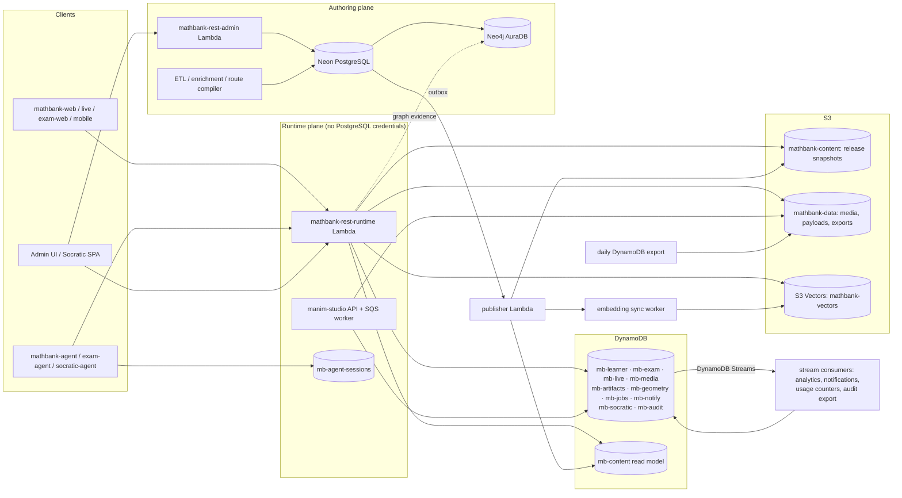

# 70. DynamoDB and S3 Vectors migration and implementation plan

**Status: data plane provisioned and data copied (dev); application cutover not started.**
- **Created** in AWS account 848941468793 / us-east-2: 12 `mb-*-dev` DynamoDB tables, the `mathbank-data` and `mathbank-content` buckets, and S3 Vectors bucket `mathbank-vectors-dev` with 12 indexes.
- **Copied** from Neon (read-only) and verified: all rows into DynamoDB plus S3, and all 129,529 vectors into S3 Vectors.
- **Unchanged:** the applications still read and write PostgreSQL. Nothing in Neon was changed or dropped. Contexts move over through the §7 runbook.
- **Scripts:** [mathbank-db/aws/](../../mathbank-db/aws/README.md). Run records: [mathbank-db/aws/runs/](../../mathbank-db/aws/runs/README.md).
**Decision (2026-11-02, product owner):** adopt DynamoDB and S3 Vectors **regardless of cost
savings**. The target is the **maximal hybrid** end state: everything the learner and staff
runtime touches moves off PostgreSQL. Search becomes **vectors only** (no PostgreSQL
full-text or trigram search at runtime). Neo4j AuraDB stays as the graph projection.
**Every finding** in the [per-schema documentation](../database/schemas/) is resolved as part of
this program (§9, Appendix B).

Builds on report [66](66_AWS_STORAGE_DATABASE_COST_AND_MIGRATION_REPORT.md) and register
[66A](66A_POSTGRES_TABLE_MIGRATION_ASSESSMENT.md); their per-table codes are superseded by the
placement in §3 and Appendix A. Related: [database README](../database/README.md) ·
[REST CRUD design guide](../database/REST_CRUD_DESIGN_GUIDE.md) ·
[requirement 63](63_AWS_SERVERLESS_DEPLOYMENT_IMPLEMENTATION.md) (AWS deployment) ·
[requirement 65](65_ADAPTIVE_SOCRATIC_ADMIN_AND_AGENTCORE.md) (Socratic Studio).

## Contents

1. [Live baseline](#1-live-baseline-read-only-snapshot-2026-11-03)
2. [End state](#2-end-state)
3. [Placement summary](#3-placement-summary)
4. [Architecture](#4-architecture)
5. [Cross-cutting design rules](#5-cross-cutting-design-rules)
6. [Program phases M0–M10](#6-program-phases-m0m10)
7. [Cutover and rollback mechanics](#7-cutover-and-rollback-mechanics)
8. [Infrastructure (CDK)](#8-infrastructure-cdk)
9. [Findings resolution — summary](#9-findings-resolution--summary)
10. [Testing and acceptance](#10-testing-and-acceptance)
11. [Risks](#11-risks)
12. [Open decisions](#12-open-decisions)
13. [Detailed designs C1–C7](#13-detailed-designs-c1c7)
- [Appendix A — placement register (all 229 tables)](#appendix-a--placement-register-all-229-tables)
- [Appendix B — findings traceability (all IDs)](#appendix-b--findings-traceability-all-ids)
- [Appendix C — re-measurement queries](#appendix-c--re-measurement-queries-read-only)


## 1. Live baseline (read-only snapshot, 2026-11-03)

Collected over a read-only session (`SET default_transaction_read_only = on`) on the Neon
`neondb` database. Only catalog/statistics views and aggregate counts were read; no row
contents. No credentials appear in this document: connection details live in SSM or the
operator's environment. Re-run Appendix C before each phase gate.

| Fact | Value |
|---|---|
| Engine | PostgreSQL 18.6 on Neon (pooled endpoint, us-east-2). Extensions: `vector` 0.8.6, `pg_trgm` 1.6, `pg_session_jwt` 0.5.0 |
| Size | 3,614 MB database |
| Tables | 228 live: 210 of the 211 `mathbank-db/sql` tables, 4 `geometry_scene`, 5 `agent_sessions` (ADK) and 9 `neon_auth`. `notification.event` is missing (migration 043 never applied). |
| Where the bytes are | `knowledge` 1,414 MB · `search` 1,036 MB · `pedagogy` 942 MB · `ingest` 139 MB · `core` 58 MB · the other 17 schemas ≈ 11 MB combined |
| Vectors | 129,529, all `text-embedding-3-small` 1,536-dim cosine, ≈ 2.0 GiB (54% of relation bytes), with HNSW indexes of 971 MB. By family: misconception 70,018 · taxonomy node 6,968 · search 52,543 (learning item 22,372, solution 14,856, solution step 7,814, problem 7,000, other 501) · theorem 0 · artifact 0 |
| Runtime data volume | Every learner/quiz/live/runtime schema is under 2 MB (e.g. 41 student profiles, 25 quiz papers, 11 live sessions). **This makes short write-freeze cutovers practical (§7).** |
| Compute | Running continuously since 2026-10-29 07:01 UTC, about 1.9 commits/s. Kept awake by the manim-studio worker on an EventBridge `rate(1 minute)` schedule polling `studio.*`, plus likely developer/admin pollers. |

## 2. End state

| Plane | Store | Holds | Who reads/writes |
|---|---|---|---|
| **Runtime state** | DynamoDB: 10 context tables (`mb-learner`, `mb-exam`, `mb-live`, `mb-media`, `mb-artifacts`, `mb-geometry`, `mb-jobs`, `mb-notify`, `mb-socratic`, `mb-agent-sessions`) plus `mb-audit` | Learner identity and every learner-, session- or staff-runtime record | `mathbank-rest-runtime` Lambda, manim-studio, the agents (ADK sessions), Socratic app |
| **Published content** | DynamoDB `mb-content` + S3 `mathbank-content-<env>` (immutable, hash-addressed release snapshots) | Learner-visible projection of authored content (problems, catalogs, releases, learning items, activities, interaction templates, videos), with server-only attributes kept apart | Read by the runtime. Written **only** by the publisher. |
| **Vectors** | S3 Vectors bucket `mathbank-vectors-<env>`: one index per family and model version | All embeddings | Search/similarity code via the `vector_store` adapter; written by the embedding sync worker |
| **Bytes and archives** | S3 `mathbank-data-<env>` | Media, renders, large JSON payloads, Parquet exports, daily DynamoDB exports for Athena | Owners of each context |
| **Authoring and ETL** | Neon PostgreSQL (smaller, no pgvector, no runtime traffic) | Corpus, catalogs, review/approval, release authoring, ETL bookkeeping, PG audit, outbox | `mathbank-rest-admin` Lambda, ETL scripts, Neo4j projector, publisher (read-only) |
| **Graph** | Neo4j AuraDB (unchanged) | Projection of authored content | Projector from PostgreSQL; hybrid-search graph evidence |

**Invariants**
1. The runtime Lambda has **no PostgreSQL credentials**.
2. Each fact has exactly one authoritative store.
3. Copies are derived only through an outbox or a stream, never by dual writes.
4. Learner-owned data is partitioned by `STUDENT#<id>`, so authorization is a key condition and erasure is deleting by partition.
5. Answer keys and solutions live in server-only items and are never serialized before the learner is entitled to them.

## 3. Placement summary

| Target | Tables | Live bytes | Meaning |
|---|---:|---:|---|
| **DDB** | 84 | 6.5 MB | Authoritative in DynamoDB: 83 tables, plus `quiz.question_pool` with a vector near-duplicate index. Includes `pedagogy.step_hint`, which the runtime writes and which becomes a runtime-owned item in `mb-content`. |
| **F→DDB** | 5 | 1.2 MB | ADK framework session store, re-implemented as a DynamoDB `SessionService` |
| **S3V** | 5 | 2,021.7 MB | Vector payloads go to S3 Vectors. SQL keeps id/model/hash metadata until the column/table is retired. |
| **PG+RM** | 73 | 1,071.3 MB | Authored in PostgreSQL and projected to `mb-content` / S3 snapshots for the runtime |
| **PG** | 53 | 497.7 MB | Authoring/ETL only: review logs, enrichment jobs, compiler queues, outbox, similarity tables (feed Neo4j), lineage |
| **F** | 9 | 0.3 MB | `neon_auth` provider tables (0 users). Retired with Neon Auth if confirmed unused (open decision 4). |

Appendix A lists every table. The PostgreSQL that remains is about 1.5 GB with **no runtime
traffic**, so it can scale to zero whenever nobody is authoring or running ETL.

## 4. Architecture



**Event plumbing**
- **Authoring to runtime:** `pipeline.outbox_event` (written in the same PostgreSQL transaction as a publish/approve/withdraw) → an outbox relay Lambda (scheduled only while the authoring plane is awake, or triggered by the admin Lambda after commit) → SQS `content-events` → publisher → `mb-content` / S3 snapshot / embedding sync.
- **Runtime to runtime:** DynamoDB Streams → idempotent consumers. These replace the runtime producers of the SQL outbox (`ATTEMPT_*`, `STEP_EVALUATED`, `LEARNER_SIGNAL`, `LIVE_EVENT`, ...).
- **Runtime to authoring** (learner feedback for review, usage counts for deactivation guards): stream consumers write small summary items, which the admin Lambda reads through the DynamoDB API. No runtime component writes to PostgreSQL.

## 5. Cross-cutting design rules

These are the conventions every context design in §13 follows.

| Topic | Rule |
|---|---|
| Tables | One table per bounded context, single-table design inside it, named `mb-<context>-<env>`. Settings: on-demand billing, PITR on, deletion protection on, `RemovalPolicy.RETAIN`, SSE (AWS-owned key in dev, CMK in prod). |
| Keys | Generic `PK`/`SK`, `GSI1PK/GSI1SK`, `GSI2PK/GSI2SK` (sparse where possible), plus `type` and `version`. Existing UUIDs and codes are kept as identifiers, so Neo4j, PostgreSQL and S3 references stay valid. |
| Concurrency | Every mutable item has `version`, and updates use `ConditionExpression version = :expected`. These replace `FOR UPDATE`, `SKIP LOCKED`, `expected_revision` and `expected_hash`. |
| Atomicity | `TransactWriteItems` (≤ 100 items, ≤ 4 MB; may span the context table, `mb-audit` and uniqueness sentinels). The aggregates are sized to stay under these limits. |
| Constraints | **FK** → existence check against `mb-content` or the same table, inside the transaction where needed. **UNIQUE** → sentinel item `UNIQUE#<field>#<value>` with `attribute_not_exists`. **CHECK/enums** → Pydantic models plus store validation (one shared `Literal` per enum). **Immutability triggers** → `attribute_not_exists` on create and no update path. **Cascade** → delete-by-partition or a stream consumer. |
| Idempotency | Client `Idempotency-Key` → receipt item `IDEMP#<key>` written in the **same** transaction as the effect, holding the response hash and returning the stored response on replay. Replaces `learner.idempotency_record` and `live.command_receipt`, and **binds the receipt to the actor**. |
| Large items | Anything > ~100 KB or binary → S3 object referenced by key + sha256. Learners get only short-lived presigned URLs. |
| Pagination | Opaque, HMAC-signed `next_token` wrapping `LastEvaluatedKey`. List responses keep the guide's `{items, total?, limit, next_token}` shape; `total` only where a counter item exists. |
| Reporting | Interactive admin lists use bounded GSIs. Cross-learner analytics use Athena over the daily `ExportTableToPointInTime` Parquet in S3. **No `Scan` in request paths.** |
| Retention | `ttl` attribute (epoch seconds) for disposable items. Privacy deletes are always explicit (TTL is asynchronous). |
| Audit | Staff/admin mutations against DynamoDB write an `mb-audit` item in the same transaction. PostgreSQL mutations keep `audit.action_log`. Both are exported daily for one Athena view. |
| Code | `mathbank_rest/stores/<context>/` with a `Protocol`, `postgres.py` (current SQL, moved out of routers/services) and `dynamodb.py`, selected by `<CONTEXT>_STORE`. Shared helpers in `stores/ddb.py`. Routers contain no SQL and no boto3 (guide §2). |
| Search | Vectors only. Problem search uses filtered ANN. Step search scores **exactly** in Lambda over a small eligible set and uses filtered ANN with oversampling for large sets (C6). Neo4j graph evidence is kept for hybrid search. |

## 6. Program phases M0–M10

Phases are ordered by dependency. Within a phase, contexts cut over one at a time behind
their flag. Effort is in engineer-weeks (EW) for one engineer familiar with the codebase,
including tests and documentation.

| Phase | Scope | Depends on | Exit gate | Effort |
|---|---|---|---|---|
| **M0 Foundations** | `MathBankDataPlaneStack` (all tables, buckets, vector bucket, queues, streams, IAM skeleton). `stores/` package and `ddb.py` helpers. DynamoDB Local + ElasticMQ in `make dev`. `mathbank-migrate` CLI (export/transform/load/verify/rollback per context, sha256 manifests). Contract-parity harness. Split `mathbank-rest` into `-runtime` and `-admin` Lambdas (same code, different routers and IAM). | — | CDK synth/deploy to dev. Parity harness green against the PostgreSQL stores. Runtime Lambda deploys without a DSN using stub stores. | 4 |
| **M1 PostgreSQL pre-work (C7)** | Fixes that must land **before** anything is copied (answer-key leaks, release immutability, ungoverned writers, publish-path outbox+audit). FK removals prepared. | M0 | C7 §4 "before" list done. Migrations applied to the dev branch, then prod. | 3 |
| **M2 Vectors** | Vector bucket and all indexes. Copy 129,529 vectors (no re-embedding). Embedding sync worker. Similarity rebuild from S3 Vectors. Vectors-only problem/step/hybrid search. Parquet export, then drop pgvector columns/indexes. | M0, M1 | C6 parity gates (recall, eligibility, latency). PostgreSQL size drops ≥ 1.9 GB. `DROP EXTENSION vector` at M10. | 4 |
| **M3 Jobs and notifications** | `mb-jobs` + SQS for Studio (EventBridge poll deleted). `mb-notify` inbox fed by streams/outbox. | M0 | Neon idles to suspend when nobody uses Studio. Notification authz/idempotency tests. | 2 |
| **M4 Content read model** | `mb-content` + snapshots. Publisher, backfill, reconciliation job. Every public/learner content read switched to the read model. | M1, M2 | Reconciliation reports 0 diffs. Anonymous endpoints make 0 PostgreSQL queries (verified by the runtime Lambda having no DSN). | 5 |
| **M5 Learner runtime** | `mb-learner`: identity, attempts, mastery, step runtime, gap/recovery, micro-course enrollment/runtime, events, analytics rollups. | M4 | Contract parity. Erasure test. Idempotency replay test. Mastery equals the PostgreSQL computation on replayed fixtures. | 6 |
| **M6 Exams** | `mb-exam`, including exam-agent integration routes and the vector question pool | M4, M5 | Parity. No answer key before submit. Agent integration e2e. | 3 |
| **M7 Live classroom and lesson authoring** | `mb-live`: sessions, events (cursor reads), receipts, polls, widgets, presentation plans | M4, M5 | Parity. Gateway e2e. Actor-bound receipts. | 3 |
| **M8 Media, artifacts, geometry** | `mb-media`, `mb-artifacts`, `mb-geometry`, private/public artifact vectors | M4, M5 | Parity. Presigned-URL-only. Version immutability tests. | 3 |
| **M9 Socratic, ADK sessions, audit** | `mb-socratic`, `mb-agent-sessions` (custom ADK `SessionService` for all agents), `mb-audit` export | M0, M5 | ADK conformance tests. Socratic CAS tests. Unified audit Athena view. | 3 |
| **M10 Decommission** | Drop moved PostgreSQL tables after the 30-day windows. `DROP EXTENSION vector`. Remove the runtime DSN and SSM parameter. Update all schema docs and the mathbank-db skill. Retire `neon_auth` if unused. | all | Invoice shows PostgreSQL runtime traffic gone. Docs regenerated. | 2 |

**Total ≈ 38 EW.** M2/M3 can run in parallel with M1; M6–M9 can run in parallel after M5.

## 7. Cutover and rollback mechanics

Every context follows the same runbook. Volumes are tiny (§1), so each cutover finishes in
minutes.

| Step | Action | Check |
|---|---|---|
| 1 Prepare | Deploy the DynamoDB store dark (`<CTX>_STORE=postgres`). Run contract parity in CI against both stores on fixtures. | Parity suite green |
| 2 Dry run | `mathbank-migrate <ctx> export|transform|load --target dev` from a Neon **branch** of production | Counts and per-item sha256 manifest match. App smoke tests pass on dev. |
| 3 Freeze | Set the context's maintenance flag: writes return `503 Retry-After`, reads continue. Drain in-flight jobs/queues. | No writes in the PostgreSQL stats for N minutes |
| 4 Copy | Export → transform → `BatchWriteItem` (idempotent, deterministic keys) | Manifest equal: counts per item type, sha256 of canonical JSON per row/item |
| 5 Switch | `<CTX>_STORE=dynamodb` and remove the freeze. Revoke the runtime role's grants on those PostgreSQL tables (`REVOKE INSERT, UPDATE, DELETE`). | Synthetic e2e passes. Error rate and latency are within SLO for 1 h. |
| 6 Observe | 30-day recovery window. PostgreSQL tables stay read-only and untouched. | Weekly reconciliation report |
| 7 Retire | Migration drops the PostgreSQL tables. Docs updated. | Restore drill from PITR/S3 export completed once |

**Rollback (inside the window):**
1. Freeze.
2. `mathbank-migrate <ctx> reverse --since <cutover_ts>` copies items created or changed after cutover back into PostgreSQL. The transforms are bijective by design, and the tests prove it.
3. Flip the flag back and unfreeze.

**After the window:** restore the PostgreSQL tables from Neon history or a snapshot, or rebuild them from the DynamoDB export.

There are **no dual writes at any time**. The freeze is the consistency mechanism.

## 8. Infrastructure (CDK)

All resources live in the single CDK project `mathbank-infra-aws` (installed `aws-cdk-lib`
already provides `aws_s3vectors` L1 constructs and `aws_dynamodb` / `aws_sqs`).

> **Implemented so far:** the data-plane tables, buckets, vector bucket and indexes were created by the
> idempotent provisioning scripts in [mathbank-db/aws/](../../mathbank-db/aws/README.md)
> (`make aws-provision`). Their definitions (keys, GSIs including INCLUDE projections, streams, TTL, PITR,
> deletion protection, encryption, tags) are the source to port into `stacks/data_plane_stack.py`, so the
> CDK stack can adopt these resources rather than recreate them. SQS queues, Lambdas, IAM and alarms below
> are not created yet; they belong to each context's cutover.

| Resource | Details |
|---|---|
| `stacks/data_plane_stack.py` (new) | 11 DynamoDB tables + `mb-content` (keys and GSIs per §13 designs), streams on `mb-learner`, `mb-exam`, `mb-live`, `mb-media`, `mb-socratic` and `mb-notify` (`NEW_AND_OLD_IMAGES`). Buckets `mathbank-content-<env>` (versioned, Object Lock off, lifecycle to IA after 90 days) and `mathbank-data-<env>` (private, block public access, TLS-only policy). Vector bucket `mathbank-vectors-<env>` with indexes per C6 (`CfnVectorBucket`, `CfnIndex`). SQS queues: `content-events`, `embedding-sync`, `studio-research`, `studio-render`, each with a DLQ. Glue database + Athena workgroup for exports. |
| Lambdas | `mathbank-rest-runtime` (no DSN, DynamoDB/S3/S3 Vectors grants scoped to ARNs), `mathbank-rest-admin` (DSN + read-only DynamoDB for staff views + SQS send), `publisher`, `embedding-sync`, `outbox-relay`, stream consumers (`learner-analytics`, `notifications`, `usage-counters`, `audit-export`), `ddb-export` (daily schedule), manim-studio worker (SQS-triggered). |
| IAM | One role per Lambda. Actions are listed explicitly (no `dynamodb:*` / `s3vectors:*`). Resource ARNs include index ARNs (`/index/*` only where needed). `kms:Decrypt` scoped to the CMK. |
| Config | SSM parameters per flag: `/mathbank/<env>/stores/<ctx>` (`postgres`/`dynamodb`/`frozen`). The Lambdas read them at cold start with a 60 s refresh, so flags flip without redeploying. |
| Observability | Alarms: DLQ depth > 0, stream iterator age > 5 min, throttles, conditional-check-failure rate spikes, Lambda errors, S3 Vectors 5xx. A dashboard per context. Structured logs with `request_id`, `student_id` hash and `ctx`. |
| Local | `docker compose` profile: DynamoDB Local, ElasticMQ, MinIO. The S3 Vectors stub implements the `vector_store` protocol in memory with exact cosine. `make dev-data` seeds from fixtures. |


## 9. Findings resolution — summary

Every top-level item in §4 (findings), §5.1 (schema improvements) and §5.3 (endpoints to build) of each [schema document](../database/schemas/) got a stable ID (`<DOC>-<F|S|E><nn>`). Each one is resolved in the **Findings resolution** table of at least one detailed design (§13). Appendix B is the complete traceability list, with the design section and phase for each ID. The list is regenerated by the assembly check, and the program does not exit M10 while any ID is unresolved.

| Kind | Items |
|---|---:|
| §4 finding | 291 |
| §5.1 schema improvement | 215 |
| §5.3 endpoint to build | 254 |
| **Total** | **760** |

| Design | IDs resolved |
|---|---:|
| C1 | 120 |
| C2 | 32 |
| C3 | 116 |
| C4 | 97 |
| C5 | 40 |
| C6 | 433 |
| C7 | 428 |


## 10. Testing and acceptance

| Layer | What | Tooling | Gate |
|---|---|---|---|
| Store unit | Every conditional write, transaction composition, sentinel, idempotent replay, TTL/expiry check, pagination-token tamper | `moto` (DynamoDB, S3, SQS) and an in-memory S3 Vectors stub | M0 onward, required per PR |
| Store integration | Same suites against DynamoDB Local/ElasticMQ/MinIO, plus concurrency tests (parallel claims, double submits) | `docker compose` profile | Per phase |
| Contract parity | Record API responses from the PostgreSQL store on fixtures, replay against the DynamoDB store, and structurally diff (ignore volatile fields) | `tests/parity/` harness | Cutover step 1 |
| Authorization | Every runtime route: 401 without auth, 404 for another owner's id, and a learner serializer snapshot test that **fails if any answer-key/solution field appears before entitlement** | pytest + schema snapshots | Each phase |
| Search quality | Recall@k vs the exact baseline per filter family, nDCG@10 on labelled sets, zero ineligible results, p95 latency | C6 harness | M2 |
| Migration | Manifest equality (counts and sha256), reverse-copy round trip (PG → DDB → PG equal), and a rehearsal on a Neon branch | `mathbank-migrate verify` | Cutover steps 2/4 |
| Erasure | Create a learner with data in every context, erase, then verify zero items under `STUDENT#<id>`, no S3 objects under their prefix, and vectors deleted from private indexes | e2e | M5, re-run at M8/M10 |
| Resilience | Throttling (forced), stream consumer failure → DLQ → replay, outbox relay restart, publisher replay idempotency | fault injection in dev | M4/M5 |
| Findings | Every Appendix B row has a linked test, or a "verified by" note when the resolution is structural | traceability check script | M10 |

## 11. Risks

| Risk | Impact | Mitigation |
|---|---|---|
| Access patterns not anticipated (new admin reports) | A `Scan` creeps in, or features stall | Reporting goes through Athena exports by rule. A GSI is added via CDK when a bounded interactive list is needed. Code review lint forbids `scan(` in request paths. |
| Lost relational guarantees (FK/UNIQUE/CHECK) | Data drift | Sentinels, conditional checks, shared enum `Literal`s, nightly reconciliation (`mb-content` vs PostgreSQL, usage counters) |
| Read-model staleness after publish | Learners see old content briefly | Publisher latency SLO (< 60 s). Release activation flips only after the snapshot write succeeds (pointer swap). Withdrawal propagates first. |
| Lower recall from filtered ANN | Missed relevant content | Exact scoring path for small eligible sets. Per-filter recall gates. The degraded flag is surfaced, never a silent empty result. |
| Removing lexical search (vectors only) | Exact-code/term queries (e.g. "AMC 10A 2019 #12") get worse | `canonical_code` lookups go through a direct `mb-content` key get, checked before vector search. Labelled queries in the M2 benchmark. |
| Transaction limits (100 items / 4 MB) | Large aggregate writes fail | Aggregates sized in C1–C5. Large payloads offloaded to S3. Bulk operations use idempotent batches, not transactions. |
| Hot partitions (live session events, popular content) | Throttling | Per-session sequence counter. Read-model items cached in Lambda memory. On-demand capacity. |
| ADK custom SessionService drift with ADK upgrades | Agent breakage | Pin the ADK version. Conformance tests derived from ADK's own session tests. Upgrade checklist. |
| Two audit stores | Incomplete audits | Single Athena view. M10 check that every admin/staff mutation path writes exactly one audit record. |
| Lock-in and operational surface | More services to run | IaC for everything. Runbooks per context. Restore drills. |

## 12. Open decisions

| # | Decision | Default |
|---|---|---|
| 1 | Recovery window before dropping migrated PostgreSQL tables | 30 days |
| 2 | Encryption keys: one CMK per environment or per context | One per environment |
| 3 | Notification retention / learner event retention in DynamoDB | 90 days / indefinite (events are evidence) |
| 4 | Retire `neon_auth` (0 users) together with the Neon Auth integration | Yes, at M10, if no code references remain |
| 5 | Keep the Neon project after M10 for the authoring plane, or move authoring to Aurora Serverless v2 later | Keep Neon (out of scope) |
| 6 | Live updates: keep cursor polling of `/events` or add Streams → WebSocket push | Cursor polling first, push later |

**Behaviour changes surfaced by the detailed designs (sign-off needed before the named phase):**

| # | Design | Decision | Default in the design |
|---|---|---|---|
| 7 | C6 (M4) | Anonymous `GET /v1/problems` and `/by-code/{code}` return `official_answer` and full solutions today | Kept for parity behind `CONTENT_PUBLIC_ANSWERS=true`. **Recommendation: off.** |
| 8 | C6 (M2) | Dropping lexical search changes ranking for exact-term queries (names, numbers) | Direct `canonical_code` lookup first, then semantic. Gate measured against a semantic baseline. |
| 9 | C2/C6 (M6) | Question-pool similarity: trigram ≥ 0.5 has no cosine equivalent | Near-duplicate ≥ 0.95 and topic ≥ 0.75–0.80 cosine, recalibrated once the pool has rows |
| 10 | C2 (M6) | Strict exam status transitions, submit → `GRADED` directly, `GET review` no longer writes, draft and generation-event retention 90/180 days | Behind `QUIZ_STRICT_EXAM_POLICY` |
| 11 | C1 (M5) | Early hand-in (`SUBMITTED`) counts against mastery | `is_correct=false`, configurable to NULL (excluded) |
| 12 | C1 (M5) | Erasure: hard delete plus tombstone vs. scrub PII in place | Hard delete plus tombstone |
| 13 | C1 (M5–M6) | Quiz responses stay in PostgreSQL until M6 while their mastery evidence moves at M5 (non-atomic window) | Repair consumer plus nightly reconcile; or schedule M5 and M6 back to back |
| 14 | C1/C5 (M5–M9) | ADK sessions are read from PostgreSQL until M9 (an exception to "runtime has no DSN") | Move M9's ADK part ahead of M5 if the exception is unacceptable |
| 15 | C3 (M7) | `authoring.*` presentation plans live in `mb-live` (vs. PostgreSQL + `mb-content`) | `mb-live` |
| 16 | C3 (M7) | Per-session instructor ownership still relies on the shared admin key + `X-Actor-Id` until per-staff identity exists | Ownership checks plus per-admin keys (C7); real staff login tracked separately |
| 17 | C3 (M7) | One sequence-counter item per live session limits burst submits | Load-test gate: 60 concurrent submits in 2 s, all accepted with no sequence gaps |
| 18 | C4 (M8) | Existing media bytes may sit in a non-AWS S3-compatible store; presigned URLs would point at it | Copy the ≈ 7 existing objects to `mathbank-data-<env>` at cutover |
| 19 | C4 (M8) | Artifact text search must embed the query (paid, rate-limited) or return `UNAVAILABLE` | Embed with a per-learner rate limit |
| 20 | C4 (M8) | Async geometry interpret changes the agent tool contract | Synchronous path behind a flag until the agent polls |
| 21 | C5 (M9) | Socratic sources bind only *published* problems/solutions/routes (that is all `mb-content` holds) | Published only |
| 22 | C5 (M5) | Admin student search becomes exact email or UUID (no substring) | Exact match; substring search via Athena |
| 23 | C5 (M9) | Retention for stored agent conversations | 365 days, pending privacy approval |
| 24 | C7 (M1) | Declined items: PSF-E17 (drop `solution_step_theorem`), KNC-S06 (no theorem full-text, vectors only), PMC-S08 (item-table redesign deferred), PMC-F06 (drop unused transition types after verifying no rows) | As listed |


## 13. Detailed designs C1–C7

Each design follows the shared template: scope, access patterns, key schema, write paths and transactions, streams/TTL/S3, authorization and privacy, data migration, code changes, tests, risks, and findings resolution.


### C1 Learner runtime — `mb-learner`

#### 1. Scope

Table `mb-learner-<env>`. One single-table design. Every learner-owned item sits under `PK = STUDENT#<student_id>`. A few global items (uniqueness sentinels, owner pointers, cohort aggregates, the retrieval-exclusion list, erasure tombstones) use their own partitions. Merged 1:1 tables: `tutor.runtime_state` is folded into the `SOLVE` item and `tutor.micro_course_runtime` into the `ENROLL` item. Their PK/FK pair becomes one item, so the two rows can no longer diverge (TUT-S01/S02).

| Source table (live rows) | Item type(s) | Notes |
|---|---|---|
| learner.student_profile (41) | `PROFILE`, `UNIQUE#email`, `UNIQUE#cognito_sub` | `email_lc` normalised (trim+lower). `password_hash` = bcrypt, or literal `!COGNITO` for Cognito rows (replaces the random 64-hex value). Adds `token_version`, `disabled_at`, `status` enum `ACTIVE/DISABLED/ERASING`. |
| learner.attempt (35) | `OUTCOME` (+ `MEVID` fan-out, `PROBLEM` cursor) | Immutable. `source` enum `web/agent_chat/import/step_runtime/multimodal_approved/quiz`. |
| learner.concept_mastery (70), technique_mastery (29) | `MASTERY` (`C`/`T` discriminator) | Written in the same transaction as the evidence. |
| learner.solve_attempt (8) + tutor.runtime_state (8) | `SOLVE`, `OWNER` pointer `SOLVE#<id>` | `state_version` is the item's `version`. Counters `hint_requested_count` and `last_activity_at`, plus `plan_ids` list. |
| learner.attempt_step_state (9) | `STEPSTATE` | Adds `skill_node_id`, `subconcept_node_id` (denormalised from content at present time) and `returned_to_step_count` / `returned_to_problem_count`. |
| learner.event (243) | `EVENT` | Append-only. The teacher payload is stored; the learner view is projected through an allow-list. |
| learner.idempotency_record (173) | `IDEM` | TTL 7 d (`ttl`). |
| learner.micro_course_enrollment (6) + tutor.micro_course_runtime (6) | `ENROLL`, `UNIQUE#open_enroll`, `OWNER` pointer `ENROLL#<id>` | Adds `last_responses` map (resume), `state_version`. The dead `current_video_*`/`active_intervention_id` columns are not migrated (TUT-S04). |
| learner.micro_course_state_event (25) | `MCEVENT` | Append-only. Enum `ENROLLED/STATE_CHANGED/COMPLETED/QUIZ_RESPONSE/ACTIVITY_RESPONSE/ABANDONED/RESET`. |
| learner.interaction_event (1) | `IXEVENT` | Append-only. JSON fields > 64 KB each go to S3. |
| learner.misconception_evidence (0) | `MISCEVID`, `MISCSTATE` | `MISCSTATE` holds the running confidence (versioned), which replaces the unlocked "latest row" read. |
| learner.route_attempt (2) | `ROUTE`, `UNIQUE#open_route` | Adds `status` IN_PROGRESS/FINISHED/ABANDONED and `finished_at`. |
| learner.pedagogy_feedback (0) | `FEEDBACK`, `UNIQUE#feedback`, `OWNER` pointer `FEEDBACK#<id>`, `RETRIEVAL_EXCLUSION` | `requested_node_id` and `reviewed_by` promoted to attributes. |
| learner.agent_session_link (77) | `AGENTLINK`, `UNIQUE#agent_session` | ADK sessions themselves live in `mb-agent-sessions` (M9). |
| pedagogy.gap_diagnosis (3) | `DIAG`, `UNIQUE#diag_fp` | `ai_rerank` is set once (conditional). |
| pedagogy.knowledge_gap (3) | `GAP` | Versioned status machine. |
| pedagogy.recovery_plan (19) + recovery_plan_item (111) | `PLAN` with embedded `items[]`, `OWNER` pointer `PLAN#<id>` | Items are embedded (≤ 20 per plan). The two-phase ordinal shift disappears: one CAS UpdateItem per plan change. |
| analytics.learner_daily_activity (5) | `DAILY`, `APPLIED` (consumer idempotency, TTL 48 h) | Maintained by the Streams consumer `learner-analytics`. |
| (new) | `COHORT` (`PK=COHORT#CONCEPT`) | Maintained by the Streams consumer `mastery-cohort` for the admin weak-concepts view. |
| pipeline.outbox_event producers in step_runtime / step_diagnosis / step_recovery / micro_course_service | — | Replaced by DynamoDB Streams on `EVENT`/`IXEVENT`/`MCEVENT` items (§5). |

**Stays in PostgreSQL:** nothing from these 22 tables. They become read-only at cutover and are dropped after 30 days. Runtime reads that previously joined PostgreSQL content are listed below; each is now served by `mb-content` through the C6 content store, with no PG access:

| Content | Previously read from |
|---|---|
| Problem tags | `knowledge.problem_concept`/`problem_technique`, APPROVED only |
| Published solution steps and step dependencies | `pedagogy.solution_step`, `solution_step_dependency` |
| Learning items and probes | — |
| Micro-course release states/transitions | — |
| Route releases/instructions | — |
| Misconception evidence rules | — |
| `core.problem` code ↔ id resolution | — |

Route authoring tables (`solution_route_release` etc.) remain C7 authoring.

#### 2. Access patterns

All learner paths take `sid` from the verified JWT. PK = `STUDENT#<sid>` is therefore the authorization: a foreign id simply returns no item, which maps to 404.

| # | Pattern | Callers (endpoint / function) | Key condition / index | Consistency |
|---|---|---|---|---|
| A1 | Validate token subject is active | `security.get_current_student_id`, `get_optional_student_id` | GetItem `STUDENT#sid`/`PROFILE`, projection `status,token_version` (30 s per-container cache) | Strong |
| A2 | Login by email | `POST /v1/learner/login` (`get_student_by_email`) | GetItem `UNIQUE#email#<email_lc>`/`UNIQUE` → GetItem PROFILE | Strong |
| A3 | Profile by id | `GET /v1/learner/me`, `GET /v1/quiz-integration/students/{id}`, `GET /v1/admin/learner/students/{id}`, `live_runtime.join_session` (display_name) | GetItem PROFILE | Strong |
| A4 | Profile by Cognito sub | `GET /v1/quiz-integration/students/by-cognito-sub/{sub}`, `mint-session-token` | GetItem `UNIQUE#cognito_sub#<sub>` → PROFILE | Strong |
| A5 | Admin student search | `GET /v1/admin/learner/students?q&status` | Query GSI2 `STUDENT_DIR`, SK = `email_lc#sid`, Filter `contains(search_blob,:q)` / `status` | Eventual |
| A6 | Own outcome history | `GET /v1/learner/attempts` (`list_attempts`), admin `/students/{id}/attempts` | Query PK, `begins_with(SK,'OUTCOME#')`, desc | Strong |
| A7 | Evidence for one concept/technique | `mastery.recompute_*` (`get_attempts_for_concept/technique`) | Query PK, `begins_with(SK,'MEVID#C#<cid>#')` | Strong |
| A8 | Mastery summary / improvement plan / quiz targets | `GET /v1/learner/mastery`, `/mastery/improvement-plan`, `POST /v1/quiz/generate`, `exam_integration` mastery-summary / diagnosis-input | Query PK, `begins_with(SK,'MASTERY#')` | Strong |
| A9 | Practice progress / exposure filter | `GET /v1/learner/practice-progress`, `topic_pedagogy.topic_candidates` | Query PK, `begins_with(SK,'PROBLEM#')` | Eventual OK |
| A10 | Open solve for problem + attempt sequence | `start_attempt` | GetItem `PROBLEM#<pid>` | Strong |
| A11 | Runtime view | `GET /v1/attempts/{id}[/runtime]`, start, `geometry_interpretation.interpret_scene` | GetItem `SOLVE#<id>` + Query `begins_with(SK,'SOLVE#<id>#')` (steps, diags, fp sentinels) | Strong |
| A12 | Resolve solve owner without a JWT | `POST …/outcome` (admin), `GET /v1/admin/attempts/{id}/diagnoses`, `GET /v1/admin/attempts/{id}/runtime` | GetItem `SOLVE#<id>`/`OWNER` → A11 | Strong |
| A13 | My solve sessions | `GET /v1/learner/solve-attempts?status` | Query GSI2 `STUDENT#sid#SOLVES`, SK = `started_at#id`, Filter status | Eventual |
| A14 | Skill history across attempts | `step_diagnosis._skill_history` | Query GSI2 `STUDENT#sid#SKILL#<skill>` (STEPSTATE) | Eventual (current step excluded) |
| A15 | Stale open sessions | `learner-abandon-stale` job (was `outbox_worker --abandon-idle-days`) | Query GSI1 `OPEN_SOLVE#<0..3>`, SK < cutoff | Eventual, then CAS |
| A16 | Learner event feed | `GET /v1/students/{sid}/events`, `GET /v1/learner/events?attempt_id&after` | Query PK `begins_with 'EVT#'` desc; with attempt: GSI1 `SOLVE#<aid>`, `begins_with 'EVT#'` | Strong / Eventual |
| A17 | Admin events | `GET /v1/admin/learner/students/{id}/events` | as A16 (full payload) | Strong |
| A18 | Idempotency replay | `_replay` (all step/recovery/micro-course mutations) | GetItem `IDEM#<key>` | Strong |
| A19 | Diagnoses of an attempt | `GET /v1/attempts/{id}/diagnoses`, `latest_for_step` | Query `begins_with 'SOLVE#<aid>#DIAG#'` | Strong |
| A20 | Open gaps for a skill/subconcept | `update_gap_statuses`, `topic_candidates` (open gap skills) | Query PK `begins_with 'GAP#'`, Filter `status IN (UNRESOLVED,CONFIRMED)` and target | Strong |
| A21 | Learner gap list | `GET /v1/learner/knowledge-gaps`, admin `/students/{id}/knowledge-gaps` | Query `begins_with 'GAP#'` | Strong |
| A22 | Admin gap overview | `GET /v1/admin/knowledge-gaps` (`admin_gap_overview`) | Query GSI1 `GAPSTATUS#<s>` (one per status) desc + BatchGet PROFILE for email; totals = `Select=COUNT` | Eventual |
| A23 | Recovery plan by id | `GET /v1/recovery-plans/{id}`, `/next`, responses, resume, abort | GetItem `PLAN#<id>` | Strong |
| A24 | Plans of an attempt | `GET /v1/attempts/{id}/recovery-plans` | `SOLVE.plan_ids` → BatchGet `PLAN#…` | Strong |
| A25 | Admin plans list / detail | `GET /v1/admin/recovery-plans?student_id&status`, `/{plan_id}` | GSI1 `PLANSTATUS#<s>`; or PK Query `begins_with 'PLAN#'`; detail via `PLAN#<id>`/`OWNER` | Eventual / Strong |
| A26 | Open enrollment for a course | `POST /v1/micro-courses/{code}/enroll` | GetItem `UNIQUE#open_enroll#<course_id>` | Strong |
| A27 | Enrollment runtime | `GET /v1/micro-courses/enrollments/{eid}`, advance, responses, interaction-events, item-help | GetItem `ENROLL#<eid>` (includes `last_responses`) | Strong |
| A28 | My enrollments | `GET /v1/learner/micro-course-enrollments?status` | Query `begins_with 'ENROLL#'`, Filter `type=ENROLL` | Strong |
| A29 | Admin course activity | `GET /v1/admin/micro-courses/{code}/activity` | GSI1 `MC_RELEASE#<rid>` (`begins_with status#`) + GSI1 `MC_RELEASE#<rid>#EVT` desc | Eventual |
| A30 | Admin enrollment drill-down / reset | `GET /v1/admin/micro-courses/enrollments/{eid}`, `POST …/reset` | GetItem `ENROLL#<eid>`/`OWNER` → A27 | Strong |
| A31 | Last 10 interactions for an item | `micro_course_assist` ("Help me?") | Query `begins_with 'ENROLL#<eid>#IX#<instance>#'` desc, Limit 10 | Strong |
| A32 | Running misconception confidence | `interaction_runtime.apply_evidence`, `GET /v1/learner/misconceptions` | GetItem `MISCSTATE#<mid>` / Query `begins_with 'MISCSTATE#'` | Strong |
| A33 | Route attempt | `GET /v1/tutor/route-attempts/{id}`, assist (`owned_attempt`) | GetItem `ROUTE#<id>` | Strong |
| A34 | Resume open route attempt / list | `POST /v1/tutor/route-attempts`, `GET /v1/learner/route-attempts` | GetItem `UNIQUE#open_route#<rrid>`; Query `begins_with 'ROUTE#'` | Strong |
| A35 | Feedback duplicate check / own list | `POST /v1/tutor/feedback`, `GET /v1/learner/feedback` | GetItem `UNIQUE#feedback#<pid>#<h>`; Query `begins_with 'FEEDBACK#'` | Strong |
| A36 | Admin feedback queue / examples | `GET /v1/admin/pedagogy/feedback?status`, `/retrieval-examples` | GSI1 `FEEDBACK#<status>`, SK `created_at` | Eventual |
| A37 | Retrieval exclusion | `topic_candidates` | Query `RETRIEVAL_EXCLUSION#<node_id>` | Eventual OK |
| A38 | Agent link ownership | `register_link`, `/learner/agent-sessions/{sid}/transcript`, admin transcript | GetItem `UNIQUE#agent_session#<app>#<sid>` | Strong |
| A39 | My agent sessions | `GET /v1/learner/agent-sessions` | Query `begins_with 'AGENT#'` | Strong |
| A40 | Admin agent sessions | `GET /v1/admin/agent-sessions?student` | GSI1 `AGENTLINKS` desc (or A5 → per-student A39) | Eventual |
| A41 | Daily activity | `GET /v1/learner/activity`, `GET /v1/admin/analytics/learner-daily-activity` | Query `SK BETWEEN 'DAILY#<from>' AND 'DAILY#<to>'` | Strong |
| A42 | Cohort weak concepts | `GET /v1/admin/analytics/weak-concepts` | Query `COHORT#CONCEPT` + filter `n ≥ min_students (≥10)` | Eventual |
| A43 | Whole partition (erasure, rebuilds) | erasure SFN, mastery rebuild, analytics rebuild | Query PK (all SK) | Strong |

#### 3. Key schema

| Item type | PK | SK | GSI1PK / GSI1SK | GSI2PK / GSI2SK | Key attributes |
|---|---|---|---|---|---|
| PROFILE | `STUDENT#<sid>` | `PROFILE` | — | `STUDENT_DIR` / `<email_lc>#<sid>` | email, email_lc, password_hash, first/last/display_name, status, token_version, cognito_sub, grade, phone, is_anonymous, last_login_at, disabled_at, search_blob, version |
| Email sentinel | `UNIQUE#email#<email_lc>` | `UNIQUE` | — | — | student_id |
| Cognito sentinel | `UNIQUE#cognito_sub#<sub>` | `UNIQUE` | — | — | student_id |
| OUTCOME | `STUDENT#<sid>` | `OUTCOME#<attempted_at>#<attempt_id>` | — | — | problem_id, is_correct, submitted_answer, time_spent_seconds, hint_count, source, solve_attempt_id? |
| MEVID | `STUDENT#<sid>` | `MEVID#<C\|T>#<tag_id>#<attempted_at>#<src_kind>#<src_id>` | — | — | is_correct, hint_count, difficulty_band / difficulty_weight, attempted_at, src_kind `OUT`/`QZ` |
| MASTERY | `STUDENT#<sid>` | `MASTERY#<C\|T>#<tag_id>` | — | — | mastery_score, attempts_count, correct_count, last_attempt_at, formula_version, version |
| PROBLEM cursor | `STUDENT#<sid>` | `PROBLEM#<problem_id>` | — | — | attempt_seq, open_solve_attempt_id?, first_attempted_at, outcome_count |
| SOLVE | `STUDENT#<sid>` | `SOLVE#<aid>` | `OPEN_SOLVE#<hash(aid)%4>` / `<last_activity_at>#<aid>` (only while IN_PROGRESS) | `STUDENT#<sid>#SOLVES` / `<started_at>#<aid>` | problem_id, attempt_number, status, current_mode, current_solution_part_id/step_id, current_recovery_plan_id, recovery_plan_id, plan_ids, outcome_attempt_id, hint_requested_count, state_version(=version), timestamps |
| Solve owner | `SOLVE#<aid>` | `OWNER` | — | — | student_id, problem_id |
| STEPSTATE | `STUDENT#<sid>` | `SOLVE#<aid>#STEP#<step_id>` | — | `STUDENT#<sid>#SKILL#<skill_node_id>` / `<last_updated_at>#<aid>#<step_id>` | state, help_level_used, attempt_count, independent_success, last_response_text, last_evaluation, returned_* counters, version |
| EVENT | `STUDENT#<sid>` | `EVT#<event_time µs Z>#<event_id>` | `SOLVE#<aid>` / `EVT#<event_time>#<event_id>` | — | event_id, event_type, actor_type, solution_step_id, payload, idempotency_key |
| IDEM | `STUDENT#<sid>` | `IDEM#<key>` | — | — | operation, request_hash, response (or s3_key+sha256), ttl |
| DIAG | `STUDENT#<sid>` | `SOLVE#<aid>#DIAG#<created_at>#<diag_id>` | — | — | solution_step_id, trigger, recommended_action, evidence_fingerprint, evidence, probes, diagnoser_version, ai_rerank |
| Diag fp sentinel | `STUDENT#<sid>` | `UNIQUE#diag_fp#<aid>#<step_id>#<fp>` | — | — | gap_diagnosis_id, diag_sk |
| GAP | `STUDENT#<sid>` | `GAP#<gap_id>` | `GAPSTATUS#<status>` / `<created_at>#<gap_id>` | — | diag id, aid, step, rank, failure_*, target_*, confidence, evidence, status, status_reason, latest_plan_id/status, version |
| PLAN | `STUDENT#<sid>` | `PLAN#<plan_id>` | `PLANSTATUS#<status>` / `<created_at>#<plan_id>` | — | aid, origin_*, gap ids, parent id, trigger, target_*, status, current_item_ordinal, mastery_policy, outcome, items[], version |
| Plan owner | `PLAN#<plan_id>` | `OWNER` | — | — | student_id |
| ENROLL | `STUDENT#<sid>` | `ENROLL#<eid>` | `MC_RELEASE#<release_id>` / `<status>#<started_at>#<eid>` | — | micro_course_id, canonical_code, release_id, status, current_state_id, state_version(=version), last_responses, timestamps |
| Open-enroll sentinel | `STUDENT#<sid>` | `UNIQUE#open_enroll#<course_id>` | — | — | enrollment_id |
| Enroll owner | `ENROLL#<eid>` | `OWNER` | — | — | student_id |
| MCEVENT | `STUDENT#<sid>` | `ENROLL#<eid>#EVT#<created_at µs>#<event_id>` | `MC_RELEASE#<release_id>#EVT` / `<created_at>#<event_id>` | — | state_id, event_type, actor_type, payload |
| IXEVENT | `STUDENT#<sid>` | `ENROLL#<eid>#IX#<instance_id>#<created_at>#<ix_id>` | — | — | course_state_id, event_type, semantic_action, control_key, object_id, before/action/after (or s3 refs), evaluation_outcome, error_signature |
| MISCEVID | `STUDENT#<sid>` | `MISC#<mid>#<created_at>#<evidence_id>` | — | — | ix_id, evidence_type, evidence_weight, confidence_before/after |
| MISCSTATE | `STUDENT#<sid>` | `MISCSTATE#<mid>` | — | — | confidence, confirmed, version |
| ROUTE | `STUDENT#<sid>` | `ROUTE#<route_attempt_id>` | — | — | route_release_id, problem_code, current_step, tutor_explained_steps, status, finished_at, version |
| Open-route sentinel | `STUDENT#<sid>` | `UNIQUE#open_route#<route_release_id>` | — | — | route_attempt_id |
| FEEDBACK | `STUDENT#<sid>` | `FEEDBACK#<fid>` | `FEEDBACK#<status>` / `<created_at>#<fid>` | — | problem_id, topic, reason, status, review fields, reviewed_by, audit_snapshot, requested_node_id, retrieval_verdict, error_kind, version |
| Feedback sentinel | `STUDENT#<sid>` | `UNIQUE#feedback#<problem_id>#<sha256(topic\|reason)>` | — | — | feedback_id |
| Feedback owner | `FEEDBACK#<fid>` | `OWNER` | — | — | student_id |
| RETRIEVAL_EXCLUSION | `RETRIEVAL_EXCLUSION#<node_id>` | `PROBLEM#<problem_id>` | — | — | feedback_ids (SS), updated_at |
| AGENTLINK | `STUDENT#<sid>` | `AGENT#<app>#<session_id>` | `AGENTLINKS` / `<created_at>#<link_id>` | — | link_id, agent_user_id, surface, context, last_seen_at |
| Agent sentinel | `UNIQUE#agent_session#<app>#<session_id>` | `UNIQUE` | — | — | student_id |
| DAILY | `STUDENT#<sid>` | `DAILY#<yyyy-mm-dd UTC>` | — | — | 9 counters, updated_at |
| APPLIED | `STUDENT#<sid>` | `APPLIED#<consumer>#<event_id>` | — | — | ttl (48 h) |
| COHORT | `COHORT#CONCEPT` | `<concept_id>` | — | — | sum_score, n_students, updated_at |
| Tombstone | `ERASED#<sid>` | `TOMBSTONE` | — | — | erased_at, job_id (no PII) |

**GSI definitions** (both on-demand):
- **GSI1** `GSI1PK`/`GSI1SK`, projection **ALL**. Holds cross-learner admin lists (gaps, plans, feedback, agent links, course activity) and the per-attempt event list. These need full rows and the data volume is tiny. Sparse: only the item types listed above set GSI1 keys. `OPEN_SOLVE#n` has 4 shards to avoid one hot partition key.
- **GSI2** `GSI2PK`/`GSI2SK`, projection **INCLUDE** with `type, student_id, email, email_lc, first_name, last_name, display_name, status, created_at, is_anonymous, cognito_sub, search_blob, problem_id, attempt_number, started_at, current_mode, solve_attempt_id, solution_step_id, state, help_level_used, attempt_count, independent_success, last_updated_at`. It deliberately never projects `password_hash`, `last_response_text` or `last_evaluation`.
- No LSIs, so there is no 10 GB item-collection limit per student.

#### 4. Write paths and transactions

**General rules (shared helpers in `stores/ddb.py`).**

- **Idempotency.** Every mutation that accepts `Idempotency-Key` does the following:
  1. Reads `IDEM#<key>` with a strong GetItem (A18). Same `operation` + `request_hash` → replay with `replayed:true`. A different operation or body → 422 `IDEMPOTENCY_KEY_REUSED`.
  2. Otherwise, adds `Put IDEM#<key>` to the **same** TransactWriteItems as the state change, with the condition `attribute_not_exists(PK) OR #ttl < :now`.
  3. If the transaction is cancelled on that IDEM item (a concurrent duplicate), re-reads and replays.
  - The key now covers micro-course, route and feedback writes too (LRN-F18).
- **Concurrency.** `FOR UPDATE`, `pg_advisory_xact_lock` and CAS are replaced by conditions on the aggregate item:
  - `SOLVE`: `state_version = :seen`. The client's `state_version` is checked in code first (409 `STATE_VERSION_CONFLICT`), then enforced by the condition.
  - `ENROLL`: `state_version = :seen`.
  - `PLAN`, `GAP`, `ROUTE`, `FEEDBACK`, `MASTERY`, `MISCSTATE`, `PROFILE`: `version = :seen`.
  - Every update does `SET version = version + 1, updated_at = :now`.
- **Retries.** `TransactionCanceledException` with `ConditionalCheckFailed` on a server-derived condition (not the client's version) is retried up to 3× with jitter after reloading. Any other cancellation → 409.
- **Append-only items** (`OUTCOME`, `MEVID`, `EVENT`, `MCEVENT`, `IXEVENT`, `MISCEVID`, `DIAG`) are written only with `Put … attribute_not_exists(PK)`. The store exposes no update method for them. The `learner-integrity` stream consumer alarms on any MODIFY/REMOVE of these types that is not from the TTL service or the erasure role (§5). This replaces the `event_append_only` / `forbid_update()` triggers and adds the missing `attempt_append_only` (LRN-S02).
- **Enums and CHECKs.** Each enum and CHECK becomes a shared Pydantic `Literal` validated in the store before write. This covers status/mode/state/event_type/actor/source/trigger/failure_*/stage/item_kind/added_reason, `help_level_used` 0–5, `attempt_count ≥ 0`, `0 ≤ correct_count ≤ attempts_count`, `mastery_score ∈ [0,1]`, `confidence_* ∈ [0,1]`, `evidence_weight ∈ [-1,1]`, `independent ⇒ help_level_used=0`, the `(item_kind='LEARNING_ITEM') = (learning_item_id present)` rule, the feedback review pairing rules, and length rules. The existing DB-level unit tests are ported as validator tests.
- **FKs to content.** `problem_id`, `solution_step_id`, `concept_id/technique_id`, `release_id`, `state_id`, `learning_item_id`, `route_release_id`, `misconception_id` and `interaction_instance_id` are validated against the C6 `mb-content` read model before the transaction. Content is immutable per release snapshot, so a ConditionCheck is not needed. ON DELETE CASCADE/SET NULL to content is moot: content is never deleted, it is only retired.
- **Intra-learner FKs** are structural: children share the parent's PK, and their SK is prefixed by the parent id (`SOLVE#<aid>#…`, `ENROLL#<eid>#…`). This makes the composite owner FKs of LRN-S07 / TUT-S02 impossible to violate.

| # | Operation (function) | Items in TransactWriteItems | Conditions | Replaces |
|---|---|---|---|---|
| T1 | Register (`learner.register` → `create_student`) | Put PROFILE; Put `UNIQUE#email#<lc>` | both `attribute_not_exists(PK)` | Check-then-insert race → now a clean 409 `EMAIL_TAKEN` (LRN-F10); UNIQUE(email) |
| T2 | Cognito onboard (`create_student_for_cognito`) | **New:** Put PROFILE (`password_hash='!COGNITO'`), Put email sentinel, Put `UNIQUE#cognito_sub` (if sub). **Link:** Update PROFILE `SET cognito_sub` + Put cognito sentinel | New: all `attribute_not_exists`. Link only when the caller asserts `email_verified=true` (verified Cognito ID-token claim relayed by the per-service credential) **and** `attribute_not_exists(cognito_sub) AND version=:v`. Otherwise 409 `EMAIL_ALREADY_REGISTERED` | `ON CONFLICT (email) DO UPDATE` takeover (LRN-F02); UNIQUE(cognito_sub) |
| T3 | Login (`login`, `touch_last_login`) | Update PROFILE `SET last_login_at` | `status = ACTIVE` | Also stamped on `mint-session-token` |
| T4 | Disable/reactivate (new) | Update PROFILE (`status`, `disabled_at`, `token_version+1`); Put `mb-audit` item | `version=:v`, from-status check | `status` never enforced (LRN-F05) |
| T5 | `PATCH /v1/learner/me` | Update PROFILE names/grade/phone, recompute `display_name`, `search_blob` | `version=:v` | — |
| T6 | `POST /v1/learner/me/password` | Update PROFILE `password_hash`, `token_version+1` | `version=:v AND password_hash <> '!COGNITO'` (old password verified in code; rate limit 5/15 min per sid via a `RATE#pw` counter item with TTL) | — |
| T7 | **record_outcome** (`learner_store.record_outcome`). Used by step completion (T12), early submit (T14), admin import (LRN-E02), `attempt_media` approve and, until M6, quiz responses (`src_kind=QZ`, no OUTCOME) | Put OUTCOME; Put/Update `PROBLEM#<pid>` (`ADD outcome_count 1`); for each APPROVED tag k: Put MEVID (graded only), Put MASTERY with the recomputed score | OUTCOME/MEVID `attribute_not_exists`; MASTERY `attribute_not_exists(PK) OR version=:v`. The score is computed in process from A7 (strong) + the new evidence with the unchanged `mastery.compute_mastery_score` | Recompute "not atomic, separate connections" (LRN-F13); concept/technique FKs |
| T8 | Start solve (`step_runtime.start_attempt`) | Update `PROBLEM#<pid>` (`attempt_seq=:n`, `open_solve_attempt_id=:aid`); Put SOLVE (mode SOLVING, state_version 2 after present); Put `SOLVE#<aid>/OWNER`; Put STEPSTATE(first, PRESENTED); Put EVENT ATTEMPT_STARTED, PROBLEM_VIEWED, STEP_PRESENTED; Put IDEM | `attribute_not_exists(open_solve_attempt_id) AND (attribute_not_exists(attempt_seq) OR attempt_seq=:n-1)`; puts `attribute_not_exists`. Resume path: when PROBLEM shows an open id → Put EVENT PROBLEM_VIEWED + IDEM only | Advisory lock; partial unique `solve_attempt_one_open`; UNIQUE(student, problem, attempt_number) |
| T9 | Step response (`submit_step_response`) | Update STEPSTATE (`ATTEMPTED`, `attempt_count+1`, last_response_text); Update SOLVE (`state_version+1`, last_activity_at); Put EVENT STEP_RESPONSE_SUBMITTED; Put IDEM | SOLVE `state_version=:v AND status=IN_PROGRESS AND current_mode<>RECOVERY AND current_solution_step_id=:step` | `_lock_attempt` FOR UPDATE + `_require_current_step` |
| T10 | Hint (`request_hint`) | Update STEPSTATE `help_level_used = min(+1,5)` (`help_level_used < 5` else SET 5); Update SOLVE (`state_version+1`, `hint_requested_count+1`); Put EVENT HINT_REQUESTED; Put IDEM | as T9 | `_complete` counting HINT_REQUESTED events → now the `hint_requested_count` counter |
| T11 | Hint presented (`record_hint_presented`) | Put EVENT HINT_PRESENTED | — | — |
| T12 | Step outcome (`record_step_outcome`, + `_diagnosis_hooks`, `_complete`). Learner path after the evaluator; admin `/outcome` resolves the owner via A12 | Update STEPSTATE(current: state, independent_success, last_evaluation); Put EVENT STEP_EVALUATED + STEP_COMPLETED_*/FAILED/SKIPPED; per open gap changed (A20): Update GAP (`version=:v`, status) + Put EVENT GAP_HYPOTHESIS_*; diagnosis items when auto-diagnose fires (DIAG + fp sentinel + GAPs + events, see T13), included only if the total stays ≤ 100, otherwise skipped like today's savepoint failure; next step: Update/Put STEPSTATE (PRESENTED/RETRY_PRESENTED) + EVENT STEP_PRESENTED; RETURNED_TO_ORIGINAL_PROBLEM event + STEPSTATE `returned_to_problem_count+1` when `returned_to_step_count > returned_to_problem_count`; Update SOLVE (position, `state_version+1`, mode); on completion: Update SOLVE (COMPLETED, outcome_attempt_id), REMOVE `PROBLEM.open_solve_attempt_id`, EVENT ATTEMPT_COMPLETED + T7 items; Put IDEM | SOLVE as T9 (admin path: `actor ∈ INTERNAL_ACTORS`); PROBLEM `open_solve_attempt_id=:aid`. Worst case 31 + 2k items (k = tags). If > 100, T7's MASTERY/MEVID move to a follow-up transaction and the `mastery-repair` consumer guarantees convergence (flag `mastery_pending` on OUTCOME) | `_returned_from_detour` event-count query; outbox STEP_EVALUATED / ATTEMPT_COMPLETED; mastery recompute after commit in `_with_mastery` (now inside the transaction, so `updated_mastery` comes from T7) |
| T13 | Diagnose (`diagnose_step` / `diagnose_locked`) | Put `UNIQUE#diag_fp#…`; Put DIAG; Put GAP×n (rank 1..n); Put EVENT GAP_HYPOTHESIS_CREATED×n + GAP_DIAGNOSED; ConditionCheck SOLVE | fp sentinel `attribute_not_exists` (cancelled → return the existing DIAG `reused:true`); SOLVE `state_version=:seen AND status=IN_PROGRESS` | UNIQUE(attempt, step, fingerprint); UNIQUE(diag, rank) by construction; outbox GAP_DIAGNOSED / KNOWLEDGE_GAP_CREATED |
| T14 | Early submit (`submit_attempt`). **Behaviour change F6:** writes an outcome with `is_correct=false`, `source=step_runtime`, `hint_count` from the counter | Update SOLVE (SUBMITTED, mode REVIEW, `state_version+1`, outcome_attempt_id); REMOVE PROBLEM open marker; EVENT ATTEMPT_SUBMITTED; T7 items; IDEM | SOLVE `state_version=:v AND status=IN_PROGRESS AND current_mode<>RECOVERY` | LRN-F06 |
| T15 | Abandon stale (scheduled `learner-abandon-stale`, daily, `IDLE_DAYS=30`) | per attempt: Update SOLVE (ABANDONED, mode ABANDONED, drop GSI1 keys); REMOVE PROBLEM open marker; Update each ACTIVE/SUSPENDED PLAN → ABORTED (version CAS, items → SKIPPED); EVENT ATTEMPT_ABANDONED + RECOVERY_PLAN_ABORTED | SOLVE `status=IN_PROGRESS AND last_activity_at=:seen` (skip if it moved) | `FOR UPDATE SKIP LOCKED` scan of `learner.event`; TUT-S03 |
| T16 | Create recovery plan (`create_plan`, `_create_plan_row`) | Put PLAN (items embedded, item 1 PRESENTED); Put `PLAN#/OWNER`; Update STEPSTATE → DETOURED; Update SOLVE (`current_recovery_plan_id`, `recovery_plan_id`, `plan_ids` list_append, mode RECOVERY, `state_version+1`); EVENT RECOVERY_PLAN_CREATED + RECOVERY_ITEM_PRESENTED; IDEM | SOLVE `state_version=:v AND current_mode<>RECOVERY AND status=IN_PROGRESS` (if RECOVERY: return the running plan, `resumed:true`); gap/diag ids validated by GetItem in the same partition | Partial unique `recovery_plan_one_active_idx` → SOLVE mode guard |
| T17 | Recovery item response (`apply_item_response`, `_advance`, `_end_plan`, `_update_gap`, branch) | Update PLAN (`items[i]` tries/status/last_*; adaptive insert = rewrite `items` list; current_item_ordinal; status); branch: Put child PLAN + OWNER, parent → SUSPENDED, SOLVE `current_recovery_plan_id`; end: PLAN outcome, GAP RESOLVED/CONFIRMED (`status IN allowed AND version`), parent re-activation; SOLVE `state_version+1`; EVENTs RECOVERY_ITEM_SUBMITTED/EVALUATED/PLAN_*; IDEM | SOLVE `state_version=:v`; PLAN `version=:v AND status=ACTIVE`; item ordinal/status checked in code against the loaded PLAN (protected by the version CAS) | Two-phase ordinal shift; UNIQUE(plan, ordinal) by construction; plan FOR UPDATE |
| T18 | Resume/abort (`leave_recovery`) | Update PLAN(s) (abort: plan + branch tree, items SKIPPED/RETURN PASSED); Update STEPSTATE (RETRY_PRESENTED/PRESENTED, `returned_to_step_count+1`); Update SOLVE (mode SOLVING, current step = origin, `state_version+1`); EVENT RETURNED_TO_ORIGINAL_STEP / RECOVERY_PLAN_ABORTED; IDEM | SOLVE `state_version=:v AND current_mode=RECOVERY`; PLAN `version` | — |
| T19 | Admin abort plan (PRD-E14) | T18 abort with `actor=ADMIN` + `mb-audit` Put | as T18 without a client state_version (uses the loaded value) | — |
| T20 | Admin gap confirm/reject (PRD-E13) | Update GAP; EVENT GAP_HYPOTHESIS_CONFIRMED/REJECTED (`actor=ADMIN`); `mb-audit` | `version=:v AND status IN (UNRESOLVED, CONFIRMED)` | — |
| T21 | Enroll (`start_enrollment`) | Put `UNIQUE#open_enroll#<course>`; Put ENROLL (entry state from the mb-content release snapshot, state_version 1); Put `ENROLL#/OWNER`; Put MCEVENT ENROLLED; (IDEM if key) | sentinel `attribute_not_exists` (cancelled → return the existing enrollment); ConditionCheck PROFILE `status=ACTIVE` | `FOR UPDATE OF c` on the course row; missing partial unique (LRN-S05) |
| T22 | Advance (`advance_enrollment`) | Update ENROLL (`current_state_id`, `state_version+1`; completion: status COMPLETED, completed_at, GSI1SK re-keyed); completion: Delete open-enroll sentinel; Put MCEVENT STATE_CHANGED/COMPLETED; IDEM | `state_version=:v AND status=IN_PROGRESS`; transition looked up in the immutable release snapshot | — |
| T23 | LI / activity response (`submit_learning_item_response`, `submit_activity_response`, item-help give-up) | Put MCEVENT QUIZ_RESPONSE/ACTIVITY_RESPONSE; Update ENROLL `last_responses.<item_id>` (no version bump); IDEM | ENROLL `status=IN_PROGRESS AND current_state_id=:sid` | Scan for "latest response" (LRN-F18) |
| T24 | Interaction event (`record_interaction_event`) + misconception evidence (`apply_evidence`, flag `MISCONCEPTION_EVIDENCE=on`) | Put IXEVENT (with deterministic `evaluation_outcome`/`error_signature` when a validator exists); if an APPROVED rule matches: Put MISCEVID, Update MISCSTATE; IDEM | ENROLL ConditionCheck `status=IN_PROGRESS`; instance validated as bound to `current_state_id` in the release snapshot; MISCSTATE `attribute_not_exists OR version=:v` | Outbox LEARNER_SIGNAL → stream; unlocked running total |
| T25 | Abandon enrollment (LRN-E12) | Update ENROLL → ABANDONED; Delete open sentinel; MCEVENT ABANDONED; IDEM | `state_version=:v AND status=IN_PROGRESS` | — |
| T26 | Admin reset (TUT-E02) | Update ENROLL `current_state_id=:to` (validated in the pinned release), `state_version+1`; MCEVENT RESET (`actor=ADMIN`); `mb-audit` | `state_version=:v` | — |
| T27 | Route start (`route_runtime.start_attempt`) | Put `UNIQUE#open_route#<rrid>`; Put ROUTE | sentinel `attribute_not_exists` (cancelled → 200 with the existing attempt) | Duplicate cursors (LRN-F21) |
| T28 | Route assist (`assist`) | Update ROUTE (`current_step`, `tutor_explained_steps`, version+1; FINISHED when no next instruction → Delete sentinel) | `version=:expected AND status=IN_PROGRESS` | FOR UPDATE on GET removed (LRN-F09) |
| T29 | Feedback submit (`submit_feedback`) | Put `UNIQUE#feedback#…`; Put FEEDBACK (`audit_snapshot` → S3 if > 100 KB); Put `FEEDBACK#/OWNER` | sentinel `attribute_not_exists` (cancelled → return the existing one) | UNIQUE(student, problem, topic, reason) |
| T30 | Feedback withdraw (LRN-E14) | Update FEEDBACK → DISMISSED, `review_note='withdrawn by learner'` | `version=:v AND status=PENDING` | — |
| T31 | Feedback review (`resolve_feedback`) | Update FEEDBACK (status, note, verdict, error_kind, `reviewed_by`, reviewed_at); if RESOLVED+IRRELEVANT: Update `RETRIEVAL_EXCLUSION#<node>/PROBLEM#<pid>` `ADD feedback_ids`; `mb-audit` | `version=:v AND status=PENDING` | No reviewer/audit (LRN-F22, LRN-S10) |
| T32 | Link agent session (`register_link`) | Put `UNIQUE#agent_session#…` (student_id); Put/Update AGENTLINK (`context` merged, `last_seen_at`) | sentinel `attribute_not_exists OR student_id=:sid` (else 409); ADK ownership verified first via the `AgentSessionStore` (user_id = sid) | UNIQUE(app, session_id) |
| T33 | Unlink (LRN-E18) | Delete AGENTLINK; Delete sentinel | `student_id=:sid` | — |
| T34 | Rerank (`rerank_diagnosis`) | Update DIAG `SET ai_rerank` | `attribute_not_exists(ai_rerank)` | `WHERE ai_rerank IS NULL` |
| T35 | Mastery rebuild (LRN-E17, job) | per tag: Put MASTERY recomputed from MEVID | `version=:v` | — |
| T36 | Erasure | see §6 | — | — |

The `learner.event` UNIQUE(student, idempotency_key) is subsumed by `IDEM` (the key is kept on EVENT for traceability only). Cascades from the student are replaced by delete-by-partition (§6). Cascades solve→steps/events/diags/gaps/plans are moot because the runtime never deletes a session.

#### 5. Streams, TTL and S3 offload

**Stream** `NEW_AND_OLD_IMAGES`. Every consumer uses an event-source-mapping `FilterCriteria` on `eventName` + `NewImage.type`, a batch of ≤ 100, bisect-on-error, and an SQS DLQ `learner-<consumer>-dlq` with a CloudWatch alarm.

| Consumer (Lambda) | Trigger filter | Effect | Idempotency |
|---|---|---|---|
| `learner-analytics` | INSERT `EVENT` with event_type ∈ {ATTEMPT_STARTED, ATTEMPT_COMPLETED, ATTEMPT_ABANDONED, STEP_EVALUATED, GAP_DIAGNOSED, GAP_HYPOTHESIS_CREATED (=KNOWLEDGE_GAP_CREATED), RECOVERY_PLAN_CREATED, RECOVERY_PLAN_COMPLETED} | Transact: Put `APPLIED#learner-analytics#<event_id>` (ttl 48 h) + Update `DAILY#<event_time UTC date>` `ADD <col> 1` (+ `steps_succeeded` when `payload.result=SUCCESS`) | APPLIED sentinel `attribute_not_exists` |
| `learner-event-bus` | INSERT `EVENT` (same types as the old outbox), `IXEVENT` (as LEARNER_SIGNAL), `MCEVENT` | PutEvents to EventBridge bus `mathbank-<env>` (source `mathbank.learner`, detail-type = old outbox event_type, detail = old outbox payload + event_id). Downstream: `mb-notify` (C5) and the `analytics` export | Consumers dedupe on `event_id` |
| `mastery-cohort` | INSERT/MODIFY/REMOVE `MASTERY` with `C` | Update `COHORT#CONCEPT/<cid>` `ADD sum_score Δ, n_students ±1` | APPLIED sentinel on `<eventID of stream record>` |
| `mastery-repair` | INSERT `OUTCOME` with `mastery_pending=true` | Runs T35 for the affected tags, then clears the flag | Version CAS |
| `learner-integrity` | MODIFY/REMOVE of `OUTCOME, MEVID, EVENT, MCEVENT, IXEVENT, MISCEVID, DIAG` where `userIdentity` ≠ dynamodb TTL and no erasure job marker is in the old image partition | CloudWatch metric + alarm `LearnerAppendOnlyViolation` | n/a |

Scheduled (EventBridge Scheduler):

| Job | Schedule | Replaces |
|---|---|---|
| `learner-abandon-stale` (T15) | daily | `outbox_worker --abandon-idle-days` |
| `learner-export` (`ExportTableToPointInTime` → `s3://mathbank-data-<env>/exports/learner/` → Athena) | daily | — |

The old `pipeline.outbox_event` / `outbox_consumption` rows for these producers stop at cutover. `outbox_worker` keeps only the `projection_requests` consumer (C7).

**TTL** (`ttl`):

| Item | Expiry |
|---|---|
| `IDEM` | created + 7 d (LRN-S11) |
| `APPLIED` | 48 h |
| `RATE#*` | 15 min |

Reads treat `ttl < now` as absent (TTL deletion lags).

**S3 offload** (`s3://mathbank-data-<env>/learner/<sid>/…`, SSE-KMS, key + `sha256` stored on the item, written before the transaction, orphan sweep by prefix after 24 h):

| Item | Offloaded when |
|---|---|
| `IDEM.response` | > 100 KB |
| `STEPSTATE.last_evaluation` | > 100 KB |
| `IXEVENT` before/action/after | > 64 KB each |
| `FEEDBACK.audit_snapshot` | > 100 KB |
| `PLAN.items[].last_response` | if the PLAN would exceed 300 KB |

Per-student prefix ⇒ erasure deletes the prefix.

#### 6. Authorization and privacy

| Path | Check |
|---|---|
| All learner JWT routes | `sid = token.sub` after A1 (status ACTIVE and `tv` claim == `token_version`; tokens without `tv` accepted only while `token_version = 0`). Every key starts with `STUDENT#<sid>`, so a foreign id → no item → 404 (same as `_lock_attempt` today). `/v1/students/{student_id}/…` keeps the 403 `_same_student` check. |
| Admin-key routes (`/v1/admin/*`, `/v1/quiz-integration/*`, `…/outcome`) | `require_admin_api_key`; owner resolved through `OWNER`/sentinel pointers. Every admin mutation writes `mb-audit` in the same transaction. Onboarding moves to a per-service credential (LRN-E03). |
| Optional-JWT `topic-practice` | Reads only the caller's own `PROBLEM#`/`GAP#` + the global `RETRIEVAL_EXCLUSION`. |
| Cohort | Admin key only; `min_students` default **10**, floor 10 (LRN-F04). |

**Disclosure rules preserved:**
- `_student_evaluation`, `step_diagnosis.student_view`, `step_recovery.student_item` and `plan_view` are unchanged and run on store DTOs.
- Learner event feed (LRN-F01): payload projected by `EVENT_STUDENT_PAYLOAD_ALLOWLIST`. STEP_EVALUATED → `{result}` + `evaluation.{verdict, feedback, feedback_redacted}`; GAP_HYPOTHESIS_* → `{knowledge_gap_id, rank, target_label, likelihood_label}`; RECOVERY_ITEM_EVALUATED → `{result, tries, decision}`; unknown types → `{}`. Admin feed returns the full payload.
- Server-only content attributes (expected answers, `correctness_policy`, reference steps for unfinished steps) are read from `mb-content` server-only fields and never copied into learner items or responses. `last_result.teacher` is only in admin plan detail.
- `password_hash` is never projected to GSI2 or returned.

**Erasure** (`POST /v1/admin/learner/students/{sid}/erase` → 202 + `job_id` in `mb-jobs`; Step Functions `learner-erasure`, idempotent per sid):
1. Transact: PROFILE `status=ERASING`, `token_version+1`, plus `mb-audit`. A1 now rejects the student.
2. Fan out to the other contexts' erase APIs: C2 `mb-exam`, C3 `mb-live`, C4 `mb-media`/`mb-geometry`, C5 `mb-notify`/`mb-agent-sessions` (ADK transcripts for `user_id=sid`). Wait for all to succeed.
3. Query the whole partition `STUDENT#<sid>` (A43) and collect pointer/sentinel keys: `SOLVE#*/OWNER`, `PLAN#*/OWNER`, `ENROLL#*/OWNER`, `FEEDBACK#*/OWNER`, `UNIQUE#email`, `UNIQUE#cognito_sub`, `UNIQUE#agent_session#*`.
4. BatchWriteItem-delete all partition items, then the pointers/sentinels. Only the erasure role has `dynamodb:BatchWriteItem` delete rights on immutable types; `learner-integrity` ignores records while `ERASING`.
5. Delete the S3 prefix `learner/<sid>/`.
6. Put `ERASED#<sid>/TOMBSTONE` (no PII).
7. Streams effects: `mastery-cohort` subtracts automatically on REMOVE.

`RETRIEVAL_EXCLUSION` keeps only feedback ids (no PII). PITR/backups age out within 35 days, and daily exports are lifecycle-expired at 35 days (documented retention).

#### 7. Data migration

Tool: `mathbank-migrate learner {export,transform,load,verify,rollback}` (M0). Transforms read the PG rows exported to `s3://mathbank-data-<env>/migration/learner/<run>/` and use the `mb-content` read model to fill denormalised content attributes. Every item is loaded with BatchWriteItem into an **empty** table (pre-check `Select=COUNT` = 0).

**Verification:**
- Item counts per `type`.
- Per item, `sha256` of canonical JSON (sorted keys, Decimals as strings with 6 dp, timestamps ISO-8601 µs `Z`, UUIDs lower-case). The PG side is computed by the same transform; the DDB side by Query read-back. The manifest is stored next to the export.

| Source (rows) | Transform | Expected items | Extra verification |
|---|---|---|---|
| student_profile (41) | `email_lc`; Cognito rows `password_hash → '!COGNITO'` (a non-bcrypt value is detected by prefix `$2`); `token_version=0`; `search_blob` | 41 PROFILE + 41 email sentinels + N cognito sentinels (N = `count(cognito_sub)`) | Fail if two emails collide after lower-casing (manual merge) |
| attempt (35) | → OUTCOME; MEVID per APPROVED tag for `is_correct IS NOT NULL`; PROBLEM cursors | 35 OUTCOME + Σ tags MEVID | — |
| quiz.response (29, read-only export; C2 owns the table) | → MEVID `src_kind=QZ` with question tags/difficulty | Σ tags | — |
| concept_mastery (70) / technique_mastery (29) | → MASTERY; then a **recompute check**: the DDB score from MEVID (at a fixed `now`) vs the PG `mastery.compute_mastery_score` on the same fixed `now` | 99 | Gate: `max \|Δ\| < 1e-9`, counts equal |
| solve_attempt (8) + runtime_state (8) | Merge on `solve_attempt_id`; `hint_requested_count` = count of HINT_REQUESTED events; `last_activity_at` = max event_time; `plan_ids` from recovery_plan; `current_mode=ABANDONED` for ABANDONED sessions | 8 SOLVE + 8 OWNER; PROBLEM cursors = distinct (student, problem) over attempt ∪ solve_attempt | `attempt_seq` = max attempt_number; open marker for IN_PROGRESS |
| attempt_step_state (9) | + skill/subconcept from content; returned_* counters from events | 9 | — |
| event (243) | SK from `event_time` µs + event_id | 243 | Order of `list_events` equal |
| idempotency_record (173) | Only rows with `created_at ≥ cutover − 7 d`; `ttl = created_at + 7 d` | = SQL count | — |
| micro_course_enrollment (6) + micro_course_runtime (6) | Merge; `last_responses` rebuilt from the latest QUIZ/ACTIVITY_RESPONSE per item; open sentinel for IN_PROGRESS | 6 ENROLL + 6 OWNER + open sentinels | `get_enrollment_runtime` parity |
| micro_course_state_event (25) | → MCEVENT | 25 | — |
| interaction_event (1) / misconception_evidence (0) | → IXEVENT / MISCEVID (+ MISCSTATE from the last row) | 1 / 0 | — |
| route_attempt (2) | `status` = FINISHED if no instruction at `current_step`, else IN_PROGRESS. For duplicates per (student, release), the newest stays IN_PROGRESS + sentinel and older ones become ABANDONED | 2 + sentinels | — |
| pedagogy_feedback (0) | → FEEDBACK + sentinel + OWNER (+ exclusion if resolved IRRELEVANT) | 0 | — |
| agent_session_link (77) | → AGENTLINK + sentinel | 154 | — |
| gap_diagnosis (3) / knowledge_gap (3) | → DIAG + fp sentinel / GAP (+ latest plan id/status) | 6 / 3 | — |
| recovery_plan (19) + recovery_plan_item (111) | Embed items ordered by ordinal | 19 PLAN + 19 OWNER | Σ embedded items = 111 |
| learner_daily_activity (5) | → DAILY; also recomputed from EVENT and diffed (report-only; the outbox-era counts are authoritative) | 5 | — |

**Cutover (M5):**
1. Set `LEARNER_STORE=readonly`. Learner/admin mutations covered by C1 return 503 `MAINTENANCE`; reads stay on PG.
2. Run `outbox_worker --once` to drain `learner_analytics`.
3. Export → transform → load → verify. All gates must be green.
4. Deploy the stream consumers (disabled while loading so the backfill is not double-counted; then enable with `StartingPosition=LATEST`).
5. Flip `LEARNER_STORE=dynamodb` and run the smoke suite (register/login, start → respond → complete, enroll/advance, link session, admin lists).
6. PG learner/tutor/analytics/gap tables become read-only (`REVOKE INSERT, UPDATE, DELETE`) for 30 days, then dropped (C7 migration).

Expected freeze: under 20 min.

**Rollback:** set `LEARNER_STORE=postgres`, then `mathbank-migrate learner rollback --since <cutover>`. It reverse-transforms items with `created_at`/`updated_at > cutover` (upsert into PG, events/outcomes inserted) and re-enables PG writes.

#### 8. Code changes

| Area | Change |
|---|---|
| New `stores/learner/__init__.py` | `Protocol`s: `IdentityStore`, `OutcomeStore` (record_outcome, mastery reads/rebuild, exposure), `SolveRuntimeStore` (load aggregate, commit plan, events, idempotency), `DiagnosisStore`, `RecoveryStore`, `MicroCourseRuntimeStore`, `RouteAttemptStore`, `FeedbackStore`, `AgentLinkStore`, `LearnerAnalyticsStore`; `get_learner_store()` selected by `LEARNER_STORE`. |
| `stores/learner/uow.py` | `LearnerUnitOfWork` collects puts/updates/condition-checks plus the IDEM record. The postgres impl executes SQL in one transaction (row locks); the dynamodb impl issues one TransactWriteItems (§4). Domain modules become "load → pure transition → commit". |
| `stores/learner/postgres.py` | SQL moved verbatim from: `db/learner.py` (all functions); `step_runtime` (`_replay`, `_remember`, `_event`, `_outbox`, `_states`, `_lock_attempt`, `_present`, `_set_position`, `_bump_version`, the SQL of `start_attempt`/`submit_step_response`/`request_hint`/`record_step_outcome`/`_returned_from_detour`/`abandon_stale_attempts`/`_complete`/`submit_attempt`/`list_events`/`get_runtime`); `step_diagnosis` (`_skill_history`, `load_context` learner parts, `diagnose_locked` inserts, `update_gap_statuses`, `latest_for_step`, `list_diagnoses`, `list_student_gaps`, `rerank_diagnosis`, `admin_gap_overview`); `step_recovery` (`_plan_row`, `_items`, `_insert_items`, `_present_item`, `_add_item_before_return`, `_added_count`, `_create_plan_row`, `_set_runtime_plan`, `_end_plan`, `_update_gap`, `_advance`, `apply_item_response`, `leave_recovery`, `list_attempt_plans`, `admin_plans`, `admin_plan_detail`, `recovery_summary`); `micro_course_service` (`start_enrollment`, learner parts of `get_enrollment_runtime`, `submit_learning_item_response`, `submit_activity_response`, `record_interaction_event`, `advance_enrollment`, learner parts of `get_course_activity`); `micro_course_assist._runtime_state` + last-10 query; `interaction_runtime.record_interaction_event`/`apply_evidence`; `route_runtime.start_attempt`/`owned_attempt`/`assist`; `db/topic_pedagogy` (`submit_feedback`, `feedback_queue`, `resolve_feedback`, `reviewed_retrieval_examples`, exposure/open-gap/exclusion reads in `topic_candidates`); `agent_transcripts` (`register_link`, `list_student_sessions`, `list_all_sessions`, link lookup in `transcript`); `outbox_worker._analytics`; inline SQL in `routers/step_runtime.py` (`_resolve_problem` → content store) and `routers/tutoring_routes.py`. |
| `stores/learner/dynamodb.py` | Item mappers + §4 transactions; `stores/ddb.py` shared helpers (`transact()`, `cas_update()`, `sentinel_put()`, `sign_next_token`/`verify_next_token` HMAC-SHA256 with SSM key, retry/jitter, S3 offload). |
| `security.py` | `get_current_student_id`/`get_optional_student_id` call `IdentityStore.auth_status(sid)` (A1, TTL cache); `create_access_token` adds `tv`. |
| `mastery.py` | Pure scoring unchanged; `recompute_*` read MEVID via `OutcomeStore`; `recompute_mastery_for_problem` is kept for quiz/attempt_media callers (they delegate to `record_outcome`). |
| Routers | New endpoints of §11 in `routers/learner.py`, `routers/admin_learner.py` (new), `routers/step_runtime.py`, `routers/micro_courses.py`, `routers/tutoring_routes.py`, `routers/agent_sessions.py`, `routers/pedagogy_admin.py`, `routers/v1.py` (`/v1/analytics/weak-concepts` → 410 → admin route). `POST /v1/learner/attempts` → 410 after one deprecation release (LRN-E02). |
| Lambdas (`mathbank-rest/src/mathbank_rest/workers/`) | `learner_analytics.py`, `learner_event_bus.py`, `mastery_cohort.py`, `mastery_repair.py`, `learner_integrity.py`, `abandon_stale.py`, `learner_erasure.py` (SFN tasks), `mastery_rebuild.py`. |
| Config | `LEARNER_STORE=postgres\|readonly\|dynamodb`, `LEARNER_TABLE`, `LEARNER_DATA_BUCKET`, `IDEMPOTENCY_TTL_DAYS=7`, `AUTH_STATUS_CACHE_SECONDS=30`, `NEXT_TOKEN_KEY_PARAM`, `MISCONCEPTION_EVIDENCE=off\|on`, `ABANDON_IDLE_DAYS=30`, `COHORT_MIN_STUDENTS=10`. |
| CDK (`stacks/data_plane_stack.py`) | Table `mb-learner-<env>` (PK/SK S, GSI1 ALL, GSI2 INCLUDE as §3, stream NEW_AND_OLD_IMAGES, TTL `ttl`, PITR, deletion protection, CMK in prod, RETAIN). Event-source mappings with filters + DLQs; Scheduler rules; SFN `learner-erasure`; Athena table over exports. |
| IAM, runtime role | `GetItem, BatchGetItem, Query, PutItem, UpdateItem, DeleteItem, ConditionCheckItem, TransactWriteItems` on `table/mb-learner-<env>` and `…/index/*`; explicit **Deny `Scan`, `BatchWriteItem`**; read on `mb-content`; `PutItem` on `mb-audit`; S3 `Get/Put` on `learner/*`. |
| IAM, consumers | `dynamodb:GetRecords/GetShardIterator/DescribeStream/ListStreams` on the stream ARN + `UpdateItem/PutItem/TransactWriteItems` on the table; `events:PutEvents` on the bus (event-bus consumer only). |
| IAM, erasure role | `Query, BatchWriteItem, DeleteItem, UpdateItem`, `s3:DeleteObject` on `learner/*`. |
| IAM, export role | `ExportTableToPointInTime` + S3 `exports/learner/*`. |

#### 9. Tests and acceptance criteria

- **moto unit tests**, one per conditional/transaction path T1–T35:
  - Duplicate email/cognito/agent-session/open-solve/open-enroll/open-route/feedback/diag-fp → expected 409 or reuse.
  - Stale `state_version`/`version` → 409.
  - IDEM replay, IDEM key reuse → 422, concurrent duplicate → replay, expired IDEM → new write.
  - Mastery CAS retry under two concurrent completions on the same concept.
  - T12 > 100 items → `mastery_pending` + repair.
  - Disabled/erased token → 401.
  - Link takeover blocked without `email_verified`.
  - Append-only: no store API mutates immutable types.
- **DynamoDB Local integration:** full solve flow (start → respond ×n with hint, diagnosis, detour with branch, resume, complete). Micro-course enroll/advance/respond/abandon/reset. Route resume. Stream consumers via Local streams: DAILY counts, cohort, integrity alarm, event-bus payload shape equal to the old outbox payloads.
- **Contract parity:** record responses of every C1 endpoint from the postgres store on fixtures, replay against the dynamodb store, diff (ignoring generated ids/timestamps). Gate: 0 diffs except the documented behaviour changes (F1 allow-list, F2, F3, F6, route resume, `{items,total,…}` lists).
- **Migration gates (§7):** counts, sha256 manifests, mastery recompute equality, `Σ plan items = 111`.
- **Erasure e2e:** after the job, `Query STUDENT#<sid>` returns 0 items, the sentinels/pointers are gone, the S3 prefix is empty, the other contexts report done, the tombstone exists, and the old JWT gets 401.
- **Security:** a learner cannot read another student's attempt/plan/enrollment/route/event (404). The learner event feed contains no `confidence|failure_mode|failure_location|evidence` keys. No learner response contains server-only content attributes.
- **Runtime:** the runtime Lambda has no PG DSN for C1 routes (M4 gate extended).

#### 10. Risks and open questions

| # | Risk / question | Mitigation / proposal |
|---|---|---|
| R1 | Quiz responses stay in PG until M6, but their mastery evidence goes to `mb-learner` from M5. A PG commit + DDB write is not atomic in that window. | Same as today's non-atomic recompute; `mastery-repair` + nightly reconcile (PG quiz.response vs MEVID `QZ`) until M6. M6 makes it one cross-table TransactWriteItems (`mb-exam` + `mb-learner`). |
| R2 | ADK `agent_sessions` stays in PG until M9; `register_link`/transcripts still read it. | Accessed only through `AgentSessionStore` (PG impl until M9). Documented exception to "runtime never queries PG" for M5–M9. |
| R3 | Admin `q` substring search scans the `STUDENT_DIR` GSI partition. | Fine below ~50k students; beyond that, a search directory (open question: OpenSearch Serverless vs prefix-only search). |
| R4 | T12 worst-case item count (many tags + many open gaps + diagnosis). | Diagnosis is dropped first, then mastery deferred; metric `learner_tx_items` p99. |
| R5 | `OPEN_SOLVE`/`AGENTLINKS`/`GAPSTATUS`/`PLANSTATUS`/`FEEDBACK#` are low-cardinality GSI partitions. | Volumes are tiny; `OPEN_SOLVE` sharded ×4; add `#<shard>` suffixes if write rate > 500/s. |
| R6 | Early-submit outcome policy (`is_correct=false` vs NULL) changes mastery. | Default false. Product decision needed; NULL keeps it out of mastery (configurable `SUBMIT_OUTCOME_POLICY`). |
| R7 | Lower-casing emails may merge distinct accounts. | Migration fails on collision; manual resolution. |
| R8 | Append-only integrity relies on IAM + detector rather than an in-database trigger. | Integrity alarm pages; daily export diff of immutable types. |
| R9 | `step_hint` cache writes on GET (`LRN-F09`) belong to the C6 content/hint cache. | C1 calls hint generation only on POST `…/hint`; GET returns cached text. |

#### 11. Findings resolution

| ID | Resolution in this design | Phase |
|---|---|---|
| ANL-F01 | DAILY items maintained by the `learner-analytics` stream consumer. Reads: ANL-E01/E02. Deleted by partition erasure. | M5 |
| ANL-S01 | Counters change only via `ADD +1` in the consumer; the store validator rejects negative values on rebuild Puts. Moto test. | M5 |
| ANL-S02 | `steps_succeeded` is incremented in the same UpdateItem as `steps_evaluated`; the rebuild asserts `succeeded ≤ evaluated` before Put. | M5 |
| ANL-S03 | SK `DAILY#<UTC date>` documented as UTC. PROFILE gets an optional `tz`; the learner endpoint re-buckets from EVENT when `tz` is set (bounded range ≤ 92 d). | M5 |
| ANL-S04 | Rebuild = Query `EVT#` for the student → recompute DAILY → Put with `version` CAS (job, ANL-E03). | M5 |
| ANL-E01 | `GET /v1/learner/activity?from&to` (JWT): A41 on `STUDENT#<sub>`, max 366 d. | M5 |
| ANL-E02 | `GET /v1/admin/analytics/learner-daily-activity?student_id&from&to` (admin key): A41. Cross-student totals via Athena export. | M5 |
| ANL-E03 | `POST /v1/admin/analytics/learner-daily-activity/rebuild` `{student_id?}` → 202 `mb-jobs` job → ANL-S04 per student; audited. | M5 |
| TUT-F01 | Runtime merged into ENROLL. Admin reset = T26 (TUT-E02). | M5 |
| TUT-F02 | Runtime merged into SOLVE. Admin read = TUT-E01 via A12. | M5 |
| TUT-S01 | No separate runtime row: SOLVE `STUDENT#sid/SOLVE#<aid>` is the 1:1 checkpoint, so a second row is impossible. | M5 |
| TUT-S02 | `student_id`/`current_problem_id` are no longer duplicated: they derive from the PK and `SOLVE.problem_id`. | M5 |
| TUT-S03 | T15 sets `current_mode=ABANDONED` (enum extended) and drops the GSI1 open keys. | M5 |
| TUT-S04 | `last_agent_turn_id`, `current_video_*`, `active_intervention_id` and mode `DIAGNOSING` are not migrated or written; removed from the enum. Re-added with MCR-9. | M5 |
| TUT-S05 | ENROLL `state_version` starts at 1 and only `ADD 1` under CAS; the validator rejects < 1. Video time is dropped (S04). | M5 |
| TUT-S06 | T22/T26 validate `to_state_id ∈` the pinned release snapshot (`release_id` stored on ENROLL) before the transaction. | M5 |
| TUT-E01 | `GET /v1/admin/attempts/{attempt_id}/runtime` (admin): A12 → SOLVE + STEPSTATE. Admin DTO with `current_step_id`, no step text. | M5 |
| TUT-E02 | `POST /v1/admin/micro-courses/enrollments/{eid}/reset` `{expected_state_version, to_state_id?}`: A30 + T26 (MCEVENT RESET, audit). | M5 |
| TUT-E03 | `GET /v1/admin/micro-courses/enrollments/{eid}` (admin): A30 + Query `ENROLL#<eid>#EVT#`. | M5 |
| LRN-F01 | `EVENT_STUDENT_PAYLOAD_ALLOWLIST` projection in the learner feed (§6); security test asserts no teacher keys. | M5 |
| LRN-F02 | T2 links only on a verified email + `attribute_not_exists(cognito_sub)`; otherwise 409. Moto test. | M5 |
| LRN-F03 | `POST /v1/learner/attempts` deprecated, then 410; replaced by the admin import (LRN-E02) with `source=import`. | M5 |
| LRN-F04 | Cohort moves to the admin endpoint over the COHORT aggregate with `min_students ≥ 10`. | M5 |
| LRN-F05 | A1 checks `status` + `token_version`. Disable (T4) / erase (§6) exist; partition delete removes all rows. | M5 |
| LRN-F06 | T14 writes an OUTCOME (policy `SUBMIT_OUTCOME_POLICY`, default false) + mastery atomically. | M5 |
| LRN-F07 | Hot paths are key-prefix Queries: `ENROLL#<eid>#EVT#`, `ROUTE#`, `MISCSTATE#`, `ENROLL#<eid>#IX#<inst>#`. GSI1 `MC_RELEASE#` replaces the release index. Redundant indexes are not carried over. | M5 |
| LRN-F08 | Misconception evidence wired in T24 (flag). IXEVENT evaluation fields set by the deterministic validator. Dead columns are not migrated. ENROLL `ABANDONED` used (T25). LEARNER_SIGNAL consumed by the event bus. | M5 |
| LRN-F09 | Route GET = plain GetItem (A33). Hint generation only on POST (R9; cache owner C6). | M5 / C6 |
| LRN-F10 | Feedback review audited (T31). Router SQL moved into stores (§8). Register race → 409 via the sentinel (T1). Login rate limit via a `RATE#login#<email_lc>` TTL counter (10/15 min). | M5 |
| LRN-F11 | Endpoints LRN-E04–E08 on PROFILE. | M5 |
| LRN-F12 | OUTCOME is Put-only + integrity alarm. Lists return `{items,next_token,total}` (total = `Select=COUNT`). | M5 |
| LRN-F13 | Mastery written in the same transaction as the outcome (T7). Rebuild job (T35, LRN-E17). | M5 |
| LRN-F14 | LRN-E10 list via GSI2. Submit outcome via T14. | M5 |
| LRN-F15 | Same as LRN-F01. | M5 |
| LRN-F16 | IDEM TTL 7 d. IDEM also used by micro-course/route/feedback writes. | M5 |
| LRN-F17 | LRN-E12 list (A28) + abandon (T25). Restart = enroll after abandon (sentinel freed). | M5 |
| LRN-F18 | Key-prefix Query on `ENROLL#<eid>#EVT#`, `last_responses` map, IDEM on response writes. | M5 |
| LRN-F19 | T24 stores `evaluation_outcome`/`error_signature` from `interaction_validators` when the template declares a validator. | M5 |
| LRN-F20 | Writer wired (T24, flag `MISCONCEPTION_EVIDENCE`), reads in LRN-E20. If the flag stays off at M5, no items exist (no dead table to keep). | M5 |
| LRN-F21 | `UNIQUE#open_route#<rrid>` sentinel + resume (T27); per-student prefix Query. | M5 |
| LRN-F22 | `reviewed_by` from the admin principal + `mb-audit` in T31. | M5 |
| LRN-F23 | `DELETE /v1/learner/agent-sessions/{id}` (T33). | M5 |
| LRN-S01 | PROFILE `status` enum ACTIVE/DISABLED/ERASING + `disabled_at`. Erasure is a full delete plus tombstone (brief rule) instead of PII scrub; A1 enforces status. | M5 |
| LRN-S02 | OUTCOME Put-only (`attribute_not_exists`), `source` Literal, `hint_count ≥ 0` validator. | M5 |
| LRN-S03 | Erasure role batch-deletes the partition, including append-only types (§6). Integrity detector exempts the `ERASING` status. | M5 |
| LRN-S04 | Index list mapped to key prefixes/GSIs (LRN-F07). Idempotency purge = TTL. | M5 |
| LRN-S05 | Sentinels `PROBLEM#.open_solve_attempt_id`, `UNIQUE#open_enroll#`, `UNIQUE#open_route#`; route status/finished_at added. | M5 |
| LRN-S06 | Shared `Literal`s for MCEVENT/IXEVENT event_type and the IDEM `operation` list, validated in the store. | M5 |
| LRN-S07 | Owner binding is structural (children under the parent's partition and SK prefix). Release↔course checked against mb-content on enroll. | M5 |
| LRN-S08 | Validator `0 ≤ correct ≤ attempts`; atomic T7; rebuild T35 / `mastery-repair`. | M5 |
| LRN-S09 | Dead attributes not migrated. `apply_evidence` wired (T24). Confidence ∈ [0,1] validator. | M5 |
| LRN-S10 | `reviewed_by`, `mb-audit` (T31). `requested_node_id` promoted + `RETRIEVAL_EXCLUSION#<node>` items replace the partial index. | M5 |
| LRN-S11 | IDEM `ttl` = +7 d; reads treat expired as absent. | M5 |
| LRN-E01 | `GET /v1/learner/events?attempt_id&after&limit` (+ legacy path): A16, allow-list, `next_token` (HMAC) on the EVT# SK. | M5 |
| LRN-E02 | `POST /v1/admin/learner/students/{sid}/attempts:import` (admin, Idempotency-Key) → T7 per row with `source=import`; audit; 202 when > 25 rows (job). | M5 |
| LRN-E03 | Onboard behind a per-service credential (SSM, `X-Service-Credential`); `email_verified` required for linking (T2). | M5 |
| LRN-E04 | `POST /v1/admin/learner/students/{sid}/disable` · `/reactivate` `{reason?}` → T4. | M5 |
| LRN-E05 | `POST /v1/admin/learner/students/{sid}/erase` → 202 + job (§6 SFN). | M5 |
| LRN-E06 | `PATCH /v1/learner/me` (`extra=forbid`) → T5. | M5 |
| LRN-E07 | `POST /v1/learner/me/password` → T6 (409 for Cognito rows, rate-limited). | M5 |
| LRN-E08 | `GET /v1/admin/learner/students?q&status&limit&next_token` (A5) · `GET …/{sid}` (A3), no password_hash. | M5 |
| LRN-E09 | `GET /v1/admin/learner/students/{sid}/attempts` (A6) · `/mastery` (A8) · `/events` (A17, full payload) · `/solve-attempts` (A13). | M5 |
| LRN-E10 | `GET /v1/learner/solve-attempts?status` → A13 + problem codes from mb-content. | M5 |
| LRN-E11 | Submit → T14. | M5 |
| LRN-E12 | `GET /v1/learner/micro-course-enrollments?status` (A28); `POST /v1/micro-courses/enrollments/{eid}/abandon` (T25). | M5 |
| LRN-E13 | `GET /v1/learner/route-attempts?route_release_id` (A34); POST resumes the open attempt (200) or creates one (201) (T27). | M5 |
| LRN-E14 | `GET /v1/learner/feedback` (A35); `POST /v1/learner/feedback/{fid}/withdraw` (T30). | M5 |
| LRN-E15 | `GET /v1/admin/pedagogy/feedback?status&student_id&q` (A36; student → partition Query); review T31 audited. | M5 |
| LRN-E16 | `GET /v1/admin/analytics/weak-concepts?min_students(≥10)&limit` → A42. The old path returns 410. | M5 |
| LRN-E17 | `POST /v1/admin/learner/mastery/rebuild?student_id=` → 202 job → T35 (all students: iterate the GSI2 directory). | M5 |
| LRN-E18 | `GET /v1/learner/agent-sessions/{id}` (A38 + AGENTLINK); `DELETE` → T33 (204). | M5 |
| LRN-E19 | `GET /v1/admin/learner/interaction-events?enrollment_id=&student_id=&after=` → A30 owner + Query `ENROLL#<eid>#IX#` (keyset); payloads on detail only. | M5 |
| LRN-E20 | `GET /v1/learner/misconceptions` (A32, hides weights) · `GET /v1/admin/learner/students/{sid}/misconceptions` (+ MISCEVID). | M5 |
| LRN-E21 | Superseded by DynamoDB TTL on IDEM. No purge endpoint; a CloudWatch metric `IdempotencyItemsExpired` replaces it. | M5 |
| PRD-F01 | C7: audit review/publish/edit in PG. C1: ROUTE stores the pinned `route_release_id`; unaffected. | M1 (C7) |
| PRD-F02 | C7: retire path + one-published rule. C1: open ROUTE attempts keep their release snapshot (immutable in mb-content, C6). | M1 (C7) / M4 |
| PRD-F03 | C7: preference table/whitelist. C6: projected into the mb-content route index used by `select_published`. | M1 / M4 |
| PRD-F04 | C7: asset upsert by `asset_key`. No C1 impact. | M1 (C7) |
| PRD-F05 | C7: router SQL → `route_runtime`. C1: admin gap/plan lists return `{items,total,next_token}` (PRD-E15). | M1 / M5 |
| PRD-F06 | C7: async graph refresh job. | M1 (C7) |
| PRD-F07 | C7: compile-queue admin reads (PRD-E08/E09). | M1 (C7) |
| PRD-F08 | C1: learner gap list (PRD-E12), admin confirm/reject (T20), admin abort (T19), plans per attempt via `SOLVE.plan_ids` (A24). | M5 |
| PRD-F09 | C1: `SUPERSEDED` and `trigger=TUTOR` removed from the Literals. `added_reason` Literal. Gap targets validated against mb-content taxonomy (S07). `PLAN.updated_at` set in every CAS update by the store helper. | M5 |
| PRD-F10 | C7: route_compile_task admin endpoints (PRD-E09). | M1 (C7) |
| PRD-F11 | C7: run detail exposes `generation_config` (PRD-E08). | M1 (C7) |
| PRD-F12 | C7: job `error_details` on run detail. | M1 (C7) |
| PRD-F13 | C7: audit + preference. C6: projection. | M1 / M4 |
| PRD-F14 | C6: `expected_response` kept server-only in mb-content. C1 route views never copy it into ROUTE items or responses. | M4 / M5 |
| PRD-F15 | C1: learner `GET /v1/learner/knowledge-gaps` + per-attempt diagnoses (A19); diagnoses also listed via Query `SOLVE#*#DIAG#` per student. | M5 |
| PRD-F16 | C1: PRD-E12 learner read; PRD-E13 teacher override (T20). | M5 |
| PRD-F17 | C1: PRD-E14 admin abort (T19). | M5 |
| PRD-S01 | C7: `record_audit_event` in review/publish/edit with the caller identity. | M1 (C7) |
| PRD-S02 | C7: partial unique one-PUBLISHED + RETIRED/REJECTED. C1: ROUTE start rejects RETIRED releases (mb-content status). | M1 / M5 |
| PRD-S03 | C7: route preference. | M1 (C7) |
| PRD-S04 | C7: stable `asset_id`. | M1 (C7) |
| PRD-S05 | C7: composite FK release↔solution↔problem. C1: ROUTE stores `problem_code` from the snapshot. | M1 (C7) |
| PRD-S06 | C1: `added_reason` Literal; plans per attempt via `SOLVE.plan_ids`; SUPERSEDED dropped; `updated_at` set by the CAS helper. | M5 |
| PRD-S07 | C1: `target_skill_node_id`/`target_*_id` validated against mb-content skill/taxonomy at T13 (else stored as display-only and flagged). | M5 |
| PRD-S08 | C7: `max_attempts` on compile tasks. | M1 (C7) |
| PRD-S09 | C7: drafts/preview SQL → `route_runtime.list_releases`/`get_release_preview`. | M1 (C7) |
| PRD-E01 | C7: `POST /v1/admin/tutoring-routes/{id}/retire` in PG (+ outbox → mb-content). C1: in-flight ROUTEs unaffected. | M1 (C7) |
| PRD-E02 | C7: audit on review/publish/edit. | M1 (C7) |
| PRD-E03 | C7: `…/reject` DRAFT → REJECTED. | M1 (C7) |
| PRD-E04 | C7: filtered release list `{items,total,limit,offset}`. | M1 (C7) |
| PRD-E05 | C7: `PATCH …/preference`. C6: projection. | M1 / M4 |
| PRD-E06 | C7: `PUT …/program` with `expected_hash`. | M1 (C7) |
| PRD-E07 | C7: async graph-refresh job (202). | M1 (C7) |
| PRD-E08 | C7: compile run list/detail. | M1 (C7) |
| PRD-E09 | C7: compile task list. | M1 (C7) |
| PRD-E10 | C7: enqueue compile tasks. | M1 (C7) |
| PRD-E11 | C7: retry a compile task. | M1 (C7) |
| PRD-E12 | `GET /v1/learner/knowledge-gaps?status=open\|resolved\|all&limit&next_token` (JWT): A21, `student_view` projection. | M5 |
| PRD-E13 | `POST /v1/admin/knowledge-gaps/{gap_id}/confirm` · `/reject` `{reason}`. Owner: GAP carries `student_id` on GSI1; lookup via `GAPSTATUS#` GSI then T20. | M5 |
| PRD-E14 | `POST /v1/admin/recovery-plans/{plan_id}/abort` `{reason}`: `PLAN#<id>/OWNER` → T19. | M5 |
| PRD-E15 | Admin gap/plan lists return `{items,total,limit,next_token}`; total via `Select=COUNT` on the GSI1 partitions; legacy shape behind `?legacy=1` until the UI switches. | M5 |
| KNP-F03 | C1: MEVID fan-out uses only APPROVED tags from mb-content (`get_problem_tags(approved_only=True)`). C7/C6: projection filters `review_status`. | M5 / M4 |
| KNP-F10 | C1: mastery no longer queries `problem_concept(concept_id)`: evidence is keyed `MEVID#C#<cid>#` in the student partition. C7 keeps the browse index. | M5 / M1 |
| QUZ-S07 | MEVID carries `difficulty_weight` per source. Quiz evidence (`src_kind=QZ`) uses the per-question difficulty supplied by C2. | M5 / M6 |
| NTF-S02 | The erasure SFN step 2 calls the C5 `mb-notify` erase-by-student. | M5 / M3 |
| GEO-S02 | C4 binds `owner` to `student_id`, validated by GetItem PROFILE (A3). Erasure SFN fans out to C4. | M5 / M8 |


### C2 Quizzes and mock exams — `mb-exam`

#### 1. Scope

Table `mb-exam-<env>`. It holds all 13 `quiz.*` tables. Sources: [quiz_runtime.py](../../mathbank-rest/src/mathbank_rest/quiz_runtime.py), [routers/quiz_runtime.py](../../mathbank-rest/src/mathbank_rest/routers/quiz_runtime.py), [routers/exam_integration.py](../../mathbank-rest/src/mathbank_rest/routers/exam_integration.py), the quiz branch of `db/learner.get_attempts_for_concept/technique`, and the callers in mathbank-exam-agent `rest_client.py`, `exam_service.py` and `main.py`. (`quiz_service.py` covers the activity bank and is C3/C6, not this fragment.)

| Source table (live rows) | → Item type(s) | Notes |
|---|---|---|
| quiz.paper (25) | `PAPER` + `PAPER_OWNER` pointer | Adds counters `question_count`, `answered_count`, `correct_count`, plus `answer_disclosure` and `diagnosis_version` |
| quiz.question (68) | `QUESTION` (learner-safe fields + tags) | Keyed by `question_id`. `ordinal` is an attribute. |
| quiz.solution (68) | merged into `QUESTION_SECRET` | 1:1 with the question, so the merge saves one item per question in the finalize transaction |
| quiz.question_source (34) | `QUESTION_SECRET.inspiration_sources[]` | Ordered list; rank = position (1–5) |
| quiz.question_concept (37) / question_technique (15) / question_skill (0) | `QUESTION.concept_ids/slugs`, `technique_ids/slugs`, `skill_ids/slugs` (string sets) + `QUIZ_EVIDENCE` items once answered | No junction items. The reverse lookup "responses for concept X" goes through `QUIZ_EVIDENCE`. |
| quiz.response (29) | `RESPONSE` + `RESPONSE_OWNER` pointer + `QUIZ_EVIDENCE` (one per tag) | |
| quiz.response_draft (0) | `DRAFT` | TTL 90 d |
| quiz.response_event (54) | `RESPONSE_EVENT` | Append-only; ordered by server time |
| quiz.generation_event (716) | `GENERATION_EVENT` | Append-only; TTL 180 d |
| quiz.exam_diagnosis (9) | `DIAGNOSIS` (versioned) | |
| quiz.question_pool (0) | `POOL_QUESTION` + `UNIQUE#content_hash` sentinel + `POOL_CONCEPT` index items + `POOL_SERVED` (in the learner partition) + 2 vectors in S3 Vectors `quiz-question-te3small-1536-v1` | `pg_trgm` is not used at runtime |

**What stays in PostgreSQL:** nothing from `quiz.*` after the 30-day read-only window. Content references are validated against the **mb-content read model**, not PG:
- concept, technique and skill slugs → ids
- problem `canonical_code` → `problem_id`, plus competition, year and `source_url` for review enrichment

Data owned by other contexts:
- Learner mastery (`learner.concept_mastery/technique_mastery`) is read and recomputed through the **C1 learner store**.
- The "inspired-from" problem search is still `hybrid_search.search_problems`, owned by the search/vector context.
- Mastery-based targets for the practice generator come from `mastery.build_improvement_plan` (C1).

#### 2. Access patterns

SK abbreviations: `Q#` = `QUIZ#<qid>`. `P#` items are visible to the owner while taking the paper. `S#` items are reveal-gated. `T#` items are telemetry. `X#` items are post-exam.

| # | Pattern | Callers (endpoint / function) | Key condition / index | Consistency |
|---|---|---|---|---|
| 1 | Get the paper header, with an owner check | every `/v1/quiz/{id}*` and `/v1/quiz-integration/papers/{id}*` → `_require_owned_paper` | GetItem `PK=STUDENT#<sid>, SK=Q#` | Strong |
| 2 | Get the paper for a learner (no answer keys) | `GET /v1/quiz/{id}`, `GET …/papers/{id}`, and the return value of generate/finalize/fail → `get_quiz` | Query `PK=STUDENT#<sid>, SK BETWEEN 'Q#' AND 'Q#…#P#\uffff'` (META + `P#Q#`, `P#RESP#`, `P#DRAFT#`). `ProjectionExpression` is the allow-list in §6. | Strong |
| 3 | List my papers (latest 20) with question and correct counts | `GET /v1/quiz/mine`, `GET …/papers/mine` → `list_my_quizzes` | GSI1 `GSI1PK=STUDENT#<sid>#PAPERS`, `ScanIndexForward=false`, `Limit` | Eventual (GSI) |
| 4 | Resolve a paper's owner from `quiz_id` alone | `POST …/papers/{id}/generation-events` (the request has no `student_id`), admin E02/E03 | GetItem `PK=QUIZ#<qid>, SK=OWNER` | Strong |
| 5 | Get one question with its answer key, for grading | `respond` → `submit_response` | GetItem `Q#…#P#Q#<question_id>` + GetItem `Q#…#S#KEY#<question_id>` (BatchGet) | Strong |
| 6 | Find a question by ordinal (progress) | `PUT …/progress` → `save_exam_progress` | Pattern 2 reduced to `P#Q#` (≤20 items), matched on `ordinal` in the app | Strong |
| 7 | Full review (questions + keys + solutions + responses + sources) | `GET /v1/quiz/{id}/review`, `GET …/review`, `POST …/submit` → `get_review` | Query `PK=STUDENT#<sid>, SK BETWEEN 'Q#…#P#' AND 'Q#…#S#\uffff'`, then BatchGet mb-content `PROBLEM` items for source enrichment | Strong |
| 8 | Generation progress since ordinal N | `GET …/generation-events?since_ordinal` → `list_generation_events` (polled by exam-web through the agent) | Query `SK BETWEEN 'Q#…#T#GEN#<N+1:06d>' AND 'Q#…#T#GEN#999999'` | Strong |
| 9 | Ordered interaction timeline | `GET …/papers/{id}/events` → `get_response_events` | Query `SK begins_with 'Q#…#T#EVT#'` (SK = ISO time + event_id, so the result is ordered by `created_at`) | Strong |
| 10 | Diagnosis input (per-question tags, times, solutions + pre-exam mastery) | `GET …/diagnosis-input` → `get_paper_for_diagnosis` | Pattern 7 (no `T#`), then C1 `learner_store.get_mastery(student, concept_ids/technique_ids)` and mb-content BatchGet `CONCEPT`/`TECHNIQUE`/`SKILL` for current slugs | Strong |
| 11 | Latest diagnosis | `GET …/diagnosis` → `get_diagnosis`; E08 | Query `begins_with 'Q#…#X#DIAG#'`, `ScanIndexForward=false`, `Limit 1` | Strong |
| 12 | **Pool match: topic branch** | `POST /v1/quiz-integration/question-pool/match` → `match_pool_questions` | S3 Vectors `QueryVectors(index=quiz-question-te3small-1536-v1, topK=min(100, 4·limit), filter {kind:'topic', style, question_type∈types, difficulty_band:<band\|'NONE'>, status:'ACTIVE'})`, keeping hits with similarity ≥ `QUIZ_POOL_TOPIC_MIN_SIM` (default 0.80) | Vectors: eventual (seconds) |
| 13 | Pool match: concept branch | same | Query `PK=POOLCONCEPT#<slug>, SK begins_with '<style>#<qtype>#<band>#'` for each (slug × type) | Strong |
| 14 | **History-based exclusion per learner (key query)** | same; also written at finalize | BatchGetItem `(PK=STUDENT#<sid>, SK=POOLSERVED#<pool_id>)` for every candidate from #12/#13, ConsistentRead. Any hit is excluded. (Full-history alternative: Query `begins_with 'POOLSERVED#'`.) | Strong |
| 15 | Hydrate pool candidates and recheck status | same | BatchGetItem `PK=POOL#<id>, SK=POOL`; drop if `status≠ACTIVE`. Sort by `topic_similarity desc, times_served asc, random`. | Strong |
| 16 | Exact duplicate check for a pool write-back | `finalize_paper` → `_link_pool_question` | GetItem `PK=UNIQUE#content_hash#<sha256>`; the sentinel Put carries `attribute_not_exists` | Strong |
| 17 | Near-duplicate check for a pool write-back | same | `QueryVectors(topK=3, filter {kind:'prompt', style, question_type})`; similarity ≥ `QUIZ_POOL_DUP_MIN_SIM` (0.95) counts as a duplicate | Eventual |
| 18 | Quiz mastery evidence for a concept or technique | C1 `mastery.recompute_concept_mastery/technique_mastery` (from `/v1/learner/attempts`, step runtime, and the stream consumer `exam-mastery-fanout`) → `exam_store.quiz_evidence(student, kind, id)` | Query `PK=STUDENT#<sid>, SK begins_with 'QEVID#C#<concept_id>#'` (or `QEVID#T#`), ordered by `submitted_at` | Strong |
| 19 | Admin: papers by status and created range (E01) | `GET /v1/admin/quiz/papers` | GSI2 `GSI2PK=PAPER_STATUS#<status>, GSI2SK BETWEEN '<from>' AND '<to>~'`. With no status filter, the 6 status partitions are merged. With `student_id`, use GSI1. | Eventual |
| 20 | Admin: paper detail incl. secrets (E02) | `GET /v1/admin/quiz/papers/{qid}` | #4 → Query `PK=STUDENT#<sid>, begins_with 'Q#'` (all items) | Strong |
| 21 | Admin: pool list (E04) | `GET /v1/admin/quiz/question-pool` | GSI2 `POOL_STATUS#<status>` by `created_at`. When style, type and band are all given: GSI1 `POOLKEY#…`. `q`: QueryVectors (kinds prompt+topic), then BatchGet. | Eventual |
| 22 | Admin: response by id (E10) | `POST /v1/admin/quiz/responses/{rid}/regrade` | GetItem `PK=RESPONSE#<rid>, SK=OWNER` → GetItem RESPONSE | Strong |
| 23 | Erasure: everything a learner owns | E07 purge; C1 account erasure | Query `PK=STUDENT#<sid>` (all SKs), paginated | Strong |
| 24 | Cross-learner analytics (pool reuse, grading mix, pacing) | reporting / ML (`mathbank-ml-training` stubs) | Athena over the daily `ExportTableToPointInTime` export | — |

#### 3. Key schema

| Item type | PK | SK | GSI1PK / GSI1SK | GSI2PK / GSI2SK | Key attributes |
|---|---|---|---|---|---|
| PAPER | `STUDENT#<sid>` | `QUIZ#<qid>` | `STUDENT#<sid>#PAPERS` / `<created_at>#<qid>` | `PAPER_STATUS#<status>` / `<created_at>#<qid>` | `quiz_id, student_id, style, title, instructions, requested_question_count, requested_question_types, target_skill_slugs, target_concept_slugs, difficulty_band, generated_by, agent_framework, exam_mode, answer_disclosure (IMMEDIATE\|AFTER_SUBMIT), time_limit_seconds, status, error_message, resume_question_ordinal, question_count, answered_count, correct_count, diagnosis_version, object_key/object_sha256, started_at, submitted_at, graded_at, version` |
| PAPER_OWNER | `QUIZ#<qid>` | `OWNER` | — | — | `student_id, created_at` |
| QUESTION | `STUDENT#<sid>` | `QUIZ#<qid>#P#Q#<question_id>` | — | — | `question_id, ordinal, question_type, prompt_text, prompt_latex, options, points, diagram_object_key/sha256, difficulty_band, inspired_by_problem_id, pool_question_id, complexity_signals, concept_ids/slugs, technique_ids/slugs, skill_ids/slugs` |
| QUESTION_SECRET | `STUDENT#<sid>` | `QUIZ#<qid>#S#KEY#<question_id>` | — | — | `correct_answer, option_explanations, revision_log \| revision_log_s3 {key,sha256}, inspiration_sources[{rank,problem_id,canonical_code,note}], solution_text, solution_latex, key_insight, solution_steps, step_count, solution_object_key/sha256` |
| RESPONSE | `STUDENT#<sid>` | `QUIZ#<qid>#P#RESP#<question_id>` | — | — | `response_id, question_id, ordinal, response_type, raw_response, is_correct, grading_method, grading_confidence, grading_feedback, time_spent_seconds, submitted_at, object_key/sha256, regrades[], version` |
| RESPONSE_OWNER | `RESPONSE#<rid>` | `OWNER` | — | — | `student_id, quiz_id, question_id` |
| DRAFT | `STUDENT#<sid>` | `QUIZ#<qid>#P#DRAFT#<question_id>` | — | — | `raw_response, updated_at, ttl` |
| RESPONSE_EVENT | `STUDENT#<sid>` | `QUIZ#<qid>#T#EVT#<created_at μs ISO>#<event_id>` | — | — | `event_id, question_id, ordinal, event_type, option_key, client_timestamp_ms` |
| GENERATION_EVENT | `STUDENT#<sid>` | `QUIZ#<qid>#T#GEN#<ordinal:06d>` | — | — | `ordinal, phase, status, question_ordinal, detail, ttl` |
| DIAGNOSIS | `STUDENT#<sid>` | `QUIZ#<qid>#X#DIAG#<version:04d>` | — | — | `time_management_verdict, pacing_notes, reasoning_guidance, improvement_areas, generated_by, created_at` |
| QUIZ_EVIDENCE | `STUDENT#<sid>` | `QEVID#C#<concept_id>#<submitted_at>#<response_id>` / `QEVID#T#<technique_id>#…` | — | — | `is_correct, attempted_at, difficulty_band (question ?? paper), quiz_id, question_id` |
| POOL_SERVED | `STUDENT#<sid>` | `POOLSERVED#<pool_question_id>` | — | — | `first_quiz_id, origin (SERVED\|WRITE_BACK), first_served_at` |
| POOL_QUESTION | `POOL#<pool_id>` | `POOL` | `POOLKEY#<style>#<qtype>#<band\|NONE>` / `<status>#<times_served:08d>#<pool_id>` | `POOL_STATUS#<status>` / `<created_at>#<pool_id>` | `content_hash, style, question_type, difficulty_band, topic_key, concept_slugs, technique_slugs, question \| question_s3 {key,sha256}, source_quiz_id, generated_by, times_served, last_served_at, status (ACTIVE\|RETIRED), retired_at, retired_reason, near_duplicate_of, vector_state (PENDING\|INDEXED), version` |
| UNIQUE (pool hash) | `UNIQUE#content_hash#<sha256>` | `UNIQUE` | — | — | `pool_question_id` |
| POOL_CONCEPT | `POOLCONCEPT#<concept_slug>` | `<style>#<qtype>#<band\|NONE>#<pool_id>` | — | — | `status` (kept in sync with the pool item) |
| ADMIN_AUDIT | `AUDIT#<yyyy-mm>` | `<ts>#<action_id>` | — | — | `actor, action, target, reason, before/after digest` (runtime admin actions; PG `audit.action_log` keeps PG mutations only) |

**GSIs.** Both use projection `INCLUDE` with: `quiz_id, style, title, status, created_at, exam_mode, agent_framework, question_count, answered_count, correct_count, student_id, question_type, difficulty_band, times_served, topic_key, concept_slugs, error_message`. Answer keys and question payloads are never projected.
- **GSI1** (`GSI1PK`/`GSI1SK`) covers "my papers" and the pool lookup by style/type/band.
- **GSI2** (`GSI2PK`/`GSI2SK`) is the admin status list for papers and the pool.

Both GSIs are sparse: only PAPER and POOL_QUESTION carry their keys.

**S3 Vectors.**
- Bucket `mathbank-vectors-<env>`, index **`quiz-question-te3small-1536-v1`**: `FLOAT32`, 1536, `COSINE`, text-embedding-3-small.
- Vector keys: `<pool_id>#prompt` (normalised `prompt_text`) and `<pool_id>#topic` (`topic_key`).
- Filterable metadata: `kind, style, question_type, difficulty_band ('NONE' for null), status`.
- Non-filterable metadata: `content_hash, model`.
- No learner id and no free text are stored with the vectors.

#### 4. Write paths and transactions

All writes go through `ExamStore`. "Txn" means `TransactWriteItems`. Every mutable item carries `version`, and updates add `#version = :v` where read-modify-write applies. Cross-table `ConditionCheck`s go to `mb-learner` and `mb-content` in the same account and region.

| Operation (function / route) | Items in the transaction (conditions) | Notes and constraint replacements |
|---|---|---|
| **Start paper**: `start_paper` (`POST …/papers/start`), and the first half of `generate_quiz` / `import_paper` | Put PAPER `attribute_not_exists(PK)`, status `GENERATING`, `answer_disclosure = exam_mode ? AFTER_SUBMIT : IMMEDIATE`; Put PAPER_OWNER `attribute_not_exists`; ConditionCheck on the C1 profile item `attribute_exists(PK) AND status='ACTIVE'` | Replaces the FK `student_id → student_profile`. The store validates the CHECKs: style ∈ STYLES, count 1–20, types ⊆ {MCQ, FREE_TEXT, PROOF}, `difficulty_band ∈ {easy, medium, hard, very_hard}` (lower-cased), time limit 60–36000. |
| **Practice persist**: `_persist_questions` | Per question: Put QUESTION and Put QUESTION_SECRET (`attribute_not_exists`). Update PAPER `SET status='READY', question_count=n, object_key…`, condition `status='GENERATING'`. At most 41 items. | Concept/skill tags: before the transaction, BatchGet mb-content by slug → ids. Unknown slugs are dropped, as today. Snapshot objects are written first to `s3://mathbank-data-<env>/exam/papers/<qid>/…`. |
| **Generation failure**: `generate_quiz` except-path, `finalize_paper` except-path, `fail_paper` (`POST …/fail`), E03 | Update PAPER `SET status='FAILED', error_message`, condition `status='GENERATING'` (replaces `SELECT … FOR UPDATE`). E03 adds Put ADMIN_AUDIT. | A failed condition returns the paper unchanged (parity with `fail_paper`). |
| **Pool write-back**: `_link_pool_question`, run in `finalize_paper` *before* the paper transaction, one transaction per new question | 1. GetItem UNIQUE → if it exists, link that pool id. 2. Embed `prompt_text` (one batched OpenAI call per finalize) → near-duplicate QueryVectors (#17) → on a hit ≥ 0.95, link that id. 3. Otherwise Txn: Put POOL_QUESTION `attribute_not_exists` (`vector_state=PENDING`, `status=ACTIVE`); Put UNIQUE `attribute_not_exists(PK)`; Put POOL_CONCEPT per slug. If the UNIQUE condition fails, a concurrent writer won: re-read the sentinel and link its id. 4. After commit: `PutVectors` (prompt + topic), then Update `vector_state='INDEXED'`. | Replaces `UNIQUE content_hash` and `ON CONFLICT DO UPDATE`, and the trigram near-match (vectors only). Prompts inside one finalize are compared pairwise in memory. The pool style CHECK is enforced by the store. Payloads over 100 KB go to `s3://…/exam/pool/<pool_id>.json`. |
| **Finalize**: `finalize_paper` (`POST …/finalize`, `POST …/papers`) | Update PAPER `SET status='READY', question_count, generated_by`, condition `status='GENERATING' AND student_id=:sid`. Per question: Put QUESTION and Put QUESTION_SECRET `attribute_not_exists`. Per pooled or written-back question: Update POOL `ADD times_served 1 SET last_served_at, GSI1SK`, condition `attribute_exists(PK)`, and Put POOL_SERVED (`if_not_exists` for first_*). | At most 1 + 40 + 40 = 81 items for 20 questions (≤ 100). Ordinal uniqueness comes from construction: 1..n are assigned in one transaction guarded by the status condition, so a second finalize fails → 404/409. `inspiration_sources`: canonical codes are resolved via mb-content, unresolved codes are skipped, problem_ids are deduplicated, rank = position ≤ 5 (unique by construction). `complexity_signals` is computed as today. A `revision_log` over 64 KB goes to S3. Any exception → the failure path above. |
| **Save progress**: `save_exam_progress` (`PUT …/progress`, E09) | Update PAPER `SET resume_question_ordinal, started_at=if_not_exists(started_at,:now), status=:IN_PROGRESS`, condition `status IN ('READY','IN_PROGRESS')`. If a draft is given: Put DRAFT (`ttl = now + 90 d`) and ConditionCheck RESPONSE `attribute_not_exists(PK)` (no drafts for answered questions). | Draft shape is validated by `_validate_exam_draft`, unchanged. Upsert semantics: Put overwrites. |
| **Respond**: `submit_response` (both respond routes) | Read PAPER (version v) and QUESTION/SECRET → grade (exact match or LLM) → Txn: Put RESPONSE `attribute_not_exists(PK)`; Put RESPONSE_OWNER; Put QUIZ_EVIDENCE for each concept_id and technique_id; Delete DRAFT; Update PAPER `ADD answered_count 1, correct_count :c; SET status = :next, started_at=if_not_exists, graded_at/submitted_at` when `:next='GRADED'`, condition `version=:v AND status IN ('READY','IN_PROGRESS')`. `:next = GRADED` if `answered+1 = question_count AND answer_disclosure='IMMEDIATE'`, otherwise `IN_PROGRESS`. | `CancellationReasons[0] = ConditionalCheckFailed` → 409 `ALREADY_ANSWERED` (replaces `UNIQUE question_id`). A failure on the PAPER condition → re-read; a version race retries up to 3 times without re-grading; a status mismatch → 409 `EXAM_NOT_EDITABLE`. The response must belong to the question and the paper by key construction (replaces the composite-FK proposal). The mastery recompute moves to the stream (§5). |
| **Response event**: `log_response_event` (`POST …/events`) | Put RESPONSE_EVENT `attribute_not_exists` (SK includes event_id). If `event_type='SKIP'`, also Delete DRAFT in the same transaction. | Question membership: consistent GetItem on QUESTION beforehand (404). `event_type` is validated against the enum (replaces the CHECK); `option_key` ≤ 10 characters; `client_timestamp_ms` must be within ±1 day of server time or it is stored as null. The store has no update or delete path (append-only). |
| **Generation event**: `post_generation_event` | GetItem PAPER_OWNER (404 if missing). Txn: Put GENERATION_EVENT `attribute_not_exists(PK)` (`ttl = now + 180 d`) and ConditionCheck PAPER `status IN ('GENERATING','READY','FAILED')`. | `phase` and `status` are validated as Literals → 422. A duplicate ordinal (Put condition fails) is a no-op 200 (replaces `ON CONFLICT DO NOTHING`). A PAPER condition failure → 409. `READY` is allowed because the agent posts `PERSIST/DONE` and `DONE` after finalize returns. |
| **Submit**: `submit_exam` (`POST …/submit`) | Update PAPER `SET status='GRADED', submitted_at=if_not_exists, graded_at`, condition `status IN ('READY','IN_PROGRESS')`; Delete each DRAFT (≤ 20). | `GENERATING` is no longer submittable (409). The `SUBMITTED` state stays in the vocabulary for migrated rows, but grading is synchronous per response, so submit goes straight to `GRADED`. `get_review` becomes a pure read. |
| **Write diagnosis**: `write_diagnosis` (`POST …/diagnosis`) | Update PAPER `ADD diagnosis_version 1`, condition `status='GRADED' AND diagnosis_version=:n`; Put DIAGNOSIS `#X#DIAG#<n+1>` `attribute_not_exists`. | Replaces the upsert. History is kept, and `created_at` is stable per version. |
| **Regrade**: E10 | Txn: Update RESPONSE `SET is_correct, grading_method='HUMAN_OVERRIDE', grading_feedback`, `list_append regrades`, condition `version=:v`; Put/overwrite each QUIZ_EVIDENCE with the new `is_correct`; Update PAPER `ADD correct_count ±1`; Put ADMIN_AUDIT. | The stream recompute follows. `grading_method` adds the value `HUMAN_OVERRIDE`. |
| **Pool retire / reactivate**: E06 | Txn: Update POOL `SET status, retired_at, retired_reason, GSI1SK, GSI2PK`, condition `status=:from AND version=:v`; Update each POOL_CONCEPT `status`; Put ADMIN_AUDIT. | The stream updates the vector metadata. Match also rechecks `status` in DynamoDB. |
| **Purge**: E07 | Step 1 (`?dry_run=true`) returns counts and an HMAC confirmation token (sid + exp 10 min). Step 2 runs the erasure procedure in §6. | |

Cascade replacement: the cascade from a paper to its children becomes "every child lives under `STUDENT#<sid>` with SK prefix `QUIZ#<qid>#`", so it is a prefix delete. `ON DELETE SET NULL` from the pool to the paper becomes `REMOVE source_quiz_id` during erasure. Pool entries are never deleted, only `RETIRED`.

#### 5. Streams, TTL and S3 offload

Streams use `NEW_AND_OLD_IMAGES`. Consumers are idempotent on `eventID` and the item version.

| Consumer (Lambda) | Trigger | Action |
|---|---|---|
| `exam-mastery-fanout` | INSERT or MODIFY of a RESPONSE (`is_correct` changed) | For each concept_id and technique_id on the item: C1 `mastery.recompute_concept_mastery/technique_mastery`, which reads QUIZ_EVIDENCE (#18). This replaces the synchronous `_absorb_mastery_feedback`, whose result was discarded anyway. |
| `exam-pool-vector-indexer` | POOL_QUESTION INSERT with `vector_state=PENDING`, or MODIFY of `status` | Re-embed if needed, then `PutVectors` (prompt and topic, metadata with status), then set `vector_state=INDEXED`. Retires update the metadata. Also repairs PutVectors calls that failed after a finalize. |
| `exam-object-gc` | REMOVE of any item with `object_key` / `*_s3` (erasure, TTL) | Delete the S3 object under `exam/`. |
| `exam-notification-producer` | PAPER MODIFY to `READY`/`FAILED`/`GRADED`; DIAGNOSIS INSERT | Calls the C5 notification store (resolves NTF-S01). |

**TTL** (attribute `ttl`):
- GENERATION_EVENT: created + 180 d (operational data).
- DRAFT: updated + 90 d (abandoned exams).
- Papers, responses, events and diagnoses have no TTL; they are learner record data.

**S3 offload** (`s3://mathbank-data-<env>/exam/...`, referenced by key + sha256):
- paper, solution and response JSON snapshots (current `object_store` behaviour)
- `revision_log` over 64 KB
- pool `question` payloads over 100 KB
- diagrams (key passed through from the artifact pipeline)

#### 6. Authorization and privacy

| Path | Authz check |
|---|---|
| `/v1/quiz/*` (learner JWT) | `student_id` from the token → `PK=STUDENT#<sid>`. Another learner's `quiz_id` simply misses and returns 404 `NOT_FOUND`. |
| `/v1/quiz-integration/*` | Admin key at router level (LRN-E03 target: per-service credential for exam-agent). The caller-supplied `student_id` becomes the partition key. Generation events resolve the owner through PAPER_OWNER. |
| `/v1/admin/quiz/*` | Admin key plus staff role. Every mutation writes ADMIN_AUDIT. These are the only paths that return QUESTION_SECRET or pool payloads to a human. |
| question-pool/match | Admin key (agent only). It returns answer keys to the agent and must never be proxied to a browser. The exam-agent's `_payload_from_pool_match` stays server-side. |

**Disclosure rules.** These are enforced in `ExamStore.get_quiz` / `get_review` / `submit_response`, not in the UI.
- `get_quiz`, `list`, `progress` and the return values of finalize/fail use the projection allow-list: `question_id, ordinal, question_type, prompt_text, prompt_latex, options, points, diagram_object_key→has_diagram`, plus `raw_response` from RESPONSE/DRAFT.
- `S#` items are never read by these paths, because the SK range stops at `#P#\uffff`.
- `respond`:
  - `answer_disclosure=IMMEDIATE` (practice) returns `is_correct, feedback, solution{solution_text,key_insight}`, as today.
  - `AFTER_SUBMIT` (exam_mode) returns `{saved:true, question_id, answered_count}` only. mathbank-exam-web ignores the respond body and reads correctness only in `Review.jsx`.
- `review`: 409 `EXAM_IN_PROGRESS` unless `answer_disclosure=IMMEDIATE` or the status is `GRADED`/`SUBMITTED`.
- Pool vectors carry no learner data or answer text, only hashes and enum metadata.

**Erasure procedure** (E07 and C1 account deletion):
1. Query `PK=STUDENT#<sid>` → collect quiz_ids, response_ids and POOL_SERVED items with `origin=WRITE_BACK`.
2. For each written-back pool id, Update `REMOVE source_quiz_id` with condition `source_quiz_id IN (:learner_qids)`.
3. BatchWrite-delete PAPER_OWNER `QUIZ#<qid>` and RESPONSE_OWNER `RESPONSE#<rid>`.
4. BatchWrite-delete every item in `STUDENT#<sid>`.
5. `exam-object-gc` removes the S3 snapshots.
6. ADMIN_AUDIT records counts only, with no content.

Pool questions remain, because they are not personal data.

#### 7. Data migration

Export each table with keyset batches in one read-only transaction during the write freeze. "Canonical JSON" means sorted keys, ISO UTC timestamps, UUIDs as lower-case strings and numerics as strings. Verification: for each source row, the sha256 of its canonical JSON must equal the sha256 of the same JSON rebuilt from DynamoDB by the inverse transform.

| Source | Transform | Expected items |
|---|---|---|
| quiz.paper | PAPER (+ counters from SQL: `question_count`, `answered_count`, `correct_count`; `answer_disclosure` from `exam_mode`; `diagnosis_version` = 1 if a diagnosis exists, else 0) + PAPER_OWNER | 25 + 25 |
| quiz.question + question_concept/technique/skill | QUESTION, with tag ids and slugs looked up in PG `knowledge.*` at export and checked against mb-content | 68 |
| quiz.solution + question_source + answer-key columns | QUESTION_SECRET (sources sorted by rank) | 68 (source rows 34 → list entries 34) |
| quiz.response | RESPONSE + RESPONSE_OWNER + QUIZ_EVIDENCE | 29 + 29 + E, where E = `count(response⋈question_concept) + count(response⋈question_technique)` with `is_correct IS NOT NULL`, computed at export |
| quiz.response_draft | DRAFT (`ttl = updated_at + 90 d`) | 0 |
| quiz.response_event | RESPONSE_EVENT (ordinal joined) | 54 |
| quiz.generation_event | GENERATION_EVENT (`ttl = created_at + 180 d`; rows already past 180 d are still copied with their computed ttl and expire naturally) | 716 |
| quiz.exam_diagnosis | DIAGNOSIS `#X#DIAG#0001` | 9 |
| quiz.question_pool | POOL_QUESTION + UNIQUE + POOL_CONCEPT + vectors; POOL_SERVED from `question.pool_question_id ⋈ paper` | 0 (code path still tested) |

Pre-checks:
- `difficulty_band` values must be in the vocabulary after lower-casing. Otherwise abort and list the offenders.
- Every response's `student_id` must equal its paper's `student_id`.
- Every response's and every draft's `question_id` must belong to its `quiz_id`.

**Cutover:**
1. Freeze writes with `EXAM_STORE=readonly` (writes return 503 with `Retry-After`). The exam-agent already treats the pool and progress as best-effort.
2. Export, transform, BatchWriteItem.
3. Verify counts per item type, per-row sha256, GSI1 counts per student equal to the PG `count(*)` per student, and a mastery parity check: C1 recompute from DynamoDB evidence equals the current `learner.concept_mastery`/`technique_mastery` within 1e-9 for all 41 learners.
4. Flip `EXAM_STORE=dynamodb`.
5. Revoke runtime INSERT/UPDATE/DELETE on `quiz.*`.

**Rollback:**
1. Flip back to `postgres`.
2. Reverse-copy items with `created_at > cutover_ts` (papers, questions, responses, events, diagnoses, pool) using the inverse transform. Pool rows go back into `quiz.question_pool`; `pg_trgm` is still present during the 30-day window.
3. Leave the vectors in place (harmless).

#### 8. Code changes

| Change | Detail |
|---|---|
| New `src/mathbank_rest/stores/exam/__init__.py` | `ExamStore` Protocol with these methods: `create_paper, persist_practice_questions, mark_failed, finalize_paper, get_paper_header, get_quiz_view, get_review_view, list_papers, save_progress, record_response, log_response_event, get_response_events, append_generation_event, list_generation_events, submit, write_diagnosis, get_latest_diagnosis, diagnosis_input_rows, quiz_evidence, pool_match, pool_link_or_insert, pool_get/list/set_status, regrade_response, purge_student, admin_list_papers`. Selected by `EXAM_STORE`. |
| `stores/exam/postgres.py` | Today's SQL moved verbatim from `quiz_runtime.py`: `generate_quiz` (INSERT/FAILED), `_persist_questions`, `_require_owned_paper`, `get_quiz`, `save_exam_progress`, `submit_response` (SQL parts), `_absorb_mastery_feedback` (tag reads), `_inspiration_sources_by_question`, `get_review`, `list_my_quizzes`, `start_paper`, `match_pool_questions`, `_link_pool_question`, `finalize_paper`, `fail_paper`, `post_generation_event`, `list_generation_events`, `submit_exam`, `write_diagnosis`, `get_diagnosis`, `get_paper_for_diagnosis`, `log_response_event`, `get_response_events`. Also the quiz `UNION ALL` branch of `db/learner.get_attempts_for_concept/technique`, which becomes `exam_store.quiz_evidence` merged in Python by C1. |
| `stores/exam/dynamodb.py` | Implements §4 using `stores/ddb.py` (transact helper with cancellation-reason mapping, `next_token` signing, retries). |
| `stores/exam/pool_vectors.py` | S3 Vectors adapter (`query_topic`, `query_near_duplicate`, `put`, `update_status`) plus embedding through `runtime_ai`/OpenAI `text-embedding-3-small`. Has a fake for tests. |
| `quiz_runtime.py` | Keeps validation, LLM generation and grading, and disclosure shaping; calls the store only. Disclosure policy: `answer_disclosure`, behind flag `QUIZ_STRICT_EXAM_POLICY` (on for both stores before cutover). |
| Content lookups | `stores/content` (mb-content reader, defined by the content fragment): `resolve_slugs(kind, slugs)`, `problem_by_code(code)`, `get_problems(ids)`, `get_taxonomy(ids)`. These replace `_resolve_slugs`, `_resolve_problem_id` and the `core.*`/`knowledge.*` joins in review and diagnosis input. |
| New routers | `routers/admin_quiz.py` (E01–E07, E10). `routers/quiz_runtime.py` adds `GET /{quiz_id}/diagnosis` (E08) and `PUT /{quiz_id}/progress` (E09). |
| Config | `EXAM_STORE=postgres\|readonly\|dynamodb`, `EXAM_TABLE_NAME`, `QUIZ_POOL_VECTOR_BUCKET`, `QUIZ_POOL_VECTOR_INDEX=quiz-question-te3small-1536-v1`, `QUIZ_POOL_TOPIC_MIN_SIM=0.80`, `QUIZ_POOL_DUP_MIN_SIM=0.95`, `QUIZ_STRICT_EXAM_POLICY` |
| mathbank-exam-agent | No contract change required. Optional: send `student_id` with generation events (validated against PAPER_OWNER if present). Raise the `match` timeout from 15 s to 20 s because of the embedding call. |
| CDK (mathbank-infra-aws, runtime-data stack) | Table `mb-exam-<env>`: on-demand, PITR, deletion protection, SSE (CMK in prod), `RETAIN`, TTL attribute `ttl`, stream NEW_AND_OLD_IMAGES, GSI1/GSI2 (INCLUDE as in §3). `CfnIndex` `quiz-question-te3small-1536-v1` in `mathbank-vectors-<env>` (FLOAT32/1536/COSINE; non-filterable `content_hash`, `model`). Four Lambda consumers with an SQS DLQ and bisect-on-error. |
| IAM (scoped) | mathbank-rest role: `dynamodb:GetItem, PutItem, UpdateItem, DeleteItem, Query, BatchGetItem, BatchWriteItem, ConditionCheckItem` on the table ARN and `/index/*`; `dynamodb:ConditionCheckItem` on the mb-learner ARN; `GetItem/BatchGetItem` on mb-content; `s3vectors:QueryVectors, PutVectors, GetVectors` on `arn:aws:s3vectors:<r>:<a>:bucket/mathbank-vectors-<env>/index/quiz-question-te3small-1536-v1`; `s3:GetObject/PutObject` on `mathbank-data-<env>/exam/*`. Consumers: stream read on the stream ARN; `PutVectors` for the indexer only; `s3:DeleteObject` on `exam/*` for gc only. `TransactWriteItems` is authorised through the per-item actions above. |

#### 9. Tests and acceptance criteria

**Moto unit tests** (one per conditional or transaction path):
- Duplicate respond → 409 `ALREADY_ANSWERED`, and no second evidence item is written.
- Respond on `GENERATING`/`FAILED`/`GRADED` → 409.
- A version race retries without re-grading.
- Finalize twice → second call fails; finalize on a non-owner paper → 404; a 20-question finalize stays at ≤ 100 items.
- `fail` acts only from `GENERATING`.
- A duplicate generation-event ordinal is a no-op; an event for an unknown quiz → 404; an event after `IN_PROGRESS` → 409; a bad phase → 422.
- A `SKIP` event deletes the draft; a draft for an answered question → 409.
- Submit from `GENERATING` → 409. Submit deletes the drafts and sets `GRADED`.
- Diagnosis requires `GRADED`, and versions increment.
- Pool: the sentinel race links the winner; the history exclusion hides `POOLSERVED` ids; a retired entry is excluded; the concept branch works with vectors disabled.
- Regrade updates evidence and counters.
- Purge removes every item in the `STUDENT#` partition and both pointer types, and clears `source_quiz_id`.

**Other tests:**
- **Disclosure tests.** Walk every learner-reachable response body (`get`, `mine`, `progress`, `generate`, `finalize`, `fail`, exam-mode `respond`) and assert there is no `correct_answer`, `solution*`, `option_explanations`, `revision_log`, `inspiration_sources` or `is_correct` (the last only for exam-mode respond). Review → 409 before submit.
- **DynamoDB Local integration.** Full exam flow (start → 30 events → pool match → finalize → progress → respond ×n → events → submit → review → diagnosis-input → diagnosis) and the practice flow, with LLMs stubbed.
- **Contract parity.** Record the postgres-store responses on fixtures, replay them on the dynamodb store, and diff while ignoring ids and timestamps. Known differences under `QUIZ_STRICT_EXAM_POLICY` are allow-listed.
- **Mastery parity.** C1 recompute from QUIZ_EVIDENCE equals the SQL `UNION ALL` results on a 41-learner fixture. The one intentional difference is S07 (per-question band), and it gets its own test.
- **Pool vector calibration gate.** On a 200-pair labelled synthetic set (same/different topic; paraphrased duplicates), topic recall ≥ 0.9 at 0.80 and duplicate precision ≥ 0.98 at 0.95, before `QUIZ_POOL_*` defaults are frozen. This runs against a real dev index; moto has no s3vectors support.

**Acceptance:**
- Migration verification passes with 0 hash mismatches.
- Runtime code makes no `quiz.*` SQL calls (a grep gate in CI).
- p95 of `get_quiz` < 50 ms and of `respond` excluding the LLM < 80 ms.
- Stream DLQ is empty for 7 days.

#### 10. Risks and open questions

| Risk / question | Mitigation / decision needed |
|---|---|
| S3 Vectors is eventually consistent, so two concurrent finalizes can insert near-duplicates | The exact duplicate is still blocked by the sentinel. A weekly `exam-pool-dedupe` job (QueryVectors per new entry, prompt kind, ≥ 0.95) marks the later entry `RETIRED` with `retired_reason='near_duplicate_of:<id>'`. |
| Topic similarity changes from trigram (lexical, ≥ 0.5) to embedding cosine (semantic) | The calibration gate in §9. The thresholds are config values. |
| The 100-item transaction bound | Holds while `requested_question_count ≤ 20` (store CHECK). Raising the cap requires a staged finalize (`finalize_token`). |
| Behaviour changes: strict status transitions, exam-mode respond withholding, submit → `GRADED`, GET review is read-only, draft and generation-event TTLs | Ship behind `QUIZ_STRICT_EXAM_POLICY` on PG first; exam-web needs no change (verified). Product sign-off is needed on the 90 d draft and 180 d generation-event retention. |
| Pool writes are no longer atomic with the paper transaction (written-back entries can outlive a failed finalize) | Only critic-approved questions are written back, so this is acceptable. Alternatively, mark them `RETIRED` from the failure path. |
| Admin `total` counts need COUNT queries | Bounded by status partitions; `next_token` pagination. |
| The `match` call now pays for an embedding | One batched call; the topic embedding is cached for 10 min by `sha256(topic_key)` in process. |
| `mb-content` must expose slug→id and canonical_code→problem lookups plus `difficulty_band` vocabulary | A dependency on the content fragment (M4). The C7 owner confirms the `core.problem` band vocabulary. |

#### 11. Findings resolution

| ID | Resolution in this design | Phase |
|---|---|---|
| QUZ-F01 | Status changes only through store transactions with conditions (§4). Admin list: GSI2 `PAPER_STATUS#` (E01). Purge: E07 partition delete; there is no FK block in DynamoDB. | Cutover + P2 |
| QUZ-F02 | Concept tags are QUESTION `concept_ids/slugs`, written at generate/finalize after mb-content validation, and fanned out to QUIZ_EVIDENCE when answered. | Cutover |
| QUZ-F03 | Technique tags as F02. The practice path also writes `technique_ids` when the improvement-plan target kind is `technique` (today it is dropped). | Cutover |
| QUZ-F04 | `skill_ids/slugs` are now read: returned in diagnosis-input, and available to Athena analytics via the export. | Cutover |
| QUZ-F05 | One RESPONSE per question via `attribute_not_exists`. Regrade is E10 (RESPONSE `regrades[]`, `HUMAN_OVERRIDE`). | P3 |
| QUZ-F06 | DRAFT items have a 90 d TTL. The learner-JWT `PUT /v1/quiz/{id}/progress` is added (E09). | P3 |
| QUZ-F07 | RESPONSE_EVENT is append-only: Put `attribute_not_exists`, and the store interface has no update or delete (only purge). | Cutover |
| QUZ-F08 | GENERATION_EVENT is append-only and idempotent on ordinal, with a 180 d TTL. | Cutover |
| QUZ-F09 | DIAGNOSIS is versioned (`#X#DIAG#<n>`). The learner read is E08. | Cutover + P3 |
| QUZ-F10 | Staff list, inspect and retire: E04–E06 over GSI1/GSI2 and the vectors. | P2 |
| QUZ-S01 | PAPER `answer_disclosure`. An `AFTER_SUBMIT` respond returns `{saved:true}` only. Review is gated on status. Covered by the disclosure test suite (§6, §9). | Pre-cutover (both stores) |
| QUZ-S02 | Every transition is a ConditionExpression: respond and progress need `READY/IN_PROGRESS`; submit is blocked from `GENERATING`; fail and finalize only act from `GENERATING`. | Pre-cutover |
| QUZ-S03 | Children live under `STUDENT#<sid>` with SK `QUIZ#<qid>#…#<question_id>`, so cross-learner or cross-paper rows cannot exist. Writes check the QUESTION item exists (GetItem/ConditionCheck). | Cutover |
| QUZ-S04 | Erasure procedure (§6): partition delete + pointer deletes + `REMOVE source_quiz_id` + S3 gc, via E07 or C1 account deletion. | Cutover |
| QUZ-S05 | POOL `status ACTIVE/RETIRED`, `retired_at`, `retired_reason`; style is validated in the store; match filters `status` in both the vectors and DynamoDB. | Cutover |
| QUZ-S06 | The store validates `difficulty_band ∈ {easy, medium, hard, very_hard}` (lower-cased) on paper, question and pool; the migration pre-check aborts on other values. C7: confirm and publish the `core.problem.difficulty_band` vocabulary to mb-content. | Cutover |
| QUZ-S07 | QUIZ_EVIDENCE `difficulty_band` = the question band, falling back to the paper band. A dedicated mastery test covers it. | Cutover |
| QUZ-S08 | `GRADED` is set in the submit transaction, and in the respond transaction when the last practice question is answered; `get_review` is a pure read. | Pre-cutover |
| QUZ-S09 | The duplicate generation index has no equivalent (SK only). The missing concept/technique indexes become QUIZ_EVIDENCE keyed `QEVID#C#<concept_id>` / `QEVID#T#<technique_id>`. | Cutover |
| QUZ-S10 | `inspiration_sources` is a list with rank = position ≤ 5 and deduplicated `problem_id`, so ranks are unique by construction; rank 1 equals `inspired_by_problem_id`. | Cutover |
| QUZ-S11 | PAPER_OWNER lookup (404), ConditionCheck on PAPER status (409), Literal validation (422), duplicate ordinal → no-op. | Cutover |
| QUZ-S12 | Versioned DIAGNOSIS items plus a `diagnosis_version` counter conditioned in the same transaction; `created_at` is stable per version. | Cutover |
| QUZ-E01 | `GET /v1/admin/quiz/papers?status&agent_framework&exam_mode&student_id&from&to&limit≤200&next_token` (admin key + staff). GSI2 `PAPER_STATUS#<s>` by created range, or GSI1 when `student_id` is given; returns `{items,total,next_token}`. | P2 |
| QUZ-E02 | `GET /v1/admin/quiz/papers/{quiz_id}` (admin key). PAPER_OWNER → Query `STUDENT#<sid>` `begins_with QUIZ#<qid>` (includes secrets, revision_log, generation timeline, diagnosis). | P2 |
| QUZ-E03 | `POST /v1/admin/quiz/papers/{quiz_id}/fail` `{reason}` (admin key). PAPER_OWNER → Txn: Update PAPER condition `status='GENERATING'` + ADMIN_AUDIT. | P2 |
| QUZ-E04 | `GET /v1/admin/quiz/question-pool?q&style&question_type&difficulty_band&status&limit&next_token` (admin key). GSI2 `POOL_STATUS#`, or GSI1 `POOLKEY#`; `q` → QueryVectors then BatchGet. | P2 |
| QUZ-E05 | `GET /v1/admin/quiz/question-pool/{pool_question_id}` (admin key). GetItem `POOL#<id>` plus the source paper summary via PAPER_OWNER; payload hydrated from S3 if offloaded. | P2 |
| QUZ-E06 | `POST /v1/admin/quiz/question-pool/{id}/retire` and `/reactivate` `{reason}` (admin key). Txn: POOL status condition + POOL_CONCEPT updates + ADMIN_AUDIT; the stream updates the vector metadata. | P2 |
| QUZ-E07 | `POST /v1/admin/learners/{student_id}/quiz-data/purge` (admin key). `?dry_run` → counts + HMAC token; confirm runs the §6 erasure procedure + ADMIN_AUDIT. | P2 |
| QUZ-E08 | `GET /v1/quiz/{quiz_id}/diagnosis` (learner JWT). Query `STUDENT#<sid>` `begins_with QUIZ#<qid>#X#DIAG#`, newest first, Limit 1; 404 if none. | P3 |
| QUZ-E09 | `PUT /v1/quiz/{quiz_id}/progress` (learner JWT), body as `SaveExamProgressRequest` minus `student_id`. Same `save_progress` transaction. | P3 |
| QUZ-E10 | `POST /v1/admin/quiz/responses/{response_id}/regrade` `{is_correct, feedback, reason}` (admin key). RESPONSE_OWNER → regrade transaction (§4) → `exam-mastery-fanout`. | P3 |
| NTF-S01 (C5, quiz producer part) | `exam-notification-producer` stream consumer on PAPER `READY/FAILED/GRADED` and DIAGNOSIS INSERT calls the C5 notification store. | After C5 |
| LRN-E03 (C1, router shared) | The `/v1/quiz-integration/*` router moves from the global admin key to a per-service exam-agent credential with the same `require_*` dependency, applied to all quiz-integration routes, including the pool and generation events. | With C1 |
| LRN-F13 (C1, quiz part) | The quiz-side recompute runs in the `exam-mastery-fanout` consumer after the RESPONSE commit, idempotent and retryable through the DLQ, instead of a non-atomic synchronous call. | Cutover |
| LRN-S08 (C1, quiz part) | The rebuild path reads `exam_store.quiz_evidence` (QUIZ_EVIDENCE Query); evidence is reproducible from RESPONSE + QUESTION tags by `exam-evidence-rebuild` (an admin script). | With C1 |


### C3 Live classroom, activities, widgets and lesson authoring — `mb-live`

#### 1. Scope

Table `mb-live-<env>` (single-table). Context flag `LIVE_STORE=postgres|dynamodb` covers every path below (live, activity runs, runtime widgets, presentation-plan authoring), because they share transactions (session create reads plans; reveal writes widgets; commands write activity items).

| Source table (live rows 2026-11-03) | → Item type(s) | Notes |
|---|---|---|
| `live.session` (11) | `SESSION` (META), `SEQ` (atomic event counter), `JOINCODE` (UNIQUE sentinel), `STAFF` (owner/co-instructor, new) | `stage.widgets` leaves META (moves to `WIDGET` items, 400 KB safety); META keeps `stage_activity` (public projection only). |
| `live.participant` (22) | `PART` | |
| `live.session_event` (110) | `EVT` | Sequence = SK, gap-free, commit-ordered. |
| `live.command_receipt` (79) | `CMD` | Re-keyed by actor (fixes live.md §4 #3). |
| `live.topic_run` (30) | `TOPICRUN` | |
| `live.recommendation` (0) | `REC` | + `attempt_count`, `last_error`. |
| `live.takeover` (0) | `TAKEOVER`, `TAKEOVER_ACTIVE` (partial-UNIQUE sentinel) | |
| `activity.instance` (10) | `ACT` | Snapshots the definition **incl. answer key** at open (server-side only). |
| `activity.response` (9) | `RESP` (+ `RESPHIST`, append-only history, new) | |
| — (inline live definitions) | `ACTDEF` | SESSION/EPHEMERAL definitions created by live paths; TTL. STATIC never minted here. |
| `visual.widget_spec` (20) | `WSPEC` | Runtime/scratch specs only. Library specs (`live_session_id IS NULL` and `persistence='STATIC'` or `lifecycle='PROMOTED_TO_TEMPLATE'`) **stay in PG** and are served from `mb-content`. |
| `visual.widget_state` (20) | `WIDGET` | Becomes **authoritative** stage widget state (replaces `session.stage.widgets`). |
| `authoring.presentation_plan` (0) | `PLAN`, `PLANKEY_PUBLISHED`, `PLANKEY_EDITABLE`, `PLANKEY_COUNTER` (sentinels) | |
| `authoring.plan_topic` (0) | `topics` list attribute on `PLAN` (each element keeps `topic_id`, `ordinal`, `scenes`) | Always rewritten whole today (`_write_topics`), so embedding is lossless; S3 offload if > 100 KB. |
| `authoring.chat_session` (0) | `CHAT` | |
| `authoring.chat_message` (0) | `MSG` | `message_id` becomes a per-chat monotonic int (counter on `CHAT`). |
| `authoring.proposed_patch` (0) | `PATCH` | |

**Stays in PostgreSQL (C7 authoring plane):** `activity.definition` (catalogue, answer keys, admin authoring via `quiz_service`) → published to `mb-content`; the PG `visual.widget_spec` **library** subset + all other `visual.*` (interaction templates, assets, scenes). mb-live reads them only through the `ContentStore` interface (mb-content), never PG. The single exception is the explicit authoring API `POST /v1/widgets/specs/{id}/review` (PROMOTE), which is an admin authoring-plane write into PG (§4.9). Presentation plans move to mb-live (assignment) because the runtime reads them at session create inside the same transaction (ConditionCheck); see §10 R7.

#### 2. Access patterns

| # | Pattern | Callers (endpoint / function) | Key condition / index | Consistency |
|---|---|---|---|---|
| 1 | Create session | `POST /v1/live/sessions` → `create_session` | TransactWriteItems (§4.1) | — |
| 2 | List my sessions (staff) | `GET /v1/live/sessions` → `list_sessions` (now owner-scoped) | GSI1 `STAFF#<actor_id>`, SK desc | Eventual |
| 3 | Admin list all sessions | new `GET /v1/admin/live/sessions` | GSI2 `LIVESESSIONS#<yyyy-mm>` desc, walk months; `status`/`q` filter | Eventual |
| 4 | Join by code | `POST /v1/live/sessions/join` → `join_session` | GetItem `JOINCODE#<code>`/`JOINCODE` → sid; GetItem META; GetItem `PART#student:<uuid>` | Strong |
| 5 | Session state snapshot | `GET …/{sid}/state` → `snapshot`; gateway `live:join` | Query `PK=SESSION#<sid>` (all SK except `EVT#`/`CMD#`): two Queries `SK < "D"` (ACT…, CHAT n/a) and `SK BETWEEN "F" AND "~"` — practically: Query PK with `SK` ranges `ACT#`..`ACT$`, `META`, `PART#`, `REC#`, `TAKEOVER_ACTIVE#`, `TOPICRUN#`, `WIDGET#` (BatchGet META+SEQ, Query per prefix) | Strong |
| 6 | Event replay / gateway pump cursor | `GET …/{sid}/events?after_sequence=&limit=` → `list_events`; gateway `replay()` every 700 ms | Query `PK=SESSION#<sid> AND SK BETWEEN EVT#<pad12(after+1)> AND EVT#999999999999`, `Limit=limit`; students: same + post-filter `_visible`, keep reading until `limit` visible or end (fixes short pages) | **Strong** (pump must see every committed event) |
| 7 | Realtime head | `GET /v1/realtime/sessions/{sid}` → `realtime_info` | BatchGet META, SEQ, PART (student) | Strong |
| 8 | Time state | `GET …/{sid}/time` | GetItem META | Strong |
| 9 | Execute command (all command routes, gateway ops, overrides, tutor messages) | `execute_command` | GetItem `CMD#<actor>#<ccid>` → BatchGet META+SEQ(+STAFF/PART) → TransactWriteItems (§4.2) | Strong |
| 10 | Last N events for handoff / tutor context | `handoff_packet`, `tutor_context` | Query EVT range `ScanIndexForward=false`, `Limit=200`, filter types | Strong |
| 11 | Recommendations list | `GET /v1/instructor/live/{sid}/recommendations?status=` | Query `begins_with(SK,"REC#")`, filter status (validated enum), sort `created_at` desc, top 100 | Strong |
| 12 | Decide recommendation | `POST /v1/instructor/live/{sid}/recommendations/{rid}` | GetItem `REC#<rid>` + §4.5 | Strong |
| 13 | Propose AI action | `POST /v1/tutor/sessions/{sid}/actions` → `propose_ai_action` | §4.5 | Strong |
| 14 | Activity aggregate | `GET …/activities/{aid}/aggregate`, close/reveal, `activity.aggregate.updated` | GetItem `ACT#<aid>` (key includes sid → fixes ACT-F05) + Query `begins_with(SK,"ACT#<aid>#RESP#")` | Strong |
| 15 | Past activity runs in a session | new `GET /v1/live/sessions/{sid}/activities` | Query `begins_with(SK,"ACT#")`, keep items with `type=ACT`, sort `opened_at` desc | Strong |
| 16 | My sessions / my live answers (learner) | new `GET /v1/learner/live-sessions`, `GET /v1/learner/live-activities` | GSI1 `STUDENT#<uuid>` begins_with `LIVE#` / `LIVERESP#` | Eventual |
| 17 | Activity definition resolve | `_open_activity`, `_submit_response` (snapshot) | GetItem `ACTDEF#<id>`/`META` else `ContentStore.get_activity(id, include_answer_key=True)` | Strong / content cache 60 s |
| 18 | Widget spec by id | `_show_widget(widget_spec_id)`, `GET /v1/widgets/specs/{id}`, new `GET /v1/live/sessions/{sid}/widgets/{spec_id}` | GetItem `WSPEC#<id>`/`META` else `ContentStore.get_widget_library_spec(id)` | Strong |
| 19 | Widget specs by lifecycle (admin) | `GET /v1/widgets/specs?lifecycle=&persistence=` | GSI2 `WSPEC_LC#<lifecycle>` desc by `created_at`; persistence filter | Eventual |
| 20 | Widget specs of a session (expiry, erasure, cascade) | archiver / erasure | GSI1 `SESSION#<sid>` begins_with `WSPEC#` | Eventual |
| 21 | Plan get / edit | `GET/PUT/PATCH/POST /v1/authoring/presentation-plans/{plan_id}[/…]` → `authoring.*` | GetItem `PLAN#<plan_id>`/`META` | Strong |
| 22 | Plan list | `GET /v1/authoring/presentation-plans` | GSI2 `PLANS` desc by `updated_at`; filters `status`, `q` (title contains), `plan_key` → GSI1 | Eventual |
| 23 | Versions of a plan key | `new_version`, `publish_plan`, list `?plan_key=` | GSI1 `PLANKEY#<key>` / `V#<ver6>`; sentinels GetItem `PLANKEY#<key>`/`PUBLISHED`,`EDITABLE`,`COUNTER` | Sentinels strong |
| 24 | Chats of a plan | new `GET /v1/authoring/presentation-plans/{plan_id}/chat-sessions` | GSI1 `PLAN#<plan_id>` begins_with `CHAT#` | Eventual |
| 25 | Sessions run from a plan | new `GET …/{plan_id}/live-sessions`; plan DELETE guard | GSI1 `PLAN#<plan_id>` begins_with `LIVE#` | Eventual (DELETE also re-checks via ConditionCheck on `PLAN.session_count = 0`) |
| 26 | Chat transcript / patches | `GET /v1/authoring/chat/sessions/{chat_id}`, `…/messages?after_id=`, `…/proposed-patches` | Query `PK=CHAT#<id>` `SK BETWEEN MSG#<pad12(after+1)> AND MSG#9…`; `begins_with PATCH#` | Strong |
| 27 | Rejected commands audit | new `GET /v1/admin/live/sessions/{sid}/commands?status=REJECTED` | Query `begins_with(SK,"CMD#")` filter status, sort `created_at` | Strong |
| 28 | Takeover history | new `GET /v1/live/sessions/{sid}/takeovers` | Query `begins_with(SK,"TAKEOVER#")` | Strong |
| 29 | Cross-session analytics (poll correctness trends, retention reports) | none today | Athena over daily `ExportTableToPointInTime` | — |

#### 3. Key schema

| Item type | PK | SK | GSI1PK / GSI1SK | GSI2PK / GSI2SK | Key attributes |
|---|---|---|---|---|---|
| SESSION | `SESSION#<sid>` | `META` | `PLAN#<plan_id>` / `LIVE#<created_at>#<sid>` (sparse: plan sessions) | `LIVESESSIONS#<yyyy-mm>` / `<created_at>#<sid>` | title, join_code, status, control_mode, controller, agent_locked, state_version, current_topic_index, current_scene_index, course_limit_seconds, interaction_buffer_seconds, hard_limit, extension_seconds, started_at, paused_at, paused_total_seconds, topic_started_at, completed_at, cancelled_at, archived_at, topics (list; or `topics_s3_key`+sha256), stage_activity, open_activity_instance_id, owner_actor_id, created_by, plan_id, plan_version, version |
| SEQ | `SESSION#<sid>` | `SEQ` | — | — | last_sequence (atomic counter, CAS) |
| JOINCODE | `JOINCODE#<code>` | `JOINCODE` | — | — | live_session_id |
| STAFF | `SESSION#<sid>` | `STAFF#<actor_id>` | `STAFF#<actor_id>` / `LIVE#<created_at>#<sid>` | — | role OWNER\|CO_INSTRUCTOR, title, status (copied for list) |
| PART | `SESSION#<sid>` | `PART#<participant_id>` | `STUDENT#<uuid>` / `LIVE#<joined_at>#<sid>` (students only) | — | role, student_id, display_name, group_id, control_mode, confused, joined_at, last_seen_at, version |
| EVT | `SESSION#<sid>` | `EVT#<sequence 12-digit>` | — | — | event_id, event_type, session_version, correlation_id, causation_id, actor_type, actor_id, audience, audience_id, payload, created_at, ttl (after archive) |
| CMD | `SESSION#<sid>` | `CMD#<actor_id>#<client_command_id>` | — | — | command_type, request_hash, actor_type, status, result (or `result_s3_key`), created_at, ttl |
| TOPICRUN | `SESSION#<sid>` | `TOPICRUN#<topic_index 4-digit>` | — | — | title, planned_seconds, started_at, ended_at, actual_seconds, active_seconds, status, version |
| REC | `SESSION#<sid>` | `REC#<rid>` | — | — | source, action, rationale, based_on_version, status, decided_by, decided_at, attempt_count, last_error, created_at, version |
| TAKEOVER | `SESSION#<sid>` | `TAKEOVER#<takeover_id>` | — | — | scope, scope_id, instructor, handoff_packet, started_at, ended_at |
| TAKEOVER_ACTIVE | `SESSION#<sid>` | `TAKEOVER_ACTIVE#<scope>#<scope_id>` | — | — | takeover_id |
| ACT | `SESSION#<sid>` | `ACT#<aid>` | — | — | activity_id, definition_source CONTENT\|SESSION, definition_sha256, public (type, prompt, options), answer_key (private), status, anonymous, opened_by, opened_at, closes_at, closed_at, revealed_at, version |
| RESP | `SESSION#<sid>` | `ACT#<aid>#RESP#<participant_id>` | `STUDENT#<uuid>` / `LIVERESP#<submitted_at>#<aid>` | — | response_id, response, confidence, is_correct, client_command_id, submitted_at, attempt_no, version |
| RESPHIST | `SESSION#<sid>` | `ACT#<aid>#RHIST#<participant_id>#<attempt_no 4-digit>` | — | — | superseded answer (append-only) |
| ACTDEF | `ACTDEF#<activity_id>` | `META` | — | — | activity_type, prompt, options, correctness_policy (canonical vocabulary), estimated_seconds, source_type (INSTRUCTOR_CREATED\|LIVE_AGENT_CREATED), persistence_mode (SESSION\|EPHEMERAL), created_by, live_session_id?, ttl |
| WSPEC | `WSPEC#<spec_id>` | `META` | `SESSION#<sid>` / `WSPEC#<created_at>` (sparse) | `WSPEC_LC#<lifecycle>` / `<created_at>#<spec_id>` | widget_type, spec_version, title, spec, lifecycle, persistence, live_session_id, source_type, source_lineage, validation, content_hash, created_by, reviewed_by, reviewed_at, library_ref, ttl, version |
| WIDGET | `SESSION#<sid>` | `WIDGET#<widget_instance_id>` | — | — | widget_spec_id, spec (snapshot ≤ 64 KB), state {operations ≤ 500}, visible, state_version, updated_at |
| PLAN | `PLAN#<plan_id>` | `META` | `PLANKEY#<plan_key>` / `V#<version 6-digit>` | `PLANS` / `<updated_at>#<plan_id>` | plan_key, version, parent_plan_id, title, description, status, course_limit_seconds, interaction_buffer_seconds, hard_limit, topics (list), revision, session_count, created_by, approved_by/at, published_by/at |
| PLANKEY_* | `PLANKEY#<plan_key>` | `PUBLISHED` \| `EDITABLE` \| `COUNTER` | — | — | plan_id, version / max_version |
| CHAT | `CHAT#<chat_id>` | `META` | `PLAN#<plan_id>` / `CHAT#<created_at>#<chat_id>` | — | plan_id (current target, advanced on new version), actor, last_message_seq, created_at |
| MSG | `CHAT#<chat_id>` | `MSG#<message_id 12-digit>` | — | — | role, content, patch_id, created_at |
| PATCH | `CHAT#<chat_id>` | `PATCH#<patch_id>` | — | — | plan_id, plan_revision, summary, operations, impact, validation, proposer, status, result_plan_id, decided_by, decided_at, created_at, version |

GSIs (on-demand): **GSI1** (`GSI1PK`,`GSI1SK`) projection **INCLUDE** [`type`,`title`,`status`,`created_at`,`joined_at`,`submitted_at`,`live_session_id`,`plan_id`,`version`,`role`] — owner/membership/version listings; detail is re-read by GetItem. **GSI2** (`GSI2PK`,`GSI2SK`) projection **INCLUDE** [`type`,`title`,`status`,`lifecycle`,`persistence`,`widget_type`,`owner_actor_id`,`join_code`,`created_at`,`updated_at`,`plan_key`,`version`] — admin lists. Because META's projected attributes rarely change, per-command updates (`last_sequence` lives on `SEQ`, `state_version` not projected) do not write GSIs.

#### 4. Write paths and transactions

Common: every mutable item carries `version`; updates use `ConditionExpression version = :v` and `SET version = version + 1`. Retries: on `TransactionCanceledException` with `ConditionalCheckFailed` on `SEQ`/`META`, or `TransactionConflict`, re-read and re-dispatch (max 8 attempts, full-jitter 10–200 ms); after exhaustion 503 `LIVE_CONTENTION` (no receipt written, client retries same id). Helper `stores/ddb.py::transact(items, retry_on=...)`.

**4.1 Create session** (`create_session`). Pre: if `plan_id`, GetItem PLAN (strong) for topics/limits. Join code: random 6 chars, collision → retry whole transaction (≤20, 503 `JOIN_CODE_EXHAUSTED`). Transaction: Put META (`attribute_not_exists(PK)`), Put SEQ (`last_sequence=1`), Put JOINCODE (`attribute_not_exists(PK)` = UNIQUE `join_code`), Put STAFF#owner (owner = authenticated actor), Put PART#`instructor:<name>` (single prefix — LIV-S08), Put TOPICRUN × n, Put EVT#000000000001 `session.created`, and if plan: **Update PLAN `ADD session_count 1` CONDITION `status IN ('APPROVED','PUBLISHED')`** (replaces FK + 409 `PLAN_NOT_APPROVED`; snapshot `plan_version`). Limit: 7 + n ≤ 100 → topics capped at 90 (422 `TOO_MANY_TOPICS`; also enforced in `validate_plan`). CHECKs (`course_limit_seconds>0`, `control_mode`, `status`) → Pydantic + store validation.

**4.2 Execute command** (`execute_command`; replaces session `FOR UPDATE` + SAVEPOINT):
1. Receipt lookup: GetItem `CMD#<actor_id>#<ccid>` (strong). Hit: if `request_hash` (sha256 of canonical `{command_type, payload, expected_session_version}`) equals → return stored result `duplicate:true`; else 409 `IDEMPOTENCY_KEY_REUSED`. Because the SK contains the authenticated actor, another actor's receipt is unreachable (fixes live.md §4 #3 actor binding / handoff_packet leak).
2. BatchGet (strong) META, SEQ, and `STAFF#<actor>` (staff) or `PART#<pid>` (student). Authorise (§6). Version check as today.
3. `_dispatch` becomes pure: returns `Mutation{puts, updates, condition_checks, events[]}` computed from the loaded items.
4. TransactWriteItems containing exactly: **Update SEQ `SET last_sequence = :L + :n` CONDITION `last_sequence = :L`** (the atomic counter; commit order = sequence order, gap-free); **Update META** CONDITION `version = :mv` (only if the mutation touches META or bumps `state_version`; otherwise **ConditionCheck META `#status IN (ACTIVE,PAUSED)`** for student commands); Put EVT × n (n ≤ 3: primary, `instructor.handoff_packet`, `activity.aggregate.updated`) each `attribute_not_exists(SK)`; Put CMD (ACCEPTED, `attribute_not_exists(SK)`) — **receipt in the same transaction as the state change**; plus domain items (≤ ~85).
5. On `LiveError` (domain rejection) no state is written; a separate PutItem CMD (REJECTED, `attribute_not_exists(SK)`, no sequence consumed) preserves today's "rejection is idempotent" semantics.
6. `pipeline.outbox_event LIVE_EVENT` insert is **dropped** (no consumer, LIV-F05); Streams replace it.

Per command domain items (in the step-4 transaction):

| Command | Items |
|---|---|
| START/NEXT/BACK/SKIP/FORCE_SCENE/SELECT_BRANCH CONTINUE | META (indices, timing), TOPICRUN old (`DONE`/`SKIPPED`, `active_seconds += now−entered−overlapping pause`), TOPICRUN new (`ACTIVE`) — LIV-S07 |
| PAUSE/RESUME/EXTEND/SHORTEN | META; SHORTEN/EXTEND condition `course_limit_seconds + extension_seconds + :d > 0` (LIV-S07 CHECK) |
| COMPLETE / CANCEL (new) | META `status` CONDITION `status IN (ACTIVE,PAUSED)` (CANCEL also `SCHEDULED`); for each `TAKEOVER_ACTIVE#*` (Query first): Delete sentinel + Update TAKEOVER `ended_at` |
| TAKEOVER | META `control_mode` CONDITION `control_mode='AI_ACTIVE'` (SESSION) or PART CONDITION `control_mode='AI_ACTIVE'` (STUDENT; GROUP: each PART of the group); Put TAKEOVER; **Put TAKEOVER_ACTIVE#scope#id `attribute_not_exists`** (= partial UNIQUE `takeover_active_uidx`); Update up to 40 PROPOSED AI_TUTOR REC → STALE (remaining are stale anyway because takeover bumps `state_version` and decide re-checks `based_on_version`) |
| RELEASE | Delete TAKEOVER_ACTIVE CONDITION `attribute_exists` (409 `NO_ACTIVE_TAKEOVER`), Update TAKEOVER `ended_at`, META/PART control_mode |
| LOCK/UNLOCK_AGENT | META `agent_locked`; REC staling as above |
| SHOW_WIDGET | Put WSPEC (inline spec; validated by `widgets.validate` with a `ContentStore`-backed ref checker replacing `_ref_checker` SQL) or Update WSPEC `lifecycle=SHOWN` CONDITION `lifecycle IN (VALIDATED,READY,SHOWN)` (library specs from mb-content are read-only); Put WIDGET (spec snapshot, `state_version = old+1`) |
| UPDATE_WIDGET | Update WIDGET CONDITION `visible = true AND state_version = :sv`; `size(state.operations) ≤ 500` (413 `WIDGET_STATE_TOO_LARGE`) |
| HIDE_WIDGET | Update WIDGET `visible=false` CONDITION `visible = true` (404 otherwise) |
| OPEN_ACTIVITY | Resolve definition (§2 #17; inline `definition` → Put ACTDEF `attribute_not_exists`, forced SESSION + server-chosen source_type); 409 `ACTIVITY_INACTIVE` for inactive content defs; if META.open_activity_instance_id → Update old ACT `status=CLOSED` CONDITION `status='OPEN'`; Put ACT (public + answer_key snapshot + `definition_sha256`); META `open_activity_instance_id=:aid`, `stage_activity` CONDITION version (= "one OPEN per session") |
| CLOSE_ACTIVITY | Update ACT `status=CLOSED` CONDITION `status='OPEN'` (REVEALED terminal — ACT-F06); META clear `open_activity_instance_id`; Put REC POLL_BRANCH if branch |
| REVEAL_ACTIVITY | Update ACT `status=REVEALED` CONDITION `status IN (OPEN,CLOSED)`; Put WSPEC POLL_RESULT (EPHEMERAL→ttl); Put WIDGET `poll-<aid8>`; META |
| RESPONSE_SUBMIT | ConditionCheck META status; Update ACT? no — **ConditionCheck ACT `status='OPEN' AND (attribute_not_exists(closes_at) OR closes_at >= :now)`** (enforces `closes_at`, 409 `ACTIVITY_CLOSED`); Update RESP `SET response_id = if_not_exists(response_id,:new), attempt_no = if_not_exists(attempt_no,0)+1, …`; if prior exists Put RESPHIST of the prior answer (`attribute_not_exists`); `is_correct` graded server-side from ACT.answer_key via `activity_scoring.evaluate` (vocabulary adapter accepts legacy `correct_option`/`numeric_answer`); aggregate event computed from a strong Query of RESP + the new answer (serialised by the SEQ CAS, so never stale) |
| MARK_CONFUSED/HINT/QUESTION/WIDGET_INTERACT, INSTRUCTOR/TUTOR_MESSAGE | Update PART (confused, last_seen_at) for MARK_CONFUSED; else events only |
| SET_PARTICIPANT_GROUP / REMOVE_PARTICIPANT (new commands, LIV-E06) | Update PART `group_id` / Update PART `removed_at`, `role` unchanged; event `participant.updated`/`participant.removed` |

**4.3 Join** (`join_session`): GetItem JOINCODE → META (`status NOT IN (COMPLETED,CANCELLED)`); display name from `LearnerStore.get_profile` (mb-learner) when not supplied. Transaction (first join): Put PART CONDITION `attribute_not_exists(SK)` + SEQ CAS + Put EVT `participant.joined` + ConditionCheck META status. On PART condition failure → UpdateItem PART `last_seen_at` only (no event), matching `ON CONFLICT DO UPDATE`.

**4.4 Event append-only**: EVT has no update path in `LiveStore`; IAM policy for the REST role denies `UpdateItem` on EVT via `dynamodb:LeadingKeys` is impossible per-SK, so enforced by: store API (no method), `attribute_not_exists` on put, and a stream check in `mb-live-archiver` that alarms on any EVT `MODIFY` not made by the erasure/archiver roles (replaces trigger `session_event_append_only`; LIV-S06). Deletes only by TTL after archive or erasure.

**4.5 Recommendations**. `_recommend`: Put REC `attribute_not_exists` (inside the command transaction when produced by CLOSE_ACTIVITY; standalone for AI/NL proposals: Put REC + SEQ CAS + EVT `recommendation.proposed` INSTRUCTOR). Stale-at-insert: write with `status=STALE` directly. Auto-apply: run 4.2 with actor `auto:<source>` and ccid `rec:<rid>:<attempt>`, plus Update REC `status=ACCEPTED, decided_by='policy:auto'` CONDITION `status='PROPOSED'` **in the same transaction**. Staff decide: ACCEPT → same, ccid `rec:<rid>:<attempt_count+1>`; if the command is rejected → Update REC `attempt_count += 1, last_error = :e` CONDITION `status='PROPOSED' AND attempt_count = :a` (remains retryable; LIV-F02/LIV-S02); if rejection is `STALE_VERSION` → `status=STALE`. REJECT → Update REC CONDITION `status='PROPOSED'`. Invariant `(status='PROPOSED') = (decided_at absent)` enforced in store + moto test.

**4.6 Widget scratch store** (`POST /v1/widgets/specs`, `POST /v1/widgets/generate store=true`, `store_widget_spec`): PutItem WSPEC `attribute_not_exists`; `ttl` = created+1 d (EPHEMERAL), else unset while session open / created+30 d if sessionless. No `STATIC` library rows are created at runtime (persistence `STATIC` requests are stored as SESSION + `lifecycle=VALIDATED`, promotable).

**4.7 Inline activity definitions** (`POST /v1/activities/definitions`, OPEN_ACTIVITY `definition`): typed `ActivityCreateRequest` (shared with admin API, policy per type), PutItem ACTDEF; `source_type` server-chosen (`INSTRUCTOR_CREATED` staff, `LIVE_AGENT_CREATED` AI); `persistence_mode` SESSION (ttl session end+30 d) or EPHEMERAL (+1 d). `STATIC`/`PRECOMPILED`/`CORPUS_DERIVED` → 422 pointing to `POST /v1/admin/activities` (C7).

**4.8 Presentation plans** (`authoring.py`; pure functions `validate_plan`, `apply_operations`, `parse_admin_message`, `patch_impact` unchanged):

| Operation | Transaction / condition |
|---|---|
| `create_plan` | Put PLAN (`revision=1`, DRAFT) `attribute_not_exists`; Put PLANKEY_COUNTER `max_version=1` `attribute_not_exists` (= UNIQUE `(plan_key, version)`); Put PLANKEY_EDITABLE → plan_id `attribute_not_exists` |
| `update_topics`, `update_timing`, new `PATCH …/{plan_id}` | Update PLAN CONDITION `status IN (DRAFT,APPROVED) AND revision = :expected` (409 `PLAN_IMMUTABLE` / `REVISION_CONFLICT`); `SET status=DRAFT, approved_at=REMOVE, revision+1` |
| `approve_plan` | `validate_plan` + scene refs validated against `ContentStore` (`widget_spec_id`, `activity_id` exist and active) and topic `concept_id`/`problem_id` resolved; Update CONDITION `status='DRAFT' AND revision=:r`; `approved_by` from actor |
| `publish_plan` | Update PLAN `status=PUBLISHED, published_by/at` CONDITION `status='APPROVED' AND revision=:r`; Put/Update PLANKEY_PUBLISHED → new plan_id CONDITION `attribute_not_exists(PK) OR plan_id = :prev` (= partial UNIQUE published); Update previous PLAN `status=SUPERSEDED` CONDITION `status='PUBLISHED'`; Delete PLANKEY_EDITABLE CONDITION `plan_id=:this` |
| `new_version` | If PLANKEY_EDITABLE exists → return it (idempotent). Else: Update COUNTER `max_version+1` CONDITION `max_version=:m`; Put new PLAN DRAFT; Put PLANKEY_EDITABLE `attribute_not_exists` (= one editable per key) |
| Immutability (triggers `presentation_plan_guard`, `plan_topic_guard`) | Every PLAN update carries `status IN (DRAFT,APPROVED)` except the publish/supersede transitions above; no `allow_purge` bypass in the store; DELETE only via new endpoint with CONDITION `status='DRAFT' AND session_count = 0` (+ delete EDITABLE sentinel and its CHAT partitions asynchronously) |
| `create_chat` | Put CHAT `attribute_not_exists`; ConditionCheck PLAN `attribute_exists` |
| `post_message` | Update CHAT `last_message_seq += 2` CONDITION `last_message_seq=:m`; Put MSG ADMIN, MSG ASSISTANT; Put PATCH (`plan_revision` = PLAN.revision, proposer ∈ enum) |
| `decide_patch` | Update PATCH CONDITION `status='PROPOSED'`; APPLY/MODIFY: + PLAN update CONDITION `revision = PATCH.plan_revision` (stale → 409 `PATCH_STALE`) or new-version path if PUBLISHED; CHAT `plan_id` advanced to `result_plan_id`; Put MSG SYSTEM. ALTERNATIVE: PATCH→SUPERSEDED + Put new PATCH + MSG |
| FK cascades (plan→topics/chats/patches) | Topics embedded; chats/patches orphaning impossible (no plan delete except unused DRAFT, which deletes its chats); `result_plan_id` SET NULL not needed (plans never deleted once used) |

**4.9 Widget review / promotion** (`POST /v1/widgets/specs/{id}/review`, admin; reviewer = authenticated actor, not body):
- NOMINATE: Update WSPEC `lifecycle=PROMOTION_CANDIDATE` CONDITION `lifecycle IN (VALIDATED,SHOWN)`; REMOVE `ttl` (protect candidate).
- REJECT: CONDITION `lifecycle IN (VALIDATED,SHOWN,PROMOTION_CANDIDATE)`.
- PROMOTE (authoring-plane call, `visual_library_service.promote_widget_spec`, C7): (1) PG txn: `INSERT visual.widget_spec (same widget_spec_id, live_session_id NULL, persistence STATIC, lifecycle PROMOTED_TO_TEMPLATE, source_lineage + {promoted_from:'mb-live', live_session_id}) ON CONFLICT (widget_spec_id) DO NOTHING` + verify `content_hash` equal + `audit.action_log` + outbox `WIDGET_SPEC_PROMOTED` (publisher → mb-content). (2) DDB Update WSPEC `lifecycle=PROMOTED_TO_TEMPLATE, library_ref, reviewed_by/at` CONDITION `lifecycle='PROMOTION_CANDIDATE'`. Retry-safe (PG idempotent; DDB conditional). Wrong state → 409 (not silent success). The PG library row has no session FK, so it can no longer be cascade-deleted (VIS-F08).

#### 5. Streams, TTL and S3 offload

Stream `NEW_AND_OLD_IMAGES` on `mb-live-<env>`. Consumers (idempotent by `eventID` + item key/version; ignore TTL deletes `userIdentity.principalId=dynamodb.amazonaws.com` except where noted):

| Consumer | Trigger | Action |
|---|---|---|
| `mb-live-archiver` | META `MODIFY` with `status` → COMPLETED/CANCELLED; also nightly sweep for `archived_at` missing | Query EVT range → write `s3://mathbank-data-<env>/live/sessions/<sid>/events.jsonl.gz` (+ `.sha256`, SSE-KMS), receipts summary `commands.jsonl.gz`; then set `ttl = completed_at + 30 d` on EVT, CMD, WIDGET, ACTDEF and session WSPEC (not PROMOTION_CANDIDATE/PROMOTED); set META `archived_at`, `archive_s3_key`, `archive_sha256`. Alarms on EVT `MODIFY` from non-erasure principals (append-only guard). |
| `mb-live-event-notifier` (phase 2, optional) | EVT `INSERT` | POST `{sid, sequence}` to mathbank-live `POST /internal/live/nudge` (HMAC `LIVE_NUDGE_SECRET` from SSM) → `gateway.nudge(sid)`; gateway poll then relaxes from 700 ms to 5 s safety net. Multi-task gateways require fan-out to every task (SNS → per-task HTTP or Socket.IO Redis adapter) — later option: API Gateway WebSocket. |
| `mb-live-erasure-audit` | REMOVE/MODIFY by erasure role | Writes erasure receipt to mb-learner (owner C-learner) |

Phase 1 (cutover): gateway unchanged (`lib/gateway.mjs` 700 ms `replay()` through REST); REST serves #6 as a strongly consistent `SK BETWEEN` cursor Query (one 0.5–1 RCU read when idle). The `last_sequence` returned comes from SEQ.

TTL attribute `ttl` (epoch s): EPHEMERAL WSPEC/ACTDEF +1 d; session-scoped items +30 d after completion/cancel (post-archive); CMD +30 d after completion; never on META, PART, ACT, RESP, RESPHIST, TOPICRUN, REC, TAKEOVER, PLAN*, CHAT*. Abandoned sessions (`SCHEDULED`/`ACTIVE` > 30 d untouched): nightly sweep issues `CANCEL` as SYSTEM, then archiver applies.

S3 offload (`s3://mathbank-data-<env>/live/...`, key + sha256 on the item): `topics` > 100 KB (`topics_s3_key`), PLAN `topics` > 100 KB, CMD `result` > 100 KB (handoff packets), TAKEOVER `handoff_packet` > 100 KB; event archives as above. WSPEC/WIDGET specs ≤ 64 KB stay inline (validator cap).

#### 6. Authorization and privacy

Actor model (`routers/live.py::live_actor` → `LiveActor`): `STAFF` (instructor identity from a verified staff credential — Cognito staff JWT or mathbank-live's HMAC admin marker forwarded as a signed `X-Staff-Assertion`; transitional: admin key + `X-Actor-Id`), `STUDENT` (learner JWT → `student:<uuid>`), `AI_TUTOR` (agent credential), `GATEWAY` (mathbank-live system actor `live-gateway`, read-only + `ask_tutor` proxy), `LIVE_ADMIN` (ops role).

| Path | Authz check |
|---|---|
| Create session | STAFF; owner = actor |
| Session staff ops (state staff view, time, commands, overrides, NL, recommendations, handoff, takeovers, widgets, activities open/close/reveal, cancel, participants) | `STAFF#<actor>` GetItem in the session partition (batched with META) or `LIVE_ADMIN`; else 403 `NOT_SESSION_STAFF` |
| List sessions | STAFF: GSI1 `STAFF#<actor>` only; LIVE_ADMIN: GSI2 |
| Student reads (state, events, realtime, aggregate, widget spec) | PART exists, role STUDENT, not removed; events filtered by `_visible`; aggregate only when ACT `REVEALED` |
| Student commands | PART + META status ACTIVE/PAUSED (ConditionCheck); STUDENT_COMMANDS only |
| Gateway pump | GATEWAY may read events/realtime for any session (needed for fan-out); cannot issue commands except proxied `ask_tutor` (executed as AI_TUTOR with participant id from the verified join) |
| Tutor (`/v1/tutor/sessions/*`) | AI_TUTOR; context reads; actions only via recommendations |
| Receipts | Lookup keyed by authenticated actor; admin audit list omits `result.handoff_packet` unless `?include=packet` |
| Widget spec by id | Staff: any; student: only via `GET /v1/live/sessions/{sid}/widgets/{spec_id}` with PART + spec.live_session_id = sid or library spec; `GET /v1/widgets/specs/{id}` becomes staff-only |
| Plans / chats | STAFF (admin key today) |
| Learner self lists | JWT `sub` = GSI1PK `STUDENT#<sub>` (key condition = authz) |

**Answer-key disclosure (preserved/tightened):** answer keys exist only in ACT.answer_key and ACTDEF.correctness_policy; never in EVT payloads to SESSION/STUDENT audiences (`activity.opened` carries the public projection); `correct_option` appears only in staff aggregates, `activity.aggregate.updated` (INSTRUCTOR audience) and after REVEAL (POLL_RESULT spec + revealed aggregate). Grading is server-side only. mb-content reads with `include_answer_key=True` are restricted to `ContentStore` methods used by `_open_activity`.

**Privacy class:** PART `display_name`/`student_id`, RESP, student-authored EVT payloads = learner-private within the session.

**Erasure (student `<uuid>`):** Query GSI1 `STUDENT#<uuid>` → sessions (PART) and RESP items. Per session: Delete PART, RESP, RESPHIST (`begins_with ACT#…#RHIST#student:<uuid>#` via Query), CMD (`begins_with CMD#student:<uuid>#`); Query EVT range with filter `actor_id = :p OR audience_id = :p` → Update `payload = {"redacted": true}`, `actor_id = "student:erased"`, `audience_id` likewise (erasure role is the only principal allowed to modify EVT); rewrite S3 archive objects of archived sessions (re-gzip, new sha256 on META). Aggregates already emitted in events contain counts only. Runs as `mb-live-erasure` Lambda invoked by the learner-erasure orchestrator.

#### 7. Data migration

Export (read-only PG, write-freeze) → transform (`scripts/migrate_live_to_ddb.py`) → BatchWriteItem (sentinels/counters via PutItem with conditions) → verify.

| Source | Transform | Expected items |
|---|---|---|
| live.session 11 | META (+ `stage.widgets` removed → WIDGET; `stage.activity` → `stage_activity`; `open_activity_instance_id` from instances `OPEN`), SEQ (`last_sequence`), JOINCODE, STAFF (owner = `created_by` normalised, OWNER) | 44 |
| live.participant 22 | PART; fix `instructor:instructor:x` → `instructor:x` (LIV-S08; same rewrite on `created_by`/STAFF) | 22 |
| live.session_event 110 | EVT; `sequence` 12-digit SK; `created_at` ISO | 110 |
| live.command_receipt 79 | CMD SK `CMD#<actor_id or 'unknown'>#<ccid>`; `request_hash` absent (legacy → match on actor only) | 79 |
| live.topic_run 30 | TOPICRUN (`active_seconds` = `actual_seconds`) | 30 |
| live.recommendation 0 / takeover 0 | REC / TAKEOVER + TAKEOVER_ACTIVE for `ended_at IS NULL` | 0 |
| activity.instance 10 | ACT; snapshot `public` + `answer_key` from PG `activity.definition` (migration-time read), `definition_sha256` | 10 |
| activity.response 9 | RESP; GSI1 from `participant_id` uuid; `attempt_no=1` | 9 |
| visual.widget_spec 20 | rows with `live_session_id` NOT NULL or non-library → WSPEC; library subset stays PG (count recorded, `live_session_id` set NULL on promoted rows in PG — C7 migration) | ≤ 20 |
| visual.widget_state 20 | WIDGET with spec snapshot from `session.stage.widgets` (authoritative) else WSPEC spec; `visible` preserved | 20 |
| authoring.* 0 | none (sentinels created on first write) | 0 |

Total ≈ 344 base items. Verification: (a) count per `type` = expected; (b) per-item sha256 of canonical JSON (sorted keys, ISO UTC, ints) of the transformed source record vs read-back item minus generic keys — 100 % match; (c) per session `EVT` sequences contiguous `1..SEQ.last_sequence`; (d) JOINCODE ↔ META bijection; (e) contract parity: record `GET /state` (staff + one student), `/events?after_sequence=0`, `/time`, `/realtime`, aggregates for all 11 sessions/10 instances from the postgres store, replay against dynamodb store, diff = only documented deltas (participant id prefix fix, receipt duplicates).

Cutover: (1) require 0 sessions `ACTIVE/PAUSED` (else instructors notified; force `PAUSE`); (2) maintenance flag 503 + `Retry-After` on `/v1/live/*`, `/v1/instructor/live/*`, `/v1/tutor/sessions/*`, `/v1/realtime/*`, `/v1/widgets/*` (except registry/validate), `/v1/activities/definitions`, `/v1/authoring/*`; (3) export/transform/load/verify; (4) set `LIVE_STORE=dynamodb`, redeploy REST Lambda; (5) smoke: create→join→open poll→respond→reveal→complete; gateway `live:join` replay; (6) lift flag. PG tables read-only 30 d, then drop (C7 migration: drop FKs `live.session.plan_id`, `visual.widget_spec.live_session_id`, `activity.instance.activity_id` first). Rollback: flag back to postgres; reverse-copy items with `created_at > T_cutover` (EVT with sequence > migrated max, META/SEQ updated values, PART, CMD, ACT, RESP, WSPEC, WIDGET, PLAN/CHAT/MSG/PATCH) via `scripts/migrate_live_to_ddb.py --reverse`, restoring `last_sequence`/`state_version`.

#### 8. Code changes

| Area | Change |
|---|---|
| `src/mathbank_rest/stores/live/protocol.py` | `LiveStore` Protocol: `load_session(sid, actor) -> SessionCtx`, `get_receipt(sid, actor_id, ccid)`, `commit(ctx, Mutation, events, receipt)`, `put_rejected_receipt`, `list_events(sid, after, limit, view)`, `recent_events`, `create_session`, `join`, `list_sessions_for_staff`, `admin_list_sessions`, `recommendations`, `takeovers`, `activity_runs`, `responses`, `learner_sessions`, `learner_responses`, widget/ACTDEF methods, plan/chat/patch methods (`PlanStore` sub-protocol) |
| `stores/live/postgres.py` | Current SQL moved verbatim out of `live_runtime.py` (`emit`, `list_events`, `get_session`, `_join_code`, `create_session`, `list_sessions`, `join_session`, `participant`, `store_widget_spec`, `_show_widget`/`_update_widget`/`_hide_widget`/`_save_stage` SQL, `create_activity_definition`, `aggregate`, `_open_activity`, `_close_activity`, `_submit_response`, `_close_topic`, `_enter_topic`, `_takeover`, `_release`, `_ai_in_control`, `execute_command` receipt SQL, `_recommend`, `propose_ai_action`, `list_recommendations`, `decide_recommendation`, `handoff_packet`, `snapshot`, `tutor_context`), `authoring.py` (`get_plan`, `list_plans`, `_write_topics`, `create_plan`, `save_plan_state`, `update_topics`, `update_timing`, `approve_plan`, `publish_plan`, `new_version`, `create_chat`, `get_chat`, `list_patches`, `_store_patch`, `post_message`, `decide_patch`) and `routers/fluid.py` inline SQL (`widget_specs`, `widget_spec`, `widget_review`) |
| `stores/live/dynamodb.py` | Item mapping §3, transactions §4 |
| `stores/ddb.py` (shared) | client, `transact()` with cancellation-reason parsing + jittered retry, token signing |
| `live_runtime.py` | Becomes domain-only: `_dispatch` returns `Mutation`; `time_state`, `compile_instructor_command`, `_visible`, branch logic unchanged; grading via `activity_scoring.evaluate` + legacy adapter |
| `stores/content` (mb-content client) | `get_activity(id, include_answer_key)`, `get_widget_library_spec(id)`, `resolve_problem_ref`, `resolve_concept` (replaces `_ref_checker` SQL) |
| `visual_library_service.py` (C7) | `promote_widget_spec` PG write + audit + outbox |
| `routers/live.py` | New `LiveActor` (STAFF/STUDENT/AI_TUTOR/GATEWAY/LIVE_ADMIN), ownership dependency; new routes §11; `/aggregate` scoped by sid |
| `routers/fluid.py` | No SQL; review uses actor; new plan/chat endpoints |
| mathbank-live | Phase 1 none. Phase 2: `server.mjs` `POST /internal/live/nudge` (HMAC) → `gateway.nudge(sid)`, `pollMs` env `LIVE_POLL_MS` (default 700, 5000 with notifier); forward signed staff assertion header instead of `X-Actor-Id` |
| Config | `LIVE_STORE`, `LIVE_TABLE_NAME`, `LIVE_ARCHIVE_BUCKET`, `LIVE_NUDGE_URL`/`LIVE_NUDGE_SECRET` (phase 2) |
| CDK (`mathbank-infra-aws/stacks/live_data_stack.py`, new) | Table `mb-live-<env>` (PK/SK strings, GSI1/GSI2 INCLUDE as §3, on-demand, PITR, deletion protection, SSE AWS-owned dev / CMK prod, TTL `ttl`, stream NEW_AND_OLD_IMAGES, `RemovalPolicy.RETAIN`); Lambdas `mb-live-archiver`, `mb-live-erasure`, (phase 2) `mb-live-event-notifier`; daily export schedule to `s3://mathbank-data-<env>/exports/live/` |
| IAM | REST Lambda role (`rest_service_stack.py`): `dynamodb:GetItem, BatchGetItem, Query, PutItem, UpdateItem, DeleteItem, ConditionCheckItem, TransactWriteItems` on table ARN + `/index/*`; no `Scan`. Archiver: stream read on stream ARN, `Query, UpdateItem` table, `s3:PutObject` `arn:aws:s3:::mathbank-data-<env>/live/*`. Erasure: `Query, DeleteItem, UpdateItem` table+GSI1, `s3:GetObject/PutObject` `live/*`. Notifier: stream read + SSM `GetParameter` nudge secret. mathbank-live Fargate task role: **no DynamoDB access** (gateway stays stateless). |

#### 9. Tests and acceptance criteria

moto unit (`tests/stores/live/test_dynamodb_*.py`):
- SEQ CAS: two interleaved commits with the same `L` → one fails condition, retry gets `L+1`; sequences contiguous; staff retry with changed state_version → REJECTED `STALE_VERSION`.
- Receipt: same actor+ccid+hash → duplicate; same ccid different hash → 409; same ccid other actor → independent (no leak of `handoff_packet`); receipt and state change in one transaction (inject failure on domain item → no receipt, no EVT).
- Rejected receipt idempotent, consumes no sequence.
- Recommendation: rejected ACCEPT leaves `PROPOSED`, `attempt_count=1`, second ACCEPT executes; double ACCEPT race → one wins.
- TAKEOVER_ACTIVE uniqueness; RELEASE without active → 409; COMPLETE ends all.
- One OPEN activity per session; RESPONSE after close / after `closes_at` → 409; REVEALED→CLOSED refused; re-submit writes RESPHIST.
- Join code collision retry; join twice → one event.
- Plans: concurrent publish of two APPROVED versions → exactly one PUBLISHED; edit published → 409; stale `expected_revision` → 409; stale patch apply → 409; new_version idempotent; create_session against DRAFT plan → 409.
- Widget: promote idempotent (PG mocked), wrong state → 409; UPDATE_WIDGET op cap; EPHEMERAL ttl set.
- Answer key never present in any SESSION/STUDENT-audience EVT payload or student state/aggregate pre-reveal (property test over all commands).
DynamoDB Local integration: 60 concurrent `RESPONSE_SUBMIT` in 2 s on one session → all ACCEPTED, sequences gap-free, p99 < 1.5 s; gateway e2e (`mathbank-live/tests`) against REST on DynamoDB Local: no missed/duplicated `live:event` over 500 commands.
Contract parity: recorder on postgres store over fixture sessions (all `routers/live.py`, `routers/fluid.py` widget/authoring endpoints) → replay on dynamodb store → JSON diff empty except documented deltas.
Acceptance: §7 verification 100 %; parity green; archiver writes archive + ttl for a completed session; erasure test leaves no item/attribute containing the student uuid (Query GSI1 + archive grep); CloudWatch alarm on `LIVE_CONTENTION` > 0.5 %/5 min.

#### 10. Risks and open questions

| # | Risk / question | Mitigation / decision needed |
|---|---|---|
| R1 | SEQ item contention in big classes (all commands serialise per session) | DDB txn ~10–25 ms → ~40–80 commits/s/session; jittered retry; load test gate; if insufficient, move student chatter (QUESTION/HINT/CONFUSED) to a second ordered stream `SEQ#STUDENT` (gateway merges) |
| R2 | 100-item transaction limit (topics, takeover staling, COMPLETE with many takeovers) | Topic cap 90; REC staling bounded + version-based staleness; takeovers ≪ 100 |
| R3 | Staff identity still shared admin key + `X-Actor-Id` until a staff credential exists → ownership is advisory | Depends on staff auth work (Cognito staff pool / signed assertion); flagged P1 |
| R4 | Phase-2 nudge with >1 gateway task (Fargate `desired_count` 0/1 today) | Keep polling until fan-out (SNS per task / Redis adapter / API GW WebSocket) is designed |
| R5 | mb-content availability for OPEN_ACTIVITY/SHOW_WIDGET | 60 s in-process cache; snapshot into ACT/WIDGET so later reads never hit content |
| R6 | Behaviour changes vs PG: INACTIVE definitions refused live; `closes_at` enforced; REVEALED terminal; `GET /v1/widgets/specs/{id}` staff-only; plan topics capped; `message_id` per-chat | Documented parity exceptions; announce to mathbank-web/live |
| R7 | Brief places "content authoring" in PG, assignment places `authoring.*` in mb-live | Chosen: mb-live (runtime ConditionCheck on plan at session create, 0 rows). Alternative: keep in PG (C7) and publish plans to mb-content; needs owner decision |
| R8 | Retention of learner-private RESP/PART (kept indefinitely like today) | Decide a retention period (e.g. 1 year) → would add ttl on RESP/PART/EVT archives |
| R9 | `participant_id` text keys embed uuid in SK → erasure must delete (not update) items | Covered in §6 |

#### 11. Findings resolution

| ID | Resolution in this design | Phase |
|---|---|---|
| ACT-F01 | Live: answer key only in ACT/ACTDEF, never in student payloads (§6, property test). C6: micro-course reader serves `public_options` from mb-content without `correctness_policy`; grading server-side. | Cutover |
| ACT-F02 | Live snapshots definition + `definition_sha256` into ACT at open, so later edits never change a running poll. C7: guard PATCH/mappings with `_guard_published_binding` + `expected_revision`. | Cutover |
| ACT-F03 | Live grading via `activity_scoring.evaluate` with legacy-vocabulary adapter; new ACTDEF stores canonical vocabulary only. C7: one Pydantic policy model, backfill `correct_option`→`correct_index`. | Cutover |
| ACT-F04 | `POST /v1/activities/definitions` typed request, server-chosen source_type, SESSION/EPHEMERAL only (ACTDEF), STATIC → 422; INACTIVE content defs → 409 on OPEN; audit via EVT/CMD. C7: admin path unchanged. | Cutover |
| ACT-F05 | ACT keyed `SESSION#<sid>`/`ACT#<aid>` → aid outside sid is 404 by key; student must have PART. | Cutover |
| ACT-F06 | `closes_at` enforced by ConditionCheck on RESPONSE_SUBMIT; REVEALED terminal (CLOSE condition `status='OPEN'`); one OPEN via META `open_activity_instance_id` condition; `anonymous` gates ACT-E08. | Cutover |
| ACT-F07 | C7: admin list `{items,total}`, `expected_revision`, before/after audit. Live: ACT/RESP lists paginated with signed `next_token`. | C7 / Cutover |
| ACT-F08 | Live create paths reduced to one typed `ActivityCreateRequest` (ACTDEF); C7: `revision` column / `definition_revision` table; mb-content serves revision. | Cutover |
| ACT-F09 | New `GET /v1/live/sessions/{sid}/activities` (Query `ACT#`); `closes_at` enforced (ACT-F06). | Cutover |
| ACT-F10 | ACT-E08 (staff, non-anonymous) and ACT-E09 (learner GSI1 `LIVERESP#`). | P3 post-cutover |
| ACT-S01 | Public projection in `stage_activity`/`activity.opened`; answer key only server-side (§6). C6/C7: reader projections. | Cutover |
| ACT-S02 | ACT pins `definition_sha256` (+ `revision` when C7 adds it). C7: `revision`/`updated_at`, `definition_revision` table, published-binding guard. | Cutover / C7 |
| ACT-S03 | Shared policy model validates ACTDEF writes; live grading through `activity_scoring`. C7: CHECK object + migrate vocabulary. | Cutover |
| ACT-S04 | ACTDEF store rejects `PRECOMPILED/CORPUS_DERIVED/STATIC` (validation + 422). C7: CHECK on PG + drop `target_skill` after backfill. | Cutover / C7 |
| ACT-S05 | Partial UNIQUE OPEN → META `open_activity_instance_id` + conditions; transition guard via ConditionExpressions; `closes_at` enforced; `anonymous` used by ACT-E08. | Cutover |
| ACT-S06 | RESPHIST append-only items + `attempt_no`; RESP lives in session partition with PART check (composite-FK equivalent); retention open (R8). | Cutover |
| ACT-S07 | C7: PG bank indexes/trigram for admin list (vector-only rule: admin `q` via mb-content list filters, not pg_trgm at runtime). Live has no bank queries. | C7 |
| ACT-S08 | ACTDEF `ttl` (EPHEMERAL +1 d, SESSION end+30 d); ACT keeps its snapshot so expiry is safe. C7: legacy PG SESSION/EPHEMERAL rows purged by job after cutover (instances no longer reference PG). | Cutover / C7 |
| ACT-E01 | C6: `GET /v1/micro-courses/{code}` and enrollment runtime served from mb-content public projection without policy; grade server-side. | C6 |
| ACT-E02 | C7: PATCH/mappings with `expected_revision`, published-binding 409, before/after audit. | C7 |
| ACT-E03 | `POST /v1/activities/definitions` (STAFF) → PutItem `ACTDEF#<id>` `attribute_not_exists`, typed model, server source_type, 201. | Cutover |
| ACT-E04 | C7: `GET /v1/admin/activities` `{items,total,limit,offset}` + filters on PG authoring plane. | C7 |
| ACT-E05 | C7: `GET /v1/admin/activities/{id}/usages` over PG bindings; plus mb-live usage via Athena export (ACT `activity_id`) since live runs are in DDB. | C7 |
| ACT-E06 | `GET /v1/live/sessions/{sid}/activities/{aid}/aggregate` (live_actor): GetItem `SESSION#sid`/`ACT#aid` + PART check; students only when REVEALED. | Cutover |
| ACT-E07 | `GET /v1/live/sessions/{sid}/activities?limit=&next_token=` (session staff): Query `begins_with ACT#`, type=ACT, sort `opened_at` desc, aggregates on demand. | Cutover |
| ACT-E08 | `GET /v1/live/sessions/{sid}/activities/{aid}/responses` (session staff): 403 if ACT.anonymous; Query `ACT#aid#RESP#`. | P3 |
| ACT-E09 | `GET /v1/learner/live-activities?limit=&next_token=` (JWT): GSI1 `STUDENT#<sub>` begins_with `LIVERESP#`; correct option only if ACT REVEALED (GetItem). | P3 |
| ACT-E10 | Replaced by ACTDEF TTL for live defs; C7: `POST /v1/admin/activities/purge-expired` (202 job) for legacy PG rows. | Cutover / C7 |
| AUT-F01 | New `DELETE /v1/authoring/presentation-plans/{id}` (unused DRAFT) and `PATCH …/{id}` (title/description) — AUT-E02/E03. | Cutover |
| AUT-F02 | Topics embedded as PLAN `topics` list; bulk replace is a single conditional UpdateItem (no delete/reinsert). | Cutover |
| AUT-F03 | GSI1 `PLAN#<plan_id>` begins_with `CHAT#` + AUT-E05. | Cutover |
| AUT-F04 | PATCH items never deleted (no store method); decision updates conditional on `PROPOSED`. | Cutover |
| AUT-F05 | MSG put-only with `attribute_not_exists`; no update/delete method. | Cutover |
| AUT-S01 | PLANKEY_PUBLISHED sentinel in publish transaction (condition) → exactly one PUBLISHED per key. | Cutover |
| AUT-S02 | PLANKEY_EDITABLE sentinel `attribute_not_exists` in create/new_version. | Cutover |
| AUT-S03 | PLAN `approved_by`/`published_by` from authenticated actor; audit via stream → audit log consumer (C-audit) / PLAN attributes. | Cutover |
| AUT-S04 | `approve_plan` validates scene `widget_spec_id`/`activity_id` against mb-content (exists, active/approved), 422 otherwise; scenes stay embedded with stable `scene_id`. | Cutover |
| AUT-S05 | Topic elements gain `concept_id`/`problem_id` resolved via ContentStore at save (422 unknown); text kept as label. | Cutover |
| AUT-S06 | PATCH `plan_revision`; apply conditions `PLAN.revision = :plan_revision` → 409 `PATCH_STALE`. | Cutover |
| AUT-S07 | PLAN `revision`; PUT topics/PATCH timing require `expected_revision` (condition). | Cutover |
| AUT-S08 | `proposer` enum validated in store before Put (`DETERMINISTIC_PARSER`, `LLM_PARSER`, `DETERMINISTIC_ALTERNATIVE`). | Cutover |
| AUT-S09 | GSI1 on CHAT (`PLAN#<plan_id>` / `CHAT#<created_at>`). | Cutover |
| AUT-S10 | Decision: keep PUBLISHED/SUPERSEDED forever (store has no delete for them); only unused DRAFT deletable (`session_count=0`). | Cutover |
| AUT-E01 | `GET /v1/authoring/presentation-plans?q=&status=&plan_key=&limit=&next_token=` (admin): GSI2 `PLANS` or GSI1 `PLANKEY#`; `total` via bounded count (plans ≪ 10k). | Cutover |
| AUT-E02 | `PATCH /v1/authoring/presentation-plans/{id}` (admin): Update PLAN title/description CONDITION `status IN (DRAFT,APPROVED) AND revision=:r`, APPROVED→DRAFT. | Cutover |
| AUT-E03 | `DELETE /v1/authoring/presentation-plans/{id}` (admin): Delete PLAN CONDITION `status='DRAFT' AND session_count=0` + Delete EDITABLE sentinel; chats removed async; 409 otherwise. | Cutover |
| AUT-E04 | approve/publish record actor; publish uses sentinel transaction; condition failure → 409. | Cutover |
| AUT-E05 | `GET /v1/authoring/presentation-plans/{id}/chat-sessions` (admin): GSI1 `PLAN#<id>` begins_with `CHAT#`, `next_token`. | Cutover |
| AUT-E06 | `GET /v1/authoring/chat/sessions/{chat_id}/messages?after_id=&limit=` (admin): Query `MSG#` range keyset. | Cutover |
| AUT-E07 | `GET /v1/authoring/presentation-plans/{id}/live-sessions` (admin): GSI1 `PLAN#<id>` begins_with `LIVE#`. | Cutover |
| LIV-F01 | Session STAFF items + `owner_actor_id`; every staff route checks `STAFF#<actor>`; list owner-scoped; tutor uses AI_TUTOR credential, gateway GATEWAY role. Full security needs staff credential (R3). | Cutover + auth follow-up |
| LIV-F02 | ccid `rec:<rid>:<attempt>`, `attempt_count`/`last_error`, REC stays retryable (§4.5). | Cutover |
| LIV-F03 | CMD SK includes actor; `request_hash` mismatch → 409 (§4.2). | Cutover |
| LIV-F04 | GROUP made real via `SET_PARTICIPANT_GROUP` (LIV-E06); `OBSERVER` role, `ADMIN` actor_type, `TIME_ORCHESTRATOR`/`VISUAL_AGENT` sources removed from store enums (validation); `CANCELLED` reachable (LIV-E03). | Cutover |
| LIV-F05 | LIVE_EVENT outbox insert dropped; EVT/CMD archived to S3 + TTL by `mb-live-archiver`. | Cutover |
| LIV-F06 | SQL moved to `stores/live/postgres.py`; aggregate scoped by key (ACT-F05). | Cutover |
| LIV-F07 | `CANCEL` command + LIV-E03; archive via archiver/LIV-E09. | Cutover |
| LIV-F08 | `REMOVE_PARTICIPANT` / `SET_PARTICIPANT_GROUP` commands (LIV-E06). | Cutover |
| LIV-F09 | LIV-E05 admin receipts list. | Cutover |
| LIV-F10 | LIV-E07 takeover history. | Cutover |
| LIV-S01 | CMD SK `CMD#<actor_id>#<ccid>` + `request_hash`. | Cutover |
| LIV-S02 | REC `attempt_count`, `last_error`; invariant PROPOSED ⇔ no `decided_at` enforced in store + test. | Cutover |
| LIV-S03 | META `owner_actor_id` + STAFF items (OWNER/CO_INSTRUCTOR) = `session_staff` junction; GSI1 `STAFF#`. | Cutover |
| LIV-S04 | META `archived_at`; archiver S3 export + TTL; admin list via GSI2 (replaces `(status, created_at)` index). | Cutover |
| LIV-S05 | Groups made real (LIV-E06); GROUP audience/takeover work via PART.group_id. | Cutover |
| LIV-S06 | Append-only EVT: no store update method, `attribute_not_exists` puts, stream alarm on non-erasure MODIFY; deletes only TTL/erasure. | Cutover |
| LIV-S07 | TOPICRUN `active_seconds` accumulated minus pause overlap; EXTEND/SHORTEN condition keeps limit > 0. | Cutover |
| LIV-S08 | Participant id `instructor:<name>` (single prefix); migration rewrites existing rows. | Cutover |
| LIV-E01 | All staff routes: `LiveActor` STAFF from verified credential; `STAFF#<actor>` GetItem; 403 `NOT_SESSION_STAFF`. | Cutover (+ staff auth) |
| LIV-E02 | `POST /v1/instructor/live/{sid}/recommendations/{rid}`: retryable ACCEPT (§4.5); rejected → 409 with error, REC PROPOSED or STALE. | Cutover |
| LIV-E03 | `POST /v1/live/sessions/{sid}/cancel` (owner): `CANCEL` via execute_command; META CONDITION status ∈ {SCHEDULED,ACTIVE,PAUSED}; ends takeovers; archiver runs. | Cutover |
| LIV-E04 | `GET /v1/admin/live/sessions?status=&q=&limit=&next_token=` (LIVE_ADMIN): GSI2 `LIVESESSIONS#<yyyy-mm>`, filter status/title/join_code. | Cutover |
| LIV-E05 | `GET /v1/admin/live/sessions/{sid}/commands?status=REJECTED` (LIVE_ADMIN): Query `CMD#`, filter, packet omitted by default. | Cutover |
| LIV-E06 | `PUT/DELETE /v1/live/sessions/{sid}/participants/{pid}` (owner): versioned commands SET_PARTICIPANT_GROUP/REMOVE_PARTICIPANT → Update PART + EVT. | Cutover |
| LIV-E07 | `GET /v1/live/sessions/{sid}/takeovers?include=packet` (session staff): Query `TAKEOVER#`. | P3 |
| LIV-E08 | `GET /v1/learner/live-sessions` (JWT): GSI1 `STUDENT#<sub>` begins_with `LIVE#`. | P3 |
| LIV-E09 | `POST /v1/admin/live/sessions/archive` (LIVE_ADMIN): 202 + invokes `mb-live-archiver` sweep (async); idempotent. | Cutover |
| VIS-F01 | `routers/fluid.py` widget SQL moved to `LiveStore`. C7: interaction-template router/CLI SQL → `interaction_template_service.py`. | Cutover / C7 |
| VIS-F02 | Widget review records authenticated reviewer + 409 on wrong state; promotion writes `audit.action_log` (C7). C7: template/instance/scene approvals audited. | Cutover / C7 |
| VIS-F03 | C7: tighten PG immutability triggers (content cols, DEPRECATED/SUPERSEDED, junctions, scene video asset). No mb-live part. | C7 |
| VIS-F04 | Learner widget read session-scoped (VIS-E11), `GET /v1/widgets/specs/{id}` staff-only. C6/C7: theorem asset URIs not exposed (VIS-E02). | Cutover / C6 |
| VIS-F05 | Live: DDB condition failures map to 409/422 via `stores/ddb.py`. C7: template router maps IntegrityError to 409/422. | Cutover / C7 |
| VIS-F06 | C7: scene promotion downloads/uploads outside the PG txn, UNIQUE `source_studio_job_id`. No mb-live part. | C7 |
| VIS-F07 | WSPEC lifecycle enum reduced to written values (`VALIDATED, SHOWN, PROMOTION_CANDIDATE, PROMOTED_TO_TEMPLATE, REJECTED`; expiry = TTL delete). C7: drop/wire dead PG columns/states. | Cutover / C7 |
| VIS-F08 | Promotion copies to PG library row with no session link (§4.9); DDB session deletion/TTL can't affect it. | Cutover |
| VIS-F09 | C7: template version authoring endpoints replace seed placeholders; scene path runs validator. | C7 |
| VIS-F10 | WSPEC TTL (EPHEMERAL 1 d, session +30 d) = expiry; learner read scoped (VIS-E11). | Cutover |
| VIS-F11 | Made authoritative: WIDGET items replace `stage.widgets`; `/state` reads WIDGET. | Cutover |
| VIS-F12 | C7: admin asset library endpoints (VIS-E07). | C7 |
| VIS-F13 | C7: template CRUD (VIS-E03). | C7 |
| VIS-F14 | C7: version authoring endpoints (VIS-E04). | C7 |
| VIS-F15 | C7: scene supersede + filtered list (VIS-E08). | C7 |
| VIS-F16 | C7: instance CRUD/review queue (VIS-E05). | C7 |
| VIS-F17 | C7: junction endpoints write skill links (VIS-E06). | C7 |
| VIS-F18 | C7: misconception links writable (VIS-E06) + test CAN_REVEAL gate. | C7 |
| VIS-S01 | Widget review/promote audited with actor (§4.9). C7: all template/scene/instance approvals audited via shared service. | Cutover / C7 |
| VIS-S02 | C7/C6: theorem asset served via content route without `uri` (VIS-E02). | C7 |
| VIS-S03 | C7: trigger tightening. Library widget specs in PG covered by same rule (promoted rows immutable). | C7 |
| VIS-S04 | C7: race-safe scene promotion. Widget promotion race-safe via PG `ON CONFLICT` + DDB condition. | C7 / Cutover |
| VIS-S05 | WSPEC TTL + archiver; promotion clears session link (new PG row `live_session_id NULL`). C7: `CHECK (persistence<>'STATIC' OR live_session_id IS NULL)` on library rows after migration nulls them. | Cutover / C7 |
| VIS-S06 | Decision: widget state authoritative (WIDGET items), stage widgets removed from META; reverse lookup by spec not needed (spec snapshot embedded). | Cutover |
| VIS-S07 | C7: junction reverse indexes in PG (authoring); runtime lookups via mb-content/Neo4j. | C7 |
| VIS-S08 | WSPEC `widget_type` validated against the 13-type registry in store + `widgets.validate`. C7: CHECKs for asset_kind etc. | Cutover / C7 |
| VIS-S09 | WSPEC drops `REQUESTED/SPEC_GENERATED/READY/EXPIRED`; `expires_at` → TTL `ttl`. C7: other dead columns. | Cutover / C7 |
| VIS-S10 | WSPEC/WIDGET/PLAN carry `version`/`revision` + `updated_at`. C7: catalogue rows in PG. | Cutover / C7 |
| VIS-E01 | `POST /v1/widgets/specs/{id}/review` refactored (actor, 409, audit, no router SQL, §4.9). C7: template publish/instance/scene approve refactor. | Cutover / C7 |
| VIS-E02 | C6/C7: `GET /v1/theorems/{slug}/assets/{asset_id}/content` from mb-content + S3 with hash/size check. | C6 |
| VIS-E03 | C7: template CRUD endpoints on PG. | C7 |
| VIS-E04 | C7: template version endpoints on PG. | C7 |
| VIS-E05 | C7: instance endpoints on PG. | C7 |
| VIS-E06 | C7: junction endpoints on PG. | C7 |
| VIS-E07 | C7: asset admin endpoints on PG (+ S3 content). | C7 |
| VIS-E08 | C7: scene list filters/supersede on PG. | C7 |
| VIS-E09 | C7: vocabulary endpoints on PG. | C7 |
| VIS-E10 | `POST /v1/admin/widgets/specs/expire` (admin): 202; sweep = Query GSI2 `WSPEC_LC#*` for items past `ttl` not yet reaped and Delete (TTL lag ≤ 48 h); otherwise TTL does it automatically. | Cutover |
| VIS-E11 | `GET /v1/live/sessions/{sid}/widgets/{widget_spec_id}` (live_actor): PART check; GetItem WSPEC with `live_session_id = sid`, else mb-content library spec; 403 otherwise. | Cutover |


### C4 Learner media, artifacts, geometry scenes and Studio jobs — `mb-media`, `mb-artifacts`, `mb-geometry`, `mb-jobs`

#### 1. Scope

**Table count decision: 4 tables, not fewer.** Merging would give no atomicity benefit, because TransactWriteItems already spans tables. It would cost several things, each per table:
- **Cutover flags:** `ATTEMPT_MEDIA_STORE`, `ARTIFACT_STORE`, `GEOMETRY_STORE`, `STUDIO_JOB_STORE`.
- **PITR restore granularity:** restoring geometry must not roll back learner uploads.
- **IAM principals:** the manim-studio Lambdas must never reach learner-private data. A separate table is a hard boundary; `dynamodb:LeadingKeys` would only be a soft one.
- **Retention:** `mb-jobs` has a 1-day TTL and PITR off in dev. `mb-media` and `mb-geometry` hold learner-private data (CMK in prod, erasure). `mb-artifacts` is mostly shared catalogue.
- **Stream consumers:** each table has different consumers.

There are no cross-context reads, so a 3-table merge (media+geometry) would only add key-prefix noise.

| Source table (live rows) | → Table | Item type(s) | Notes |
|---|---|---|---|
| attempt_media.submission (0) | mb-media | `SUBMISSION` (head) + `SUBREF` (sid→owner pointer) | The head is the CAS aggregate root. |
| attempt_media.media_asset (0) | mb-media | `ASSET` | Bytes stay in the existing private bucket. |
| attempt_media.transcription_candidate (0), step_candidate (0), step_candidate_evidence (0), evidence_region (0) | mb-media | `TRANSCRIPT` (1 item per version, steps + evidence links + cumulative region set embedded; body offloaded to S3 when > 100 KB) | One immutable version item replaces 4 tables (≤100 steps × ≤30 links + ≤300 regions would exceed the 100-item transaction cap as separate items). |
| attempt_media.approval (0) | mb-media | `APPROVAL` + `LATTEMPTREF` (learner_attempt_id pointer = UNIQUE) | |
| attempt_media.step_assessment (0) | mb-media | `ASMTRUN` (1 item per analyse/override call, all per-step assessments embedded) | Keeps "AI must cover every step" atomic. |
| attempt_media.event (0) | mb-media | `EVTBLOCK` (1 item per command holding its 1..n contiguous events) | Keyed by the last sequence (§3). |
| views approved_step, approved_step_evidence, step_alignment, visual_explanation | — | Projections in `stores/attempt_media/dynamodb.py` (`approved_steps()` = TRANSCRIPT[approval.transcription_version].steps; the other three = field projections of ASMTRUN) | Three are unused today, so only `approved_step` is implemented; the others are dropped (AMD-S05). |
| artifact_runtime.artifact_request (0) | mb-artifacts | `ARTREQ` | Learner-owned partition. |
| artifact_runtime.artifact_bundle (0), artifact_asset (0), artifact_metadata (0), overlay_state (0), frame_sequence (0), artifact_annotation (0), artifact_lineage (0) | mb-artifacts | `BUNDLE` (assets[], frame_manifest ref, lineage, tags, metadata embedded) | The 5 write-only tables collapse into bundle attributes or the existing manifest asset (ART-F01). |
| artifact_runtime.artifact_search_tag (0) | mb-artifacts | `BUNDLETAG` (stream-projected) | Filter-browse GSI only. |
| artifact_runtime.validation_result (0) | mb-artifacts | `VALIDATION` | Append-only, now readable. |
| artifact_runtime.artifact_embedding (0) | S3 Vectors `artifact-public-te3small-1536-v1` / `artifact-private-te3small-1536-v1` + `embedding` map on `BUNDLE` | Vector only in S3 Vectors; model/dims/sha/index_name on BUNDLE. | Coordinates with the vector fragment. |
| geometry_scene.scenes (2) | mb-geometry | `SCENE` (head) | |
| geometry_scene.versions (3) | mb-geometry | `SCENEVER` | Immutable. |
| geometry_scene.receipts (3) | mb-geometry | `RECEIPT` | Committed atomically with SCENEVER. |
| geometry_scene.runs (1) | mb-geometry | `RUN` + `RUNREVIEW` (append-only history) | |
| studio.scene_research_job (8) | mb-jobs | `RESEARCHJOB` | |
| studio.video_render_job (0) | mb-jobs | `RENDERJOB` | |
| (new) | mb-media / mb-artifacts / mb-geometry | `AUDIT` | Staff mutation audit, written in the same transaction. Exported to Athena. |

**What stays in Postgres (C7):**
- `visual.asset` and `visual.scene_spec`: promotion stays an explicit authenticated mathbank-rest call that writes PG in one transaction.
- `pedagogy.solution_step` and `solution_step_dependency`: still authored in PG. The runtime reads them from `mb-content` (see PSF-F09).
- `core.problem`: resolved through `mb-content`.
- `learner.attempt`: owned by the learner fragment (`mb-learner`). It is written cross-table in the approve transaction.

**Bytes:** all existing objects stay where they are, in the private bucket `MATHBANK_OBJECT_BUCKET` (default `mathbank-runtime`; manim-studio uses prefix `manim-studio/`). Every object descriptor gains a `bucket` attribute so old and new objects can coexist. New large-JSON offloads go to `s3://mathbank-data-<env>/{media,artifacts,geometry,jobs}/…`.

**Read semantics for bytes:** clients get short-lived presigned GET URLs only (TTL 60 s, `response-cache-control=private, no-store`, `response-content-type` = stored mime). The REST response is a `302` from the existing `…/content` paths, so `` callers are unchanged. The few paths that must transform bytes stay streamed, because they produce derived output, not stored bytes:
- PDF page raster `…/pages/{page}`;
- artifact frame SVG re-render `…/frames/{n}/content`;
- geometry `GET …/versions/{v}` (server parses frame JSON).

This reverses the "never presigned" docstring in [object_store.py](../../mathbank-rest/src/mathbank_rest/object_store.py) (see §6 and §10).

#### 2. Access patterns

| # | Pattern | Callers (endpoint / function) | Key condition / index | Consistency |
|---|---|---|---|---|
| M1 | Create submission | `POST /v1/attempt-media/submissions` → `attempt_media.create` | Put `STUDENT#<jwt>`/`SUBMISSION#<sid>` + `SUBMISSION#<sid>`/`REF` | — |
| M2 | Resolve sid → owner partition (admin, and any `{sid}` path) | every `/submissions/{sid}…` → `runtime.submission` | GetItem `PK=SUBMISSION#<sid>, SK=REF` | Strong |
| M3 | Snapshot (head + assets + current transcript + approvals + current assessments + first 500 events) | `GET /submissions/{sid}`, `…/transcription`, all command responses → `runtime.snapshot` | Query `PK=STUDENT#<owner>`, `SK begins_with SUBMISSION#<sid>#` (+ GetItem head) | Strong |
| M4 | Event tail `after_sequence` | `GET /submissions/{sid}/events` → `runtime.events`; mathbank-live `lib/attemptEvents.mjs`; agent `get_multimodal_attempt` | Query `PK=STUDENT#<owner>`, `SK > SUBMISSION#<sid>#EVT#<pad12(after)>` and `≤ …#EVT#~`; expand blocks, drop seq ≤ after, stop at 500 | Strong |
| M5 | Learner listing (created_at DESC, limit ≤100, `has_more`) | `GET /submissions` (student) → `listing` | GSI1 `GSI1PK=STUDENT#<jwt>#SUBMISSIONS`, `GSI1SK` desc | Eventual |
| M6 | Admin listing (all; target filters status/student/problem) | `GET /submissions` (admin); `GET /v1/admin/attempt-media/submissions` (AMD-E02) | GSI2 `GSI2PK=SUBMISSIONS#<status>`, `GSI2SK=<created_at>#<sid>`; "all" = query the 11 status partitions and k-way merge | Eventual |
| M7 | Asset metadata + presign | `GET …/assets/{aid}/content`, `…/pages/{page}` → `_asset` | GetItem `SK=SUBMISSION#<sid>#ASSET#<aid>` | Strong |
| M8 | Approved steps / latest assessment by learner_attempt_id | `GET /attempts/{aid}/steps`, `…/steps/{step_id}/assessment` (`/visual`) → `_approved`; agent `get_multimodal_step_assessment` | GetItem `PK=LATTEMPT#<aid>, SK=REF` → GetItem APPROVAL + TRANSCRIPT; Query `ASMT#<tv>#` desc, Limit 20 | Strong |
| M9 | Analytics (feedback aggregates) | `mathbank-data-ingestion/queries/11_learner_feedback_aggregates.sql` | Athena over the daily `ExportTableToPointInTime` of mb-media | Batch |
| A1 | Create / get request | `POST /v1/artifacts/requests`, `GET /requests/{id}` → `create_request`, `get_request` | Put `PK=STUDENT#<jwt>` or `STAFF#ARTIFACTS`, `SK=ARTREQ#<created_at>#<rid>`; get = GSI1 `GSI1PK=ARTREQ#<rid>` → strong GetItem | Strong after lookup |
| A2 | My requests (ART-E06) | `GET /v1/artifacts/requests` | Query `PK=STUDENT#<jwt>`, `begins_with(SK,'ARTREQ#')`, desc | Strong |
| A3 | Staff request queue (ART-E02) | `GET /v1/admin/artifacts/requests` | GSI2 `GSI2PK=ARTREQ#STATUS#<status>`, `GSI2SK=<created_at>#<rid>` | Eventual |
| A4 | Get bundle / assets / frames / validate / publish / index | `GET /bundles/{id}` etc. → `get_bundle`, `list_assets`, `asset_bytes`, `get_frames`, `frame_svg`, `validate_bundle`, `publish_bundle`, `index_bundle` | GetItem `PK=BUNDLE#<bid>, SK=META` | Strong |
| A5 | Browse / filter (no query text; subject, difficulty, tag, asset_type) | `POST /v1/artifacts/search` with empty `query` → `search`; `GET /v1/admin/artifacts/bundles` (ART-E04) | GSI1 `GSI1PK=BUNDLE#<status>#<subject>`, `GSI1SK=<created_at>#<bid>`; tag filter = GSI2 `GSI2PK=TAG#<type>#<tag>`, `GSI2SK=<status>#<created_at>#<bid>`; difficulty/asset_type = FilterExpression | Eventual |
| A6 | Text / semantic / similar search | `POST /search` (with `query`), `/search/semantic`, `/bundles/{id}/similar` → `search`, `similar` | S3 Vectors `QueryVectors` on the public index (staff: public + private), metadata filter; then `BatchGetItem` BUNDLE to recheck status | Strong recheck |
| A7 | Validation history | `GET /v1/admin/artifacts/bundles/{id}` (ART-E05) | Query `PK=BUNDLE#<bid>`, `begins_with(SK,'VALIDATION#')` desc | Strong |
| A8 | Embedding rate limit | `generate_embedding=true` by a learner (ART-E08) | UpdateItem `PK=RATE#STUDENT#<id>`, `SK=EMBED#<yyyymmddhh>` | Strong |
| G1 | Head / current / frames list | `GET /v1/geometry-scenes/{scene_id}`, `…/frames` → `current`, `frames`, `_head` | GetItem `PK=<ownerPK>, SK=SCENE#<scene_id>`; Query `begins_with(SK,'SCENE#<scene_id>#V#')` (keyset `after_version`, GEO-E06) | Strong |
| G2 | Read version / render / validate | `GET …/versions/{v}`, `/render`, `POST …/validate` → `read`, `_read` | GetItem `SK=SCENE#<scene_id>#V#<pad8(v)>` | Strong |
| G3 | Receipt replay | `_replay`, `lookup_receipt` (create, deltas, interpret) | GetItem `SK=RECEIPT#<key>` | Strong |
| G4 | My scenes (GEO-E01) | `GET /v1/geometry-scenes` | GSI1 `GSI1PK=<ownerPK>#SCENES`, `GSI1SK=<created_at>#<scene_id>` | Eventual |
| G5 | Runs by owner | `GET /v1/geometry-scenes/debug/runs?owner=` → `list_runs` | GSI1 `GSI1PK=<ownerPK>#RUNS`, `GSI1SK=<created_at>#<run_id>` desc | Eventual |
| G6 | Run detail / review | `GET/POST …/debug/runs/{run_id}[/review]` → `read_run`, `review_run` | GetItem `SK=RUN#<run_id>` | Strong |
| G7 | Cross-owner unreviewed triage (GEO-E03) | `GET /v1/admin/geometry-scenes/runs` | Sparse GSI2 `GSI2PK=RUNS#<review_state>` (`NONE`, `ACCEPTED`, `REJECTED`, `NEEDS_REVISION`), `GSI2SK=<created_at>#<owner>#<run_id>` | Eventual |
| J1 | Get job | `GET /v1/research-jobs/{id}`, `GET /v1/render-jobs/{id}` → `jobs.get_*`; rest `promote_render_job` | GetItem `PK=RESEARCH#<id>` or `RENDER#<id>`, `SK=META` + `expires_at > now` check | Strong |
| J2 | List render jobs (status, unpromoted) | `GET /v1/render-jobs` → `jobs.list_render_jobs`; rest `list_promotable_candidates` | GSI1 `GSI1PK=RENDER#STATUS#<status>`, `GSI1SK=<created_at>#<id>` desc, Filter `attribute_not_exists(promoted_scene_spec_id)`; no status = merge of 5 partitions | Eventual |
| J3 | List research jobs (STU-E02) | `GET /v1/research-jobs` | GSI1 `GSI1PK=RESEARCH#STATUS#<status>` | Eventual |
| J4 | Claim / complete / fail | SQS-triggered worker → `JobStore.claim/complete/fail` | UpdateItem by PK with conditions (§4) | Strong |
| J5 | Stuck-lease sweep | DLQ handler + `RUNNING` partition | GSI1 `…#STATUS#RUNNING`, Filter `lease_until < now` | Eventual |

#### 3. Key schema

`<ownerPK>` is `STUDENT#<uuid>` for learners and `STAFF#<principal>` for admin-key callers. The principal is `X-Actor-Id` when present, else `admin`; `standalone` maps to `STAFF#standalone`. Zero-padded numbers: `pad8` for versions, `pad12` for sequences.

| Item type | PK | SK | GSI1PK / GSI1SK | GSI2PK / GSI2SK | Key attributes |
|---|---|---|---|---|---|
| SUBMISSION | `STUDENT#<student_id>` | `SUBMISSION#<sid>` | `STUDENT#<id>#SUBMISSIONS` / `<created_at>#<sid>` | `SUBMISSIONS#<status>` / `<created_at>#<sid>` | `submission_id`, `student_id`, `problem_id`, `canonical_code` (denormalised from mb-content), `status`, `transcription_version`, `approved_version`, `last_sequence`, `active_original_count`, `error_code`, `version`, `created_at`, `updated_at` |
| SUBREF | `SUBMISSION#<sid>` | `REF` | — | — | `owner_pk`, `student_id` (immutable) |
| ASSET | `STUDENT#<id>` | `SUBMISSION#<sid>#ASSET#<aid>` | — | — | `media_asset_id`, `role`, `parent_asset_id`, `asset_type`, `bucket`, `object_key`, `mime_type`, `sha256`, `size_bytes`, `page_count`, `duration_ms`, `timestamp_ms`, `retention_class`, `purged_at` |
| TRANSCRIPT | `STUDENT#<id>` | `SUBMISSION#<sid>#TX#<pad8(v)>` | — | — | `version`, `source` (MACHINE/STUDENT), `model_profile`, `steps[]` {step_id, ordinal, plain_text, latex_text, step_type, confidence, evidence_ids[]}, `regions[]` (cumulative, each with `first_version`), `machine_output_ref` {bucket, key, sha256} (MACHINE only, always S3), `body_ref` (when steps+regions > 100 KB), `body_sha256` |
| APPROVAL | `STUDENT#<id>` | `SUBMISSION#<sid>#APPROVAL#<pad8(av)>` | — | — | `approved_version`, `transcription_version`, `learner_attempt_id`, `approved_at`, `student_edit_summary` |
| LATTEMPTREF | `LATTEMPT#<learner_attempt_id>` | `REF` | — | — | `owner_pk`, `submission_id`, `approved_version`, `transcription_version` |
| TXAPPROVED (UNIQUE sentinel) | `STUDENT#<id>` | `SUBMISSION#<sid>#UNIQUE#approved_tv#<pad8(tv)>` | — | — | `approved_version` (= UNIQUE(submission, transcription_version)) |
| ASMTRUN | `STUDENT#<id>` | `SUBMISSION#<sid>#ASMT#<pad8(tv)>#<pad8(run)>` | — | — | `source` (AI/INSTRUCTOR), `actor_type`, `actor_id`, `approved_version`, `assessments[]` {assessment_id, step_id, assessment_version, correctness, alignment_type, canonical_solution_step_id, confidence, why, failure_mode, next_action, evidence_ids[], model_profile}, `body_ref` if > 100 KB |
| EVTBLOCK | `STUDENT#<id>` | `SUBMISSION#<sid>#EVT#<pad12(last_seq)>` | — | — | `first_seq`, `last_seq`, `events[]` {sequence, event_type, transcription_version, approved_version, payload, created_at} |
| AUDIT (media) | `AUDIT#MEDIA#<yyyymm>` | `<ts>#<action_id>` | — | — | `actor`, `action`, `target`, `before_sha256`, `after_sha256` |
| ARTREQ | `STUDENT#<id>` or `STAFF#ARTIFACTS` | `ARTREQ#<created_at>#<rid>` | `ARTREQ#<rid>` / `META` | `ARTREQ#STATUS#<status>` / `<created_at>#<rid>` | `artifact_request_id`, `owner_student_id`, `created_by`, `request_source`, `subject`, `topic`, `subtopic`, `goal_type`, `linked_problem_id`, `linked_solution_step_id`, `spec` (inline ≤ 100 KB) or `spec_ref`, `spec_sha256`, `status` (REQUESTED/GENERATED/REJECTED/FAILED), `status_reason`, `decided_by`, `decided_at`, `bundle_id`, `version` |
| BUNDLE | `BUNDLE#<bid>` | `META` | `BUNDLE#<status>#<subject>` / `<created_at>#<bid>` | — | display fields, `status` (DRAFT/PUBLISHED/RETIRED), `bundle_version`, `root_bundle_id`, `parent_bundle_id`, `artifact_request_id`, `source_spec_ref` {bucket, key, sha256} (frozen copy of the plan), `generator_version`, `rule_profile_id`, `annotation_profile_id`, `assets[]` {artifact_asset_id, asset_type, bucket, object_key, sha256, size_bytes, mime_type, render_format, width, height, element_ids}, `manifest_asset_id`, `ordered_overlay_ids[]`, `tags` {concept[], skill[], theorem[]}, `search_text` (or `search_text_ref` if > 100 KB), `search_text_sha256`, `metadata`, `embedding` {index_name, model, dimensions, search_text_sha256, indexed_at}, `generated_by`, `published_by`, `published_at`, `retired_by`, `retired_at`, `retired_reason`, `version` |
| BUNDLETAG | `BUNDLE#<bid>` | `TAG#<type>#<tag>` | — | `TAG#<type>#<tag>` / `<status>#<created_at>#<bid>` | `subject`, `difficulty_band`, `asset_types[]` (stream-projected) |
| UNIQUE (artifacts) | `UNIQUE#bundle_request#<rid>`; `UNIQUE#bundle_root_version#<root>#<v>` | `UNIQUE` | — | — | `bundle_id` |
| VALIDATION | `BUNDLE#<bid>` | `VALIDATION#<created_at>#<id>` | — | — | `valid`, `validator_version`, `report` (S3 ref if > 100 KB), `actor` |
| RATE | `RATE#STUDENT#<id>` | `EMBED#<yyyymmddhh>` | — | — | `count`, `ttl` (+2 h) |
| AUDIT (artifacts) | `AUDIT#ARTIFACTS#<yyyymm>` | `<ts>#<action_id>` | — | — | as above |
| SCENE | `<ownerPK>` | `SCENE#<scene_id>` | `<ownerPK>#SCENES` / `<created_at>#<scene_id>` | — | `scene_id`, `owner`, `student_id?`, `staff_principal?`, `current_version`, `version`, `created_at`, `updated_at` |
| SCENEVER | `<ownerPK>` | `SCENE#<scene_id>#V#<pad8(v)>` | — | — | `version`, `assets` {frame:{bucket,object_key,sha256,size_bytes}, svg:{…}}, `lineage` (≤ 64 KiB inline), `created_at` |
| RECEIPT | `<ownerPK>` | `RECEIPT#<key>` | — | — | `request_hash`, `scene_id`, `version`, `created_at`, `ttl` (created + 30 d) |
| RUN | `<ownerPK>` | `RUN#<run_id>` | `<ownerPK>#RUNS` / `<created_at>#<run_id>` | `RUNS#<review_state>` / `<created_at>#<owner>#<run_id>` | `evidence_asset` {bucket,object_key,sha256,size_bytes}, `evidence_hash`, `status` (ACCEPTED/FAILED/FAILED_CANDIDATE), `review` (latest), `reviewed_by`, `reviewed_at`, `review_count`, `created_at`, `ttl` (`retain_until`) |
| RUNREVIEW | `<ownerPK>` | `RUN#<run_id>#REVIEW#<pad8(n)>` | — | — | `decision`, `note`, `reviewed_by`, `reviewed_at` |
| INTERPJOB | `<ownerPK>` | `INTERP#<run_id>` | — | — | `status`, `receipt_key`, `request_ref`, `scene_id`, `version`, `error`, `ttl` (async interpret, GEO-E05) |
| AUDIT (geometry) | `AUDIT#GEOMETRY#<yyyymm>` | `<ts>#<action_id>` | — | — | as above |
| RESEARCHJOB | `RESEARCH#<uuid>` | `META` | `RESEARCH#STATUS#<status>` / `<created_at>#<id>` | — | `status` (PENDING/RUNNING/DONE/FAILED/CANCELLED), `topic`, `context_json` (or `context_ref`), `result_scene_spec` (or `result_ref`), `result_explanation`, `error_message`, `requested_by`, `attempts`, `lease_until`, `claim_token`, `version`, `created_at`, `updated_at`, `expires_at`, `ttl` |
| RENDERJOB | `RENDER#<uuid>` | `META` | `RENDER#STATUS#<status>` / `<created_at>#<id>` | — | as above plus `source_research_job_id`, `scene_spec_json` (or `scene_spec_ref`), `video_bucket`, `video_object_key`, `video_duration_ms`, `promoted_scene_spec_id` |

**GSI definitions.** All GSIs are on-demand and sparse: only items that carry the GSI attributes are indexed.

| Table | GSI | Projection | Why |
|---|---|---|---|
| mb-media | GSI1 (learner list) | INCLUDE `submission_id, problem_id, canonical_code, status, transcription_version, approved_version, created_at` | `listing` returns exactly these. |
| mb-media | GSI2 (admin triage by status) | INCLUDE same + `student_id, error_code` | AMD-E02. |
| mb-artifacts | GSI1 (request lookup / bundle browse) | ALL | Bundle browse returns the display fields. Request lookup only needs keys; ALL is harmless at this volume. |
| mb-artifacts | GSI2 (request queue / tag filter) | INCLUDE `subject, topic, title, summary, status, owner_student_id, difficulty_band, asset_types` | |
| mb-geometry | GSI1 (my scenes / runs by owner) | INCLUDE `scene_id, current_version, created_at, run_id, review, status` | |
| mb-geometry | GSI2 (run triage) | INCLUDE `owner, run_id, created_at, review, status` | |
| mb-jobs | GSI1 (status lists) | ALL | List responses are full job bodies. |

#### 4. Write paths and transactions

Notation: `TX[...]` is one `TransactWriteItems`; `cond:` is that item's ConditionExpression; `H` is the SUBMISSION head. Every TX that changes `H` uses `cond: version = :v` (the head's optimistic version, read strongly first). Every command also appends one EVTBLOCK, `cond: attribute_not_exists(PK)`, at `SK=…#EVT#<pad12(last_seq')>`, where `last_seq' = H.last_sequence + n`. The head CAS makes the sequence gap-free; the attempt-media `FOR UPDATE` lock and `UPDATE … RETURNING last_sequence` are replaced by `version` CAS.

On `TransactionCanceledException`:
- `ConditionalCheckFailed` on `H` → re-read `H`. If `transcription_version ≠ expected`, return 409 `TRANSCRIPTION_VERSION_CONFLICT`. Otherwise retry once (a concurrent event-only bump).
- Objects written before the TX are deleted, using the same cleanup as today's `run()`/`_transaction()`.

**attempt_media (mb-media)**

| Operation (code) | TX items and conditions | Replaces |
|---|---|---|
| create (`routers/attempt_media.create`) | Validate `problem_ref` against `mb-content` (PROBLEM by `canonical_code` or id) → 404 `PROBLEM_NOT_FOUND`. TX[Put H `cond: attribute_not_exists(PK)`; Put SUBREF `cond: attribute_not_exists(PK)`]. | FK `problem_id`, FK `student_id`, PK |
| upload (`upload` → `_store_asset`) | `put_bytes` first. TX[Update H `SET transcription_version+=1, status=MEDIA_NORMALIZED, error_code=REMOVE, active_original_count+=1, last_sequence+=1, version+=1`, `cond: version=:v AND transcription_version=:expected AND active_original_count < :10`; Put ASSET `cond: attribute_not_exists(PK)`; Put EVTBLOCK(`attempt.upload.accepted`)]. A failing `active_original_count` condition → 422 `ASSET_COUNT_LIMIT`. Store validation: `size_bytes>0`, `page_count` 1–10, `duration_ms` 1–120000, sha256 `^[0-9a-f]{64}$`, object_key `^[0-9a-f]{32}\.[a-z0-9]{1,10}$`. Key uniqueness: UUID key + S3 `IfNoneMatch="*"`. | count query, CHECKs (AMD-S07) |
| process: begin (`_begin`) | TX[Update H `status=TRANSCRIBING`, `cond: version=:v AND transcription_version=:expected AND NOT status IN (TRANSCRIBING, ALIGNING, CRITIQUING)`; Put EVTBLOCK]. 409 `PROCESSING_ALREADY_RUNNING`. | `FOR UPDATE` |
| process: keyframe (`frame_op`) | `put_bytes(png)` → TX[ConditionCheck H `transcription_version=:expected AND status=TRANSCRIBING`; Put ASSET role=KEYFRAME `cond: attribute_not_exists(PK)`]. | |
| process: progress (`progress`) | TX[Update H `last_sequence+=1, version+=1`, `cond: transcription_version=:expected`; Put EVTBLOCK(`attempt.transcription.progress`)]. | |
| save_transcript (`runtime.save_transcript`, from process/PUT/PATCH/merge/split) | Build the new body: steps + evidence links + cumulative regions = previous TRANSCRIPT regions ∪ new regions. Validate in the store (`validate_links`): purged assets, page/interval bounds, unchanged geometry for existing region ids (409 `EVIDENCE_IMMUTABLE_CREATE_NEW_REGION`), 1..n contiguous ordinals (≤ 100), unique step_id, 1–30 evidence per step, enum Literals (step_type, region_type), region rectangle-xor-interval rule, `end_ms ≤ 120000`. If the body exceeds 100 KB, put it to S3 (`media/transcripts/<sid>/<v>.<uuid>.json`) first. MACHINE `machine_output` always goes to S3. TX[Update H `transcription_version=:v+1, status=TRANSCRIPTION_READY or STUDENT_REVIEWING, REMOVE error_code`, `cond: version=:hv AND transcription_version=:expected`; Put TRANSCRIPT `cond: attribute_not_exists(PK)`; Put EVTBLOCK(`attempt.transcription.ready`)]. | 4 tables' PK/UNIQUE/FK/CHECK; `ON CONFLICT region_id` probe |
| failure (`_failure`) | TX[Update H `status=FAILED, error_code=:c`, `cond: transcription_version=:expected`; Put EVTBLOCK]. If the condition fails, do nothing (same semantics as today). | |
| approve (`runtime.approve`) | Strong GetItem of the `TXAPPROVED` sentinel for `(sid, expected)`. If present, return that APPROVAL (idempotent). Otherwise read TRANSCRIPT[expected] (422 `NO_STEPS_TO_APPROVE` if no steps), then cross-table TX[Update H `approved_version+=1, status=APPROVED`, `cond: version=:hv AND transcription_version=:expected AND status <> TRANSCRIBING`; Put APPROVAL `cond: attribute_not_exists(PK)`; Put TXAPPROVED `cond: attribute_not_exists(PK)`; Put LATTEMPTREF `cond: attribute_not_exists(PK)`; Put EVTBLOCK(`attempt.approved`); **Put the learner ATTEMPT item in `mb-learner`** (key/shape per the learner fragment: `is_correct=null`, `source=multimodal_approved`, `submitted_answer` = joined LaTeX), `cond: attribute_not_exists(PK)`]. Six items. | FK to learner.attempt, UNIQUE ×2, `FOR UPDATE` |
| analyse begin / save_assessments AI (`analyse`, `save_assessments`) | Begin as for process, but also require `ConditionCheck TXAPPROVED(sid, tv)` exists (409 `APPROVE_CURRENT_TRANSCRIPTION_FIRST`). Canonical steps and dependencies are read from `mb-content` (published solution steps of the problem), not PG (PSF-F09). Validation in the store: inventory = all steps, no duplicates, evidence ⊆ step evidence, confidence < 0.7 ⇒ UNCERTAIN, `canonical_solution_step_id` ∈ published steps of the problem (mb-content), alignment_type Literal. Steps that already have an INSTRUCTOR assessment for this tv are skipped (folded from earlier ASMTRUNs). `assessment_version` per step = previous fold max + 1. TX[Update H `status=READY, last_sequence+=n+2`, `cond: version=:hv AND transcription_version=:expected AND status=ALIGNING`; Put ASMTRUN `cond: attribute_not_exists(PK)` (S3 body if > 100 KB); Put EVTBLOCK (n × `attempt.step.assessed` + `attempt.visual.ready` + `attempt.analysis.complete`)]. One run = all steps, so the 100-item limit is never hit. | append-only CHECKs, UNIQUE(…assessment_version), FK to solution_step |
| override (`override`) | Same TX with source=INSTRUCTOR, one assessment, `actor_type=STAFF`, `actor_id=X-Actor-Id`, `model_profile=null`. Adds Put AUDIT. | AMD-S06 |
| purge asset (`purge`) | GetItem H. 409 if processing. Delete S3 objects of the asset and its un-purged keyframes. TX[Update ASSET ×(1+k) `SET purged_at`, `cond: attribute_not_exists(purged_at)`; Update H `active_original_count -= (role=ORIGINAL ? 1 : 0), last_sequence+=1`, `cond: version=:hv AND NOT status IN (TRANSCRIBING, ALIGNING, CRITIQUING)`; Put EVTBLOCK(`attempt.media.purged`)]. k ≤ the keyframe count of a ≤ 2-min video (< 90 items; checked in the store, otherwise split into consecutive TXs of ≤ 90). | |
| withdraw/erase submission (AMD-E01, AMD-S01) | 409 if processing. Delete every un-purged object (assets, transcript bodies, machine_output, ASMTRUN bodies). Then `BatchWriteItem` delete of all items under `SUBMISSION#<sid>#` and the SUBREF + LATTEMPTREF pointers, with the head deleted **last** (`cond: version=:hv`) so a crash leaves a retryable head. Put AUDIT (admin). `learner.attempt` is kept (policy: approved history survives withdrawal; erasure of the learner deletes it via the learner fragment). | cascade + NO ACTION blockers |

Immutability replacing "append-only by convention":
- The store exposes no update API for TRANSCRIPT/APPROVAL/ASMTRUN/EVTBLOCK. They are written only with `attribute_not_exists(PK)`.
- The stream consumer `media-tamper-guard` alarms on any MODIFY of these types, and on any REMOVE whose principal is not the erasure role.

**artifacts (mb-artifacts)**

| Operation | TX items and conditions |
|---|---|
| create_request | `validate_plan`. `linked_problem_id` validated against mb-content. Spec > 100 KB → S3. Put ARTREQ `cond: attribute_not_exists(PK)`, `status=REQUESTED`. Optional `Idempotency-Key` → `UNIQUE#artreq_idem#<owner>#<key>` sentinel in the same TX (`ttl` 24 h). |
| generate_request (admin) | Strong GetItem ARTREQ. If GENERATED, return or publish the existing bundle (idempotent). Render, then `put_bytes` the 3–4 assets plus the frozen `source_spec` copy to S3. TX[Update ARTREQ `status=GENERATED, bundle_id, version+=1`, `cond: status=REQUESTED AND version=:v`; Put BUNDLE `cond: attribute_not_exists(PK)`; Put `UNIQUE#bundle_request#<rid>` `cond: attribute_not_exists(PK)` (1:1, ART-S04); Put `UNIQUE#bundle_root_version#<root>#<v>` (sibling-version fix); ConditionCheck parent BUNDLE `subject=:s AND status <> RETIRED` when `parent_bundle_id` is set (INVALID_LINEAGE); Put VALIDATION; Put AUDIT]. 7 items. Asset/overlay/frame-sequence `uuid5` ids are unchanged. |
| validate_bundle | Regenerate from `source_spec_ref`, compare bytes. Admin: Put VALIDATION (single item). |
| publish_bundle | Validate, then TX[Update BUNDLE `status=PUBLISHED, published_at=if_not_exists(published_at,:now), published_by, version+=1`, `cond: version=:v AND status IN (DRAFT, PUBLISHED)`; Put VALIDATION; Put AUDIT]. |
| retire / reactivate (ART-E01) | TX[Update BUNDLE `status=RETIRED` (or back to PUBLISHED), `retired_*`, `cond: version=:v AND status=PUBLISHED` (or `RETIRED`); Put AUDIT]. |
| reject request (ART-E03) | TX[Update ARTREQ `status=REJECTED, status_reason, decided_by, decided_at`, `cond: status=REQUESTED AND version=:v`; Put AUDIT]. A generation exception → Update `status=FAILED`, `cond: status=REQUESTED`. |
| index_bundle | `search_text_sha256` must equal BUNDLE's (409 `STALE_SEARCH_TEXT`). `PutVectors` into `artifact-public-…` if PUBLISHED, else `artifact-private-…`. Key = bundle_id. Metadata: `subject, difficulty_band, grade_band, concept_ids[], skill_ids[], theorem_ids[], asset_types[], search_text_sha256, model`, plus `owner_student_id` on the private index only. Then Update BUNDLE `SET embedding=:e, version+=1`, `cond: search_text_sha256=:h`, and Put AUDIT. |
| delete draft (ART-E09) | `cond: status=DRAFT AND attribute_not_exists(child_count) OR child_count=0` (`child_count` is maintained by generate via `ADD` on the parent). Delete S3 objects → BatchWrite delete of BUNDLE + VALIDATION + BUNDLETAG + UNIQUE sentinels; `DeleteVectors` (private index); AUDIT. |

Search is vectors only. `POST /search` with non-empty `query` embeds the query, applying the per-learner `RATE` limit (`UpdateItem ADD count :1`, `cond: attribute_not_exists(count) OR count < :20`, `ttl` +2 h), and runs `QueryVectors(topK = offset+limit, ≤ 100)` with a metadata filter. Every hit is rechecked with `BatchGetItem BUNDLE`: status PUBLISHED for learners, and `search_text_sha256` equal (stale vectors are dropped). Empty `query` is GSI browse (A5).

**geometry (mb-geometry)**: `PostgresGeometryRepository` is replaced by `DynamoGeometryRepository`. Same public methods; advisory locks are removed.

| Operation | TX items and conditions |
|---|---|
| `_replay` / `lookup_receipt` | GetItem RECEIPT (strong). Hash equal → `_read` (replayed). Different → 409 `IDEMPOTENCY_CONFLICT`. `ttl` past but not yet deleted → treated as absent. |
| `_publish` initial (create, interpret) | `validate_frame` (never trust a caller PASS). Upload `frame.json` and `frame.svg` (write-once keys). TX[Put SCENE `current_version=0`, `cond: attribute_not_exists(PK)` (per-owner, so 409 reveals only the caller's own ids, GEO-F03); Put SCENEVER v0 `cond: attribute_not_exists(PK)`; Put RECEIPT `cond: attribute_not_exists(PK)` if a key was sent]. |
| `_publish` delta (apply, commit_candidate) | Strong GetItem SCENE (404 if absent in the caller's partition = owner check); `_read` previous; check `apply_delta(previous)==frame`; upload. TX[Update SCENE `SET current_version=:n, version+=1`, `cond: current_version=:expected`; Put SCENEVER vn `cond: attribute_not_exists(PK)`; Put RECEIPT `cond: attribute_not_exists(PK)`]. Receipt, version and head commit atomically, so there is no state where a receipt points at a missing version or a head points past its versions (GEO-S05). |
| Cancellation | If the RECEIPT condition failed, a concurrent same-key request won: re-read the receipt → replay or 409. If the SCENE condition failed → 409 `SCENE_VERSION_CONFLICT`. Always delete this attempt's uploaded objects (as in `_transaction`). |
| `InvalidFrame` | `save_run("failed_<hex>")` after the cancelled path (unchanged semantics). |
| `save_run` | Upload evidence. Put RUN `cond: attribute_not_exists(PK) OR evidence_hash = :h` (idempotent). A failure with a different hash → 409. `ttl = created + 180 d` (GEO-S10). |
| review (`review_run`, GEO-E04) | TX[Update RUN `SET review=:r, reviewed_by, reviewed_at, review_count+=1, GSI2PK=RUNS#<decision>`, `cond: attribute_exists(PK) AND review_count = :n`; Put RUNREVIEW n+1 `cond: attribute_not_exists(PK)`; Put AUDIT]. The decision is validated as a Literal. The UpdateExpression never touches evidence attributes. |
| Immutability triggers | Replaced by: (1) store code only ever conditional-Puts SCENEVER/RECEIPT and never updates evidence fields; (2) **IAM: the mathbank-rest role has no `dynamodb:DeleteItem` on mb-geometry**, and only the `geometry-erasure` Lambda role has it; (3) the `geometry-tamper-guard` stream consumer alarms on MODIFY of SCENEVER/RECEIPT, on any MODIFY of RUN that changes evidence attributes, and on REMOVE by any principal other than erasure/TTL. |
| owner purge (GEO-E02) | The `geometry-erasure` Lambda: Query the owner partition → delete S3 objects (frames, svgs, evidence) → BatchWrite delete of all items → AUDIT. Dry-run returns counts. Returns 202 + `job_id` (an INTERPJOB-style status item). |
| interpret async (GEO-E05) | `POST /interpret` replays the receipt first. Otherwise Put INTERPJOB `cond: attribute_not_exists(PK)` and enqueue to `mb-geometry-interpret-<env>` SQS → 202 `{run_id}`. The worker runs `geometry_orchestration.interpret` → `commit_candidate`. Status: `GET /v1/geometry-scenes/interpret-jobs/{run_id}` (owner partition GetItem). The sync mode is kept behind `GEOMETRY_INTERPRET_ASYNC=false` for the agent until it polls. |

**Studio jobs (mb-jobs)**: replaces `FOR UPDATE SKIP LOCKED` and the EventBridge `rate(1 minute)`.

| Operation (`jobs.py` function → `JobStore`) | Write and condition |
|---|---|
| `create_research_job` / `create_render_job` | Put `status=PENDING, version=1, attempts=0, expires_at=ttl=now+1d, requested_by=X-Actor-Id`, `cond: attribute_not_exists(PK)`. Render from a research job: GetItem RESEARCH (must be DONE and not expired, else 404/409); the SceneSpec is copied (`source_research_job_id` is a plain attribute, so SET NULL is not needed). SceneSpec validated at enqueue (`scene_spec_validation`). |
| enqueue | Stream consumer `studio-job-enqueuer` (INSERT, or MODIFY to PENDING on retry) → `SendMessage` to `mathbank-studio-research-<env>` / `mathbank-studio-render-<env>` with body `{job_id, version}`. The API never needs SQS permissions, and a lost API→SQS call cannot orphan a job. |
| claim (`claim_pending_*`) | SQS-triggered worker, batch 1. UpdateItem `SET status=RUNNING, lease_until=now+330s, claim_token=:uuid, attempts+=1, version+=1`, `cond: (status=PENDING OR (status=RUNNING AND lease_until < :now)) AND attempts < :3 AND expires_at > :now`. A failed condition is a duplicate or stale delivery: delete the message. |
| complete / fail | UpdateItem `status=DONE` (+ result / video key) or `FAILED` (error ≤ 4000), `cond: status=RUNNING AND claim_token=:t`. If the condition fails, the lease was lost: delete this run's uploaded video and drop the result. |
| DLQ | `studio-job-dlq-handler` (SQS DLQ, maxReceiveCount 3): UpdateItem `status=FAILED, error_message=DELIVERY_EXHAUSTED`, `cond: status IN (PENDING, RUNNING)`. |
| cancel (STU-E03) | `cond: status=PENDING` → CANCELLED. A worker claim then fails its condition. |
| retry (STU-E04) | `cond: status=FAILED OR (status=RUNNING AND lease_until < :now)` → `PENDING, attempts=0, REMOVE error_message, expires_at=ttl=now+1d` (the stream re-enqueues). |
| `mark_render_job_promoted` | UpdateItem `SET promoted_scene_spec_id=:s, REMOVE GSI-unpromoted…`, `cond: status=DONE AND (attribute_not_exists(promoted_scene_spec_id) OR promoted_scene_spec_id=:s)`. Write-once and idempotent (STU-S05). |
| delete (STU-E06) | `DeleteItem cond: attribute_not_exists(promoted_scene_spec_id) AND status <> RUNNING` → delete the video object. |
| Promotion (rest `promote_render_job`) | Still an explicit admin REST call. Before opening the PG transaction (VIS-F06): GET job → `CopyObject` the video from `manim-studio/<key>` into rest's key space (server-side, no download) → then one short PG transaction inserts `visual.asset` and `visual.scene_spec` (C7) → `mark-promoted` (conditional, as above). If the PG transaction fails, the copied object is deleted. |

#### 5. Streams, TTL and S3 offload

All 4 tables have Streams `NEW_AND_OLD_IMAGES`. Consumers are idempotent by `eventID`, using a dedupe item `DEDUP#<eventID>` with a 24 h TTL in the consumer's own table.

| Table | Consumer (Lambda) | Trigger | Action |
|---|---|---|---|
| mb-media | `media-events-publisher` | INSERT EVTBLOCK | Publishes one identifier-only event per contained event (`{submission_id, sequence, transcription_version}`, type = event_type, aggregate `MULTIMODAL_ATTEMPT`) to the platform event bus. Replaces the `pipeline.outbox_event` insert in `runtime.event`. No current consumer exists in the repo; mathbank-live keeps tailing REST `/events`. |
| mb-media | `media-tamper-guard` | MODIFY/REMOVE of immutable types | CloudWatch alarm (§4). |
| mb-media | `media-retention-sweeper` | (not a stream) EventBridge daily | AMD-E05: Query GSI2 per terminal status, `created_at < now - N d` → the purge path per asset. |
| mb-artifacts | `artifact-bundle-projector` | INSERT/MODIFY/REMOVE BUNDLE | Maintains BUNDLETAG items (GSI2SK reflects status). On status change: DRAFT→PUBLISHED moves the vector private→public (`GetVectors` returnData → `PutVectors` public → `DeleteVectors` private); →RETIRED `DeleteVectors` public; REMOVE deletes tags and vectors. Idempotent: the target state is derived from NewImage. |
| mb-geometry | `geometry-tamper-guard` | MODIFY/REMOVE | Alarm (§4). |
| mb-geometry | `geometry-object-reaper` | REMOVE by TTL (`userIdentity.principalId = dynamodb.amazonaws.com`) of RUN | Deletes the evidence object (GEO-F07, GEO-S10). |
| mb-jobs | `studio-job-enqueuer` | INSERT/MODIFY → PENDING | SendMessage (§4). |
| mb-jobs | `studio-job-ttl-reaper` | REMOVE by TTL of RENDERJOB | Deletes the video object (replaces `cleanup_expired_jobs.py`, STU-S02). |

**TTL attribute `ttl`:**

| Table | Items with TTL | Notes |
|---|---|---|
| mb-media | none (learner history; explicit purge and erasure only), `DEDUP` | |
| mb-artifacts | `RATE` (2 h), `UNIQUE#artreq_idem` (24 h), `DEDUP` | |
| mb-geometry | `RECEIPT` (30 d), `RUN`/`RUNREVIEW` (180 d), `INTERPJOB` (7 d) | |
| mb-jobs | all jobs (`expires_at`, 1 d; extended to `lease_until + 1 d` on claim so a RUNNING job is never reaped under the worker, STU-S07) | |

Readers always check `expires_at`/`ttl > now`, because TTL deletion is asynchronous.

**S3 offload:**

| Data | Rule |
|---|---|
| TRANSCRIPT body > 100 KB, `machine_output` (always), ASMTRUN body > 100 KB | `mathbank-data-<env>/media/…` |
| ARTREQ spec > 100 KB, BUNDLE `source_spec` (always), VALIDATION report > 100 KB, `search_text` > 100 KB | `…/artifacts/…` |
| Geometry frames, svgs and evidence | Already S3: descriptors only |
| Studio context/result/scene_spec > 100 KB | `…/jobs/…` |

All offloads are write-once (`IfNoneMatch="*"`, `ChecksumAlgorithm=SHA256`), referenced by `{bucket, key, sha256, size_bytes}`, and verified on server-side reads. Bucket policy denies `s3:DeleteObject` except to the erasure/reaper roles. Versioning is on, with noncurrent expiry after 30 d.

#### 6. Authorization and privacy

| Path | Check |
|---|---|
| Learner media reads/commands (M2–M8) | The SUBREF `owner_pk` must equal `STUDENT#<jwt sub>`, else 404 `SUBMISSION_NOT_FOUND` (same as today). The learner's queries use `PK=STUDENT#<jwt>` only. Learner listing uses GSI1PK built from the JWT. Role rules are unchanged: create/approve are student-only, PUT/PATCH/merge/split are student-only, and override is admin-only. `assessment_history` is returned only to admin. `machine_output` is only readable through AMD-E04, which is admin-only and audited. |
| Asset bytes | Presigned GET is issued only after the ownership check and the not-purged check (410). TTL 60 s, `private, no-store`. URLs are never stored or logged. `object_key` is still never returned in snapshots. The REST role has `s3:GetObject` on the bucket; presigns inherit that and expire with the session credentials. |
| Artifacts | ARTREQ read: `PK == STUDENT#<jwt>` or admin. Learners see BUNDLE only if `status=PUBLISHED`. Vector hits are rechecked with BatchGetItem (status + stale hash). The private index is queried only for admin, or for a learner's own drafts with filter `owner_student_id = jwt` plus an item recheck. `generate`, `publish`, `index`, `retire`, `reject` and `delete` are admin-key only and audited. `generate_embedding` for learners is rate-limited (RATE). |
| Geometry | Every key is built from `geometry_owner(actor)`, so the owner check is the key condition. Run evidence (prompts, learner text) is staff-only through the debug/admin routes. `owner` there is a staff-chosen query parameter, mapped to `<ownerPK>`. |
| Studio | All routes require `X-Admin-Api-Key` (STU-S01, STU-E01). The Function URL moves to `AWS_IAM` behind rest, or keeps NONE plus the key dependency. `requested_by` is recorded. Workers have no HTTP surface. |

**Erasure procedure for learner L** (in the learner-erasure checklist):
1. mb-media: Query `PK=STUDENT#L` → for each submission run the withdraw path (objects first) → delete SUBREF/LATTEMPTREF.
2. mb-artifacts: Query `PK=STUDENT#L` (ARTREQ) → delete spec objects and items. BUNDLEs generated from L's requests keep their frozen spec copy, but `owner_student_id`/`artifact_request_id` are REMOVEd (catalogue content).
3. mb-geometry: GEO-E02 purge for `STUDENT#L`.
4. S3 Vectors private index: `DeleteVectors` for keys whose metadata owner = L (listed via mb-artifacts).
5. AUDIT records the counts, never the content.

**Answer-key / solution disclosure:**
- Canonical solution steps are fetched server-side from mb-content for alignment only. Their text is never copied into ASMTRUN; only `canonical_solution_step_id` is stored, as today.
- Assessment `why`/`next_action` remain the only learner-visible feedback.
- Events and outbox payloads carry identifiers only.

#### 7. Data migration

The live data is tiny: media 0, artifacts 0, geometry 9 rows, studio 8. Each context migrates under its own flag.
1. Write-freeze: the router returns 503 `MAINTENANCE` for that context's mutations.
2. Export the PG rows to JSONL.
3. Transform.
4. `BatchWriteItem`.
5. Verify.
6. Flip the flag.

| Source | Transform | Expected items | Verification |
|---|---|---|---|
| attempt_media.* (all 0) | Script implemented and run anyway, so tests prove it: submission→H+SUBREF; assets→ASSET; per (sid, version) join candidate+steps+evidence+regions(first_version ≤ v)→TRANSCRIPT; approval→APPROVAL+TXAPPROVED+LATTEMPTREF; assessments grouped by (sid, tv, created_at batch)→ASMTRUN; events grouped by command (equal created_at)→EVTBLOCK | 0 | counts = 0; fixture dry-run in CI |
| artifact_runtime.* (all 0) | request→ARTREQ; bundle+asset+metadata+overlay+frame_sequence+annotation+lineage+tags→BUNDLE (source_spec copied to S3); validation_result→VALIDATION; embedding→PutVectors (index by status) + BUNDLE.embedding | 0 | as above |
| geometry_scene.scenes (2) | owner `admin`→`STAFF#admin`, uuid→`STUDENT#<uuid>`; `created_at` preserved | 2 SCENE | count; `current_version` = max SCENEVER |
| versions (3) | assets JSON + `bucket=MATHBANK_OBJECT_BUCKET`; objects untouched | 3 | for each: `_read` succeeds on the DynamoDB store (S3 sha256 + `validate_frame`) |
| receipts (3) | `created_at` = migration time (PG has none); `ttl` = +30 d | 3 | hash and target equal |
| runs (1) | evidence descriptor copied; `review` → RUN.review + RUNREVIEW#1 if not null; `ttl` = created + 180 d | 1 (+1) | `read_run` evidence hash verifies |
| studio.scene_research_job (8) | copy only `expires_at > now` (likely 0 live); status names unchanged | ≤ 8 | count of non-expired rows |
| studio.video_render_job (0) | — | 0 | — |

Checksums: for every source row, the canonical JSON (`sort_keys`, compact, UUIDs lower-case, timestamps ISO-8601 UTC) is hashed with sha256. The same projection is rebuilt from the DynamoDB item(s) by `stores/<ctx>/verify.py` and the hashes must be equal (per item, not just per table).

Cutover order:
- **jobs first** (it is DDB-1). Pause the EventBridge rule, drain RUNNING, copy, flip `STUDIO_JOB_STORE=dynamodb`, delete the rule.
- Then geometry, artifacts and media (independent of each other).
- **media must follow the learner fragment's cutover**, because approve writes `mb-learner`.

**Rollback:** flip the flag back. Then run the reverse-copy script for items created after cutover; it emits PG rows from items, splitting TRANSCRIPT/ASMTRUN/EVTBLOCK back into rows. PG tables stay read-only for 30 days.

#### 8. Code changes

| Area | Change |
|---|---|
| `mathbank-rest/src/mathbank_rest/stores/attempt_media/` | `base.py` `AttemptMediaStore` Protocol: `create`, `listing`, `snapshot`, `events`, `get_asset`, `store_asset`, `begin`, `fail`, `progress`, `save_transcript`, `approve`, `save_assessments`, `purge_asset`, `withdraw`, `approved_steps`, `approved_assessment`. `postgres.py` = current SQL moved out of [attempt_media.py](../../mathbank-rest/src/mathbank_rest/attempt_media.py) (`submission`, `event`, `set_status`, `snapshot`, `events`, `validate_links`, `save_transcript`, `approve`, `ensure_approved`, `save_assessments`) and of [routers/attempt_media.py](../../mathbank-rest/src/mathbank_rest/routers/attempt_media.py) (`create`, `listing`, `_asset`, `_store_asset`, `upload.op`, `_begin`, `_failure`, `frame_op`, `progress`, `_approved`, `approved_steps`, `approved_assessment`, the inline `pedagogy.*` SQL in `analyse`, and `purge`). `dynamodb.py` = §4. The router keeps HTTP, provider calls (`media_processing`) and presign redirects only. |
| `stores/artifacts/` | Protocol over `create_request`, `get_request`, `generate_request` (persistence half), `get_bundle`, `list_assets`, `asset_bytes`, `get_frames`, `frame_svg` (spec source), `_record_validation`, `validate_bundle`, `publish_bundle`, `index_bundle`, `search`, `similar` from [artifact_runtime.py](../../mathbank-rest/src/mathbank_rest/artifact_runtime.py). Rendering and validation stay in `artifact_runtime.py`. New `stores/vectors.py` client (shared with the vector fragment) for `PutVectors`, `QueryVectors`, `GetVectors` and `DeleteVectors`. |
| `stores/geometry/` | `postgres.py` = `PostgresGeometryRepository` moved from [geometry_storage.py](../../mathbank-rest/src/mathbank_rest/geometry_storage.py). `dynamodb.py` = `DynamoGeometryRepository` (same methods: `create`, `apply`, `commit_candidate`, `lookup_receipt`, `read`, `current`, `frames`, `save_run`, `read_run`, `list_runs`, `review_run`, plus `list_scenes`, `purge_owner`). `get_geometry_repository()` selects by flag. `migrations/026_geometry_scenes.sql` and `scripts/migrate_geometry_scenes.py` are deleted after the recovery window (GEO-S01). |
| `stores/ddb.py` | Shared helpers: client, `transact()` with cancellation-reason mapping, `cas_update`, `next_token` HMAC, `pad`, `presign_get(bucket, key, mime, ttl=60)`. |
| [object_store.py](../../mathbank-rest/src/mathbank_rest/object_store.py) | Add `presign_get`, `copy_object`, `bucket` in descriptors, and `ChecksumAlgorithm=SHA256` on put. Update the docstring policy. |
| [scene_spec_promotion.py](../../mathbank-rest/src/mathbank_rest/scene_spec_promotion.py) | Copy the video before the PG transaction (`copy_object`) and follow redirects. |
| Routers | New endpoints from §11 (E rows). `routers/geometry_scenes.py`: list, admin runs/reviews/purge, interpret-jobs. Asset/render/video content endpoints return 302. |
| `mathbank-manim-studio` | `store.py` `JobStore` Protocol; `PostgresJobStore` = [jobs.py](../../mathbank-manim-studio/src/mathbank_manim_studio/jobs.py); `DynamoJobStore`. [worker.py](../../mathbank-manim-studio/src/mathbank_manim_studio/worker.py): `process_research(job_id)` / `process_render(job_id)` take an id (claim by id). The local dev loop long-polls ElasticMQ. [lambda_handler.py](../../mathbank-manim-studio/src/mathbank_manim_studio/lambda_handler.py): `research_worker_handler(event)` / `render_worker_handler(event)` for SQS (ReportBatchItemFailures), `dlq_handler`, `enqueuer_handler`, `ttl_reaper_handler`. `worker_handler` and `scripts/cleanup_expired_jobs.py` are deleted. [main.py](../../mathbank-manim-studio/src/mathbank_manim_studio/main.py): `require_admin_api_key` on all routes, cancel/retry/delete/list endpoints, `/video` → 302. |
| Flags | `ATTEMPT_MEDIA_STORE`, `ARTIFACT_STORE`, `GEOMETRY_STORE`, `STUDIO_JOB_STORE` ∈ {postgres, dynamodb}; `GEOMETRY_INTERPRET_ASYNC`; `MB_TABLE_SUFFIX=<env>`; `ARTIFACT_VECTOR_INDEX_PUBLIC/PRIVATE`; `PRESIGN_TTL_SECONDS=60`. |
| CDK (`stacks/data_plane_stack.py`) | Tables `mb-media-<env>`, `mb-artifacts-<env>`, `mb-geometry-<env>`, `mb-jobs-<env>`: PAY_PER_REQUEST, PITR (jobs: off in dev), deletion protection, CMK in prod, RETAIN, Streams NEW_AND_OLD_IMAGES, TTL `ttl`, GSIs per §3. SQS `mathbank-studio-research-<env>`, `mathbank-studio-render-<env>`, and `mb-geometry-interpret-<env>`, each with a DLQ (maxReceiveCount 3, visibility 1800 s = 6 × the 300 s function timeout). Stream Lambdas from §5. In [manim_studio_service_stack.py](../../mathbank-infra-aws/stacks/manim_studio_service_stack.py): remove `ManimStudioWorkerSchedule`; add `ManimStudioResearchWorker` (1024 MB) and `ManimStudioRenderWorker` (3008 MB), each with an SQS ESM (batch 1, reserved concurrency 2). |
| IAM | rest: `dynamodb:GetItem/PutItem/UpdateItem/Query/BatchGetItem/TransactWriteItems/ConditionCheckItem` on mb-media, mb-artifacts and mb-geometry (+ `/index/*`); `DeleteItem/BatchWriteItem` on mb-media and mb-artifacts only (withdraw/delete draft), **not** mb-geometry; `PutItem` on mb-learner (approve); `s3vectors:QueryVectors/GetVectors/PutVectors/DeleteVectors` on the two artifact index ARNs; `s3:GetObject/PutObject/DeleteObject` on the bucket prefixes. manim-studio API: `GetItem/PutItem/UpdateItem/DeleteItem/Query` on mb-jobs only. Workers: `GetItem/UpdateItem` on mb-jobs, `sqs:ReceiveMessage/DeleteMessage/ChangeMessageVisibility` on their own queue, and S3 `manim-studio/*`. The enqueuer gets `sqs:SendMessage`. `geometry-erasure`: `Query/BatchWriteItem/DeleteItem` on mb-geometry + S3 delete. |

#### 9. Tests and acceptance criteria

| Test (moto unless noted) | Asserts |
|---|---|
| `test_media_store_cas.py` | Concurrent `save_transcript` with the same `expected_version` → exactly one wins, the other 409. EVTBLOCK sequences are gap-free over 200 random commands. Upload with 10 active originals → 422. |
| `test_media_approve_tx.py` | Approve writes 6 items across mb-media and mb-learner atomically. Re-approving the same tv returns the same APPROVAL. A failure injected on the mb-learner Put leaves no APPROVAL. |
| `test_media_assessments.py` | The AI run must cover all steps. INSTRUCTOR is not overwritten by AI. `assessment_version` increments. A 100-step ASMTRUN body offloads to S3 and folds correctly. |
| `test_media_events_tail.py` | `after_sequence` inside a block returns only later events; limit 500 across blocks. |
| `test_media_withdraw_erasure.py` | All objects deleted before items; head deleted last; crash-resume idempotent. |
| `test_artifact_generate_tx.py` | 1:1 request→bundle sentinel; sibling-version sentinel; idempotent re-generate; objects cleaned up on cancellation. |
| `test_artifact_search_vectors.py` (moto stub of s3vectors, plus a live-dev integration) | A DRAFT is never returned to a learner; a stale sha is dropped; publish moves the vector to the public index; retire removes it; rate limit returns 429. |
| `test_geometry_dynamo.py` | Port of `test_geometry_postgres.py`: receipt+version+head atomicity; same-key race → one publish + one replay; different hash → 409; there is no update/delete API; the tamper guard alarms on a forced MODIFY; per-owner scene ids. |
| `test_studio_jobstore.py` | Duplicate SQS delivery → a single run; lease expiry → re-claim; `attempts ≥ 3` → DLQ → FAILED; completion with a stale `claim_token` rejected; mark-promoted write-once; cancel vs claim race. |
| DynamoDB Local + ElasticMQ integration | Full upload→process(stub provider)→approve→analyse; studio research→render→promote (PG for the visual side). |
| Contract parity (`tests/parity/`) | Record responses from the postgres stores on fixtures and replay them on dynamodb. Allowed diffs: `content` endpoints (302 vs bytes), the artifact `search` `mode`/ranking (set membership only), geometry 409 for a foreign scene id, and `EVIDENCE_ID_UNAVAILABLE` (§10). |

**Acceptance:**
- No runtime SQL against `attempt_media`, `artifact_runtime`, `geometry_scene` or `studio` with the flags on (a pg_stat check shows 0 scans for 7 days).
- The EventBridge rule is deleted.
- Migration checksums are 100% equal.
- Presigned URL TTL ≤ 60 s is verified.
- The erasure test leaves 0 items and 0 objects.

#### 10. Risks and open questions

1. **The object store endpoint may not be AWS S3.** `object_store.py` targets an S3-compatible endpoint (`MATHBANK_S3_ENDPOINT_URL`, Neon-hosted). Presigned URLs would then point at that host: CSP `img-src`/`media-src` and CORS must allow it. Alternatively, copy the existing objects (only ~7 today) to `mathbank-data-<env>` at cutover. **Decision needed.**
2. **Presigning removes per-read sha256 verification and the SVG sandbox CSP header.** Mitigations:
   - S3 checksums are applied at write;
   - delete is denied by bucket policy;
   - SVG responses use `response-content-disposition=attachment` for top-level navigation;
   - a weekly `object-integrity-auditor` job re-hashes objects.

   Geometry frame JSON keeps server-side verification.
3. **`EVIDENCE_ID_UNAVAILABLE` (a cross-submission region_id collision) disappears**, because regions are now submission-scoped. The 409 `scene identity already exists` becomes per-owner. Both are deliberate (they removed existence oracles) and are listed as parity exceptions.
4. **Lexical search becomes vector search.** `POST /search` with text needs an embedding call (cost, latency, rate-limited). With no provider configured it returns `UNAVAILABLE`, where today it returns lexical results. **Product sign-off needed.**
5. **S3 Vectors metadata filtering on array-valued `concept_ids` must be verified** (`$in` semantics). The fallback is post-filtering with `topK` × 3.
6. **The approve TX depends on the `mb-learner` ATTEMPT key shape.** It must be aligned with the learner fragment before the media cutover.
7. **Async interpret (GEO-E05) changes the agent tool contract.** The sync path is kept behind a flag until `geometry_scene_tools.py` polls.
8. **Keyframe purge >90 items splits the TX.** A crash mid-way leaves some keyframes purged; this is acceptable because purge is idempotent and resumable.

#### 11. Findings resolution

Phases:
- **P0** = built with the store (cutover prerequisite).
- **P1** = same release, after the flag flips.
- **P2** = follow-up endpoint/feature on the new store.
- **G** = retire (after the 30-day window).

| ID | Resolution in this design | Phase |
|---|---|---|
| ART-F01 | metadata/overlay/annotation/lineage/frame_sequence collapse into BUNDLE attributes and the existing manifest asset. `validation_result` becomes the readable VALIDATION item (A7). | P0 |
| ART-F02 | BUNDLE `status` DRAFT/PUBLISHED/RETIRED with retire/reactivate TX (ART-E01). Draft delete removes objects + vectors (ART-E09). The projector drops public vectors on retire. | P1 |
| ART-F03 | `generated_by`/`published_by`/`retired_by`/`decided_by` from `X-Actor-Id`. An AUDIT item is in every staff TX (generate, publish, retire, reject, index, delete). | P0 |
| ART-F04 | A2 "my requests" (Query `STUDENT#<jwt>` `ARTREQ#`). ARTREQ carries `bundle_id`/status. Learners may read their own DRAFT bundle (BUNDLE `artifact_request_id` → owner check). | P2 |
| ART-F05 | Search goes to S3 Vectors (ANN). Browse returns `next_token` + `total` (GSI1 `Select=COUNT`), limit ≤ 200. The OpenAPI tag text is corrected to "Learner JWT or admin key". | P1 |
| ART-F06 | Frame SVGs are cached as write-once S3 objects keyed `frame/<bid>/<ordinal>` on first render (sha recorded on BUNDLE) and then served presigned. `validate`/`similar` for learners go through the RATE item (20/h). | P1 |
| ART-F07 | ARTREQ status adds REJECTED/FAILED. A2 learner list; A3 staff queue on GSI2 `ARTREQ#STATUS#<s>`. | P2 |
| ART-F08 | Retire/reactivate (ART-E01); admin draft list via GSI1 `BUNDLE#DRAFT#<subject>` (ART-E04). | P1 |
| ART-F09 | `artifact_metadata` is not migrated; its fields already live on BUNDLE (`tags`, `rule_profile_id`, `search_text`). | P0 |
| ART-F10 | `overlay_state` is not migrated; overlays live in the manifest asset + `ordered_overlay_ids`. | P0 |
| ART-F11 | `transition_notes` is dropped (not in the BUNDLE schema). | P0 |
| ART-F12 | `artifact_annotation` is not migrated; the text is served from the manifest. | P0 |
| ART-F13 | VALIDATION items are readable via ART-E05 (Query `VALIDATION#` desc). | P2 |
| ART-F14 | `artifact_lineage` folds into BUNDLE `source_spec_ref.sha256`, `generator_version`, `parent_bundle_id`, `root_bundle_id`. | P0 |
| ART-F15 | Tags are validated at generate against mb-content taxonomy ids (concept/skill/theorem); unknown ids → 422 `UNKNOWN_TAG`. BUNDLETAG GSI2 indexes them. C7: the taxonomy ids stay authored in PG and are published to mb-content. | P1 |
| ART-F16 | ANN = S3 Vectors indexes `artifact-public/private-te3small-1536-v1`. Bulk reindex job ART-E07. | P0 |
| ART-S01 | `status` ∈ {DRAFT, PUBLISHED, RETIRED} validated in the store. Retire TX `cond: status=PUBLISHED AND version=:v` sets `retired_at/by/reason`. | P1 |
| ART-S02 | Actor attributes + AUDIT items (see ART-F03). The audit log is in-table, exported to Athena (it is not PG `audit.action_log`). | P0 |
| ART-S03 | Write-only tables are dropped: BUNDLE embeds lineage and the spec sha; overlays/annotations stay in the manifest (ART-F09..F14). | P0 |
| ART-S04 | 1:1 enforced by the `UNIQUE#bundle_request#<rid>` sentinel. Root versioning by `root_bundle_id` + `UNIQUE#bundle_root_version#<root>#<v>` in the generate TX. | P0 |
| ART-S05 | ARTREQ REJECTED/FAILED + `status_reason`/`decided_at`. Owner listing = base partition; staff queue = GSI2. Erasure = partition delete (no FK blocker). | P0 |
| ART-S06 | Fixed 1536-dim FLOAT32 COSINE S3 Vectors indexes. The store rejects any other model/dims (`EMBEDDING_PROFILE_MISMATCH`). | P0 |
| ART-S07 | Store validation: `subject` enum on ARTREQ/BUNDLE, `render_format` ∈ {SVG, LATEX, JSON}, `mime_type` allow-list, sha256 regex on `search_text_sha256`/`source_spec` sha. Tags → mb-content ids (ART-F15). | P0 |
| ART-S08 | `transition_notes` and `review_state` dropped (status only). Indexes are replaced by the embedded `assets[]` and VALIDATION SK ordering. | P0 |
| ART-E01 | `POST /v1/admin/artifacts/bundles/{bundle_id}/retire` and `/reactivate`, admin key, body `{reason, expected_version}`. TX on `BUNDLE#<bid>/META` + AUDIT; the projector moves vectors. | P1 |
| ART-E02 | `GET /v1/admin/artifacts/requests?status=&subject=&owner_student_id=&limit≤200&next_token=`, admin key. GSI2 `ARTREQ#STATUS#<s>`; owner filter = base Query `STUDENT#<id>`; `total` via `Select=COUNT`. | P2 |
| ART-E03 | `POST /v1/admin/artifacts/requests/{request_id}/reject`, admin key, `{reason}`. Update ARTREQ `cond: status=REQUESTED AND version=:v` + AUDIT. | P2 |
| ART-E04 | `GET /v1/admin/artifacts/bundles?status=&subject=&q=&limit=&next_token=`, admin key. GSI1 `BUNDLE#<status>#<subject>` desc; `q` → vector query over public+private. | P2 |
| ART-E05 | `GET /v1/admin/artifacts/bundles/{bundle_id}`, admin key. GetItem META + Query `VALIDATION#` + ARTREQ spec (presigned if offloaded) + `embedding` state (fresh/stale by sha). | P2 |
| ART-E06 | `GET /v1/artifacts/requests?limit&next_token`, learner JWT. Query `PK=STUDENT#<jwt>`, `begins_with(SK,'ARTREQ#')`, desc, HMAC `next_token`. | P2 |
| ART-E07 | `POST /v1/admin/artifacts/bundles/reindex`, admin key → 202 + job id. A Step Functions/Lambda job scans GSI1 per status, embeds bundles with missing/stale `embedding.search_text_sha256`, and PutVectors in batches of ≤ 500. AUDIT. | P2 |
| ART-E08 | `generate_embedding=true`: learners are limited by the RATE item (`cond: count < 20` per hour, 429 `EMBEDDING_RATE_LIMIT`); query vectors are cached by sha256 in RATE-adjacent `QVEC#<sha>` items (TTL 1 h). | P1 |
| ART-E09 | `DELETE /v1/admin/artifacts/bundles/{bundle_id}`, admin key. `cond: status=DRAFT AND child_count=0` (409 lists blockers); objects + private vector + items deleted; AUDIT. | P2 |
| AMD-F01 | Withdraw/erase via AMD-E01 (objects first). Admin list with status/student filters + `total` via GSI2 (AMD-E02). | P1 |
| AMD-F02 | `machine_output` is kept in S3 via `machine_output_ref` and is staff-readable only through AMD-E04 (audited). | P2 |
| AMD-F03 | ASMTRUN is append-only (`attribute_not_exists`). Corrections stay as INSTRUCTOR runs. The tamper guard alarms on MODIFY. | P0 |
| AMD-F04 | EVTBLOCK is append-only, Put-only; tamper guard. | P0 |
| AMD-F05 | View `approved_step_evidence` is dropped (unused); the data is available as TRANSCRIPT `steps[].evidence_ids`. | P0 |
| AMD-F06 | View `step_alignment` is dropped (unused); fields are projectable from ASMTRUN. | P0 |
| AMD-F07 | View `visual_explanation` is dropped; `/visual` keeps aliasing the assessment projection. | P0 |
| AMD-S01 | No FKs remain. Withdraw/erasure deletes objects, then items (head last). The assessment→approval blocker disappears (same partition). | P0 |
| AMD-S02 | Immutability = Put-only `attribute_not_exists` for TRANSCRIPT/APPROVAL/ASMTRUN/EVTBLOCK + no update API + `media-tamper-guard` alarm. ASSET allows only `SET purged_at` (`cond: attribute_not_exists(purged_at)`). | P0 |
| AMD-S03 | `step_type`, `region_type` and `alignment_type` Literals are enforced in `dynamodb.py` validation before every TX (also in the migration verifier). `end_ms ≤ 120000` and `ordinal ≤ 100` are store checks. | P0 |
| AMD-S04 | Not needed: regions/evidence are embedded in TRANSCRIPT (one GetItem). `region_id` reverse lookup is in-item. | P0 |
| AMD-S05 | Unused views dropped. Statuses CRITIQUING/VISUAL_GROUNDING and roles PAGE/AUDIO are removed from the store enum. `retention_class` is adopted by the retention sweeper (AMD-E05). | P1 |
| AMD-S06 | EVTBLOCK uses `approved_version` (renamed). ASMTRUN gets `actor_type` (STUDENT/STAFF/SYSTEM) + `actor_id` = X-Actor-Id. `model_profile` is null for INSTRUCTOR. | P0 |
| AMD-S07 | Store validation: object_key regex, sha256 regex; key uniqueness by UUID key + S3 `IfNoneMatch="*"`; `bucket` recorded. | P0 |
| AMD-E01 | `DELETE /v1/attempt-media/submissions/{sid}`, learner JWT (owner via SUBREF) or admin key; 409 while processing. Objects → BatchWrite delete under `SUBMISSION#<sid>#` → head (`cond: version`). AUDIT for admin. | P1 |
| AMD-E02 | `GET /v1/admin/attempt-media/submissions?status=&student_id=&problem_ref=&limit≤200&next_token=`, admin key. GSI2 `SUBMISSIONS#<status>` (or GSI1 `STUDENT#<id>#SUBMISSIONS` when `student_id` is given); `problem_ref` resolved via mb-content then FilterExpression; never returns `object_key`. | P2 |
| AMD-E03 | `POST /v1/admin/attempt-media/submissions/{sid}/retry`, admin key, `{expected_version}`. Update H `status=<last good state>, REMOVE error_code`, `cond: status=FAILED AND transcription_version=:e` + EVTBLOCK `attempt.retry.requested` + AUDIT. | P2 |
| AMD-E04 | `GET /v1/admin/attempt-media/submissions/{sid}/transcriptions/{version}`, admin key. GetItem TRANSCRIPT + server-side read of `machine_output_ref` (sha verified). AUDIT item for the access. | P2 |
| AMD-E05 | `POST /v1/admin/attempt-media/retention/purge?older_than_days=`, admin key → 202. The sweeper Queries GSI2 for non-processing statuses and `created_at` < cutoff, then runs the purge path per un-purged ASSET (idempotent condition `attribute_not_exists(purged_at)`), emitting `attempt.media.purged`. | P2 |
| GEO-F01 | The schema leaves PG entirely. `026_geometry_scenes.sql` and `migrate_geometry_scenes.py` are deleted at G; the CDK table definition becomes the single source. C7: no geometry DDL is added to mathbank-db; it records the drop. | G |
| GEO-F02 | Owner is bound to a principal by key: `STUDENT#<uuid>` (validated against mb-learner at write) or `STAFF#<X-Actor-Id>`. Receipts live in the owner partition, so they are tied to it. Erasure via GEO-E02. | P0 |
| GEO-F03 | Scene ids are per-owner (PK = `<ownerPK>`, `cond: attribute_not_exists`), so a 409 only reflects the caller's own scenes. | P0 |
| GEO-F04 | RUNREVIEW append-only history + `reviewed_by/at` + AUDIT in the review TX (GEO-E04). | P1 |
| GEO-F05 | Async interpret via INTERPJOB + SQS `mb-geometry-interpret-<env>` (GEO-E05); receipt replay is kept. | P2 |
| GEO-F06 | SQL moves to `stores/geometry/postgres.py`; `dynamodb.py` sits beside it, behind the `GeometryRepository` Protocol. | P0 |
| GEO-F07 | Erasure and TTL reaper delete blobs. Run evidence expires (180 d) and `geometry-object-reaper` deletes the objects. | P1 |
| GEO-F08 | My scenes = GEO-E01 on GSI1 `<ownerPK>#SCENES`. Archive = `archived_at` attribute (filter) set by `POST /v1/geometry-scenes/{scene_id}/archive` (owner; Update `cond: attribute_exists(PK)`). | P2 |
| GEO-F09 | RECEIPT has `created_at` + `ttl` (30 d). | P0 |
| GEO-F10 | Cross-owner triage = sparse GSI2 `RUNS#<review_state>` (GEO-E03); reviews audited (GEO-E04). | P2 |
| GEO-S01 | Superseded: the schema moves to DynamoDB, not mathbank-db. C7: the catalog/doc marks `geometry_scene` as retired; tables are dropped at G via a mathbank-db migration `05x_drop_geometry_scene.sql`. | G |
| GEO-S02 | The owner principal is encoded in the PK. `student_id`/`staff_principal` attributes are mutually exclusive (store check). Staff identity comes from `X-Actor-Id`. | P0 |
| GEO-S03 | The `geometry-erasure` Lambda is the only role with DeleteItem (IAM). It deletes objects, then items, and writes AUDIT. | P1 |
| GEO-S04 | Per-owner scene ids by key. The `^[A-Za-z][A-Za-z0-9_]{0,63}$` validation is in the store. | P0 |
| GEO-S05 | Head and version commit in one TX (Update SCENE `cond: current_version=:expected` + Put SCENEVER); initial Put SCENE + SCENEVER v0 together, which replaces the deferred FK. | P0 |
| GEO-S06 | RECEIPT in the owner partition (`<ownerPK>`/`RECEIPT#<key>`) referencing `(scene_id, version)` in the same partition; `created_at` + `ttl` 30 d. | P0 |
| GEO-S07 | `reviewed_by`/`reviewed_at` + decision Literal validated in the store; append-only RUNREVIEW; AUDIT. | P1 |
| GEO-S08 | GSI1 `<ownerPK>#RUNS` (created_at desc) for `list_runs`; sparse GSI2 `RUNS#NONE` for the unreviewed queue. | P0 |
| GEO-S09 | Store validation: `evidence_hash`/`request_hash` `^[0-9a-f]{64}$`; `assets` must contain `frame`+`svg` descriptors with `object_key`/`sha256`/`size_bytes`/`bucket`. | P0 |
| GEO-S10 | RUN/RUNREVIEW `ttl` = created + 180 d (`retain_until`); the TTL reaper deletes the evidence objects. | P1 |
| GEO-E01 | `GET /v1/geometry-scenes?limit≤200&next_token=&sort=-created_at`, learner JWT or admin key. GSI1 `<ownerPK>#SCENES` desc; `total` via COUNT. | P1 |
| GEO-E02 | `POST /v1/admin/geometry-scenes/owners/{owner}/purge?dry_run=`, admin key → 202 + job id. The erasure Lambda processes the `<ownerPK>` partition plus blobs; AUDIT. | P1 |
| GEO-E03 | `GET /v1/admin/geometry-scenes/runs?owner=&review=NONE\|ACCEPTED\|REJECTED\|NEEDS_REVISION&status=&limit&next_token`, admin key. GSI2 `RUNS#<review>`, or GSI1 `<ownerPK>#RUNS` when `owner` is given; returns `{run_id, owner, created_at, review}`. | P2 |
| GEO-E04 | `POST /v1/admin/geometry-scenes/runs/{owner}/{run_id}/reviews`, admin key, `{decision, note≤4000}` → 201. Review TX (RUN update `cond: review_count=:n` + RUNREVIEW + AUDIT). The old `/debug/runs/{id}/review` is kept as an alias. | P1 |
| GEO-E05 | `POST /v1/geometry-scenes/interpret` → 202 `{run_id}` + `GET /v1/geometry-scenes/interpret-jobs/{run_id}` (learner JWT/admin; GetItem `<ownerPK>/INTERP#<run_id>`). The SQS worker publishes via `commit_candidate`; receipt replay happens before enqueue. | P2 |
| GEO-E06 | `GET /v1/geometry-scenes/{scene_id}/frames?limit≤200&after_version=`. Query `SK > SCENE#<id>#V#<pad8(after)>`, `begins_with` guard. | P1 |
| GEO-E07 | Superseded by the RECEIPT `ttl` (30 d, automatic). An admin `POST /v1/admin/geometry-scenes/receipts/expire?older_than_days=` remains for a shorter manual window: Query + BatchWrite delete by the erasure role, AUDIT. | P2 |
| PSF-F09 | The `analyse` inline `pedagogy.solution_step`/`solution_step_dependency` SQL moves behind `AttemptMediaStore.canonical_solution(problem_id)`, which reads the published steps/dependencies from mb-content (C6 key). C7: PG publishes reviewed steps/dependencies through the outbox to mb-content. | P0 |
| VIS-F06 | Promotion copies the video server-side (`CopyObject`) and reads the job before a short PG TX that only inserts `visual.asset`/`scene_spec`. Version calc and conflict handling stay C7: `UNIQUE(canonical_code, version)` + retry. Then a conditional `mark-promoted`. | P1 |
| STU-F01 | Research jobs get a list (STU-E02) and cancel (STU-E03), all on mb-jobs. The cleanup script is replaced by TTL + reaper. | P1 |
| STU-F02 | Render jobs get cancel/retry/delete (STU-E03/E04/E06). Promotion stays over HTTP. | P1 |
| STU-S01 | `require_admin_api_key` on every studio route; `requested_by` = X-Actor-Id on the job item; Function URL auth hardened (§6). | P0 |
| STU-S02 | DynamoDB TTL on `ttl` + `studio-job-ttl-reaper` (stream REMOVE) deletes videos. No schedule needed. | P0 |
| STU-S03 | `lease_until` + `claim_token` + `attempts`: re-claim `cond: RUNNING AND lease_until < now AND attempts < 3`; SQS redelivery; DLQ → FAILED. | P0 |
| STU-S04 | Polling is eliminated (SQS-driven). Status lists use GSI1 `<TYPE>#STATUS#<s>`. | P0 |
| STU-S05 | mark-promoted `cond: status=DONE AND (attribute_not_exists(promoted_scene_spec_id) OR = :s)`. | P0 |
| STU-S06 | No FK: `promoted_scene_spec_id` is a plain attribute, so discarding a DRAFT `visual.scene_spec` never fails. C7: rest treats a missing scene as unpromoted only via its own `source_studio_job_id`. | P0 |
| STU-S07 | Claim extends `ttl` to `lease_until + 1 d`; completion `cond: attribute_exists(PK) AND claim_token=:t`, else delete the orphan video. | P0 |
| STU-S08 | The boundary is enforced by IAM: the studio roles can touch only `mb-jobs-<env>` + the `manim-studio/*` prefix + their own queues. The PG grant is dropped at G (C7: drop `studio.*` + role in `05y_drop_studio_job_tables.sql`). | G |
| STU-E01 | Existing `POST/GET /v1/research-jobs`, `/v1/render-jobs*` require the admin key (studio `require_admin_api_key`). `/video` → 302 presigned. | P0 |
| STU-E02 | `GET /v1/research-jobs?status=&limit≤200&next_token=`, admin key. GSI1 `RESEARCH#STATUS#<s>` desc (merge across statuses when no status); `total` via COUNT. | P2 |
| STU-E03 | `POST /v1/research-jobs/{id}/cancel`, `POST /v1/render-jobs/{id}/cancel`, admin key. Update `cond: status=PENDING` → CANCELLED (409 otherwise). | P2 |
| STU-E04 | `POST /v1/render-jobs/{id}/retry` (+ research), admin key. Update `cond: status=FAILED OR (RUNNING AND lease_until<now)` → PENDING, attempts=0; the stream re-enqueues. | P2 |
| STU-E05 | `GET /v1/render-jobs?status=&unpromoted_only=&limit≤200&next_token=` returns `{items,total,next_token}` (GSI1). The rest client is updated. | P2 |
| STU-E06 | `DELETE /v1/render-jobs/{id}`, admin key → 204. `DeleteItem cond: attribute_not_exists(promoted_scene_spec_id) AND status <> RUNNING`, then delete the video. | P2 |


### C5 Socratic Studio, notifications, agent sessions and runtime audit — `mb-socratic`, `mb-notify`, `mb-agent-sessions`, `mb-audit`

Verified against: `mathbank-rest/src/mathbank_rest/{socratic_service.py, socratic_preview.py, socratic_contracts.py, socratic_auth.py, socratic_users.py, socratic_app.py, routers/socratic.py, notifications.py, routers/notifications.py, agent_transcripts.py, routers/agent_sessions.py, config.py}`, `mathbank-agent/{session_config.py, server.py, lambda_handler.py}`, installed **google-adk 2.11.0** (`mathbank-agent/.venv/.../google/adk/sessions/{base_session_service.py, database_session_service.py, schemas/v1.py, state.py}`), `mathbank-infra-aws/stacks/{socratic_service_stack.py, agent_service_stack.py}`. `mathbank-exam-agent` does not use ADK sessions (no `SessionService` import). `mathbank-socratic-agent/src` has no Python session code. Only `mathbank-agent` (app `mathbank_tutor`) is in scope for the ADK store.

#### 1. Scope

| Source (live rows) | Target table · item type(s) | Notes |
|---|---|---|
| `orchestration.socratic_strategy` (20) | `mb-socratic` · `STRATEGY` (20) + derived `DOMAIN` (8) | Domains become first-class items (ORC-S03). Seeded and immutable. |
| `orchestration.socratic_workflow` (2) | `mb-socratic` · `WORKFLOW` (2) | Current-revision pointer and `expected_hash` CAS. Gains `archived_at/by`. |
| `orchestration.socratic_revision` (4) | `mb-socratic` · `REVISION` (4) | Immutable. `program` goes to S3 when larger than 100 KB (the IR allows up to 200 nodes × 12 KB prompts). |
| `orchestration.socratic_command` (4) | `mb-socratic` · `COMMAND` (4) | Idempotency receipt. The key itself encodes the operation format. |
| `orchestration.socratic_preview` (10) | `mb-socratic` · `PREVIEW` (10) | CAS on `state_version`. Private `activity_snapshot`. TTL 30 days (new). |
| `orchestration.socratic_preview_event` (27) | `mb-socratic` · `PREVIEW_EVENT` (27) + `PREVIEW_IDEMP` (one per non-null key, expected 17) | UNIQUE(preview_id, idempotency_key) is enforced by a sentinel item. |
| (new) | `mb-socratic` · `STRATEGY_REVIEW`, `REVIEW_HEAD`, `META` | ORC-S02 and ORC-E04. `META#SCHEMA` serves `/health`. |
| `notification.event` (table never created; 0) | `mb-notify` · `NOTIFICATION`, `DEDUPE`, `INBOX_COUNTER` | Built natively. Fed by DynamoDB Streams. 90-day TTL (the plan's retention decision). Migration 043 is superseded and is never applied. |
| `agent_sessions.sessions` (130) | `mb-agent-sessions` · `SESSION` (130) | Custom ADK `BaseSessionService` (`DynamoDBSessionService`). |
| `agent_sessions.events` (305) | `mb-agent-sessions` · `EVENT` (305) | `event_data` goes to S3 when larger than 100 KB. |
| `agent_sessions.app_states` (1) / `user_states` (8) | `mb-agent-sessions` · `APP_STATE` (1) / `USER_STATE` (8) | `app:` and `user:` prefixed state. `temp:` is never persisted (the base class trims it). |
| `agent_sessions.adk_internal_metadata` (1) | `mb-agent-sessions` · `META` (1) | Holds `schema=dynamodb-v1` instead of the SQL `schema_version`. |
| `learner.agent_session_link` (77) | **Owned by C1 (`mb-learner`)**. This fragment defines only the cross-table contract | `register_link` ConditionChecks and updates the `SESSION` item (see §4 W-AS5). |
| (new) | `mb-audit` · `AUDIT` | Staff/admin (and learner-help) mutations against DynamoDB-backed contexts. Written in the **same** `TransactWriteItems` as the change. |
| `audit.action_log` rows with `entity_type IN ('SOCRATIC_WORKFLOW','STAFF_USER')` (count measured at freeze; ≥ 4) | `mb-audit` · `AUDIT` copies with `migrated_from='pg'` | They are needed by `access_history` and the Studio audit view. The PG originals stay in place. |

**What stays in PG (C7):**
- `audit.action_log`, for PG authoring-plane mutations (micro-course, taxonomy, activity authoring, theorems, pipeline).
- `pedagogy.*` publication targets. Publishing a Socratic workflow into PG pedagogy is **always an explicit REST call into the authoring plane** (§4 W-SO9). No Stream or consumer writes PG.
- `pipeline.outbox_event` `SOCRATIC_DRAFT_SAVED` has no consumer (PIP-F01) and is **dropped**. Draft-save evidence lives in `mb-audit`, and change capture comes from the `mb-socratic` Stream.

Canonical sources that the Studio binds are read from `mb-content` (C6), never from `core.*`, `pedagogy.*` or `activity.definition`:
- problems: `statement_hash`;
- solutions: `revision`, `solution_hash`;
- route releases: `status`, `source_hash`, `content_hash`;
- activity definitions.

#### 2. Access patterns

| # | Pattern | Callers (endpoint / function) | Key condition / index | Consistency |
|---|---|---|---|---|
| S1 | List strategies by domain, code | `GET /v1/admin/socratic/strategies` → `service.strategies` | GSI1 `GSI1PK='STRATEGIES'`, SK ascending (`DOMAIN#<d>#CODE#<c>`), plus BatchGet `REVIEW_HEAD` | Eventual (immutable) |
| S2 | First strategy of a domain | `create_workflow` | GSI1 `GSI1PK='STRATEGIES' AND begins_with(GSI1SK,'DOMAIN#<d>#')` Limit 1, plus a `ConditionCheck` on the base item inside the write | Eventual + transactional check |
| S3 | Get strategy by code (domain match) | `dependency_snapshot` | GetItem `STRATEGY#<code>`/`STRATEGY` | Strong |
| S4 | List my drafts (active, newest first) | `GET …/workflows` → `list_workflows` | GSI1 `GSI1PK=OWNER#<actor>` `begins_with(GSI1SK,'ACTIVE#')` descending. `?archived=true` uses `ARCHIVED#` | Eventual; signed `next_token` |
| S5 | Get workflow + current/given revision | `GET …/workflows/{id}`, `/revisions/{n}`, `revision_row` | GetItem `WF#<id>`/`WF` (owner check `owner_id == actor`, else 404), then GetItem `WF#<id>`/`REV#<n:010>` (n = `revision` when absent) | Strong |
| S6 | Revision history list (ORC-E01) | new `GET …/workflows/{id}/revisions` | Query `PK=WF#<id>`, `begins_with(SK,'REV#')` descending, Projection without `program` | Strong (after S5 owner check) |
| S7 | Command receipt replay | `command_replay` | GetItem `OWNER#<actor>`/`CMD#CREATE#<key>` or `CMD#UPDATE#<wf>#<key>` | Strong |
| S8 | Get preview (owner) | `GET …/previews/{id}`, `_load` | GetItem `PREVIEW#<id>`/`PREVIEW`. Owner check; `ttl < now` is treated as 404 | Strong |
| S9 | Preview history (no START, no private fields) | `_history` | Query `PK=PREVIEW#<id>` `SK BETWEEN 'EV#0000000002' AND 'EV#9999999999'`, Projection excluding `response`, `evidence`, `result` | Strong |
| S10 | Preview command replay | `_command` | GetItem `PREVIEW#<id>`/`IDEMP#<key>`, then GetItem the referenced `EV#` (`result`) | Strong |
| S11 | List my previews of a workflow (ORC-E02) | new `GET …/workflows/{id}/previews` | GSI2 `GSI2PK=OWNER#<actor>#WF#<id>` descending | Eventual |
| S12 | Strategy reviews (ORC-E04) | new `GET …/strategies/{code}/reviews` | Query `PK=STRATEGY#<code>` `begins_with(SK,'REVIEW#')` descending | Strong |
| S13 | Studio health | `socratic_app.health` | GetItem `META#SCHEMA`/`META` + `DescribeTable` status | Strong |
| S14 | Source catalog search | `GET …/resources` → `service.resources` | **C6**: exact `canonical_code` via the mb-content GSI. Free text goes through S3 Vectors (no ILIKE). Only published solutions/routes | Eventual |
| N1 | Learner inbox page | `GET /v1/notifications/me` | Query `PK=RCPT#STUDENT#<jwt sid>` `begins_with(SK,'N#')` descending (UUIDv7 ⇒ time order); `?unread=true` uses GSI1 `UNREAD#STUDENT#<sid>` | Eventual; `next_token` |
| N2 | Unread count / total | same | GetItem `RCPT#…`/`COUNTER` (unread); `Select=COUNT` Query on PK (bounded by the 90-day TTL) | Strong |
| N3 | Mark one read | `POST /v1/notifications/{id}/read` | UpdateItem `RCPT#STUDENT#<jwt sid>`/`N#<id>` — the key itself is the owner check | n/a (write) |
| N4 | Mark all read | new `POST /v1/notifications/me/read-all` | Query GSI1 `UNREAD#STUDENT#<sid>`, then batched transactions | Eventual read, conditional writes |
| N5 | Admin inbox | new `GET /v1/admin/notifications` | Query `PK=RCPT#ADMIN` descending (FilterExpression on `notification_type`); `?unread` uses GSI1 `UNREAD#ADMIN` | Eventual |
| N6 | Dedupe on produce | `mb-notify-producer` | Put `RCPT#…`/`DEDUPE#<dedupe_key>` with `attribute_not_exists(PK)` | Transactional |
| A1 | ADK create_session | mathbank-agent ADK runner (`/apps/{app}/users/{uid}/sessions[/{sid}]`) | Put `APP#<app>#USER#<uid>`/`SESSION#<sid>` with `attribute_not_exists` | Transactional |
| A2 | ADK get_session (+ num_recent_events / after_timestamp) | ADK runner, `get_session` | GetItem SESSION + Query `PK=SESS#<app>#<uid>#<sid>` (`SK >= EVT#<after µs>`), descending, `Limit=num_recent_events`, reversed + BatchGet `APP_STATE`, `USER_STATE` | Strong |
| A3 | ADK list_sessions(app, user) | ADK `/apps/{app}/users/{uid}/sessions`, startup check | Query `PK=APP#<app>#USER#<uid>` `begins_with(SK,'SESSION#')`, sorted by `update_time` ascending in memory | Strong |
| A4 | ADK list_sessions(app, None) | ADK (rare) | GSI1 `GSI1PK=APP#<app>` ascending (`UPD#<iso>#…`) + Query user states | Eventual |
| A5 | ADK get_user_state | ADK 2.11 `get_user_state` | GetItem `APP#<app>#USER#<uid>`/`USER_STATE` | Strong |
| A6 | Student's conversations | `GET /v1/learner/agent-sessions` → `list_student_sessions` | C1 link items under `STUDENT#<jwt sid>`, then BatchGet `SESSION` items (`event_count`, `first_user_text`, `update_time`) | Eventual |
| A7 | Transcript (student / admin) | `GET /v1/{learner,admin}/agent-sessions/{sid}/transcript` → `transcript` | Student: C1 link by sentinel, then Query events. Admin unlinked: GSI2 `GSI2PK=SID#<app>#<sid>` (≥ 2 hits ⇒ 422 ambiguous, as today) | Strong events |
| A8 | Admin list + unlinked count | `GET /v1/admin/agent-sessions` → `list_all_sessions` | GSI1 `APP#mathbank_tutor` descending Limit; unlinked = same Query `Select=COUNT` + `FilterExpression attribute_not_exists(linked_student_id)`; `?student=<uuid>` uses the C1 partition; `?student=<email>` uses the C1 exact-email GSI (substring dropped, §10) | Eventual |
| U1 | Audit by entity | Studio `access_history`, new `GET /v1/admin/socratic/audit`, `GET /v1/admin/audit/action-logs?entity_type&entity_id` | Query `PK=ENTITY#<TYPE>#<id>` descending (`SK > AT#<now-30d>` for 30-day stats) | Eventual |
| U2 | Audit by actor (AUD-S04) | `…/action-logs?actor_type&actor_id` | GSI1 `ACTOR#<type>#<id>` descending | Eventual |
| U3 | Audit by request id | `…/action-logs?request_id` | GSI2 `REQ#<request_id>` | Eventual |
| U4 | Audit by id | `GET /v1/admin/audit/action-logs/{id}` | GSI3 `AUDIT#<audit_id>` (KEYS_ONLY), then GetItem | Eventual → strong |
| U5 | Audit by action / date range only; cross-store history | admin reporting | **Athena** over the daily exports (`audit_unified` view) | Daily |

#### 3. Key schema

| Item type | PK | SK | GSI1PK / GSI1SK | GSI2PK / GSI2SK | Key attributes |
|---|---|---|---|---|---|
| META (socratic) | `META#SCHEMA` | `META` | — | — | `schema`, `seeded_strategies` |
| DOMAIN | `DOMAIN#<code>` | `DOMAIN` | `DOMAINS` / `<code>` | — | `code`, `label` |
| STRATEGY | `STRATEGY#<code>` | `STRATEGY` | `STRATEGIES` / `DOMAIN#<domain>#CODE#<code>` | — | `code`, `domain`, `label`, `status='DRAFT'`, `phases` (L), `provenance` |
| STRATEGY_REVIEW | `STRATEGY#<code>` | `REVIEW#<iso>#<review_id>` | — | — | `decision` ∈ APPROVED/REJECTED/NEEDS_CHANGES, `reviewer_id`, `notes`, `decided_at` |
| REVIEW_HEAD | `STRATEGY#<code>` | `REVIEW_HEAD` | — | — | `latest_decision`, `review_id`, `decided_at`, `version` |
| WORKFLOW | `WF#<workflow_id>` | `WF` | `OWNER#<owner_id>` / `ACTIVE#<updated_at>#<wf>` or `ARCHIVED#<updated_at>#<wf>` | — | `owner_id`, `title`, `domain`, `revision`, `content_hash`, `prototype_only=true`, `archived_at`, `archived_by`, `version` |
| REVISION | `WF#<workflow_id>` | `REV#<revision:010>` | — | — | `content_hash`, `author_id`, `strategy_code`, `program` (M) **or** `program_s3_key` + `program_sha256`, `dependencies` (M), `problem_id`, `solution_id`, `solution_revision`, `route_release_id`, `created_at` |
| COMMAND | `OWNER#<owner_id>` | `CMD#CREATE#<key>` · `CMD#UPDATE#<wf>#<key>` · `CMD#REVIEW#<code>#<key>` · `CMD#ARCHIVE#<wf>#<key>` | — | — | `request_hash`, `workflow_id`, `revision`, `content_hash` |
| PREVIEW | `PREVIEW#<preview_id>` | `PREVIEW` | — | `OWNER#<owner>#WF#<wf>` / `CREATED#<iso>#<preview_id>` | `owner_id`, `workflow_id`, `workflow_revision`, `content_hash`, `activity_snapshot` (M) or S3 ref, `state_version`, `current_node_key`, `status`, `transitions_used`, `hint_level`, `revealed`, `feedback`, `synthetic=true`, `ttl` |
| PREVIEW_EVENT | `PREVIEW#<preview_id>` | `EV#<state_version:010>` | — | — | `action`, `idempotency_key`, `request_hash`, `node_key`, `from_key`, `to_key`, `outcome`, `rule_id`, `decision_source`, `reason`, `assisted`, `response`, `evidence`, `result` (or S3 ref), `ttl` |
| PREVIEW_IDEMP | `PREVIEW#<preview_id>` | `IDEMP#<key>` | — | — | `request_hash`, `state_version`, `ttl` |
| NOTIFICATION | `RCPT#STUDENT#<student_id>` · `RCPT#ADMIN` | `N#<notification_id UUIDv7>` | sparse `UNREAD#STUDENT#<sid>` · `UNREAD#ADMIN` / `N#<id>` (removed on read) | — | `notification_type`, `severity`, `title`, `body`, `payload` (typed M), `dedupe_key`, `read_at`, `acknowledged_by`, `created_at`, `ttl` |
| DEDUPE | same PK | `DEDUPE#<dedupe_key>` | — | — | `notification_id`, `ttl` |
| INBOX_COUNTER | same PK | `COUNTER` | — | — | `unread_count` (N ≥ 0), `version` |
| SESSION | `APP#<app>#USER#<user_id>` | `SESSION#<session_id>` | `APP#<app>` / `UPD#<update_iso µs>#<user_id>#<sid>` | `SID#<app>#<session_id>` / `USER#<user_id>` | `state` (M of key→JSON string), `create_time`, `update_time` (N, epoch), `update_marker` (`v<version>`), `version`, `event_count`, `first_user_text` (≤160), `linked_student_id`, `linked_at`, `deleted` |
| EVENT | `SESS#<app>#<user_id>#<session_id>` | `EVT#<timestamp µs:017>#<event_id>` | — | — | `event_id`, `invocation_id`, `author`, `partial`, `event_json` (S) **or** `event_s3_key` + `event_sha256` |
| APP_STATE | `APP#<app>` | `APP_STATE` | — | — | `state` (M), `update_time`, `version` |
| USER_STATE | `APP#<app>#USER#<user_id>` | `USER_STATE` | — | — | `state` (M), `update_time`, `version` |
| META (agent) | `META#SCHEMA` | `META` | — | — | `schema='dynamodb-v1'`, `adk_version='2.11.0'` |
| AUDIT | `ENTITY#<ENTITY_TYPE>#<entity_id>` | `AT#<created_at µs>#<audit_id>` | `ACTOR#<actor_type>#<actor_id>` / `AT#…#<audit_id>` | sparse `REQ#<request_id>` / `AT#…` (GSI3 `AUDIT#<audit_id>` / `AUDIT`) | `audit_id` (UUIDv7), `actor_type`, `actor_id`, `actor_auth` ∈ cognito/admin_key/jwt/system, `on_behalf_of`, `action`, `entity_type`, `entity_id`, `before_state`, `after_state` (or S3 ref), `request_id`, `source_table`, `created_at`, `migrated_from` |

**GSIs.** All are on-demand.

| Table | Index | Projection | Notes |
|---|---|---|---|
| mb-socratic | GSI1 | INCLUDE (`code`,`domain`,`label`,`status`,`phases`,`title`,`revision`,`content_hash`,`updated_at`,`archived_at`) | Strategies, domains and the owner draft list. |
| mb-socratic | GSI2 | INCLUDE (`workflow_revision`,`status`,`state_version`,`created_at`,`updated_at`,`content_hash`) — **never** `activity_snapshot` | Owner previews per workflow. |
| mb-notify | GSI1 | ALL | Sparse unread. Small items. |
| mb-agent-sessions | GSI1 | INCLUDE (`update_time`,`create_time`,`event_count`,`first_user_text`,`linked_student_id`) | Per-app list + admin list. |
| mb-agent-sessions | GSI2 | KEYS_ONLY | Session-id → user lookup (admin transcripts of unlinked sessions). |
| mb-audit | GSI1 | ALL | Actor history. |
| mb-audit | GSI2 | KEYS_ONLY | Request correlation. |
| mb-audit | GSI3 | KEYS_ONLY | Lookup by `audit_id`. |

#### 4. Write paths and transactions

Shared rules:
- Every `TransactWriteItems` uses a `ClientRequestToken` equal to sha256(actor, operation, key).
- `CancellationReasons[i]` maps to an HTTP error per item index.
- Every staff/admin write includes exactly one `mb-audit` Put: `AUDIT` with `attribute_not_exists(PK)`, built by `stores/audit.audit_put(...)`.

| ID | Operation (caller) | Items in the TransactWriteItems | Conditions → error | SQL replaced |
|---|---|---|---|---|
| W-SO1 | Create workflow (`POST …/workflows`, `create_workflow`) | Pre-read: GetItem COMMAND (replay / 409 `SOCRATIC_IDEMPOTENCY_CONFLICT`), S2, then C6 source reads. **Txn:** ① Put COMMAND `attribute_not_exists(PK)`; ② Put WORKFLOW `attribute_not_exists(PK)` (rev 1, GSI1SK `ACTIVE#…`); ③ Put REVISION `REV#0000000001` `attribute_not_exists(SK)`; ④ ConditionCheck STRATEGY `domain = :d AND #status='DRAFT'`; ⑤ ConditionCheck DOMAIN exists; ⑥–⑧ ConditionCheck mb-content problem/solution/route items (`statement_hash=:h`, `revision=:r`, `#status='PUBLISHED' AND source_hash=:sh`) when bound; ⑨ Put AUDIT `SOCRATIC_DRAFT_SAVED` (`after_state={revision,content_hash,prototype_only}`, `request_id`=Idempotency-Key) | ① fails → re-read the receipt, then replay or 409. ④/⑤ → 422 `SOCRATIC_DOMAIN_INVALID`/`STRATEGY_MISMATCH`. ⑥–⑧ → 409 `SOCRATIC_SOURCE_STALE` | `pg_advisory_xact_lock` + receipt PK; deferred composite FK workflow↔revision (written atomically); FKs to strategy/problem/solution/route (ConditionChecks; RESTRICT is moot because content is immutable-versioned in mb-content); `prototype_only` CHECK (store constant); audit + outbox inserts (AUDIT Put; outbox dropped) |
| W-SO2 | Update workflow (`PUT …/workflows/{id}`) | Pre-read: receipt, S5 (owner), `dependency_snapshot` from mb-content. If `program` > 100 KB: PutObject `socratic/revisions/<wf>/<content_hash>.json` (content-addressed, so an orphan is harmless) **before** the txn. **Txn:** ① Put COMMAND `CMD#UPDATE#<wf>#<key>`; ② Put REVISION `REV#<n+1>` `attribute_not_exists(SK)`; ③ Update WORKFLOW `SET revision, content_hash, updated_at, GSI1SK, version=version+1` with Condition `owner_id=:actor AND content_hash=:expected_hash AND attribute_not_exists(archived_at)`; ④ ConditionCheck STRATEGY domain; ⑤–⑦ C6 source checks; ⑧ Put AUDIT | ③ fails → GetItem: missing/not owner → 404, archived → 409 `SOCRATIC_DRAFT_ARCHIVED`, otherwise 409 `SOCRATIC_DRAFT_STALE`. ② fails (concurrent same n+1) → 409 STALE. Same-source content change → 409 `SOCRATIC_SOURCE_STALE` (pre-read, rechecked by ⑤–⑦) | `SELECT … FOR UPDATE` + `expected_hash` fence → ③. Revision `n+1` uniqueness → SK `attribute_not_exists`. CHECKs (`revision>0`, hex hash, `(solution_id IS NULL)=(solution_revision IS NULL)`, solution⇒problem, route⇒solution, program schema_version) → Pydantic `Program` + `RevisionItem` validator in the store before the Put |
| W-SO3 | Rename (`PATCH …/workflows/{id}`, ORC-E06) | As W-SO2, with a new `title` (it is part of the hash); action `SOCRATIC_DRAFT_RENAMED`; `CMD#UPDATE#…` | As W-SO2 | — |
| W-SO4 | Archive / reactivate (ORC-E03) | ① Put COMMAND `CMD#ARCHIVE#<wf>#<key>`; ② Update WORKFLOW `SET archived_at/by, GSI1SK='ARCHIVED#…', version+1` Cond `owner_id=:a AND content_hash=:expected_hash AND attribute_not_exists(archived_at)` (reactivate: `attribute_exists(archived_at)`, REMOVE); ③ Put AUDIT `SOCRATIC_DRAFT_ARCHIVED`/`REACTIVATED` | Already in the target state → 200 idempotent (re-read). Wrong hash → 409 | — |
| W-SO5 | Start preview (`POST …/simulate`) | Pre-read: S5, `dependency_snapshot` equality, reachability, `bind_activity` from mb-content (ACTIVE, same source problem, scoreable); snapshot > 100 KB → S3 `socratic/previews/<id>/snapshot.json` (SSE-KMS). **Txn:** ① Put PREVIEW `attribute_not_exists(PK)` (`state_version=1`, `ttl=now+SOCRATIC_PREVIEW_RETENTION_DAYS`); ② Put PREVIEW_EVENT `EV#0000000001` START (no idempotency key; no IDEMP item); ③ ConditionCheck WORKFLOW `owner_id=:a AND content_hash=:pinned AND attribute_not_exists(archived_at)`; ④ ConditionCheck each bound mb-content ACTIVITY `#status='ACTIVE' AND revision=:r`; ⑤ Put AUDIT `SOCRATIC_PREVIEW_STARTED` | ③ → 409 `SOCRATIC_DRAFT_STALE`. ④ → 422 `SOCRATIC_ACTIVITY_UNSUPPORTED` | Composite FK preview→revision (③ pins the hash); `synthetic`, `status`, `hint_level 0–5`, `feedback ≤ 12000` CHECKs → `PreviewItem` validator |
| W-SO6 | Preview command (`/respond`, `/assist`, `/reveal`, `/transition`) | Pre-read: S8 (owner), S10 (replay or 409 `SOCRATIC_IDEMPOTENCY_CONFLICT`), `expected_version` check, WORKFLOW `content_hash` check, S9. **Txn:** ① Update PREVIEW `SET …, state_version=:n1` Cond `state_version=:expected AND #status='ACTIVE' AND owner_id=:a`; ② Put PREVIEW_EVENT `EV#<n1>` `attribute_not_exists(SK)`; ③ Put PREVIEW_IDEMP `IDEMP#<key>` `attribute_not_exists(SK)`; ④ ConditionCheck WORKFLOW `content_hash=:pinned` | ① fails → re-read: COMPLETE → 409 `SOCRATIC_PREVIEW_COMPLETE`, else 409 `SOCRATIC_PREVIEW_STALE`. ③ fails → replay the stored result. ④ → 409 `SOCRATIC_PREVIEW_DRAFT_CHANGED`. No audit (synthetic, high-frequency; parity with today) | `SELECT … FOR UPDATE` → ①. UNIQUE(preview_id, idempotency_key) → ③. PK(preview_id, state_version) → ②. CHECK START⇔NULL key → store assertion (ORC-S06). `action`/`outcome`/`decision_source` CHECKs → `Literal` validators |
| W-SO7 | Close preview (ORC-E05) | As W-SO6 with action `CLOSE` (new Literal), `status → 'COMPLETE'`, plus Put AUDIT `SOCRATIC_PREVIEW_CLOSED` | As W-SO6 | — |
| W-SO8 | Strategy review (ORC-E04, capability `review_strategy`) | ① Put COMMAND `CMD#REVIEW#<code>#<key>`; ② Put STRATEGY_REVIEW `attribute_not_exists(SK)`; ③ Update REVIEW_HEAD `SET latest_decision…, version = if_not_exists(version,0)+1`; ④ ConditionCheck STRATEGY exists; ⑤ Put AUDIT `SOCRATIC_STRATEGY_REVIEWED` | ④ → 404 | Strategy immutability trigger → IAM deny on `LeadingKeys STRATEGY#*` for Put/Update/Delete except `REVIEW#`/`REVIEW_HEAD` SKs (enforced in code) + the integrity Stream |
| W-SO9 | Publish a revision to the authoring plane (reserved; capability `publish`; no endpoint exists today) | No DynamoDB write of pedagogy. `POST /v1/admin/socratic/workflows/{id}/revisions/{n}/publication` calls the **C7 REST authoring endpoint** with `{workflow_id, revision, content_hash, program, dependencies}`. Afterwards: Put `PUBLICATION#<n>` receipt in the WF partition + AUDIT | C7 rejects a stale hash with 409 | PG pedagogy stays the source of truth for released teaching content |
| W-SO10 | Strategy/domain seed (`scripts/seed_socratic_strategies.py`, replaces migration-053 seed) | One Put per item with `attribute_not_exists(PK)` (ON CONFLICT DO NOTHING) | — | Migration seed |
| W-N1 | Produce notification (`mb-notify-producer` Lambda) | ① Put NOTIFICATION `attribute_not_exists(PK)` (UUIDv7 id); ② Put DEDUPE `DEDUPE#<dedupe_key>` `attribute_not_exists(SK)`; ③ Update COUNTER `ADD unread_count :1`. `ttl = now+90d` on ①② | ② fails → duplicate delivery, drop silently (success) | No FK → `student_id` validated by `GetItem mb-learner STUDENT#<sid>/PROFILE` before the txn; `recipient_type`, `notification_type`, `severity` CHECKs → Literals; `payload` → per-type Pydantic models (NTF-S05) |
| W-N2 | Mark read (student `POST /v1/notifications/{id}/read`; admin `POST /v1/admin/notifications/{id}/read`) | ① Update NOTIFICATION `SET read_at=:now[, acknowledged_by=:actor] REMOVE GSI1PK, GSI1SK` Cond `attribute_exists(PK) AND attribute_not_exists(read_at)`; ② Update COUNTER `ADD unread_count :-1` Cond `unread_count > :0`; admin adds ③ Put AUDIT `NOTIFICATION_ACKNOWLEDGED` | ① fails → GetItem: absent → 404 (another student's id is never found, because the PK comes from the JWT); already read → 200 idempotent | `UPDATE … coalesce(read_at, now())` |
| W-N3 | Read-all (`POST /v1/notifications/me/read-all`) | Query GSI1 unread, then repeated txns of ≤ 98 × ① + 1 × COUNTER `ADD unread_count :-k`. Returns `updated` | Items read concurrently fail individually → retry that chunk without them | — |
| W-AS1 | `create_session` (ADK) | ① Put SESSION `attribute_not_exists(PK)` (state = session-scoped delta, `version=1`, `update_marker='v1'`); ② Update APP_STATE `SET state.#k = :v …, version = if_not_exists(version,0)+1` (creates the item if absent); ③ Update USER_STATE likewise | ① fails → `AlreadyExistsError` (same as the SQL IntegrityError path) | Composite PK (app, user, id); `_get_or_create_state` race → `if_not_exists` |
| W-AS2 | `append_event` (ADK) | Base behaviour first: `partial` → return; `_apply_temp_state`; `_trim_temp_delta_state`; `extract_json_safe_state_delta`. Event > 100 KB → PutObject `agent-sessions/<app>/<uid>/<sid>/<event_id>.json`. **Txn:** ① Update SESSION `SET state.#k=:v…, update_time=:ts, GSI1SK=:upd, update_marker=:m1, version=version+1, event_count=event_count+1[, first_user_text=if_not_exists(first_user_text,:t)]` Cond `update_marker = :session._storage_update_marker AND attribute_not_exists(deleted)`; ② Put EVENT `attribute_not_exists(SK)`; ③ Update APP_STATE `SET state.#k=:v` (only if there is an `app:` delta); ④ Update USER_STATE (only if there is a `user:` delta) | ① fails → item missing ⇒ `SessionNotFoundError`, else `StaleSessionError`. ② fails (duplicate event id) → `StaleSessionError`. Then set `session.last_update_time` and `session._storage_update_marker='v<n+1>'`, and call `_commit_event_to_session` | `with_for_update` + `_storage_update_marker` compare → ① condition. FK event→session CASCADE → purge consumer. State keys must be non-empty strings (ExpressionAttributeNames); a state value is stored as a JSON string so floats survive without `Decimal` drift. If an expression exceeds 4 KB, fall back to read-modify-write with `version=:v` |
| W-AS3 | `delete_session` (ADK) | ① Delete SESSION Cond `attribute_exists(PK)` (missing is a no-op, as in SQL). Events and S3 objects are removed asynchronously by `mb-agent-sessions-purge` | — | `ON DELETE CASCADE` of events |
| W-AS4 | Migration-only state rewrite | n/a | — | — |
| W-AS5 | `register_link` (mathbank-rest; link item owned by C1) | ① ConditionCheck → replaced by Update SESSION `APP#mathbank_tutor#USER#<jwt sid>`/`SESSION#<id>` `SET linked_student_id=:sid, linked_at=if_not_exists(linked_at,:now)` Cond `attribute_exists(PK) AND (attribute_not_exists(linked_student_id) OR linked_student_id=:sid)`; ② **C1** Put/Update link + `UNIQUE#AGENT_SESSION#<app>#<id>` sentinel (Cond `attribute_not_exists OR student_id=:sid`; merge `context`, bump `last_seen_at`) | ① fails → item absent ⇒ 404, else 409 `linked to another student`. The update does **not** touch `update_marker`, so ADK stale detection is unaffected | SQL `SELECT 1 FROM agent_sessions.sessions` + UNIQUE(app, session_id) + student match |
| W-AU1 | Studio access audit (`socratic_users.record`) | Single PutItem AUDIT (`ENTITY#STAFF_USER#<username[:128]>`) `attribute_not_exists(PK)`. Best-effort, 3 s timeout, failure only logged (parity) | — | `INSERT audit.action_log` in its own txn |
| W-AU2 | Audit in other DynamoDB contexts (C1–C4, C6 staff routes; learner item-help) | `stores/audit.audit_put()` returns one TransactItem that the context appends to its own txn (≤ 100 items) | — | `micro_course_service.record_audit_event` (for DynamoDB-backed contexts) |

**Audit immutability (replaces the missing PG trigger).**
- Runtime IAM roles get only `dynamodb:PutItem` on `mb-audit`, plus `ConditionCheckItem` for transactions. `UpdateItem` and `DeleteItem` are explicitly denied.
- `mb-audit-tamper` Stream consumer: any `MODIFY` or `REMOVE` raises a CloudWatch alarm, except removes performed by the erasure role, which are recorded as an `ERASURE_APPLIED` tombstone.

**Value validation.**
- `entity_type` must match `^[A-Z][A-Z0-9_]*$`; the writer maps legacy lowercase theorem names.
- `actor_type` ∈ {STUDENT, ADMIN, AI, SYSTEM}.

#### 5. Streams, TTL and S3 offload

**DynamoDB Streams** are enabled on all four tables with `NEW_AND_OLD_IMAGES`. Every consumer is idempotent by event id.

| Table | Stream consumer (Lambda) | Filter | Action |
|---|---|---|---|
| mb-socratic | `mb-socratic-integrity-<env>` | `MODIFY`/`REMOVE` on `type IN (STRATEGY, REVISION, COMMAND, PREVIEW_EVENT, PREVIEW_IDEMP, STRATEGY_REVIEW, AUDIT)`, excluding `userIdentity.principalId = dynamodb.amazonaws.com` (TTL) | Raises an alarm and writes an AUDIT `INTEGRITY_VIOLATION`. This is the immutability-trigger replacement. |
| mb-notify | `mb-notify-realtime-<env>` (**deferred**, flag `NOTIFY_REALTIME`) | `INSERT type=NOTIFICATION` | POSTs to mathbank-live `emitTo(room student:<sid>)`. |
| mb-quiz, mb-learner (C2/C1 tables) | `mb-notify-producer-<env>` | `INSERT`/`MODIFY` where `NewImage.notify` exists. Producers set a sparse `notify` map (`{type, recipient_type, recipient_id, vars}`) on the graded item in their own transaction: quiz response graded, micro-course item/activity graded, mastery milestone | `dedupe_key = <table>#<PK>#<SK>#<version>`, then W-N1. |
| PG authoring plane (C7) | `ADMIN_REVIEW_NEEDED`, `ADMIN_DATA_GAP` | — | The C7 outbox publisher calls the `mb-notify` writer (`notify_store.produce`) with `dedupe_key=<outbox_event_id>`. Recipient is `RCPT#ADMIN` (shared admin inbox, per-admin `acknowledged_by`). |
| mb-agent-sessions | `mb-agent-sessions-purge-<env>` | `REMOVE type=SESSION` | Queries `SESS#…`, BatchWriteItem deletes, deletes the S3 prefix, then writes AUDIT `AGENT_SESSION_PURGED` (actor SYSTEM). |
| mb-audit | `mb-audit-tamper-<env>` | `MODIFY`/`REMOVE` | Alarm. |

**TTL attribute `ttl`.**
- PREVIEW, PREVIEW_EVENT and PREVIEW_IDEMP: creation + `SOCRATIC_PREVIEW_RETENTION_DAYS` (default 30). Reads treat `ttl < now` as 404.
- NOTIFICATION and DEDUPE: 90 days. COUNTER: none. If counters drift after TTL deletes, a nightly `mb-notify-reconcile` recomputes `unread_count` from GSI1.
- AGENT SESSION: off by default (`AGENT_SESSION_RETENTION_DAYS` unset). See §10.
- AUDIT: 400 days in DynamoDB, after the daily export. S3 audit exports are kept in an Object Lock bucket prefix (governance mode, 7 years).

**S3 (`s3://mathbank-data-<env>/`, SSE-KMS).**

| Prefix | Contents |
|---|---|
| `socratic/revisions/<wf>/<content_hash>.json` | `program` > 100 KB |
| `socratic/previews/<id>/snapshot.json` | Private answer keys |
| `socratic/previews/<id>/ev-<n>.json` | `result` > 100 KB |
| `agent-sessions/<app>/<uid>/<sid>/<event_id>.json` | Event > 100 KB |
| `audit/state/<audit_id>.json` | `before`/`after` > 32 KB |
| `exports/ddb/<table>/<date>/` | `ExportTableToPointInTime`, daily, all four tables |
| `audit/pg/<date>/` | **C7**: daily `COPY audit.action_log` to Parquet |

Every S3 offload stores its sha256 on the item, and reads verify it.

**Athena.**
- Glue tables `mb_audit_export` and `pg_action_log`.
- View `audit_unified` = UNION ALL of the two, with `entity_type` upper-cased for PG rows and DDB rows where `migrated_from='pg'` excluded (they are deduplicated by `audit_id = action_log_id`).

#### 6. Authorization and privacy

| Path | Check |
|---|---|
| All `/v1/admin/socratic/*` (both deployments) | `require_staff`: Cognito cookie; mutations also require `Origin` + `X-CSRF-Token`. Then a capability (`author`, `author`\|`preview`, new `review_strategy`, `publish`, `manage_users`). Ownership is `owner_id == actor.actor_id`, checked on the GetItem and **again** in every ConditionExpression. A non-owner gets 404. |
| Revisions/previews by id | Always reached through the owning WORKFLOW/PREVIEW item's `owner_id`. Revision items carry no owner, so there is no direct revision read path. |
| Private fields | `activity_snapshot`, `response`, `evidence` and the S3 snapshot are never projected. GSI2 excludes them. `_history` uses a ProjectionExpression. The answer-key disclosure rules of `_public_activity` are unchanged. |
| `/v1/notifications/*` | `student_id` comes **only** from the JWT and is placed in the PK. Another owner's id → 404. Limit ≤ 200. |
| `/v1/admin/notifications*` | Admin key **plus** resolved actor (AUD-S01): `X-Admin-Api-Key` maps to `key_id`, giving `actor_id=admin-key:<key_id>` and `on_behalf_of`. A Studio Cognito cookie with `manage_users` is also accepted, giving `actor_id=<sub>`. |
| ADK service | Runs inside the mathbank-agent Lambda role and is not reachable from clients. The ADK API runs with `user_id` from `agentIdentity.mjs` (student id or `anonymous`), as today. |
| Learner transcripts | Link sentinel `student_id == jwt` (C1). Then events are read and filtered to user text and tutor replies (`include_tools=False`). |
| Admin transcripts | Admin key. Thinking and tool calls are included (parity). |
| Audit reads | `GET /v1/admin/audit/*` needs an admin key with a resolved actor. `GET /v1/admin/socratic/audit` needs Studio `manage_users` and is restricted to `entity_type ∈ {STAFF_USER, SOCRATIC_WORKFLOW, SOCRATIC_STRATEGY}`. |

**IAM.**
- `dynamodb:LeadingKeys` restricts the socratic Lambda to Put/Update on `WF#*`, `OWNER#*` and `PREVIEW#*`, plus `STRATEGY#*` with the REVIEW SK checked in code.
- mathbank-rest may run `UpdateItem` on `mb-agent-sessions` only with `dynamodb:Attributes ⊆ {linked_student_id, linked_at}` and `dynamodb:ReturnValues=NONE`.

**Erasure** (C1 orchestrator `POST /v1/admin/learner/students/{sid}/erase` calls `C5.erase_student(sid)`):

| Store | Erasure step |
|---|---|
| mb-notify | Query and delete `RCPT#STUDENT#<sid>` (all items, including COUNTER and DEDUPE). |
| mb-agent-sessions | Delete `APP#<app>#USER#<sid>` for each app (sessions + USER_STATE). The purge consumer then deletes events and S3 objects. |
| mb-audit | The `ACTOR#STUDENT#<sid>` GSI1 items are deleted by the dedicated erasure role, the only role with `DeleteItem`, and a tombstone `ERASURE_APPLIED{subject_hash}` is written. `actor_id` in PG `audit.action_log` → **C7: pseudonymise `actor_id`**. |
| mb-socratic | Holds no learner data (`synthetic=true`). |

#### 7. Data migration

**Per-table transform.**

| Source | Transform | Expected items | Verification |
|---|---|---|---|
| socratic_strategy (20) | 1:1 → STRATEGY; distinct `domain` → DOMAIN (`label=code`) | 20 + 8 | count; sha256(canonical JSON of the row) == sha256(item minus keys/type) |
| socratic_workflow (2) | `revision`, `content_hash`; GSI1SK `ACTIVE#<updated_at>#<id>`; `version=revision` | 2 | count + sha256; pointer → existing REVISION |
| socratic_revision (4) | `program`/`dependencies` as maps (S3 if > 100 KB); recompute `content_digest` == `content_hash` | 4 | count + sha256 + hash recompute |
| socratic_command (4) | SK from `operation`: `CREATE` → `CMD#CREATE#<key>`; `UPDATE:<wf>` → `CMD#UPDATE#<wf>#<key>`; add `content_hash` from the revision | 4 | count + sha256 |
| socratic_preview (10) | `ttl = cutover + 30d` | 10 | count + sha256 |
| socratic_preview_event (27) | `EV#<v:010>`; for each non-null key, an IDEMP item | 27 + 17 (verify `count(idempotency_key)`) | count + sha256 per event |
| agent_sessions.sessions (130) | state map key→JSON string; `update_time` epoch; `version=1`; `update_marker='v1'`; `event_count`/`first_user_text` computed from events; `linked_student_id` from `learner.agent_session_link` (77) | 130 | count; sha256 of `{app,user,id,state,create,update}` |
| agent_sessions.events (305) | `EVT#<µs>#<id>`; `event_json` = canonical `event_data` (S3 if > 100 KB; count measured) | 305 | count; sha256(event_data) == sha256(event_json/S3); `Event.model_validate` round-trip |
| app_states (1), user_states (8), adk_internal_metadata (1) | 1:1 | 1 + 8 + 1 | count + sha256 |
| audit.action_log (SOCRATIC_WORKFLOW + STAFF_USER rows) | `audit_id=action_log_id`, `migrated_from='pg'` | n measured | count + sha256 |
| notification.event | none (the table does not exist) | 0 | — |

**Cutover** (three independent flags; each is a short write-freeze):

1. **Socratic (`SOCRATIC_STORE=dynamodb`).**
   - Freeze: set the socratic Lambda reserved concurrency to 0 and turn on the main-app router maintenance flag.
   - Run `scripts/migrate_socratic_to_ddb.py --export --transform --load --verify`, which uses BatchWriteItem.
   - Flip the flag on **both** deployments and restore concurrency. Before flipping, `/health` must return ok against `META`.
2. **Agent sessions (`AGENT_SESSIONS_STORE=dynamodb`)**, flipped on mathbank-agent and mathbank-rest together.
   - Freeze: mathbank-agent concurrency 0 (the chat UI shows maintenance).
   - Migrate, verify, flip, then run a smoke test: create a session, append an event, get the session, read the transcript.
   - C1 may cut `learner.agent_session_link` before or after. `stores/agent_sessions` composes with either C1 store, because W-AS5 ② is delegated.
3. **Notifications (`NOTIFY_STORE=dynamodb`).** No data. Deploy the producer with the flag off, then enable it. The router returns 501 until the flag is on.
4. **Audit.** No flag. Each DynamoDB context writes `mb-audit` from its own cutover onward.

**Rollback.** Flip the flag back, then reverse-copy any items created after cutover (`created_at > T`) into PG with `scripts/... --reverse` (for ADK: sessions, events and states). PG tables stay read-only for 30 days and are then dropped by C7 migrations, including dropping the ADK schema `agent_sessions`.

#### 8. Code changes

**mathbank-rest.**

| Area | Change |
|---|---|
| `stores/ddb.py` (shared) | Client, `transact()` with cancellation-reason mapping, `sign_token`/`verify_token` (HMAC `NEXT_TOKEN_SECRET`), `s3_offload()`, UUIDv7. |
| `stores/socratic/{protocol.py, postgres.py, dynamodb.py}` | `SocraticStore` takes over SQL from `socratic_service`: `strategies`, `dependency_snapshot` (source reads), `revision_row`, `get_workflow`, `list_workflows`, `command_replay`, `record_revision`, `create_workflow`/`update_workflow` persistence, `validate_workflow` reads. From `socratic_preview`: `bind_activity` (source read), `_history`, `_append`, `_load`, the persistence half of `start_preview`/`_command`. From `socratic_app.health`: `ready()`. New: `list_revisions`, `list_previews`, `archive`, `reactivate`, `rename`, `close_preview`, `strategy_reviews`, `review_strategy`, `request_publication`. Pure logic (`route`, `_move`, scoring, `_dto`, reachability) stays in the service modules. `resources` delegates to the C6 content store / vector search. |
| `stores/notify/{protocol.py, dynamodb.py}` | Replaces `notifications.record_notification`, `list_notifications`, `mark_read`. Adds `mark_all_read`, `admin_list`, `admin_ack` and `erase_student`. There is no `postgres.py`, because the table never existed. `record_*` wrappers become `notify` map builders for C1/C2 producers. |
| `stores/agent_sessions/{protocol.py, postgres.py, dynamodb.py}` | Replaces `agent_transcripts._agent_schema_present`, `register_link` (W-AS5 ①, delegating ② to the C1 store), `_LIST_SQL`, `list_student_sessions`, `list_all_sessions`, `_events`, `transcript`. `build_transcript` stays. |
| `stores/audit/{protocol.py, dynamodb.py}` | `audit_put()`, `record_access()` (from `socratic_users.record`), `access_history()`, `query()`, `get()`. |
| Routers | `routers/socratic.py` gains new endpoints (§11). `routers/notifications.py` is rewritten, and `routers/admin_notifications.py` and `routers/admin_audit.py` are new. |
| `socratic_auth.py` | `Capability` gains `review_strategy` (mapped from `socratic_math_reviewer_group`/admin). |
| `config.py` | Flags `SOCRATIC_STORE`, `NOTIFY_STORE`, `AGENT_SESSIONS_STORE` (`postgres`\|`dynamodb`); `SOCRATIC_PREVIEW_RETENTION_DAYS=30`, `NOTIFY_RETENTION_DAYS=90`, `NOTIFY_REALTIME=false`, `AGENT_SESSION_RETENTION_DAYS` (unset); `DDB_TABLE_{SOCRATIC,NOTIFY,AGENT_SESSIONS,AUDIT}`; `socratic_access_audit` default **True** when `ENV != local`. |
| Scripts | `scripts/seed_socratic_strategies.py`, `scripts/migrate_socratic_to_ddb.py`, `scripts/migrate_agent_sessions_to_ddb.py`, `scripts/migrate_socratic_audit_to_ddb.py`. |
| Lambdas | `lambdas/notify_producer.py`, `notify_reconcile.py`, `socratic_integrity.py`, `agent_sessions_purge.py`, `audit_tamper.py`. |

**mathbank-agent.**
- New `dynamodb_session_service.py`, `class DynamoDBSessionService(BaseSessionService)` (async via `aioboto3`). It implements the abstract `create_session`, `get_session`, `list_sessions` and `delete_session`, and overrides `get_user_state` and `append_event` as in W-AS1–3. It reuses `_session_util.extract_json_safe_state_delta`, the State prefixes `app:`/`user:`/`temp:`, `AlreadyExistsError`, `SessionNotFoundError` and `StaleSessionError`. It sets `session._storage_update_marker`. `close()` is a no-op.
- `session_config.py` gains `create_dynamodb_session_service()`.
- `server.py` and `lambda_handler.py` register the scheme `mathbank-dynamodb` via `get_service_registry().register_session_service(...)` and use `session_service_uri="mathbank-dynamodb://sessions"` when `AGENT_SESSIONS_STORE=dynamodb`.
- `check_session_storage` keeps the `list_sessions(..., user_id="startup-check")` probe.
- The ADK version is pinned (`google-adk==2.11.*`). Upgrades require the conformance suite to pass.

**CDK (mathbank-infra-aws, `stacks/data_plane_stack.py`).**
- Four tables, `mb-{socratic,notify,agent-sessions,audit}-<env>`: on-demand, PITR, deletion protection, SSE (CMK in prod), `RemovalPolicy.RETAIN`, Streams `NEW_AND_OLD_IMAGES`, the GSIs above, TTL `ttl` (not on mb-audit until the export job is green).
- Five consumer Lambdas with event source mappings, `bisect_on_error`, SQS DLQ, and filter criteria.
- Daily EventBridge rule → `ExportTableToPointInTime` (×4) + Glue/Athena view. S3 Object Lock prefix `audit/`.

**IAM (scoped to table and index ARNs).**

| Role | Permissions |
|---|---|
| `socratic_service_stack` Lambda and `rest_service_stack` | mb-socratic Get/Put/Update/Query/BatchGet/ConditionCheckItem (LeadingKeys as in §6); mb-audit PutItem + Query on base + GSI1–3; mb-content GetItem/Query/ConditionCheckItem; s3 Get/Put on `socratic/*`, `audit/state/*`; mb-notify (rest only) Get/Query/Update/TransactWrite; mb-agent-sessions (rest) GetItem/Query/BatchGet + UpdateItem with the `dynamodb:Attributes` condition. Remove the `POSTGRES_*` keys from the socratic stack once `SOCRATIC_STORE=dynamodb`. |
| `agent_service_stack` | mb-agent-sessions Get/Put/Update/Delete/Query/BatchGet/ConditionCheckItem on table + GSIs; s3 Get/Put on `agent-sessions/*`. The `POSTGRES_*` env is removed after the flag flip. |
| Producer | Streams read on mb-quiz/mb-learner; mb-notify TransactWrite; mb-learner GetItem (recipient check). |

#### 9. Tests and acceptance criteria

| Area | Test (moto unless noted) | Acceptance |
|---|---|---|
| Socratic CAS | Concurrent `PUT` with the same `expected_hash` → exactly one revision n+1, the other 409 STALE; stale hash → 409; non-owner → 404; archived → 409 | Parity with `tests/test_socratic_*` rerun on `SocraticStore` (dynamodb) |
| Idempotency | Same key + body → identical DTO; different body → 409; concurrent first-use CREATE → one workflow (replaces the advisory lock) | — |
| Preview | CAS race on `expected_version`; IDEMP replay; DRAFT_CHANGED; COMPLETE; TTL-expired → 404; private fields absent from every response and from GSI2 | API contract parity tests (fixtures recorded on postgres, replayed on dynamodb, diffed) |
| Sources | mb-content ConditionCheck failure → 409 SOURCE_STALE/ROUTE_STALE | — |
| Audit | Each staff mutation writes exactly one AUDIT in the same txn (txn failure ⇒ no audit); Update/Delete denied (IAM simulation test); `access_history` parity | — |
| Notifications | Another student's id → 404; duplicate stream record → one item; counter never < 0; read-all; TTL; erasure empties the partition | Endpoint p95 < 200 ms (DynamoDB Local load test) |
| ADK conformance | **One parameterised suite** over `InMemorySessionService`, `DatabaseSessionService(sqlite)` and `DynamoDBSessionService(moto)`: create (dup id → AlreadyExists), get with `num_recent_events` 0/N and `after_timestamp`, list (user / all; ascending update), delete + purge, `app:`/`user:` state shared across sessions, `temp:` not persisted, partial events not stored, stale marker → `StaleSessionError`, > 100 KB event via S3 round-trip | Identical observable results across all three |
| Integration | DynamoDB Local + `adk api_server` with `mathbank-dynamodb://` running a real conversation; mathbank-web linking → transcript | Smoke test green |
| Migration | Counts and sha256 for every row in §7; `content_hash` recompute; `Event.model_validate` for all 305 events | 0 mismatches before the flag flip |

#### 10. Risks and open questions

1. **Sources limited to published content.** mb-content holds published content only. Today's Studio can bind any `core.solution` revision. Proposal: Studio sources = published only. Binding drafts needs a C7 REST read. Product decision needed.
2. **ADK upgrades** may add abstract methods or change marker semantics. Mitigation: pin the version and run the conformance suite in CI.
3. **Transaction/expression limits.** Large state deltas hit the 4 KB expression limit and need a fallback path. The ADK event item limit is handled by S3 offload.
4. **Admin search by email substring** (`?student=` ILIKE) cannot be served by DynamoDB. It becomes exact email or uuid; fuzzy search goes to Athena. The change must be communicated to admin UI owners.
5. **Agent-session retention.** None exists today. Learner chats are personal data, so a 365-day TTL is recommended and needs privacy sign-off.
6. **Admin notification recipients.** A shared `RCPT#ADMIN` inbox is chosen. Per-admin inboxes would require Cognito group fan-out (deferred).
7. **Admin-key actor identity** (AUD-S01) depends on introducing per-admin key ids (`ADMIN_API_KEYS` map in SSM). Until then, `actor_auth=admin_key` with a self-declared `on_behalf_of`.
8. **Counter drift** after TTL deletes. The nightly reconcile handles it; a brief inaccuracy in unread counts is acceptable.

#### 11. Findings resolution

| ID | Resolution in this design | Phase |
|---|---|---|
| ORC-F01 | STRATEGY items stay immutable (integrity Stream + IAM). Review flow via STRATEGY_REVIEW/REVIEW_HEAD (W-SO8) and ORC-E04 endpoints. | Socratic cutover + P2 |
| ORC-F02 | Rename (W-SO3, ORC-E06) and archive/reactivate (W-SO4, ORC-E03). No hard delete: revisions are evidence, and archived drafts leave the `ACTIVE#` GSI1 list. | Socratic cutover + P2 |
| ORC-F03 | `GET …/workflows/{id}/revisions`: Query `WF#<id>` `begins_with REV#` descending, `program` not projected (S6). | P2 |
| ORC-F04 | COMMAND items are internal only; no endpoint. Key `OWNER#<actor>/CMD#…` is never projected. | Cutover |
| ORC-F05 | ORC-E02 list via GSI2 (S11). TTL 30 days on PREVIEW/EVENT/IDEMP + S3 lifecycle on snapshots purges answer keys. | P2 |
| ORC-S01 | `archived_at/by` on WORKFLOW (W-SO4). `ttl` on previews replaces `expires_at` + the purge job and GUC. TTL deletes are exempt from the integrity alarm. | P2 |
| ORC-S02 | Append-only STRATEGY_REVIEW (`attribute_not_exists`) + REVIEW_HEAD (version CAS); the strategy item is never mutated. | P2 |
| ORC-S03 | DOMAIN items (`DOMAIN#<code>`, GSI1 `DOMAINS`). ConditionCheck DOMAIN in W-SO1, and the strategy domain is checked in W-SO2. | Cutover |
| ORC-S04 | Single validation: `Program` Pydantic (`schema_version` Literal) in the store before Put. No duplicate CHECK. | Cutover |
| ORC-S05 | Operation format is enforced by the SK grammar `CMD#CREATE#<key>`/`CMD#UPDATE#<wf>#<key>` (validated). The receipt stores `content_hash`, and replay verifies it against the REVISION. | Cutover |
| ORC-S06 | Store asserts `(action=='START') == (key is None)`. Only non-START events get IDEMP sentinels. `decision_source` is validated against a Literal of base sources × prefixes. | Cutover |
| ORC-S07 | `GET …/workflows` returns `{workflows, has_more, next_token, total}`. `total` via GSI1 `Select=COUNT`. `offset` is accepted for one release (server-side skip, bounded), then removed. | Cutover |
| ORC-E01 | `GET /v1/admin/socratic/workflows/{id}/revisions?limit≤200&next_token` · Staff `author` · S6. | P2 |
| ORC-E02 | `GET /v1/admin/socratic/workflows/{id}/previews?limit&next_token` · Staff `author`\|`preview` · GSI2 `OWNER#<a>#WF#<id>`. No snapshot in the response. | P2 |
| ORC-E03 | `POST /v1/admin/socratic/workflows/{id}/archive` · `/reactivate` · Staff `author`, CSRF, Idempotency-Key, body `expected_hash` · W-SO4 + AUDIT. Archived drafts are rejected by PUT/simulate with 409. | P2 |
| ORC-E04 | `GET`/`POST /v1/admin/socratic/strategies/{code}/reviews` · Staff `review_strategy` · S12 / W-SO8 + AUDIT. The strategies list gains `latest_review` from REVIEW_HEAD. | P2 |
| ORC-E05 | `POST /v1/admin/socratic/previews/{id}/close` · Staff `author`\|`preview` · W-SO7 (CAS `state_version`, IDEMP, CLOSE event, AUDIT). | P3 |
| ORC-E06 | `PATCH /v1/admin/socratic/workflows/{id}` `{title, expected_hash}` · Staff `author` · W-SO3 (new revision, CMD, AUDIT). | P3 |
| NTF-F01 | mb-notify built natively. Producer Lambda (W-N1) + implemented read/mark-read routes. No delete endpoint; 90-day TTL. Migration 043 superseded (C7: mark 043 superseded, never apply). | Notify launch |
| NTF-S01 | `mb-notify-producer` consumes mb-quiz (quiz graded) and mb-learner (micro-course item/activity graded) Streams via the `notify` map that C1/C2 write in their grading txns. C7 outbox covers admin review-needed. | Notify launch |
| NTF-S02 | Recipient split by PK: `RCPT#STUDENT#<uuid>` (validated against mb-learner profile) vs `RCPT#ADMIN`. Erasure deletes the student partition. | Notify launch |
| NTF-S03 | `ttl = created + 90d` on NOTIFICATION/DEDUPE (DynamoDB TTL replaces the purge job) + nightly counter reconcile. | Notify launch |
| NTF-S04 | `dedupe_key` (`<table>#<PK>#<SK>#<version>` or outbox id). DEDUPE sentinel `attribute_not_exists` in the same txn = UNIQUE(recipient, dedupe_key). | Notify launch |
| NTF-S05 | Per-`notification_type` Pydantic payload models (discriminated union). `payload` stored as M, so it is always an object. | Notify launch |
| NTF-E01 | `GET /v1/notifications/me?unread&limit≤200&next_token` · Learner JWT · N1/N2 → `{items,total,unread_count,limit,next_token}`. | Notify launch |
| NTF-E02 | `POST /v1/notifications/{id}/read` · Learner JWT · W-N2 (PK from JWT ⇒ 404 if not owned; idempotent). | Notify launch |
| NTF-E03 | `POST /v1/notifications/me/read-all` · Learner JWT · W-N3 → `{updated}`. | P2 |
| NTF-E04 | `GET /v1/admin/notifications?type&unread&limit&next_token` · Admin key + resolved actor (or Studio `manage_users`) · N5 on `RCPT#ADMIN`. `recipient_type=STUDENT` lists go through Athena only. | P2 |
| NTF-E05 | `POST /v1/admin/notifications/{id}/read` · Admin key/Studio · W-N2 with `acknowledged_by` + AUDIT `NOTIFICATION_ACKNOWLEDGED`. | P3 |
| AUD-F01 | Read side built: AUD-E01–E03 on mb-audit (U1–U4) + Athena `audit_unified` for cross-store and ad-hoc queries. C7: keep `action_log` for PG mutations and export it daily. | Audit launch |
| AUD-S01 | `actor_id` comes from authenticated identity: Cognito sub, or `admin-key:<key_id>` from per-admin keys in SSM. The body `actor` becomes `on_behalf_of`; `actor_auth` is recorded. C7: same rule in `record_audit_event` for PG routes. | Audit launch |
| AUD-S02 | mb-audit append-only: PutItem `attribute_not_exists` only; IAM deny Update/Delete (except the erasure role); tamper Stream alarm; S3 Object Lock on exports. C7: add the `audit.forbid_mutation()` trigger. | Audit launch |
| AUD-S03 | Writer validates `entity_type ^[A-Z][A-Z0-9_]*$` and maps theorem names to `THEOREM`, `THEOREM_RELATION`…; Athena view upper-cases PG rows. C7: backfill UPDATE + CHECK + `THEOREM_CREATED`-style verbs. | Audit launch |
| AUD-S04 | GSI1 `ACTOR#<type>#<id>` / `AT#…` (U2). C7: create index `(actor_type, actor_id, created_at DESC)`. | Audit launch |
| AUD-S05 | DynamoDB TTL 400 days after daily `ExportTableToPointInTime`; S3 Object Lock for 7 years; Athena for history. C7: daily Parquet export of `action_log` + monthly partitioning when volume justifies it. | Audit launch |
| AUD-S06 | `socratic_access_audit` defaults to True when `ENV != local`; CDK sets it explicitly; `/health` reports `audit_enabled`. | Socratic cutover |
| AUD-E01 | `GET /v1/admin/audit/action-logs?entity_type&entity_id&actor_type&actor_id&request_id&from&to&limit≤200&next_token` · Admin key (resolved actor) · routes to base/GSI1/GSI2; `action`-only filters → 400 with an Athena hint. `source=all` merges with the C7 PG query (C7: provide `list_action_logs` in the authoring plane). | Audit launch |
| AUD-E02 | `GET /v1/admin/audit/action-logs/{audit_id}` · Admin key · GSI3 then GetItem (S3 state hydrated); falls back to C7 for PG ids. | P2 |
| AUD-E03 | `GET /v1/admin/socratic/audit?entity_type∈{STAFF_USER,SOCRATIC_WORKFLOW,SOCRATIC_STRATEGY}&entity_id&limit&next_token` · Studio `manage_users` · U1. | P2 |
| AUD-E04 | No write endpoints: audit is written only inside mutation txns via `stores/audit.audit_put()`. | — |
| LRN-F23 (C1) | C5 part: unlink leaves the ADK SESSION intact. C1 deletes the link item + sentinel in one txn with Update SESSION `REMOVE linked_student_id` Cond `linked_student_id=:sid`. | C1 phase |
| LRN-E18 (C1) | C5 part: `GET` composes the C1 link + SESSION summary (BatchGet). `DELETE` as in LRN-F23. Transcript erasure stays admin-only via `delete_session` (W-AS3 → purge consumer). | C1 phase |
| PIP-F01 (C7) | `SOCRATIC_DRAFT_SAVED` outbox producer removed: the draft-save fact is captured by the `mb-socratic` Stream and the `mb-audit` row. C7: delete the producer/event type from the outbox registry. | Socratic cutover |
| PIP-F05 (C7) | Audit mechanism only: C7 adds `audit.action_log` rows in the pipeline transactions. Any pipeline mutation that moves to DynamoDB uses `audit_put()` in its txn. | C7 phase |
| ART-F03 (C4) | C4 staff `generate`/`publish`/`index` include `stores/audit.audit_put()` (actor from resolved identity, AUD-S01) in their TransactWriteItems. | C4 phase |
| ART-S02 (C4) | Same as ART-F03: `actor_id`/`actor_auth` on the C4 item + AUDIT Put in the same txn. | C4 phase |
| GEO-F04 (C4) | `review_run` becomes a CAS Update (version) + AUDIT Put (`GEOMETRY_RUN_REVIEWED`, before/after review) in one txn. | C4 phase |
| KNC-F18 (C6+C7) | C7: theorem-asset review gate + `audit.action_log`. Runtime-published copies in mb-content carry `reviewed_by`; any DynamoDB-side mutation writes `audit_put()`. | C6/C7 phase |
| KNP-F06 (C6+C7) | Reviewer/publisher identity is the resolved actor (AUD-S01). C7 writes `action_log` for governance; the C6 publisher stores `published_by` and writes AUDIT for DynamoDB-side publication. | C6/C7 phase |


### C6 Published content read model and S3 Vectors search — `mb-content`, S3 snapshots, vector indexes

Part A = the learner/staff runtime's only view of authored content (`mb-content-<env>` + immutable S3 JSON). Part B = every vector family on S3 Vectors, with **semantic-only** search (no `tsvector`, no `pg_trgm`, no RRF lexical leg). PostgreSQL stays the **authoring source of truth**. The runtime reads content only through `ContentStore` / `SearchStore`. Verified against `db/queries.py`, `db/vector_search.py`, `db/step_search.py`, `db/hybrid_search.py`, `db/problem_images.py`, `micro_course_service.py` (`_assemble_course_reader_payload` L416, `get_enrollment_runtime` L713, `submit_learning_item_response` L949, `submit_activity_response` L1032, `_content_hash` L2941, `publish_release` L2970), `route_runtime.py` (`select_published`, `load_program`, `current_view`, `assist`, `publish`), `theorem_service.py`, `outbox_worker.py` (`PROJECTIONS`), `scripts/generate_similarity_embeddings.py`, and `ENDPOINT_INDEX.md`.

#### 1. Scope

**1a. Source tables (live rows, 2026-11-03) → read-model item types.** Only rows in a *published / approved / student-visible* state are projected. Draft, review and job rows stay in PG.

| PG source (rows) | Projected subset | `mb-content` item type(s) / S3 object |
|---|---|---|
| `core.competition` 15, `core.competition_edition` 2,809, `core.paper` 1,391 | all (context only) | `COMPETITION`. Edition and paper fields are denormalised into `PROBLEM` (no separate items). |
| `core.problem` 12,542 | `status='ACTIVE'` | `PROBLEM` (learner-safe) + `PROBLEM_KEY` (`official_answer`, `answer_type`, server-only) |
| `core.problem_image` 989 + `pedagogy.diagram` 250 | `STUDENT_IMAGE_FILTER` (`db/problem_images.py`) → `audience='STUDENT'` | `IMAGE`. Bytes go to `s3://mathbank-data-<env>/content/images/<sha256>`. |
| `core.solution` 18,749 | all; **server-only** | `SOLUTION` (S3 offload if `body_markdown` > 100 KB) |
| `knowledge.problem_concept` 55,589, `problem_technique` 26,489, `problem_skill` 57,947 | `review_status <> 'REJECTED'` (fixes KNP-F03). Technique evidence = `queries.technique_problem_evidence_sql(filter_slug=False)` | `PTAG` edge items (concept / technique-evidence / skill) |
| `knowledge.concept` 885, `technique` 279, `skill` 2,997, `misconception` 70,036, `entity_alias` 0, `concept_relation` 798, `skill_relation` 8,827, `skill_concept` 9,265 | `status='ACTIVE'` / `is_active` | `CONCEPT`, `TECHNIQUE`, `SKILL`, `MISCONCEPTION` (aliases and relations inline) + S3 `content/catalog/<kind>.json` list snapshot |
| `knowledge.theorem` 0 + `theorem_relation`, `technique_theorem`, `theorem_taxonomy_link`, `theorem_source`, `theorem_asset` (all 0) | `review_status='APPROVED'`; asset `validation_status='VALID'` | `THEOREM`, `THEOREM_LINK` |
| `pedagogy.taxonomy_node` 6,968, `taxonomy_edge` 3,065, `problem_enrichment` 1,697, `problem_source_ref` 1,697, `source_book` 1, `chapter_section` 214 | all non-deprecated | `TAXNODE` (+ derived `problem_count`/`example_problem_codes` from `step_search._TAXONOMY_DETAILS`), `SOURCEBOOK`. Enrichment and source ref are inline in `PROBLEM`. |
| `pedagogy.solution_part` 2,001, `solution_step` 7,814, `solution_step_dependency` 7,309, `solution_step_technique` 4,354 | `publication_status='PUBLISHED'`, technique `APPROVED` | `SOLDAG` (one item per solution, server-only, used by step runtime) + `STEP` (eligibility/search projection) |
| `pedagogy.learning_item` 11,186, `learning_item_step_anchor` 10,378 | `review_status='APPROVED' AND student_visible AND no_proof` | `LI` (learner-safe) + `LI_KEY` (`correct_answer`, `answer_or_solution_seed`) |
| `activity.definition` 37 | `persistence_mode='STATIC'` or `source_type='PRECOMPILED'`, `status='ACTIVE'` | `ACT` + `ACT_KEY` (`correctness_policy`, normalised to one vocabulary, ACT-S03). Live `SESSION`/`EPHEMERAL` definitions are C3 (`mb-live`). |
| `visual.interaction_template` 21 / `_version` 21, `control_template` 11, `icon_token` 25, `animation_template` 29, `interaction_instance` 5 (+4 junctions, 0), `scene_spec` 0, `asset` 3 | version `PUBLISHED`; instance/scene `APPROVED`; asset `VALID` | `ITPLVER`, `IINST`, `SCENE`, `VASSET`, plus the `content/catalog/widget-library.json` snapshot. `widget_spec`/`widget_state` are runtime data (C3). |
| `pedagogy.micro_course` 6, `_target` 6, `_release` 9, `_module` 1, `_state` 21, `_transition` 12, `_state_activity` 28, `_state_asset` 3, `_state_interaction` 10, `_state_learning_item` 2, `_state_concept/_skill/_technique/_misconception` 0, `state_qa_context` 0, `intervention_script/_step` 0, `video_timeline_marker` 0 | course `ACTIVE`, release `PUBLISHED` (+ historic `SUPERSEDED`/`RETIRED` releases that are still pinned by enrollments) | `MC` (catalogue + current pointer), `MCREL` (release metadata) + immutable S3 `content/releases/micro-course/<release_id>/<sha256>/{learner,server}.json` |
| `pedagogy.solution_route_release` 18,746, `route_step` 80,773, `solution_step_instruction` 80,773, `route_step_hint` 403,865, `solution_step_requirement` 82,023, `route_asset` 321,166 (274 MB), `route_asset_link` 240,498 | `status='PUBLISHED'` | `ROUTEREL` + `ROUTEPTR` (under `PROBLEM`) + immutable S3 `content/releases/route/<route_release_id>/<sha256>/{learner,server}.json` |
| `pedagogy.video_asset`, `video_transcript`, `video_transcript_segment`, `video_segment_*` (all 0) | asset `APPROVED`; one `APPROVED` transcript per (video, language) (PVD-S02) | `VIDEO` + `VTRANSCRIPT` pointer + S3 `content/video/<video_asset_id>/<lang>/v<version>/<sha256>.json` |
| `pedagogy.step_hint` 4 (LLM hint **cache written at runtime**) | all | `HINT` (the only runtime-written content item besides `QEMB`) |
| `search.representation` 52,497 / `chunk` 52,543 (lineage stays in PG); `search.embedding` 52,543, `knowledge.misconception_embedding` 70,018, `pedagogy.taxonomy_node_embedding` 6,968, `theorem_embedding` 0, `artifact_runtime.artifact_embedding` 0 | vectors move | S3 Vectors indexes (Part B). Per-entity `vector_state` lives on the owning item. Index catalogue = `VINDEX` items. |

**1b. What stays in PG and why.** All authoring, review, job, lineage and governance tables stay in PG, because only staff and ETL write them and admin routes are the authoring plane (C7). This covers `ingest.*`, `pipeline.*`, `knowledge.enrichment_job`, `relationship_enrichment_job`, `pedagogy_review_event`, `metadata_approval_event`, `pedagogy_publication`, `knowledge.problem_pedagogy`, `route_compile_*`, `micro_course_review`, `solution_dag_review`, `solution_step_technique_run`, `feedback_*`, `misconception_evidence_rule`, `search.embedding_model`, `preprocessing_profile`, `representation` and `chunk`. The `*_similarity` tables also stay; they are rebuilt from S3 Vectors and read only by `route_projection.py`.

PG remains the **source of truth**: `mb-content` is a derived projection, rebuildable at any time by `backfill`. Runtime-owned tables named in the same docs are out of scope here: `gap_diagnosis`, `knowledge_gap` and `recovery_plan*` (C1); `activity.instance`/`response` and `visual.widget_*` (C3); `learner.*` (C1/C2).

#### 2. Access patterns

| # | Pattern | Callers (endpoint / function) | Key condition / index | Consistency |
|---|---|---|---|---|
| A1 | List competitions | `GET /v1/competitions` (`queries.list_competitions`) | `Query PK=CATALOG#COMPETITION` | eventual |
| A2 | Problem by code (+ concepts, reviewed techniques, student images) | `GET /v1/problems/by-code/{code}`, `/diagrams`, tutor `workspace`/`practice`/`micro-check`/`decompose`, live widget build, `pedagogy.problem_statement` | `GetItem PK=PROBLEM#<code>, SK=META` | eventual |
| A3 | Problem by `problem_id` (internal refs from steps, LIs, attempts, quiz) | `step_runtime`, `step_recovery`, `quiz_runtime._resolve_problem_id`, learner attempts | `GSI1 PK=PID#<problem_id>` → then A2. Callers holding `problem_code` skip this step. | eventual |
| A4 | Batch problems for result hydration | hybrid search, learner attempt list, concept/technique problem lists | `BatchGetItem` ≤100 keys `PROBLEM#<code>/META` | eventual |
| A5 | List problems filtered by competition/year, ordered `comp.name, year, paper_code, problem_number` | `GET /v1/problems` (`queries.list_problems`) | `GSI2 PK=PLIST#<comp_code>`, `SK BETWEEN <y0>#… AND <y1>#~`. Without a competition filter: iterate the 15 competitions in `name` order (A1). | eventual |
| A6 | Problems for a concept incl. `HAS_SUBCONCEPT` closure | `GET /v1/concepts/{slug}/problems`, `GET /v1/problems?concept=` | closure from `content/catalog/concept.json` (in-memory) → per concept `GSI1 PK=CONCEPT#<id>` (`PTAG`) → k-way merge on `GSI1SK=<year>#<num>#<code>`, DISTINCT by problem preferring `PRIMARY` then confidence | eventual |
| A7 | Problems for a technique (technique-evidence semantics) | `GET /v1/techniques/{slug}/problems`, `?technique=` | `GSI1 PK=TECHNIQUE#<technique_id>` on `PTAG#TECHEV` | eventual |
| A8 | Concept / technique / skill catalogue + alias substring filter | `GET /v1/concepts`, `GET /v1/techniques`, quiz target resolution | S3 `content/catalog/<kind>.json` (≤3k rows, cached by sha256), filtered in memory | snapshot sha in `CATALOGPTR` item (strong read on cold start) |
| A9 | Entity by slug | concept neighbours, theorem by-technique, learner mastery labels | `GSI1 PK=SLUG#<KIND>#<slug>` | eventual |
| A10 | Concept neighbours | `GET /v1/concepts/{slug}/neighbors` | A9, then the `relations_out[]`/`relations_in[]` attributes | eventual |
| A11 | Problem tags for mastery attribution | `POST /v1/learner/attempts`, `quiz respond`, `step outcome`, `db/learner.py` L239/L248 | `Query PK=PROBLEM#<code>, SK begins_with TAG#` | eventual |
| A12 | Corpus coverage | `GET /v1/corpus/coverage` | `GetItem PK=STATS#CORPUS, SK=COVERAGE` (publisher-maintained) | eventual |
| A13 | Student image bytes | `GET /v1/problem-images/{image_id}` | `GetItem IMAGE#<id>/META` (`audience='STUDENT'`), then S3 `GetObject` | eventual |
| A14 | Solution DAG (parts, steps, deps, approved techniques) | `POST /v1/students/{sid}/problems/{ref}/attempts`, `GET /v1/attempts/{id}[/runtime]`, step `responses`/`hint`/`hints`/`diagnose`/`outcome`, `attempt-media analyse` | `Query PK=PROBLEM#<code>, SK begins_with SOLDAG#` | eventual (immutable per `src_rev`) |
| A15 | Step / LI eligibility + details (search recheck) | `step_search._search` detail SQL, recovery plans | `BatchGetItem STEP#<id>/META`, `LI#<id>/META` | eventual |
| A16 | Learning-item answer key (grading only) | `submit_learning_item_response`, `answer_recovery_item` | `GetItem LI#<id>/KEY` via `AnswerKeyStore` only | strong |
| A17 | Activity definition + key (grading) | micro-course `activity-responses`, live `respond` for STATIC defs | `GetItem ACT#<id>/META`; `ACT#<id>/KEY` via `AnswerKeyStore` | strong |
| A18 | Published micro-course list | `GET /v1/micro-courses` | `GSI2 PK=CATALOG#MC` | eventual |
| A19 | Course reader / enrollment runtime | `GET /v1/micro-courses/{code}`, `enroll`, `GET …/enrollments/{id}`, `advance`, `item-help`, `responses`, `interaction-events` | `GetItem MC#<code>/META` (current release) or `MCREL#<pinned release_id>/META` → S3 `learner.json` (in-memory LRU by sha256) | eventual; snapshot immutable |
| A20 | Course asset bytes | `GET /v1/micro-courses/{code}/assets/{asset_id}/content` | asset id must be in the release snapshot → `VASSET#<id>/META` → S3 | eventual |
| A21 | Select published tutoring route | `POST /v1/tutor/route-attempts`, `POST /v1/tutor/guidance-plan`, `route_runtime.plan`/`coaching` | `Query PK=PROBLEM#<code>, SK begins_with ROUTE#, Limit 1` (SK encodes `select_published` ORDER BY) | eventual |
| A22 | Route step view / assist | `GET /v1/tutor/route-attempts/{id}`, `POST …/assist` | `GetItem ROUTEREL#<id>/META` → S3 `learner.json` (`server.json` for `expected_response`) | snapshot immutable |
| A23 | Theorem by slug / prerequisites / by technique / by taxonomy node | `GET /v1/theorems/{slug}`, `/prerequisites`, `/by-technique/{slug}`, `/by-taxonomy/{id}` | A9; `Query PK=THEOREM#<id>, SK begins_with REL#` (BFS ≤ `max_depth` 4); `GSI2 PK=THMBY#TECHNIQUE#<id>` / `THMBY#TAXNODE#<id>` | eventual |
| A24 | Taxonomy node(s) by id + children | `topic_pedagogy.topic_plan`, `topic_candidates`, step diagnosis, concept-search hydration | `BatchGetItem TAXNODE#<id>/META`; `GSI1 PK=TAXCHILD#<parent>` | eventual |
| A25 | Step-search eligible set by facet | `search_solution_steps`, `search_learning_items`, `similar_steps_for_step`, `search_taxonomy_nodes` | `Query PK=FACET#<UNIT>#<DIM>#<value>` (most selective supplied filter), with the other filters applied in memory | eventual |
| A26 | Video segment at time t / transcript | item-help, `PVD-E17` | `GetItem VIDEO#<id>/TRANSCRIPT#<lang>` → S3 transcript JSON → binary search on `start_ms` | snapshot immutable |
| A27 | Cached LLM step hint | `POST …/steps/{id}/hint`, `GET …/hints` (`step_tutor.get_or_create_hint`) | `GetItem HINT#<step_id>/L<level>#<prompt_version>`; `PutItem attribute_not_exists(PK)` | strong |
| A28 | Query-embedding cache | all semantic searches | `GetItem QEMB#<sha256(model‖text)>/V` (TTL 30 d) | eventual |
| A29 | Active vector index per family | `SearchStore` cold start | `GetItem VINDEX#<family>/ACTIVE` | strong |
| A30 | Vector sync state / failures (admin) | `SRC-E03` | `GSI2 PK=VSYNC#FAILED` (sparse) | eventual |
| A31 | Interaction template version / instance / scene | reader payload (via snapshot), widget library | `GetItem ITPLVER#<key>/V#<n>`, `IINST#<id>/META`; library from S3 `content/catalog/widget-library.json` | eventual |

**2b. Inventory of public/learner endpoints that query PG for content → read-model keys** (every non-admin route in `ENDPOINT_INDEX.md` that touches a content schema). `K` = server-only item read inside the handler, never serialised.

| Endpoint (auth today) | Today's PG content reads | Read-model keys after cutover |
|---|---|---|
| `GET /v1/competitions` (anon) | `core.competition` | A1 |
| `GET /v1/problems` (anon) | problem + context + `problem_concept` + technique evidence | A5 (+A6/A7 for filters). `official_answer` is K: see 6c. |
| `GET /v1/problems/by-code/{code}` (anon) | problem, concepts, reviewed techniques, solutions, images | A2. `PROBLEM_KEY`/`SOLUTION` are K (6c). |
| `GET /v1/problems/by-code/{code}/diagrams` (anon) | `problem_image` + `diagram` | A2 `images[]` |
| `GET /v1/problems/by-code/{code}/source[-pdf/-highlight/-marked-pdf]` (anon) | `problem_source_ref`, `source_book` | A2 `source_ref` + `SOURCEBOOK#<book>` → S3 PDF (`content/sources/<sha256>.pdf`) |
| `GET /v1/problem-images/{image_id}` (anon) | `problem_image` (filter) | A13 |
| `GET /v1/concepts`, `GET /v1/techniques` (anon) | `concept`/`technique` + `entity_alias` ILIKE | A8 |
| `GET /v1/concepts/{slug}/neighbors` (anon) | `concept_relation` | A10 |
| `GET /v1/concepts/{slug}/problems`, `GET /v1/techniques/{slug}/problems` (anon) | recursive closure / technique evidence | A6 / A7 + A4 |
| `GET /v1/corpus/coverage` (anon) | aggregate | A12 |
| `POST /v1/search/problems` (anon → Learner JWT, SRC-E01) | `search.*` + `core.*` | §8b problem index + A4 + Neo4j |
| `POST /v1/search/concepts` (anon → Learner JWT) | `search.*`, `taxonomy_node`, step/technique aggregates | §8b taxonomy-search index + A24 |
| `GET /v1/solution-steps/{step_id}/practice` (Learner JWT) | `search.*`, `solution_step`, technique, LI | `STEP#<id>` + §8b step index + A15 |
| `GET /v1/theorems/search` (anon) | `theorem` tsvector + ILIKE | §8b theorem index + `THEOREM` BatchGet |
| `GET /v1/theorems/{slug}`, `/prerequisites`, `/by-taxonomy/{id}`, `/by-technique/{slug}` (anon) | theorem graph + assets | A23. Assets are returned as `/v1/theorems/{slug}/assets/{asset_id}/content` links (VIS-E02); raw URIs are never returned. |
| `GET /v1/micro-courses` (anon) | course + release + targets + states | A18 |
| `GET /v1/micro-courses/{code}` (anon) | 20 tables incl. `activity.definition.correctness_policy`, `learning_item.correct_answer` | A19 `learner.json` only. Keys are absent from the object (fixes ACT-F01/PMC-F01). |
| `GET /v1/micro-courses/{code}/assets/{asset_id}/content` (anon) | state asset, visual asset | A20 |
| `POST /v1/micro-courses/{code}/enroll`, `GET …/enrollments/{id}`, `POST …/advance`, `…/item-help`, `…/interaction-events` (Learner JWT) | same 20 tables | A19 (pinned `release_id` from the C1 enrollment item) |
| `POST …/enrollments/{id}/responses` (Learner JWT) | `learning_item` key | A19 + A16 (K) |
| `POST …/enrollments/{id}/activity-responses` (Learner JWT) | `activity.definition` key | A19 + A17 (K) |
| `POST /v1/tutor/route-attempts`, `GET …/{id}`, `POST …/{id}/assist` (Learner JWT) | route release, instruction, hint | A21 / A22 |
| `POST /v1/tutor/guidance-plan` (anon) | `core.solution`, route release, instruction | A21 + A22. `SOLUTION` K is used only for `allow_dynamic_fallback` server-side. |
| `GET /v1/tutor/learning-context/{code}`, `POST /v1/tutor/coach` (anon) | `core.solution`, `knowledge.*` (**and writes**) | A2 + A11 + `SOLUTION` (K). Read-only after cutover; enrichment moves to an admin job (KNP-E01/E02). |
| `GET /v1/tutor/workspace/{code}`, `POST /v1/tutor/micro-check`, `GET /v1/tutor/practice/{code}`, `POST /v1/tutor/decompose` (anon) | problem, images, diagram, tags, solution | A2 (+A11, `SOLUTION` K for decompose) |
| `GET /v1/tutor/topic-plan` (anon), `POST /v1/tutor/topic-practice` (optional JWT) | `taxonomy_node`, `taxonomy_edge`, `problem_enrichment`, step techniques, tags | A24 + `PTAG` GSI1 + `PROBLEM.enrichment` |
| `POST /v1/tutor/feedback` (Learner JWT) | step/technique/taxonomy | A14 + A24 |
| `GET /v1/tutor/prerequisites/{skill_slug}` (anon) | Neo4j only | unchanged |
| `POST /v1/students/{sid}/problems/{ref}/attempts`, `GET /v1/attempts/{id}[/runtime]`, step `responses`/`hint`/`hints`/`diagnose`/`outcome`, `GET …/diagnoses`, recovery-plan routes (Learner JWT) | `solution_step`/`part`/`dependency`/`technique`, `taxonomy_node`, `learning_item`, `problem_enrichment`, `concept`/`concept_relation`, `step_hint` | A14, A15, A16 (K), A24, A27, `CONCEPT` |
| `POST /v1/geometry-scenes/interpret` (staff_or_student) | solution DAG | A14 |
| `POST /v1/attempt-media/submissions[/…/analyse, /override]`, `GET …/submissions` | `solution_step`, `dependency`, `core.problem` | A14, A2 |
| `POST /v1/artifacts/requests` | `core.problem` | A2 |
| `GET /v1/learner/attempts`, `POST /v1/learner/attempts`, `GET /v1/learner/mastery`, `/mastery/improvement-plan`, `/practice-progress` (Learner JWT) | problem context, tags, concepts, techniques, step techniques | A4, A11, A6/A7, catalogue A8 |
| `POST /v1/quiz/generate`, `…/respond`, `…/review` (Learner JWT) | `core.*`, `knowledge.*`, `search.*`; `question_pool` `similarity()` | A4, A8, A11; §8b problem + quiz-question indexes |
| live routes (`/v1/live/sessions/{sid}/*`, `/v1/instructor/live/*`, `/v1/tutor/sessions/*`), `POST /v1/widgets/generate`, `/validate` | `activity.definition`, `core.problem`, `core.problem_image`, `visual.asset` | A2, A17 (STATIC defs), `VASSET` |

#### 3. Key schema

| Item type | PK | SK | GSI1PK / GSI1SK | GSI2PK / GSI2SK | Key attributes (learner-safe unless marked **S**) |
|---|---|---|---|---|---|
| `COMPETITION` | `CATALOG#COMPETITION` | `COMP#<name>#<competition_id>` | — | — | `competition_id, external_code, name, level` |
| `PROBLEM` | `PROBLEM#<canonical_code>` | `META` | `PID#<problem_id>` / `META` | `PLIST#<comp_external_code>` / `<year:04d>#<paper_code>#<problem_number:06d>` | `problem_id, statement_text, source_url, difficulty_band, classification_status, competition{name,external_code}, year, paper_code, problem_number, concepts[], techniques[] (REVIEWED), images[] (STUDENT), source_ref, enrichment, search_render_sha256, vector_state{keys[],sha,model}, visibility (ACTIVE/WITHDRAWN), src_rev, content_sha256, version` |
| `PROBLEM_KEY` **S** | `PROBLEM#<code>` | `KEY#ANSWER` | — | — | `official_answer, answer_type` |
| `SOLUTION` **S** | `PROBLEM#<code>` | `KEY#SOLUTION#<kind>#<revision:04d>#<solution_id>` | — | — | `body_markdown` or `s3_key+sha256`, `verification_status` |
| `SOLDAG` **S** | `PROBLEM#<code>` | `SOLDAG#<solution_id>` | — | — | `parts[], steps[] (incl. step_text), dependencies[], step_techniques[]`. Offloaded to `content/soldag/<solution_id>/<sha>.json` if > 100 KB. |
| `ROUTEPTR` | `PROBLEM#<code>` | `ROUTE#<9-pref>#<inv_quality:04d>#<difficulty:02d>#<inv_version:06d>#<route_release_id>` | — | — | `route_release_id, solution_id` |
| `PTAG` | `PROBLEM#<code>` | `TAG#CONCEPT#<concept_id>` / `TAG#TECHEV#<technique_id>` / `TAG#SKILL#<skill_id>#<relation_type>` | `CONCEPT#<id>` / `TECHNIQUE#<id>` / `SKILL#<id>`, SK `<year:04d>#<problem_number:06d>#<code>` | — | `role (normalised, KNP-S02), confidence, review_status, approval_method, problem_code, year, problem_number, competition_name` |
| `IMAGE` | `IMAGE#<problem_image_id>` | `META` | — | — | `problem_code, ordinal, source, audience='STUDENT', s3_key, sha256, mime, version` |
| `CONCEPT` / `TECHNIQUE` / `SKILL` / `MISCONCEPTION` | `<KIND>#<uuid>` | `META` | `SLUG#<KIND>#<slug or canonical_code>` / `META` | — | name, description, level, status, aliases[], `relations_out[]`, `relations_in[]` (concept/skill), `revision` |
| `CATALOGPTR` | `CATALOG#<kind>` | `SNAPSHOT` | — | — | `s3_key, sha256, count, published_at` |
| `THEOREM` | `THEOREM#<theorem_id>` | `META` | `SLUG#THEOREM#<slug>` / `META` | — | statement fields, `sources[]` (APPROVED), `assets[]` (VALID: asset_id, mime, sha), `vector_state` |
| `THEOREM_REL` | `THEOREM#<id>` | `REL#<relation_type>#<to_theorem_id>` | — | — | `to_slug, to_name` |
| `THEOREM_LINK` | `THEOREM#<id>` | `LINK#TECHNIQUE#<technique_id>#<role>` / `LINK#TAXNODE#<node_id>` | — | `THMBY#TECHNIQUE#<technique_id>` / `THMBY#TAXNODE#<node_id>`, SK `<slug>` | `slug, name, role` |
| `TAXNODE` | `TAXNODE#<taxonomy_node_id>` | `META` | `TAXCHILD#<parent_node_id>` / `<node_type>#<name>` | `TAXTYPE#<node_type>` / `<chapter:03d>#<section>#<id>` | `name, node_type, parent{id,name}, chapter_number, section_number, slug, slug_kind, problem_count, example_problem_codes[], edges[], lifecycle, vector_state` |
| `STEP` | `STEP#<solution_step_id>` | `META` | — | — | `problem_id, problem_code, solution_id, solution_part_id, global_step_index, step_type, tutor_role, hint_level, is_checkpoint, skill/subconcept/concept_node_id, skill_name, technique_node_ids[], eligible (bool), vector_state`. `step_text` is **S**: popped unless `include_step_text`. |
| `LI` | `LI#<learning_item_id>` | `META` | — | — | `source_problem_id, transformed_form, transformation_type, target_*_node_id, difficulty_direction, question_text, choices, diagram_strategy, anchor_step_ids[], eligible, vector_state` |
| `LI_KEY` **S** | `LI#<id>` | `KEY` | — | — | `correct_answer, answer_or_solution_seed` |
| `FACET` | `FACET#<UNIT>#<DIM>#<value>` | `<entity_id>` | — | — | full filter projection of the entity + `vector_keys[]` (UNIT ∈ STEP, LI, TAXSEARCH) |
| `ACT` / `ACT_KEY` **S** | `ACT#<activity_id>` | `META` / `KEY` | — | — | META: `activity_type, prompt, options, target_skill_id, source_problem_id, estimated_seconds, revision`. KEY: `correctness_policy` (canonical vocabulary) |
| `ITPLVER` | `ITPL#<template_key>` | `V#<version:04d>` | — | — | schemas, status `PUBLISHED`/`DEPRECATED` |
| `IINST` / `SCENE` / `VASSET` | `IINST#<id>` / `SCENE#<id>` / `VASSET#<asset_id>` | `META` | — | — | config/hash; asset: `s3_key, sha256, mime, size, kind, validation_status='VALID'` |
| `MC` | `MC#<canonical_code>` | `META` | — | `CATALOG#MC` / `<title>#<code>` | catalogue fields, targets[], `current_release_id, current_sha256, current_s3_key`, status |
| `MCREL` | `MCREL#<release_id>` | `META` | `MCRELS#<canonical_code>` / `<version:04d>` | — | `status (PUBLISHED/SUPERSEDED/RETIRED), version, content_sha256, s3_learner_key, s3_server_key, published_at` |
| `ROUTEREL` | `ROUTEREL#<route_release_id>` | `META` | — | — | `problem_code, solution_id, status, release_version, content_sha256, s3_learner_key, s3_server_key` |
| `VIDEO` / `VTRANSCRIPT` | `VIDEO#<video_asset_id>` | `META` / `TRANSCRIPT#<lang>` | — | — | META: provider, url, title. TRANSCRIPT: `version, s3_key, sha256` |
| `SOURCEBOOK` | `SOURCEBOOK#<book_code>` | `META` | — | — | `title, s3_key, sha256` |
| `STATS` | `STATS#CORPUS` | `COVERAGE` | — | — | coverage rows (A12) |
| `HINT` (runtime cache) | `HINT#<solution_step_id>` | `L<level>#<prompt_version>` | — | — | `hint_text, model, created_at, invalidated_at` |
| `QEMB` (runtime cache) | `QEMB#<sha256(model‖text)>` | `V` | — | — | `vector` (Binary float32 LE), `model`, `ttl` |
| `VINDEX` | `VINDEX#<family>` | `ACTIVE` | — | — | `index_name, model, dims, distance, activated_at` |
| `VSYNC` | `VSYNC#<family>#<entity_id>` | `STATE` | — | `VSYNC#FAILED` / `<updated_at>` (sparse, only while FAILED) | `status, attempts, last_error, keys[], source_sha256` |

**GSIs.** `GSI1` (`GSI1PK`, `GSI1SK`): projection **ALL**. Used for problem-by-id, slug lookups, tag→problem lists, taxonomy children and release history. `GSI2` (`GSI2PK`, `GSI2SK`): projection **ALL**, sparse. Used for problem listing by competition/year, catalogue lists, theorem-by-link and `VSYNC#FAILED`.

**Invariant:** items marked **S** never carry `GSI*` attributes, so no index query can return them.

#### 4. Write paths and transactions

**4a. Publisher (only writer of content items).**

```
PG writer (admin REST / ETL) ──same txn──▶ pipeline.outbox_event + pipeline.content_revision(aggregate_type, aggregate_id, rev bigint)   [C7 triggers]
   └─ post-commit relay (`content_relay.drain()`, also called at the end of every ETL run and by reconciliation) ─▶ SQS FIFO `mb-content-publish-<env>.fifo`
        MessageGroupId=<aggregate_type>#<aggregate_id>, MessageDeduplicationId=<outbox_event_id>; relay records pipeline.outbox_consumption('content-relay')
   └─ Lambda `mb-content-publisher` (batch 10, partial batch failure, DLQ after 5 receives)
        opens PG REPEATABLE READ READ ONLY snapshot → reads aggregate + content_revision.rev
        → builds canonical JSON (sorted keys, UTF-8, no floats → Decimal strings) → sha256
        → S3 PutObject (immutable releases; key contains sha256; If-None-Match:* so it is idempotent)
        → DynamoDB TransactWriteItems (below) → done
```

- **Event-driven, not polling.** There is no scheduled poller, so Neon still suspends (plan 70 §1.4).
- **Aggregates and their transactions.** Every Put carries the condition `attribute_not_exists(PK) OR src_rev < :rev`. A failed condition means a newer snapshot has already been applied, which is treated as success. If `content_sha256 = :sha` the write is skipped before the transaction (no-op).

| Aggregate (event) | Items in one `TransactWriteItems` (≤100; overflow → chunked, root written **last**) | Notes |
|---|---|---|
| `PROBLEM` (`PROBLEM_CHANGED`, `PROBLEM_TAGS_CHANGED`, `PROBLEM_IMAGE_CHANGED`, `PROBLEM_RETIRED`) | `PROBLEM/META`, `PROBLEM_KEY`, n×`SOLUTION`, n×`PTAG` Put, removed `PTAG` Delete (`attribute_exists(PK)`), n×`IMAGE`, `STATS#CORPUS` Update (`ADD` deltas, `version` CAS) | Image bytes are copied to S3 first (sha-addressed). A retire sets `visibility='WITHDRAWN'` and REMOVEs `GSI2PK` and all `PTAG` items. META is kept so historic attempts still resolve. |
| `SOLUTION_DAG` (`SOLUTION_STEP_CHANGED`, `CONTENT_PACKAGE_IMPORTED` fan-out) | `SOLDAG`, n×`STEP` (≤ ~60/solution), `FACET` Put/Delete, `TAXNODE` stats are **not** here: a coalesced `TAXONOMY_STATS` message is emitted instead | Withdrawn step → `eligible=false`, facets deleted |
| `LEARNING_ITEM` (`LEARNING_ITEM_PUBLISHED` / `_WITHDRAWN`) | `LI`, `LI_KEY`, `FACET`s | Withdraw → `eligible=false`, `LI_KEY` kept (graders of pinned releases), facets deleted |
| `CATALOG` (`CONCEPT/TECHNIQUE/SKILL/MISCONCEPTION/THEOREM_CHANGED`) | entity META, rel/link items; afterwards a debounced `CATALOG_SNAPSHOT` job rewrites `content/catalog/<kind>.json` and `CATALOGPTR` (`version` CAS) | |
| `TAXONOMY` (`TAXONOMY_NODE_CHANGED`, `TAXONOMY_STATS`) | `TAXNODE` (+ FACET TAXSEARCH) | stats recomputed from PG `_TAXONOMY_DETAILS` SQL |
| `MC_RELEASE` (`MICRO_COURSE_PUBLISHED`, `MICRO_COURSE_RELEASE_RETIRED`, `MICRO_COURSE_DEACTIVATED`) | S3 `learner.json` + `server.json` first; then `MCREL` (new, `attribute_not_exists(PK)`), previous `MCREL` Update `status=SUPERSEDED` (`status='PUBLISHED'`), `MC` Update `current_*` (`version = :v`) | Snapshot freezes learning items, activities, transcripts and markers **as of publish** (PVD-S01). The publisher recomputes `_content_hash` (completed per PMC-S11) and refuses (DLQ + alarm) if it differs from `micro_course_release.content_hash`. |
| `ROUTE_RELEASE` (`ROUTE_RELEASE_PUBLISHED` / `_RETIRED` / `_PREFERENCE_CHANGED`) | S3 objects; `ROUTEREL`, `ROUTEPTR` Put/Delete (old ordering key Delete + new Put in the same txn) | |
| `ACTIVITY` | `ACT`, `ACT_KEY` | `correctness_policy` is validated against the canonical schema; invalid → DLQ |
| `VISUAL` / `VIDEO` | `ITPLVER` / `IINST` / `SCENE` / `VASSET` / `VIDEO` / `VTRANSCRIPT` | bytes → S3 first |

- **PG constraint → read-model replacement.**
  - FKs: the publisher resolves every reference inside one PG snapshot. Runtime writers in other contexts (C1/C3) validate content ids with `GetItem` (`visibility='ACTIVE'`/`eligible=true`) before writing.
  - Cascades: replaced by explicit Delete/withdraw in the aggregate transaction.
  - `UNIQUE`: PG remains the uniqueness authority. `canonical_code`, slug and `(template_key, version)` are part of the PK/GSI key, so a duplicate is impossible by construction.
  - Immutability triggers on published releases: the S3 key embeds sha256, the `MCREL`/`ROUTEREL` Put uses `attribute_not_exists`, and a mismatching hash fails the publish.
  - CHECKs: the canonical-JSON builder validates vocabularies (pydantic models in `content_publisher/models.py`). A violation goes to the DLQ instead of projecting bad data.
- **Runtime writes to `mb-content` (two cache types only).**
  - `HINT`: `PutItem` with `attribute_not_exists(PK) AND attribute_not_exists(SK)`. This replaces `INSERT … ON CONFLICT DO NOTHING` in `get_or_create_hint`. On `ConditionalCheckFailed` the handler re-reads the existing hint. Invalidation sets `invalidated_at` with `UpdateItem`, written by the admin publisher path.
  - `QEMB`: `PutItem`, unconditional, idempotent by key.
- **Backfill.** `python -m mathbank_rest.content_publisher backfill [--aggregate TYPE] [--since-rev N] [--dry-run]` enumerates aggregate ids from PG and runs the same builder, so it is idempotent by `src_rev`/sha. It is also the full-rebuild/DR command.
- **Reconciliation.** Lambda `mb-content-reconcile`: EventBridge daily at 03:00 UTC plus on demand via `POST /v1/admin/content/reconcile`. For every aggregate in PG it compares `(id, content_revision.rev, publication state)` with `mb-content` (`src_rev`, `visibility`/`eligible`, `content_sha256`). A sampled 5% (100% weekly) re-builds the canonical JSON and compares sha256. It also lists S3 Vectors keys per family against the expected `vector_state.keys`.
  - **Drift** (missing, stale, extra, or published-in-PG-but-withdrawn-here) → re-enqueue to SQS and emit the CloudWatch metric `ContentDrift{type}` (alarm > 0 for 2 days).
  - The report is stored at `s3://mathbank-data-<env>/content/reconcile/<date>.json`.

#### 5. Streams, TTL and S3 offload

- **DynamoDB Streams** (NEW_AND_OLD_IMAGES) on `mb-content`:
  - Consumer **`mb-content-vector-sync`**. Event filter: `type ∈ {PROBLEM, STEP, LI, TAXNODE, THEOREM, MISCONCEPTION}` and (`search_render_sha256`/`vector_source_sha256` changed OR `visibility`/`eligible` flipped). It embeds only changed chunk keys and deletes vectors on withdraw. Idempotent by `(entity, sha256)`.
  - Consumer **`mb-content-cache-bust`**. Event filter: `type ∈ {CATALOGPTR, MC, ROUTEREL, VINDEX}`. Publishes the new pointer to the SNS topic `mb-content-changed-<env>`, which mathbank-rest Lambdas poll lazily (in-memory LRU keyed by sha256, so stale caches are harmless).
- **TTL** (`ttl`): `QEMB` 30 days. Nothing else expires; content withdrawal is explicit.
- **S3 layout** (`s3://mathbank-data-<env>/content/…`; versioning on; a bucket policy denies `s3:DeleteObject`/`PutObject` overwrite on `releases/*` except the `mb-content-retention` role):
  - `images/<sha256>`, `assets/<sha256>`, `sources/<sha256>.pdf`
  - `catalog/<kind>/<sha256>.json`
  - `soldag/<solution_id>/<sha256>.json`
  - `releases/micro-course/<release_id>/<sha256>/{learner,server}.json`
  - `releases/route/<route_release_id>/<sha256>/{learner,server}.json`
  - `video/<video_asset_id>/<lang>/v<version>/<sha256>.json`
  - `vector-sync/<family>/<entity_id>/<sha256>.json` (rendered chunk texts handed to the sync worker)
  - `reconcile/<date>.json`
  - `archive/pgvector/<date>/<table>.parquet` (+ `manifest.json` with row counts and sha256)
- Every reference is stored as `s3_key + sha256`, and readers verify the sha256 on first load.

#### 6. Authorization and privacy

- **6a. Reads.** Content is public or learner-wide, not owner-scoped.
  - Anonymous routes keep their current auth, except search, which needs a Learner JWT or service credential for `semantic=true` (SRC-E01). Anonymous search requests get 401 because lexical search is removed.
  - Enrollment/route-attempt routes take the release id from the caller's own C1 item. Authz is the C1 key condition `STUDENT#<sid>`, then the snapshot is read.
  - Course asset content (A20) requires `asset_id ∈ snapshot.assets`. Theorem asset content requires `asset_id ∈ THEOREM.assets` with `validation_status='VALID'`.
- **6b. Writes.** Only `mb-content-publisher` (IAM `dynamodb:PutItem/UpdateItem/DeleteItem/TransactWriteItems` on the table ARN) writes content. The runtime role has read actions plus `PutItem/UpdateItem` restricted with `dynamodb:LeadingKeys` `ForAllValues:StringLike ["HINT#*","QEMB#*"]`.
- **6c. Answer keys and solutions.**
  - All server-only data lives in separate items (`*_KEY`, `SOLUTION`, `SOLDAG`) or separate objects (`server.json`). `stores/content/dynamodb.py` exposes them only through `AnswerKeyStore`, which is imported only by graders (`micro_course_service.submit_*`, `step_runtime`/`step_tutor`/`step_diagnosis`, `route_runtime.assist`, `solution_guidance`, `tutor.decompose`, `pedagogy.learning_context`).
  - Learner response models are pydantic with `extra="forbid"`. A CI test (§9 T7) greps the import graph and fuzzes every learner route with fixtures whose key fields contain the sentinel `__ANSWER_KEY__`.
  - Current behaviour preserved by contract: `GET /v1/problems` and `/v1/problems/by-code/{code}` return `official_answer`/`solutions` today. The DDB store serves them from `PROBLEM_KEY`/`SOLUTION` via the explicit allow-list `PUBLIC_DISCLOSURE = {"problems.list", "problems.detail"}` behind flag `CONTENT_PUBLIC_ANSWERS=true` (default **true** for parity). Removing it is open question Q1.
  - Step text is returned only when `include_step_text=True` (unchanged). Micro-course reader/runtime **no longer** return `correctness_policy`/`correct_answer`/`answer_or_solution_seed` (fixes ACT-F01/PMC-F01). This is an intended contract change, listed in the parity-diff allow-list. The explanation is still returned *after* answering, from `submit_learning_item_response`, as today.
- **6d. Erasure.** `mb-content` holds no learner data. `HINT` stores model text only. `QEMB` keys are a sha256 of the query text and the vector, with no student id; the 30-day TTL bounds retention, and an erasure request purges by student only in C1. Private artifact vectors carry `owner_student_id`, so on erasure C-artifact calls `DeleteVectors` for that student's keys (listed from its own table) in the same erasure workflow.
- **6e. Vectors.** Indexes hold public/published content only, except `artifact-private-*`. Every query result is re-checked against `mb-content` eligibility (or C-artifact ownership) before it is returned.

#### 7. Data migration

**7a. Read model (no write freeze needed: the runtime never writes content; PG stays authoritative).**

| Source | Transform | Expected items | Verification |
|---|---|---|---|
| competition 15 | `COMPETITION` | 15 | count, per-item sha256 of canonical JSON recomputed from PG == `content_sha256` |
| problem 12,542 (+ paper/edition) | `PROBLEM` + `PROBLEM_KEY` | ≈12,542 ×2 (ACTIVE only) | count by `visibility`; sha256 per item |
| solution 18,749 | `SOLUTION` | 18,749 | count; sha256; S3 offload objects re-hashed |
| problem_concept 55,589 / technique evidence (≈26,489 + step-supported) / problem_skill 57,947 | `PTAG` (non-REJECTED) | `count(*) WHERE review_status<>'REJECTED'` per table | per-problem tag-set sha256 |
| problem_image 989 | `IMAGE` (student-safe subset) + S3 bytes | `count(*)` under `STUDENT_IMAGE_FILTER` | S3 object sha256 == item sha256; HEAD each |
| catalogue (885 + 279 + 2,997 + 70,036 + theorems 0) | entity items + snapshots | same counts (ACTIVE) | sha256; snapshot row counts |
| taxonomy_node 6,968 | `TAXNODE` | 6,968 | sha256; `problem_count` equals the `_TAXONOMY_DETAILS` SQL output |
| solution_step 7,814 / part 2,001 / dependency 7,309 | `SOLDAG` per solution + `STEP` | `count(DISTINCT solution_id)` + 7,814 | DAG sha256 per solution |
| learning_item 11,186 | `LI` + `LI_KEY` | eligible count ×2 | sha256 |
| FACET | derived | Σ per dimension | count per `PK` prefix equals the `GROUP BY` in PG |
| activity.definition 37 | STATIC/PRECOMPILED subset | subset count ×2 | sha256; `correctness_policy` canonicalised (pre/post diff report) |
| visual (21 + 21 + 5 + 3 + catalogs) | items + S3 bytes | same | sha256 |
| micro_course 6 / releases 9 | `MC`, `MCREL` (PUBLISHED + SUPERSEDED pinned) + S3 snapshots | 6 + n | re-run `_content_hash` (completed per PMC-S11, recorded as `snapshot_hash`) and compare |
| route releases 18,746 (PUBLISHED subset) | `ROUTEREL`, `ROUTEPTR`, S3 | published count ×2 | sha256; for 500 sampled problems, A21 selection == `route_runtime.select_published` |
| step_hint 4 | `HINT` | 4 | sha256; reverse-copy on rollback |

**Read-model cutover:**
1. Deploy table, bucket, queue and Lambdas (P0).
2. Start relay + publisher (live events flow).
3. Run `backfill --all`.
4. Reconciliation must show 0 drift twice, 24 h apart.
5. Run API contract parity tests (record PG store → replay DDB store) on 2,000 recorded requests per endpoint family. The diff allow-list covers only §6c key removal and `lexical_rank`.
6. Flip `CONTENT_STORE=dynamodb` per router group: corpus → catalogue/theorems → tutor/step runtime → micro-courses/routes → live.

**Rollback:** flip back. PG never stopped being authoritative. Reverse-copy `HINT` items created since the flip into `pedagogy.step_hint` (`ON CONFLICT DO NOTHING`).

**7b. Vectors (copy 129,529, no re-embedding).**

| Source | Target index | Expected | Copy |
|---|---|---|---|
| `knowledge.misconception_embedding` 70,018 | `misconception-te3small-1536-v1` | 70,018 | keyset by `misconception_id`, PutVectors ×500 |
| `pedagogy.taxonomy_node_embedding` 6,968 | `taxonomy-node-te3small-1536-v1` | 6,968 | keyset |
| `search.embedding` 52,543 split by `representation_kind` × `representation.status` | ACTIVE → `problem-` (7,000), `solution-` (14,856), `step-` (7,814), `learning-item-` (22,372), `taxonomy-search-` ("other" 501, verified by query below); non-ACTIVE → `search-archive-te3small-1536-v1` | Σ = 52,543 | keyset by `chunk_id`, PutVectors ×500, metadata built from `chunk` + `representation` + `mb-content` |
| theorem / artifact / quiz-question | — | 0 | created empty |

**Pre-flight count query (read-only):**

```sql
SELECT r.representation_kind, r.status, count(*)
FROM search.embedding e
JOIN search.chunk c USING (chunk_id)
JOIN search.representation r USING (representation_id)
GROUP BY 1, 2;
```

Its totals are the per-index gates.

**Gates (all must pass, reported per family and per filter):**
- **G-V1 (fidelity).** Index vector count == PG partition count. For 100% of keys, `GetVectors(returnData)` float32 array == pgvector array, bit-exact. pgvector stores float32, so equality is exact.
- **G-V2 (recall vs exact).** For each family, 2,000 sampled stored vectors + 300 logged real queries: compute exact cosine top-k in NumPy over the **eligible** set and compare with QueryVectors.
  - problem: recall@10 ≥ 0.95 overall **and** per `competition` value (15) and for year windows {≤2000, 2001–2015, ≥2016}.
  - step / LI: recall@10 ≥ 0.98 per filter dimension (skill, subconcept, concept, technique, problem, step_type, anchor) on the ANN path; the exact path must equal NumPy (1.0).
  - taxonomy: per `node_type`.
  - misconception / taxonomy similarity: recall@8 ≥ 0.95; pair count ≥ 0.80 within ±2% of `*_similarity`; `route_projection` edge counts ±2%.
- **G-V3 (end-to-end).** `SEARCH_STORE=s3vectors` vs PG run with `lexical=False`: nDCG@10 drop ≤ 0.02, p95 ≤ 1 s, **0 ineligible results** after recheck.
- **G-V4 (archive).** Parquet export of all 129,529 rows (`key, model, dims, source_sha256, vector float32[1536], metadata json`) to `archive/pgvector/<date>/`, re-read, and confirm row count + per-file sha256 in `manifest.json`.

**Drop sequence (each a C7 migration, after 30 days on `SEARCH_STORE=s3vectors`):**
1. Drop the HNSW indexes (`idx_search_embedding_text_embedding_3_small_hnsw`, the 041 indexes).
2. `ALTER TABLE knowledge.misconception_embedding / pedagogy.taxonomy_node_embedding / knowledge.theorem_embedding / artifact_runtime.artifact_embedding DROP COLUMN embedding` (keep metadata + `source_text_sha256`).
3. `DROP TABLE search.embedding, search.embedding_job`.
4. `ALTER TABLE search.chunk DROP COLUMN textsearch`; drop `idx_search_chunk_fts`, `idx_search_chunk_trgm`.
5. Assert `SELECT count(*) FROM pg_attribute a JOIN pg_type t ON t.oid = a.atttypid WHERE t.typname = 'vector' AND NOT a.attisdropped` = 0, then `DROP EXTENSION vector`.

`pg_trgm` is dropped when C7/quiz confirm no remaining use.

**Vector rollback:** before the drop, flip `SEARCH_STORE=pgvector`. After the drop, restore from Parquet, or rebuild from `ListVectors(returnData)`.

#### 8. Code changes

- **`stores/content/`** — `protocol.py` (`ContentStore`, `AnswerKeyStore`, `ReleaseSnapshotStore`), `postgres.py`, `dynamodb.py`, `s3snapshots.py` (sha-verified LRU). Selected by `CONTENT_STORE`. SQL moved behind the interface:
  - `db/queries.py` (all 10 functions)
  - `db/problem_images.py.list_images`, `routers/step_runtime.get_problem_image`/`list_problem_diagrams`/`get_problem_source*`
  - `db/problem_sources.py`, `db/topic_pedagogy.py`, `db/learner.py` tag/context reads (L25, L239–L300)
  - `step_runtime.py`/`step_tutor.py`/`step_diagnosis.py`/`step_recovery.py` content reads
  - `micro_course_service.list_published_courses`, `get_published_course`, `_assemble_course_reader_payload`, `get_enrollment_runtime`, `submit_learning_item_response`, `submit_activity_response`, `get_published_asset`, `get_widget_library`
  - `route_runtime.select_published`, `load_program`, `plan`, `coaching`, `current_view`, `assist`
  - `theorem_service.get_theorem`, `get_theorem_prerequisites`, `get_theorems_for_technique`, `list_theorems_for_taxonomy_node`, `search_theorems`
  - `solution_guidance.guidance_plan`, `pedagogy.problem_statement`/`learning_context`, `quiz_runtime` content reads, `live_runtime` STATIC definition reads, `attempt_media` router inline SQL
- **`stores/search/`** — `protocol.py` (`SearchStore`), `pgvector.py` (current `vector_search`/`step_search`/`hybrid_search` SQL), `s3vectors.py`. Selected by `SEARCH_STORE`. Shared `stores/vectors.py`: client, `query(index, vec, topk, filter)` paging over 100-result pages, `get_vectors(keys)` in batches of 100 with concurrency 8, `put_vectors` ≤500, `delete_vectors` ≤500, retries with jitter, and `VINDEX` resolution.
- **Problem search** (`search_problems`). `retrieval.lexical` is accepted but ignored (`"lexical": "removed"` in the response; `lexical_rank` always `null`).
  1. Embed the query (cached in `QEMB`).
  2. `QueryVectors(index=problem-*, topK=ceil(candidate_limit×1.25) ≤ 2,000, filter={"$and":[{"competition":c}?, {"year":{"$gte":y0,"$lte":y1}}?]}, returnMetadata, returnDistance)`. ENHANCED pre-filter preserves the "filter before ranking" guarantee from `vector_search.py`.
  3. Drop rows whose `content_sha256 ≠ PROBLEM.search_render_sha256` (stale, the old `rendered_text = live` rule).
  4. Dedup chunks → `semantic_rank`.
  5. `hybrid_search.fuse` unchanged (graph via Neo4j; `eligible` list from GSI2 `PLIST#` when filters are set).
  6. Hydrate with A4, sort by `order_by`.
- **Step search** (`search_solution_steps`, `search_learning_items`, `search_taxonomy_nodes`, `similar_steps_for_step`). The allow-listed filters from `_UNITS` are preserved 1:1.
  1. Pick the most selective supplied facet: `problem_id > anchor_step_id > skill > technique > subconcept > concept > target_* > chapter`.
  2. `Query FACET#…` (paged) → apply the remaining filters in memory → eligible entity set E with `vector_keys`.
  3. **Exact path** if `|keys(E)| ≤ EXACT_MAX_VECTORS = 1,000` (≤ 10 GetVectors calls at concurrency 8, ≈ one round trip): fetch vectors, compute cosine distance in NumPy, `min` per entity (as the SQL `min(distance)` GROUP BY), and rank. The result is identical to today's semantic leg.
  4. **ANN path** otherwise, or when no facet filter is supplied: `QueryVectors(topK=min(10,000, max(limit×20, candidate_limit×4)), filter=metadata equivalent of all filters)`, group by entity with min distance. If after grouping and recheck fewer than `limit` remain, double topK once.
  5. **Recheck** via BatchGet `STEP`/`LI` (`eligible=true`, sha match), then build the `_STEP_DETAILS`/`_ITEM_DETAILS` shapes; taxonomy uses the `TAXNODE` attributes.
  6. `similar_steps_for_step`: anchor vector from `GetVectors(STEP.vector_state.keys[0])` (no paid call), `exclude_problem_id` → `{"problem_id":{"$ne":…}}`.
  7. The `lexical` fallback in `routers/v1.search_concepts` is removed: embedding failure → 503 `{"code":"SEMANTIC_UNAVAILABLE"}`.
- **Theorem search** → theorem index (+ `include_unapproved` admin path stays on PG). **Quiz pool** `match_pool_questions` → quiz-question index filter `{style, question_type ∈ types, difficulty_band}` + cosine ≥ `min_topic_similarity` recalibrated (Q4), unioned with the concept-slug `$in` filter; the already-served exclusion stays in C-quiz.
- **`content_publisher/`** (new package, in mathbank-rest so renderers are shared): `relay.py`, `handler.py` (SQS Lambda), `aggregates/*.py` (one builder per aggregate, reusing the existing SQL), `models.py` (pydantic vocabularies), `snapshot.py` (canonical JSON + sha256), `backfill.py`, `reconcile.py`.
- **`search_lineage/`**: moved from `mathbank-db/etl/embed_corpus.py`/`embed_textbook_steps.py`. Renderers + `ensure_representations(entity)` write `search.representation`/`chunk` in PG (publisher role) so `chunk_id` keys exist before vector sync.
- **`vector_sync/handler.py`** (Stream consumer):
  1. Read the `vector-sync/…json` chunk texts.
  2. `GetVectors` existing keys and skip any whose metadata `content_sha256` already matches.
  3. Batch-embed via OpenAI (≤ 2,048 inputs/request).
  4. `PutVectors` ≤ 500, then `DeleteVectors` for keys no longer present.
  5. `UpdateItem` the owning item's `vector_state` with `ConditionExpression vector_source_sha256 = :sha`.
  6. On failure write `VSYNC` (`attempts`, `last_error`, sparse `GSI2PK=VSYNC#FAILED`).

  This replaces `pipeline.projection_request` targets `STEP_EMBEDDINGS`/`LEARNING_ITEM_EMBEDDINGS` and the runtime role of `search.embedding_job`.
- **`scripts/generate_similarity_embeddings.py`** → `--vector-store s3vectors` (default after G-V2):
  1. Embed only rows where `sha256(source_text) <> source_text_sha256` (fixes PTS-F07).
  2. For the rebuild, `ListVectors` (16 segments, `returnData`) → per vector `QueryVectors(topK=TOP_K+1=9, filter={"node_type":t}` for taxonomy) → drop self → `rank` = ANN order 1..8 → keep `similarity = 1 − distance ≥ MIN_SIMILARITY (0.80)`.
  3. Bulk-load into `*_similarity_staging`, then swap in one transaction (same TRUNCATE+reload semantics).
  4. `DeleteVectors` for ids removed from PG in the same run.

  Runs as Step Functions `mb-similarity-rebuild` (Map, concurrency 20) or locally.
- **Config flags:** `CONTENT_STORE={postgres,dynamodb}`, `SEARCH_STORE={pgvector,s3vectors}`, `CONTENT_TABLE`, `CONTENT_BUCKET`, `VECTOR_BUCKET`, `EXACT_MAX_VECTORS=1000`, `CONTENT_PUBLIC_ANSWERS=true`, `QEMB_TTL_DAYS=30`.
- **CDK** (`mathbank-infra-aws`, new `content_stack.py`):
  - `dynamodb.Table mb-content-<env>`: PK/SK, GSI1/GSI2 ALL, on-demand, PITR, deletion protection, stream NEW_AND_OLD_IMAGES, TTL `ttl`, SSE (CMK in prod), RETAIN.
  - `sqs.Queue mb-content-publish-<env>.fifo` + DLQ.
  - Lambdas `mb-content-publisher` (VPC-less, Neon creds from SSM, IAM: write on table ARN, `s3:PutObject` on `content/*`, `sqs:*Message` on queue), `mb-content-vector-sync` (IAM: `s3vectors:PutVectors/DeleteVectors/GetVectors/QueryVectors` on `arn:aws:s3vectors:<r>:<a>:bucket/mathbank-vectors-<env>/index/*`, `dynamodb:UpdateItem/PutItem` on table, `s3:GetObject` on `content/vector-sync/*`), `mb-content-reconcile` (EventBridge cron; read table, `s3vectors:ListVectors/GetVectors`, SQS send), Step Functions `mb-similarity-rebuild`.
  - `aws_s3vectors.CfnVectorBucket mathbank-vectors-<env>` (SSE-S3 dev / KMS prod) + one `CfnIndex` per row of §8b (`float32`, 1536, `cosine`, `nonFilterableMetadataKeys`).
  - mathbank-rest role: `dynamodb:GetItem/BatchGetItem/Query` on table + `/index/*`, `PutItem/UpdateItem` with the LeadingKeys condition, `s3:GetObject` on `content/*`, `s3vectors:QueryVectors/GetVectors` on the public indexes only.
  - The relay runs inside the existing admin Lambda/ETL hosts (`sqs:SendMessage`).

##### 8b. S3 Vectors index catalogue (vector bucket `mathbank-vectors-<env>`, all `float32`/1536/`cosine`, ENHANCED mode)

| Index | Source (rows) | Vector key | Filterable metadata (≤ 2 KB total) | Non-filterable (≤ 10 keys) | Readers |
|---|---|---|---|---|---|
| `misconception-te3small-1536-v1` | misconception_embedding 70,018 | `misconception_id` | `lifecycle`, `taxonomy_node_ids[]` (≤ 16) | `source_sha256`, `generated_at` | similarity rebuild, KNC-E13 |
| `taxonomy-node-te3small-1536-v1` | taxonomy_node_embedding 6,968 | `taxonomy_node_id` | `node_type`, `lifecycle`, `book_code`, `chapter_number` | `source_sha256`, `generated_at` | similarity rebuild, PTS-E09 |
| `taxonomy-search-te3small-1536-v1` | search chunks `TAXONOMY_NODE` (≈501) | `chunk_id` | `node_type`, `chapter_number`, `taxonomy_node_id` | `content_sha256`, `representation_id` | `POST /v1/search/concepts` |
| `problem-te3small-1536-v1` | `PROBLEM_STATEMENT` 7,000 | `chunk_id` | `competition` (external_code), `year` (number), `problem_id`, `chunk_kind` | `canonical_code`, `content_sha256`, `chunk_ordinal`, `representation_id` | problem/hybrid search, quiz examples |
| `solution-te3small-1536-v1` | `SOLUTION_FULL` 14,856 | `chunk_id` | `problem_id`, `solution_kind`, `verification_status`, `competition`, `year` | `solution_id`, `content_sha256`, `chunk_ordinal` | **server-only** (no learner route; admin/eval) |
| `step-te3small-1536-v1` | `SOLUTION_STEP` 7,814 | `chunk_id` | `skill_node_id`, `subconcept_node_id`, `concept_node_id`, `step_type`, `tutor_role`, `is_checkpoint`, `hint_level`, `problem_id`, `technique_node_ids[]` (≤ 8), `book_code` | `solution_step_id`, `content_sha256`, `problem_code` | step search, practice |
| `learning-item-te3small-1536-v1` | `LEARNING_ITEM_QUESTION` + `_SKILL_SIGNATURE` 22,372 | `chunk_id` | `kind`, `target_skill_node_id`, `target_subconcept_node_id`, `transformed_form`, `transformation_type`, `difficulty_direction`, `source_problem_id`, `anchor_step_ids[]` (≤ 8; overflow forces exact path) | `learning_item_id`, `content_sha256` | recovery practice |
| `theorem-te3small-1536-v1` | theorem_embedding 0 | `theorem_id` | `review_status`, `taxonomy_node_ids[]`, `technique_ids[]` | `slug`, `source_sha256` | `GET /v1/theorems/search`, theorem similarity |
| `artifact-public-te3small-1536-v1` | artifact_embedding (public) 0 | `artifact_bundle_id` | `subject`, `status`, `concept_tags[]`, `skill_tags[]`, `theorem_tags[]` | `search_text_sha256` | `/v1/artifacts/search/semantic`, `/similar` |
| `artifact-private-te3small-1536-v1` | artifact_embedding (private) 0 | `artifact_bundle_id` | `owner_student_id` (**always filtered**), `subject`, `status` | `search_text_sha256` | same routes, owner-scoped |
| `quiz-question-te3small-1536-v1` | quiz.question_pool 0 | `pool_question_id` | `style`, `question_type`, `difficulty_band`, `concept_slugs[]` | `topic_key_sha256` | `match_pool_questions` |
| `search-archive-te3small-1536-v1` | non-ACTIVE search vectors (≤ 52,543 − active) | `chunk_id` | `kind`, `status` | `representation_id` | none (rollback/GC only; deleted by SRC-S03 GC) |

Model switch = create `<family>-<newmodel>-v1`, sync, run the gates, then flip `VINDEX#<family>/ACTIVE` (SRC-F05). Indexes are immutable in dimension/metric by design.

#### 9. Tests and acceptance criteria

| # | Test | Tooling |
|---|---|---|
| T1 | Publisher conditional paths: stale `src_rev` rejected and treated as success; same sha skipped; MC_RELEASE txn supersedes the previous release only if it is `PUBLISHED`; ROUTEPTR delete+put atomic; retire removes GSI keys and facets | moto |
| T2 | `HINT` put race (two concurrent creators → one wins, the other re-reads); `QEMB` TTL attribute set | moto |
| T3 | Backfill idempotency: run twice → 0 writes the second time; reconciliation reports 0 drift; injected drift detected and repaired | DynamoDB Local + PG fixture DB |
| T4 | Contract parity: every route in §2b recorded on the postgres store and replayed on the dynamodb store, diffed. Allow-list: §6c key removal, `lexical_rank`, `retrieval.lexical` | pytest + fixtures |
| T5 | Step-search exactness: exact path == NumPy reference == current pgvector semantic leg (distance tie-break by `entity_id`) on all filter combinations of `_UNITS` | moto-s3vectors stub / DynamoDB Local |
| T6 | Recall gates G-V1..G-V4 (scripted, results stored in `reconcile/` and attached to the cutover ticket) | `scripts/vector_parity.py` |
| T7 | Answer-key safety: import-graph test (only allow-listed modules import `AnswerKeyStore`); sentinel fuzz over all learner/anonymous routes; `learner.json` schema has no key fields | pytest |
| T8 | Snapshot immutability: re-publishing the same release with different content fails (hash mismatch); S3 overwrite denied by bucket policy | moto + CDK assertion test |
| T9 | Withdraw flow: LI withdrawn → `eligible=false`, facets gone, vectors deleted within one stream batch; recheck filters it even before deletion | moto |
| T10 | Similarity rebuild parity: pair count ±2%, recall@8 ≥ 0.95 per family/node_type | G-V2 harness |

**Acceptance:**
- All gates pass.
- 0 PG connections from runtime Lambdas after cutover (CloudWatch metric `pg_connections{role=runtime}` = 0 for 7 days).
- Publish-to-visible latency p95 ≤ 60 s.
- Reconciliation drift = 0 for 14 consecutive days before the PG vector drop.

#### 10. Risks and open questions

| # | Item | Default / mitigation |
|---|---|---|
| Q1 | Anonymous `GET /v1/problems[/by-code]` currently disclose `official_answer` + all solutions. | Parity behind `CONTENT_PUBLIC_ANSWERS=true`; recommend `false` (product decision). |
| Q2 | Removing lexical/RRF changes ranking (exact-term queries such as names/numbers). | G-V3 compares against a semantic-only baseline; publish a changelog; the graph leg stays. |
| Q3 | "other 501" is assumed to be `TAXONOMY_NODE` representations. | Verified by the pre-flight query; index sizes follow its output. |
| Q4 | Quiz pool `pg_trgm` `similarity ≥ 0.5` has no direct cosine equivalent. | Calibrate on pool data once rows exist (currently 0); default cosine ≥ 0.75. |
| R1 | Publisher needs PG reads → Neon wakes on every publish. | Acceptable: authoring-time only, no polling. |
| R2 | Large aggregates (> 100 items) are not atomic. | Root written last; readers key off the root's `src_rev`; reconciliation catches partial writes. |
| R3 | Problem images with on-disk `local_path` must be uploaded by a backfill run on the operator host that has the files. | Missing files are reported, not projected (404 as today). |
| R4 | Concept-closure lists with large `offset` read many GSI pages. | Bounded `limit ≤ 200`; cache closure lists per sha in Lambda. |
| R5 | `CLASSIC` mode if the bucket was created before 2026-09-30. | Create a new bucket (ENHANCED by default); assert `indexMode=ENHANCED` in the CDK test. |

#### 11. Findings resolution

Every register row whose Owner contains C6 (424 rows), plus the 9 `pipeline` rows (owner C7) that concern the content outbox → publisher path (`PIP-F01/F02/F06/F11/F12/S01/S03/E02/E10`). "C7:" is the PG authoring-plane part; C1/C3 name the runtime context that owns the rest. Phases: **P0** infra (table, bucket, indexes) · **P1** publisher + backfill + reconciliation (shadow) · **P2** read cutover `CONTENT_STORE=dynamodb` · **P3** S3 Vectors + `SEARCH_STORE=s3vectors` · **P4** PG vector/FTS drop after 30 days.

| ID | Resolution in this design | Phase |
|---|---|---|
| ACT-F01 | `ACT_KEY` is a separate **S** item and course `learner.json` has no `correctness_policy`; only `AnswerKeyStore` (graders) reads it; T7 sentinel fuzz on `GET /v1/micro-courses/{code}`. | C6-P2 |
| ACT-F02 | C7: PG guard rejects PATCH of a definition bound to a PUBLISHED release (409) → new revision instead. C6: published releases read the frozen copy in the S3 snapshot, so later edits cannot change them. | C7 + C6-P1 |
| ACT-F03 | Publisher `models.ActivityKey` canonicalises both vocabularies to one schema (`kind: single\|multi\|numeric\|text`, `answer`, `tolerance`); legacy forms are mapped and unknown forms go to DLQ. C7: migrate stored rows. | C6-P1 + C7 |
| ACT-F04 | C3: live-created definitions live in `mb-live` with server-set `source_type=LIVE_AGENT_CREATED/INSTRUCTOR_CREATED`; `mb-content` projects only STATIC/PRECOMPILED from PG, so callers cannot mint published content. | C3 + C6-P1 |
| ACT-F05 | C3: aggregate reads `mb-live` `SESSION#<sid>/ACTIVITY#<aid>` (key condition proves membership) + participant check; content side only provides `ACT` META. | C3 |
| ACT-F06 | C3: instance state machine with ConditionExpressions (`status IN (OPEN)` for close, `closes_at` checked at response write, one OPEN via sentinel `UNIQUE#OPEN#<sid>`). | C3 |
| ACT-F07 | C7: admin list in PG gets `total`, `expected_revision`, before/after audit. C6: `ACT.revision` mirrors the PG revision; publisher `src_rev` CAS. | C7 + C6-P1 |
| ACT-F08 | Single publish path: only PG-authored STATIC/PRECOMPILED definitions (one builder, `models.ActivityDefinition`) become `ACT` items with `revision`; live-created ones are C3-only. | C6-P1 + C3 |
| ACT-F09 | C3: `mb-live` `SESSION#<sid>` SK `ACTRUN#<started_at>#<instance_id>` gives the past-runs list; `closes_at` is enforced in the response ConditionExpression. | C3 |
| ACT-F10 | C3: raw responses are under `SESSION#<sid>/RESP#<instance>#<student>` (instructor) and `STUDENT#<sid>/LIVERESP#…` (learner); no content change needed. | C3 |
| ACT-S01 | Implemented structurally: learner serializers can only read META items/`learner.json`; grading happens server-side in `submit_activity_response` via `AnswerKeyStore.activity_key(id)`. | C6-P2 |
| ACT-S02 | C7: `activity.definition_revision` table (append-only). C6: `ACT` keyed by `activity_id` with `revision`; release snapshots embed `(activity_id, revision)` content, so they stay frozen. | C7 + C6-P1 |
| ACT-S03 | Canonical `correctness_policy` JSON schema enforced by the publisher (`models.py`) and by C3 for live-created definitions; one grader `activity_scoring.grade(policy, response)`. | C6-P1 |
| ACT-S04 | C7: CHECK in PG. C6: publisher projects only rows satisfying `(persistence_mode='STATIC') OR source_type IN (…)` and DLQs violations; C3 live endpoint ignores caller provenance. | C7 + C6-P1 |
| ACT-S05 | C3: instance integrity via `mb-live` keys (instance under its session PK) + ConditionExpressions; `activity_id` validated with `GetItem ACT#<id>` (`status=ACTIVE`) or `mb-live` definition. | C3 |
| ACT-S06 | C3: append-only `RESPATTEMPT#<ts>` items under the response partition; the composite FK is replaced by key nesting. | C3 |
| ACT-S07 | C7: PG indexes for the admin bank. Runtime needs no index: `ACT` is fetched by id; the bank list is admin/PG. | C7 |
| ACT-S08 | C3: SESSION/EPHEMERAL definitions in `mb-live` carry `ttl` = session end + 30 d; `mb-content` never holds them. | C3 |
| ACT-E01 | `GET /v1/micro-courses/{code}` (anon) → `MC#<code>` + `learner.json`; enrollment runtime (Learner JWT) → `MCREL#<pinned>`; responses omit keys; graded via `POST …/activity-responses` → `ACT_KEY`. | C6-P2 |
| ACT-E02 | C7: `PATCH /v1/admin/activities/{id}` (+`/skill-mapping`, `/source-mapping`) Admin key, 409 if bound to a PUBLISHED release, `expected_revision`; emits `ACTIVITY_CHANGED` → publisher updates `ACT`. | C7 + C6-P1 |
| ACT-E03 | C3: `POST /v1/activities/definitions` (staff_actor) validated by pydantic `LiveActivityDefinition`; writes `mb-live` only; server sets provenance. | C3 |
| ACT-E04 | C7: `GET /v1/admin/activities?q=&status=&limit=&offset=` returns `{items,total}` on PG (authoring). | C7 |
| ACT-E05 | `GET /v1/admin/activities/{id}/usages` (Admin key): C7 PG join over `micro_course_state_activity` for drafts + C6 `Query GSI1 PK=ACTUSE#<activity_id>` on `MCREL` usage items (added by publisher per release) for published usages. | C7 + C6-P1 |
| ACT-E06 | C3: `GET /v1/live/sessions/{sid}/activities/{aid}/aggregate` (live_actor) → `Query PK=SESSION#<sid>, SK begins_with RESP#<aid>` + participant check. | C3 |
| ACT-E07 | C3: `GET /v1/live/sessions/{sid}/activities` (staff_actor) → `Query SESSION#<sid>, SK begins_with ACTRUN#`. | C3 |
| ACT-E08 | C3: `GET /v1/live/sessions/{sid}/activities/{aid}/responses` (staff_actor) → `Query SESSION#<sid>/RESP#<aid>#`. | C3 |
| ACT-E09 | C3: `GET /v1/learner/live-activities` (Learner JWT) → `Query PK=STUDENT#<sid>, SK begins_with LIVERESP#`, HMAC `next_token`. | C3 |
| ACT-E10 | C3: purge is a TTL on `mb-live` definitions; the endpoint `POST /v1/admin/activities/purge-expired` becomes a report of TTL-pending items (no PG). | C3 |
| COR-F01 | C7: `GET /v1/admin/competitions[/{code}]` with counts on PG. C6: public `COMPETITION` items + `STATS#CORPUS` per-competition counts. | C7 + C6-P1 |
| COR-F02 | C7: admin edition PATCH/merge endpoints on PG; a merge emits `PROBLEM_CHANGED` for each affected problem so `PROBLEM.year`/`GSI2SK` are rewritten. | C7 + C6-P1 |
| COR-F03 | C7: `PATCH /v1/admin/papers/{id}` in PG; emits a `PROBLEM_CHANGED` fan-out to refresh denormalised `paper_code` in `PROBLEM`/`GSI2SK`. | C7 + C6-P1 |
| COR-F04 | C7: retire lifecycle in PG. C6: `PROBLEM_RETIRED` → `visibility=WITHDRAWN`, GSI2/PTAG removed, vectors deleted; META kept for history. | C7 + C6-P1 |
| COR-F05 | C7: admin withdraw/reorder in PG. C6: `PROBLEM_IMAGE_CHANGED` → `IMAGE` Delete + `PROBLEM.images[]` rewrite in one transaction. | C7 + C6-P1 |
| COR-F06 | C7: `PATCH /v1/admin/corpus/solutions/{id}` (verification_status, body). C6: `SOLUTION` item is re-projected (server-only). | C7 + C6-P1 |
| COR-S01 | C7: `UNIQUE NULLS NOT DISTINCT` on edition. C6: no DDB equivalent needed (edition is not keyed in `mb-content`). | C7 |
| COR-S02 | C7: CHECKs in PG. C6: `models.Problem` validates `status/answer_type/classification_status` enums and DLQs violations. | C7 + C6-P1 |
| COR-S03 | C7: `problem_image.audience` column. C6: the publisher projects only `audience='STUDENT'` into `IMAGE` (replacing the runtime regex `STUDENT_IMAGE_FILTER`); staff-only images never reach `mb-content`. | C7 + C6-P1 |
| COR-S04 | C7: trigger protecting `ADMIN_*` images. C6: n/a at runtime (read-only projection). | C7 |
| COR-S05 | C7: `status` CHECK + `retired_at`, `superseded_by_problem_id`. C6: `PROBLEM.visibility` + `superseded_by` attribute; public routes 410 with redirect code. | C7 + C6-P1 |
| COR-S06 | C7: FK `pdf_source → core.paper` (also PIP-S06); content unaffected. | C7 |
| COR-S07 | C7: `competition_kind` column. C6: `COMPETITION.kind` attribute; `models.Competition` enum. | C7 + C6-P1 |
| COR-S08 | C7: drop `core.solution_step` and `idx_problem_paper`; not projected by C6. | C7 |
| COR-S09 | C7: drop or populate unused columns; publisher projects only populated fields (no `statement_latex`/`body_latex` until populated). | C7 |
| COR-E01 | C7: `GET /v1/admin/corpus/problems/{code}/images` (Admin key) on PG incl. STAFF_ONLY; shows `published` flag from `IMAGE#<id>` existence. | C7 |
| COR-E02 | C7: `POST /v1/admin/corpus/images/{id}/withdraw` (Admin key) → PG + outbox `PROBLEM_IMAGE_CHANGED` → `IMAGE` Delete. | C7 + C6-P1 |
| COR-E03 | C7: `POST /v1/admin/corpus/problems/{code}/retire` (Admin key) → outbox `PROBLEM_RETIRED` → §4a retire transaction. | C7 + C6-P1 |
| COR-E04 | C7: `PATCH /v1/admin/corpus/solutions/{solution_id}` (Admin key, `expected_revision`) → outbox → `SOLUTION` re-projection. | C7 + C6-P1 |
| COR-E05 | C7: `GET/PATCH /v1/admin/competitions/{external_code}` on PG → outbox `COMPETITION_CHANGED` → `COMPETITION` item + problem fan-out. | C7 + C6-P1 |
| COR-E06 | C7: edition list/PATCH/merge on PG; merge emits a `PROBLEM_CHANGED` fan-out (GSI2SK year rewrite). | C7 + C6-P1 |
| COR-E07 | C7: `PATCH /v1/admin/papers/{paper_id}` on PG; fan-out republish. | C7 + C6-P1 |
| KNC-F01 | Runtime cannot write PG after cutover; `GET /v1/tutor/learning-context` reads only `mb-content` (A2/A11); enrichment moves to admin job KNP-E02. | C6-P2 |
| KNC-F02 | C7: one skill PATCH with `expected_revision` and `approval_method='human'`. C6: `SKILL.revision` mirrors PG. | C7 + C6-P1 |
| KNC-F03 | C7: review workflow for theorem relations/technique links. C6: publisher projects only `REVIEWED/APPROVED` links into `THEOREM_REL`/`THEOREM_LINK`. | C7 + C6-P1 |
| KNC-F04 | C7: align `validate_key` whitelist and CHECK. C6: `models.ConceptRelation.relation_type` enum; unknown values → DLQ + `ContentDrift{vocab}` metric. | C7 + C6-P1 |
| KNC-F05 | C7: unify lifecycle vocabularies in PG. C6: one projected `lifecycle ∈ {ACTIVE, DEPRECATED}` attribute on every catalogue item, derived by the builder. | C7 + C6-P1 |
| KNC-F06 | C7: add CHECKs. C6: builder validation + DLQ (no invalid rows projected). | C7 + C6-P1 |
| KNC-F07 | C7: `updated_at/revision` + audit in PG. C6: `src_rev` CAS on every Put gives monotonic projection. | C7 + C6-P1 |
| KNC-F08 | C7: admin lists return `total` (PG). Public catalogue lists come from the snapshot with known `count` (`CATALOGPTR.count`). | C7 + C6-P2 |
| KNC-F09 | `theorem_embedding` vector moves to `theorem-te3small-1536-v1` (key `theorem_id`); PG keeps metadata only; similarity job writes `theorem_similarity`. | C6-P3 |
| KNC-F10 | C7: backfill `approved_at`, populate/drop `recognition_pattern`/`severity`. C6: `MISCONCEPTION` projects only `is_active` rows. | C7 + C6-P1 |
| KNC-F11 | C7: `POST /v1/admin/taxonomy/concepts` on PG → outbox `CONCEPT_CHANGED` → `CONCEPT` + catalogue snapshot. | C7 + C6-P1 |
| KNC-F12 | C7: misconception approve/reject. C6: approval change → re-project + vector metadata `lifecycle` update. | C7 + C6-P1 |
| KNC-F13 | C7: typed FK columns (KNC-S05). C6: aliases inline on the owning entity item (`aliases[]`), so they are typed by construction. | C7 + C6-P1 |
| KNC-F14 | C7: review for `BUILDS_ON`. C6: only reviewed relations projected into `relations_out/in`. | C7 + C6-P1 |
| KNC-F15 | C7: theorem_relation review → `REVIEWED`; C6 projects `THEOREM_REL` only then (also unblocks Neo4j). | C7 + C6-P1 |
| KNC-F16 | C7: technique_theorem review; C6 projects `THEOREM_LINK` only when approved. | C7 + C6-P1 |
| KNC-F17 | C7: create path forces `PENDING_REVIEW` + audit; C6 projects `sources[]` with `review_status='APPROVED'` only. | C7 + C6-P1 |
| KNC-F18 | C7: asset review gate + audit; C6 projects `assets[]` only with `validation_status='VALID'`, served by VIS-E02. | C7 + C6-P1 |
| KNC-F19 | Vector column dropped; theorem vectors live only in S3 Vectors; generator = vector_sync (THEOREM items with `vector_source_sha256`). | C6-P3/P4 |
| KNC-F20 | `theorem_similarity` rebuilt by `mb-similarity-rebuild` from `theorem-*` index (TOP_K 8, ≥0.80). | C6-P3 |
| KNC-F21 | C7: curation API for `misconception_taxonomy_link`; C6 projects links into `MISCONCEPTION.taxonomy_node_ids` + vector filterable metadata. | C7 + C6-P1 |
| KNC-F22 | C7: route compiler maintains `route_asset_misconception_link`; C6 includes links in route `server.json` snapshot. | C7 + C6-P1 |
| KNC-F23 | `POST /v1/admin/knowledge/similarity/rebuild` (KNC-E14) starts Step Functions `mb-similarity-rebuild`. | C6-P3 |
| KNC-S01 | C7: unified lifecycle in PG; C6 `lifecycle` attribute + vector metadata `lifecycle` filter. | C7 + C6-P1 |
| KNC-S02 | C7: `updated_at`/`revision` columns + `expected_revision`. C6: copied into items as `revision`; `src_rev` CAS. | C7 + C6-P1 |
| KNC-S03 | C7: CHECKs. C6: pydantic enums in `content_publisher/models.py` (same vocabularies) + DLQ. | C7 + C6-P1 |
| KNC-S04 | C7: `approval_method` + review pattern; C6 projection filter on approved links. | C7 + C6-P1 |
| KNC-S05 | C7: typed alias FKs. C6: `aliases[]` inline per entity; no polymorphic id in the read model. | C7 + C6-P1 |
| KNC-S06 | C7: PG indexes for authoring. Runtime equivalents: GSI1 `SLUG#…`, `PTAG` GSI1 `CONCEPT#/TECHNIQUE#/SKILL#`. | C7 + C6-P0 |
| KNC-S07 | C7: level CHECKs. C6: `models.Concept.level` 0–2, skill 1–5, misconception per kind validated. | C7 + C6-P1 |
| KNC-S08 | Implemented: theorem generator = vector_sync into `theorem-te3small-1536-v1`; no pgvector column (S3 Vectors from day one). | C6-P3 |
| KNC-S09 | C7: misconception hygiene (dedupe, approved_at). C6: projection + vectors only for active, approved rows; DeleteVectors on deactivate. | C7 + C6-P3 |
| KNC-E01 | `GET /v1/tutor/learning-context/{code}` (anon) becomes read-only on `mb-content` (A2+A11+`SOLUTION` K); C7: `POST /v1/admin/pedagogy/problems/{code}/enrich` → 202 + job id on PG. | C6-P2 + C7 |
| KNC-E02 | C7: `POST /v1/admin/taxonomy/{kind}` (Admin key) on PG → outbox `<KIND>_CHANGED` → catalogue item + snapshot. | C7 + C6-P1 |
| KNC-E03 | C7: `PATCH /v1/admin/taxonomy/{kind}/{code}` with `expected_revision` (412 on mismatch). | C7 |
| KNC-E04 | C7: `GET /v1/admin/taxonomy/{kind}?sort=` with `total` on PG. | C7 |
| KNC-E05 | C7: concept relation GET/PUT/DELETE on PG → outbox → `CONCEPT.relations_*` + Neo4j. | C7 + C6-P1 |
| KNC-E06 | C7: skill-concept / skill relation PUT/DELETE on PG → `SKILL` re-projection. | C7 + C6-P1 |
| KNC-E07 | C7: review endpoints for theorem relations / technique links → `THEOREM_REL`/`THEOREM_LINK` projected on approval. | C7 + C6-P1 |
| KNC-E08 | C7: DELETE endpoints on PG → outbox → corresponding `THEOREM_*` item Delete in the theorem aggregate transaction. | C7 + C6-P1 |
| KNC-E09 | C7: theorem source reject/PATCH → re-projection of `THEOREM.sources[]`. | C7 + C6-P1 |
| KNC-E10 | C7: theorem deactivate/reactivate → `THEOREM.lifecycle` + GSI1 slug removed while deactivated; vectors deleted/re-put. | C7 + C6-P1 |
| KNC-E11 | C7: misconception approve/reject endpoints → re-projection + vector metadata. | C7 + C6-P1 |
| KNC-E12 | C7: misconception taxonomy-link GET/PUT/DELETE on PG → `MISCONCEPTION.taxonomy_node_ids` + vector metadata update. | C7 + C6-P1 |
| KNC-E13 | `GET /v1/admin/taxonomy/misconceptions/{code}/similar?limit=` (Admin key): `GSI1 SLUG#MISCONCEPTION#<code>` → `GetVectors` own vector → `QueryVectors(misconception-*, topK=limit+1)`; drop self. | C6-P3 |
| KNC-E14 | `POST /v1/admin/knowledge/similarity/rebuild?entity=misconception\|theorem\|taxonomy` (Admin key) → `StartExecution mb-similarity-rebuild`, 202 + execution ARN. | C6-P3 |
| KNP-F01 | Runtime GETs become pure reads of `mb-content` (no PG, no LLM); enrichment only via admin/learner request endpoints (KNP-E02/E03). | C6-P2 |
| KNP-F02 | C7: automatic writers keep `PENDING`. C6: projection filter `review_status <> 'REJECTED'` (and REVIEWED for techniques), so `PENDING` vs `REVIEWED` is visible as `PTAG.review_status`. | C7 + C6-P1 |
| KNP-F03 | Fixed in the read model: `PTAG` excludes `REJECTED`; mastery attribution (A11), public reads and search all use `PTAG`. | C6-P1 |
| KNP-F04 | C7: trigger emits a SUPPRESSED event (KNP-S06). C6: unaffected. | C7 |
| KNP-F05 | C7: CHECKs. C6: `PTAG.role` normalised enum (`PRIMARY\|SECONDARY\|…`) in the builder. | C7 + C6-P1 |
| KNP-F06 | C7: real actor identity in governance logs; the publisher records `published_by` from the outbox payload on items (`src_actor`). | C7 + C6-P1 |
| KNP-F07 | C7: job endpoints on PG (KNP-E04..E06). | C7 |
| KNP-F08 | Fingerprinting replaced for runtime by per-aggregate `content_revision.rev` + item sha256; C7 adopts the revision counter (KNP-S08). | C7 + C6-P1 |
| KNP-F09 | C7: retention/index on `metadata_approval_event`; not projected. | C7 |
| KNP-F10 | Runtime equivalents are GSI1 `CONCEPT#`/`TECHNIQUE#` on `PTAG`; C7 adds PG indexes for authoring. | C6-P0 + C7 |
| KNP-F11 | C7: manual attach/detach (KNP-E07) + role normalisation; C6 `PTAG` Put/Delete in the problem aggregate txn. | C7 + C6-P1 |
| KNP-F12 | C7: enrichment job endpoints on PG. | C7 |
| KNP-F13 | C7: relationship job endpoints on PG. | C7 |
| KNP-F14 | C7: actor captured from the authenticated admin. | C7 |
| KNP-F15 | C7: reader/retention for `metadata_approval_event`. | C7 |
| KNP-F16 | C7: `GET /v1/admin/pedagogy/publications`; C6 links each publication to `src_rev`. | C7 |
| KNP-S01 | C7: real review gate. C6: projection follows `review_status` (PENDING stays visible with flag; REJECTED excluded). | C7 + C6-P1 |
| KNP-S02 | C7: normalise roles. C6: enum enforced in builder. | C7 + C6-P1 |
| KNP-S03 | C7: PG indexes. C6: GSI1 on `PTAG` serves runtime tag→problem queries. | C7 + C6-P0 |
| KNP-S04 | C7: attributable logs. | C7 |
| KNP-S05 | C7: key + retention for `metadata_approval_event`. | C7 |
| KNP-S06 | C7: SUPPRESSED outcome event. | C7 |
| KNP-S07 | C7: job-table cleanup. | C7 |
| KNP-S08 | Adopted: `pipeline.content_revision` counter (C7 trigger) is the publisher's `src_rev`; replaces full-table fingerprints for change detection. | C7 + C6-P1 |
| KNP-E01 | `GET /v1/tutor/learning-context/{code}` and `POST /v1/tutor/coach` (anon) read-only on `mb-content`; `enrich` param ignored (always false). | C6-P2 |
| KNP-E02 | C7: `POST /v1/admin/pedagogy/problems/{code}/enrichment` (Admin key) → 202 + job id; completion → outbox `PROBLEM_TAGS_CHANGED` → `PTAG`. | C7 + C6-P1 |
| KNP-E03 | `POST /v1/learner/problems/{code}/enrichment-request` (Learner JWT): C1 writes `STUDENT#<sid>/ENRICHREQ#<code>` (idempotent) + SQS message to the C7 enrichment queue; no PG call from runtime. | C1 + C7 |
| KNP-E04 | C7: enrichment-jobs list/detail on PG. | C7 |
| KNP-E05 | C7: retry/cancel on PG. | C7 |
| KNP-E06 | C7: relationship-jobs endpoints on PG. | C7 |
| KNP-E07 | C7: problem concept/technique/skill PUT/DELETE on PG → outbox → `PTAG` Put/Delete. | C7 + C6-P1 |
| KNP-E08 | C7: `PUT /v1/admin/problems/{code}/pedagogy` on PG; projected into `PROBLEM.pedagogy` (learner-safe subset). | C7 + C6-P1 |
| KNP-E09 | C7: `GET /v1/admin/pedagogy/history`. | C7 |
| KNP-E10 | C7: `GET /v1/admin/pedagogy/publications`. | C7 |
| KNP-E11 | C7: `GET /v1/admin/pedagogy/automatic-approvals`. | C7 |
| KNP-E12 | C7: `POST /v1/admin/pedagogy/publications` → 202 job; job end emits outbox events consumed by the publisher. | C7 + C6-P1 |
| PMC-F01 | Reader/runtime payloads are built from `learner.json` only (no `correct_answer`, `answer_or_solution_seed`, `correctness_policy`); keys live in `server.json` read via `AnswerKeyStore`. | C6-P2 |
| PMC-F02 | C1 enrollment `advance` (TransactWriteItems, `ConditionExpression current_state=:s AND version=:v`) recomputes `assessment_complete` from `learner.json.required_items` + the learner's response items; 409 if incomplete. | C1 + C6-P2 |
| PMC-F03 | C7: route `attach_learning_item` (PMC-E03). C6: snapshot builder includes `micro_course_state_learning_item` bindings in `learner.json`/`server.json`. | C7 + C6-P1 |
| PMC-F04 | C7: withdraw guard (PMC-S03). C6: published snapshots embed the LI content, so withdrawal cannot break a published release; `LI_KEY` is retained for graders. | C7 + C6-P1 |
| PMC-F05 | C7: draft PATCH/DELETE endpoints in PG (authoring). Not runtime. | C7 |
| PMC-F06 | C1 runtime executes conditional transitions from the snapshot (`transitions[]` with `condition_type/payload`), `skippable`, `module.required`; snapshot schema carries them verbatim. | C1 + C6-P1 |
| PMC-F07 | C7: review history endpoint + record validator rejections (`NEEDS_REVISION`). | C7 |
| PMC-F08 | C7: role enum → 422, compaction race fix in PG. | C7 |
| PMC-F09 | C7: DB invariants (PMC-S04). C6: snapshot builder asserts same-release membership and DLQs on violation. | C7 + C6-P1 |
| PMC-F10 | Snapshot sha256 = sha256 of the full canonical `learner.json`+`server.json` (covers every field incl. `module_id`, `estimated_seconds`, `sequence_position`, `theorem_id`); C7 extends `_content_hash` identically (PMC-S11). | C6-P1 + C7 |
| PMC-F11 | C7: admin list `total`/`q`/status + identity PATCH. C6: `MC` catalogue item mirrors status. | C7 + C6-P1 |
| PMC-F12 | Targets are frozen into the release snapshot (`targets[]` incl. theorem); `MC.targets` mirrors the current release. C7: freeze trigger. | C6-P1 + C7 |
| PMC-F13 | C7: clone-on-`parent_release_id`, RETIRED transition. C6: `MICRO_COURSE_RELEASE_RETIRED` → `MCREL.status=RETIRED`, `MC.current_*` removed if it was current. | C7 + C6-P1 |
| PMC-F14 | C7: `required` semantics + RESTRICT FK. C6: `modules[].required` in snapshot enforced by C1 runtime. | C7 + C1 |
| PMC-F15 | C7: review history endpoint (PMC-E16). | C7 |
| PMC-F16 | Snapshot carries conditional transitions; C1 runtime evaluates them (CORRECT/MISCONCEPTION from response items). C7: per-edge reject. | C1 + C7 |
| PMC-F17 | `skippable`/`agent_policy` are in the snapshot; C1 `advance` honours `skippable`; agent policy passed to the tutor agent context. | C1 + C6-P1 |
| PMC-F18 | `correctness_policy` only in `server.json`/`ACT_KEY` (no leak). C7: detach compaction fix. | C6-P2 + C7 |
| PMC-F19 | C7: attach-existing/reorder/detach asset routes (PMC-E15). | C7 |
| PMC-F20 | Snapshot includes state concept/skill/technique/misconception bindings (`bindings[]`) for reader/runtime/item-help; C7: include in deactivation guards. | C6-P1 + C7 |
| PMC-F21 | C7: writer (PMC-E03). C6: LI bindings in snapshot; keys only in `server.json`. | C7 + C6-P1 |
| PMC-F22 | C7: validator rule stays; C6 snapshot includes only APPROVED misconception bindings (validated at publish). | C7 + C6-P1 |
| PMC-F23 | C7: admin LI GET/filter/PATCH (PMC-E04/E05). | C7 |
| PMC-S01 | Done by item/object separation (§6c): `learner.json` ⟂ `server.json`, `LI`/`LI_KEY`, `ACT`/`ACT_KEY`; T7 enforces. | C6-P2 |
| PMC-S02 | C1 `advance` transaction: Update enrollment with `ConditionExpression version=:v AND current_state_id=:s`, completeness computed from snapshot required items + learner responses before the write; 409 otherwise. | C1 |
| PMC-S03 | C7: refuse withdraw if bound to PUBLISHED release; C6 reconciliation flags any `MCREL` referencing a non-eligible LI (`ContentDrift{withdrawn_ref}`). | C7 + C6-P1 |
| PMC-S04 | C7: UNIQUE constraints. C6: snapshot keys are `(release_id, state_key)` maps; duplicates impossible in JSON object keys. | C7 + C6-P1 |
| PMC-S05 | C7: transition index/UNIQUE/CHECK. C6: builder validates `condition_payload` schema per `condition_type`. | C7 + C6-P1 |
| PMC-S06 | C7: fix triggers. C6: S3 immutability (sha-keyed, overwrite denied) + `MCREL` `attribute_not_exists`. | C7 + C6-P1 |
| PMC-S07 | C7: revision columns for draft children (authoring only). | C7 |
| PMC-S08 | C7: optional unification; snapshot already exposes one ordered `items[]` per state (asset/interaction/learning_item/activity union with `kind`). | C7 + C6-P1 |
| PMC-S09 | C7: CHECKs. C6: `models.LearningItem` enums for `transformed_form`, `transformation_type`, `difficulty_direction`. | C7 + C6-P1 |
| PMC-S10 | C7: `validation_errors` column + index. | C7 |
| PMC-S11 | Snapshot sha covers all fields; C7 updates `_content_hash` to hash the same canonical JSON (single implementation in `content_publisher/snapshot.py` imported by `publish_release`). | C6-P1 + C7 |
| PMC-E01 | `GET /v1/micro-courses/{code}` (anon) → `MC#<code>` + `learner.json`; `GET …/enrollments/{id}`, `POST …/enroll`, `POST …/advance` (Learner JWT) → C1 `STUDENT#<sid>/ENROLL#<id>` + `MCREL#<pinned>` snapshot; no keys in any response. | C6-P2 + C1 |
| PMC-E02 | `POST /v1/micro-courses/enrollments/{id}/advance` (Learner JWT): C1 transaction per PMC-S02 using snapshot required items. | C1 |
| PMC-E03 | C7: `PUT/PATCH/DELETE /admin/mc/states/{state_id}/learning-items/{learning_item_id}` (Admin key) on PG drafts. | C7 |
| PMC-E04 | C7: `GET /v1/admin/learning-items?…` on PG. | C7 |
| PMC-E05 | C7: `GET /v1/admin/learning-items/{id}` on PG (+ `published` flag from `LI#<id>.eligible`). | C7 |
| PMC-E06 | C7: review endpoint with published-binding guard; emits `LEARNING_ITEM_PUBLISHED/WITHDRAWN` → `LI` + vectors. | C7 + C6-P1 |
| PMC-E07 | C7: `PATCH /admin/mc/releases/{id}` (draft only). | C7 |
| PMC-E08 | C7: clone release on PG. | C7 |
| PMC-E09 | C7: `POST /admin/mc/releases/{id}/retire` → outbox `MICRO_COURSE_RELEASE_RETIRED` → `MCREL.status=RETIRED` (`ConditionExpression status IN (PUBLISHED,SUPERSEDED)`), pinned enrollments keep reading the snapshot. | C7 + C6-P1 |
| PMC-E10 | C7: module PATCH/DELETE on PG drafts. | C7 |
| PMC-E11 | C7: state PATCH/DELETE on PG drafts. | C7 |
| PMC-E12 | C7: transition PATCH/DELETE on PG drafts. | C7 |
| PMC-E13 | C7: binding PUT/DELETE on PG drafts. | C7 |
| PMC-E14 | C7: interaction PUT/DELETE on PG drafts. | C7 |
| PMC-E15 | C7: asset PUT/PATCH/DELETE on PG drafts. | C7 |
| PMC-E16 | C7: `GET /admin/mc/releases/{id}/reviews`. | C7 |
| PMC-E17 | C7: `PATCH /admin/mc/{code}` → outbox `MICRO_COURSE_CHANGED` → `MC` catalogue fields. | C7 + C6-P1 |
| PMC-E18 | C7: `PUT /admin/mc/{code}/targets` (draft); frozen into next release snapshot. | C7 |
| PMC-E19 | C7: `GET /admin/mc?q=&status=` on PG. | C7 |
| PRD-F01 | C7: audit row on route publish/review/edit/retire (`audit.action_log`). | C7 |
| PRD-F02 | C7: retire path; C6 `ROUTE_RELEASE_RETIRED` → `ROUTEPTR` Delete + `ROUTEREL.status=RETIRED` in one transaction. | C7 + C6-P1 |
| PRD-F03 | C7: allow updating preference columns. C6: `ROUTE_PREFERENCE_CHANGED` → old `ROUTEPTR` Delete + new Put (ordering key) atomically. | C7 + C6-P1 |
| PRD-F04 | C7: keep misconception links on draft edit; C6 snapshot includes them in `server.json`. | C7 + C6-P1 |
| PRD-F05 | Runtime SQL moved behind `ContentStore` (`route_runtime.select_published/load_program/current_view/assist`); C7: admin list SQL to `db/`. | C6-P2 + C7 |
| PRD-F06 | C7: graph refresh becomes async job (PIP-E01). | C7 |
| PRD-F07 | C7: compile queue admin endpoints (PRD-E08..E11). | C7 |
| PRD-F08 | C1: diagnosis/recovery gaps on `mb-learner`; content side supplies `LI`, `TAXNODE`, `SOLDAG`. | C1 |
| PRD-F09 | C7: drop/enforce dead vocabulary; C6 builder enum validation for projected route fields. | C7 + C6-P1 |
| PRD-F10 | C7: compile task admin listing (PRD-E09). | C7 |
| PRD-F11 | C7: run detail endpoint (PRD-E08). | C7 |
| PRD-F12 | C7: job error details in run/task endpoints. | C7 |
| PRD-F13 | C7: audit + preference endpoints; C6 ordering-key re-projection. | C7 + C6-P1 |
| PRD-F14 | Preserved: `expected_response` only in route `server.json`; learner views from `learner.json`; T7 sentinel test on route-attempt routes. | C6-P2 |
| PRD-F15 | C1: `GET /v1/learner/diagnoses` → `Query STUDENT#<sid>, SK begins_with DIAG#`. | C1 |
| PRD-F16 | C1: learner open gaps (PRD-E12) + teacher override (PRD-E13). | C1 |
| PRD-F17 | C1: admin abort (PRD-E14) on `mb-learner` with `ConditionExpression status='ACTIVE'`. | C1 |
| PRD-S01 | C7: audit + caller identity on route publication; publisher copies `published_by` into `ROUTEREL`. | C7 + C6-P1 |
| PRD-S02 | C7: partial UNIQUE (one PUBLISHED per solution) + retire. C6: `ROUTEPTR` SK includes `route_release_id`; publisher deletes the previous pointer for the same `solution_id` in the same transaction (Condition on old item `attribute_exists`). | C7 + C6-P1 |
| PRD-S03 | C7: settable preference; C6 pointer re-key (PRD-F03). | C7 + C6-P1 |
| PRD-S04 | C7: stable `route_asset.asset_id` across edits; snapshot asset ids follow PG. | C7 |
| PRD-S05 | C7: release/problem consistency CHECK/trigger; C6 builder asserts `solution.problem_id = release.problem_id` (DLQ otherwise). | C7 + C6-P1 |
| PRD-S06 | C1: recovery data constraints in `mb-learner` (conditions on plan/item writes; LI validated via `GetItem LI#<id>` `eligible=true`). | C1 + C6-P2 |
| PRD-S07 | C1: knowledge-gap target validated against `TAXNODE#<id>`/`CONCEPT#<id>` existence at write. | C1 + C6-P2 |
| PRD-S08 | C7: bound the compile queue. | C7 |
| PRD-S09 | C7 (admin routers) + C6 (runtime) SQL moved to stores (§8). | C7 + C6-P2 |
| PRD-E01 | C7: `POST /v1/admin/tutoring-routes/{release_id}/retire` (Admin key) → outbox → `ROUTEPTR` Delete, `ROUTEREL.status=RETIRED`. | C7 + C6-P1 |
| PRD-E02 | C7: audit on review/publish/edit. | C7 |
| PRD-E03 | C7: `POST …/{release_id}/reject`. | C7 |
| PRD-E04 | C7: admin list with filters/sort/pagination on PG. | C7 |
| PRD-E05 | C7: `PATCH …/{release_id}/preference` → outbox `ROUTE_PREFERENCE_CHANGED`. | C7 + C6-P1 |
| PRD-E06 | C7: `PUT …/{release_id}/program` (draft only). | C7 |
| PRD-E07 | C7: `POST /v1/admin/tutoring-routes/graph-refreshes` → 202 job. | C7 |
| PRD-E08 | C7: route-compiler runs list/detail. | C7 |
| PRD-E09 | C7: route-compiler tasks list. | C7 |
| PRD-E10 | C7: create tasks. | C7 |
| PRD-E11 | C7: retry task. | C7 |
| PRD-E12 | C1: `GET /v1/learner/knowledge-gaps?status=` (Learner JWT) → `Query PK=STUDENT#<sid>, SK begins_with GAP#`, filter status; hydrate names via `TAXNODE` BatchGet. | C1 + C6-P2 |
| PRD-E13 | C1: confirm/reject gap (Admin/teacher) → `UpdateItem` with `ConditionExpression status IN (...)`. | C1 |
| PRD-E14 | C1: admin abort recovery plan. | C1 |
| PRD-E15 | C1: paginated admin lists (GSI on status per C1 design) with `total` via Athena/S3 export. | C1 |
| PSF-F01 | `GET …/hints` returns only cached `HINT` items (A27); generation only via `POST …/hint` (paid, idempotent `attribute_not_exists`). | C6-P2 + C1 |
| PSF-F02 | Leakage controls: `SOLDAG`/`SOLUTION`/`*_KEY` are **S** items; step text opt-in; T7 sentinel fuzz on attempt/hint/recovery routes. | C6-P2 |
| PSF-F03 | C7: author feedback catalogue (PSF-E08..E10); publisher projects APPROVED templates/policies/rules into release `server.json` (runtime `apply_evidence`/`select_feedback` read them from the snapshot). | C7 + C6-P1 |
| PSF-F04 | C7: intervention authoring routes (PSF-E04..E07); snapshot includes `interventions[]` + steps (prompt in learner.json, expected response type in server.json). | C7 + C6-P1 |
| PSF-F05 | C7: CHECKs. C6: builder enums for step_type/tutor_role/dependency type. | C7 + C6-P1 |
| PSF-F06 | `SOLDAG` carries `dag_review_status`; step runtime refuses (`409 SOLUTION_UNDER_REVISION`) to start attempts on `NEEDS_REVISION`; C7: reviewer identity. | C6-P1 + C7 |
| PSF-F07 | C7: per-column admin-edit guard in importer. | C7 |
| PSF-F08 | C7: `expected_revision` on DAG edits. | C7 |
| PSF-F09 | `attempt_media` router inline SQL moved to `ContentStore.solution_dag(problem_code)` (A14). | C6-P2 |
| PSF-F10 | Runtime references to steps are plain attributes in DDB (no FK), so PG hard deletes no longer conflict with learner data; withdrawn steps keep `STEP` META (`eligible=false`) for history. C7 may now delete/re-key safely after publisher retire. | C6-P1 + C7 |
| PSF-F11 | By design: `SOLDAG.parts[]` read-only projection. | C6-P1 |
| PSF-F12 | C7: `expected_revision` + publication toggle (PSF-E12) → `SOLUTION_STEP_CHANGED` → `STEP.eligible`. | C7 + C6-P1 |
| PSF-F13 | C7: dependency route shape. | C7 |
| PSF-F14 | Consulted via `SOLDAG.dag_review_status` (PSF-F06). | C6-P2 |
| PSF-F15 | C7: approve/reject step techniques (PSF-E11) → `STEP.technique_node_ids` (APPROVED only) + vector metadata. | C7 + C6-P1 |
| PSF-F16 | C7: run status admin endpoint. | C7 |
| PSF-F17 | C7: decide/drop `solution_step_theorem`; projected into `SOLDAG.step_theorems` only if built. | C7 |
| PSF-F18 | `HINT` items: admin inspect (PSF-E02) `Query PK=HINT#<step_id>`; invalidate (PSF-E03) sets `invalidated_at`; runtime ignores invalidated hints. | C6-P2 |
| PSF-F19 | C7: populate `feedback_template`; projected into release `server.json`. | C7 + C6-P1 |
| PSF-F20 | C7: populate `feedback_policy`; projected likewise. | C7 + C6-P1 |
| PSF-F21 | C7: author rules; C6 projects into snapshot; C1 runtime consumer reads from snapshot. | C7 + C6-P1 + C1 |
| PSF-F22 | C7: authoring routes; snapshot projection. | C7 + C6-P1 |
| PSF-F23 | C7: authoring routes; snapshot projection. | C7 + C6-P1 |
| PSF-S01 | `HINT` item: `model`, `prompt_version`, `created_at`, `invalidated_at` (auditable), Put `attribute_not_exists`; invalidation `UpdateItem SET invalidated_at` with `attribute_exists(PK)`. | C6-P2 |
| PSF-S02 | C7: CHECKs on dependency vocabulary; C6 builder enum. | C7 + C6-P1 |
| PSF-S03 | C7: same-solution trigger; C6 builder asserts dependencies within the solution (DLQ). | C7 + C6-P1 |
| PSF-S04 | C7: visibility lifecycle; C6 `STEP.eligible` derives from it. | C7 + C6-P1 |
| PSF-S05 | `dag_review_status` projected and enforced (PSF-F06). | C6-P1 |
| PSF-S06 | C7: TECHNIQUE node enforcement; C6 builder asserts `node_type='TECHNIQUE'` for `technique_node_ids`. | C7 + C6-P1 |
| PSF-S07 | C7: constraints on intervention scripts/steps; builder validation. | C7 + C6-P1 |
| PSF-S08 | Deterministic matching: snapshot orders `evidence_rules[]` by `(priority, rule_id)`; C1 evaluator takes the first match. | C6-P1 + C1 |
| PSF-S09 | C7: governance columns on feedback catalogue; only APPROVED projected. | C7 + C6-P1 |
| PSF-S10 | C7: PG indexes. Runtime: steps ordered inside `SOLDAG` (no query needed). | C7 |
| PSF-S11 | C7: decide `solution_step_theorem`. | C7 |
| PSF-S12 | C7: rename/document `core.solution_step`; read model uses `STEP#` for pedagogy steps only. | C7 |
| PSF-E01 | `GET /v1/attempts/{id}/steps/{step_id}/hints` (Learner JWT): C1 ownership via `STUDENT#<sid>/ATTEMPT#<id>`, then `Query HINT#<step_id>` for levels ≤ revealed level; no generation. | C6-P2 + C1 |
| PSF-E02 | `GET /v1/admin/textbooks/steps/{step_id}/hints?prompt_version=` (Admin key) → `Query PK=HINT#<step_id>, SK begins_with L`, filter version. | C6-P2 |
| PSF-E03 | `POST /v1/admin/textbooks/steps/{step_id}/hints/invalidate` (Admin key) → `UpdateItem SET invalidated_at` on each `HINT` (Condition `attribute_exists`). | C6-P2 |
| PSF-E04 | C7: create intervention on draft release (PG). | C7 |
| PSF-E05 | C7: list/get interventions (PG). | C7 |
| PSF-E06 | C7: PATCH/DELETE (draft only). | C7 |
| PSF-E07 | C7: PUT steps (draft only). | C7 |
| PSF-E08 | C7: feedback-template CRUD + approve/versions (PG). | C7 |
| PSF-E09 | C7: feedback-policy CRUD (PG). | C7 |
| PSF-E10 | C7: evidence-rule CRUD + validate (PG). | C7 |
| PSF-E11 | C7: step technique GET/PUT/DELETE (PG) → outbox `SOLUTION_STEP_CHANGED`. | C7 + C6-P1 |
| PSF-E12 | C7: `POST /v1/admin/imports/steps/{id}/withdraw\|republish` → outbox → `STEP.eligible` + facets + vector delete/put. | C7 + C6-P1 |
| PSF-E13 | C7: rework PATCH step / PUT dependencies with `expected_revision`. | C7 |
| PSF-E14 | C7: dag-reviews list (PG). | C7 |
| PSF-E15 | C7: step-technique coverage (PG). | C7 |
| PSF-E16 | C7: derive job (PG) → outbox fan-out. | C7 + C6-P1 |
| PSF-E17 | C7: step theorem GET/PUT/DELETE (PG). | C7 |
| PTS-F01 | C7: author `state_qa_context` (PTS-E01..E04). C6: APPROVED qa contexts frozen into release `learner.json` (`approved_content`) for reader/runtime/item-help. | C7 + C6-P1 |
| PTS-F02 | C7: taxonomy curation API (PTS-E05..E08). C6: `TAXNODE.lifecycle` + GSI keys follow curation events. | C7 + C6-P1 |
| PTS-F03 | C7: route edit must not create taxonomy nodes silently (audit + explicit node create). C6 unaffected. | C7 |
| PTS-F04 | C7: remove or support THEOREM node_type; C6 builder enum mirrors the decision. | C7 + C6-P1 |
| PTS-F05 | C7: FKs/triggers. C6: builder resolves parent/edge targets in one snapshot; dangling refs → DLQ. | C7 + C6-P1 |
| PTS-F06 | Diagrams projected only when `visibility='STUDENT_PROBLEM'` into `IMAGE` (S3 sha key, no paths); solution diagrams stay PG/admin. | C6-P1 |
| PTS-F07 | Vector sync embeds by `sha256(name ‖ ' ' ‖ description) ≠ vector_state.source_sha256`; `generate_similarity_embeddings.py` compares sha too. | C6-P3 |
| PTS-F08 | C7: PG indexes. Runtime: `TAXCHILD#`, `TAXTYPE#` GSIs and FACET items. | C7 + C6-P0 |
| PTS-F09 | Learning-context GET is read-only on `mb-content` (KNP-E01). | C6-P2 |
| PTS-F10 | `SOURCEBOOK#<code>` items + C7 `GET /v1/admin/textbooks/books` (PTS-E12). | C6-P1 + C7 |
| PTS-F11 | C7: sections endpoint; C6 `PROBLEM.source_ref.section` inline. | C7 + C6-P1 |
| PTS-F12 | C7: importer updates existing refs → outbox `PROBLEM_CHANGED`. | C7 + C6-P1 |
| PTS-F13 | C7: curation endpoints; compiler-proposed nodes visible to admin in PG; read model shows them only once `lifecycle=ACTIVE`. | C7 + C6-P1 |
| PTS-F14 | C7: admin re-tagging (PTS-E11) → `PROBLEM.enrichment` re-projection. | C7 + C6-P1 |
| PTS-F15 | `POST /v1/admin/taxonomy/embeddings/rebuild` (PTS-E10) → vector sync for changed sha + similarity rebuild. | C6-P3 |
| PTS-F16 | `GET /v1/admin/taxonomy/nodes/{id}/similar` (PTS-E09) via S3 Vectors. | C6-P3 |
| PTS-F17 | Student diagrams are in `PROBLEM.images[]`/`IMAGE` and served by A13; no separate student diagram route needed. | C6-P2 |
| PTS-F18 | C7: CRUD + approval metadata for qa contexts; publisher includes only APPROVED. | C7 + C6-P1 |
| PTS-S01 | C7: authorable/auditable qa contexts; snapshot freezes approved content. | C7 + C6-P1 |
| PTS-S02 | C7: lifecycle columns; C6 `TAXNODE.lifecycle`, deprecated nodes removed from FACET/TAXSEARCH vectors (DeleteVectors). | C7 + C6-P1 |
| PTS-S03 | C7: hierarchy/tag integrity; C6 builder asserts parent exists and the node_type ladder. | C7 + C6-P1 |
| PTS-S04 | C7 decision (see PTS-F04). | C7 |
| PTS-S05 | Diagram files → S3 `content/images/<sha256>` by the publisher; `asset_path`/`local_path` never exposed. | C6-P1 |
| PTS-S06 | C7: PG indexes; runtime GSIs as PTS-F08. | C7 + C6-P0 |
| PTS-S07 | Implemented in vector sync (sha comparison); one taxonomy rendering per index (`taxonomy-node` similarity, `taxonomy-search` concept search; unify = open Q). | C6-P3 |
| PTS-S08 | C7: provenance tidy-up; `TAXNODE.proposed_by` projected for admin only (not learner). | C7 |
| PTS-E01 | C7: `POST /v1/admin/micro-courses/states/{state_id}/qa-contexts` (Admin key) on PG drafts. | C7 |
| PTS-E02 | C7: PATCH/DELETE qa context (draft only). | C7 |
| PTS-E03 | C7: list qa contexts per release (PG). | C7 |
| PTS-E04 | C7: approve/reject → included at next publish. | C7 |
| PTS-E05 | C7: `GET /v1/admin/taxonomy/nodes?…` on PG. | C7 |
| PTS-E06 | C7: `PATCH /v1/admin/taxonomy/nodes/{id}` → outbox `TAXONOMY_NODE_CHANGED` → `TAXNODE` + vector re-sync. | C7 + C6-P1 |
| PTS-E07 | C7: accept/deprecate/reactivate/merge → outbox; merge re-points `PTAG`/`STEP` via fan-out, deprecated node vectors deleted. | C7 + C6-P1 |
| PTS-E08 | C7: edges GET/PUT/DELETE → `TAXNODE.edges[]`. | C7 + C6-P1 |
| PTS-E09 | `GET /v1/admin/taxonomy/nodes/{id}/similar?limit=` (Admin key) → `GetVectors(taxonomy-node, key=id)` → `QueryVectors(topK=limit+1, filter={node_type})`, drop self; hydrate `TAXNODE`. | C6-P3 |
| PTS-E10 | `POST /v1/admin/taxonomy/embeddings/rebuild` (Admin key) → Step Functions: sync changed sha → similarity rebuild; 202 + ARN. | C6-P3 |
| PTS-E11 | C7: `PUT /v1/admin/textbooks/problems/{code}/enrichment` → outbox → `PROBLEM.enrichment`. | C7 + C6-P1 |
| PTS-E12 | C7: books/sections endpoints on PG. | C7 |
| PTS-E13 | C7: `GET /v1/admin/textbooks/diagrams/{id}` returns a presigned S3 URL (bytes in `content/images/<sha>` if published, else authoring bucket). | C7 |
| PVD-F01 | C7: video authoring endpoints (PVD-E01..E15). C6: publisher projects `VIDEO`/`VTRANSCRIPT` + S3 transcript JSON. | C7 + C6-P1 |
| PVD-F02 | Release snapshots freeze the video, transcript version and segments used at publish (PVD-S01), so later edits cannot drift published content. | C6-P1 |
| PVD-F03 | C7: one APPROVED transcript per (video, language) (partial UNIQUE). C6: `VTRANSCRIPT#<lang>` pointer = single version; snapshot stores the chosen version. | C7 + C6-P1 |
| PVD-F04 | One approval predicate (`video_asset APPROVED AND transcript APPROVED AND segment APPROVED`) implemented once in the builder; runtime never re-filters. | C6-P1 |
| PVD-F05 | C7: admin preview groups by version with status fields. | C7 |
| PVD-F06 | Snapshot includes `timeline_markers[]` per state (learner-safe fields); C1 runtime returns them (PVD-E16). | C6-P1 + C1 |
| PVD-F07 | `GET /v1/micro-courses/enrollments/{id}/video-segment` (PVD-E17) does a binary search on snapshot segments; item-help sends only the segment at `time_ms` ± 1. | C6-P2 |
| PVD-F08 | C7: drop or govern dead tag tables/columns; not projected until governed. | C7 |
| PVD-F09 | C7: `POST /v1/admin/videos` (PVD-E01); seeds go through it. | C7 |
| PVD-F10 | C7: transcript import (PVD-E06). | C7 |
| PVD-F11 | Time-indexed lookup on snapshot segments (sorted `start_ms`), PVD-E17. | C6-P2 |
| PVD-F12 | Markers delivered (PVD-F06/E16). | C6-P1 |
| PVD-F13 | C7: dead table decision (drop or govern + project into `segments[].concepts`). | C7 |
| PVD-F14 | C7: same as PVD-F13 for techniques. | C7 |
| PVD-F15 | C7: same as PVD-F13 for skills. | C7 |
| PVD-F16 | C7: same as PVD-F13 for misconceptions. | C7 |
| PVD-S01 | Implemented: `learner.json` embeds the video/transcript/segments/markers as of publish; S3 sha-keyed and immutable. | C6-P1 |
| PVD-S02 | C7: partial UNIQUE; C6 pointer item per language. | C7 + C6-P1 |
| PVD-S03 | Single builder predicate (PVD-F04). | C6-P1 |
| PVD-S04 | C7: marker consistency CHECKs; builder asserts `0 ≤ timestamp_ms ≤ duration` and the referenced item belongs to the release. | C7 + C6-P1 |
| PVD-S05 | C7: exclusion constraint on segment ranges; builder asserts non-overlap (DLQ). | C7 + C6-P1 |
| PVD-S06 | C7: tag governance. | C7 |
| PVD-S07 | C7: review consistency on `video_asset`. | C7 |
| PVD-S08 | C7: small tidy-ups. | C7 |
| PVD-E01 | C7: `POST /v1/admin/videos` (Admin key) on PG. | C7 |
| PVD-E02 | C7: list videos (PG). | C7 |
| PVD-E03 | C7: get video (PG). | C7 |
| PVD-E04 | C7: PATCH video. | C7 |
| PVD-E05 | C7: approve/reject/mark-stale → outbox `VIDEO_CHANGED` → `VIDEO` item. | C7 + C6-P1 |
| PVD-E06 | C7: create transcript. | C7 |
| PVD-E07 | C7: get transcript. | C7 |
| PVD-E08 | C7: PUT segments (draft transcript). | C7 |
| PVD-E09 | C7: review/approve transcript → outbox → `VTRANSCRIPT#<lang>` pointer + S3 JSON. | C7 + C6-P1 |
| PVD-E10 | C7: segment approve/reject. | C7 |
| PVD-E11 | C7: segment tags GET. | C7 |
| PVD-E12 | C7: segment tag PUT/DELETE. | C7 |
| PVD-E13 | C7: bulk tag approve. | C7 |
| PVD-E14 | C7: timeline markers GET/POST (draft). | C7 |
| PVD-E15 | C7: marker PATCH/DELETE (draft). | C7 |
| PVD-E16 | `GET /v1/micro-courses/enrollments/{id}` (Learner JWT) and the reader (anon) return `current_state.timeline_markers` from the snapshot (learner-safe fields; no answer keys). | C6-P2 |
| PVD-E17 | `GET /v1/micro-courses/enrollments/{id}/video-segment?video_asset_id=&time_ms=` (Learner JWT): C1 ownership → `MCREL#<pinned>` snapshot → binary search on `start_ms`; 404 if the video is not in the current state. | C6-P2 |
| PVD-E18 | `PUT /v1/micro-courses/enrollments/{id}/video-position` (Learner JWT): C1 `UpdateItem STUDENT#<sid>/ENROLL#<id> SET video_pos.<vid>=:ms` (Condition `attribute_exists`); `video_asset_id` validated against the snapshot. | C1 + C6-P2 |
| PVD-E19 | C7: `POST /v1/admin/videos/{id}/projection-requests` → outbox `VIDEO_CHANGED` (republish). | C7 + C6-P1 |
| SRC-F01 | Search requires Learner JWT/service credential (SRC-E01); query embeddings cached in `QEMB` (TTL 30 d); per-principal rate limit (API Gateway usage plan). | C6-P3 |
| SRC-F02 | The ANN index is infrastructure (`CfnIndex` in CDK, versioned name); HNSW dropped (§7b). | C6-P0/P4 |
| SRC-F03 | Every content change → outbox → publisher → `ensure_representations` → vector sync (stream); STALE is no longer a terminal state; non-ACTIVE vectors are archived then GC'd. | C6-P1/P3 |
| SRC-F04 | Dead columns: `search.embedding` dropped; C7 drops `retrieval_profile`, `chunk.parent_chunk_id/concept_id/technique_id`; S3 Vectors metadata defines only used fields. | C6-P4 + C7 |
| SRC-F05 | Model selection is explicit: `VINDEX#<family>/ACTIVE` pointer (strong read, cache-busted via stream); new model = new index + gates + pointer flip. | C6-P3 |
| SRC-F06 | Replaced by S3 Vectors filterable metadata (`concept_node_id` etc.) + FACET items; PG indexes no longer needed for runtime. | C6-P3 |
| SRC-F07 | `GET /v1/admin/search/models` lists `VINDEX` items + `search.embedding_model`; activate/retire = SRC-E05. | C6-P3 |
| SRC-F08 | The only write (STALE flip) is replaced by outbox `PROBLEM_CHANGED` → representation rebuild by the publisher (no side effect in review). | C6-P1 + C7 |
| SRC-F09 | Preserved: runtime only reads vectors; writes only by vector_sync/migration roles (IAM). | C6-P3 |
| SRC-F10 | `VSYNC` failure items (sparse GSI2 `VSYNC#FAILED`) + retry (SRC-E03/E04). | C6-P3 |
| SRC-F11 | C7: drop `search.retrieval_profile` (fusion parameters no longer exist: semantic-only). | C7 |
| SRC-S01 | Superseded: ANN index = S3 Vectors index created by CDK (`CfnIndex`), tested by a CDK assertion. | C6-P0 |
| SRC-S02 | C7: CHECKs on lineage vocabularies (`representation.status` incl. STALE→removed, `kind`). | C7 |
| SRC-S03 | GC job `mb-search-gc` (Step Functions, monthly): deletes `search-archive-*` vectors and PG `SUPERSEDED/STALE` representations older than 30 d (C7 part). | C6-P4 + C7 |
| SRC-S04 | Implemented generically: `PROBLEM_CHANGED` outbox event → publisher → representation → vector sync. | C6-P1 |
| SRC-S05 | C7: drop `retrieval_profile`; RRF constants removed with lexical. | C7 |
| SRC-S06 | Dimension guard: S3 Vectors index dimension 1536 rejects mismatches at `PutVectors`; vector_sync asserts `len==VINDEX.dims`. | C6-P3 |
| SRC-S07 | Obsolete for runtime (filters are vector metadata); C7 may add lineage indexes for ETL. | C6-P3 + C7 |
| SRC-E01 | `POST /v1/search/problems`, `POST /v1/search/concepts`: Learner JWT or service credential (`require_principal`); anonymous → 401 (no lexical fallback exists). | C6-P3 |
| SRC-E02 | `GET /v1/admin/search/coverage?entity=&book=` (Admin key): counts from `mb-content` (`vector_state` present vs eligible, via FACET/GSI scans per entity) + `ListVectors` count per index (cached daily by reconcile). | C6-P3 |
| SRC-E03 | `GET /v1/admin/search/embedding-jobs?status=FAILED&limit=&next_token=` (Admin key) → `Query GSI2 PK=VSYNC#FAILED`. | C6-P3 |
| SRC-E04 | `POST /v1/admin/search/rebuild` (Admin key, body `{family, entity_ids?\|all}`) → enqueue publisher messages (republish → vector sync); 202. | C6-P3 |
| SRC-E05 | `GET /v1/admin/search/models`, `POST …/models/{id}/activate` (requires gates report id; `UpdateItem VINDEX#<family>/ACTIVE` with `ConditionExpression index_name=:old`), `…/retire`. | C6-P3 |
| SRC-E06 | `POST /v1/admin/search/gc` (Admin key) → start `mb-search-gc`; 202. | C6-P4 |
| SRC-E07 | C7: profiles endpoint lists `preprocessing_profile`; retrieval profiles dropped (semantic-only) → endpoint returns 410. | C7 |
| VIS-F01 | C7: interaction-template router SQL → `db/`; runtime reads `ITPLVER`/`IINST`/`SCENE` via `ContentStore`. | C7 + C6-P2 |
| VIS-F02 | C7: actor + audit on approvals; publisher copies `approved_by`. | C7 + C6-P1 |
| VIS-F03 | C7: trigger fixes. C6: published versions/instances are immutable in DDB (`attribute_not_exists` on `V#<n>`; content changes require a new version key). | C7 + C6-P1 |
| VIS-F04 | `GET /v1/theorems/{slug}` returns asset links `/v1/theorems/{slug}/assets/{asset_id}/content` only for `VALID` assets (VIS-E02); raw `uri` never projected. | C6-P2 |
| VIS-F05 | C7: error mapping (409/422) in admin router. Runtime DDB errors map to 503 only for throttling/unavailability. | C7 |
| VIS-F06 | C7: promotion downloads outside the DB transaction; publisher copies the bytes to S3 before the DDB write. | C7 + C6-P1 |
| VIS-F07 | C7: drop dead lifecycle values; builder enums mirror the result. | C7 + C6-P1 |
| VIS-F08 | C3: promoted widget templates are copied to PG authoring (C7) → published as `ITPLVER`/`IINST`, decoupled from the live session TTL. | C3 + C7 |
| VIS-F09 | C7: authoring path for real schemas (VIS-E04); publisher refuses placeholder schemas (`models` flag `placeholder=true` → DLQ). | C7 + C6-P1 |
| VIS-F10 | C3: widget spec TTL + participant-scoped read (VIS-E11). | C3 |
| VIS-F11 | C3: `widget_state` decision (drop; `live.session.stage` is authoritative in `mb-live`). | C3 |
| VIS-F12 | C7: asset admin (VIS-E07). | C7 |
| VIS-F13 | C7: template create/PATCH/deactivate. | C7 |
| VIS-F14 | C7: version draft endpoints. | C7 |
| VIS-F15 | C7: supersede/reject scenes; projected `SCENE.status`. | C7 + C6-P1 |
| VIS-F16 | C7: instance CRUD/review queue. | C7 |
| VIS-F17 | C7: write `interaction_instance_skill`; projected into `IINST.skills[]`. | C7 + C6-P1 |
| VIS-F18 | C7: write misconception links; projected into `IINST.misconceptions[]`, so CAN_REVEAL is evaluable from the snapshot. | C7 + C6-P1 |
| VIS-S01 | C7: audit every approval. | C7 |
| VIS-S02 | Implemented: no object keys in any learner/anonymous payload; content routes stream via sha-verified S3 reads. | C6-P2 |
| VIS-S03 | C7: trigger tightening; DDB immutability by key versioning. | C7 + C6-P1 |
| VIS-S04 | C7: race-safe promotion (version CAS). | C7 |
| VIS-S05 | C3/C7: widget TTL (C3) and promoted-template decoupling (C7). | C3 + C7 |
| VIS-S06 | C3: drop `visual.widget_state` (state lives in `mb-live`). | C3 |
| VIS-S07 | C7: PG junction indexes; runtime reverse lookups are inline lists on `IINST`. | C7 |
| VIS-S08 | C7: CHECKs; builder enums. | C7 + C6-P1 |
| VIS-S09 | C7: drop dead columns/states. | C7 |
| VIS-S10 | C7: `updated_at`/`revision`; projected `revision`. | C7 + C6-P1 |
| VIS-E01 | C7: refactor the publish/approve/review endpoints with actor + audit; each emits outbox `VISUAL_CHANGED` → projection. | C7 + C6-P1 |
| VIS-E02 | `GET /v1/theorems/{slug}/assets/{asset_id}/content` (public): `GSI1 SLUG#THEOREM#<slug>` → asset ∈ `THEOREM.assets` (VALID) → `VASSET#<id>` → S3 GetObject (sha verified), `Content-Type` from item, `nosniff`. | C6-P2 |
| VIS-E03 | C7: template GET/POST/PATCH/deactivate (PG). | C7 |
| VIS-E04 | C7: version endpoints (PG); publish → `ITPLVER` Put `attribute_not_exists`. | C7 + C6-P1 |
| VIS-E05 | C7: instance endpoints (PG); approve → `IINST` projection. | C7 + C6-P1 |
| VIS-E06 | C7: instance tag endpoints (PG). | C7 |
| VIS-E07 | C7: asset admin endpoints (PG + presigned URL). | C7 |
| VIS-E08 | C7: scenes list/supersede (PG). | C7 |
| VIS-E09 | C7: controls/icons/animations catalogue (PG) → `content/catalog/widget-library.json` snapshot on change. | C7 + C6-P1 |
| VIS-E10 | C3: `POST /v1/admin/widgets/specs/expire` → report; expiry by TTL in `mb-live`. | C3 |
| VIS-E11 | C3: `GET /v1/live/sessions/{sid}/widgets/{widget_spec_id}` (live_actor + participant check) → `mb-live` key `SESSION#<sid>/WIDGET#<id>`. | C3 |
| PIP-F01 | `MICRO_COURSE_PUBLISHED`, `SOLUTION_STEP_CHANGED`, `LEARNING_ITEM_*`, `CONTENT_PACKAGE_IMPORTED` are consumed by the content relay → publisher (consumer `content-relay` recorded in `outbox_consumption`). Runtime producers move to DDB Streams (C1/C3). | C6-P1 + C7 |
| PIP-F02 | `STEP_EMBEDDINGS`/`LEARNING_ITEM_EMBEDDINGS` projection targets are replaced by the publisher → vector sync path; C7 drops the unused targets. | C6-P3 + C7 |
| PIP-F06 | `/v1/problems/by-code/{code}/source*` read `PROBLEM.source_ref` + `SOURCEBOOK` via `ContentStore` (no router SQL, no regex join). | C6-P2 |
| PIP-F11 | `GET /v1/admin/pipeline/outbox/status` (PIP-E02) includes the content relay lag + SQS `ApproximateAgeOfOldestMessage` + DLQ depth. | C6-P1 + C7 |
| PIP-F12 | Relay lag exposed as CloudWatch metric `ContentRelayLagSeconds` and in PIP-E02. | C6-P1 |
| PIP-S01 | Outbox loop closed for content: every content event has a consumer (relay → publisher); reconciliation re-drives misses. | C6-P1 + C7 |
| PIP-S03 | C7: align projection targets; content projection no longer uses `projection_request` (direct SQS). | C7 + C6-P1 |
| PIP-E02 | `GET /v1/admin/pipeline/outbox/status` (Admin key): PG unconsumed counts per consumer + SQS queue/DLQ attributes for `mb-content-publish` + last reconcile drift report. | C7 + C6-P1 |
| PIP-E10 | `POST /v1/admin/pipeline/outbox/consumers/content-relay/replay` (Admin key, `{since}`) → deletes `outbox_consumption` rows for the window and drains again (publisher is idempotent by `src_rev`/sha). | C7 + C6-P1 |


### C7 PostgreSQL authoring plane

PostgreSQL (Neon) stays the **authority for authored content and ETL bookkeeping**. After M4 it has exactly four clients: the `mathbank-rest-admin` Lambda, ETL/CLI scripts, the Neo4j projector, and the read-only `publisher`/`outbox-relay`. The runtime Lambda has **no DSN**. Verified against migrations 001–054, `generated/catalog.json` and `mathbank-rest/src` (2026-11-03).

#### 1. Scope

| Schema | Tables kept (live rows) | Projected to `mb-content` / S3 by the publisher | Why it stays in PG |
|---|---|---|---|
| `core` | `competition` 15, `competition_edition` 2,809, `paper` 1,391, `problem` 12,542, `problem_image` 989, `solution` 18,749 (`solution_step` 0 rows, dropped in 057) | all (only `audience='STUDENT'` images, and solutions only under the reveal rules) | Corpus root with about 30 inbound FKs. ETL (`load_corpus.py`, `pdf_pipeline.py`, `import_textbook_package.py`) upserts by natural keys. Edition merges need multi-table joins. |
| `ingest` | `content_package` 3, `package_file` 282, `package_status_event` 25, `staging_row` 37,421, `reconciliation` 30, `import_conflict` 443, `corpus_draft` 0, `admin_review_action` 0 | none | Import staging, reconciliation and four-eyes draft review. These are pure ETL/review tables. |
| `knowledge` catalogue | `concept` 885, `technique` 279, `skill` 2,997, `misconception` 70,036, `entity_alias` 0, `concept_relation` 798, `skill_relation` 8,827, `skill_concept` 9,265, `theorem*` 0 (×6) | catalogue + approved links | Review gates (`apply_automatic_approval` trigger, 8 tables), cycle checks, Neo4j projection source. |
| `knowledge` problem links + governance | `problem_concept` 55,589, `problem_skill` 57,947, `problem_technique` 26,489, `problem_pedagogy` 10,604, `enrichment_job` 10,841, `relationship_enrichment_job` 3,909, `pedagogy_review_event` 28, `pedagogy_publication` 606, `metadata_approval_event` 207,561, `misconception_taxonomy_link` 78,799, `route_asset_misconception_link` 80,260, `misconception_similarity` 300,404, `theorem_similarity` 0 | non-REJECTED links only | Enrichment queue, review log, fingerprinted publish, similarity tables that feed Neo4j. |
| `knowledge` vectors | `misconception_embedding` 70,018, `theorem_embedding` 0 | → S3 Vectors (M2) | Only id/model/`source_text_sha256` metadata stays (§2d). |
| `pedagogy` authoring/release | micro-course: `micro_course` 6, `_release` 9, `_module` 1, `_state` 21, `_transition` 12, `_target` 6, `_review` 9, `_state_*` (8 tables, 43 rows), `learning_item` 11,186, `learning_item_step_anchor` 10,378, `state_qa_context` 0; routes: `solution_route_release` 18,746, `route_step` 80,773, `route_step_hint` 403,865, `solution_step_instruction` 80,773, `solution_step_requirement` 82,023, `route_asset` 321,166, `route_asset_link` 240,498, `route_compile_task` 37,498, `route_compiler_job` 74,861, `route_compiler_run` 17; solutions: `solution_part` 2,001, `solution_step` 7,814, `solution_step_dependency` 7,309, `solution_dag_review` 0, `solution_step_technique(_run)` 4,354/7,814, `solution_step_theorem` 0; catalogue: `feedback_policy`/`feedback_template`/`misconception_evidence_rule`/`intervention_script`/`intervention_step` 0; taxonomy/sources: `taxonomy_node` 6,968, `taxonomy_edge` 3,065, `taxonomy_node_similarity` 9,386, `problem_enrichment` 1,697, `problem_source_ref` 1,697, `solution_source_ref` 1,546, `source_book` 1, `chapter_section` 214, `diagram` 250; video: 8 tables, 0 rows | releases (immutable, hash-addressed S3 snapshots), steps, learning items, taxonomy nodes, approved video segments | Release immutability triggers, review workflows, compiler queues. **Moved out:** `gap_diagnosis`, `knowledge_gap`, `recovery_plan`, `recovery_plan_item` → `mb-learner` (C1). **Placement correction:** `step_hint` (4 rows) is a cache written by the runtime, so it moves to `mb-content` (see PSF). |
| `search` lineage | `chunk` 52,543, `representation` 52,497, `embedding_job` 52,543, `embedding_model` 1, `preprocessing_profile` 2, `retrieval_profile` 0; `embedding` 52,543 → metadata only | chunk text → S3 Vectors metadata (C6) | Lineage and re-embed bookkeeping (`source_text_sha256`, model, profile). |
| `pipeline` | `outbox_event` 184, `outbox_consumption` 23, `projection_request` 0, `graph_projection` 131, `run` 363, `work_item` 844, `pdf_source` 767 | none | Content outbox, Neo4j projection queue, ETL runs. |
| `audit` | `action_log` 54 | daily Parquet export → Athena view with `mb-audit` (C5) | Must commit atomically with the PG mutation it records. |
| `visual` library | `interaction_template` 21, `interaction_template_version` 21, `interaction_instance` 5 (+4 junctions, 0 rows), `asset` 3, `control_template` 11, `icon_token` 25, `animation_template` 29, `scene_spec` 0 | published versions, approved instances, VALID assets | Publish/approve triggers. Bound by FKs to micro-course releases. (`widget_spec`/`widget_state` → `mb-live`, C3.) |
| `activity` | `definition` 37 | published definitions (learner view without `correctness_policy`) | Bound to releases by `micro_course_state_activity`. The ACT-* findings are owned by C3+C6. |

#### 2. Changes the migration forces on PostgreSQL

##### 2a. Publisher outbox — events, producers, enforcement

Verified state of each publish path today: `publish_release` (`micro_course_service.py:2970`) writes outbox `MICRO_COURSE_PUBLISHED` and audit. `review_learning_item` (`db/import_admin.py:246`) writes `LEARNING_ITEM_PUBLISHED|WITHDRAWN` and audit. Step PATCH writes `SOLUTION_STEP_CHANGED`. The ETL writes `CONTENT_PACKAGE_IMPORTED`. Every other path is incomplete:

| Path | Today | Gap |
|---|---|---|
| `route_runtime.publish/review/edit` | no outbox, no audit | both missing |
| interaction template publish, instance approve, scene approve | no outbox, no audit | both missing |
| `corpus_authoring` draft review (creates/edits `core.problem`) | no outbox, no audit (only `ingest.admin_review_action`) | both missing |
| `enrichment.py` and `publication.py` (pedagogy publish) | no outbox, no audit | both missing |
| taxonomy, activity, theorem and course deactivate | audit only | outbox missing |

**Migration 056 (`056_content_publish_outbox.sql`, M1):**
- Add to `pipeline.outbox_event`: `txid bigint NOT NULL DEFAULT txid_current()`, `aggregate_version bigint`, `content_hash text`, `actor_id text`, `CHECK (event_type ~ '^[A-Z][A-Z0-9_]+$')`, and the partial index `(created_at) WHERE event_type = ANY(<content set>)`.
- Add `txid bigint NOT NULL DEFAULT txid_current()` to `audit.action_log`.
- Add the constraint trigger `pipeline.require_publish_evidence()`: `AFTER INSERT OR UPDATE … DEFERRABLE INITIALLY DEFERRED FOR EACH ROW`. It fires on the state columns listed below.
  - **Check.** It raises `publish_without_outbox` unless both exist in the same transaction (`txid = txid_current()`): an `outbox_event` for `(aggregate_type, aggregate_id)` and an `audit.action_log` row for the same entity.
  - **ETL bulk paths.** The importer sets `SET LOCAL mathbank.bulk_outbox_event_id`, which must reference a `CONTENT_PACKAGE_IMPORTED` row written in the same transaction. One package-level event then satisfies every row.
- Code: a single helper, `content_events.emit(conn, event_type, aggregate_type, aggregate_id, *, version, actor, before, after)`, writes audit and outbox together. Every path below calls it.

| Aggregate (`aggregate_type`) | Source tables (trigger columns) | Events | Emitting paths (admin route / CLI) |
|---|---|---|---|
| `PROBLEM` | `core.problem` (`status`), `core.problem_image` (`audience`, delete), `core.solution` (`verification_status`, `body_markdown`), `knowledge.problem_*` and `problem_pedagogy` (decisions), `pedagogy.problem_source_ref`, `problem_enrichment_node` | `PROBLEM_PUBLISHED`, `PROBLEM_UPDATED`, `PROBLEM_WITHDRAWN` | corpus draft review (NEW_PROBLEM → PUBLISHED, EDIT → UPDATED), COR-E02/E03/E04, KNP-E02/E07/E08/E12, PTS-E11, `import_textbook_package.py` (bulk) |
| `SOLUTION_STEP` | `pedagogy.solution_step` (`publication_status`, text), `solution_step_dependency`, `solution_step_technique` | `SOLUTION_STEP_CHANGED` (existing), `STEP_WITHDRAWN`, `STEP_HINTS_INVALIDATED` | PSF-E11/E12/E13, PSF-E03, importer |
| `LEARNING_ITEM` | `pedagogy.learning_item` (`review_status`, `student_visible`) | `LEARNING_ITEM_PUBLISHED`, `LEARNING_ITEM_WITHDRAWN` (existing) | PMC-E06, importer |
| `COURSE_RELEASE` / `MICRO_COURSE` | `micro_course_release` (`status`), `micro_course` (`is_active`) | `MICRO_COURSE_PUBLISHED` (existing), `MICRO_COURSE_WITHDRAWN` (release RETIRED), `MICRO_COURSE_DEACTIVATED`, `MICRO_COURSE_REACTIVATED` | publish, PMC-E09, deactivate/reactivate |
| `ROUTE_RELEASE` | `solution_route_release` (`status`), `route_release_preference` | `ROUTE_PUBLISHED`, `ROUTE_WITHDRAWN`, `ROUTE_UPDATED` | publish (auto-retires predecessor), PRD-E01/E05, `route_compiler publish-reviewed` |
| `CATALOG` (`CONCEPT`, `TECHNIQUE`, `SKILL`, `MISCONCEPTION`, `THEOREM`) | `status`/`is_active`/`review_status`/content columns, link tables, aliases | `CATALOG_UPDATED`, `CATALOG_WITHDRAWN` | KNC-E02/E03/E05–E12, taxonomy deactivate/reactivate, theorem approve/reject/deactivate, `load_corpus.py` (bulk) |
| `TAXONOMY_NODE` | `pedagogy.taxonomy_node` (`status`, name, parent) | `TAXONOMY_NODE_UPDATED`, `TAXONOMY_NODE_WITHDRAWN` | PTS-E06/E07/E08 |
| `ACTIVITY` | `activity.definition` (`status`, content) | `ACTIVITY_PUBLISHED`, `ACTIVITY_UPDATED`, `ACTIVITY_WITHDRAWN` | admin activity create/PATCH/deactivate/reactivate (C3+C6 decide versioning; C7 enforces audit and outbox) |
| `INTERACTION_TEMPLATE_VERSION` / `INTERACTION_INSTANCE` / `SCENE_SPEC` / `ASSET` / `VISUAL_VOCAB` | `status`, `review_status`, `validation_status` | `INTERACTION_TEMPLATE_VERSION_PUBLISHED`/`_DEPRECATED`, `INTERACTION_INSTANCE_APPROVED`/`_WITHDRAWN`, `SCENE_SPEC_APPROVED`/`_WITHDRAWN`, `ASSET_WITHDRAWN`, `VISUAL_VOCAB_UPDATED` | VIS-E01/E03–E09, `interactions_cli.py` |
| `VIDEO_ASSET` / `VIDEO_TRANSCRIPT` | `review_status`, transcript `status` | `VIDEO_UPDATED`, `VIDEO_WITHDRAWN`, `VIDEO_TRANSCRIPT_APPROVED` | PVD-E04/E05/E09 |
| `FEEDBACK_CATALOG` | `feedback_template`, `feedback_policy`, `misconception_evidence_rule` (`review_status`) | `FEEDBACK_CATALOG_PUBLISHED` | PSF-E08–E10 |
| `COMPETITION` / `PAPER` | content columns | `COMPETITION_UPDATED`, `PAPER_UPDATED` | COR-E05/E06/E07, PIP-E07 |
| `CONTENT_PACKAGE` | `ingest.content_package` (`status = POSTGRES_COMPLETE`) | `CONTENT_PACKAGE_IMPORTED` (existing) | `import_textbook_package.py:731` |

- **Event contract.** Payload `{aggregate_version, content_hash?, actor_id, occurred_at}`. The publisher always re-reads the current PG state and does not trust the payload, so events are idempotent and order-insensitive.
- **`mb-content` writes.** Each write is guarded by `ConditionExpression attribute_not_exists(version) OR version < :v`.
- **`outbox_consumption` consumers.** `publisher` (new), `projection_requests` (existing; add the `MICRO_COURSE_*`, `INTERACTION_*`, `CATALOG_*`, `TAXONOMY_NODE_*` and `VIDEO_*` mappings, PIP-S03), and `embedding_sync` (new; re-embeds on `*_UPDATED` when `source_text_sha256` changes, deletes vectors on `*_WITHDRAWN`).
- **Learner analytics consumer.** The existing `learner_analytics` consumer (`outbox_worker.py:60`) is retired at M5. It is replaced by the `learner-analytics` stream consumer (C1).

##### 2b. Cross-plane foreign keys

No PG-kept table has an FK into a moved table (verified: 0 rows in catalog.json). The reverse direction has 46 FKs, listed below.

**How each FK is dropped (cutover script `mathbank-migrate freeze <ctx>`).** The script runs at the context's cutover, after export, verify and the flag flip:
1. `REVOKE INSERT, UPDATE, DELETE ON <tables> FROM mathbank_app`.
2. Add the trigger `<schema>.forbid_frozen()` `BEFORE INSERT OR UPDATE OR DELETE`.
3. `ALTER TABLE … DROP CONSTRAINT <fk>` for each FK below. The migration files are listed in 2f.

**Rollback** (flag back to `postgres`) re-adds each FK as `NOT VALID` and runs `VALIDATE` after the reverse copy.

**What replaces the FKs:**
- At write time, the context store validates each id against `mb-content` (C1–C5).
- On the PG side, `core.forbid_hard_delete()` is a `BEFORE DELETE` trigger, added in 056, on every referenced content table (the targets in the table below). It raises unless one of these holds:
  - the row belongs to a release that was never published (`DRAFT`);
  - an audited merge procedure has set `SET LOCAL mathbank.allow_hard_delete = 'on'`.
- Withdrawal is therefore always a status change. Learners' pinned references keep resolving through the immutable S3 snapshots ("historical-only" rule).

| Phase / migration | Child table (moved) | FK constraint → PG parent | Today | Replacement |
|---|---|---|---|---|
| M2 / 074 | `knowledge.misconception_embedding`, `knowledge.theorem_embedding`, `pedagogy.taxonomy_node_embedding`, `search.embedding` | `*_misconception_id_fkey`, `*_theorem_id_fkey`, `*_taxonomy_node_id_fkey`, `embedding_chunk_id_fkey` (all CASCADE), `embedding_embedding_model_id_fkey` | CASCADE | **Kept.** The metadata row stays in PG (vector column dropped). The CASCADE delete of a metadata row emits `*_WITHDRAWN`, and `embedding-sync` deletes the vector key. `theorem_embedding` is dropped. |
| M3 / 068 | `studio.video_render_job` | `video_render_job_promoted_scene_spec_id_fkey` → `visual.scene_spec` | NO ACTION | The `mb-jobs` item stores `promoted_scene_spec_id`, validated against `mb-content` `SCENE#`. `scene_spec` cannot be hard-deleted. |
| M5 / 069 | `learner.attempt`, `learner.solve_attempt` (`problem_id`, `current_solution_part_id`, `current_solution_step_id`), `learner.attempt_step_state`, `learner.event` (`solution_step_id`) | `attempt_problem_id_fkey`, `solve_attempt_problem_id_fkey`, `solve_attempt_current_solution_part_id_fkey`, `solve_attempt_current_solution_step_id_fkey`, `attempt_step_state_solution_step_id_fkey`, `event_solution_step_id_fkey` | NO ACTION | C1 validates the id against `mb-content` `PROBLEM#`/`STEP#` on attempt start. Hard delete is forbidden. |
| M5 / 069 | `learner.concept_mastery`, `learner.technique_mastery`, `learner.misconception_evidence` | `concept_mastery_concept_id_fkey`, `technique_mastery_technique_id_fkey`, `misconception_evidence_misconception_id_fkey` | NO ACTION | C1 validates against `CATALOG#`. Catalogue rows are deactivated, never deleted. |
| M5 / 069 | `learner.micro_course_enrollment` (`micro_course_id`, `release_id`), `learner.micro_course_state_event` (`state_id`), `learner.interaction_event` (`course_state_id`, `interaction_instance_id`), `tutor.micro_course_runtime` (`current_state_id`, `active_intervention_id`, `current_video_asset_id`) | `micro_course_enrollment_micro_course_id_fkey`, `micro_course_enrollment_release_id_fkey`, `micro_course_state_event_state_id_fkey`, `interaction_event_course_state_id_fkey`, `interaction_event_interaction_instance_id_fkey`, `micro_course_runtime_current_state_id_fkey`, `micro_course_runtime_active_intervention_id_fkey`, `micro_course_runtime_current_video_asset_id_fkey` | NO ACTION | The enrollment pins `release_id` + `content_hash`. State and instance ids are validated against the pinned S3 snapshot, which is immutable. |
| M5 / 069 | `learner.route_attempt` | `route_attempt_route_release_id_fkey` | NO ACTION | Pinned route snapshot (`ROUTE#<release_id>`). The route is retired, not deleted. |
| M5 / 069 | `learner.pedagogy_feedback` | `pedagogy_feedback_problem_id_fkey` | **CASCADE** | The CASCADE is replaced by forbid-hard-delete. Erasure is by `STUDENT#` partition (C1). |
| M5 / 069 | `tutor.runtime_state` (`current_problem_id`, `current_step_id`) | `runtime_state_current_problem_id_fkey`, `runtime_state_current_step_id_fkey` | NO ACTION | Validated by the C1 store. |
| M5 / 069 | `pedagogy.gap_diagnosis`, `pedagogy.knowledge_gap` (`solution_step_id`, `source_step_id`), `pedagogy.recovery_plan` (`origin_problem_id`, `origin_step_id`), `pedagogy.recovery_plan_item` (`learning_item_id`, `worked_step_id`) | `gap_diagnosis_solution_step_id_fkey`, `knowledge_gap_solution_step_id_fkey`, `knowledge_gap_source_step_id_fkey`, `recovery_plan_origin_problem_id_fkey`, `recovery_plan_origin_step_id_fkey`, `recovery_plan_item_learning_item_id_fkey`, `recovery_plan_item_worked_step_id_fkey` | NO ACTION | Validated by the C1 store. The recovery planner skips `LEARNING_ITEM` items that are WITHDRAWN in `mb-content`. |
| M6 / 070 | `quiz.question` (`inspired_by_problem_id`), `quiz.question_source` (`problem_id`), `quiz.question_concept`/`_skill`/`_technique` | `question_inspired_by_problem_id_fkey`, `question_source_problem_id_fkey`, `question_concept_concept_id_fkey`, `question_skill_skill_id_fkey`, `question_technique_technique_id_fkey` | NO ACTION | Validated by the C2 store. |
| M7 / 071 | `activity.instance` | `instance_activity_id_fkey` → `activity.definition` | **RESTRICT** | Replaced by forbid-hard-delete on `activity.definition`. The `mb-live` instance copies the published learner view at open time (C3). |
| M8 / 072 | `attempt_media.submission` (`problem_id`), `attempt_media.step_assessment` (`canonical_solution_step_id`), `artifact_runtime.artifact_request` (`linked_problem_id`) | `submission_problem_id_fkey`, `step_assessment_canonical_solution_step_id_fkey`, `artifact_request_linked_problem_id_fkey` | NO ACTION | Validated by the C4 stores. |
| M9 / 073 | `orchestration.socratic_revision` (`problem_id`, `solution_id`, `route_release_id`) | `socratic_revision_problem_id_fkey`, `socratic_revision_solution_id_fkey`, `socratic_revision_route_release_id_fkey` | **RESTRICT** | Validated by the C5 store. Forbid-hard-delete protects the targets. |

**Targets of `core.forbid_hard_delete()` (18 tables):** `core.problem`, `core.solution`, `pedagogy.solution_part`, `pedagogy.solution_step`, `pedagogy.solution_route_release`, `pedagogy.micro_course`, `pedagogy.micro_course_release`, `pedagogy.micro_course_state` (DRAFT parent allowed), `pedagogy.intervention_script` (DRAFT allowed), `pedagogy.learning_item`, `pedagogy.video_asset`, `knowledge.concept`, `knowledge.technique`, `knowledge.skill`, `knowledge.misconception`, `visual.interaction_instance`, `visual.scene_spec`, `activity.definition`. The only hard deletes in code today are on other tables (verified by grep: `core.problem_image`, `knowledge.entity_alias`, `knowledge.problem_skill`, `pedagogy.micro_course_state_activity`, `pedagogy.solution_step_dependency`, `pedagogy.solution_step_technique`), so nothing breaks.

**PG code that reads learner data (no FK, but must change):**

| Code | Where | After the migration |
|---|---|---|
| `db/topic_pedagogy.py:113` (topic practice excludes negatively-flagged problems) | runtime selection | Moves to C1: it reads `USAGE#PROBLEM#<id>.negative_feedback` in `mb-learner`. |
| `db/topic_pedagogy.py:166–231` (`/v1/admin/pedagogy/feedback`, `/feedback-review`) | joins `learner.pedagogy_feedback` with `core.problem` | Served by the **runtime** Lambda under `/v1/admin/pedagogy/feedback*` (admin principal, C1 store). Problem titles come from `mb-content`. |
| `micro_course_service.get_course_activity` (`:2037–2121`, `GET /v1/admin/micro-courses/{code}/activity`) | joins enrollments, state events and `student_profile` | Admin Lambda, read-only `Query` on the `mb-learner` counter items `USAGE#RELEASE#<release_id>` / `STATE#<state_id>` (maintained by `usage-counters`). Per-learner drill-down uses Athena. |
| `outbox_worker._analytics` (`:60`) | writes `analytics.learner_daily_activity` from PG events | Replaced by the C1 stream consumer. The consumer entry is removed in 069. |

##### 2c. Deactivation and retire guards

Today every guard is **PG-only**, so all of them keep working unchanged:
- `taxonomy_service._guard_published_reference` (`:246`; joins `micro_course_target`/`release`);
- `quiz_service._guard_published_binding` (`:241`; joins `micro_course_state_activity`/`release`);
- the release/state immutability triggers.

None queries learner tables (verified by grep). The migration replaces learner-usage checks under two rules:
- **Historical-only (default).** Retiring or withdrawing hides content from **new** starts only. Learners who are already pinned keep reading the immutable snapshot. No learner usage check is needed, and the guard stays purely in PG.
- **Usage counters (informational, or blocking where in-flight state would break).**
  - The `usage-counters` stream consumer on `mb-learner`, `mb-exam` and `mb-live` maintains `PK=USAGE#<ENTITY>#<id>`, `SK=SUMMARY` with `{active_count, total_count, last_used_at, negative_feedback}`, in the producing context table.
  - The admin Lambda reads these items with `BatchGetItem` (read-only IAM).
  - Counters are eventually consistent (stream lag alarm > 5 min), so the runtime also re-checks `mb-content` status at use time.

| Guard | Rule after migration | Data source |
|---|---|---|
| Taxonomy/misconception/theorem deactivate | PG published-reference guard, extended to state bindings and theorem targets (KNC-S01, PMC-S03); historical-only for learner mastery | PG |
| Activity deactivate/PATCH | PG `_guard_published_binding`; usage list (ACT-E05, C3) reads `USAGE#ACTIVITY#` in `mb-live` | PG + `mb-live` |
| Learning-item withdraw (PMC-E06) | 409 if bound to a PUBLISHED release (PG). 409 if `USAGE#LEARNING_ITEM#<id>.active_count > 0` (active recovery plans), unless `{force:true, reason}` | PG + `mb-learner` |
| Problem retire (COR-E03), route retire (PRD-E01), course/release retire (PMC-E09), video reject (PVD-E05), asset reject (VIS-E07) | Historical-only. The response includes `active_count` from `USAGE#PROBLEM#`, `USAGE#ROUTE_RELEASE#` or `USAGE#RELEASE#` as a warning | PG + counters |
| Draft purge (`allow_purge`) / state delete | Allowed only for DRAFT releases. Nothing learner-side can reference them, because enrollments pin PUBLISHED releases only | PG |

##### 2d. pgvector and lexical-search removal (after the S3 Vectors cutover)

| Step | Object | Action | When |
|---|---|---|---|
| 1 | `knowledge.misconception_embedding` (70,018), `pedagogy.taxonomy_node_embedding` (6,968), `search.embedding` (52,543) | Export to Parquet `s3://mathbank-data-<env>/vectors-archive/<table>/` (sha256 manifest). C6 parity gates must be green. | M2 exit |
| 2 | same three tables | 074: `DROP INDEX idx_misconception_embedding_hnsw, idx_taxonomy_node_embedding_hnsw`; `ALTER TABLE … DROP COLUMN embedding`; `ADD COLUMN s3v_index text NOT NULL`, `s3v_key text NOT NULL`, `synced_at timestamptz` (backfilled). Keep the id, model and `source_text_sha256`. Then `VACUUM (FULL, ANALYZE)` per table in a maintenance window (or `CREATE TABLE … AS` + swap) so Neon storage actually shrinks by ≥ 1.9 GB. | M2 exit |
| 3 | `knowledge.theorem_embedding`, `knowledge.theorem_similarity` | `DROP TABLE` (0 rows; KNC-S08). | 074 · M2 |
| 4 | `search.chunk.textsearch` + `idx_search_chunk_fts`, `idx_search_chunk_trgm`; `core.problem` `idx_problem_statement_fts`, `idx_problem_statement_trgm` | Drop them (vectors-only search; readers `db/vector_search.py:128–135`, `db/step_search.py:107–140`, `theorem_service.py:629–636` rewritten by C6). Admin lists use `ILIKE` on bounded sets. | 074 · M2 |
| 5 | `artifact_runtime.artifact_embedding` | Owned by C4 (moves to S3V). C7 only checks that no vector columns remain. | M8 |
| 6 | Extensions | 075: `DROP EXTENSION vector` guarded by `DO $$ … IF EXISTS (SELECT 1 FROM pg_attribute a JOIN pg_type t ON t.oid=a.atttypid WHERE t.typname='vector' AND NOT a.attisdropped) THEN RAISE …`. **`pg_trgm` is kept**: `relationship_enrichment.py:187` (ETL plane, not runtime) uses `similarity()`. | M10 |

##### 2e. Splitting `mathbank-rest` into runtime and admin Lambdas

The code and image are the same. `main.py` becomes `build_app(plane: Literal['runtime','admin'])`, and each plane mounts its own router list. API Gateway routes by path. The admin Lambda gets the Neon DSN, read-only DynamoDB (`GetItem`/`BatchGetItem`/`Query` on `mb-*`), `sqs:SendMessage` on `content-events`, `pipeline-runs`, `enrichment-requests` and `embedding-sync`, and `s3:PutObject` on `mathbank-data-<env>/{diagrams,uploads}/*`. The runtime Lambda has no DSN, and CI fails if a runtime-mounted router imports `sqlalchemy` or the `engine`.

| Router (file) | Plane | Notes |
|---|---|---|
| `admin.py` (`/v1/admin` papers, competitions, pipeline) | admin | PIP-E*, COR-E05 |
| `admin_corpus.py`, `admin_imports.py`, `admin_textbooks.py`, `admin_taxonomy.py`, `pedagogy_admin.py` (except `/feedback`, `/feedback-review`) | admin | |
| `pedagogy_admin.py` `/feedback`, `/feedback-review` | runtime (admin principal) | Data in `mb-learner` (C1) |
| `admin_activities.py` (`router`, `binding_router`) | admin | |
| `micro_courses.py` `admin_router` | admin | `/{code}/activity` reads usage counters |
| `micro_courses.py` `student_router` | runtime | Reads S3 snapshot / `mb-content`; enrollment in `mb-learner` |
| `interaction_templates.py` | admin | graph rebuild becomes async (PIP-E01) |
| `theorems.py` `admin_router` / `student_router` | admin / runtime | |
| `tutoring_routes.py` `/admin/tutoring-routes*` | admin | `/tutor/route-attempts*` → runtime |
| `step_runtime.py` | runtime | Includes `/admin/attempts…`, `/admin/knowledge-gaps`, `/admin/recovery-plans` (C1 data, admin principal) and `/problems/by-code/{code}/source*`, `/problem-images/{id}` (`mb-content` + presigned S3) |
| `v1.py`, `pedagogy.py`, `tutor.py`, `learner.py`, `quiz_runtime.py`, `exam_integration.py`, `live.py`, `fluid.py`, `attempt_media.py`, `artifacts.py`, `geometry_*.py`, `notifications.py`, `agent_sessions.py` | runtime | C1–C6 stores |
| `socratic.py` | separate `socratic_lambda.py` (already exists) | C5 |
| New: audit browse (AUD-E01/E02), learning items, videos, assets, route compiler, enrichment jobs, pipeline runs, papers | admin | §3 |

New plane-specific Lambdas with a DSN: `outbox-relay`, `publisher` (DSN read-only role `mathbank_publisher`, `SELECT` only), `projector` (Neo4j), `enrichment-intake`, `embedding-sync` (reads PG metadata, writes S3 Vectors and PG `s3v_*` columns). Separate DB roles: `mathbank_admin` (DML on authoring), `mathbank_publisher` (SELECT), `mathbank_etl`.

##### 2f. Migrations from 055 onward (in order)

| # | File | Content | Phase | Before publisher/backfill? |
|---|---|---|---|---|
| 055 | `055_audit_identity_hardening.sql` | `action_log.on_behalf_of`, `auth_method`; `audit.forbid_mutation()` trigger; `entity_type`/`action` upper-case backfill + CHECK; actor index; `corpus_draft.created_by/reviewed_by`, `pedagogy_review_event.actor`, `pedagogy_publication.actor/trigger/problem_codes` columns | M1 | yes |
| 056 | `056_content_publish_outbox.sql` | outbox/audit `txid` and contract columns, `require_publish_evidence` constraint triggers, `core.forbid_hard_delete()` on 18 tables, `mathbank_publisher` role | M1 | yes |
| 057 | `057_core_corpus_integrity.sql` | COR-S01–S09 (edition de-dup + NULLS NOT DISTINCT, CHECKs, `audience`, admin-image trigger, retire lifecycle, `competition_kind`, drop `core.solution_step`) | M1 | yes |
| 058 | `058_ingest_governance.sql` | ING-S01–S05, S07 columns/CHECKs/indexes, `WITHDRAWN`/`ARCHIVED` statuses | M1 | yes (S01) / no |
| 059 | `059_knowledge_catalogue_lifecycle.sql` | KNC-S01–S07, S09 | M1 | yes (S01, S03) |
| 060 | `060_knowledge_problem_links.sql` | KNP-S01–S08 | M1 | yes (S01, S02) |
| 061 | `061_pedagogy_taxonomy_sources.sql` | PTS-S01–S06, S08 | M1 | yes (S02, S05) |
| 062 | `062_pedagogy_solutions_feedback.sql` | PSF-S02–S11 | M1 | yes (S02, S04) |
| 063 | `063_route_release_lifecycle.sql` | PRD-S01–S05, S08 (one-published index, REJECTED, preference table, composite FK) | M1 | yes |
| 064 | `064_micro_course_release_integrity.sql` | PMC-S03–S11, target guard | M1 | yes |
| 065 | `065_pedagogy_video_governance.sql` | PVD-S01–S08 (`btree_gist`) | M1 | yes (S01–S03) |
| 066 | `066_visual_library_governance.sql` | VIS-S01, S03, S04, S07–S10 | M1 | yes (S01, S03) |
| 067 | `067_pipeline_contract.sql` | PIP-S01–S07, COR-S06, new `run_type`s | M1 | yes (vocabulary used by the publisher runs) |
| 068 | `068_freeze_studio_fks.sql` | drop `video_render_job_promoted_scene_spec_id_fkey` + freeze `studio.*` | M3 | — |
| 069 | `069_freeze_learner_fks.sql` | drop the 28 M5 FKs, freeze `learner.*`, `tutor.*`, `analytics.*`, `pedagogy.{gap_diagnosis,knowledge_gap,recovery_plan,recovery_plan_item}`; remove runtime outbox producers' event types from the CHECK allow-list | M5 | — |
| 070 | `070_freeze_quiz_fks.sql` | 5 FKs, freeze `quiz.*` | M6 | — |
| 071 | `071_freeze_live_activity_fks.sql` | `instance_activity_id_fkey`, freeze `live.*`, `activity.{instance,response}`, `visual.widget_*`, `authoring.*` | M7 | — |
| 072 | `072_freeze_media_artifact_fks.sql` | 3 FKs, freeze `attempt_media.*`, `artifact_runtime.*`, `geometry_scene.*` | M8 | — |
| 073 | `073_freeze_orchestration_fks.sql` | 3 FKs, freeze `orchestration.*`, ADK tables | M9 | — |
| 074 | `074_drop_vector_columns.sql` | §2d steps 2–4 | M2 exit | after |
| 075 | `075_decommission.sql` | drop frozen tables (after 30 days each), `pedagogy.step_hint`, `DROP EXTENSION vector`, revoke the runtime role | M10 | after |

Migrations 068–073 are independent: each one only runs `DROP CONSTRAINT IF EXISTS` and creates freeze triggers, and they are applied when their phase completes. Every migration is idempotent: `IF NOT EXISTS`, CHECKs added `NOT VALID` then `VALIDATE`, `DO $$` guards. Each ships with a `mathbank-db/sql/ops/verify_0NN.sql` that returns 0 rows on success.

#### 3. Findings remediation (all 428 IDs whose Owner contains C7)

Conventions:
- **Admin routes.** "Admin" routes run on `mathbank-rest-admin` under `require_admin_principal` (AUD-S01) with a per-route capability.
- **Mutations.** Every mutation calls `content_events.emit` (audit, plus outbox where learner-visible) in the same transaction.
- **Errors.** `IntegrityError` → 409 (UNIQUE/FK/trigger) or 422 (CHECK). Lists return `{items,total,limit≤200,offset}`.
- **Read model.** "+C6 serving" means only the PostgreSQL part is described here; the read-model part is in C6.
- **Migration/phase column.** "code" = no DDL. **Bold** = must land before the publisher backfill (§4).

##### audit (owner C5+C7 — C7 resolves the PostgreSQL `audit.action_log`; C5 owns `mb-audit` + unified Athena view)

| ID | Resolution | Migration/phase |
|---|---|---|
| AUD-F01 | Read side added: AUD-E01/E02 on the admin Lambda over `audit.action_log`; daily export to `s3://mathbank-data-<env>/audit/pg/` joins the C5 Athena view with `mb-audit`. | 055 · M1; export M9 |
| AUD-S01 | Per-admin identity without PG dependency (both Lambdas must authenticate): (1) humans use the Studio Cognito staff pool JWT (`cognito:groups` → capabilities); (2) machine/CLI callers use per-admin API keys stored as `{sha256: {actor_id, capabilities, revoked}}` in Secrets Manager `/mathbank/<env>/admin-keys`, loaded at cold start (5-min refresh). `require_admin_api_key` → `require_admin_principal` sets `request.state.principal`; `record_audit_event` takes `actor_id` only from it. `audit.action_log` gains `on_behalf_of text` (old body `actor`) and `auth_method text NOT NULL CHECK IN ('COGNITO','ADMIN_KEY','ETL','SYSTEM','LEGACY')` (54 existing rows backfilled `LEGACY`). Shared key revoked at M1 exit. Test: a forged body `actor` never reaches `actor_id`. | 055 · **M1 before publisher** |
| AUD-S02 | `audit.forbid_mutation()` `BEFORE UPDATE OR DELETE ... FOR EACH ROW` raising unless `current_setting('mathbank.allow_purge',true)='on'` (used only by the archival job, AUD-S05). | 055 · M1 |
| AUD-S03 | One-off `UPDATE audit.action_log SET entity_type=upper(entity_type), action=upper(action)` inside the same migration with `allow_purge` set, then `CHECK (entity_type = upper(entity_type) AND action = upper(action))`; theorem_service verbs → `THEOREM_CREATED/UPDATED/RELATION_ADDED/...`. | 055 · M1 |
| AUD-S04 | `CREATE INDEX action_log_actor_idx ON audit.action_log (actor_type, actor_id, created_at DESC)`. | 055 · M1 |
| AUD-S05 | Keep in PG (atomic with authoring writes). Monthly job (admin-plane EventBridge rule → `audit-archive` Lambda with DSN) exports rows > 13 months to Parquet in S3 (Object Lock governance 7 y) and deletes them under `allow_purge`; range partitioning deferred until > 5 M rows. | 055 trigger bypass; job M10 |
| AUD-S06 | `STUDIO_ACCESS_AUDIT_ENABLED` default `True` when `MATHBANK_ENV in (dev,prod)`; startup check fails the admin Lambda cold start if disabled in prod. After M9 Studio access is recorded in `mb-audit` (C5) — PG part is only the config default. | code · M1 |
| AUD-E01 | `GET /v1/admin/audit/action-logs` (admin Lambda, `require_admin_principal` capability `audit:read`), filters per spec, limit ≤ 200, `{items,total,limit,offset}`, `created_at DESC`; `store/audit/postgres.py`. Test: filter combos hit `action_log_entity_idx`/`actor_idx` (EXPLAIN in CI). | code · M1 |
| AUD-E02 | `GET /v1/admin/audit/action-logs/{action_log_id}` → full `before_state/after_state`; 404. | code · M1 |
| AUD-E03 | Studio route stays on the Socratic Lambda; it reads `mb-audit` after M9 (C5) and, until then, `audit.action_log` restricted to `entity_type IN ('STAFF_USER','SOCRATIC_WORKFLOW')`. PG part: read function `audit_store.list_for_entities`. | code · M1 (PG) → M9 (C5) |
| AUD-E04 | Confirmed: no write endpoints; `record_audit_event` remains the only writer; 056 constraint triggers make it mandatory on publish paths. | 056 · M1 |

##### core (owner C6+C7 — PG authority; C6 projects `PROBLEM#`/`COMPETITION#` items)

| ID | Resolution | Migration/phase |
|---|---|---|
| COR-F01 | `GET /v1/admin/competitions` (list with `paper_count`, `problem_count`, `total`) + COR-E05 detail/PATCH on admin Lambda; public list served from `mb-content` (+C6 serving). Competition edits emit `COMPETITION_UPDATED`. | code · M1 |
| COR-F02 | COR-E06 (edition list/patch/merge) after 057 de-dup. | 057 · M1 |
| COR-F03 | COR-E07 `PATCH /v1/admin/papers/{paper_id}`; emits `PAPER_UPDATED`. | code · M1 |
| COR-F04 | COR-S05 lifecycle + COR-E03 retire; retire emits `PROBLEM_WITHDRAWN` (publisher marks `mb-content` item `status=RETIRED`, keeps it readable for historical attempts) (+C6 serving). | 057 · M1 |
| COR-F05 | COR-E01/E02 (staff image view + withdraw). | 057 · M1 |
| COR-F06 | COR-E04 `PATCH /v1/admin/corpus/solutions/{id}`. | 057 · M1 |
| COR-S01 | 057: de-dup editions (repoint `core.paper.edition_id`, `pedagogy.source_book.edition_id` to `min(created_at)` row, delete losers with audit `EDITION_MERGED`), then `ALTER TABLE core.competition_edition DROP CONSTRAINT …, ADD CONSTRAINT competition_edition_uq UNIQUE NULLS NOT DISTINCT (competition_id, year, season, edition_label)`; `load_corpus.py`/`pdf_pipeline.py` switch to `INSERT … ON CONFLICT ON CONSTRAINT competition_edition_uq DO UPDATE … RETURNING`. Needs PG ≥ 15 — M1 preflight asserts `server_version_num >= 150000`. | 057 · M1 (before backfill) |
| COR-S02 | CHECKs (NOT VALID → backfill/normalise → VALIDATE): `problem.status IN ('ACTIVE','RETIRED','DUPLICATE')`, `answer_type` IN distinct-values list frozen from live data, `classification_status IN ('UNMAPPED','FINE_CONCEPT_MAPPED','BROAD_OR_OTHER_ONLY','PACKAGE_MAPPED')`, `problem_image.source` IN (12 `IMAGE_SOURCES` + `TEXTBOOK_PACKAGE` + `ADMIN_STATEMENT`,`ADMIN_SOLUTION_DIAGRAM`), `solution.verification_status IN ('UNVERIFIED','VERIFIED','DISPUTED')`, `solution_kind` frozen list. Shared Python `Literal`s in `content_vocab.py` reused by the publisher. | 057 · M1 (before backfill — publisher filters on them) |
| COR-S03 | `problem_image.audience text NOT NULL DEFAULT 'STAFF_ONLY' CHECK (audience IN ('STUDENT','STAFF_ONLY'))`, backfilled from `STUDENT_IMAGE_FILTER` (so `ADMIN_SOLUTION_DIAGRAM`/`PDF_SOLUTION_*` → STAFF_ONLY); publisher copies **only** `audience='STUDENT'` images into `mb-content`/S3 public prefix; default is fail-closed. Test: no STAFF_ONLY key in any snapshot. | 057 · **M1 before backfill** |
| COR-S04 | Trigger `core.protect_admin_image()` `BEFORE UPDATE OR DELETE ON core.problem_image` raising when `OLD.source LIKE 'ADMIN\_%'` unless `mathbank.admin_image_edit='on'` (set only by COR-E02 service). Fixes `import_textbook_package.py:1073` silently. | 057 · M1 |
| COR-S05 | `status` CHECK (above), `retired_at timestamptz`, `superseded_by_problem_id uuid REFERENCES core.problem ON DELETE RESTRICT`, `CHECK ((status='ACTIVE') = (retired_at IS NULL))`, `core.touch_updated_at()` BEFORE UPDATE trigger on problem/solution/paper/competition. Plus `core.forbid_hard_delete()` (see 2b) because learner DDB items reference problems by id. | 057 · M1 |
| COR-S06 | `pipeline.pdf_source.competition_id uuid REFERENCES core.competition`, `paper_id uuid REFERENCES core.paper ON DELETE SET NULL` (backfilled via external codes); `POST /v1/admin/papers` returns 422 for unknown competition code. Same as PIP-S06. | 067 · M1 |
| COR-S07 | `competition.competition_kind text NOT NULL CHECK (IN ('CONTEST','TEXTBOOK','AUTHORED'))` backfilled; `level` normalised to `upper()` audience enum with CHECK. | 057 · M1 |
| COR-S08 | `DROP TABLE core.solution_step` (0 rows; two ad-hoc audit SQL files updated); `DROP INDEX core.idx_problem_paper`. | 057 · M1 |
| COR-S09 | Drop `problem.statement_latex`, `solution.body_latex` (never populated; publisher contract excludes them); keep `paper.duration_minutes/max_score` as editable via COR-E07. | 057 · M1 |
| COR-E01 | `GET /v1/admin/corpus/problems/{code}/images` (admin, `corpus:read`) returns all images with `source`, `audience`; never routed on runtime Lambda. | code · M1 |
| COR-E02 | `POST /v1/admin/corpus/images/{problem_image_id}/withdraw` body `{reason, mode: AUDIENCE_STAFF_ONLY\|DELETE, force?}`: 409 if referenced by `pedagogy.diagram` unless `force`; audit `PROBLEM_IMAGE_WITHDRAWN` with before-state; outbox `PROBLEM_UPDATED` (publisher deletes S3 public object + rewrites problem item) in same txn. | 057 · M1 |
| COR-E03 | `POST /v1/admin/corpus/problems/{code}/retire` body `{reason, superseded_by_code?, expected_hash}`; audit `PROBLEM_RETIRED`; outbox `PROBLEM_WITHDRAWN`; runtime excludes RETIRED from lists/search (+C6 serving: vector filter `status=ACTIVE`). | 057 · M1 |
| COR-E04 | `PATCH /v1/admin/corpus/solutions/{solution_id}` `{verification_status, body_markdown?}`; `If-Match: <revision>` → new `solution.revision int`; body edits only via `ingest.corpus_draft` (409 otherwise); audit + outbox `PROBLEM_UPDATED` (solution is learner-visible only after reveal rules, +C6 serving). | 057 · M1 |
| COR-E05 | `GET/PATCH /v1/admin/competitions/{external_code}` (404 not upsert); audit; outbox `COMPETITION_UPDATED`. | code · M1 |
| COR-E06 | `GET /v1/admin/competitions/{code}/editions`, `PATCH /v1/admin/editions/{id}`, `POST /v1/admin/editions/{id}/merge-into/{target_id}` — merge repoints `core.paper`, `pedagogy.source_book` in one txn, deletes source under `allow_hard_delete`, audit `EDITION_MERGED`, outbox `COMPETITION_UPDATED`. | 057 · M1 |
| COR-E07 | `PATCH /v1/admin/papers/{paper_id}` partial; audit; outbox `PAPER_UPDATED`. | code · M1 |

##### ingest (owner C7)

| ID | Resolution | Migration/phase |
|---|---|---|
| ING-F01 | No change (append-only trigger kept); actor now real (ING-S01). | 058 · M1 |
| ING-F02 | ING-E05 archive endpoint + ING-S02 state machine. | 058 · M1 |
| ING-F03 | `POST /v1/admin/corpus/drafts/{draft_id}/withdraw` (DRAFT → `WITHDRAWN`; add to status CHECK; `protect_corpus_draft` allows only this transition for unreviewed rows); audit. | 058 · M1 |
| ING-F04 | ING-E02 bulk + ING-E03 ignore. | 058 · M1 |
| ING-S01 | `corpus_draft.created_by text NOT NULL DEFAULT 'legacy'`, `reviewed_by text`; `admin_review_action.actor` from principal (AUD-S01); `protect_corpus_draft` adds `IF NEW.reviewed_by = NEW.created_by THEN RAISE 'four_eyes'` on transition to APPROVED (bypass `mathbank.single_admin='on'` for dev only). | 055/058 · **M1 before backfill** (ungoverned writer) |
| ING-S02 | `embed_textbook_steps.py`/`project_textbook_steps.py` call `set_status(pkg,'EMBEDDING'|'GRAPH_PROJECTING'|'COMPLETED')` with `package_status_event`; `record_report()` gets `WHERE content_package_id = :id` (bug at line 409 updates every row); `INVALID` kept for validator failure. Test: report write touches 1 row. | 058 + ETL · M1 |
| ING-S03 | `import_conflict.decided_by text`, `superseded_at timestamptz`; importer sets `superseded_at=now(), resolution_status='AUTO_RESOLVED'` for OPEN conflicts not re-reported for the same `(book_code, entity_type, entity_key)`; index `(content_package_id, resolution_status)`. | 058 · M1 |
| ING-S04 | CHECKs: `package_file.file_role IN ('RAW','ENRICHED','ASSET')`; `entity_type IN` (12 `IMPORTED_FILES` entities) on staging_row/import_conflict/reconciliation; `package_status_event.from_status/to_status` same list as `content_package.status`; `admin_review_action.action IN (…existing verbs…)`. | 058 · M1 |
| ING-S05 | `CREATE INDEX ON ingest.package_status_event (content_package_id, created_at)`; `ON ingest.corpus_draft (problem_id)`. | 058 · M1 |
| ING-S06 | Store true imported count (created+updated+unchanged) in `imported_count`; importer fix lines 1144–1154. | ETL · M1 |
| ING-S07 | Purge via ING-E05 (archived packages) + nightly job deleting `staging_row` of packages superseded by a newer `manifest_hash` for the same `book_code` > 30 days. | 058 · M10 job |
| ING-E01 | `GET /v1/admin/corpus/drafts/{draft_id}` (admin, `corpus:read`); 404; admin-only router. | code · M1 |
| ING-E02 | `POST /v1/admin/imports/conflicts/decisions` `{conflict_ids[≤200], decision, note}`; single txn, `SELECT … FOR UPDATE` in id order; one `admin_review_action` + one `audit.action_log` per conflict; 409 if any not OPEN (all-or-nothing). | 058 · M1 |
| ING-E03 | `POST /v1/admin/imports/conflicts/{conflict_id}/ignore` → `IGNORED`, `decided_by`; audit `IMPORT_CONFLICT_IGNORED`. | 058 · M1 |
| ING-E04 | `GET /v1/admin/imports/packages/{package_id}/events?limit≤200&offset`. | 058 · M1 |
| ING-E05 | `POST /v1/admin/imports/packages/{package_id}/archive`: refuse newest package of a book and the synthetic route-compiler package (409); status `ARCHIVED` (added to CHECK); delete staging rows; audit. | 058 · M1 |

##### knowledge — catalogue (owner C6+C7)

| ID | Resolution | Migration/phase |
|---|---|---|
| KNC-F01 | Anonymous writes removed — KNC-E01/KNP-E01: runtime `learning-context` and `coach` become read-only over `mb-content` (runtime Lambda has no DSN, so writes are impossible by construction) (+C6 serving); enrichment only via admin/queue (KNP-E02/E03). | code · **M1 before backfill** |
| KNC-F02 | Taxonomy PATCH on skill runs under `SET LOCAL mathbank.human_review='on'`, sets `approval_method='human'`, requires `expected_revision` (KNC-S02); `/pedagogy/edit` and taxonomy PATCH share `taxonomy_service.update_skill`. | 059 · M1 |
| KNC-F03 | KNC-S04 + KNC-E07; public prerequisites/by-technique served from `mb-content` filtered `review_status='REVIEWED'` (+C6 serving). | 059 · M1 |
| KNC-F04 | KNC-S03: normalise `relation_type` then CHECK; `validate_key` imports the same `Literal`. | 059 · M1 |
| KNC-F05 | KNC-S01: one lifecycle (`is_active` + `review_status`) per catalogue table, publisher projects only active+approved (`CATALOG_UPDATED`/`CATALOG_WITHDRAWN`); guard extended to misconceptions/theorems. | 059 · M1 |
| KNC-F06 | KNC-S03/S05/S07 (CHECKs, alias FKs, level ranges 422). | 059 · M1 |
| KNC-F07 | KNC-S02 (revision/updated_at), theorem `revision` + `expected_revision`, audit on `theorem_source` create and `theorem_asset` attach, actor from principal (AUD-S01). | 055/059 · M1 |
| KNC-F08 | `count(*) OVER ()` → `total` on admin taxonomy + theorem lists (KNC-E04). | code · M1 |
| KNC-F09 | KNC-S08: drop `knowledge.theorem_embedding` and `theorem_similarity` (0 rows); theorem vectors, when built, go straight to S3 Vectors index `theorem` (C6). | 074 · M2 |
| KNC-F10 | KNC-S09. | 059 · M1 |
| KNC-F11 | KNC-E02. | code · M1 |
| KNC-F12 | KNC-E11. | code · M1 |
| KNC-F13 | KNC-S05. | 059 · M1 |
| KNC-F14 | KNC-S03 (`BUILDS_ON` in CHECK + `validate_key`). | 059 · M1 |
| KNC-F15 | KNC-S04/E07 (`theorem_relation` reviewable; projector picks REVIEWED). | 059 · M1 |
| KNC-F16 | Same as KNC-F15 for `technique_theorem`. | 059 · M1 |
| KNC-F17 | KNC-E09: create forces `PENDING_REVIEW` unless capability `theorem:auto_approve`; audit `THEOREM_SOURCE_CREATED`. | 059 · M1 |
| KNC-F18 | `theorem_asset.review_status` (`PENDING_REVIEW`/`APPROVED`/`REJECTED`, default PENDING); publisher exports only APPROVED; attach/caption audited. | 059 · M1 |
| KNC-F19 | Dropped (KNC-F09). | 074 · M2 |
| KNC-F20 | Dropped (KNC-F09). | 074 · M2 |
| KNC-F21 | KNC-E12. | code · M1 |
| KNC-F22 | `route_compiler.py` inserts `knowledge.route_asset_misconception_link` in the same txn as each `MISCONCEPTION` asset; one-off backfill from `route_asset` payload codes. | 059 · M1 |
| KNC-F23 | KNC-E14 rebuild endpoint; source vectors read from S3 Vectors after M2 (C6). | code · M2 |
| KNC-S01 | `theorem.is_active/deactivated_at/deactivated_by`; `_guard_published_reference` extended to `micro_course_state_misconception`, `micro_course_state_concept/skill/technique`, `micro_course_target.theorem_id` (PG-only joins — releases stay in PG). Learner-facing readers move to `mb-content`, where the publisher omits inactive items (+C6 serving). | 059 · M1 |
| KNC-S02 | `revision int NOT NULL DEFAULT 1`, `updated_at timestamptz NOT NULL DEFAULT now()` on concept/technique/skill/misconception; `knowledge.bump_revision()` BEFORE UPDATE trigger (`NEW.revision := OLD.revision+1; NEW.updated_at := now()`); PATCH `WHERE revision=:expected` → 409 `revision_conflict`. | 059 · M1 |
| KNC-S03 | After normalising CSV values: `concept_relation.relation_type IN ('HAS_SUBCONCEPT','PART_OF','BUILDS_ON','PREREQUISITE_OF','RELATED_TO')`, `review_status IN ('PENDING','REVIEWED','REJECTED')`, `approval_method IN ('automatic','human')` on all eight trigger tables, `theorem_taxonomy_link.role IN ('PRIMARY','RELATED')`, `CHECK (from_concept_id <> to_concept_id)`. | 059 · M1 |
| KNC-S04 | `approval_method` on `theorem_relation`/`technique_theorem`; admin-authored links created `REVIEWED`/`human` (principal-attributed), AI-proposed stay `PENDING`; public reads filter REVIEWED. | 059 · M1 |
| KNC-S05 | `entity_alias` gets `concept_id/technique_id/skill_id/misconception_id` FKs `ON DELETE CASCADE` + `CHECK (num_nonnulls(...)=1)`, backfill from `(entity_kind, entity_id)`, drop orphans (0 rows live), drop `entity_id`; `UNIQUE (lower(alias), <kind>)` per kind. Trigram index **not** added (no pg_trgm at runtime; admin search uses btree `lower(alias) text_pattern_ops`). | 059 · M1 |
| KNC-S06 | `CREATE INDEX ON knowledge.concept_relation (to_concept_id)`; drop `theorem_relation_from_idx`, `theorem_source_theorem_idx`, `idx_misconception_similarity_a` (`theorem_similarity_a_idx` goes with the table). Theorem tsvector GIN **declined**: search is vectors-only (C6 `theorem` index); admin list uses `ILIKE` on ≤ few-k rows. | 059 · M1 |
| KNC-S07 | Rename `concept.level` → `depth` with `CHECK (depth BETWEEN 0 AND 2)` (view alias `level` kept one release for ETL); PATCH validators per kind (`skill` 1–5, `misconception` 1–10) → 422. | 059 · M1 |
| KNC-S08 | Decided: drop now (KNC-F09); generator implemented later against S3 Vectors. | 074 · M2 |
| KNC-S09 | Backfill `approved_at = created_at` for APPROVED; `updated_at` via KNC-S02 trigger; route compiler link (KNC-F22); embedding sync compares `source_text_sha256` and enqueues re-embed (C6 `embedding-sync`). | 059 · M1/M2 |
| KNC-E01 | Runtime `GET /v1/tutor/learning-context/{code}` read-only (no `enrich` param); admin `POST /v1/admin/pedagogy/problems/{code}/enrichment` = KNP-E02. | code · M1 |
| KNC-E02 | `POST /v1/admin/taxonomy/{kind}` (`taxonomy:write`): slug regex, 409 on UNIQUE, audit `TAXONOMY_ENTITY_CREATED`, outbox `CATALOG_UPDATED`, 201 + Location. | code · M1 |
| KNC-E03 | `expected_revision` required on PATCH; 409; skills under `human_review`. Outbox `CATALOG_UPDATED`. | 059 · M1 |
| KNC-E04 | `total` + `sort` (allow-list) on `GET /v1/admin/taxonomy/{kind}`. | code · M1 |
| KNC-E05 | `GET …/concepts/{code}/relations`, `PUT …/relations/{to_code}?type=`, `DELETE` same: recursive-CTE cycle check for `HAS_SUBCONCEPT`/`PART_OF`; `pedagogy_review_event` + audit; detach 409 if referenced by a published release target; outbox `CATALOG_UPDATED` (Neo4j projection request). | code · M1 |
| KNC-E06 | Same pattern for `skill_concept`, `skill_relation` with `validate_graph`. | code · M1 |
| KNC-E07 | `POST /v1/admin/theorems/{slug}/relations/{relation_id}/review`, `…/techniques/{technique_slug}/review`: `{decision: REVIEWED\|REJECTED, note≥10}`; audit; projection request `GRAPH_THEOREMS`. | code · M1 |
| KNC-E08 | DELETE detach routes for theorem relations/techniques/taxonomy-links/sources/assets; 204; audit with `before_state`; outbox `CATALOG_UPDATED`. | code · M1 |
| KNC-E09 | `POST /v1/admin/theorems/sources/{id}/reject`, `PATCH …/sources/{id}` (`expected_revision`); create defaults PENDING_REVIEW. | 059 · M1 |
| KNC-E10 | `POST /v1/admin/theorems/{slug}/deactivate|reactivate`: `_guard_published_reference` (PG), audit, outbox `CATALOG_WITHDRAWN`/`CATALOG_UPDATED`. | 059 · M1 |
| KNC-E11 | `POST /v1/admin/taxonomy/misconceptions/{code}/approve|reject`: sets `approved_at`, `approval_method='human'`, audit, outbox. | code · M1 |
| KNC-E12 | `GET/PUT/DELETE /v1/admin/taxonomy/misconceptions/{code}/taxonomy-links/{taxonomy_node_id}`; `derived_via='admin_curation'`; idempotent PUT. | code · M1 |
| KNC-E13 | `GET /v1/admin/taxonomy/misconceptions/{code}/similar` — top 8 from `knowledge.misconception_similarity` (PG table kept, rebuilt from S3 Vectors after M2). | code · M1 |
| KNC-E14 | `POST /v1/admin/knowledge/similarity/rebuild?entity=misconception|taxonomy_node` → 202 + `pipeline.run` (run_type `SIMILARITY_REBUILD`); worker queries S3 Vectors top-k and truncates/reloads the PG similarity table in one txn. | 067 · M2 |

##### knowledge — problem links and enrichment (owner C6+C7)

| ID | Resolution | Migration/phase |
|---|---|---|
| KNP-F01 | KNP-E01/E02/E03 — anonymous enrichment removed; runtime has no DSN. | code · **M1 before backfill** |
| KNP-F02 | KNP-S01 option B (keep auto-approval, name it): CHECK `review_status IN ('REVIEWED','REJECTED') OR approval_method='human'`; remove `'PENDING'` from automatic writers (`load_corpus.py`, classifier docs). | 060 · M1 |
| KNP-F03 | Publisher projects only `review_status <> 'REJECTED'` links into `mb-content`; projector filters likewise; learner mastery (C1) attributes using the published link set (+C6 serving). PG part: `knowledge.v_problem_link_effective` view used by publisher + projector. | 060 · **M1 before backfill** |
| KNP-F04 | KNP-S06. | 060 · M1 |
| KNP-F05 | KNP-S02. | 060 · M1 |
| KNP-F06 | KNP-S04 + AUD-S01. | 055/060 · M1 |
| KNP-F07 | KNP-E04/E05/E06. | code · M1 |
| KNP-F08 | KNP-S08. | 060 · M1 |
| KNP-F09 | KNP-S05. | 060 · M1 |
| KNP-F10 | KNP-S03. | 060 · M1 |
| KNP-F11 | KNP-E07 + KNP-S02. | 060 · M1 |
| KNP-F12 | KNP-E04/E05. | code · M1 |
| KNP-F13 | KNP-E06. | code · M1 |
| KNP-F14 | KNP-S04 (`actor` from principal). | 060 · M1 |
| KNP-F15 | KNP-E11 + KNP-S05. | 060 · M1 |
| KNP-F16 | KNP-E10. | code · M1 |
| KNP-S01 | As KNP-F02; plus readers filter `REJECTED` via the view. | 060 · M1 |
| KNP-S02 | `UPDATE problem_concept SET role=upper(role)` with duplicate merge (keep human row, else highest confidence) under `human_review`; enrichment writes `PRIMARY`; CHECKs `problem_concept.role IN ('PRIMARY','SECONDARY')`, `problem_technique.role IN (frozen list)`, `review_status`, `approval_method`, `confidence BETWEEN 0 AND 1` on both. | 060 · **M1 before backfill** |
| KNP-S03 | Indexes `problem_concept (concept_id, problem_id)`, `problem_technique (technique_id, problem_id)`, partial `enrichment_job (updated_at) WHERE status='COMPLETED' AND published_at IS NULL`, `pedagogy_publication (published_at DESC)`. | 060 · M1 |
| KNP-S04 | `pedagogy_review_event.actor text NOT NULL DEFAULT 'legacy'`; `pedagogy_publication.actor`, `trigger CHECK IN ('ADMIN','ENRICHMENT','WORKER')`, `problem_codes text[]`; review/publish call `record_audit_event`. | 060 · M1 |
| KNP-S05 | `metadata_approval_event.entity_key jsonb`, `outcome CHECK IN ('APPROVED','SUPPRESSED')`, index `(entity_kind, approved_at DESC)`; nightly prune > 90 days (207k rows live). | 060 · M1; prune M10 |
| KNP-S06 | `apply_automatic_approval()` writes `metadata_approval_event(outcome='SUPPRESSED')` when returning OLD; enrichment logs count. | 060 · M1 |
| KNP-S07 | `enrichment_job.created_at`, `requested_by CHECK IN ('ANONYMOUS','LEARNER','ADMIN','WORKER')`, `max_attempts int DEFAULT 3`, claim SQL `AND attempts < max_attempts`; `relationship_enrichment_job` surrogate `job_id`, `skill_id`/`concept_id` FKs + `num_nonnulls=1`; scoped publish stamps only projected jobs. | 060 · M1 |
| KNP-S08 | `knowledge.authoring_revision(table_name PK, revision bigint)` bumped by statement-level AFTER triggers on the 8 tables; `fingerprint()` hashes this table. | 060 · M1 |
| KNP-E01 | Runtime `GET /v1/tutor/learning-context/{code}` and `POST /v1/tutor/coach` read-only from `mb-content`, returning `enrichment.status` from the published problem item (+C6 serving). | code · M1/M4 |
| KNP-E02 | `POST /v1/admin/pedagogy/problems/{code}/enrichment` `{force?}` → 202 `{job_id, status}`; 409 if fresh `IN_PROGRESS`; audit; worker runs; publish emits `PROBLEM_UPDATED`. Replaces `/reclassify`. | 060 · M1 |
| KNP-E03 | Runtime `POST /v1/learner/problems/{code}/enrichment-request` (Learner JWT) cannot touch PG: it writes a rate-limit counter item in `mb-learner` and sends `{problem_id, student_hash}` to SQS `enrichment-requests`; admin-plane `enrichment-intake` Lambda (DSN) does `INSERT … ON CONFLICT DO NOTHING` with `requested_by='LEARNER'`. 202. | 060 · M5 |
| KNP-E04 | `GET /v1/admin/pedagogy/enrichment-jobs?status=&q=&limit=&offset=`, `GET …/{problem_code}`. | code · M1 |
| KNP-E05 | `POST …/enrichment-jobs/{code}/retry` (FAILED only, resets attempts) and `/cancel` (stale IN_PROGRESS > 15 min); audit. | code · M1 |
| KNP-E06 | `GET /v1/admin/pedagogy/relationship-jobs`, `POST …/{entity_kind}/{anchor_slug}/enqueue`, `…/retry`; 202. | 060 · M1 |
| KNP-E07 | `GET/PUT/DELETE /v1/admin/problems/{code}/{concepts|techniques|skills}/{slug}?role=`: PUT under `human_review`; DELETE writes `pedagogy_review_event`; 422 bad role; outbox `PROBLEM_UPDATED`. | code · M1 |
| KNP-E08 | `PUT /v1/admin/problems/{code}/pedagogy` with `expected_revision` (row hash); `approval_method='human'`; outbox. | code · M1 |
| KNP-E09 | `GET /v1/admin/pedagogy/history?kind=&key=&reviewer=&from=&to=&limit=&offset=`; POST kept as deprecated alias until M10. | code · M1 |
| KNP-E10 | `GET /v1/admin/pedagogy/publications?limit=&offset=`. | code · M1 |
| KNP-E11 | `GET /v1/admin/pedagogy/automatic-approvals?kind=&since=&after=` keyset on `(approved_at, event_id)`. | 060 · M1 |
| KNP-E12 | `POST /v1/admin/pedagogy/publications` → 202 + `pipeline.run(run_type='PEDAGOGY_PUBLISH')`, `expected_fingerprint` checked at enqueue; worker projects Neo4j **and** writes outbox `PROBLEM_UPDATED` per affected problem. | 067 · M1 |

##### pedagogy — micro-courses and learning items (owner C6+C7)

| ID | Resolution | Migration/phase |
|---|---|---|
| PMC-F01 | PG part: publisher builds two payloads per release — learner snapshot (`s3://mathbank-content-<env>/micro-courses/<release_id>/<content_hash>.json`, no `correct_answer`/`answer_or_solution_seed`/`correctness_policy`) and a grader-only `ANSWERKEY#` item in `mb-content` readable only by the grader role; admin preview keeps keys. Fixed in the PG services first (PMC-S01) so the backfill copies safe shapes (+C6 serving). | code · **M1 before backfill** |
| PMC-F02 | PG part: snapshot carries `required`, `skippable`, item `purpose` so the runtime can gate; enforcement is in the learner runtime (C1 `advance` ConditionExpression) (+C6 serving). | code · M1 → M5 |
| PMC-F03 | PMC-E03 routes `attach_learning_item`. | code · M1 |
| PMC-F04 | PMC-S03 guards. | 064 · **M1 before backfill** |
| PMC-F05 | PMC-E07…E15 PATCH/DELETE on DRAFT children, clone (PMC-E08), audit on every child mutation (`record_audit_event` with before/after). | 064 · M1 |
| PMC-F06 | Declined to implement conditional runtime in PG scope; 064 drops unused `transition_type` values (`CORRECT`,`MISCONCEPTION`, …) from the CHECK after confirming 0 rows use them, keeps `condition_payload` for future; `skippable`/`required`/`agent_policy` are shipped in the snapshot and enforced by C1 runtime. Outbox `MICRO_COURSE_PUBLISHED` now consumed by publisher + projection consumer (`GRAPH_MICRO_COURSES`). | 064 · M1/M4 |
| PMC-F07 | PMC-E16 + PMC-S10. | 064 · M1 |
| PMC-F08 | `StateBinding.role` → `Literal` per target (422); detach compaction via two-phase update (`ordinal = -ordinal` then renumber) inside DEFERRABLE `UNIQUE (state_id, ordinal) DEFERRABLE INITIALLY IMMEDIATE` + `SET CONSTRAINTS … DEFERRED`; `UNIQUE (state_id, activity_id)` forbids double binding (fixes `one_or_none` 503). | 064 · M1 |
| PMC-F09 | PMC-S04 + PMC-S06 + self-FK (PMC-S09). | 064 · **M1 before backfill** |
| PMC-F10 | PMC-S11. | code · **M1 before backfill** (hash is the snapshot key) |
| PMC-F11 | PMC-E19. | code · M1 |
| PMC-F12 | Trigger `pedagogy.guard_published_course_target()` BEFORE INSERT/UPDATE/DELETE on `micro_course_target` raising if any release of the course is PUBLISHED/SUPERSEDED; `theorem_id` added to `_content_hash`. | 064 · **M1 before backfill** |
| PMC-F13 | Clone (PMC-E08) copies children; RETIRE via PMC-E09 (emits `MICRO_COURSE_WITHDRAWN`); `REVIEWED` dropped from status CHECK (unreachable). | 064 · M1 |
| PMC-F14 | `module.required` shipped in snapshot; FK states→module becomes composite `ON DELETE SET NULL (module_id)` (PMC-S04). | 064 · M1 |
| PMC-F15 | PMC-E16, PMC-S10. | 064 · M1 |
| PMC-F16 | As PMC-F06 (vocabulary trimmed; per-edge reject via PMC-E12 resetting `review_status`). | 064 · M1 |
| PMC-F17 | As PMC-F06/F02 (snapshot + C1 enforcement). | code · M5 |
| PMC-F18 | Leak fixed (PMC-S01); learner payload uses `ActivityLearnerView` (no policy). | code · **M1 before backfill** |
| PMC-F19 | PMC-E15. | code · M1 |
| PMC-F20 | Guard extension (PMC-S03); bindings included in snapshot `semantics` block for C1/C6 (+C6 serving). | 064 · M1 |
| PMC-F21 | PMC-E03 writer; leak fixed (PMC-S01); admin release detail includes items. | code · **M1 before backfill** |
| PMC-F22 | Kept (validator requires APPROVED misconception); PUT binding route PMC-E13. | code · M1 |
| PMC-F23 | PMC-E04/E05. | code · M1 |
| PMC-S01 | `micro_course_service._assemble_course_reader_payload` / `get_enrollment_runtime` select through new `LearnerItem`/`LearnerActivity` Pydantic models (no key fields); key returned only by grader after a submitted/given-up answer. Contract test: JSON of every learner route + every snapshot has no key in `{correct_answer, answer_or_solution_seed, correctness_policy}`. | code · **M1 before backfill** |
| PMC-S02 | Runtime concern (C1 `mb-learner` advance condition `assessment_complete = true`); PG ships `required` flags. Interim PG fix in `advance_enrollment` (409 `assessment_incomplete`) lands in M1 so parity fixtures encode the correct behaviour. | code · M1 (PG) → M5 |
| PMC-S03 | `review_learning_item` 409 listing course codes if bound to PUBLISHED release; guard extended to state concept/skill/technique; indexes `micro_course_state_learning_item(learning_item_id)`, binding tables `(concept_id)`, `(skill_id)`, `(technique_id)`, `(misconception_id)`, `micro_course_state_activity(activity_id)`, `micro_course_state_asset(asset_id)`. | 064 · **M1** |
| PMC-S04 | `UNIQUE (release_id, state_id)`, `UNIQUE (release_id, module_id)`; composite FKs transition `(release_id, from_state_id)`/`(release_id,to_state_id)` → state; state `(release_id, module_id)` → module `ON DELETE SET NULL (module_id)`. | 064 · M1 |
| PMC-S05 | Index `(release_id, from_state_id, priority)`; `UNIQUE (from_state_id, transition_type, priority)`; `CHECK (jsonb_typeof(condition_payload)='object')`; unused enum values dropped (PMC-F06). | 064 · M1 |
| PMC-S06 | Guard functions check `OLD` and `NEW` parent release on UPDATE; `pedagogy.forbid_update` honours `mathbank.allow_purge`. | 064 · **M1 before backfill** |
| PMC-S07 | `revision int NOT NULL DEFAULT 1`, `updated_at` + bump trigger on module/state/transition. | 064 · M1 |
| PMC-S08 | Deferred (P3): keep four tables; add `CHECK (sequence_position >= 0)` and cross-kind order computed in the snapshot builder. Revisit after M10 (no runtime impact since runtime reads snapshot). | 064 · M1 |
| PMC-S09 | CHECKs `transformed_form IN ('MCQ','SUBPROBLEM')`, `transformation_type`/`difficulty_direction` per package spec, `choices IS NULL OR jsonb_typeof(choices)='array'`; self-FK `parent_learning_item_id` (importer applies `#n` suffix); importer deletes stale anchors; index `learning_item_step_anchor(solution_step_id)`. | 064 · M1 |
| PMC-S10 | `micro_course_review.validation_errors jsonb`, status `NEEDS_REVISION` recorded for validator-rejected approvals; index `(release_id, reviewed_at DESC)`. | 064 · M1 |
| PMC-S11 | `_content_hash` includes state `module_id`, `estimated_seconds`, all `sequence_position`s and `micro_course_target.theorem_id`; hash version bumped `v2` (stored `content_hash_version`); published releases re-hashed **only** into a new column `content_hash_v2` (immutable rows not rewritten — trigger bypass `mathbank.rehash='on'` restricted to that column). | 064 · **M1 before backfill** |
| PMC-E01 | Learner routes return safe models (PMC-S01); after M4 they read the S3 snapshot / `mb-content` (+C6 serving). | code · M1 → M4 |
| PMC-E02 | PG interim 409 (PMC-S02); C1 owns final. | code · M1 → M5 |
| PMC-E03 | `PUT/PATCH/DELETE /v1/admin/micro-courses/states/{state_id}/learning-items/{learning_item_id}` (admin, `courses:write`): APPROVED+visible item, DRAFT only (`_editable_release`), two-phase ordinal compaction; audit. | code · M1 |
| PMC-E04 | `GET /v1/admin/learning-items?…` `{items,total,limit≤200,offset}`. | code · M1 |
| PMC-E05 | `GET /v1/admin/learning-items/{id}` with anchors and usages (course states in PG; recovery-plan usage from the `mb-learner` usage counter item `USAGE#LEARNING_ITEM#<id>` — see 2c). | code · M1/M5 |
| PMC-E06 | `POST /v1/admin/imports/learning-items/{id}/review` 409 for published bindings; withdrawal emits `LEARNING_ITEM_WITHDRAWN` + audit in same txn. | 064 · M1 |
| PMC-E07 | `PATCH /v1/admin/micro-courses/releases/{release_id}` (DRAFT; `expected_revision`). | 064 · M1 |
| PMC-E08 | `POST /v1/admin/micro-courses/{code}/releases {clone_from_release_id}` — single txn INSERT…SELECT with uuid remap temp table; 201 + Location; audit. | code · M1 |
| PMC-E09 | `POST /v1/admin/micro-courses/releases/{id}/retire {reason}` from PUBLISHED/SUPERSEDED → RETIRED; audit + outbox `MICRO_COURSE_WITHDRAWN` (publisher hides from catalog; enrollments keep pinned snapshot). | 056/064 · M1 |
| PMC-E10 | `PATCH/DELETE /v1/admin/micro-courses/modules/{id}` (`expected_revision`; delete → SET NULL). | 064 · M1 |
| PMC-E11 | `PATCH/DELETE /v1/admin/micro-courses/states/{id}` (`expected_revision`; delete cascades bindings/transitions in DRAFT only). | 064 · M1 |
| PMC-E12 | `PATCH/DELETE /v1/admin/micro-courses/transitions/{id}`; same-release check enforced by composite FK; resets `review_status='PENDING_REVIEW'`. | 064 · M1 |
| PMC-E13 | `PUT/DELETE /v1/admin/micro-courses/states/{id}/bindings/{target_type}/{target_id}/{role}` with `Literal` roles. | code · M1 |
| PMC-E14 | `PUT/DELETE …/states/{id}/interactions/{instance_id}`: instance APPROVED and template version PUBLISHED. | code · M1 |
| PMC-E15 | `PUT/PATCH/DELETE …/states/{id}/assets/{asset_id}`: asset `VALID`; detach never deletes `visual.asset`. | code · M1 |
| PMC-E16 | `GET /v1/admin/micro-courses/releases/{id}/reviews` (`reviewed_at DESC`, `validation_errors`). | code · M1 |
| PMC-E17 | `PATCH /v1/admin/micro-courses/{code}`; existing trigger → 409 after publish. | code · M1 |
| PMC-E18 | `PUT /v1/admin/micro-courses/{code}/targets` (replace set, ≥1 PRIMARY); 409 after publish (PMC-F12 trigger). | 064 · M1 |
| PMC-E19 | `GET /v1/admin/micro-courses?q=&status=ACTIVE|INACTIVE|ALL&limit=&offset=` with `total`. | code · M1 |

##### pedagogy — tutoring routes and diagnosis (owner C1+C6+C7 — C7 = route authoring/compiler tables; gap/recovery rows move to `mb-learner` under C1)

| ID | Resolution | Migration/phase |
|---|---|---|
| PRD-F01 | PRD-S01/E02: audit + outbox in the same txn on review/publish/edit/retire/reject; `reviewed_by` from principal. | 056/063 · **M1 before backfill** |
| PRD-F02 | PRD-S02 (one PUBLISHED per solution, publish auto-retires previous, `REJECTED` for drafts) + PRD-E01/E03. | 063 · **M1 before backfill** (read model must not copy two "published" routes) |
| PRD-F03 | PRD-S03/E05. | 063 · M1 |
| PRD-F04 | PRD-S04 (stable `asset_id` upsert) + link FK → RESTRICT. | 063 · M1 |
| PRD-F05 | PRD-S09 + PRD-E04 (`{items,total,limit,offset}`); admin gap/plan lists → PRD-E15 (served by C1 store). | code · M1 |
| PRD-F06 | PRD-E07 (async job). | 067 · M1 |
| PRD-F07 | PRD-E08/E09/E10/E11. | code · M1 |
| PRD-F08 | Learner-side items (my gaps, teacher confirm/reject, admin abort, `list_attempt_plans` index) are `mb-learner` designs (C1). PG part: none (tables move at M5; frozen copy read-only). | C1 · M5 |
| PRD-F09 | `recovery_plan`/`gap_diagnosis`/`recovery_plan_item` vocab → Pydantic `Literal`s in C1 store (`SUPERSEDED`, `TUTOR` dropped); `knowledge_gap.target_*` validated against `mb-content` at write time (C1). PG part: none. | C1 · M5 |
| PRD-F10 | PRD-E09 replaces `make routes-status`. | code · M1 |
| PRD-F11 | PRD-E08 detail returns `generation_config`. | code · M1 |
| PRD-F12 | PRD-E08 detail returns job `error_details`. | code · M1 |
| PRD-F13 | PRD-S01/S03. | 063 · M1 |
| PRD-F14 | Confirmed safe today; publisher keeps `expected_response` out of the learner route snapshot (separate grader-only `ANSWERKEY#ROUTE#<release_id>` item) (+C6 serving). Contract test asserts absence. | code · M4 |
| PRD-F15 | C1 (`mb-learner` per-student gap list). PG: none. | C1 · M5 |
| PRD-F16 | C1 (learner gaps list, teacher override item + `mb-audit`). PG: none. | C1 · M5 |
| PRD-F17 | C1 (admin abort via `mb-learner` CAS). PG: none. | C1 · M5 |
| PRD-S01 | `route_runtime.review/publish/edit/retire/reject` and `route_compiler approve-drafts/publish-reviewed` call `record_audit_event("ROUTE_RELEASE_*", "SOLUTION_ROUTE_RELEASE", id, before, after)`; CLI requires `--approve-by` resolved from an admin key (AUD-S01, `auth_method='ETL'`); 056 constraint trigger makes audit+outbox mandatory on `status` change. | 056/063 · **M1** |
| PRD-S02 | Pre-check duplicates (retire all but `select_published` winner, audited), then `CREATE UNIQUE INDEX route_release_one_published ON pedagogy.solution_route_release (solution_id) WHERE status='PUBLISHED'`; `retired_at`, `retired_reason` (whitelisted in `guard_route_release()`); status CHECK + `REJECTED`, `DRAFT→REJECTED` allowed. `publish` retires predecessor in same txn and emits `ROUTE_PUBLISHED` + `ROUTE_WITHDRAWN`. | 063 · **M1 before backfill** |
| PRD-S03 | New mutable `pedagogy.route_release_preference (route_release_id PK FK, preferred_for_tutoring bool, route_quality numeric CHECK 0–1, updated_by, updated_at)`; not part of `content_hash`; change emits `ROUTE_UPDATED` (publisher rewrites the per-solution "preferred route" pointer only). | 063 · M1 |
| PRD-S04 | `route_runtime.edit` upserts `route_asset` on `(route_release_id, asset_key)` keeping `asset_id`, deletes only removed keys; `knowledge.route_asset_misconception_link.asset_id` FK → `ON DELETE RESTRICT`. | 063 · M1 |
| PRD-S05 | `ALTER TABLE core.solution ADD UNIQUE (solution_id, problem_id)`; composite FK `solution_route_release (solution_id, problem_id) → core.solution (solution_id, problem_id)` (validate after fixing mismatches, expected 0). | 063 · **M1 before backfill** |
| PRD-S06 | Recovery tables move to `mb-learner` (C1): `added_reason` `Literal`, `updated_at` set by store, list by `ATTEMPT#` key. PG: none (no point adding constraints to a table frozen at M5). | C1 · M5 |
| PRD-S07 | C1: `target_skill_node_id`/`target_*` validated against `mb-content` catalog items at write time. PG: none. | C1 · M5 |
| PRD-S08 | `route_compile_task.max_attempts int NOT NULL DEFAULT 5`; claim SQL sets `FAILED` when `attempts >= max_attempts`; index `route_compiler_job (solution_id)`. | 063 · M1 |
| PRD-S09 | SQL moves to `route_runtime.list_releases`/`get_release_preview` (admin store `stores/routes_admin/postgres.py`). | code · M1 |
| PRD-E01 | `POST /v1/admin/tutoring-routes/{release_id}/retire {reason}` (admin `routes:publish`): PUBLISHED only (409), sets `retired_at/reason`, audit, outbox `ROUTE_WITHDRAWN` (publisher marks route item RETIRED; learners' pinned attempts keep reading the immutable S3 snapshot). | 063 · M1 |
| PRD-E02 | As PRD-S01. | 056/063 · M1 |
| PRD-E03 | `POST /v1/admin/tutoring-routes/{release_id}/reject {reason}`: DRAFT only; audit. No outbox (never published). | 063 · M1 |
| PRD-E04 | `GET /v1/admin/tutoring-routes?status=&problem_code=&q=&generator_version=&limit≤200&offset&sort=-created_at`. | code · M1 |
| PRD-E05 | `PATCH /v1/admin/tutoring-routes/{release_id}/preference` → PRD-S03 table; audit; outbox `ROUTE_UPDATED`. | 063 · M1 |
| PRD-E06 | `PUT /v1/admin/tutoring-routes/{release_id}/program {expected_hash, program}`; 409 `revision_conflict`; asset-preserving upsert; `POST …/edit` alias until M10. | 063 · M1 |
| PRD-E07 | `POST /v1/admin/tutoring-routes/graph-refreshes` → 202 + `pipeline.graph_projection` row (heartbeat, PIP-S04) executed by projector worker; `GET …/graph-refreshes/{job_id}`. Old sync route removed. | 067 · M1 |
| PRD-E08 | `GET /v1/admin/route-compiler/runs`, `…/runs/{run_id}` (jobs + `error_details` on detail). | code · M1 |
| PRD-E09 | `GET /v1/admin/route-compiler/tasks?status=&generator_version=&solution_id=` with `stuck` flag (`lease_until < now()`). | code · M1 |
| PRD-E10 | `POST /v1/admin/route-compiler/tasks {solution_ids[], generator_version?}` → `ON CONFLICT (generator_version, solution_id, source_hash) DO NOTHING`; 202; audit. | code · M1 |
| PRD-E11 | `POST /v1/admin/route-compiler/tasks/{task_id}/retry` FAILED→QUEUED; audit. | code · M1 |
| PRD-E12 | C1 runtime route over `mb-learner` (`STUDENT#<sid>` / `GAP#`). PG: none. | C1 · M5 |
| PRD-E13 | Data is in `mb-learner`, so the route is served by the **runtime** Lambda (staff/admin auth, C1 store CAS + `mb-audit`); the admin Lambda keeps read-only DynamoDB. PG: none. | C1 · M5 |
| PRD-E14 | Same as PRD-E13 (runtime Lambda staff route, C1 CAS, `mb-audit`). PG: none. | C1 · M5 |
| PRD-E15 | Admin lists served by C1 GSI (`GSI1PK=GAPSTATUS#<status>`); `total` from counter item. PG: none. | C1 · M5 |

##### pedagogy — solutions, steps, feedback catalogue, interventions (owner C6+C7)

`pedagogy.step_hint` is a **runtime-written cache** (learner `POST …/hint` inserts), so it cannot stay in PG once the runtime has no DSN: placement corrected to `mb-content` item `HINT#<solution_step_id>` / `L<level>#PV<prompt_version>#<step_text_sha256>` (conditional put by the runtime, +C6 serving); the 4 PG rows are copied at M4 and the table dropped at M10. Invalidation from the admin side goes through the outbox (publisher deletes).

| ID | Resolution | Migration/phase |
|---|---|---|
| PSF-F01 | PSF-E01: GET becomes read-only on the runtime over the `mb-content` hint cache (+C6 serving); generation only in `POST …/hint`. | code · M1 (PG fix) → M4 |
| PSF-F02 | PSF-S01 (`leak_checked` honest, level 4 checked, cache keyed by `step_text_sha256`). THEORY worked-example selection is a C1 runtime rule (only steps of problems the learner has already attempted/completed, checked against `mb-learner`); PG part: none beyond PSF-S01 (+C6 serving). | 062 · **M1 before backfill** |
| PSF-F03 | PSF-E08/E09/E10 authoring routes; until populated the instance validator treats `CAN_REVEAL` bindings as warnings (not failures). Runtime consumer = C1/C6. | 062 · M1 |
| PSF-F04 | PSF-E04…E07; `create_release` clone copies scripts/steps (PMC-E08). | code · M1 |
| PSF-F05 | PSF-S02 + `step_type`/`publication_status` CHECKs (PSF-S04); dependency `review_status` aligned to `PENDING_REVIEW/APPROVED/REJECTED` with mapping `PENDING→PENDING_REVIEW`, `REVIEWED→APPROVED`; single predicate `pedagogy.v_active_step_dependency` (`review_status <> 'REJECTED'`) used by publisher; attempt-media grading reads the published DAG (+C6 serving). | 062 · **M1 before backfill** |
| PSF-F06 | PSF-S05: `content_sha256` on review; publisher sets `dag_review_status` on the problem item; runtime refuses start-attempt when `NEEDS_REVISION` (C1). | 062 · M1 |
| PSF-F07 | PSF-S04 per-column `admin_edited_fields text[]`. | 062 · M1 |
| PSF-F08 | `revision` on `solution_step`, `solution_step_dependency` (row-hash `expected_hash` for edge sets), `solution_dag_review`; PSF-E13. | 062 · M1 |
| PSF-F09 | Router SQL removed: `attempt_media.analyse` calls `content_store.get_solution_dag(problem_id)` (PG store pre-M4, `mb-content` after) (+C6 serving). | code · M1 |
| PSF-F10 | Soft-withdraw (PSF-S04/E12) + `core.forbid_hard_delete()` on `pedagogy.solution_step`, `core.solution` (2b) — learner FKs are dropped at M5 and replaced by this rule. | 056/062 · M1 |
| PSF-F11 | Confirmed by design (ETL-owned). Publisher projects parts into the problem snapshot. | — |
| PSF-F12 | PSF-S04 + PSF-E12/E13. | 062 · M1 |
| PSF-F13 | `PUT /v1/admin/imports/steps/{from_step_id}/dependencies/{to_step_id}?type=` + `DELETE` same (guide shape); old `PUT /dependencies` kept as alias until M10. | code · M1 |
| PSF-F14 | PSF-S05 (consulted via published `dag_review_status`). | 062 · M1 |
| PSF-F15 | PSF-E11. | code · M1 |
| PSF-F16 | PSF-E15. | code · M1 |
| PSF-F17 | PSF-S11 → drop. | 062 · M1 |
| PSF-F18 | PSF-E02/E03 (admin inspect via read-only DynamoDB; invalidate via outbox). | code · M4 |
| PSF-F19 | PSF-E08. | 062 · M1 |
| PSF-F20 | PSF-E09. | 062 · M1 |
| PSF-F21 | PSF-E10 authoring + PSF-S08 determinism in PG; runtime consumer wired by C1 against published rules (+C6 serving). | 062 · M1 |
| PSF-F22 | PSF-E04/E05/E06. | code · M1 |
| PSF-F23 | PSF-E07. | code · M1 |
| PSF-S01 | Cache moves to `mb-content` (above). Item attributes: `leak_checked` (false by default; true only after `leaks_solution` ran, now also for level 4 at looser threshold), `hint_source IN ('GENERATED','FALLBACK')`, `step_text_sha256` in SK → re-import misses cache. PG `step_hint` gets no DDL (frozen). | M4 (C6 item); 075 drop |
| PSF-S02 | Map importer `USES_RESULT`→`USES_RESULT_FROM`, keep `CHECKS`; `CHECK (relationship_type IN ('USES_RESULT_FROM','DERIVES_FROM','BRANCHES_TO','JOINS_AT','CHECKS','DEPENDS_ON'))`; `source_type IN ('IMPORTED_PACKAGE','ADMIN_REVIEWED')`; `approval_method IN ('automatic','human')`; importer rejects unknown. | 062 · **M1 before backfill** |
| PSF-S03 | `UNIQUE (solution_part_id, solution_id, problem_id)` on `solution_part`; composite FK from `solution_step`; `UNIQUE (solution_step_id, problem_id)` on `solution_step`; `solution_step_dependency.problem_id` + composite FKs `(from_step_id, problem_id)`, `(to_step_id, problem_id)`. | 062 · M1 |
| PSF-S04 | `CHECK (publication_status IN ('PUBLISHED','WITHDRAWN'))`, `step_type` CHECK (9 `STEP_GOALS` keys), `revision`, `admin_edited_fields text[]` replacing blanket `admin_edited_at` skip. | 062 · **M1 before backfill** |
| PSF-S05 | `solution_dag_review.reviewed_by` from principal, `content_sha256`; review invalid when current hash differs; gate is enforced (not advisory) through publisher flag. | 062 · M1 |
| PSF-S06 | Add `technique_id uuid REFERENCES knowledge.technique` filled via `taxonomy_node.technique_id`, `NOT NULL` after backfill; drop `technique_node_id` after projector switch. | 062 · M1 |
| PSF-S07 | `intervention_script`: `CHECK (num_nonnulls(target_misconception_id,target_skill_id,target_technique_id)=1)`, composite FK `(entry_state_id, release_id)` → `micro_course_state (state_id, release_id)` (uses PMC-S04 UNIQUE); `intervention_step` per-type CHECK (`SHOW_ASSET⇒asset_id`, `LEARNING_ITEM⇒learning_item_id`, `ACTIVITY⇒activity_id`, `ASK/EXPLAIN⇒prompt_text`). | 062 · M1 |
| PSF-S08 | `interaction_template_version_id NOT NULL`; partial `UNIQUE (interaction_template_version_id, semantic_action, error_signature) WHERE review_status='APPROVED'`; `CHECK (NOT requires_probe OR diagnostic_learning_item_id IS NOT NULL)`. | 062 · M1 |
| PSF-S09 | `created_at`, `created_by`, `approved_by`, `approved_at` on the three catalogue tables; `policy_json` validated against `feedback_policy.schema.json` in service (FK-backed stage table deferred). | 062 · M1 |
| PSF-S10 | Index `solution_step (solution_id, global_step_index)`, `solution_dag_review (problem_id)` (`solution_step_theorem` dropped). | 062 · M1 |
| PSF-S11 | Drop `pedagogy.solution_step_theorem` (0 rows, no reader/writer). | 062 · M1 |
| PSF-S12 | Resolved by COR-S08 (drop `core.solution_step`). | 057 · M1 |
| PSF-E01 | Runtime `GET /v1/attempts/{id}/steps/{step_id}/hints` read-only; miss → `{hint_text:null, hint_source:"PENDING"}` (C1/C6). PG interim fix lands in M1 so parity fixtures encode it. | code · M1 |
| PSF-E02 | `GET /v1/admin/textbooks/steps/{step_id}/hints?prompt_version=` (admin Lambda, read-only `dynamodb:Query` on `mb-content` `HINT#` partition) + current `step_text` from PG. | code · M4 |
| PSF-E03 | `POST /v1/admin/textbooks/steps/{step_id}/hints/invalidate {levels?, prompt_version?}`: audit + outbox `STEP_HINTS_INVALIDATED` in one PG txn; publisher deletes matching `HINT#` items; 404 unknown step. | 056 · M4 |
| PSF-E04 | `POST /v1/admin/micro-courses/releases/{id}/interventions`: 409 non-editable/duplicate code, 422 mismatch; audit. | code · M1 |
| PSF-E05 | `GET …/interventions`, `GET …/interventions/{id}` (steps embedded). | code · M1 |
| PSF-E06 | `PATCH/DELETE …/interventions/{id}`: DRAFT only; DELETE 409 if referenced by `video_timeline_marker`/evidence rule. | code · M1 |
| PSF-E07 | `PUT …/interventions/{id}/steps` atomic replace; last step `RETURN`; audit. | code · M1 |
| PSF-E08 | Feedback-template CRUD/approve/reject/versions under `/v1/admin/interaction-templates/feedback-templates`; approved immutable (trigger); approve emits `FEEDBACK_CATALOG_PUBLISHED`. | 062 · M1 |
| PSF-E09 | Same for `feedback-policies` with schema validation; stage templates must be APPROVED (422). | 062 · M1 |
| PSF-E10 | Same for `evidence-rules` + `POST …/{id}/validate`; approval 409 on duplicate match key (PSF-S08 index). | 062 · M1 |
| PSF-E11 | `GET/PUT/DELETE /v1/admin/imports/steps/{step_id}/techniques/{technique_id}` (human approve; DELETE → `REJECTED`); outbox `STEP_UPDATED`. | 062 · M1 |
| PSF-E12 | `POST /v1/admin/imports/steps/{step_id}/withdraw|republish {reason}`: 409 if dependants still PUBLISHED; audit + outbox `STEP_WITHDRAWN`/`STEP_UPDATED`. | 062 · M1 |
| PSF-E13 | `expected_revision` on step PATCH and dependency PUT → 409 `revision_conflict`. | 062 · M1 |
| PSF-E14 | `GET /v1/admin/imports/dag-reviews?status=APPROVED|NEEDS_REVISION|MISSING|STALE&book=` (`STALE` = hash mismatch). | code · M1 |
| PSF-E15 | `GET /v1/admin/textbooks/step-technique-coverage?book=&derivation_version=`. | code · M1 |
| PSF-E16 | `POST /v1/admin/textbooks/step-techniques/derive` → 202 + `pipeline.run(run_type='STEP_TECHNIQUE_DERIVE')`; `llm` requires `max_calls`. | 067 · M1 |
| PSF-E17 | Declined: table dropped (PSF-S11); theorem citation will be modelled when the theorem pipeline exists. | 062 · M1 |

##### pedagogy — taxonomy, sources, diagrams, QA context (owner C6+C7)

| ID | Resolution | Migration/phase |
|---|---|---|
| PTS-F01 | PTS-S01 + PTS-E01…E04. | 061 · M1 |
| PTS-F02 | PTS-S02 + PTS-E05…E09; `relabel_taxonomy_buckets.py` retired (replaced by PATCH). | 061 · M1 |
| PTS-F03 | `write_program` no longer inserts `taxonomy_node`; unknown nodes are created as `status='PROPOSED'` through `taxonomy_service.propose_node` with audit `TAXONOMY_NODE_PROPOSED`, and route reject (PRD-E03) deprecates proposals created only by that draft. | 061/063 · M1 |
| PTS-F04 | PTS-S04 option A: remove `THEOREM` from `node_type` CHECK and drop `taxonomy_node.theorem_id` (0 writers; theorems link via `knowledge.theorem_taxonomy_link`); `NodeType` Literal unchanged ⇒ CHECK = Literal. CI test compares every CHECK enum with its `Literal`. | 061 · M1 |
| PTS-F05 | PTS-S03 + PTS-S08 composite FK. | 061 · M1 |
| PTS-F06 | PTS-S05 (S3 `object_key`, presigned URL, DB CHECK). | 061 · **M1 before backfill** (admin Lambda has no import-host disk) |
| PTS-F07 | PTS-S07; one store chosen: taxonomy node vectors live only in S3 Vectors index `taxonomy-node` (C6); `search.*` TAXONOMY_NODE representation retired. | M2 |
| PTS-F08 | PTS-S06. | 061 · M1 |
| PTS-F09 | Fixed by KNC-F01/KNP-E01 (runtime read-only, no DSN). | code · M1 |
| PTS-F10 | PTS-E12. | code · M1 |
| PTS-F11 | PTS-E12 (`…/books/{book_code}/sections`). | code · M1 |
| PTS-F12 | Importer upserts `problem_source_ref` (`ON CONFLICT (problem_id) DO UPDATE … WHERE` row hash differs) and emits `PROBLEM_UPDATED`. | ETL · M1 |
| PTS-F13 | PTS-E05…E09. | 061 · M1 |
| PTS-F14 | PTS-E11. | 061 · M1 |
| PTS-F15 | PTS-E10. | 067 · M2 |
| PTS-F16 | PTS-E09. | code · M1 |
| PTS-F17 | Confirmed: student routes use diagrams only as filter; publisher exports only `visibility='STUDENT_PROBLEM'` diagrams (+C6 serving). | — |
| PTS-F18 | PTS-E01…E04. | 061 · M1 |
| PTS-S01 | Service `add/update/delete_state_qa_context` behind `_editable_release`; bulk approval sets `approved_by/approved_at`; `CREATE INDEX ON pedagogy.state_qa_context (state_id, priority DESC) WHERE review_status='APPROVED'`; `CHECK (context_type <> 'MISCONCEPTION_RESPONSE' OR misconception_id IS NOT NULL)`; cloned by PMC-E08; included in `_content_hash`. | 061 · M1 |
| PTS-S02 | `status CHECK IN ('PROPOSED','ACTIVE','DEPRECATED','MERGED')` default ACTIVE, backfill PROPOSED where `proposed_by IS NOT NULL`; `merged_into_node_id` self-FK; `deactivated_at/by`; `revision` + bump trigger. Publisher exports only ACTIVE (+C6 serving). | 061 · M1 |
| PTS-S03 | Deferrable self-FK `parent_node_id` (`DEFERRABLE INITIALLY DEFERRED`); `confidence BETWEEN 0 AND 1` on edge/enrichment; junction `pedagogy.problem_enrichment_node (problem_id FK, taxonomy_node_id FK, role CHECK IN ('STEP_SKILL','TECHNIQUE'), PK(problem_id, taxonomy_node_id, role))` backfilled from arrays, arrays dropped after readers switch; `taxonomy_edge.relationship_type CHECK IN ('PART_OF', …enumerated from live data)`. | 061 · M1 |
| PTS-S04 | As PTS-F04. | 061 · M1 |
| PTS-S05 | `diagram.object_key text`, `object_sha256 text`; one-off upload of 250 files to `s3://mathbank-data-<env>/diagrams/<sha256>.<ext>` (private); `local_path` kept as provenance; `CHECK (visibility = 'STUDENT_PROBLEM' OR problem_image_id IS NULL)`. | 061 · **M1** |
| PTS-S06 | Indexes `taxonomy_node(parent_node_id)`, `(content_package_id)`, `(node_type)`; `taxonomy_edge(to_node_id)`; `problem_enrichment(concept_node_id)`, `(subconcept_node_id)`, `(primary_skill_node_id)` (arrays replaced by junction, so no GIN); `diagram(problem_image_id) WHERE problem_image_id IS NOT NULL`; `taxonomy_node_similarity(taxonomy_node_id_b)`; drop `idx_taxonomy_node_similarity_a`. | 061 · M1 |
| PTS-S07 | Embedding sync worker (C6) re-embeds on `sha256(name||' '||description) <> source_text_sha256`; PG keeps `source_text_sha256` + `s3v_key` metadata (2d). | M2 |
| PTS-S08 | Write `source_book.metadata` from manifest; `updated_at` trigger on `taxonomy_node`; composite FK `solution_source_ref (solution_id, problem_id) → core.solution (solution_id, problem_id)` (PRD-S05 UNIQUE); index `problem_source_ref (book_code, chapter_number)`. | 061 · M1 |
| PTS-E01 | `POST /v1/admin/micro-courses/states/{state_id}/qa-contexts` — 409 non-DRAFT, 422 FK/CHECK; 201 + Location; audit. | code · M1 |
| PTS-E02 | `PATCH/DELETE /v1/admin/micro-courses/qa-contexts/{id}` — DRAFT only; edit resets `review_status`; 204; audit. | code · M1 |
| PTS-E03 | `GET /v1/admin/micro-courses/releases/{release_id}/qa-contexts?status=`. | code · M1 |
| PTS-E04 | `POST /v1/admin/micro-courses/qa-contexts/{id}/approve|reject {reason}`; audit. | code · M1 |
| PTS-E05 | `GET /v1/admin/taxonomy/nodes?q=&node_type=&status=&proposed=&book=&limit=&offset=`; `q` uses btree `lower(name) text_pattern_ops` prefix + `ILIKE` (no trigram). | 061 · M1 |
| PTS-E06 | `PATCH /v1/admin/taxonomy/nodes/{id}` (`expected_revision`, single-bridge CHECK → 422, audit, outbox `TAXONOMY_NODE_UPDATED` → re-embed + Neo4j). | 061 · M1 |
| PTS-E07 | `POST …/nodes/{id}/accept|deprecate|reactivate|merge {into, reason}` — merge rewrites references (`problem_enrichment_node`, `taxonomy_edge`, `knowledge.misconception_taxonomy_link`, `theorem_taxonomy_link`, `micro_course_*` bindings via codes) in one txn, sets `MERGED`; no DELETE; audit; outbox `TAXONOMY_NODE_WITHDRAWN`. | 061 · M1 |
| PTS-E08 | `GET …/nodes/{id}/edges`, `PUT/DELETE …/edges/{to_node_id}?relationship_type=` — idempotent, self-loop 422, cycle check for `PART_OF`. | 061 · M1 |
| PTS-E09 | `GET …/nodes/{id}/similar?limit≤8` from PG `taxonomy_node_similarity` (rebuilt from S3 Vectors). | code · M1 |
| PTS-E10 | `POST /v1/admin/taxonomy/embeddings/rebuild {force?}` → 202 + `pipeline.run(run_type='TAXONOMY_EMBED')` → SQS `embedding-sync`; audit. | 067 · M2 |
| PTS-E11 | `PUT /v1/admin/textbooks/problems/{code}/enrichment` — replaces junction rows, `approval_method='human'` (importer skips human rows), `expected_revision`; audit; outbox `PROBLEM_UPDATED`. | 061 · M1 |
| PTS-E12 | `GET /v1/admin/textbooks/books`, `…/books/{book_code}/sections`. | code · M1 |
| PTS-E13 | `GET /v1/admin/textbooks/diagrams/{source_diagram_id}` → metadata + 5-min presigned GET on `object_key`; admin Lambda only. | 061 · M1 |

##### pedagogy — video (owner C6+C7; all 8 tables have 0 live rows, so DDL is cheap)

| ID | Resolution | Migration/phase |
|---|---|---|
| PVD-F01 | PVD-E01…E15 build the write side; seeds switched to the API. | 065 · M1 |
| PVD-F02 | PVD-S01 (pin transcript on attachment + immutability trigger); snapshot embeds the pinned transcript segments by `transcript_id` (+C6 serving). | 065 · **M1 before backfill** |
| PVD-F03 | PVD-S02 partial UNIQUE + supersede-on-approve. | 065 · **M1 before backfill** |
| PVD-F04 | PVD-S03 view `pedagogy.approved_video_segment`; publisher reads only this view. | 065 · **M1 before backfill** |
| PVD-F05 | Admin preview returns `transcript_id`, `version`, `status` per segment and filters `?transcript_id=`. | code · M1 |
| PVD-F06 | PVD-S04 consistency + PVD-E16 (markers shipped in snapshot, +C6 serving). | 065 · M1 |
| PVD-F07 | PVD-E17/E18 are runtime routes (C1 `mb-learner` runtime item holds `current_video_*`; segment lookup over snapshot `segments[]` sorted by `start_ms`) (+C6 serving). PG part: PVD-S05 guarantees one segment per instant. | 065 · M1 → M5 |
| PVD-F08 | Tags governed (PVD-S06/E11–E13); dead `video_asset` columns: `raw_text` → S3 object via `visual.asset` and dropped, `metadata_hash`/`retrieved_at` kept (set by PVD-E01 fetch), `transcript_status` maintained by service; `VIDEO_ASSET` projection scope kept and wired (PVD-E19). | 065 · M1 |
| PVD-F09 | PVD-E01. | code · M1 |
| PVD-F10 | PVD-E06. | code · M1 |
| PVD-F11 | PVD-E07/E08; time-indexed lookup = PVD-E17. | 065 · M1 |
| PVD-F12 | PVD-E14/E16. | code · M1/M4 |
| PVD-F13 | PVD-S06 + PVD-E11–E13 (kept, governed). | 065 · M1 |
| PVD-F14 | Same as PVD-F13. | 065 · M1 |
| PVD-F15 | Same as PVD-F13. | 065 · M1 |
| PVD-F16 | Same as PVD-F13. | 065 · M1 |
| PVD-S01 | `micro_course_state_asset.transcript_id uuid REFERENCES pedagogy.video_transcript` (set in DRAFT; covered by `guard_published_state_child`); trigger `pedagogy.guard_approved_transcript()` BEFORE UPDATE/DELETE on `video_transcript` and `video_transcript_segment` allowing only `status APPROVED→SUPERSEDED`; `transcript_id` added to `_content_hash`. | 065 · **M1** |
| PVD-S02 | `CREATE UNIQUE INDEX video_transcript_one_approved ON pedagogy.video_transcript (video_asset_id, language_code) WHERE status='APPROVED'`; approve supersedes predecessor in same txn. | 065 · **M1** |
| PVD-S03 | `CREATE VIEW pedagogy.approved_video_segment` (all three `APPROVED` predicates); reader/runtime/assist/validator/publisher use it only. | 065 · **M1** |
| PVD-S04 | Marker CHECKs (`QUIZ/DIAGNOSTIC ⇒ learning_item_id OR activity_id`, `INTERVENTION ⇒ intervention_id`, else all NULL); `validate_release` checks attachment, same-release intervention, `timestamp_ms <= duration_ms`; indexes `(state_id, timestamp_ms)`, `(video_asset_id)`. | 065 · M1 |
| PVD-S05 | `CREATE EXTENSION IF NOT EXISTS btree_gist`; `EXCLUDE USING gist (transcript_id WITH =, int8range(start_ms,end_ms) WITH &&)`. | 065 · M1 |
| PVD-S06 | `source_type CHECK IN ('HUMAN','MODEL_SUGGESTED','IMPORTED')`, `reviewed_by/at`, `created_at`, reverse indexes on the four tag tables. | 065 · M1 |
| PVD-S07 | `video_asset.created_at/updated_at`, `CHECK (review_status <> 'APPROVED' OR (approved_by IS NOT NULL AND approved_at IS NOT NULL))`, `rejected_reason`, `deactivated_at/by`. | 065 · M1 |
| PVD-S08 | `language_code ~ '^[a-z]{2,3}(-[A-Za-z0-9]{2,8})*$'`; `raw_text` dropped (PVD-F08); `tutor.micro_course_runtime.current_video_*` handled in `mb-learner` (C1) — PG columns frozen with the table at M5. | 065 · M1 |
| PVD-E01 | `POST /v1/admin/videos {url}` — server normalises `(provider, external_video_id)`, 409 returns existing id; creates `visual.asset` + `video_asset` in one txn; audit. | code · M1 |
| PVD-E02 | `GET /v1/admin/videos?q=&review_status=&transcript_status=&limit=&offset=`. | code · M1 |
| PVD-E03 | `GET /v1/admin/videos/{id}` (+ transcript versions). | code · M1 |
| PVD-E04 | `PATCH /v1/admin/videos/{id}` with `revision` (added in 065); APPROVED → back to PENDING_REVIEW; outbox `VIDEO_UPDATED` only if previously APPROVED. | 065 · M1 |
| PVD-E05 | `POST /v1/admin/videos/{id}/approve|reject|mark-stale` — reject 409 when used by a PUBLISHED release; audit; outbox `VIDEO_UPDATED`/`VIDEO_WITHDRAWN`. | 056/065 · M1 |
| PVD-E06 | `POST /v1/admin/videos/{id}/transcripts` (WebVTT/SRT/text/segments) → DRAFT `version=max+1`; body > 100 KB uploaded as S3 object then parsed. | code · M1 |
| PVD-E07 | `GET /v1/admin/video-transcripts/{id}`. | code · M1 |
| PVD-E08 | `PUT /v1/admin/video-transcripts/{id}/segments {expected_content_hash, segments}` DRAFT only; exclusion constraint → 422. | 065 · M1 |
| PVD-E09 | `POST …/{id}/review|approve` — approve needs all segments decided, supersedes previous (PVD-S02); audit; outbox `VIDEO_TRANSCRIPT_APPROVED`. | 065 · M1 |
| PVD-E10 | `POST /v1/admin/video-segments/{id}/approve|reject` (transcript not APPROVED). | code · M1 |
| PVD-E11 | `GET /v1/admin/video-segments/{id}/{concepts|techniques|skills|misconceptions}`. | code · M1 |
| PVD-E12 | `PUT/DELETE …/{kind}/{target_id}/roles/{role}` idempotent; role `Literal`. | code · M1 |
| PVD-E13 | `POST /v1/admin/video-segments/{id}/tags/approve` bulk decisions; reviewer from principal (body field ignored). | code · M1 |
| PVD-E14 | `GET/POST /v1/admin/micro-courses/states/{state_id}/timeline-markers` (DRAFT only). | code · M1 |
| PVD-E15 | `PATCH/DELETE /v1/admin/micro-courses/timeline-markers/{id}` (DRAFT; PATCH resets review). | code · M1 |
| PVD-E16 | Publisher includes APPROVED markers in the state snapshot (no answer keys); runtime enrollment payload exposes `current_state.timeline_markers` (+C6 serving, C1). | M4 |
| PVD-E17 | Runtime route over snapshot + `mb-learner` enrollment ownership (C1/C6). PG: none. | M5 |
| PVD-E18 | Runtime route writing `mb-learner` runtime item with `version` condition (C1). PG: none. | M5 |
| PVD-E19 | `POST /v1/admin/videos/{id}/projection-requests` → `pipeline.projection_request (target 'GRAPH_VIDEOS', scope 'VIDEO_ASSET')`, 202; projector in mathbank-graph (`project_videos.py`). | 067 · M4 |

##### pipeline (owner C7)

| ID | Resolution | Migration/phase |
|---|---|---|
| PIP-F01 | Runtime producer families (`LIVE_EVENT`, `LEARNER_SIGNAL`, `SOCRATIC_DRAFT_SAVED`, `attempt.*`/`ATTEMPT_*`, `STEP_EVALUATED`, `GAP_DIAGNOSED`, `KNOWLEDGE_GAP_CREATED`, `RECOVERY_PLAN_*`) **stop writing PG** at their context cutover — replaced by DynamoDB Streams consumers (C1/C3/C5). Content events get two consumers: `outbox-relay` → SQS `content-events` → `publisher`, and `projection_requests` (Neo4j). Worker deployed as `outbox-relay` Lambda (EventBridge 1-min schedule only while admin Lambda reports activity, plus direct invoke after commit). Retention: PIP-S01. | 056/067 · M1 (content) / M5–M9 (runtime producers removed) |
| PIP-F02 | PIP-S03: one `projection_vocab.py`; `MICRO_COURSE_PUBLISHED → GRAPH_MICRO_COURSES`, `INTERACTION_TEMPLATE_VERSION_PUBLISHED → GRAPH_INTERACTION_TEMPLATES`; unused targets dropped from CHECK. | 067 · M1 |
| PIP-F03 | PIP-E01 (enqueue + projector worker) + PIP-S04 heartbeat/reaper; `error` stores message + traceback hash (not class name only). | 067 · M1 |
| PIP-F04 | PIP-S02 + PIP-S05. | 067 · M1 |
| PIP-F05 | PIP-E07 + PIP-S07. | 067 · M1 |
| PIP-F06 | Anonymous `/v1/problems/by-code/{code}/source*` move to the runtime Lambda over `mb-content` problem item `source` attribute + presigned S3 PDF URL (+C6 serving); PG part: PIP-S06 FK so the publisher can emit `source` without regex. | 067 · M1/M4 |
| PIP-F07 | PIP-E08/E09. | code · M1 |
| PIP-F08 | PIP-E03. | code · M1 |
| PIP-F09 | PIP-E07 audit + `POST /v1/admin/papers/{code}/deactivate` (`pdf_source.is_active=false`, `deactivated_at/by`; publisher drops `source` link). | 067 · M1 |
| PIP-F10 | PIP-E01. | 067 · M1 |
| PIP-F11 | PIP-E02. | code · M1 |
| PIP-F12 | PIP-E02 exposes per-consumer lag; CloudWatch metric `OutboxLagSeconds` from `outbox-relay`. | code · M1 |
| PIP-F13 | PIP-E05. | code · M1 |
| PIP-S01 | Runtime events removed (PIP-F01). Content events retained 90 days: nightly `DELETE FROM pipeline.outbox_event e WHERE created_at < now()-'90 days' AND NOT EXISTS (subscribed consumer without a matching outbox_consumption row)`; `outbox_consumption` pruned with it. Partitioning declined (volume is content-only, ~hundreds/month). | 067 · M1; job M4 |
| PIP-S02 | Migrate `RUNNING→IN_PROGRESS`, `EMBED_BACKFILL→EMBEDDING_BACKFILL`, rename `attempt.*` (historical rows only); CHECKs as listed (`run.status`, `work_item.status`, `graph_projection.status` + `QUEUED`, `pdf_source.*_status`, `source_kind IN ('PDF','HTML')`, `run_type` list incl. new `PEDAGOGY_PUBLISH`,`SIMILARITY_REBUILD`,`TAXONOMY_EMBED`,`STEP_TECHNIQUE_DERIVE`,`CONTENT_BACKFILL`,`CONTENT_RECONCILE`), `event_type ~ '^[A-Z][A-Z0-9_]+$'`; all `NOT VALID` + `VALIDATE` in `DO $$` guards. | 067 · M1 |
| PIP-S03 | As PIP-F02. | 067 · M1 |
| PIP-S04 | `graph_projection.heartbeat_at`, `requested_by`; reaper (`projector` Lambda start) marks `IN_PROGRESS` with `heartbeat_at < now()-'10 min'` FAILED; `source_watermark` = max `updated_at` read; index `(graph_name, started_at DESC)`. | 067 · M1 |
| PIP-S05 | Implement leases (projector, publisher backfill and route compiler run concurrently): claim `SELECT … FOR UPDATE SKIP LOCKED` setting `lease_owner`, `lease_expires_at`; keep `input_hash/output_hash` (publisher idempotency); index `work_item (item_key, started_at DESC)`. | 067 · M1 |
| PIP-S06 | `pdf_source.paper_id uuid REFERENCES core.paper ON DELETE SET NULL`, `competition_id` (COR-S06); backfill; `problem_sources.source_record` joins by FK; `register_paper` 422 unknown competition. | 067 · M1 |
| PIP-S07 | `request_projection(requested_by=principal)`, `pdf_source.registered_by`, `retried_at`; audit rows. | 067 · M1 |
| PIP-E01 | `POST /v1/admin/tutoring-routes/refresh-graph` and `/interaction-templates/graph/rebuild` → 202 `{projection_run_id}` (`QUEUED`), executed by `projector` Lambda (DSN + Neo4j secret) with advisory lock. | 067 · M1 |
| PIP-E02 | `GET /v1/admin/pipeline/outbox/status` (lag per consumer incl. `publisher` = oldest unrelayed event age, unconsumed types). | code · M1 |
| PIP-E03 | `GET /v1/admin/pipeline/runs/{run_id}`, `…/items?status=&limit=&offset=` with `total`. | code · M1 |
| PIP-E04 | `GET /v1/admin/pipeline/runs?run_type=&status=` + `GET /v1/admin/pipeline/graph-projections?graph_name=&status=`. | code · M1 |
| PIP-E05 | `POST /v1/admin/imports/projection-requests/{id}/cancel` PENDING only; audit. | code · M1 |
| PIP-E06 | `GET /v1/admin/imports/projection-requests/{id}` (with source outbox event). | code · M1 |
| PIP-E07 | `POST /v1/admin/papers`, `/papers/batch` (one txn, 422 listing bad rows), `/papers/{code}/retry`; 201/200; audit; competition validated. | 067 · M1 |
| PIP-E08 | `POST /v1/admin/pipeline/runs {run_type, requested_scope, max_cost_usd?}` → 202, `QUEUED`; worker = SQS `pipeline-runs` consumer. | 067 · M1 |
| PIP-E09 | `POST /v1/admin/pipeline/runs/{run_id}/cancel` cooperative. | code · M1 |
| PIP-E10 | `POST /v1/admin/pipeline/outbox/consumers/{name}/replay {from,to}` — deletes that consumer's `outbox_consumption` rows in window (bounded ≤ 10k), invokes relay; 202 + audit. For `publisher` this is the reconciliation/rebuild path for `mb-content`. | code · M4 |

##### visual (owner C3+C6+C7 — C7 = library tables kept in PG; `widget_spec`/`widget_state` move to `mb-live` under C3)

| ID | Resolution | Migration/phase |
|---|---|---|
| VIS-F01 | New `interaction_template_service.py` + `stores/visual_admin/postgres.py`; routers and `interactions_cli.py` call it; fluid widget SQL moves with `mb-live` (C3). | code · M1 |
| VIS-F02 | VIS-S01/E01: actor from principal, `reviewed_by/at`, `approved_by/at`, audit + outbox in the same txn, 409 when conditional UPDATE matches 0 rows. | 056/066 · **M1 before backfill** |
| VIS-F03 | VIS-S03 trigger tightening. | 066 · **M1 before backfill** |
| VIS-F04 | Theorem asset leak: VIS-S02/E02 (publisher exports only `validation_status='VALID'` assets of APPROVED theorems; no `uri` in any payload, +C6 serving). Widget-spec leak: C3 (`mb-live` participant-scoped read, VIS-E11). | 066 · **M1 before backfill** |
| VIS-F05 | `_call` maps `IntegrityError` (unique/FK/check) → 409/422 with constraint name; only `OperationalError` → 503. | code · M1 |
| VIS-F06 | VIS-S04. | 066 · M1 |
| VIS-F07 | VIS-S09: wire `REJECTED` (instance/asset reject routes), `DEPRECATED` (deprecate/deactivate routes), `icon_token.allowed_contexts` checked by validator; drop `template_version.status 'REVIEWED'`, `asset.source_problem_id`, `asset.diagram_id`, `asset.expires_at`, `asset.persistence_mode`, `icon_token.semantic_role/asset_id`, `animation_template.semantic_output_events` (never written). `widget_spec` lifecycle values → C3. | 066 · M1 |
| VIS-F08 | C3 (`mb-live`: promoted spec copied to a library item without session parent). PG: none. | C3 · M7 |
| VIS-F09 | VIS-E04 authoring API; scene path runs `validate_template_version` before inserting a PUBLISHED version (or inserts DRAFT + publish call). | 066 · M1 |
| VIS-F10 | C3 (`mb-live` TTL + participant-scoped read). PG: none. | C3 · M7 |
| VIS-F11 | C3 decision (drop shadow table; stage is authoritative in `mb-live`). PG: none. | C3 · M7 |
| VIS-F12 | VIS-E07. | code · M1 |
| VIS-F13 | VIS-E03. | 066 · M1 |
| VIS-F14 | VIS-E04. | 066 · M1 |
| VIS-F15 | VIS-E08 supersede + filters. | code · M1 |
| VIS-F16 | VIS-E05. | code · M1 |
| VIS-F17 | VIS-E06 writes skill bindings. | code · M1 |
| VIS-F18 | VIS-E06 writes misconception bindings (CAN_REVEAL gate now exercised). | code · M1 |
| VIS-S01 | As VIS-F02; `CHECK (status <> 'PUBLISHED' OR published_at IS NOT NULL)` on `interaction_template_version`, `CHECK (review_status <> 'APPROVED' OR approved_at IS NOT NULL)` on `interaction_instance` (after backfilling `approved_at = created_at` for approved rows). | 066 · **M1** |
| VIS-S02 | `theorem_service.get_theorem` filters `a.validation_status='VALID'`, drops `uri`; VIS-E02 content route. | code · **M1** |
| VIS-S03 | `guard_published_template_version` / `guard_approved_scene_spec`: when `OLD.status IN ('PUBLISHED','APPROVED','DEPRECATED','SUPERSEDED')` require `ROW(NEW.<content>) IS NOT DISTINCT FROM ROW(OLD.<content>)` and forbid DELETE; `visual.allow_purge` honoured only for DRAFT; asset guard extended to `scene_spec.rendered_video_asset_id` of APPROVED scenes; junction guard on the 4 instance tables mirroring `guard_published_micro_course_interaction`. | 066 · **M1 before backfill** |
| VIS-S04 | `CREATE UNIQUE INDEX scene_spec_source_studio_job_uq ON visual.scene_spec (source_studio_job_id) WHERE source_studio_job_id IS NOT NULL` (column → `uuid`); download/upload before `engine.begin()`; version via `SELECT … FOR UPDATE` on `scene_spec` canonical row; `IntegrityError` → 409. Note: `studio.video_render_job` moves to `mb-jobs` (M3), so promotion reads the job via the jobs store, not SQL. | 066 · M1/M3 |
| VIS-S05 | C3 (`widget_spec` in `mb-live`, TTL on EPHEMERAL, promote copies to library item). PG: none. | C3 · M7 |
| VIS-S06 | C3 (drop `widget_state`). PG: none. | C3 · M7 |
| VIS-S07 | Indexes `(concept_id)`, `(technique_id)`, `(skill_id)`, `(misconception_id)` on the four instance junctions. | 066 · M1 |
| VIS-S08 | `asset.asset_kind IN ('IMAGE','DOCUMENT','VIDEO','AUDIO','MANIM_VIDEO')`, `mime_type` allow-list, `interaction_template.interaction_family` CHECK = code set; `widget_type` → C3 `Literal`. | 066 · M1 |
| VIS-S09 | As VIS-F07. | 066 · M1 |
| VIS-S10 | `revision`, `updated_at` (+ bump trigger) on `interaction_template`, `control_template`, `icon_token`, `animation_template`, `interaction_instance`; `deactivated_at/by` on vocabulary tables. | 066 · M1 |
| VIS-E01 | Refactored publish/approve/scene-approve routes: principal actor, audit, 409 on wrong state; outbox `INTERACTION_TEMPLATE_VERSION_PUBLISHED`, `INTERACTION_INSTANCE_APPROVED`, `SCENE_SPEC_APPROVED`. Widget review → C3. | 056/066 · M1 |
| VIS-E02 | Runtime `GET /v1/theorems/{slug}/assets/{asset_id}/content` → 302 to presigned S3 URL from `mb-content` asset item (sha256+size verified at publish) (+C6 serving). PG part: publisher export filter. | M4 |
| VIS-E03 | `GET/POST/PATCH /v1/admin/interaction-templates/{template_key}`, `/deactivate`, `/reactivate` (`expected_revision`; deactivate 409 if a PUBLISHED release state uses an instance of it — PG join); audit; outbox. | 066 · M1 |
| VIS-E04 | `POST …/{template_key}/versions`, `GET/PATCH …/versions/{id}` (DRAFT only), `POST …/versions/{id}/deprecate`; schemas validated (JSON Schema meta-schema). | 066 · M1 |
| VIS-E05 | `GET …/instances?review_status=&template_key=&q=`, `GET …/instances/{id}`, `POST …/instances`, `PATCH …/instances/{id}` (PENDING only), `POST …/instances/{id}/reject`. | 066 · M1 |
| VIS-E06 | Junction routes `GET/PUT/DELETE …/instances/{id}/{kind}/{child_slug}?role=` and `PUT …/{kind}` (replace set); guarded when the instance is bound to a published release. | 066 · M1 |
| VIS-E07 | `GET /v1/admin/assets?kind=&validation_status=&q=`, `GET …/{asset_id}` (with referencing rows), `POST …/{asset_id}/reject` (409 if referenced by PUBLISHED release/APPROVED scene/approved theorem asset), `GET …/{asset_id}/content` (presigned). Reject emits `ASSET_WITHDRAWN`. | 066 · M1 |
| VIS-E08 | Scenes list with `status`, `canonical_code`, `limit/offset/total`; `POST …/scenes/{id}/supersede` (APPROVED only); audit; outbox `SCENE_SPEC_WITHDRAWN`. | code · M1 |
| VIS-E09 | `GET /v1/admin/interaction-templates/{controls|icons|animations}`, `PATCH …/{kind}/{key}` (`expected_revision`), `/deactivate`, `/reactivate`; outbox `VISUAL_VOCAB_UPDATED`. | 066 · M1 |
| VIS-E10 | C3: replaced by DynamoDB TTL on EPHEMERAL `mb-live` widget items; endpoint not built. PG: none. | C3 · M7 |
| VIS-E11 | C3 (`mb-live` participant-scoped read). PG: none. | C3 · M7 |

#### 4. Ordering — before vs after the publisher and backfill (M4)

**Must land in M1, before the first `CONTENT_BACKFILL` run.** The read model copies whatever PostgreSQL contains, and snapshots are immutable and hash-addressed. So any leak, mutable "published" row or unattributed writer would otherwise be frozen into S3.

| Group | IDs | Why it must be first |
|---|---|---|
| Answer-key and staff-only leaks | PMC-F01, PMC-S01, PMC-F18, PMC-F21, COR-S03, PTS-S05/F06, VIS-F04/S02, PSF-F02 | The publisher derives learner payloads from these projections. A leak copied into a snapshot cannot be recalled. |
| Release immutability and single truth | PMC-S04, PMC-S06, PMC-F09, PMC-F12, PMC-S11/F10 (hash v2 = snapshot key), PRD-S02/F02, PRD-S05, PVD-S01–S03/F02–F04, VIS-S03/F03 | The snapshot key is `content_hash`. Releases must not change after publish, and "the published route" must be unique. |
| Governed, attributed writers | AUD-S01, AUD-S02, AUD-S03, ING-S01, KNC-F01/KNP-F01 (anonymous writes removed), PRD-S01/F01, VIS-F02/S01, 056 publish-evidence triggers | Every outbox event must carry a verified actor. No unaudited path may emit content. |
| Vocabulary and integrity the publisher filters on | COR-S01, COR-S02, KNC-S01, KNC-S03, KNP-S01–S02/F03, PSF-S02, PSF-S04/F05, PTS-S02, PIP-S02 | Publisher filters (`status`, `review_status`, `audience`, `role`) need closed vocabularies. Edition duplicates would create duplicate `COMPETITION#` children. |
| Hard-delete replacement for future FK drops | 056 `forbid_hard_delete`, PSF-F10 | Must exist before 068–073 remove the learner FKs. |

**After M4** (no effect on what is copied, or only adds curation): the remaining P2/P3 schema items, every new curation/list endpoint, job/queue operability (KNP-E04–E06, PRD-E08–E11, PIP-E02–E10), retention jobs (AUD-S05, ING-S07, KNP-S05, PIP-S01), runtime-only changes owned by C1–C3 (PRD-F08/F15–F17, PVD-E17/E18, VIS widget items), the FK freezes 068–073 (each at its phase), vector removal 074 (M2 exit), and decommission 075 (M10).

#### 5. Tests and acceptance

| # | Test | Tooling | Acceptance |
|---|---|---|---|
| T1 | Migration replay 001→075 on an empty DB and on a Neon branch clone of prod; each `verify_0NN.sql` returns 0 rows; re-running each migration is a no-op | `mathbank-db` CI (Postgres 16 container + Neon branch) | Green on both |
| T2 | Publish-evidence: for every aggregate in §2a, a transition without `content_events.emit` fails at COMMIT with `publish_without_outbox`. With emit, exactly 1 outbox + 1 audit row share the `txid` | pytest against PG (parametrised over the 13 aggregates) | 100 % of paths |
| T3 | Route inventory: every mutating route on the admin plane writes ≥ 1 `audit.action_log` row with `auth_method <> 'LEGACY'` and `actor_id` = principal (body `actor` ignored) | FastAPI route walker + fixtures | 0 unaudited routes (M10 gate) |
| T4 | Leak scan: serialise every learner/anonymous route response and every publisher snapshot from fixtures. Assert none of `correct_answer`, `answer_or_solution_seed`, `correctness_policy`, `expected_response`, `object-store:`, `STAFF_ONLY`, `SOLUTION_HIDDEN` appears | pytest + snapshot JSON walk | 0 hits, before the M4 backfill and in nightly reconciliation |
| T5 | Immutability: UPDATE/DELETE attempts on PUBLISHED release children (OLD and NEW parent), approved transcripts/segments, published template versions (content columns in the same UPDATE as DEPRECATED), approved scenes, `micro_course_target` after publish, `audit.action_log` | pytest (expects `RaiseException`) | All rejected; purge only with `allow_purge` on DRAFT |
| T6 | Uniqueness/races: two concurrent route publishes for one solution → one PUBLISHED; concurrent scene promotion of one studio job → 409; edition upsert run twice → one row (NULLS NOT DISTINCT); detach compaction → no unique violation | pytest with two connections | Deterministic |
| T7 | Forbid-hard-delete: DELETE on each of the 18 targets fails; DRAFT state/intervention delete succeeds; edition merge succeeds only under `allow_hard_delete` with audit | pytest | — |
| T8 | Guards: taxonomy/misconception/theorem deactivate and learning-item withdraw return 409 with blocking course codes. With `usage-counters` mocked (moto `mb-learner` item `active_count=2`), withdraw returns 409 unless `force` | pytest + moto | — |
| T9 | Freeze scripts 068–073: after freeze, any INSERT/UPDATE/DELETE on frozen tables raises. Content retire/merge of rows referenced by frozen rows succeeds (FK gone). The rollback script re-adds FKs `NOT VALID` and `VALIDATE` passes | Neon branch rehearsal per phase | Rehearsed before each cutover |
| T10 | Runtime plane has no DB: `build_app('runtime')` imports no `sqlalchemy` engine (import-linter contract). The deployed runtime Lambda env has no `DATABASE_URL`. An anonymous e2e suite produces 0 Neon connections (Neon `pg_stat_activity` sampled) | import-linter, CDK assertion test, e2e | M4 gate |
| T11 | Publisher parity: from a PG fixture, publisher output == golden `mb-content` items + S3 snapshot bytes (sha256). Replaying the same outbox events twice → no change (version condition) | moto DynamoDB/S3 + DynamoDB Local | Byte-identical, idempotent |
| T12 | Vector removal: post-074 no `vector` column remains outside C4 tables; Neon logical size drops ≥ 1.9 GB; `DROP EXTENSION vector` dry-run passes the 075 guard | SQL checks | M2/M10 gates |
| T13 | Endpoint contracts for each new admin route in §3: 404/409/422 mapping, `expected_revision` conflict, list shape with `total`, capability enforcement (403 without it) | pytest + schemathesis on the admin OpenAPI | All routes |
| T14 | ETL regression: `load_corpus.py`, `pdf_pipeline.py`, `import_textbook_package.py`, `embed_textbook_steps.py` (report scoped by package — exactly 1 row updated), route compiler (stable `asset_id`, misconception links written) run against a Neon branch | ETL smoke | No CHECK/trigger violations; `CONTENT_PACKAGE_IMPORTED` satisfies the bulk evidence check |

**Exit gates:**
- **M1:** all §4 "before" rows merged and applied to prod; T1–T8, T11 green; shared admin key revoked.
- **M4:** T4 and T10 green, and reconciliation reports 0 diffs.
- **M10:** T3 reports 0 unaudited routes; T12 green; 075 applied; schema docs and the `mathbank-db` skill regenerated.


## Appendix A — placement register (all 229 tables)

Target: **DDB** = authoritative DynamoDB · **S3V** = S3 Vectors · **PG+RM** = PostgreSQL authority projected to `mb-content`/S3 snapshots · **PG** = authoring/ETL only · **F** = framework/provider-owned. Rows and sizes are the live snapshot (§1).

| Table | Live rows | Size | Target | Store / index | Phase | Note |
|---|---:|---:|---|---|---|---|
| `activity.definition` | 37 | 80 KB | PG+RM | authority PG → `mb-content` / S3 snapshot | M4 |  |
| `activity.instance` | 10 | 48 KB | DDB | `mb-live` | M7 |  |
| `activity.response` | 9 | 48 KB | DDB | `mb-live` | M7 |  |
| `agent_sessions.adk_internal_metadata` | 1 | 24 KB | F→DDB | `mb-agent-sessions` (custom ADK SessionService) | M9 |  |
| `agent_sessions.app_states` | 1 | 32 KB | F→DDB | `mb-agent-sessions` (custom ADK SessionService) | M9 |  |
| `agent_sessions.events` | 305 | 1.0 MB | F→DDB | `mb-agent-sessions` (custom ADK SessionService) | M9 |  |
| `agent_sessions.sessions` | 130 | 128 KB | F→DDB | `mb-agent-sessions` (custom ADK SessionService) | M9 |  |
| `agent_sessions.user_states` | 8 | 32 KB | F→DDB | `mb-agent-sessions` (custom ADK SessionService) | M9 |  |
| `analytics.learner_daily_activity` | 5 | 56 KB | DDB | `mb-learner` (Streams rollup) | M5 | derived; rebuilt from the learner stream |
| `artifact_runtime.artifact_annotation` | 0 | 48 KB | DDB | `mb-artifacts` | M8 |  |
| `artifact_runtime.artifact_asset` | 0 | 48 KB | DDB | `mb-artifacts` | M8 |  |
| `artifact_runtime.artifact_bundle` | 0 | 88 KB | DDB | `mb-artifacts` | M8 |  |
| `artifact_runtime.artifact_embedding` | 0 | 48 KB | S3V | `artifact-{public,private}` indexes | M8 |  |
| `artifact_runtime.artifact_lineage` | 0 | 32 KB | DDB | `mb-artifacts` | M8 |  |
| `artifact_runtime.artifact_metadata` | 0 | 32 KB | DDB | `mb-artifacts` | M8 |  |
| `artifact_runtime.artifact_request` | 0 | 32 KB | DDB | `mb-artifacts` | M8 |  |
| `artifact_runtime.artifact_search_tag` | 0 | 48 KB | DDB | `mb-artifacts` | M8 |  |
| `artifact_runtime.frame_sequence` | 0 | 48 KB | DDB | `mb-artifacts` | M8 |  |
| `artifact_runtime.overlay_state` | 0 | 48 KB | DDB | `mb-artifacts` | M8 |  |
| `artifact_runtime.validation_result` | 0 | 32 KB | DDB | `mb-artifacts` | M8 |  |
| `attempt_media.approval` | 0 | 64 KB | DDB | `mb-media` | M8 | bytes stay in S3 |
| `attempt_media.event` | 0 | 32 KB | DDB | `mb-media` | M8 | bytes stay in S3 |
| `attempt_media.evidence_region` | 0 | 32 KB | DDB | `mb-media` | M8 | bytes stay in S3 |
| `attempt_media.media_asset` | 0 | 48 KB | DDB | `mb-media` | M8 | bytes stay in S3 |
| `attempt_media.step_assessment` | 0 | 48 KB | DDB | `mb-media` | M8 | bytes stay in S3 |
| `attempt_media.step_candidate` | 0 | 48 KB | DDB | `mb-media` | M8 | bytes stay in S3 |
| `attempt_media.step_candidate_evidence` | 0 | 24 KB | DDB | `mb-media` | M8 | bytes stay in S3 |
| `attempt_media.submission` | 0 | 56 KB | DDB | `mb-media` | M8 | bytes stay in S3 |
| `attempt_media.transcription_candidate` | 0 | 32 KB | DDB | `mb-media` | M8 | bytes stay in S3 |
| `audit.action_log` | 54 | 152 KB | PG | authoring / ETL plane | — |  |
| `authoring.chat_message` | 0 | 48 KB | DDB | `mb-live` | M7 |  |
| `authoring.chat_session` | 0 | 32 KB | DDB | `mb-live` | M7 |  |
| `authoring.plan_topic` | 0 | 48 KB | DDB | `mb-live` | M7 |  |
| `authoring.presentation_plan` | 0 | 48 KB | DDB | `mb-live` | M7 |  |
| `authoring.proposed_patch` | 0 | 48 KB | DDB | `mb-live` | M7 |  |
| `core.competition` | 15 | 96 KB | PG+RM | authority PG → `mb-content` / S3 snapshot | M4 |  |
| `core.competition_edition` | 2,809 | 472 KB | PG+RM | authority PG → `mb-content` / S3 snapshot | M4 |  |
| `core.paper` | 1,391 | 592 KB | PG+RM | authority PG → `mb-content` / S3 snapshot | M4 |  |
| `core.problem` | 12,542 | 22.1 MB | PG+RM | authority PG → `mb-content` / S3 snapshot | M4 |  |
| `core.problem_image` | 989 | 8.5 MB | PG+RM | authority PG → `mb-content` / S3 snapshot | M4 |  |
| `core.solution` | 18,749 | 25.8 MB | PG+RM | authority PG → `mb-content` / S3 snapshot | M4 |  |
| `core.solution_step` | 0 | 24 KB | PG+RM | authority PG → `mb-content` / S3 snapshot | M4 |  |
| `geometry_scene.receipts` | 3 | 32 KB | DDB | `mb-geometry` | M8 | DDL lives in mathbank-rest migrations |
| `geometry_scene.runs` | 1 | 32 KB | DDB | `mb-geometry` | M8 | DDL lives in mathbank-rest migrations |
| `geometry_scene.scenes` | 2 | 48 KB | DDB | `mb-geometry` | M8 | DDL lives in mathbank-rest migrations |
| `geometry_scene.versions` | 3 | 32 KB | DDB | `mb-geometry` | M8 | DDL lives in mathbank-rest migrations |
| `ingest.admin_review_action` | 0 | 80 KB | PG | authoring / ETL plane | — |  |
| `ingest.content_package` | 3 | 136 KB | PG | authoring / ETL plane | — |  |
| `ingest.corpus_draft` | 0 | 24 KB | PG | authoring / ETL plane | — |  |
| `ingest.import_conflict` | 443 | 232 KB | PG | authoring / ETL plane | — |  |
| `ingest.package_file` | 282 | 120 KB | PG | authoring / ETL plane | — |  |
| `ingest.package_status_event` | 25 | 32 KB | PG | authoring / ETL plane | — |  |
| `ingest.reconciliation` | 30 | 32 KB | PG | authoring / ETL plane | — |  |
| `ingest.staging_row` | 37,421 | 138.2 MB | PG | authoring / ETL plane | — |  |
| `knowledge.concept` | 885 | 304 KB | PG+RM | authority PG → `mb-content` / S3 snapshot | M4 |  |
| `knowledge.concept_relation` | 798 | 392 KB | PG+RM | authority PG → `mb-content` / S3 snapshot | M4 |  |
| `knowledge.enrichment_job` | 10,841 | 2.1 MB | PG | authoring / ETL plane | — |  |
| `knowledge.entity_alias` | 0 | 64 KB | PG+RM | authority PG → `mb-content` / S3 snapshot | M4 |  |
| `knowledge.metadata_approval_event` | 207,561 | 115.7 MB | PG | authoring / ETL plane | — |  |
| `knowledge.misconception` | 70,036 | 56.7 MB | PG+RM | authority PG → `mb-content` / S3 snapshot | M4 |  |
| `knowledge.misconception_embedding` | 70,018 | 1114.0 MB | S3V | `mathbank-vectors` indexes | M2 | SQL keeps id/model/hash metadata until retired |
| `knowledge.misconception_similarity` | 300,404 | 47.5 MB | PG | authoring / ETL plane | — |  |
| `knowledge.misconception_taxonomy_link` | 78,799 | 16.3 MB | PG | authoring / ETL plane | — |  |
| `knowledge.pedagogy_publication` | 606 | 280 KB | PG | authoring / ETL plane | — |  |
| `knowledge.pedagogy_review_event` | 28 | 112 KB | PG | authoring / ETL plane | — |  |
| `knowledge.problem_concept` | 55,589 | 14.3 MB | PG+RM | authority PG → `mb-content` / S3 snapshot | M4 |  |
| `knowledge.problem_pedagogy` | 10,604 | 2.0 MB | PG+RM | authority PG → `mb-content` / S3 snapshot | M4 |  |
| `knowledge.problem_skill` | 57,947 | 15.1 MB | PG+RM | authority PG → `mb-content` / S3 snapshot | M4 |  |
| `knowledge.problem_technique` | 26,489 | 6.2 MB | PG+RM | authority PG → `mb-content` / S3 snapshot | M4 |  |
| `knowledge.relationship_enrichment_job` | 3,909 | 5.1 MB | PG | authoring / ETL plane | — |  |
| `knowledge.route_asset_misconception_link` | 80,260 | 11.5 MB | PG | authoring / ETL plane | — |  |
| `knowledge.skill` | 2,997 | 1.2 MB | PG+RM | authority PG → `mb-content` / S3 snapshot | M4 |  |
| `knowledge.skill_concept` | 9,265 | 2.0 MB | PG+RM | authority PG → `mb-content` / S3 snapshot | M4 |  |
| `knowledge.skill_relation` | 8,827 | 2.2 MB | PG+RM | authority PG → `mb-content` / S3 snapshot | M4 |  |
| `knowledge.technique` | 279 | 208 KB | PG+RM | authority PG → `mb-content` / S3 snapshot | M4 |  |
| `knowledge.technique_theorem` | 0 | 48 KB | PG+RM | authority PG → `mb-content` / S3 snapshot | M4 |  |
| `knowledge.theorem` | 0 | 96 KB | PG+RM | authority PG → `mb-content` / S3 snapshot | M4 |  |
| `knowledge.theorem_asset` | 0 | 24 KB | PG+RM | authority PG → `mb-content` / S3 snapshot | M4 |  |
| `knowledge.theorem_embedding` | 0 | 16 KB | S3V | `mathbank-vectors` indexes | M2 | SQL keeps id/model/hash metadata until retired |
| `knowledge.theorem_relation` | 0 | 80 KB | PG+RM | authority PG → `mb-content` / S3 snapshot | M4 |  |
| `knowledge.theorem_similarity` | 0 | 16 KB | PG | authoring / ETL plane | — |  |
| `knowledge.theorem_source` | 0 | 64 KB | PG+RM | authority PG → `mb-content` / S3 snapshot | M4 |  |
| `knowledge.theorem_taxonomy_link` | 0 | 48 KB | PG+RM | authority PG → `mb-content` / S3 snapshot | M4 |  |
| `learner.agent_session_link` | 77 | 104 KB | DDB | `mb-learner` | M5 |  |
| `learner.attempt` | 35 | 64 KB | DDB | `mb-learner` | M5 |  |
| `learner.attempt_step_state` | 9 | 80 KB | DDB | `mb-learner` | M5 |  |
| `learner.concept_mastery` | 70 | 48 KB | DDB | `mb-learner` | M5 |  |
| `learner.event` | 243 | 248 KB | DDB | `mb-learner` | M5 |  |
| `learner.idempotency_record` | 173 | 280 KB | DDB | `mb-learner` | M5 |  |
| `learner.interaction_event` | 1 | 96 KB | DDB | `mb-learner` | M5 |  |
| `learner.micro_course_enrollment` | 6 | 80 KB | DDB | `mb-learner` | M5 |  |
| `learner.micro_course_state_event` | 25 | 72 KB | DDB | `mb-learner` | M5 |  |
| `learner.misconception_evidence` | 0 | 64 KB | DDB | `mb-learner` | M5 |  |
| `learner.pedagogy_feedback` | 0 | 80 KB | DDB | `mb-learner` | M5 |  |
| `learner.route_attempt` | 2 | 48 KB | DDB | `mb-learner` | M5 |  |
| `learner.solve_attempt` | 8 | 112 KB | DDB | `mb-learner` | M5 |  |
| `learner.student_profile` | 41 | 120 KB | DDB | `mb-learner` | M5 |  |
| `learner.technique_mastery` | 29 | 48 KB | DDB | `mb-learner` | M5 |  |
| `live.command_receipt` | 79 | 208 KB | DDB | `mb-live` | M7 |  |
| `live.participant` | 22 | 48 KB | DDB | `mb-live` | M7 |  |
| `live.recommendation` | 0 | 48 KB | DDB | `mb-live` | M7 |  |
| `live.session` | 11 | 152 KB | DDB | `mb-live` | M7 |  |
| `live.session_event` | 110 | 168 KB | DDB | `mb-live` | M7 |  |
| `live.takeover` | 0 | 80 KB | DDB | `mb-live` | M7 |  |
| `live.topic_run` | 30 | 64 KB | DDB | `mb-live` | M7 |  |
| `neon_auth.account` | 0 | 24 KB | F | stays with the Neon project | — | provider-owned; 0 users; retire with Neon Auth if unused |
| `neon_auth.invitation` | 0 | 32 KB | F | stays with the Neon project | — | provider-owned; 0 users; retire with Neon Auth if unused |
| `neon_auth.jwks` | 0 | 16 KB | F | stays with the Neon project | — | provider-owned; 0 users; retire with Neon Auth if unused |
| `neon_auth.member` | 0 | 32 KB | F | stays with the Neon project | — | provider-owned; 0 users; retire with Neon Auth if unused |
| `neon_auth.organization` | 0 | 32 KB | F | stays with the Neon project | — | provider-owned; 0 users; retire with Neon Auth if unused |
| `neon_auth.project_config` | 1 | 48 KB | F | stays with the Neon project | — | provider-owned; 0 users; retire with Neon Auth if unused |
| `neon_auth.session` | 0 | 32 KB | F | stays with the Neon project | — | provider-owned; 0 users; retire with Neon Auth if unused |
| `neon_auth.user` | 0 | 24 KB | F | stays with the Neon project | — | provider-owned; 0 users; retire with Neon Auth if unused |
| `neon_auth.verification` | 0 | 24 KB | F | stays with the Neon project | — | provider-owned; 0 users; retire with Neon Auth if unused |
| `notification.event` | 0 | 0 KB | DDB | `mb-notify` | M3 | never created in Neon; built natively |
| `orchestration.socratic_command` | 4 | 72 KB | DDB | `mb-socratic` | M9 |  |
| `orchestration.socratic_preview` | 10 | 176 KB | DDB | `mb-socratic` | M9 |  |
| `orchestration.socratic_preview_event` | 27 | 200 KB | DDB | `mb-socratic` | M9 |  |
| `orchestration.socratic_revision` | 4 | 168 KB | DDB | `mb-socratic` | M9 |  |
| `orchestration.socratic_strategy` | 20 | 32 KB | DDB | `mb-socratic` | M9 |  |
| `orchestration.socratic_workflow` | 2 | 80 KB | DDB | `mb-socratic` | M9 |  |
| `pedagogy.chapter_section` | 214 | 80 KB | PG | authoring / ETL plane | — |  |
| `pedagogy.diagram` | 250 | 296 KB | PG+RM | authority PG → `mb-content` / S3 snapshot | M4 |  |
| `pedagogy.feedback_policy` | 0 | 24 KB | PG+RM | authority PG → `mb-content` / S3 snapshot | M4 |  |
| `pedagogy.feedback_template` | 0 | 24 KB | PG+RM | authority PG → `mb-content` / S3 snapshot | M4 |  |
| `pedagogy.gap_diagnosis` | 3 | 120 KB | DDB | `mb-learner` | M5 |  |
| `pedagogy.intervention_script` | 0 | 24 KB | PG+RM | authority PG → `mb-content` / S3 snapshot | M4 |  |
| `pedagogy.intervention_step` | 0 | 24 KB | PG+RM | authority PG → `mb-content` / S3 snapshot | M4 |  |
| `pedagogy.knowledge_gap` | 3 | 112 KB | DDB | `mb-learner` | M5 |  |
| `pedagogy.learning_item` | 11,186 | 20.2 MB | PG+RM | authority PG → `mb-content` / S3 snapshot | M4 |  |
| `pedagogy.learning_item_step_anchor` | 10,378 | 2.4 MB | PG+RM | authority PG → `mb-content` / S3 snapshot | M4 |  |
| `pedagogy.micro_course` | 6 | 80 KB | PG+RM | authority PG → `mb-content` / S3 snapshot | M4 |  |
| `pedagogy.micro_course_module` | 1 | 64 KB | PG+RM | authority PG → `mb-content` / S3 snapshot | M4 |  |
| `pedagogy.micro_course_release` | 9 | 96 KB | PG+RM | authority PG → `mb-content` / S3 snapshot | M4 |  |
| `pedagogy.micro_course_review` | 9 | 64 KB | PG | authoring / ETL plane | — |  |
| `pedagogy.micro_course_state` | 21 | 120 KB | PG+RM | authority PG → `mb-content` / S3 snapshot | M4 |  |
| `pedagogy.micro_course_state_activity` | 28 | 80 KB | PG+RM | authority PG → `mb-content` / S3 snapshot | M4 |  |
| `pedagogy.micro_course_state_asset` | 3 | 48 KB | PG+RM | authority PG → `mb-content` / S3 snapshot | M4 |  |
| `pedagogy.micro_course_state_concept` | 0 | 32 KB | PG+RM | authority PG → `mb-content` / S3 snapshot | M4 |  |
| `pedagogy.micro_course_state_interaction` | 10 | 56 KB | PG+RM | authority PG → `mb-content` / S3 snapshot | M4 |  |
| `pedagogy.micro_course_state_learning_item` | 2 | 80 KB | PG+RM | authority PG → `mb-content` / S3 snapshot | M4 |  |
| `pedagogy.micro_course_state_misconception` | 0 | 16 KB | PG+RM | authority PG → `mb-content` / S3 snapshot | M4 |  |
| `pedagogy.micro_course_state_skill` | 0 | 16 KB | PG+RM | authority PG → `mb-content` / S3 snapshot | M4 |  |
| `pedagogy.micro_course_state_technique` | 0 | 32 KB | PG+RM | authority PG → `mb-content` / S3 snapshot | M4 |  |
| `pedagogy.micro_course_target` | 6 | 120 KB | PG+RM | authority PG → `mb-content` / S3 snapshot | M4 |  |
| `pedagogy.micro_course_transition` | 12 | 32 KB | PG+RM | authority PG → `mb-content` / S3 snapshot | M4 |  |
| `pedagogy.misconception_evidence_rule` | 0 | 64 KB | PG+RM | authority PG → `mb-content` / S3 snapshot | M4 |  |
| `pedagogy.problem_enrichment` | 1,697 | 912 KB | PG | authoring / ETL plane | — |  |
| `pedagogy.problem_source_ref` | 1,697 | 584 KB | PG | authoring / ETL plane | — |  |
| `pedagogy.recovery_plan` | 19 | 120 KB | DDB | `mb-learner` | M5 |  |
| `pedagogy.recovery_plan_item` | 111 | 96 KB | DDB | `mb-learner` | M5 |  |
| `pedagogy.route_asset` | 321,166 | 294.4 MB | PG+RM | authority PG → `mb-content` / S3 snapshot | M4 |  |
| `pedagogy.route_asset_link` | 240,498 | 38.4 MB | PG+RM | authority PG → `mb-content` / S3 snapshot | M4 |  |
| `pedagogy.route_compile_task` | 37,498 | 16.7 MB | PG | authoring / ETL plane | — |  |
| `pedagogy.route_compiler_job` | 74,861 | 39.3 MB | PG | authoring / ETL plane | — |  |
| `pedagogy.route_compiler_run` | 17 | 64 KB | PG | authoring / ETL plane | — |  |
| `pedagogy.route_step` | 80,773 | 135.7 MB | PG+RM | authority PG → `mb-content` / S3 snapshot | M4 |  |
| `pedagogy.route_step_hint` | 403,865 | 108.6 MB | PG+RM | authority PG → `mb-content` / S3 snapshot | M4 |  |
| `pedagogy.solution_dag_review` | 0 | 32 KB | PG | authoring / ETL plane | — |  |
| `pedagogy.solution_part` | 2,001 | 1.6 MB | PG+RM | authority PG → `mb-content` / S3 snapshot | M4 |  |
| `pedagogy.solution_route_release` | 18,746 | 18.1 MB | PG+RM | authority PG → `mb-content` / S3 snapshot | M4 |  |
| `pedagogy.solution_source_ref` | 1,546 | 600 KB | PG | authoring / ETL plane | — |  |
| `pedagogy.solution_step` | 7,814 | 6.2 MB | PG+RM | authority PG → `mb-content` / S3 snapshot | M4 |  |
| `pedagogy.solution_step_dependency` | 7,309 | 3.0 MB | PG+RM | authority PG → `mb-content` / S3 snapshot | M4 |  |
| `pedagogy.solution_step_instruction` | 80,773 | 115.8 MB | PG+RM | authority PG → `mb-content` / S3 snapshot | M4 |  |
| `pedagogy.solution_step_requirement` | 82,023 | 17.6 MB | PG+RM | authority PG → `mb-content` / S3 snapshot | M4 |  |
| `pedagogy.solution_step_technique` | 4,354 | 1.3 MB | PG | authoring / ETL plane | — |  |
| `pedagogy.solution_step_technique_run` | 7,814 | 2.0 MB | PG | authoring / ETL plane | — |  |
| `pedagogy.solution_step_theorem` | 0 | 16 KB | PG | authoring / ETL plane | — |  |
| `pedagogy.source_book` | 1 | 48 KB | PG | authoring / ETL plane | — |  |
| `pedagogy.state_qa_context` | 0 | 16 KB | PG+RM | authority PG → `mb-content` / S3 snapshot | M4 |  |
| `pedagogy.step_hint` | 4 | 32 KB | DDB | `mb-content` (runtime-written hint cache) | M4 | generated on demand by the runtime (C7/C6) |
| `pedagogy.taxonomy_edge` | 3,065 | 784 KB | PG | authoring / ETL plane | — |  |
| `pedagogy.taxonomy_node` | 6,968 | 2.3 MB | PG+RM | authority PG → `mb-content` / S3 snapshot | M4 |  |
| `pedagogy.taxonomy_node_embedding` | 6,968 | 110.9 MB | S3V | `mathbank-vectors` indexes | M2 | SQL keeps id/model/hash metadata until retired |
| `pedagogy.taxonomy_node_similarity` | 9,386 | 2.2 MB | PG | authoring / ETL plane | — |  |
| `pedagogy.video_asset` | 0 | 40 KB | PG+RM | authority PG → `mb-content` / S3 snapshot | M4 |  |
| `pedagogy.video_segment_concept` | 0 | 16 KB | PG | authoring / ETL plane | — |  |
| `pedagogy.video_segment_misconception` | 0 | 16 KB | PG | authoring / ETL plane | — |  |
| `pedagogy.video_segment_skill` | 0 | 16 KB | PG | authoring / ETL plane | — |  |
| `pedagogy.video_segment_technique` | 0 | 16 KB | PG | authoring / ETL plane | — |  |
| `pedagogy.video_timeline_marker` | 0 | 16 KB | PG+RM | authority PG → `mb-content` / S3 snapshot | M4 |  |
| `pedagogy.video_transcript` | 0 | 24 KB | PG+RM | authority PG → `mb-content` / S3 snapshot | M4 |  |
| `pedagogy.video_transcript_segment` | 0 | 32 KB | PG+RM | authority PG → `mb-content` / S3 snapshot | M4 |  |
| `pipeline.graph_projection` | 131 | 72 KB | PG | authoring / ETL plane | — |  |
| `pipeline.outbox_consumption` | 23 | 32 KB | PG | authoring / ETL plane | — |  |
| `pipeline.outbox_event` | 184 | 184 KB | PG | authoring / ETL plane | — |  |
| `pipeline.pdf_source` | 767 | 496 KB | PG | authoring / ETL plane | — |  |
| `pipeline.projection_request` | 0 | 48 KB | PG | authoring / ETL plane | — |  |
| `pipeline.run` | 363 | 264 KB | PG | authoring / ETL plane | — |  |
| `pipeline.work_item` | 844 | 920 KB | PG | authoring / ETL plane | — |  |
| `quiz.exam_diagnosis` | 9 | 64 KB | DDB | `mb-exam` | M6 |  |
| `quiz.generation_event` | 716 | 384 KB | DDB | `mb-exam` | M6 |  |
| `quiz.paper` | 25 | 48 KB | DDB | `mb-exam` | M6 |  |
| `quiz.question` | 68 | 256 KB | DDB | `mb-exam` | M6 |  |
| `quiz.question_concept` | 37 | 24 KB | DDB | `mb-exam` | M6 |  |
| `quiz.question_pool` | 0 | 64 KB | DDB+S3V | `mb-exam` + `quiz-question` index | M6 | pg_trgm similarity replaced by vector near-duplicate check |
| `quiz.question_skill` | 0 | 8 KB | DDB | `mb-exam` | M6 |  |
| `quiz.question_source` | 34 | 48 KB | DDB | `mb-exam` | M6 |  |
| `quiz.question_technique` | 15 | 24 KB | DDB | `mb-exam` | M6 |  |
| `quiz.response` | 29 | 96 KB | DDB | `mb-exam` | M6 |  |
| `quiz.response_draft` | 0 | 48 KB | DDB | `mb-exam` | M6 |  |
| `quiz.response_event` | 54 | 48 KB | DDB | `mb-exam` | M6 |  |
| `quiz.solution` | 68 | 160 KB | DDB | `mb-exam` | M6 |  |
| `search.chunk` | 52,543 | 146.2 MB | PG+RM | authority PG → `mb-content` / S3 snapshot | M4 |  |
| `search.embedding` | 52,543 | 796.8 MB | S3V | `mathbank-vectors` indexes | M2 | SQL keeps id/model/hash metadata until retired |
| `search.embedding_job` | 52,543 | 20.0 MB | PG | authoring / ETL plane | — |  |
| `search.embedding_model` | 1 | 48 KB | PG | authoring / ETL plane | — |  |
| `search.preprocessing_profile` | 2 | 48 KB | PG | authoring / ETL plane | — |  |
| `search.representation` | 52,497 | 73.1 MB | PG | authoring / ETL plane | — |  |
| `search.retrieval_profile` | 0 | 24 KB | PG | authoring / ETL plane | — |  |
| `studio.scene_research_job` | 8 | 96 KB | DDB | `mb-jobs` + SQS | M3 | removes the 1-minute Neon poll |
| `studio.video_render_job` | 0 | 120 KB | DDB | `mb-jobs` + SQS | M3 | removes the 1-minute Neon poll |
| `tutor.micro_course_runtime` | 6 | 56 KB | DDB | `mb-learner` | M5 |  |
| `tutor.runtime_state` | 8 | 64 KB | DDB | `mb-learner` | M5 |  |
| `visual.animation_template` | 29 | 96 KB | PG+RM | authority PG → `mb-content` / S3 snapshot | M4 |  |
| `visual.asset` | 3 | 88 KB | PG+RM | authority PG → `mb-content` / S3 snapshot | M4 |  |
| `visual.control_template` | 11 | 48 KB | PG+RM | authority PG → `mb-content` / S3 snapshot | M4 |  |
| `visual.icon_token` | 25 | 48 KB | PG+RM | authority PG → `mb-content` / S3 snapshot | M4 |  |
| `visual.interaction_instance` | 5 | 96 KB | PG+RM | authority PG → `mb-content` / S3 snapshot | M4 |  |
| `visual.interaction_instance_concept` | 0 | 16 KB | PG | authoring / ETL plane | — |  |
| `visual.interaction_instance_misconception` | 0 | 32 KB | PG | authoring / ETL plane | — |  |
| `visual.interaction_instance_skill` | 0 | 16 KB | PG | authoring / ETL plane | — |  |
| `visual.interaction_instance_technique` | 0 | 16 KB | PG | authoring / ETL plane | — |  |
| `visual.interaction_template` | 21 | 48 KB | PG+RM | authority PG → `mb-content` / S3 snapshot | M4 |  |
| `visual.interaction_template_version` | 21 | 96 KB | PG+RM | authority PG → `mb-content` / S3 snapshot | M4 |  |
| `visual.scene_spec` | 0 | 120 KB | PG+RM | authority PG → `mb-content` / S3 snapshot | M4 |  |
| `visual.widget_spec` | 20 | 136 KB | DDB | `mb-live` | M7 |  |
| `visual.widget_state` | 20 | 32 KB | DDB | `mb-live` | M7 |  |


## Appendix B — findings traceability (all IDs)

Kind: F = §4 finding, S = §5.1 schema improvement, E = §5.3 endpoint to build. Text is abridged; see the schema document for the full item and the design section for the resolution.

| ID | Schema doc | Kind | Pri | Item (abridged) | Resolved in | Phase |
|---|---|---|---|---|---|---|
| ACT-F01 | [activity](../database/schemas/activity.md) | F | P1 | P1: Answer keys leak to anonymous callers. `GET /v1/micro-courses/{canonical_code}` has no auth dependency and returns each bound activity'… | C3, C6 | C6-P2; Cutover |
| ACT-F02 | [activity](../database/schemas/activity.md) | F | P1 | P1: Published content can change silently. `PATCH /v1/admin/activities/{id}` and the skill/source mappings have no published-binding guard,… | C3, C6 | C7 + C6-P1; Cutover |
| ACT-F03 | [activity](../database/schemas/activity.md) | F | P2 | P2: Two incompatible `correctness_policy` vocabularies. The live runtime uses `correct_option`/`numeric_answer`; `activity_scoring` uses `c… | C3, C6 | C6-P1 + C7; Cutover |
| ACT-F04 | [activity](../database/schemas/activity.md) | F | P2 | P2: Ungoverned live create path. `POST /v1/activities/definitions` takes an untyped `dict`. The caller chooses `source_type` and `persisten… | C3, C6 | C3 + C6-P1; Cutover |
| ACT-F05 | [activity](../database/schemas/activity.md) | F | P2 | P2: Aggregate endpoint ignores its session. `GET /v1/live/sessions/{sid}/activities/{aid}/aggregate` never checks that `aid` belongs to `si… | C3, C6 | C3; Cutover |
| ACT-F06 | [activity](../database/schemas/activity.md) | F | P3 | P3: State-machine gaps. `closes_at` and `anonymous` are not enforced or used. `CLOSE_ACTIVITY` can move `REVEALED` back to `CLOSED`. "One O… | C3, C6 | C3; Cutover |
| ACT-F07 | [activity](../database/schemas/activity.md) | F | P3 | P3: Contract drift from the guide. The admin list has no `total` and does an unindexed `ILIKE` scan. PATCH has no `expected_revision`. Audi… | C3, C6 | C7 + C6-P1; C7 / Cutover |
| ACT-F08 | [activity](../database/schemas/activity.md) | F |  | activity.definition: Three create paths with different rules; no revision. | C3, C6 | C6-P1 + C3; Cutover |
| ACT-F09 | [activity](../database/schemas/activity.md) | F |  | activity.instance: No list of past runs in a session; `closes_at` not enforced. | C3, C6 | C3; Cutover |
| ACT-F10 | [activity](../database/schemas/activity.md) | F |  | activity.response: No instructor or learner raw-response view. | C3, C6 | C3; P3 post-cutover |
| ACT-S01 | [activity](../database/schemas/activity.md) | S | P1 | P1: Learner-safe projections (service, no DDL). Never select `correctness_policy` into reader or runtime payloads. Grade on the server (the… | C3, C6 | C6-P2; Cutover |
| ACT-S02 | [activity](../database/schemas/activity.md) | S | P1 | P1: Version definitions instead of editing them in place. | C3, C6 | C7 + C6-P1; Cutover / C7 |
| ACT-S03 | [activity](../database/schemas/activity.md) | S | P2 | P2: One `correctness_policy` contract. | C3, C6 | C6-P1; Cutover |
| ACT-S04 | [activity](../database/schemas/activity.md) | S | P2 | P2: Constrain provenance. Add CHECK `(persistence_mode = 'STATIC') OR (source_type IN ('LIVE_AGENT_CREATED','INSTRUCTOR_CREATED'))` and mak… | C3, C6 | C7 + C6-P1; Cutover / C7 |
| ACT-S05 | [activity](../database/schemas/activity.md) | S | P2 | P2: Instance integrity. | C3, C6 | C3; Cutover |
| ACT-S06 | [activity](../database/schemas/activity.md) | S | P3 | P3: Response history and identity. Keep superseded answers in an append-only `activity.response_attempt` so that changed answers are visibl… | C3, C6 | C3; Cutover |
| ACT-S07 | [activity](../database/schemas/activity.md) | S | P3 | P3: Indexes for the bank. Add `(status, created_at DESC)`, `(source_type)`, `(target_skill_id)` and `(source_problem_id)`, plus a `pg_trgm`… | C3, C6 | C7 |
| ACT-S08 | [activity](../database/schemas/activity.md) | S | P3 | P3: Clean up session-scoped definitions. Add `expires_at` for `SESSION`/`EPHEMERAL` rows and a purge job that deletes unreferenced expired … | C3, C6 | C3; Cutover / C7 |
| ACT-E01 | [activity](../database/schemas/activity.md) | E | P1 | P1 — *(change)* `GET /v1/micro-courses/{canonical_code}` and the learner enrollment runtime — Anonymous / Learner JWT | C3, C6 | C6; C6-P2 |
| ACT-E02 | [activity](../database/schemas/activity.md) | E | P1 | P1 — *(change)* `PATCH /v1/admin/activities/{activity_id}`, `/skill-mapping`, `/source-mapping` — Admin key (X-Admin-Api-Key) | C3, C6 | C7; C7 + C6-P1 |
| ACT-E03 | [activity](../database/schemas/activity.md) | E | P2 | P2 — *(change)* `POST /v1/activities/definitions` — Admin key as instructor (`staff_actor`) | C3, C6 | C3; Cutover |
| ACT-E04 | [activity](../database/schemas/activity.md) | E | P2 | P2 — *(change)* `GET /v1/admin/activities` — Admin key (X-Admin-Api-Key) | C3, C6 | C7 |
| ACT-E05 | [activity](../database/schemas/activity.md) | E | P2 | P2 — GET /v1/admin/activities/{activity_id}/usages — Admin key (X-Admin-Api-Key) | C3, C6 | C7; C7 + C6-P1 |
| ACT-E06 | [activity](../database/schemas/activity.md) | E | P2 | P2 — *(change)* `GET /v1/live/sessions/{sid}/activities/{aid}/aggregate` — `live_actor` | C3, C6 | C3; Cutover |
| ACT-E07 | [activity](../database/schemas/activity.md) | E | P2 | P2 — GET /v1/live/sessions/{sid}/activities — `staff_actor` | C3, C6 | C3; Cutover |
| ACT-E08 | [activity](../database/schemas/activity.md) | E | P3 | P3 — GET /v1/live/sessions/{sid}/activities/{aid}/responses — `staff_actor` | C3, C6 | C3; P3 |
| ACT-E09 | [activity](../database/schemas/activity.md) | E | P3 | P3 — GET /v1/learner/live-activities?limit=&offset= — Learner JWT | C3, C6 | C3; P3 |
| ACT-E10 | [activity](../database/schemas/activity.md) | E | P3 | P3 — POST /v1/admin/activities/purge-expired — Admin key (X-Admin-Api-Key) | C3, C6 | C3; Cutover / C7 |
| ANL-F01 | [analytics](../database/schemas/analytics.md) | F |  | `analytics.learner_daily_activity`: Outbox consumer only; no learner or admin read endpoint; delete happens via student cascade. | C1 | M5 |
| ANL-S01 | [analytics](../database/schemas/analytics.md) | S | P2 | P2 — Add non-negative CHECKs on all counters (`CHECK (attempts_started >= 0 AND …)` or one per column). Values are only ever incremented (o… | C1 | M5 |
| ANL-S02 | [analytics](../database/schemas/analytics.md) | S | P2 | P2 — Add `CHECK (steps_succeeded <= steps_evaluated)`. Both are incremented together in one statement; the inequality is the only cross-col… | C1 | M5 |
| ANL-S03 | [analytics](../database/schemas/analytics.md) | S | P3 | P3 — Document the UTC-day semantics or store a learner time zone. `activity_date` is computed in UTC (outbox_worker.py:69); a "streak" UI f… | C1 | M5 |
| ANL-S04 | [analytics](../database/schemas/analytics.md) | S | P3 | P3 — Provide a rebuild path. The table is derived, yet no script resets `pipeline.outbox_consumption` for consumer `learner_analytics` and … | C1 | M5 |
| ANL-E01 | [analytics](../database/schemas/analytics.md) | E | P2 | P2 — `GET /v1/learner/activity?from=&to=` — Learner JWT | C1 | M5 |
| ANL-E02 | [analytics](../database/schemas/analytics.md) | E | P2 | P2 — `GET /v1/admin/analytics/learner-daily-activity?student_id=&from=&to=` — Admin key (X-Admin-Api-Key) | C1 | M5 |
| ANL-E03 | [analytics](../database/schemas/analytics.md) | E | P3 | P3 — `POST /v1/admin/analytics/learner-daily-activity/rebuild` — Admin key (X-Admin-Api-Key) | C1 | M5 |
| ART-F01 | [artifact_runtime](../database/schemas/artifact_runtime.md) | F |  | Five of the eleven tables are write-only. `artifact_metadata`, `overlay_state`, `artifact_annotation`, `artifact_lineage` and `validation_r… | C4 | P0 |
| ART-F02 | [artifact_runtime](../database/schemas/artifact_runtime.md) | F |  | No lifecycle exit. Bundles cannot be unpublished, retired or deleted, and object-store files are never garbage-collected. A wrong published… | C4 | P1 |
| ART-F03 | [artifact_runtime](../database/schemas/artifact_runtime.md) | F |  | Staff mutations are anonymous and unaudited. `generate`, `publish` and `index` act as `{"role": "ADMIN"}` with no actor identity, write no … | C4 | P0 |
| ART-F04 | [artifact_runtime](../database/schemas/artifact_runtime.md) | F |  | Learners cannot see their own drafts or list their requests. A learner can create a request but cannot list requests, and cannot see the re… | C4 | P2 |
| ART-F05 | [artifact_runtime](../database/schemas/artifact_runtime.md) | F |  | Weak search contract and scale. `search` returns no `total`, `limit` ≤ 100 (the guide says 200), semantic queries scan every embedding (no … | C4 | P1 |
| ART-F06 | [artifact_runtime](../database/schemas/artifact_runtime.md) | F |  | CPU-heavy POSTs open to learners. `POST …/validate`, `/similar` and every `…/frames/{n}/content` GET re-render the whole plan; there is no … | C4 | P1 |
| ART-F07 | [artifact_runtime](../database/schemas/artifact_runtime.md) | F |  | artifact_runtime.artifact_request: No "my requests" list or staff queue; no failed/rejected state. | C4 | P2 |
| ART-F08 | [artifact_runtime](../database/schemas/artifact_runtime.md) | F |  | artifact_runtime.artifact_bundle: No unpublish/retire; no admin draft list. | C4 | P1 |
| ART-F09 | [artifact_runtime](../database/schemas/artifact_runtime.md) | F |  | artifact_runtime.artifact_metadata: Write-only; duplicates bundle data per asset. | C4 | P0 |
| ART-F10 | [artifact_runtime](../database/schemas/artifact_runtime.md) | F |  | artifact_runtime.overlay_state: Write-only table. | C4 | P0 |
| ART-F11 | [artifact_runtime](../database/schemas/artifact_runtime.md) | F |  | artifact_runtime.frame_sequence: `transition_notes` never written. | C4 | P0 |
| ART-F12 | [artifact_runtime](../database/schemas/artifact_runtime.md) | F |  | artifact_runtime.artifact_annotation: Write-only; duplicates manifest text. | C4 | P0 |
| ART-F13 | [artifact_runtime](../database/schemas/artifact_runtime.md) | F |  | artifact_runtime.validation_result: History never readable. | C4 | P2 |
| ART-F14 | [artifact_runtime](../database/schemas/artifact_runtime.md) | F |  | artifact_runtime.artifact_lineage: Write-only; duplicates bundle FKs. | C4 | P0 |
| ART-F15 | [artifact_runtime](../database/schemas/artifact_runtime.md) | F |  | artifact_runtime.artifact_search_tag: Tags are free text, not taxonomy FKs. | C4 | P1 |
| ART-F16 | [artifact_runtime](../database/schemas/artifact_runtime.md) | F |  | artifact_runtime.artifact_embedding: No ANN index; no bulk (re)index job. | C4 | P0 |
| ART-S01 | [artifact_runtime](../database/schemas/artifact_runtime.md) | S | P1 | P1: Add a retire/unpublish lifecycle to `artifact_bundle`. | C4 | P1 |
| ART-S02 | [artifact_runtime](../database/schemas/artifact_runtime.md) | S | P1 | P1: Record actor identity and audit. | C4 | P0 |
| ART-S03 | [artifact_runtime](../database/schemas/artifact_runtime.md) | S | P2 | P2: Drop or use the write-only tables. | C4 | P0 |
| ART-S04 | [artifact_runtime](../database/schemas/artifact_runtime.md) | S | P2 | P2: Make request → bundle 1:1 explicit and fix versioning. | C4 | P0 |
| ART-S05 | [artifact_runtime](../database/schemas/artifact_runtime.md) | S | P2 | P2: Add request failure states and owner indexes. | C4 | P0 |
| ART-S06 | [artifact_runtime](../database/schemas/artifact_runtime.md) | S | P2 | P2: Fixed-dimension embeddings with an ANN index. | C4 | P0 |
| ART-S07 | [artifact_runtime](../database/schemas/artifact_runtime.md) | S | P3 | P3: Constrain vocabularies. | C4 | P0 |
| ART-S08 | [artifact_runtime](../database/schemas/artifact_runtime.md) | S | P3 | P3: Housekeeping. | C4 | P0 |
| ART-E01 | [artifact_runtime](../database/schemas/artifact_runtime.md) | E | P1 | P1 — POST /v1/admin/artifacts/bundles/{bundle_id}/retire · /reactivate — Admin key (X-Admin-Api-Key) | C4 | P1 |
| ART-E02 | [artifact_runtime](../database/schemas/artifact_runtime.md) | E | P1 | P1 — GET /v1/admin/artifacts/requests?status=&subject=&owner_student_id=&limit=&offset= — Admin key (X-Admin-Api-Key) | C4 | P2 |
| ART-E03 | [artifact_runtime](../database/schemas/artifact_runtime.md) | E | P2 | P2 — POST /v1/admin/artifacts/requests/{request_id}/reject — Admin key (X-Admin-Api-Key) | C4 | P2 |
| ART-E04 | [artifact_runtime](../database/schemas/artifact_runtime.md) | E | P2 | P2 — GET /v1/admin/artifacts/bundles?status=&subject=&q=&limit=&offset= — Admin key (X-Admin-Api-Key) | C4 | P2 |
| ART-E05 | [artifact_runtime](../database/schemas/artifact_runtime.md) | E | P2 | P2 — GET /v1/admin/artifacts/bundles/{bundle_id} — Admin key (X-Admin-Api-Key) | C4 | P2 |
| ART-E06 | [artifact_runtime](../database/schemas/artifact_runtime.md) | E | P2 | P2 — GET /v1/artifacts/requests?limit=&offset= — Learner JWT | C4 | P2 |
| ART-E07 | [artifact_runtime](../database/schemas/artifact_runtime.md) | E | P2 | P2 — POST /v1/admin/artifacts/bundles/reindex — Admin key (X-Admin-Api-Key) | C4 | P2 |
| ART-E08 | [artifact_runtime](../database/schemas/artifact_runtime.md) | E | P3 | P3 — Rate-limit / staff-only `generate_embedding=true` on POST /v1/artifacts/search/semantic — Learner JWT | C4 | P1 |
| ART-E09 | [artifact_runtime](../database/schemas/artifact_runtime.md) | E | P3 | P3 — DELETE /v1/admin/artifacts/bundles/{bundle_id} — Admin key (X-Admin-Api-Key) | C4 | P2 |
| AMD-F01 | [attempt_media](../database/schemas/attempt_media.md) | F |  | submission: No way to delete/withdraw a submission (only learner-profile cascade, which leaves objects behind). Listing has no status/stude… | C4 | P1 |
| AMD-F02 | [attempt_media](../database/schemas/attempt_media.md) | F | P3 | transcription_candidate: Not exposed directly; `machine_output` never returned (good for privacy, but staff cannot inspect raw provider out… | C4 | P2 |
| AMD-F03 | [attempt_media](../database/schemas/attempt_media.md) | F |  | step_assessment: Append-only; corrections via override. | C4 | P0 |
| AMD-F04 | [attempt_media](../database/schemas/attempt_media.md) | F |  | event: Append-only log. | C4 | P0 |
| AMD-F05 | [attempt_media](../database/schemas/attempt_media.md) | F |  | approved_step_evidence (view): Unused. | C4 | P0 |
| AMD-F06 | [attempt_media](../database/schemas/attempt_media.md) | F |  | step_alignment (view): Unused. | C4 | P0 |
| AMD-F07 | [attempt_media](../database/schemas/attempt_media.md) | F |  | visual_explanation (view): Unused. | C4 | P0 |
| AMD-S01 | [attempt_media](../database/schemas/attempt_media.md) | S | P1 | P1 — Submission deletion is blocked by NO ACTION FKs and leaks object-store bytes. `step_assessment` references `approval` and `step_candid… | C4 | P0 |
| AMD-S02 | [attempt_media](../database/schemas/attempt_media.md) | S | P2 | P2 — Enforce append-only/immutability in the database. The migration comment states approved steps are immutable (021 line 108) but only Py… | C4 | P0 |
| AMD-S03 | [attempt_media](../database/schemas/attempt_media.md) | S | P2 | P2 — Move Python-only enumerations into CHECKs. `step_candidate.step_type`, `evidence_region.region_type`, `step_assessment.alignment_type`… | C4 | P0 |
| AMD-S04 | [attempt_media](../database/schemas/attempt_media.md) | S | P2 | P2 — Missing supporting indexes. `evidence_region(submission_id, reading_order)` (snapshot + `validate_links` filter by submission, no inde… | C4 | P0 |
| AMD-S05 | [attempt_media](../database/schemas/attempt_media.md) | S | P3 | P3 — Remove or adopt unused objects. Views `approved_step_evidence`, `step_alignment`, `visual_explanation` have no consumers; statuses `CR… | C4 | P1 |
| AMD-S06 | [attempt_media](../database/schemas/attempt_media.md) | S | P3 | P3 — Naming/semantics. `event.approved_attempt_version` vs `approved_version` everywhere else; `step_assessment.actor_id` stores the litera… | C4 | P0 |
| AMD-S07 | [attempt_media](../database/schemas/attempt_media.md) | S | P3 | P3 — `media_asset.object_key` integrity. `artifact_runtime.artifact_asset` has `UNIQUE(object_key)` and regex CHECKs on key/sha256; `media_… | C4 | P0 |
| AMD-E01 | [attempt_media](../database/schemas/attempt_media.md) | E | P1 | P1 — DELETE /v1/attempt-media/submissions/{sid} — Learner JWT (owner) or Admin key | C4 | P1 |
| AMD-E02 | [attempt_media](../database/schemas/attempt_media.md) | E | P2 | P2 — GET /v1/admin/attempt-media/submissions?status=&student_id=&problem_ref=&limit=&offset= — Admin key | C4 | P2 |
| AMD-E03 | [attempt_media](../database/schemas/attempt_media.md) | E | P2 | P2 — POST /v1/admin/attempt-media/submissions/{sid}/retry — Admin key | C4 | P2 |
| AMD-E04 | [attempt_media](../database/schemas/attempt_media.md) | E | P3 | P3 — GET /v1/admin/attempt-media/submissions/{sid}/transcriptions/{version} — Admin key | C4 | P2 |
| AMD-E05 | [attempt_media](../database/schemas/attempt_media.md) | E | P3 | P3 — POST /v1/admin/attempt-media/retention/purge?older_than_days= — Admin key | C4 | P2 |
| AUD-F01 | [audit](../database/schemas/audit.md) | F |  | `audit.action_log`: Written only as a side effect of other mutations (correct). The only read is the Studio per-user access history; no adm… | C5, C7 | 055 · M1; export M9; Audit launch |
| AUD-S01 | [audit](../database/schemas/audit.md) | S | P1 | P1 — Authenticate `actor_id` for admin-key routes. Today the admin key is shared, and `actor` is a free-text body field (admin_taxonomy.py:… | C5, C7 | 055 · **M1 before pu; Audit launch |
| AUD-S02 | [audit](../database/schemas/audit.md) | S | P2 | P2 — Enforce append-only with a trigger. The migration skips this deliberately (035 §1), but every other evidence ledger (`learner.event`, … | C5, C7 | 055 · M1; Audit launch |
| AUD-S03 | [audit](../database/schemas/audit.md) | S | P2 | P2 — Normalise `entity_type` casing and vocabulary. Theorem actions write lower-case `theorem`, `theorem_relation` … (theorem_service.py:14… | C5, C7 | 055 · M1; Audit launch |
| AUD-S04 | [audit](../database/schemas/audit.md) | S | P2 | P2 — Add an actor index `(actor_type, actor_id, created_at DESC)`. "What did this admin do?" is the second most common audit query, and tod… | C5, C7 | 055 · M1; Audit launch |
| AUD-S05 | [audit](../database/schemas/audit.md) | S | P3 | P3 — Retention and archival. No policy exists. The 66A assessment recommends keeping it in Postgres for atomicity and archiving cold rows t… | C5, C7 | 055 trigger bypass; ; Audit launch |
| AUD-S06 | [audit](../database/schemas/audit.md) | S | P3 | P3 — Make the Studio access audit on by default in hosted environments. The flag defaults to `False` (config.py:66), so a misconfigured dep… | C5, C7 | Socratic cutover; code · M1 |
| AUD-E01 | [audit](../database/schemas/audit.md) | E | P1 | P1 — `GET /v1/admin/audit/action-logs?entity_type=&entity_id=&actor_type=&actor_id=&action=&request_id=&from=&to=&limit=&offset=` — Admin k… | C5, C7 | Audit launch; code · M1 |
| AUD-E02 | [audit](../database/schemas/audit.md) | E | P2 | P2 — `GET /v1/admin/audit/action-logs/{action_log_id}` — Admin key (X-Admin-Api-Key) | C5, C7 | P2; code · M1 |
| AUD-E03 | [audit](../database/schemas/audit.md) | E | P2 | P2 — `GET /v1/admin/socratic/audit?entity_type=&entity_id=&limit=&offset=` — Staff cookie (Cognito) + `manage_users` capability | C5, C7 | P2; code · M1 (PG) → M9  |
| AUD-E04 | [audit](../database/schemas/audit.md) | E |  | — — (no write endpoints) — — | C5, C7 | 056 · M1; — |
| AUT-F01 | [authoring](../database/schemas/authoring.md) | F |  | `authoring.presentation_plan`: Lifecycle actions (approve, publish, new-version) exist. There is no way to discard an unused DRAFT, and no … | C3 | Cutover |
| AUT-F02 | [authoring](../database/schemas/authoring.md) | F |  | `authoring.plan_topic`: Bulk-replace semantics only (`PUT …/topics`); deletes are part of the rewrite. | C3 | Cutover |
| AUT-F03 | [authoring](../database/schemas/authoring.md) | F |  | `authoring.chat_session`: No "list chats for a plan" read, so a chat can only be reopened by its id. | C3 | Cutover |
| AUT-F04 | [authoring](../database/schemas/authoring.md) | F |  | `authoring.proposed_patch`: Decision-only updates; deletion is intentionally absent because patches are provenance. | C3 | Cutover |
| AUT-F05 | [authoring](../database/schemas/authoring.md) | F |  | `authoring.chat_message`: Append-only transcript. | C3 | Cutover |
| AUT-S01 | [authoring](../database/schemas/authoring.md) | S | P1 | P1 — Enforce "one published version per plan_key" in the database. | C3 | Cutover |
| AUT-S02 | [authoring](../database/schemas/authoring.md) | S | P2 | P2 — Enforce "one editable version per plan_key". `new_version` looks up an existing `DRAFT`/`APPROVED` version and returns it (authoring.p… | C3 | Cutover |
| AUT-S03 | [authoring](../database/schemas/authoring.md) | S | P2 | P2 — Record who approved and who published. Only `created_by` exists, and approve and publish write no actor or audit row. Add `approved_by… | C3 | Cutover |
| AUT-S04 | [authoring](../database/schemas/authoring.md) | S | P2 | P2 — Make scene references real FKs. | C3 | Cutover |
| AUT-S05 | [authoring](../database/schemas/authoring.md) | S | P2 | P2 — Replace free-text topic links. `plan_topic.concept` and `problem_ref` are unvalidated text. Add nullable `concept_id → knowledge.conce… | C3 | Cutover |
| AUT-S06 | [authoring](../database/schemas/authoring.md) | S | P3 | P3 — Patch staleness. A patch stores `plan_id` but not the plan's `updated_at` or a revision at proposal time. Applying an older patch afte… | C3 | Cutover |
| AUT-S07 | [authoring](../database/schemas/authoring.md) | S | P3 | P3 — Optimistic concurrency for plan edits. `PUT …/topics` and `PATCH …/timing` take a row lock but have no `expected_revision`, so two edi… | C3 | Cutover |
| AUT-S08 | [authoring](../database/schemas/authoring.md) | S | P3 | P3 — CHECK on `proposed_patch.proposer`. Restrict it to `DETERMINISTIC_PARSER`, `LLM_PARSER`, `DETERMINISTIC_ALTERNATIVE`. | C3 | Cutover |
| AUT-S09 | [authoring](../database/schemas/authoring.md) | S | P3 | P3 — Index `chat_session(plan_id)`. Needed for the "list chats of a plan" endpoint in 5.3. | C3 | Cutover |
| AUT-S10 | [authoring](../database/schemas/authoring.md) | S | P3 | P3 — Purge path for superseded plans. The topic guard rejects the cascaded deletes, so a `SUPERSEDED` plan cannot be deleted, while the pla… | C3 | Cutover |
| AUT-E01 | [authoring](../database/schemas/authoring.md) | E | P2 | P2 — `GET /v1/authoring/presentation-plans?q=&status=&plan_key=&limit=&offset=` — Admin key (X-Admin-Api-Key) | C3 | Cutover |
| AUT-E02 | [authoring](../database/schemas/authoring.md) | E | P2 | P2 — `PATCH /v1/authoring/presentation-plans/{plan_id}` — Admin key (X-Admin-Api-Key) | C3 | Cutover |
| AUT-E03 | [authoring](../database/schemas/authoring.md) | E | P2 | P2 — `DELETE /v1/authoring/presentation-plans/{plan_id}` — Admin key (X-Admin-Api-Key) | C3 | Cutover |
| AUT-E04 | [authoring](../database/schemas/authoring.md) | E | P2 | P2 — *(existing)* `POST …/{plan_id}/approve`, `…/publish` — Admin key (X-Admin-Api-Key) | C3 | Cutover |
| AUT-E05 | [authoring](../database/schemas/authoring.md) | E | P2 | P2 — `GET /v1/authoring/presentation-plans/{plan_id}/chat-sessions` — Admin key (X-Admin-Api-Key) | C3 | Cutover |
| AUT-E06 | [authoring](../database/schemas/authoring.md) | E | P3 | P3 — `GET /v1/authoring/chat/sessions/{chat_id}/messages?after_id=&limit=` — Admin key (X-Admin-Api-Key) | C3 | Cutover |
| AUT-E07 | [authoring](../database/schemas/authoring.md) | E | P3 | P3 — `GET /v1/authoring/presentation-plans/{plan_id}/live-sessions` — Admin key (X-Admin-Api-Key) | C3 | Cutover |
| COR-F01 | [core](../database/schemas/core.md) | F |  | core.competition: Admin upsert + ETL; no delete (FK-referenced corpus root). Missing: admin GET list/detail with counts is public only. | C6, C7 | C7 + C6-P1; code · M1 |
| COR-F02 | [core](../database/schemas/core.md) | F |  | core.competition_edition: Only ETL / NEW_PROBLEM approval; no admin endpoint to correct year/season/label or merge duplicates. | C6, C7 | 057 · M1; C7 + C6-P1 |
| COR-F03 | [core](../database/schemas/core.md) | F |  | core.paper: Admin registers papers via `pipeline.pdf_source`, not here; no edit of `question_count`/`paper_type`/`official`. | C6, C7 | C7 + C6-P1; code · M1 |
| COR-F04 | [core](../database/schemas/core.md) | F |  | core.problem: Writes only through reviewed `ingest.corpus_draft`; no retire/withdraw lifecycle for `status`. | C6, C7 | 057 · M1; C7 + C6-P1 |
| COR-F05 | [core](../database/schemas/core.md) | F |  | core.problem_image: Wrong/duplicate figures can only be fixed by ETL re-run or SQL; need admin withdraw/reorder. | C6, C7 | 057 · M1; C7 + C6-P1 |
| COR-F06 | [core](../database/schemas/core.md) | F |  | core.solution: No way to verify (`verification_status`) or correct a solution via API. | C6, C7 | 057 · M1; C7 + C6-P1 |
| COR-S01 | [core](../database/schemas/core.md) | S | P1 | P1 — Make edition uniqueness NULL-safe. `UNIQUE (competition_id, year, season, edition_label)` treats NULLs as distinct, so `load_corpus.py… | C6, C7 | 057 · M1 (before bac; C7 |
| COR-S02 | [core](../database/schemas/core.md) | S | P1 | P1 — Enforce vocabularies with CHECKs (or lookup tables). `problem.status` (only `ACTIVE`), `problem.answer_type` (`INTEGER/TEXT/PROOF/…`),… | C6, C7 | 057 · M1 (before bac; C7 + C6-P1 |
| COR-S03 | [core](../database/schemas/core.md) | S | P1 | P1 — Persist image visibility instead of deriving it from `source` + path regex. Add `problem_image.audience text NOT NULL CHECK (audience … | C6, C7 | 057 · **M1 before ba; C7 + C6-P1 |
| COR-S04 | [core](../database/schemas/core.md) | S | P2 | P2 — Protect admin images in the database, not only in Python. `import_textbook_package.py` line 1073 upserts `core.problem_image` on `(pro… | C6, C7 | 057 · M1; C7 |
| COR-S05 | [core](../database/schemas/core.md) | S | P2 | P2 — Add retire lifecycle + audit columns to `core.problem`. Give `status` a CHECK (`ACTIVE/RETIRED/DUPLICATE`), add `retired_at`, `superse… | C6, C7 | 057 · M1; C7 + C6-P1 |
| COR-S06 | [core](../database/schemas/core.md) | S | P2 | P2 — Link `pipeline.pdf_source` to the corpus by FK. `pdf_source.competition_external_code` and `paper_external_code` join to `core.competi… | C6, C7 | 067 · M1; C7 |
| COR-S07 | [core](../database/schemas/core.md) | S | P2 | P2 — Normalise `competition.level`. Values mix `HIGH_SCHOOL`, `high_school`, `middle_school`, `TEXTBOOK` and CSV round names. Introduce `co… | C6, C7 | 057 · M1; C7 + C6-P1 |
| COR-S08 | [core](../database/schemas/core.md) | S | P3 | P3 — Drop `core.solution_step`. No writer or service reader (only two ad-hoc audit SQL files); superseded by `pedagogy.solution_step`. Also… | C6, C7 | 057 · M1; C7 |
| COR-S09 | [core](../database/schemas/core.md) | S | P3 | P3 — Unused columns. `paper.duration_minutes`, `paper.max_score`, `problem.statement_latex`, `solution.body_latex` are never populated; eit… | C6, C7 | 057 · M1; C7 |
| COR-E01 | [core](../database/schemas/core.md) | E | P1 | P1 — GET /v1/admin/corpus/problems/{code}/images — Admin key | C6, C7 | C7; code · M1 |
| COR-E02 | [core](../database/schemas/core.md) | E | P1 | P1 — POST /v1/admin/corpus/images/{problem_image_id}/withdraw — Admin key | C6, C7 | 057 · M1; C7 + C6-P1 |
| COR-E03 | [core](../database/schemas/core.md) | E | P1 | P1 — POST /v1/admin/corpus/problems/{code}/retire — Admin key | C6, C7 | 057 · M1; C7 + C6-P1 |
| COR-E04 | [core](../database/schemas/core.md) | E | P2 | P2 — PATCH /v1/admin/corpus/solutions/{solution_id} — Admin key | C6, C7 | 057 · M1; C7 + C6-P1 |
| COR-E05 | [core](../database/schemas/core.md) | E | P2 | P2 — GET /v1/admin/competitions/{external_code} and PATCH same — Admin key | C6, C7 | C7 + C6-P1; code · M1 |
| COR-E06 | [core](../database/schemas/core.md) | E | P2 | P2 — GET /v1/admin/competitions/{external_code}/editions, PATCH /v1/admin/editions/{edition_id}, POST /v1/admin/editions/{edition_id}/merge… | C6, C7 | 057 · M1; C7 + C6-P1 |
| COR-E07 | [core](../database/schemas/core.md) | E | P3 | P3 — PATCH /v1/admin/papers/{paper_id} — Admin key | C6, C7 | C7 + C6-P1; code · M1 |
| GEO-F01 | [geometry_scene](../database/schemas/geometry_scene.md) | F |  | Schema outside `mathbank-db/sql`, with a colliding number. `026_geometry_scenes.sql` is applied by a one-off script. That script's presence… | C4 | G |
| GEO-F02 | [geometry_scene](../database/schemas/geometry_scene.md) | F |  | `owner` is unconstrained text. There is no FK to `learner.student_profile`, every admin-key caller shares one `"admin"` namespace, and rece… | C4 | P0 |
| GEO-F03 | [geometry_scene](../database/schemas/geometry_scene.md) | F |  | Global `scene_id` lets one owner learn about another's scenes. A learner can `POST /v1/geometry-scenes` with a chosen `scene_id`, and the 4… | C4 | P0 |
| GEO-F04 | [geometry_scene](../database/schemas/geometry_scene.md) | F |  | Run reviews are unaudited and overwrite each other. `review_run` replaces `review` without reviewer, timestamp or `audit.action_log` row (g… | C4 | P1 |
| GEO-F05 | [geometry_scene](../database/schemas/geometry_scene.md) | F |  | Synchronous paid work in a request. `POST /interpret` runs up to 9 LLM calls with a 120 s deadline inline (guide §5 Bulk and jobs). It is a… | C4 | P2 |
| GEO-F06 | [geometry_scene](../database/schemas/geometry_scene.md) | F |  | SQL lives in a dedicated storage module, not the router. This follows guide §2, but the module is not under `db/` and has no `*_service` na… | C4 | P0 |
| GEO-F07 | [geometry_scene](../database/schemas/geometry_scene.md) | F |  | Object blobs are never collected. Rolled-back uploads are deleted, but nothing removes the blobs of rows that stay. Since rows cannot be de… | C4 | P1 |
| GEO-F08 | [geometry_scene](../database/schemas/geometry_scene.md) | F |  | `geometry_scene.scenes`: No "my scenes" list, no archive. | C4 | P2 |
| GEO-F09 | [geometry_scene](../database/schemas/geometry_scene.md) | F |  | `geometry_scene.receipts`: No expiry; no `created_at`. | C4 | P0 |
| GEO-F10 | [geometry_scene](../database/schemas/geometry_scene.md) | F |  | `geometry_scene.runs`: No cross-owner triage queue; review not audited. | C4 | P2 |
| GEO-S01 | [geometry_scene](../database/schemas/geometry_scene.md) | S | P1 | P1: Move the schema into `mathbank-db/sql`. Add `mathbank-db/sql/NNN_geometry_scene.sql` with the next free number (after 054) and the same… | C4 | G |
| GEO-S02 | [geometry_scene](../database/schemas/geometry_scene.md) | S | P1 | P1: Bind `owner` to a real principal. Replace `owner text` with `student_id uuid NULL REFERENCES learner.student_profile ON DELETE ...` plu… | C1, C4 | M5 / M8; P0 |
| GEO-S03 | [geometry_scene](../database/schemas/geometry_scene.md) | S | P1 | P1: Add a learner-erasure path. Add a `SECURITY DEFINER` purge function, or a session flag such as `SET LOCAL geometry_scene.allow_purge = … | C4 | P1 |
| GEO-S04 | [geometry_scene](../database/schemas/geometry_scene.md) | S | P2 | P2: Make the scene ID per-owner, or stop accepting client-chosen IDs from learners. Either change the PK to `(owner, scene_id)` (and carry … | C4 | P0 |
| GEO-S05 | [geometry_scene](../database/schemas/geometry_scene.md) | S | P2 | P2: Enforce head consistency. Add a `DEFERRABLE INITIALLY DEFERRED` FK `(scene_id, current_version)` → `versions(scene_id, version)`. The i… | C4 | P0 |
| GEO-S06 | [geometry_scene](../database/schemas/geometry_scene.md) | S | P2 | P2: Tie receipts to the owner. Once the PK includes `owner`, use a composite FK `(owner, scene_id, version)`. Add `created_at timestamptz N… | C4 | P0 |
| GEO-S07 | [geometry_scene](../database/schemas/geometry_scene.md) | S | P2 | P2: Make reviews auditable. Add `reviewed_by text`, `reviewed_at timestamptz` and `CHECK (review IS NULL OR review->>'decision' IN ('ACCEPT… | C4 | P1 |
| GEO-S08 | [geometry_scene](../database/schemas/geometry_scene.md) | S | P3 | P3: Add indexes for the existing queries. Add `runs (owner, created_at DESC, run_id)` for `list_runs`, and a partial `runs (created_at DESC… | C4 | P0 |
| GEO-S09 | [geometry_scene](../database/schemas/geometry_scene.md) | S | P3 | P3: Add CHECKs on the descriptors. Add `CHECK (evidence_hash ~ '^[0-9a-f]{64}$')`, `CHECK (request_hash ~ '^[0-9a-f]{64}$')`, and `jsonb` s… | C4 | P0 |
| GEO-S10 | [geometry_scene](../database/schemas/geometry_scene.md) | S | P3 | P3: Set a retention policy for run evidence. Evidence contains learner text and full LLM transcripts. Add `retain_until` or a scheduled pur… | C4 | P1 |
| GEO-E01 | [geometry_scene](../database/schemas/geometry_scene.md) | E | P1 | P1 — `GET /v1/geometry-scenes?limit=&offset=&sort=-created_at` — Learner JWT (owner-scoped) or admin key | C4 | P1 |
| GEO-E02 | [geometry_scene](../database/schemas/geometry_scene.md) | E | P1 | P1 — `POST /v1/admin/geometry-scenes/owners/{owner}/purge` — Admin key (X-Admin-Api-Key) | C4 | P1 |
| GEO-E03 | [geometry_scene](../database/schemas/geometry_scene.md) | E | P2 | P2 — `GET /v1/admin/geometry-scenes/runs?owner=&review=NONE\ — ACCEPTED\ | C4 | P2 |
| GEO-E04 | [geometry_scene](../database/schemas/geometry_scene.md) | E | P2 | P2 — `POST /v1/admin/geometry-scenes/runs/{owner}/{run_id}/reviews` — Admin key (X-Admin-Api-Key) | C4 | P1 |
| GEO-E05 | [geometry_scene](../database/schemas/geometry_scene.md) | E | P2 | P2 — `POST /v1/geometry-scenes/interpret` → 202 + `GET /v1/geometry-scenes/interpret-jobs/{run_id}` — Learner JWT / admin key | C4 | P2 |
| GEO-E06 | [geometry_scene](../database/schemas/geometry_scene.md) | E | P3 | P3 — `GET /v1/geometry-scenes/{scene_id}/frames?limit=&after_version=` — Learner JWT / admin key | C4 | P1 |
| GEO-E07 | [geometry_scene](../database/schemas/geometry_scene.md) | E | P3 | P3 — `POST /v1/admin/geometry-scenes/receipts/expire?older_than_days=30` — Admin key (X-Admin-Api-Key) | C4 | P2 |
| ING-F01 | [ingest](../database/schemas/ingest.md) | F |  | ingest.admin_review_action: Append-only by trigger. | C7 | 058 · M1 |
| ING-F02 | [ingest](../database/schemas/ingest.md) | F |  | ingest.content_package: Import is CLI-only; no admin endpoint to cancel/mark a package superseded. | C7 | 058 · M1 |
| ING-F03 | [ingest](../database/schemas/ingest.md) | F |  | ingest.corpus_draft: Reviewed drafts immutable by trigger; no withdraw for an unreviewed draft other than REJECTED. | C7 | 058 · M1 |
| ING-F04 | [ingest](../database/schemas/ingest.md) | F |  | ingest.import_conflict: No bulk decision; no "ignore" action despite `IGNORED` status. | C7 | 058 · M1 |
| ING-S01 | [ingest](../database/schemas/ingest.md) | S | P1 | P1 — Record a real actor on review/audit rows. `admin_review_action.actor` is always `'admin'` and `corpus_draft` has no `created_by`/`revi… | C7 | 055/058 · **M1 befor |
| ING-S02 | [ingest](../database/schemas/ingest.md) | S | P1 | P1 — Close the content-package state machine. `EMBEDDING`, `GRAPH_PROJECTING`, `COMPLETED` and `INVALID` are never written; embed_textbook_… | C7 | 058 + ETL · M1 |
| ING-S03 | [ingest](../database/schemas/ingest.md) | S | P2 | P2 — Make conflict decisions actionable and closable. Add `decided_by`, and a `superseded_at` / auto-close when a re-import no longer repor… | C7 | 058 · M1 |
| ING-S04 | [ingest](../database/schemas/ingest.md) | S | P2 | P2 — CHECKs for free-text vocabularies. `package_file.file_role` (`RAW/ENRICHED/ASSET`), `staging_row.entity_type`/`import_conflict.entity_… | C7 | 058 · M1 |
| ING-S05 | [ingest](../database/schemas/ingest.md) | S | P2 | P2 — Indexes for timelines. `package_status_event(content_package_id, created_at)`; `corpus_draft(problem_id)` (FK with RESTRICT, looked up… | C7 | 058 · M1 |
| ING-S06 | [ingest](../database/schemas/ingest.md) | S | P3 | P3 — Remove the redundant `reconciliation.imported_count`. It is written with the same value as `present_in_db` (import_textbook_package.py… | C7 | ETL · M1 |
| ING-S07 | [ingest](../database/schemas/ingest.md) | S | P3 | P3 — Retention. `staging_row` keeps full raw JSON for every package version forever (replaced only for the same package id). Add a policy t… | C7 | 058 · M10 job |
| ING-E01 | [ingest](../database/schemas/ingest.md) | E | P1 | P1 — GET /v1/admin/corpus/drafts/{draft_id} — Admin key | C7 | code · M1 |
| ING-E02 | [ingest](../database/schemas/ingest.md) | E | P2 | P2 — POST /v1/admin/imports/conflicts/decisions (bulk) — Admin key | C7 | 058 · M1 |
| ING-E03 | [ingest](../database/schemas/ingest.md) | E | P2 | P2 — POST /v1/admin/imports/conflicts/{conflict_id}/ignore — Admin key | C7 | 058 · M1 |
| ING-E04 | [ingest](../database/schemas/ingest.md) | E | P2 | P2 — GET /v1/admin/imports/packages/{package_id}/events — Admin key | C7 | 058 · M1 |
| ING-E05 | [ingest](../database/schemas/ingest.md) | E | P3 | P3 — POST /v1/admin/imports/packages/{package_id}/archive — Admin key | C7 | 058 · M1 |
| KNC-F01 | [knowledge-catalogue](../database/schemas/knowledge-catalogue.md) | F |  | An anonymous GET writes catalogue rows. | C6, C7 | C6-P2; code · **M1 before b |
| KNC-F02 | [knowledge-catalogue](../database/schemas/knowledge-catalogue.md) | F |  | Two inconsistent update APIs for skills. `PATCH /v1/admin/taxonomy/skills/{code}` changes `objective`/`level` without `expected_revision` a… | C6, C7 | 059 · M1; C7 + C6-P1 |
| KNC-F03 | [knowledge-catalogue](../database/schemas/knowledge-catalogue.md) | F |  | Theorem lineage and technique links never become reviewable. | C6, C7 | 059 · M1; C7 + C6-P1 |
| KNC-F04 | [knowledge-catalogue](../database/schemas/knowledge-catalogue.md) | F |  | The review-key whitelist is out of sync with the data. `validate_key` accepts five `concept_relation` types, but enrichment writes `BUILDS_… | C6, C7 | 059 · M1; C7 + C6-P1 |
| KNC-F05 | [knowledge-catalogue](../database/schemas/knowledge-catalogue.md) | F |  | Three lifecycle and review vocabularies. | C6, C7 | 059 · M1; C7 + C6-P1 |
| KNC-F06 | [knowledge-catalogue](../database/schemas/knowledge-catalogue.md) | F |  | Missing CHECKs and integrity. | C6, C7 | 059 · M1; C7 + C6-P1 |
| KNC-F07 | [knowledge-catalogue](../database/schemas/knowledge-catalogue.md) | F |  | Audit and concurrency gaps. | C6, C7 | 055/059 · M1; C7 + C6-P1 |
| KNC-F08 | [knowledge-catalogue](../database/schemas/knowledge-catalogue.md) | F |  | List responses lack `total`. Admin taxonomy and theorem lists return `{items}` without `total` (guide §5). | C6, C7 | C7 + C6-P2; code · M1 |
| KNC-F09 | [knowledge-catalogue](../database/schemas/knowledge-catalogue.md) | F |  | Dead tables. `theorem_embedding` and `theorem_similarity` have no writer or reader, and the theorem embedding is unsized and unindexed. | C6, C7 | 074 · M2; C6-P3 |
| KNC-F10 | [knowledge-catalogue](../database/schemas/knowledge-catalogue.md) | F |  | Misconception data quality. All backfilled rows are `APPROVED` with `approved_at` NULL. `recognition_pattern` and `severity` are never popu… | C6, C7 | 059 · M1; C7 + C6-P1 |
| KNC-F11 | [knowledge-catalogue](../database/schemas/knowledge-catalogue.md) | F |  | `knowledge.concept`: No admin create. | C6, C7 | C7 + C6-P1; code · M1 |
| KNC-F12 | [knowledge-catalogue](../database/schemas/knowledge-catalogue.md) | F |  | `knowledge.misconception`: No approve/reject action. | C6, C7 | C7 + C6-P1; code · M1 |
| KNC-F13 | [knowledge-catalogue](../database/schemas/knowledge-catalogue.md) | F |  | `knowledge.entity_alias`: Polymorphic, no FK. | C6, C7 | 059 · M1; C7 + C6-P1 |
| KNC-F14 | [knowledge-catalogue](../database/schemas/knowledge-catalogue.md) | F |  | `knowledge.concept_relation`: `BUILDS_ON` rows cannot be reviewed. | C6, C7 | 059 · M1; C7 + C6-P1 |
| KNC-F15 | [knowledge-catalogue](../database/schemas/knowledge-catalogue.md) | F |  | `knowledge.theorem_relation`: Never `REVIEWED`, so never projected. | C6, C7 | 059 · M1; C7 + C6-P1 |
| KNC-F16 | [knowledge-catalogue](../database/schemas/knowledge-catalogue.md) | F |  | `knowledge.technique_theorem`: Same review gap. | C6, C7 | 059 · M1; C7 + C6-P1 |
| KNC-F17 | [knowledge-catalogue](../database/schemas/knowledge-catalogue.md) | F |  | `knowledge.theorem_source`: Create can set `APPROVED`; no audit on create. | C6, C7 | 059 · M1; C7 + C6-P1 |
| KNC-F18 | [knowledge-catalogue](../database/schemas/knowledge-catalogue.md) | F |  | `knowledge.theorem_asset`: No review gate, no audit. | C6, C7 | 059 · M1; C7 + C6-P1 |
| KNC-F19 | [knowledge-catalogue](../database/schemas/knowledge-catalogue.md) | F |  | `knowledge.theorem_embedding`: Unused. | C6, C7 | 074 · M2; C6-P3/P4 |
| KNC-F20 | [knowledge-catalogue](../database/schemas/knowledge-catalogue.md) | F |  | `knowledge.theorem_similarity`: Unused. | C6, C7 | 074 · M2; C6-P3 |
| KNC-F21 | [knowledge-catalogue](../database/schemas/knowledge-catalogue.md) | F |  | `knowledge.misconception_taxonomy_link`: No curation API. | C6, C7 | C7 + C6-P1; code · M1 |
| KNC-F22 | [knowledge-catalogue](../database/schemas/knowledge-catalogue.md) | F |  | `knowledge.route_asset_misconception_link`: Not maintained by the route compiler. | C6, C7 | 059 · M1; C7 + C6-P1 |
| KNC-F23 | [knowledge-catalogue](../database/schemas/knowledge-catalogue.md) | F |  | `knowledge.misconception_embedding`: No rebuild endpoint. | C6, C7 | C6-P3; code · M2 |
| KNC-S01 | [knowledge-catalogue](../database/schemas/knowledge-catalogue.md) | S | P1 | P1 — Unify the catalogue lifecycle. | C6, C7 | 059 · M1; C7 + C6-P1 |
| KNC-S02 | [knowledge-catalogue](../database/schemas/knowledge-catalogue.md) | S | P1 | P1 — Add `updated_at` and `revision` to `concept`, `technique`, `skill` and `misconception`. Bump them in the same UPDATE, and require `exp… | C6, C7 | 059 · M1; C7 + C6-P1 |
| KNC-S03 | [knowledge-catalogue](../database/schemas/knowledge-catalogue.md) | S | P2 | P2 — Pin vocabularies with CHECKs. | C6, C7 | 059 · M1; C7 + C6-P1 |
| KNC-S04 | [knowledge-catalogue](../database/schemas/knowledge-catalogue.md) | S | P2 | P2 — Make theorem links reviewable. Add `approval_method` and reuse the review pattern for `theorem_relation` and `technique_theorem`. Alte… | C6, C7 | 059 · M1; C7 + C6-P1 |
| KNC-S05 | [knowledge-catalogue](../database/schemas/knowledge-catalogue.md) | S | P2 | P2 — Replace the polymorphic `entity_alias.entity_id` with four nullable FK columns (`concept_id`, `technique_id`, `skill_id`, `misconcepti… | C6, C7 | 059 · M1; C7 + C6-P1 |
| KNC-S06 | [knowledge-catalogue](../database/schemas/knowledge-catalogue.md) | S | P2 | P2 — Indexes. | C6, C7 | 059 · M1; C7 + C6-P0 |
| KNC-S07 | [knowledge-catalogue](../database/schemas/knowledge-catalogue.md) | S | P3 | P3 — Constrain levels. `concept.level` CHECK 0–2 (hierarchy depth) and rename it to `depth`, or document it. Make the taxonomy PATCH valida… | C6, C7 | 059 · M1; C7 + C6-P1 |
| KNC-S08 | [knowledge-catalogue](../database/schemas/knowledge-catalogue.md) | S | P3 | P3 — Theorem embeddings. Either implement the generator (fixed `vector(1536)` + HNSW, as 041 did for misconceptions) or drop `theorem_embed… | C6, C7 | 074 · M2; C6-P3 |
| KNC-S09 | [knowledge-catalogue](../database/schemas/knowledge-catalogue.md) | S | P3 | P3 — Misconception catalogue hygiene. | C6, C7 | 059 · M1/M2; C7 + C6-P3 |
| KNC-E01 | [knowledge-catalogue](../database/schemas/knowledge-catalogue.md) | E | P1 | P1 — Make `GET /v1/tutor/learning-context/{problem_code}` read-only (`enrich=false` semantics always) and add `POST /v1/admin/pedagogy/prob… | C6, C7 | C6-P2 + C7; code · M1 |
| KNC-E02 | [knowledge-catalogue](../database/schemas/knowledge-catalogue.md) | E | P1 | P1 — POST /v1/admin/taxonomy/{kind} — Admin key | C6, C7 | C7 + C6-P1; code · M1 |
| KNC-E03 | [knowledge-catalogue](../database/schemas/knowledge-catalogue.md) | E | P1 | P1 — PATCH /v1/admin/taxonomy/{kind}/{code} — add `expected_revision` — Admin key | C6, C7 | 059 · M1; C7 |
| KNC-E04 | [knowledge-catalogue](../database/schemas/knowledge-catalogue.md) | E | P2 | P2 — GET /v1/admin/taxonomy/{kind} — return `total`, accept `sort` — Admin key | C6, C7 | C7; code · M1 |
| KNC-E05 | [knowledge-catalogue](../database/schemas/knowledge-catalogue.md) | E | P2 | P2 — GET /v1/admin/taxonomy/concepts/{code}/relations · PUT …/relations/{to_code}?type= · DELETE same — Admin key | C6, C7 | C7 + C6-P1; code · M1 |
| KNC-E06 | [knowledge-catalogue](../database/schemas/knowledge-catalogue.md) | E | P2 | P2 — PUT / DELETE /v1/admin/taxonomy/skills/{code}/concepts/{concept_code} · …/relations/{to_code}?type= — Admin key | C6, C7 | C7 + C6-P1; code · M1 |
| KNC-E07 | [knowledge-catalogue](../database/schemas/knowledge-catalogue.md) | E | P2 | P2 — POST /v1/admin/theorems/{slug}/relations/{relation_id}/review · POST /v1/admin/theorems/{slug}/techniques/{technique_slug}/review — Ad… | C6, C7 | C7 + C6-P1; code · M1 |
| KNC-E08 | [knowledge-catalogue](../database/schemas/knowledge-catalogue.md) | E | P2 | P2 — DELETE /v1/admin/theorems/{slug}/relations/{relation_id} · …/techniques/{technique_slug}?role= · …/taxonomy-links/{taxonomy_node_id} ·… | C6, C7 | C7 + C6-P1; code · M1 |
| KNC-E09 | [knowledge-catalogue](../database/schemas/knowledge-catalogue.md) | E | P2 | P2 — POST /v1/admin/theorems/sources/{theorem_source_id}/reject; PATCH …/sources/{id} — Admin key | C6, C7 | 059 · M1; C7 + C6-P1 |
| KNC-E10 | [knowledge-catalogue](../database/schemas/knowledge-catalogue.md) | E | P2 | P2 — POST /v1/admin/theorems/{slug}/deactivate · /reactivate — Admin key | C6, C7 | 059 · M1; C7 + C6-P1 |
| KNC-E11 | [knowledge-catalogue](../database/schemas/knowledge-catalogue.md) | E | P2 | P2 — POST /v1/admin/taxonomy/misconceptions/{code}/approve · /reject — Admin key | C6, C7 | C7 + C6-P1; code · M1 |
| KNC-E12 | [knowledge-catalogue](../database/schemas/knowledge-catalogue.md) | E | P3 | P3 — GET · PUT · DELETE /v1/admin/taxonomy/misconceptions/{code}/taxonomy-links/{taxonomy_node_id} — Admin key | C6, C7 | C7 + C6-P1; code · M1 |
| KNC-E13 | [knowledge-catalogue](../database/schemas/knowledge-catalogue.md) | E | P3 | P3 — GET /v1/admin/taxonomy/misconceptions/{code}/similar — Admin key | C6, C7 | C6-P3; code · M1 |
| KNC-E14 | [knowledge-catalogue](../database/schemas/knowledge-catalogue.md) | E | P3 | P3 — POST /v1/admin/knowledge/similarity/rebuild?entity=misconception\ — theorem | C6, C7 | 067 · M2; C6-P3 |
| KNP-F01 | [knowledge-problems](../database/schemas/knowledge-problems.md) | F |  | GET with side effects, anonymous, and paid. | C6, C7 | C6-P2; code · **M1 before b |
| KNP-F02 | [knowledge-problems](../database/schemas/knowledge-problems.md) | F |  | `PENDING` is unreachable for automatic writers. | C6, C7 | 060 · M1; C7 + C6-P1 |
| KNP-F03 | [knowledge-problems](../database/schemas/knowledge-problems.md) | F |  | Rejected assertions are still used. Mastery attribution (db/learner.py), public problem and concept reads, and the projector do not filter … | C1, C6, C7 | 060 · **M1 before ba; C6-P1; M5 / M4 |
| KNP-F04 | [knowledge-problems](../database/schemas/knowledge-problems.md) | F |  | Silent no-op updates. The trigger returns `OLD` for automatic updates to human/rejected rows. Callers such as `import_manifest`, the textbo… | C6, C7 | 060 · M1; C7 |
| KNP-F05 | [knowledge-problems](../database/schemas/knowledge-problems.md) | F |  | Vocabulary drift and missing CHECKs. | C6, C7 | 060 · M1; C7 + C6-P1 |
| KNP-F06 | [knowledge-problems](../database/schemas/knowledge-problems.md) | F |  | No identity in governance logs. `reviewer` and `publisher` are always `shared-admin-api-key`. Anonymous-triggered publications are recorded… | C6, C7 | 055/060 · M1; C7 + C6-P1 |
| KNP-F07 | [knowledge-problems](../database/schemas/knowledge-problems.md) | F |  | Job tables are not operable through REST. There is no endpoint to list or inspect a single job, retry a `FAILED` job past the worker's 3-at… | C6, C7 | C7; code · M1 |
| KNP-F08 | [knowledge-problems](../database/schemas/knowledge-problems.md) | F |  | Cost of fingerprinting. `fingerprint()` serialises every row of eight tables (tens of thousands of `problem_skill` rows) on every publish a… | C6, C7 | 060 · M1; C7 + C6-P1 |
| KNP-F09 | [knowledge-problems](../database/schemas/knowledge-problems.md) | F |  | Unbounded, unread audit volume. `metadata_approval_event` has no reader, no index and no retention, yet grows with every automatic write. | C6, C7 | 060 · M1; C7 |
| KNP-F10 | [knowledge-problems](../database/schemas/knowledge-problems.md) | F |  | Missing indexes. `problem_concept (concept_id)` and `problem_technique (technique_id)` are used by mastery and browse queries. There is no … | C1, C6, C7 | 060 · M1; C6-P0 + C7; M5 / M1 |
| KNP-F11 | [knowledge-problems](../database/schemas/knowledge-problems.md) | F |  | `knowledge.problem_concept`: No manual attach or detach; mixed `role` casing. | C6, C7 | 060 · M1; C7 + C6-P1 |
| KNP-F12 | [knowledge-problems](../database/schemas/knowledge-problems.md) | F |  | `knowledge.enrichment_job`: No per-job GET, list, cancel or retry endpoint. | C6, C7 | C7; code · M1 |
| KNP-F13 | [knowledge-problems](../database/schemas/knowledge-problems.md) | F |  | `knowledge.relationship_enrichment_job`: No enqueue, retry or detail endpoint. | C6, C7 | C7; code · M1 |
| KNP-F14 | [knowledge-problems](../database/schemas/knowledge-problems.md) | F |  | `knowledge.pedagogy_review_event`: `reviewer` is a constant. | C6, C7 | 060 · M1; C7 |
| KNP-F15 | [knowledge-problems](../database/schemas/knowledge-problems.md) | F |  | `knowledge.metadata_approval_event`: Never read. | C6, C7 | 060 · M1; C7 |
| KNP-F16 | [knowledge-problems](../database/schemas/knowledge-problems.md) | F |  | `knowledge.pedagogy_publication`: No history listing. | C6, C7 | C7; code · M1 |
| KNP-S01 | [knowledge-problems](../database/schemas/knowledge-problems.md) | S | P1 | P1 — Make human review a real gate, or name it honestly. Either change `apply_automatic_approval()` so that automatic writers keep `PENDING… | C6, C7 | 060 · M1; C7 + C6-P1 |
| KNP-S02 | [knowledge-problems](../database/schemas/knowledge-problems.md) | S | P1 | P1 — Normalise `role` vocabularies. | C6, C7 | 060 · **M1 before ba; C7 + C6-P1 |
| KNP-S03 | [knowledge-problems](../database/schemas/knowledge-problems.md) | S | P2 | P2 — Indexes. `CREATE INDEX ON knowledge.problem_concept (concept_id, problem_id)`, `… problem_technique (technique_id, problem_id)`, a par… | C6, C7 | 060 · M1; C7 + C6-P0 |
| KNP-S04 | [knowledge-problems](../database/schemas/knowledge-problems.md) | S | P2 | P2 — Make the governance logs attributable. | C6, C7 | 060 · M1; C7 |
| KNP-S05 | [knowledge-problems](../database/schemas/knowledge-problems.md) | S | P2 | P2 — Give `metadata_approval_event` a key and a retention policy. Add `entity_key jsonb` (the natural key, as in `pedagogy_review_event`), … | C6, C7 | 060 · M1; prune M10; C7 |
| KNP-S06 | [knowledge-problems](../database/schemas/knowledge-problems.md) | S | P2 | P2 — Report suppressed automatic updates. Have the trigger `RAISE NOTICE`, or write a `metadata_approval_event` with `outcome='SUPPRESSED'`… | C6, C7 | 060 · M1; C7 |
| KNP-S07 | [knowledge-problems](../database/schemas/knowledge-problems.md) | S | P3 | P3 — Job tables. | C6, C7 | 060 · M1; C7 |
| KNP-S08 | [knowledge-problems](../database/schemas/knowledge-problems.md) | S | P3 | P3 — Cheaper fingerprints. Maintain a per-table `revision` counter (statement-level trigger bumping a row in a small `knowledge.authoring_r… | C6, C7 | 060 · M1; C7 + C6-P1 |
| KNP-E01 | [knowledge-problems](../database/schemas/knowledge-problems.md) | E | P1 | P1 — GET /v1/tutor/learning-context/{problem_code} — remove `enrich` (always read-only); same for POST /v1/tutor/coach — None (read-only) | C6, C7 | C6-P2; code · M1/M4 |
| KNP-E02 | [knowledge-problems](../database/schemas/knowledge-problems.md) | E | P1 | P1 — POST /v1/admin/pedagogy/problems/{problem_code}/enrichment — Admin key (X-Admin-Api-Key) | C6, C7 | 060 · M1; C7 + C6-P1 |
| KNP-E03 | [knowledge-problems](../database/schemas/knowledge-problems.md) | E | P1 | P1 — POST /v1/learner/problems/{problem_code}/enrichment-request — Learner JWT | C6, C7 | 060 · M5; C1 + C7 |
| KNP-E04 | [knowledge-problems](../database/schemas/knowledge-problems.md) | E | P2 | P2 — GET /v1/admin/pedagogy/enrichment-jobs?status=&q=&limit=&offset= · GET …/{problem_code} — Admin key | C6, C7 | C7; code · M1 |
| KNP-E05 | [knowledge-problems](../database/schemas/knowledge-problems.md) | E | P2 | P2 — POST /v1/admin/pedagogy/enrichment-jobs/{problem_code}/retry · /cancel — Admin key | C6, C7 | C7; code · M1 |
| KNP-E06 | [knowledge-problems](../database/schemas/knowledge-problems.md) | E | P2 | P2 — GET /v1/admin/pedagogy/relationship-jobs?entity_kind=&status= · POST …/{entity_kind}/{anchor_slug}/enqueue · …/retry — Admin key | C6, C7 | 060 · M1; C7 |
| KNP-E07 | [knowledge-problems](../database/schemas/knowledge-problems.md) | E | P2 | P2 — GET /v1/admin/problems/{problem_code}/concepts · PUT …/concepts/{concept_slug}?role= · DELETE same (same shape for /techniques and /sk… | C6, C7 | C7 + C6-P1; code · M1 |
| KNP-E08 | [knowledge-problems](../database/schemas/knowledge-problems.md) | E | P2 | P2 — PUT /v1/admin/problems/{problem_code}/pedagogy — Admin key | C6, C7 | C7 + C6-P1; code · M1 |
| KNP-E09 | [knowledge-problems](../database/schemas/knowledge-problems.md) | E | P2 | P2 — GET /v1/admin/pedagogy/history?kind=&key=… (replace POST /history) — Admin key | C6, C7 | C7; code · M1 |
| KNP-E10 | [knowledge-problems](../database/schemas/knowledge-problems.md) | E | P2 | P2 — GET /v1/admin/pedagogy/publications?limit=&offset= — Admin key | C6, C7 | C7; code · M1 |
| KNP-E11 | [knowledge-problems](../database/schemas/knowledge-problems.md) | E | P3 | P3 — GET /v1/admin/pedagogy/automatic-approvals?kind=&since= — Admin key | C6, C7 | 060 · M1; C7 |
| KNP-E12 | [knowledge-problems](../database/schemas/knowledge-problems.md) | E | P3 | P3 — Split POST /v1/admin/pedagogy/publish into POST …/publications (202 + job) — Admin key | C6, C7 | 067 · M1; C7 + C6-P1 |
| LRN-F01 | [learner](../database/schemas/learner.md) | F | P1 | F1 — P1: The learner event feed leaks teacher-only evidence. | C1 | M5 |
| LRN-F02 | [learner](../database/schemas/learner.md) | F | P1 | F2 — P1: Cognito onboarding can take over an existing password account. | C1 | M5 |
| LRN-F03 | [learner](../database/schemas/learner.md) | F | P1 | F3 — P1: Self-graded outcomes feed mastery. | C1 | M5 |
| LRN-F04 | [learner](../database/schemas/learner.md) | F | P2 | F4 — P2: Anonymous cohort endpoint with k = 1. | C1 | M5 |
| LRN-F05 | [learner](../database/schemas/learner.md) | F | P2 | F5 — P2: Account status is not enforced, and erasure is impossible. | C1 | M5 |
| LRN-F06 | [learner](../database/schemas/learner.md) | F | P2 | F6 — P2: `SUBMITTED` solve sessions never reach mastery. | C1 | M5 |
| LRN-F07 | [learner](../database/schemas/learner.md) | F | P2 | F7 — P2: Missing indexes on hot learner paths. | C1 | M5 |
| LRN-F08 | [learner](../database/schemas/learner.md) | F | P3 | F8 — P3: Dead or partly wired columns and tables. | C1 | M5 |
| LRN-F09 | [learner](../database/schemas/learner.md) | F | P3 | F9 — P3: Side effects and locks on GET. | C1 | M5 / C6 |
| LRN-F10 | [learner](../database/schemas/learner.md) | F | P3 | F10 — P3: Auditing and inline SQL. | C1 | M5 |
| LRN-F11 | [learner](../database/schemas/learner.md) | F |  | learner.student_profile: No profile edit, password change or reset, disable or erase. `status` is never enforced on JWT use. | C1 | M5 |
| LRN-F12 | [learner](../database/schemas/learner.md) | F |  | learner.attempt: Not trigger-protected. Bare list without `total`. | C1 | M5 |
| LRN-F13 | [learner](../database/schemas/learner.md) | F |  | learner.concept_mastery: No rebuild job. Recompute is not atomic with the outcome insert. | C1 | M5 |
| LRN-F14 | [learner](../database/schemas/learner.md) | F |  | learner.solve_attempt: No "my sessions" list. `SUBMITTED` never produces an outcome. | C1 | M5 |
| LRN-F15 | [learner](../database/schemas/learner.md) | F |  | learner.event: Owner view leaks teacher-only payload fields (F1). | C1 | M5 |
| LRN-F16 | [learner](../database/schemas/learner.md) | F |  | learner.idempotency_record: No TTL or purge. Only the step runtime uses it. | C1 | M5 |
| LRN-F17 | [learner](../database/schemas/learner.md) | F |  | learner.micro_course_enrollment: No list of own enrollments; no abandon or restart. | C1 | M5 |
| LRN-F18 | [learner](../database/schemas/learner.md) | F |  | learner.micro_course_state_event: No `enrollment_id` index, no idempotency. | C1 | M5 |
| LRN-F19 | [learner](../database/schemas/learner.md) | F |  | learner.interaction_event: Evaluation columns are never written in production. | C1 | M5 |
| LRN-F20 | [learner](../database/schemas/learner.md) | F |  | learner.misconception_evidence: Dead table in production. | C1 | M5 |
| LRN-F21 | [learner](../database/schemas/learner.md) | F |  | learner.route_attempt: Unbounded duplicates per student and route; no `student_id` index. | C1 | M5 |
| LRN-F22 | [learner](../database/schemas/learner.md) | F |  | learner.pedagogy_feedback: Review is not audited and stores no reviewer. | C1 | M5 |
| LRN-F23 | [learner](../database/schemas/learner.md) | F |  | learner.agent_session_link: No unlink. | C1 | M5 |
| LRN-S01 | [learner](../database/schemas/learner.md) | S | P1 | P1: Constrain and use `student_profile.status`; add erasure columns. | C1 | M5 |
| LRN-S02 | [learner](../database/schemas/learner.md) | S | P1 | P1: Make `learner.attempt` append-only and constrain `source`. | C1 | M5 |
| LRN-S03 | [learner](../database/schemas/learner.md) | S | P1 | P1: Define an erasure-safe deletion path for the append-only tables. | C1 | M5 |
| LRN-S04 | [learner](../database/schemas/learner.md) | S | P2 | P2: Add indexes for the learner hot paths and drop duplicates. | C1 | M5 |
| LRN-S05 | [learner](../database/schemas/learner.md) | S | P2 | P2: Enforce "one open" invariants in the database. | C1 | M5 |
| LRN-S06 | [learner](../database/schemas/learner.md) | S | P2 | P2: Close the event vocabularies. | C1 | M5 |
| LRN-S07 | [learner](../database/schemas/learner.md) | S | P2 | P2: Bind owner columns with composite FKs. | C1 | M5 |
| LRN-S08 | [learner](../database/schemas/learner.md) | S | P2 | P2: Add mastery invariants and a rebuild path. | C1 | M5 |
| LRN-S09 | [learner](../database/schemas/learner.md) | S | P3 | P3: Remove or wire the dead columns. | C1 | M5 |
| LRN-S10 | [learner](../database/schemas/learner.md) | S | P3 | P3: Make feedback review auditable. | C1 | M5 |
| LRN-S11 | [learner](../database/schemas/learner.md) | S | P3 | P3: Add retention for operational stores. | C1 | M5 |
| LRN-E01 | [learner](../database/schemas/learner.md) | E | P1 | P1 — Change `GET /v1/students/{student_id}/events` (alias `GET /v1/learner/events?attempt_id&after=&limit=`) — Learner JWT | C1 | M5 |
| LRN-E02 | [learner](../database/schemas/learner.md) | E | P1 | P1 — Change `POST /v1/learner/attempts` → `POST /v1/admin/learner/students/{student_id}/attempts:import` — Admin key | C1 | M5 |
| LRN-E03 | [learner](../database/schemas/learner.md) | E | P1 | P1 — Change `POST /v1/quiz-integration/students/onboard` — Admin key (target: per-service credential) | C1 | M5 |
| LRN-E04 | [learner](../database/schemas/learner.md) | E | P1 | P1 — `POST /v1/admin/learner/students/{student_id}/disable` · `/reactivate` — Admin key | C1 | M5 |
| LRN-E05 | [learner](../database/schemas/learner.md) | E | P1 | P1 — `POST /v1/admin/learner/students/{student_id}/erase` — Admin key | C1 | M5 |
| LRN-E06 | [learner](../database/schemas/learner.md) | E | P2 | P2 — `PATCH /v1/learner/me` — Learner JWT | C1 | M5 |
| LRN-E07 | [learner](../database/schemas/learner.md) | E | P2 | P2 — `POST /v1/learner/me/password` — Learner JWT | C1 | M5 |
| LRN-E08 | [learner](../database/schemas/learner.md) | E | P2 | P2 — `GET /v1/admin/learner/students?q=&status=&limit&offset` · `GET /v1/admin/learner/students/{student_id}` — Admin key | C1 | M5 |
| LRN-E09 | [learner](../database/schemas/learner.md) | E | P2 | P2 — `GET /v1/admin/learner/students/{student_id}/attempts` · `/mastery` · `/events` · `/solve-attempts` — Admin key | C1 | M5 |
| LRN-E10 | [learner](../database/schemas/learner.md) | E | P2 | P2 — `GET /v1/learner/solve-attempts?status=&limit&offset` — Learner JWT | C1 | M5 |
| LRN-E11 | [learner](../database/schemas/learner.md) | E | P2 | P2 — `POST /v1/attempts/{attempt_id}/submit` (behaviour change) — Learner JWT | C1 | M5 |
| LRN-E12 | [learner](../database/schemas/learner.md) | E | P2 | P2 — `GET /v1/learner/micro-course-enrollments?status=` · `POST /v1/micro-courses/enrollments/{enrollment_id}/abandon` — Learner JWT | C1 | M5 |
| LRN-E13 | [learner](../database/schemas/learner.md) | E | P2 | P2 — `GET /v1/learner/route-attempts?route_release_id=` and resume semantics on `POST /v1/tutor/route-attempts` — Learner JWT | C1 | M5 |
| LRN-E14 | [learner](../database/schemas/learner.md) | E | P2 | P2 — `GET /v1/learner/feedback` · `POST /v1/learner/feedback/{feedback_id}/withdraw` — Learner JWT | C1 | M5 |
| LRN-E15 | [learner](../database/schemas/learner.md) | E | P2 | P2 — Change `POST /v1/admin/pedagogy/feedback-review` and `GET /v1/admin/pedagogy/feedback?status=&student_id=&q=` — Admin key | C1 | M5 |
| LRN-E16 | [learner](../database/schemas/learner.md) | E | P2 | P2 — Change `GET /v1/analytics/weak-concepts` → `GET /v1/admin/analytics/weak-concepts` — Admin key | C1 | M5 |
| LRN-E17 | [learner](../database/schemas/learner.md) | E | P2 | P2 — `POST /v1/admin/learner/mastery/rebuild?student_id=` — Admin key | C1 | M5 |
| LRN-E18 | [learner](../database/schemas/learner.md) | E | P3 | P3 — `GET /v1/learner/agent-sessions/{agent_session_id}` · `DELETE /v1/learner/agent-sessions/{agent_session_id}` — Learner JWT | C1 | M5 |
| LRN-E19 | [learner](../database/schemas/learner.md) | E | P3 | P3 — `GET /v1/admin/learner/interaction-events?enrollment_id=&student_id=&after=` — Admin key | C1 | M5 |
| LRN-E20 | [learner](../database/schemas/learner.md) | E | P3 | P3 — `GET /v1/learner/misconceptions` · `GET /v1/admin/learner/students/{student_id}/misconceptions` — Learner JWT / Admin key | C1 | M5 |
| LRN-E21 | [learner](../database/schemas/learner.md) | E | P3 | P3 — `POST /v1/admin/learner/idempotency-records/purge` (or a worker flag) — Admin key | C1 | M5 |
| LIV-F01 | [live](../database/schemas/live.md) | F |  | Admin key = any instructor = every session. `live_actor` maps the shared admin key to INSTRUCTOR and trusts `X-Actor-Id` for identity (rout… | C3 | Cutover + auth follo |
| LIV-F02 | [live](../database/schemas/live.md) | F |  | A rejected ACCEPT poisons a recommendation forever. `decide_recommendation` reuses `client_command_id = rec:{rid}`. When the command is rej… | C3 | Cutover |
| LIV-F03 | [live](../database/schemas/live.md) | F |  | Idempotency is not actor-scoped. `command_receipt` is keyed by `(session, client_command_id)` only and returns the stored result without co… | C3 | Cutover |
| LIV-F04 | [live](../database/schemas/live.md) | F |  | Dead vocabulary and inert features. `participant.group_id` is never written, so GROUP takeovers and GROUP audiences cannot work. `role='OBS… | C3 | Cutover |
| LIV-F05 | [live](../database/schemas/live.md) | F |  | Unbounded growth and unconsumed outbox rows. `session_event`, `command_receipt` and the `LIVE_EVENT` rows in `pipeline.outbox_event` have n… | C3 | Cutover |
| LIV-F06 | [live](../database/schemas/live.md) | F |  | Inline SQL is fine here. All SQL is in `live_runtime.py`; the router has none. `/activities/{aid}/aggregate` does not check that `aid` belo… | C3 | Cutover |
| LIV-F07 | [live](../database/schemas/live.md) | F |  | `live.session`: No cancel or archive action, although `CANCELLED` exists. | C3 | Cutover |
| LIV-F08 | [live](../database/schemas/live.md) | F |  | `live.participant`: No leave/kick, no group assignment. | C3 | Cutover |
| LIV-F09 | [live](../database/schemas/live.md) | F |  | `live.command_receipt`: Internal; there is no audit read for rejected commands. | C3 | Cutover |
| LIV-F10 | [live](../database/schemas/live.md) | F |  | `live.takeover`: Ended takeovers are not readable. | C3 | Cutover |
| LIV-S01 | [live](../database/schemas/live.md) | S | P1 | P1: Scope command idempotency to the actor and the request. | C3 | Cutover |
| LIV-S02 | [live](../database/schemas/live.md) | S | P1 | P1: Make recommendation acceptance retryable. | C3 | Cutover |
| LIV-S03 | [live](../database/schemas/live.md) | S | P2 | P2: Record session ownership. | C3 | Cutover |
| LIV-S04 | [live](../database/schemas/live.md) | S | P2 | P2: Retention for the log tables. | C3 | Cutover |
| LIV-S05 | [live](../database/schemas/live.md) | S | P2 | P2: Make groups real or drop them. Either add group assignment (`PUT …/participants/{pid}` with `group_id`) or remove `GROUP` from the `aud… | C3 | Cutover |
| LIV-S06 | [live](../database/schemas/live.md) | S | P3 | P3: Guard DELETE on `session_event`. Extend the trigger to `BEFORE UPDATE OR DELETE` while still allowing the cascade, for example by check… | C3 | Cutover |
| LIV-S07 | [live](../database/schemas/live.md) | S | P3 | P3: Fix timing semantics. | C3 | Cutover |
| LIV-S08 | [live](../database/schemas/live.md) | S | P3 | P3: Store the instructor participant id correctly. Stop prefixing twice (`instructor:instructor:…`) in `create_session`, and backfill exist… | C3 | Cutover |
| LIV-E01 | [live](../database/schemas/live.md) | E | P1 | P1 — (change) all `/v1/live/sessions/{sid}/*` staff routes — Instructor credential, not the shared admin key | C3 | Cutover (+ staff aut |
| LIV-E02 | [live](../database/schemas/live.md) | E | P1 | P1 — (change) POST /v1/instructor/live/{sid}/recommendations/{rid} — Instructor | C3 | Cutover |
| LIV-E03 | [live](../database/schemas/live.md) | E | P2 | P2 — POST /v1/live/sessions/{sid}/cancel — Instructor (owner) | C3 | Cutover |
| LIV-E04 | [live](../database/schemas/live.md) | E | P2 | P2 — GET /v1/admin/live/sessions?status=&q=&limit=&offset= — Admin key (X-Admin-Api-Key) | C3 | Cutover |
| LIV-E05 | [live](../database/schemas/live.md) | E | P2 | P2 — GET /v1/admin/live/sessions/{sid}/commands?status=REJECTED — Admin key | C3 | Cutover |
| LIV-E06 | [live](../database/schemas/live.md) | E | P2 | P2 — PUT /v1/live/sessions/{sid}/participants/{pid} — Instructor (owner) | C3 | Cutover |
| LIV-E07 | [live](../database/schemas/live.md) | E | P3 | P3 — GET /v1/live/sessions/{sid}/takeovers — Instructor | C3 | P3 |
| LIV-E08 | [live](../database/schemas/live.md) | E | P3 | P3 — GET /v1/learner/live-sessions — Learner JWT | C3 | P3 |
| LIV-E09 | [live](../database/schemas/live.md) | E | P3 | P3 — POST /v1/admin/live/sessions/archive — Admin key | C3 | Cutover |
| NTF-F01 | [notification](../database/schemas/notification.md) | F |  | `notification.event`: Insert helper exists but has no caller; the read and mark-read routes return 501. Delete is intentionally absent (ret… | C5 | Notify launch |
| NTF-S01 | [notification](../database/schemas/notification.md) | S | P1 | P1 — Wire at least one producer before relying on the table. Without a caller of `record_notification()`, the table stays empty. Start with… | C5 | Notify launch |
| NTF-S02 | [notification](../database/schemas/notification.md) | S | P2 | P2 — Split the polymorphic recipient so student rows cascade on erasure. Add `student_id uuid NULL REFERENCES learner.student_profile ON DE… | C1, C5 | M5 / M3; Notify launch |
| NTF-S03 | [notification](../database/schemas/notification.md) | S | P2 | P2 — Add `expires_at timestamptz` and a purge job. Notifications are derived. No retention is defined in 043 or requirements/59, so the tab… | C5 | Notify launch |
| NTF-S04 | [notification](../database/schemas/notification.md) | S | P3 | P3 — Add a dedupe key (`dedupe_key text`, `UNIQUE (recipient_type, recipient_id, dedupe_key)`). The grading paths are retried with Idempote… | C5 | Notify launch |
| NTF-S05 | [notification](../database/schemas/notification.md) | S | P3 | P3 — Typed payload validation. Replace the free `payload_json` with per-type Pydantic models and a `CHECK (jsonb_typeof(payload_json) = 'ob… | C5 | Notify launch |
| NTF-E01 | [notification](../database/schemas/notification.md) | E | P1 | P1 — `GET /v1/notifications/me?unread=&limit=&offset=` (implement existing route) — Learner JWT | C5 | Notify launch |
| NTF-E02 | [notification](../database/schemas/notification.md) | E | P1 | P1 — `POST /v1/notifications/{notification_id}/read` (implement existing route) — Learner JWT | C5 | Notify launch |
| NTF-E03 | [notification](../database/schemas/notification.md) | E | P2 | P2 — `POST /v1/notifications/me/read-all` — Learner JWT | C5 | P2 |
| NTF-E04 | [notification](../database/schemas/notification.md) | E | P2 | P2 — `GET /v1/admin/notifications?recipient_type=&type=&unread=&limit=&offset=` — Admin key (X-Admin-Api-Key) | C5 | P2 |
| NTF-E05 | [notification](../database/schemas/notification.md) | E | P3 | P3 — `POST /v1/admin/notifications/{notification_id}/read` — Admin key (X-Admin-Api-Key) | C5 | P3 |
| ORC-F01 | [orchestration](../database/schemas/orchestration.md) | F |  | orchestration.socratic_strategy: Seeded by migration; immutable by trigger. A review/approval flow is missing (see 5.1 #2). | C5 | Socratic cutover + P |
| ORC-F02 | [orchestration](../database/schemas/orchestration.md) | F |  | orchestration.socratic_workflow: Updates only advance the revision pointer. No rename, archive or delete; drafts accumulate forever. | C5 | Socratic cutover + P |
| ORC-F03 | [orchestration](../database/schemas/orchestration.md) | F |  | orchestration.socratic_revision: Immutable history. Single-revision GET exists, but there is no revision list. | C5 | P2 |
| ORC-F04 | [orchestration](../database/schemas/orchestration.md) | F |  | orchestration.socratic_command: Internal idempotency receipts; not exposed and should not be. | C5 | Cutover |
| ORC-F05 | [orchestration](../database/schemas/orchestration.md) | F |  | orchestration.socratic_preview: No list of a workflow's previews and no expiry or purge, although rows hold private answer-key snapshots. | C5 | P2 |
| ORC-S01 | [orchestration](../database/schemas/orchestration.md) | S | P2 | P2: Add archive and retention to workflows and previews. | C5 | P2 |
| ORC-S02 | [orchestration](../database/schemas/orchestration.md) | S | P2 | P2: Give strategies a reviewable lifecycle. | C5 | P2 |
| ORC-S03 | [orchestration](../database/schemas/orchestration.md) | S | P3 | P3: Make domains a first-class lookup. | C5 | Cutover |
| ORC-S04 | [orchestration](../database/schemas/orchestration.md) | S | P3 | P3: Remove the redundant program CHECK. | C5 | Cutover |
| ORC-S05 | [orchestration](../database/schemas/orchestration.md) | S | P3 | P3: Enforce command-receipt formats in the database. | C5 | Cutover |
| ORC-S06 | [orchestration](../database/schemas/orchestration.md) | S | P3 | P3: Tighten preview-event invariants. | C5 | Cutover |
| ORC-S07 | [orchestration](../database/schemas/orchestration.md) | S | P3 | P3: Align list paging with the house convention. | C5 | Cutover |
| ORC-E01 | [orchestration](../database/schemas/orchestration.md) | E | P2 | P2 — GET /v1/admin/socratic/workflows/{workflow_id}/revisions — Staff cookie (Cognito), `author` | C5 | P2 |
| ORC-E02 | [orchestration](../database/schemas/orchestration.md) | E | P2 | P2 — GET /v1/admin/socratic/workflows/{workflow_id}/previews — Staff cookie (Cognito), `author`\ | C5 | P2 |
| ORC-E03 | [orchestration](../database/schemas/orchestration.md) | E | P2 | P2 — POST /v1/admin/socratic/workflows/{workflow_id}/archive · /reactivate — Staff cookie (Cognito), `author` | C5 | P2 |
| ORC-E04 | [orchestration](../database/schemas/orchestration.md) | E | P2 | P2 — GET /v1/admin/socratic/strategies/{code}/reviews; POST /v1/admin/socratic/strategies/{code}/reviews — Staff cookie (Cognito), new `rev… | C5 | P2 |
| ORC-E05 | [orchestration](../database/schemas/orchestration.md) | E | P3 | P3 — POST /v1/admin/socratic/previews/{preview_id}/close — Staff cookie (Cognito), `author`\ | C5 | P3 |
| ORC-E06 | [orchestration](../database/schemas/orchestration.md) | E | P3 | P3 — PATCH /v1/admin/socratic/workflows/{workflow_id} — Staff cookie (Cognito), `author` | C5 | P3 |
| PMC-F01 | [pedagogy-micro-courses](../database/schemas/pedagogy-micro-courses.md) | F | P1 | P1 — Answer keys sent to anonymous users and learners before they answer. `_assemble_course_reader_payload` (anonymous `GET /v1/micro-cours… | C6, C7 | C6-P2; code · **M1 before b |
| PMC-F02 | [pedagogy-micro-courses](../database/schemas/pedagogy-micro-courses.md) | F | P1 | P1 — Progress gating is client-side only. `can_continue` requires all required learning items answered, but `advance_enrollment` (L1215) ne… | C6, C7 | C1 + C6-P2; code · M1 → M5 |
| PMC-F03 | [pedagogy-micro-courses](../database/schemas/pedagogy-micro-courses.md) | F | P1 | P1 — Learning-item bindings cannot be created. `attach_learning_item` (L2291) is unrouted and unused, so required `QUIZ`/`CHECKPOINT`/`DIAG… | C6, C7 | C7 + C6-P1; code · M1 |
| PMC-F04 | [pedagogy-micro-courses](../database/schemas/pedagogy-micro-courses.md) | F | P2 | P2 — Withdrawing a learning item breaks published courses silently. `review_learning_item` (db/import_admin.py:246) hides an item without c… | C6, C7 | 064 · **M1 before ba; C7 + C6-P1 |
| PMC-F05 | [pedagogy-micro-courses](../database/schemas/pedagogy-micro-courses.md) | F | P2 | P2 — Draft editing is append-only. No update/delete for modules, states, transitions, semantic bindings, interactions or assets in a `DRAFT… | C6, C7 | 064 · M1; C7 |
| PMC-F06 | [pedagogy-micro-courses](../database/schemas/pedagogy-micro-courses.md) | F | P2 | P2 — Stored semantics that nothing executes. Conditional transitions (`CORRECT`, `MISCONCEPTION`, … and `condition_payload`), `skippable`, … | C6, C7 | 064 · M1/M4; C1 + C6-P1 |
| PMC-F07 | [pedagogy-micro-courses](../database/schemas/pedagogy-micro-courses.md) | F | P2 | P2 — Review history is write-only. No endpoint lists `micro_course_review`; an `APPROVED` request that fails validation returns HTTP 200 `{… | C6, C7 | 064 · M1; C7 |
| PMC-F08 | [pedagogy-micro-courses](../database/schemas/pedagogy-micro-courses.md) | F | P3 | P3 — Error mapping and races. Binding `role` is free text in `StateBinding` (CHECK violation → 409 instead of 422); `detach_activity` compa… | C6, C7 | 064 · M1; C7 |
| PMC-F09 | [pedagogy-micro-courses](../database/schemas/pedagogy-micro-courses.md) | F | P3 | P3 — Integrity holes the database does not enforce. Same-release membership of `transition.from/to_state_id` and `state.module_id` is check… | C6, C7 | 064 · **M1 before ba; C7 + C6-P1 |
| PMC-F10 | [pedagogy-micro-courses](../database/schemas/pedagogy-micro-courses.md) | F | P3 | P3 — Content hash gaps. `_content_hash` (L2941) omits state `module_id` and `estimated_seconds`, every `sequence_position` and `micro_cours… | C6, C7 | C6-P1 + C7; code · **M1 before b |
| PMC-F11 | [pedagogy-micro-courses](../database/schemas/pedagogy-micro-courses.md) | F |  | `pedagogy.micro_course`: Admin list has no `total`, `q` or status filter; no identity PATCH even for never-published courses. | C6, C7 | C7 + C6-P1; code · M1 |
| PMC-F12 | [pedagogy-micro-courses](../database/schemas/pedagogy-micro-courses.md) | F |  | `pedagogy.micro_course_target`: Not frozen by any trigger after publish; theorem targets excluded from `content_hash`. | C6, C7 | 064 · **M1 before ba; C6-P1 + C7 |
| PMC-F13 | [pedagogy-micro-courses](../database/schemas/pedagogy-micro-courses.md) | F |  | `pedagogy.micro_course_release`: `parent_release_id` copies nothing; `REVIEWED`/`RETIRED` unreachable. | C6, C7 | 064 · M1; C7 + C6-P1 |
| PMC-F14 | [pedagogy-micro-courses](../database/schemas/pedagogy-micro-courses.md) | F |  | `pedagogy.micro_course_module`: `required` unused. FK to states is ON DELETE CASCADE. | C6, C7 | 064 · M1; C7 + C1 |
| PMC-F15 | [pedagogy-micro-courses](../database/schemas/pedagogy-micro-courses.md) | F |  | `pedagogy.micro_course_review`: No history endpoint; validator-rejected approvals leave no trace. | C6, C7 | 064 · M1; C7 |
| PMC-F16 | [pedagogy-micro-courses](../database/schemas/pedagogy-micro-courses.md) | F |  | `pedagogy.micro_course_transition`: Conditional types/conditions never executed; no per-edge reject. | C6, C7 | 064 · M1; C1 + C7 |
| PMC-F17 | [pedagogy-micro-courses](../database/schemas/pedagogy-micro-courses.md) | F |  | `pedagogy.micro_course_state`: `skippable`, `agent_policy` not enforced at runtime. | C6, C7 | C1 + C6-P1; code · M5 |
| PMC-F18 | [pedagogy-micro-courses](../database/schemas/pedagogy-micro-courses.md) | F |  | `pedagogy.micro_course_state_activity`: Only fully-CRUD child. Leaks `correctness_policy`. Detach compaction can 409. | C6, C7 | C6-P2 + C7; code · **M1 before b |
| PMC-F19 | [pedagogy-micro-courses](../database/schemas/pedagogy-micro-courses.md) | F |  | `pedagogy.micro_course_state_asset`: No attach-existing-asset route; no reorder/detach. | C6, C7 | C7; code · M1 |
| PMC-F20 | [pedagogy-micro-courses](../database/schemas/pedagogy-micro-courses.md) | F |  | `pedagogy.micro_course_state_concept`: Not read by reader/runtime; not covered by deactivation guards. | C6, C7 | 064 · M1; C6-P1 + C7 |
| PMC-F21 | [pedagogy-micro-courses](../database/schemas/pedagogy-micro-courses.md) | F |  | `pedagogy.micro_course_state_learning_item`: No writer at all; leaks answer keys; absent from admin release detail. | C6, C7 | C7 + C6-P1; code · **M1 before b |
| PMC-F22 | [pedagogy-micro-courses](../database/schemas/pedagogy-micro-courses.md) | F |  | `pedagogy.micro_course_state_misconception`: Validator requires `APPROVED` misconceptions. | C6, C7 | C7 + C6-P1; code · M1 |
| PMC-F23 | [pedagogy-micro-courses](../database/schemas/pedagogy-micro-courses.md) | F |  | `pedagogy.learning_item`: No single-item admin GET, no `review_status` filter, no content PATCH. | C6, C7 | C7; code · M1 |
| PMC-S01 | [pedagogy-micro-courses](../database/schemas/pedagogy-micro-courses.md) | S | P1 | P1 — Learner-safe projections (service, no DDL). Split reader/runtime response models from admin ones: never select `correct_answer`, `answ… | C6, C7 | C6-P2; code · **M1 before b |
| PMC-S02 | [pedagogy-micro-courses](../database/schemas/pedagogy-micro-courses.md) | S | P1 | P1 — Enforce progression in `advance_enrollment`. Recompute `assessment_complete` for the current state inside the locked transaction and r… | C6, C7 | C1; code · M1 (PG) → M5 |
| PMC-S03 | [pedagogy-micro-courses](../database/schemas/pedagogy-micro-courses.md) | S | P2 | P2 — Guard learning items used by published courses. In `review_learning_item`, refuse (409 listing course codes) to withdraw an item bound… | C6, C7 | 064 · **M1**; C7 + C6-P1 |
| PMC-S04 | [pedagogy-micro-courses](../database/schemas/pedagogy-micro-courses.md) | S | P2 | P2 — Make release membership a database invariant. Add `UNIQUE (release_id, state_id)` on `micro_course_state` and `UNIQUE (release_id, mod… | C6, C7 | 064 · M1; C7 + C6-P1 |
| PMC-S05 | [pedagogy-micro-courses](../database/schemas/pedagogy-micro-courses.md) | S | P2 | P2 — Tighten transitions. Index `(release_id, from_state_id, priority)`; `UNIQUE (from_state_id, transition_type, priority)` to forbid ambi… | C6, C7 | 064 · M1; C7 + C6-P1 |
| PMC-S06 | [pedagogy-micro-courses](../database/schemas/pedagogy-micro-courses.md) | S | P2 | P2 — Fix the immutability guards. In `guard_published_release_child` / `guard_published_state_child` / `guard_micro_course_state_interactio… | C6, C7 | 064 · **M1 before ba; C7 + C6-P1 |
| PMC-S07 | [pedagogy-micro-courses](../database/schemas/pedagogy-micro-courses.md) | S | P2 | P2 — Revision columns for draft children. Add `revision integer NOT NULL DEFAULT 1` and `updated_at` to `micro_course_module`, `micro_cours… | C6, C7 | 064 · M1; C7 |
| PMC-S08 | [pedagogy-micro-courses](../database/schemas/pedagogy-micro-courses.md) | S | P3 | P3 — One item table per state. Consider replacing the four ordered item tables (`_asset`, `_interaction`, `_learning_item`, `_activity`) by… | C6, C7 | 064 · M1; C7 + C6-P1 |
| PMC-S09 | [pedagogy-micro-courses](../database/schemas/pedagogy-micro-courses.md) | S | P3 | P3 — Learning-item vocabulary and lineage. CHECKs for `transformed_form` (`MCQ`,`SUBPROBLEM`), `transformation_type` and `difficulty_direct… | C6, C7 | 064 · M1; C7 + C6-P1 |
| PMC-S10 | [pedagogy-micro-courses](../database/schemas/pedagogy-micro-courses.md) | S | P3 | P3 — Review log usefulness. Add `validation_errors jsonb` to `micro_course_review` and record validator-rejected approvals with status `NEE… | C6, C7 | 064 · M1; C7 |
| PMC-S11 | [pedagogy-micro-courses](../database/schemas/pedagogy-micro-courses.md) | S | P3 | P3 — Complete the content hash. Include state `module_id`/`estimated_seconds`, `sequence_position` of all item bindings and `micro_course_t… | C6, C7 | 064 · **M1 before ba; C6-P1 + C7 |
| PMC-E01 | [pedagogy-micro-courses](../database/schemas/pedagogy-micro-courses.md) | E | P1 | P1 — *(change)* `GET /v1/micro-courses/{code}`, `GET /v1/micro-courses/enrollments/{id}`, `POST …/enroll`, `POST …/advance` — Anonymous / L… | C6, C7 | C6-P2 + C1; code · M1 → M4 |
| PMC-E02 | [pedagogy-micro-courses](../database/schemas/pedagogy-micro-courses.md) | E | P1 | P1 — *(change)* `POST /v1/micro-courses/enrollments/{id}/advance` — Learner JWT | C6, C7 | C1; code · M1 → M5 |
| PMC-E03 | [pedagogy-micro-courses](../database/schemas/pedagogy-micro-courses.md) | E | P1 | P1 — `PUT /admin/mc/states/{state_id}/learning-items/{learning_item_id}` · `PATCH` same path · `DELETE` same path — Admin key | C6, C7 | C7; code · M1 |
| PMC-E04 | [pedagogy-micro-courses](../database/schemas/pedagogy-micro-courses.md) | E | P2 | P2 — `GET /v1/admin/learning-items?q=&book=&review_status=&student_visible=&transformation_type=&skill_node_id=&limit=&offset=` — Admin key | C6, C7 | C7; code · M1 |
| PMC-E05 | [pedagogy-micro-courses](../database/schemas/pedagogy-micro-courses.md) | E | P2 | P2 — `GET /v1/admin/learning-items/{learning_item_id}` — Admin key | C6, C7 | C7; code · M1/M5 |
| PMC-E06 | [pedagogy-micro-courses](../database/schemas/pedagogy-micro-courses.md) | E | P2 | P2 — *(change)* `POST /v1/admin/imports/learning-items/{id}/review` — Admin key | C6, C7 | 064 · M1; C7 + C6-P1 |
| PMC-E07 | [pedagogy-micro-courses](../database/schemas/pedagogy-micro-courses.md) | E | P2 | P2 — `PATCH /admin/mc/releases/{release_id}` — Admin key | C6, C7 | 064 · M1; C7 |
| PMC-E08 | [pedagogy-micro-courses](../database/schemas/pedagogy-micro-courses.md) | E | P2 | P2 — `POST /admin/mc/{code}/releases` with `{clone_from_release_id}` — Admin key | C6, C7 | C7; code · M1 |
| PMC-E09 | [pedagogy-micro-courses](../database/schemas/pedagogy-micro-courses.md) | E | P2 | P2 — `POST /admin/mc/releases/{release_id}/retire` — Admin key | C6, C7 | 056/064 · M1; C7 + C6-P1 |
| PMC-E10 | [pedagogy-micro-courses](../database/schemas/pedagogy-micro-courses.md) | E | P2 | P2 — `PATCH /admin/mc/modules/{module_id}` · `DELETE /admin/mc/modules/{module_id}` — Admin key | C6, C7 | 064 · M1; C7 |
| PMC-E11 | [pedagogy-micro-courses](../database/schemas/pedagogy-micro-courses.md) | E | P2 | P2 — `PATCH /admin/mc/states/{state_id}` · `DELETE /admin/mc/states/{state_id}` — Admin key | C6, C7 | 064 · M1; C7 |
| PMC-E12 | [pedagogy-micro-courses](../database/schemas/pedagogy-micro-courses.md) | E | P2 | P2 — `PATCH /admin/mc/transitions/{transition_id}` · `DELETE /admin/mc/transitions/{transition_id}` — Admin key | C6, C7 | 064 · M1; C7 |
| PMC-E13 | [pedagogy-micro-courses](../database/schemas/pedagogy-micro-courses.md) | E | P2 | P2 — `PUT /admin/mc/states/{state_id}/bindings/{target_type}/{target_id}/{role}` · `DELETE` same path — Admin key | C6, C7 | C7; code · M1 |
| PMC-E14 | [pedagogy-micro-courses](../database/schemas/pedagogy-micro-courses.md) | E | P2 | P2 — `PUT /admin/mc/states/{state_id}/interactions/{instance_id}` · `DELETE` same path — Admin key | C6, C7 | C7; code · M1 |
| PMC-E15 | [pedagogy-micro-courses](../database/schemas/pedagogy-micro-courses.md) | E | P2 | P2 — `PUT /admin/mc/states/{state_id}/assets/{asset_id}` · `PATCH` · `DELETE` same path — Admin key | C6, C7 | C7; code · M1 |
| PMC-E16 | [pedagogy-micro-courses](../database/schemas/pedagogy-micro-courses.md) | E | P2 | P2 — `GET /admin/mc/releases/{release_id}/reviews` — Admin key | C6, C7 | C7; code · M1 |
| PMC-E17 | [pedagogy-micro-courses](../database/schemas/pedagogy-micro-courses.md) | E | P3 | P3 — `PATCH /admin/mc/{canonical_code}` — Admin key | C6, C7 | C7 + C6-P1; code · M1 |
| PMC-E18 | [pedagogy-micro-courses](../database/schemas/pedagogy-micro-courses.md) | E | P3 | P3 — `PUT /admin/mc/{canonical_code}/targets` — Admin key | C6, C7 | 064 · M1; C7 |
| PMC-E19 | [pedagogy-micro-courses](../database/schemas/pedagogy-micro-courses.md) | E | P3 | P3 — `GET /admin/mc?q=&status=ACTIVE\ — INACTIVE\ | C6, C7 | C7; code · M1 |
| PRD-F01 | [pedagogy-routes-diagnosis](../database/schemas/pedagogy-routes-diagnosis.md) | F |  | No audit trail for route publication. | C1, C6, C7 | 056/063 · **M1 befor; C7; M1 (C7) |
| PRD-F02 | [pedagogy-routes-diagnosis](../database/schemas/pedagogy-routes-diagnosis.md) | F |  | No way out of `PUBLISHED`. | C1, C6, C7 | 063 · **M1 before ba; C7 + C6-P1; M1 (C7) / M4 |
| PRD-F03 | [pedagogy-routes-diagnosis](../database/schemas/pedagogy-routes-diagnosis.md) | F |  | Tutoring-preference columns cannot be set. `preferred_for_tutoring` and `route_quality` are sort keys of `select_published`. The release tr… | C1, C6, C7 | 063 · M1; C7 + C6-P1; M1 / M4 |
| PRD-F04 | [pedagogy-routes-diagnosis](../database/schemas/pedagogy-routes-diagnosis.md) | F |  | Draft edit silently drops misconception links. | C1, C6, C7 | 063 · M1; C7 + C6-P1; M1 (C7) |
| PRD-F05 | [pedagogy-routes-diagnosis](../database/schemas/pedagogy-routes-diagnosis.md) | F |  | Inline SQL and a non-standard admin list. | C1, C6, C7 | C6-P2 + C7; M1 / M5; code · M1 |
| PRD-F06 | [pedagogy-routes-diagnosis](../database/schemas/pedagogy-routes-diagnosis.md) | F |  | Graph refresh runs synchronously. `POST /v1/admin/tutoring-routes/refresh-graph` projects every PUBLISHED release inside the HTTP request, … | C1, C6, C7 | 067 · M1; C7; M1 (C7) |
| PRD-F07 | [pedagogy-routes-diagnosis](../database/schemas/pedagogy-routes-diagnosis.md) | F |  | The compile queue is invisible to the admin UI. The run, job and task tables, including failure details and model provenance, are reachable… | C1, C6, C7 | C7; M1 (C7); code · M1 |
| PRD-F08 | [pedagogy-routes-diagnosis](../database/schemas/pedagogy-routes-diagnosis.md) | F |  | Small gaps on learner diagnosis and recovery. | C1, C6, C7 | C1; C1 · M5; M5 |
| PRD-F09 | [pedagogy-routes-diagnosis](../database/schemas/pedagogy-routes-diagnosis.md) | F |  | Dead or unenforced vocabulary. | C1, C6, C7 | C1 · M5; C7 + C6-P1; M5 |
| PRD-F10 | [pedagogy-routes-diagnosis](../database/schemas/pedagogy-routes-diagnosis.md) | F |  | pedagogy.route_compile_task: Operators use `make routes-status`. | C1, C6, C7 | C7; M1 (C7); code · M1 |
| PRD-F11 | [pedagogy-routes-diagnosis](../database/schemas/pedagogy-routes-diagnosis.md) | F |  | pedagogy.route_compiler_run: Model configuration (`generation_config`) visible only through the CLI. | C1, C6, C7 | C7; M1 (C7); code · M1 |
| PRD-F12 | [pedagogy-routes-diagnosis](../database/schemas/pedagogy-routes-diagnosis.md) | F |  | pedagogy.route_compiler_job: Per-solution errors (`error_details`) are not exposed to admins. | C1, C6, C7 | C7; M1 (C7); code · M1 |
| PRD-F13 | [pedagogy-routes-diagnosis](../database/schemas/pedagogy-routes-diagnosis.md) | F |  | pedagogy.solution_route_release: No audit row; `preferred_for_tutoring`/`route_quality` unsettable. | C1, C6, C7 | 063 · M1; C7 + C6-P1; M1 / M4 |
| PRD-F14 | [pedagogy-routes-diagnosis](../database/schemas/pedagogy-routes-diagnosis.md) | F |  | pedagogy.solution_step_instruction: `expected_response` (answer key) is never sent to anonymous or learner callers. | C1, C6, C7 | C6-P2; M4 / M5; code · M4 |
| PRD-F15 | [pedagogy-routes-diagnosis](../database/schemas/pedagogy-routes-diagnosis.md) | F |  | pedagogy.gap_diagnosis: No list per student for the learner. | C1, C6, C7 | C1; C1 · M5; M5 |
| PRD-F16 | [pedagogy-routes-diagnosis](../database/schemas/pedagogy-routes-diagnosis.md) | F |  | pedagogy.knowledge_gap: No learner "my open gaps" read; no teacher override of `status`. | C1, C6, C7 | C1; C1 · M5; M5 |
| PRD-F17 | [pedagogy-routes-diagnosis](../database/schemas/pedagogy-routes-diagnosis.md) | F |  | pedagogy.recovery_plan: Owner-scoped. Admin cannot abort a stuck plan. | C1, C6, C7 | C1; C1 · M5; M5 |
| PRD-S01 | [pedagogy-routes-diagnosis](../database/schemas/pedagogy-routes-diagnosis.md) | S | P1 | P1: Audit route publication and use the caller's identity. | C1, C6, C7 | 056/063 · **M1**; C7 + C6-P1; M1 (C7) |
| PRD-S02 | [pedagogy-routes-diagnosis](../database/schemas/pedagogy-routes-diagnosis.md) | S | P1 | P1: Allow one published release per solution and add a retire path. | C1, C6, C7 | 063 · **M1 before ba; C7 + C6-P1; M1 / M5 |
| PRD-S03 | [pedagogy-routes-diagnosis](../database/schemas/pedagogy-routes-diagnosis.md) | S | P2 | P2: Make tutoring preference settable. | C1, C6, C7 | 063 · M1; C7 + C6-P1; M1 (C7) |
| PRD-S04 | [pedagogy-routes-diagnosis](../database/schemas/pedagogy-routes-diagnosis.md) | S | P2 | P2: Keep `route_asset.asset_id` stable across draft edits. | C1, C6, C7 | 063 · M1; C7; M1 (C7) |
| PRD-S05 | [pedagogy-routes-diagnosis](../database/schemas/pedagogy-routes-diagnosis.md) | S | P2 | P2: Check release and problem consistency. | C1, C6, C7 | 063 · **M1 before ba; C7 + C6-P1; M1 (C7) |
| PRD-S06 | [pedagogy-routes-diagnosis](../database/schemas/pedagogy-routes-diagnosis.md) | S | P2 | P2: Tighten recovery data. | C1, C6, C7 | C1 + C6-P2; C1 · M5; M5 |
| PRD-S07 | [pedagogy-routes-diagnosis](../database/schemas/pedagogy-routes-diagnosis.md) | S | P3 | P3: Enforce knowledge-gap targets. | C1, C6, C7 | C1 + C6-P2; C1 · M5; M5 |
| PRD-S08 | [pedagogy-routes-diagnosis](../database/schemas/pedagogy-routes-diagnosis.md) | S | P3 | P3: Bound the compile queue. | C1, C6, C7 | 063 · M1; C7; M1 (C7) |
| PRD-S09 | [pedagogy-routes-diagnosis](../database/schemas/pedagogy-routes-diagnosis.md) | S | P3 | P3: Remove router SQL. | C1, C6, C7 | C7 + C6-P2; M1 (C7); code · M1 |
| PRD-E01 | [pedagogy-routes-diagnosis](../database/schemas/pedagogy-routes-diagnosis.md) | E | P1 | P1 — `POST /v1/admin/tutoring-routes/{release_id}/retire` — Admin key (X-Admin-Api-Key) | C1, C6, C7 | 063 · M1; C7 + C6-P1; M1 (C7) |
| PRD-E02 | [pedagogy-routes-diagnosis](../database/schemas/pedagogy-routes-diagnosis.md) | E | P1 | P1 — Audit on existing `POST …/{release_id}/review`, `/publish`, `/edit` — Admin key | C1, C6, C7 | 056/063 · M1; C7; M1 (C7) |
| PRD-E03 | [pedagogy-routes-diagnosis](../database/schemas/pedagogy-routes-diagnosis.md) | E | P2 | P2 — `POST /v1/admin/tutoring-routes/{release_id}/reject` — Admin key | C1, C6, C7 | 063 · M1; C7; M1 (C7) |
| PRD-E04 | [pedagogy-routes-diagnosis](../database/schemas/pedagogy-routes-diagnosis.md) | E | P2 | P2 — `GET /v1/admin/tutoring-routes?status=&problem_code=&q=&generator_version=&limit=&offset=&sort=-created_at` — Admin key | C1, C6, C7 | C7; M1 (C7); code · M1 |
| PRD-E05 | [pedagogy-routes-diagnosis](../database/schemas/pedagogy-routes-diagnosis.md) | E | P2 | P2 — `PATCH /v1/admin/tutoring-routes/{release_id}/preference` — Admin key | C1, C6, C7 | 063 · M1; C7 + C6-P1; M1 / M4 |
| PRD-E06 | [pedagogy-routes-diagnosis](../database/schemas/pedagogy-routes-diagnosis.md) | E | P2 | P2 — `PUT /v1/admin/tutoring-routes/{release_id}/program` — Admin key | C1, C6, C7 | 063 · M1; C7; M1 (C7) |
| PRD-E07 | [pedagogy-routes-diagnosis](../database/schemas/pedagogy-routes-diagnosis.md) | E | P2 | P2 — `POST /v1/admin/tutoring-routes/graph-refreshes` — Admin key | C1, C6, C7 | 067 · M1; C7; M1 (C7) |
| PRD-E08 | [pedagogy-routes-diagnosis](../database/schemas/pedagogy-routes-diagnosis.md) | E | P2 | P2 — `GET /v1/admin/route-compiler/runs?status=&limit=&offset=` and `GET /v1/admin/route-compiler/runs/{run_id}` — Admin key | C1, C6, C7 | C7; M1 (C7); code · M1 |
| PRD-E09 | [pedagogy-routes-diagnosis](../database/schemas/pedagogy-routes-diagnosis.md) | E | P2 | P2 — `GET /v1/admin/route-compiler/tasks?status=&generator_version=&solution_id=&limit=&offset=` — Admin key | C1, C6, C7 | C7; M1 (C7); code · M1 |
| PRD-E10 | [pedagogy-routes-diagnosis](../database/schemas/pedagogy-routes-diagnosis.md) | E | P3 | P3 — `POST /v1/admin/route-compiler/tasks` — Admin key | C1, C6, C7 | C7; M1 (C7); code · M1 |
| PRD-E11 | [pedagogy-routes-diagnosis](../database/schemas/pedagogy-routes-diagnosis.md) | E | P3 | P3 — `POST /v1/admin/route-compiler/tasks/{task_id}/retry` — Admin key | C1, C6, C7 | C7; M1 (C7); code · M1 |
| PRD-E12 | [pedagogy-routes-diagnosis](../database/schemas/pedagogy-routes-diagnosis.md) | E | P2 | P2 — `GET /v1/learner/knowledge-gaps?status=open\ — resolved\ | C1, C6, C7 | C1 + C6-P2; C1 · M5; M5 |
| PRD-E13 | [pedagogy-routes-diagnosis](../database/schemas/pedagogy-routes-diagnosis.md) | E | P3 | P3 — `POST /v1/admin/knowledge-gaps/{knowledge_gap_id}/confirm` and `/reject` — Admin key (target: teacher role) | C1, C6, C7 | C1; C1 · M5; M5 |
| PRD-E14 | [pedagogy-routes-diagnosis](../database/schemas/pedagogy-routes-diagnosis.md) | E | P3 | P3 — `POST /v1/admin/recovery-plans/{plan_id}/abort` — Admin key | C1, C6, C7 | C1; C1 · M5; M5 |
| PRD-E15 | [pedagogy-routes-diagnosis](../database/schemas/pedagogy-routes-diagnosis.md) | E | P3 | P3 — `limit`/`offset` and `{items,total,limit,offset}` on `GET /v1/admin/knowledge-gaps`, `/v1/admin/students/{student_id}/knowledge-gaps`,… | C1, C6, C7 | C1; C1 · M5; M5 |
| PSF-F01 | [pedagogy-solutions-feedback](../database/schemas/pedagogy-solutions-feedback.md) | F |  | GET with side effects plus a paid LLM call (guide §3 rule 3). `GET /v1/attempts/{attempt_id}/steps/{step_id}/hints` calls `_hint_text` → `g… | C6, C7 | C6-P2 + C1; code · M1 (PG fix) → |
| PSF-F02 | [pedagogy-solutions-feedback](../database/schemas/pedagogy-solutions-feedback.md) | F |  | Answer-key leakage controls are incomplete (guide §3 rule 4). | C6, C7 | 062 · **M1 before ba; C6-P2 |
| PSF-F03 | [pedagogy-solutions-feedback](../database/schemas/pedagogy-solutions-feedback.md) | F |  | Unreachable catalogue. `feedback_template`, `feedback_policy` and `misconception_evidence_rule` have no writer, and their runtime functions… | C6, C7 | 062 · M1; C7 + C6-P1 |
| PSF-F04 | [pedagogy-solutions-feedback](../database/schemas/pedagogy-solutions-feedback.md) | F |  | Interventions cannot be authored. `create_intervention`/`add_intervention_step` exist in micro_course_service.py but are not routed. `creat… | C6, C7 | C7 + C6-P1; code · M1 |
| PSF-F05 | [pedagogy-solutions-feedback](../database/schemas/pedagogy-solutions-feedback.md) | F |  | Vocabulary drift without CHECKs. | C6, C7 | 062 · **M1 before ba; C7 + C6-P1 |
| PSF-F06 | [pedagogy-solutions-feedback](../database/schemas/pedagogy-solutions-feedback.md) | F |  | DAG review has no effect. `solution_dag_review.status = 'NEEDS_REVISION'` does not hide or flag the solution anywhere learners are served. … | C6, C7 | 062 · M1; C6-P1 + C7 |
| PSF-F07 | [pedagogy-solutions-feedback](../database/schemas/pedagogy-solutions-feedback.md) | F |  | Coarse re-import guard. Any admin PATCH of skill/checkpoint sets `admin_edited_at`. From then on the importer silently skips *every* column… | C6, C7 | 062 · M1; C7 |
| PSF-F08 | [pedagogy-solutions-feedback](../database/schemas/pedagogy-solutions-feedback.md) | F |  | No optimistic concurrency on admin DAG edits. `PATCH …/steps/{id}`, `PUT …/dependencies` and `POST …/dag/review` take no `expected_revision… | C6, C7 | 062 · M1; C7 |
| PSF-F09 | [pedagogy-solutions-feedback](../database/schemas/pedagogy-solutions-feedback.md) | F |  | Inline SQL in a router. `POST /v1/attempt-media/submissions/{sid}/analyse` reads `solution_step` and `solution_step_dependency` directly in… | C4, C6, C7 | C6-P2; P0; code · M1 |
| PSF-F10 | [pedagogy-solutions-feedback](../database/schemas/pedagogy-solutions-feedback.md) | F |  | Hard deletes are effectively impossible. Learner/runtime tables reference `solution_step` with NO ACTION. Deleting or re-keying a `core.sol… | C6, C7 | 056/062 · M1; C6-P1 + C7 |
| PSF-F11 | [pedagogy-solutions-feedback](../database/schemas/pedagogy-solutions-feedback.md) | F |  | `pedagogy.solution_part`: Read-only over REST by design. | C6, C7 | C6-P1; — |
| PSF-F12 | [pedagogy-solutions-feedback](../database/schemas/pedagogy-solutions-feedback.md) | F |  | `pedagogy.solution_step`: No `expected_revision`; no publication toggle. | C6, C7 | 062 · M1; C7 + C6-P1 |
| PSF-F13 | [pedagogy-solutions-feedback](../database/schemas/pedagogy-solutions-feedback.md) | F |  | `pedagogy.solution_step_dependency`: Not the guide's `PUT /parents/{id}/children/{child}` shape. | C6, C7 | C7; code · M1 |
| PSF-F14 | [pedagogy-solutions-feedback](../database/schemas/pedagogy-solutions-feedback.md) | F |  | `pedagogy.solution_dag_review`: Not consulted by any runtime. | C6, C7 | 062 · M1; C6-P2 |
| PSF-F15 | [pedagogy-solutions-feedback](../database/schemas/pedagogy-solutions-feedback.md) | F |  | `pedagogy.solution_step_technique`: No human approve/reject path. | C6, C7 | C7 + C6-P1; code · M1 |
| PSF-F16 | [pedagogy-solutions-feedback](../database/schemas/pedagogy-solutions-feedback.md) | F |  | `pedagogy.solution_step_technique_run`: `--status` CLI only. | C6, C7 | C7; code · M1 |
| PSF-F17 | [pedagogy-solutions-feedback](../database/schemas/pedagogy-solutions-feedback.md) | F |  | `pedagogy.solution_step_theorem`: Dead table: no reader or writer. | C6, C7 | 062 · M1; C7 |
| PSF-F18 | [pedagogy-solutions-feedback](../database/schemas/pedagogy-solutions-feedback.md) | F |  | `pedagogy.step_hint`: No invalidation or admin inspection. | C6, C7 | C6-P2; code · M4 |
| PSF-F19 | [pedagogy-solutions-feedback](../database/schemas/pedagogy-solutions-feedback.md) | F |  | `pedagogy.feedback_template`: Unpopulated. | C6, C7 | 062 · M1; C7 + C6-P1 |
| PSF-F20 | [pedagogy-solutions-feedback](../database/schemas/pedagogy-solutions-feedback.md) | F |  | `pedagogy.feedback_policy`: Unpopulated. | C6, C7 | 062 · M1; C7 + C6-P1 |
| PSF-F21 | [pedagogy-solutions-feedback](../database/schemas/pedagogy-solutions-feedback.md) | F |  | `pedagogy.misconception_evidence_rule`: Runtime consumer not wired. | C6, C7 | 062 · M1; C7 + C6-P1 + C1 |
| PSF-F22 | [pedagogy-solutions-feedback](../database/schemas/pedagogy-solutions-feedback.md) | F |  | `pedagogy.intervention_script`: Cannot be authored over REST. | C6, C7 | C7 + C6-P1; code · M1 |
| PSF-F23 | [pedagogy-solutions-feedback](../database/schemas/pedagogy-solutions-feedback.md) | F |  | `pedagogy.intervention_step`: Same. | C6, C7 | C7 + C6-P1; code · M1 |
| PSF-S01 | [pedagogy-solutions-feedback](../database/schemas/pedagogy-solutions-feedback.md) | S | P1 | P1: Make `step_hint` auditable and invalidatable. | C6, C7 | C6-P2; M4 (C6 item); 075 dr |
| PSF-S02 | [pedagogy-solutions-feedback](../database/schemas/pedagogy-solutions-feedback.md) | S | P1 | P1: Constrain `solution_step_dependency` vocabularies. | C6, C7 | 062 · **M1 before ba; C7 + C6-P1 |
| PSF-S03 | [pedagogy-solutions-feedback](../database/schemas/pedagogy-solutions-feedback.md) | S | P2 | P2: Enforce same-solution integrity in the database. | C6, C7 | 062 · M1; C7 + C6-P1 |
| PSF-S04 | [pedagogy-solutions-feedback](../database/schemas/pedagogy-solutions-feedback.md) | S | P2 | P2: Give `solution_step` a real visibility lifecycle. | C6, C7 | 062 · **M1 before ba; C7 + C6-P1 |
| PSF-S05 | [pedagogy-solutions-feedback](../database/schemas/pedagogy-solutions-feedback.md) | S | P2 | P2: Make the DAG review meaningful. | C6, C7 | 062 · M1; C6-P1 |
| PSF-S06 | [pedagogy-solutions-feedback](../database/schemas/pedagogy-solutions-feedback.md) | S | P2 | P2: Enforce `TECHNIQUE` nodes in `solution_step_technique`. Add a trigger, or replace `technique_node_id` with `technique_id uuid REFERENCE… | C6, C7 | 062 · M1; C7 + C6-P1 |
| PSF-S07 | [pedagogy-solutions-feedback](../database/schemas/pedagogy-solutions-feedback.md) | S | P2 | P2: Constrain intervention scripts and steps. | C6, C7 | 062 · M1; C7 + C6-P1 |
| PSF-S08 | [pedagogy-solutions-feedback](../database/schemas/pedagogy-solutions-feedback.md) | S | P2 | P2: Make evidence-rule matching deterministic. | C6, C7 | 062 · M1; C6-P1 + C1 |
| PSF-S09 | [pedagogy-solutions-feedback](../database/schemas/pedagogy-solutions-feedback.md) | S | P3 | P3: Add governance columns to the feedback catalogue. | C6, C7 | 062 · M1; C7 + C6-P1 |
| PSF-S10 | [pedagogy-solutions-feedback](../database/schemas/pedagogy-solutions-feedback.md) | S | P3 | P3: Add indexes. `solution_step (solution_id, global_step_index)` for `load_step_context`'s previous-steps query. `solution_step_theorem (t… | C6, C7 | 062 · M1; C7 |
| PSF-S11 | [pedagogy-solutions-feedback](../database/schemas/pedagogy-solutions-feedback.md) | S | P3 | P3: Decide on `solution_step_theorem`. Either build the citation pipeline (add `created_at`, `approval_method`, `derivation_version` to mat… | C6, C7 | 062 · M1; C7 |
| PSF-S12 | [pedagogy-solutions-feedback](../database/schemas/pedagogy-solutions-feedback.md) | S | P3 | P3: Resolve the name collision. `core.solution_step` (uuid, migration 001) and `pedagogy.solution_step` (text) share a name. Document `core… | C6, C7 | 057 · M1; C7 |
| PSF-E01 | [pedagogy-solutions-feedback](../database/schemas/pedagogy-solutions-feedback.md) | E | P1 | P1 — `GET /v1/attempts/{attempt_id}/steps/{step_id}/hints` (rework) — Learner JWT | C6, C7 | C6-P2 + C1; code · M1 |
| PSF-E02 | [pedagogy-solutions-feedback](../database/schemas/pedagogy-solutions-feedback.md) | E | P1 | P1 — `GET /v1/admin/textbooks/steps/{step_id}/hints?prompt_version=` — Admin key (X-Admin-Api-Key) | C6, C7 | C6-P2; code · M4 |
| PSF-E03 | [pedagogy-solutions-feedback](../database/schemas/pedagogy-solutions-feedback.md) | E | P1 | P1 — `POST /v1/admin/textbooks/steps/{step_id}/hints/invalidate` — Admin key (X-Admin-Api-Key) | C6, C7 | 056 · M4; C6-P2 |
| PSF-E04 | [pedagogy-solutions-feedback](../database/schemas/pedagogy-solutions-feedback.md) | E | P1 | P1 — `POST /v1/admin/micro-courses/releases/{release_id}/interventions` — Admin key (X-Admin-Api-Key) | C6, C7 | C7; code · M1 |
| PSF-E05 | [pedagogy-solutions-feedback](../database/schemas/pedagogy-solutions-feedback.md) | E | P1 | P1 — `GET /v1/admin/micro-courses/releases/{release_id}/interventions` · `GET …/interventions/{intervention_id}` — Admin key (X-Admin-Api-K… | C6, C7 | C7; code · M1 |
| PSF-E06 | [pedagogy-solutions-feedback](../database/schemas/pedagogy-solutions-feedback.md) | E | P1 | P1 — `PATCH /v1/admin/micro-courses/releases/{release_id}/interventions/{intervention_id}` · `DELETE …` — Admin key (X-Admin-Api-Key) | C6, C7 | C7; code · M1 |
| PSF-E07 | [pedagogy-solutions-feedback](../database/schemas/pedagogy-solutions-feedback.md) | E | P1 | P1 — `PUT /v1/admin/micro-courses/releases/{release_id}/interventions/{intervention_id}/steps` — Admin key (X-Admin-Api-Key) | C6, C7 | C7; code · M1 |
| PSF-E08 | [pedagogy-solutions-feedback](../database/schemas/pedagogy-solutions-feedback.md) | E | P2 | P2 — `GET/POST /v1/admin/interaction-templates/feedback-templates` · `GET/PATCH …/{id}` · `POST …/{id}/approve` · `/reject` · `POST …/{feed… | C6, C7 | 062 · M1; C7 |
| PSF-E09 | [pedagogy-solutions-feedback](../database/schemas/pedagogy-solutions-feedback.md) | E | P2 | P2 — Same shape under `/v1/admin/interaction-templates/feedback-policies` — Admin key (X-Admin-Api-Key) | C6, C7 | 062 · M1; C7 |
| PSF-E10 | [pedagogy-solutions-feedback](../database/schemas/pedagogy-solutions-feedback.md) | E | P2 | P2 — Same shape under `/v1/admin/interaction-templates/evidence-rules` plus `POST …/{id}/validate` — Admin key (X-Admin-Api-Key) | C6, C7 | 062 · M1; C7 |
| PSF-E11 | [pedagogy-solutions-feedback](../database/schemas/pedagogy-solutions-feedback.md) | E | P2 | P2 — `GET /v1/admin/imports/steps/{step_id}/techniques` · `PUT …/techniques/{technique_node_id}` · `DELETE …/techniques/{technique_node_id}… | C6, C7 | 062 · M1; C7 + C6-P1 |
| PSF-E12 | [pedagogy-solutions-feedback](../database/schemas/pedagogy-solutions-feedback.md) | E | P2 | P2 — `POST /v1/admin/imports/steps/{step_id}/withdraw` · `/republish` — Admin key (X-Admin-Api-Key) | C6, C7 | 062 · M1; C7 + C6-P1 |
| PSF-E13 | [pedagogy-solutions-feedback](../database/schemas/pedagogy-solutions-feedback.md) | E | P2 | P2 — `PATCH /v1/admin/imports/steps/{step_id}` (rework) · `PUT /v1/admin/imports/dependencies` (rework) — Admin key (X-Admin-Api-Key) | C6, C7 | 062 · M1; C7 |
| PSF-E14 | [pedagogy-solutions-feedback](../database/schemas/pedagogy-solutions-feedback.md) | E | P2 | P2 — `GET /v1/admin/imports/dag-reviews?status=APPROVED\ — NEEDS_REVISION\ | C6, C7 | C7; code · M1 |
| PSF-E15 | [pedagogy-solutions-feedback](../database/schemas/pedagogy-solutions-feedback.md) | E | P3 | P3 — `GET /v1/admin/textbooks/step-technique-coverage?book=&derivation_version=` — Admin key (X-Admin-Api-Key) | C6, C7 | C7; code · M1 |
| PSF-E16 | [pedagogy-solutions-feedback](../database/schemas/pedagogy-solutions-feedback.md) | E | P3 | P3 — `POST /v1/admin/textbooks/step-techniques/derive` — Admin key (X-Admin-Api-Key) | C6, C7 | 067 · M1; C7 + C6-P1 |
| PSF-E17 | [pedagogy-solutions-feedback](../database/schemas/pedagogy-solutions-feedback.md) | E | P3 | P3 — `GET/PUT/DELETE /v1/admin/imports/steps/{step_id}/theorems/{theorem_id}` — Admin key (X-Admin-Api-Key) | C6, C7 | 062 · M1; C7 |
| PTS-F01 | [pedagogy-taxonomy-sources](../database/schemas/pedagogy-taxonomy-sources.md) | F |  | `state_qa_context` cannot be authored. The release validator, reader, runtime and assist all read it, but no endpoint, service function, se… | C6, C7 | 061 · M1; C7 + C6-P1 |
| PTS-F02 | [pedagogy-taxonomy-sources](../database/schemas/pedagogy-taxonomy-sources.md) | F |  | Taxonomy has no curation API. AI-proposed nodes (`proposed_by` set) are documented as needing human curation (migration 030 comment), but t… | C6, C7 | 061 · M1; C7 + C6-P1 |
| PTS-F03 | [pedagogy-taxonomy-sources](../database/schemas/pedagogy-taxonomy-sources.md) | F |  | Side-effect write inside a review edit. `POST /v1/admin/tutoring-routes/{release_id}/edit` can insert permanent `taxonomy_node` rows (via `… | C6, C7 | 061/063 · M1; C7 |
| PTS-F04 | [pedagogy-taxonomy-sources](../database/schemas/pedagogy-taxonomy-sources.md) | F |  | Schema drift around THEOREM. Migration 046 allows `node_type = 'THEOREM'` and `theorem_id`, but no writer creates them. The admin `NodeType… | C6, C7 | 061 · M1; C7 + C6-P1 |
| PTS-F05 | [pedagogy-taxonomy-sources](../database/schemas/pedagogy-taxonomy-sources.md) | F |  | Weak referential integrity. | C6, C7 | 061 · M1; C7 + C6-P1 |
| PTS-F06 | [pedagogy-taxonomy-sources](../database/schemas/pedagogy-taxonomy-sources.md) | F |  | Solution-diagram exposure is admin-only but path-based. | C6, C7 | 061 · **M1 before ba; C6-P1 |
| PTS-F07 | [pedagogy-taxonomy-sources](../database/schemas/pedagogy-taxonomy-sources.md) | F |  | Stale embeddings. `generate_similarity_embeddings.py` skips nodes that already have an embedding, even when their name or description chang… | C6, C7 | C6-P3; M2 |
| PTS-F08 | [pedagogy-taxonomy-sources](../database/schemas/pedagogy-taxonomy-sources.md) | F |  | Missing indexes. | C6, C7 | 061 · M1; C7 + C6-P0 |
| PTS-F09 | [pedagogy-taxonomy-sources](../database/schemas/pedagogy-taxonomy-sources.md) | F |  | Anonymous reads trigger writes elsewhere. `GET /v1/tutor/learning-context/{problem_code}` reads `problem_source_ref`/`taxonomy_node` inside… | C6, C7 | C6-P2; code · M1 |
| PTS-F10 | [pedagogy-taxonomy-sources](../database/schemas/pedagogy-taxonomy-sources.md) | F |  | `pedagogy.source_book`: No admin list of books; `book` is a query param defaulting to `PRASOLOV_PGV1`. | C6, C7 | C6-P1 + C7; code · M1 |
| PTS-F11 | [pedagogy-taxonomy-sources](../database/schemas/pedagogy-taxonomy-sources.md) | F |  | `pedagogy.chapter_section`: Only inside coverage and problem detail. | C6, C7 | C7 + C6-P1; code · M1 |
| PTS-F12 | [pedagogy-taxonomy-sources](../database/schemas/pedagogy-taxonomy-sources.md) | F |  | `pedagogy.problem_source_ref`: Import never updates existing rows. | C6, C7 | C7 + C6-P1; ETL · M1 |
| PTS-F13 | [pedagogy-taxonomy-sources](../database/schemas/pedagogy-taxonomy-sources.md) | F |  | `pedagogy.taxonomy_node`: No curation (rename, merge, link, retire) endpoint; compiler nodes invisible in the book-scoped list. | C6, C7 | 061 · M1; C7 + C6-P1 |
| PTS-F14 | [pedagogy-taxonomy-sources](../database/schemas/pedagogy-taxonomy-sources.md) | F |  | `pedagogy.problem_enrichment`: No admin re-tagging. | C6, C7 | 061 · M1; C7 + C6-P1 |
| PTS-F15 | [pedagogy-taxonomy-sources](../database/schemas/pedagogy-taxonomy-sources.md) | F |  | `pedagogy.taxonomy_node_embedding`: Script-only; no rebuild endpoint or job. | C6, C7 | 067 · M2; C6-P3 |
| PTS-F16 | [pedagogy-taxonomy-sources](../database/schemas/pedagogy-taxonomy-sources.md) | F |  | `pedagogy.taxonomy_node_similarity`: No "similar nodes" lookup endpoint. | C6, C7 | C6-P3; code · M1 |
| PTS-F17 | [pedagogy-taxonomy-sources](../database/schemas/pedagogy-taxonomy-sources.md) | F |  | `pedagogy.diagram`: Student routes use it only as a filter. | C6, C7 | C6-P2; — |
| PTS-F18 | [pedagogy-taxonomy-sources](../database/schemas/pedagogy-taxonomy-sources.md) | F |  | `pedagogy.state_qa_context`: No create/edit/delete endpoint and no service function; approval metadata never recorded. | C6, C7 | 061 · M1; C7 + C6-P1 |
| PTS-S01 | [pedagogy-taxonomy-sources](../database/schemas/pedagogy-taxonomy-sources.md) | S | P1 | P1: Make `state_qa_context` authorable and auditable. | C6, C7 | 061 · M1; C7 + C6-P1 |
| PTS-S02 | [pedagogy-taxonomy-sources](../database/schemas/pedagogy-taxonomy-sources.md) | S | P1 | P1: Give taxonomy nodes a lifecycle. | C6, C7 | 061 · M1; C7 + C6-P1 |
| PTS-S03 | [pedagogy-taxonomy-sources](../database/schemas/pedagogy-taxonomy-sources.md) | S | P2 | P2: Enforce hierarchy and tag integrity. | C6, C7 | 061 · M1; C7 + C6-P1 |
| PTS-S04 | [pedagogy-taxonomy-sources](../database/schemas/pedagogy-taxonomy-sources.md) | S | P2 | P2: Align THEOREM support. Either remove `THEOREM` from the CHECK and drop `theorem_id` (theorems already link via `knowledge.theorem_taxon… | C6, C7 | 061 · M1; C7 |
| PTS-S05 | [pedagogy-taxonomy-sources](../database/schemas/pedagogy-taxonomy-sources.md) | S | P2 | P2: Move diagram files to object storage. | C6, C7 | 061 · **M1**; C6-P1 |
| PTS-S06 | [pedagogy-taxonomy-sources](../database/schemas/pedagogy-taxonomy-sources.md) | S | P2 | P2: Add missing indexes (finding 8): | C6, C7 | 061 · M1; C7 + C6-P0 |
| PTS-S07 | [pedagogy-taxonomy-sources](../database/schemas/pedagogy-taxonomy-sources.md) | S | P3 | P3: Refresh stale embeddings. In `embed_taxonomy_nodes`, re-embed when `sha256(name // ' ' // description) <> source_text_sha256` instead o… | C6, C7 | C6-P3; M2 |
| PTS-S08 | [pedagogy-taxonomy-sources](../database/schemas/pedagogy-taxonomy-sources.md) | S | P3 | P3: Tidy provenance. | C6, C7 | 061 · M1; C7 |
| PTS-E01 | [pedagogy-taxonomy-sources](../database/schemas/pedagogy-taxonomy-sources.md) | E | P1 | P1 — `POST /v1/admin/micro-courses/states/{state_id}/qa-contexts` — Admin key (X-Admin-Api-Key) | C6, C7 | C7; code · M1 |
| PTS-E02 | [pedagogy-taxonomy-sources](../database/schemas/pedagogy-taxonomy-sources.md) | E | P1 | P1 — `PATCH /v1/admin/micro-courses/qa-contexts/{qa_context_id}` / `DELETE` same path — Admin key (X-Admin-Api-Key) | C6, C7 | C7; code · M1 |
| PTS-E03 | [pedagogy-taxonomy-sources](../database/schemas/pedagogy-taxonomy-sources.md) | E | P1 | P1 — `GET /v1/admin/micro-courses/releases/{release_id}/qa-contexts?status=` — Admin key (X-Admin-Api-Key) | C6, C7 | C7; code · M1 |
| PTS-E04 | [pedagogy-taxonomy-sources](../database/schemas/pedagogy-taxonomy-sources.md) | E | P2 | P2 — `POST /v1/admin/micro-courses/qa-contexts/{qa_context_id}/approve` / `/reject` — Admin key (X-Admin-Api-Key) | C6, C7 | C7; code · M1 |
| PTS-E05 | [pedagogy-taxonomy-sources](../database/schemas/pedagogy-taxonomy-sources.md) | E | P1 | P1 — `GET /v1/admin/taxonomy/nodes?q=&node_type=&status=&proposed=true&book=&limit=&offset=` — Admin key (X-Admin-Api-Key) | C6, C7 | 061 · M1; C7 |
| PTS-E06 | [pedagogy-taxonomy-sources](../database/schemas/pedagogy-taxonomy-sources.md) | E | P1 | P1 — `PATCH /v1/admin/taxonomy/nodes/{taxonomy_node_id}` — Admin key (X-Admin-Api-Key) | C6, C7 | 061 · M1; C7 + C6-P1 |
| PTS-E07 | [pedagogy-taxonomy-sources](../database/schemas/pedagogy-taxonomy-sources.md) | E | P1 | P1 — `POST /v1/admin/taxonomy/nodes/{taxonomy_node_id}/accept`, `/deprecate`, `/reactivate`, `/merge` (body `{into, reason}`) — Admin key (… | C6, C7 | 061 · M1; C7 + C6-P1 |
| PTS-E08 | [pedagogy-taxonomy-sources](../database/schemas/pedagogy-taxonomy-sources.md) | E | P2 | P2 — `GET /v1/admin/taxonomy/nodes/{taxonomy_node_id}/edges`; `PUT` / `DELETE /v1/admin/taxonomy/nodes/{taxonomy_node_id}/edges/{to_node_id… | C6, C7 | 061 · M1; C7 + C6-P1 |
| PTS-E09 | [pedagogy-taxonomy-sources](../database/schemas/pedagogy-taxonomy-sources.md) | E | P2 | P2 — `GET /v1/admin/taxonomy/nodes/{taxonomy_node_id}/similar?limit=` — Admin key (X-Admin-Api-Key) | C6, C7 | C6-P3; code · M1 |
| PTS-E10 | [pedagogy-taxonomy-sources](../database/schemas/pedagogy-taxonomy-sources.md) | E | P2 | P2 — `POST /v1/admin/taxonomy/embeddings/rebuild` — Admin key (X-Admin-Api-Key) | C6, C7 | 067 · M2; C6-P3 |
| PTS-E11 | [pedagogy-taxonomy-sources](../database/schemas/pedagogy-taxonomy-sources.md) | E | P2 | P2 — `PUT /v1/admin/textbooks/problems/{code}/enrichment` — Admin key (X-Admin-Api-Key) | C6, C7 | 061 · M1; C7 + C6-P1 |
| PTS-E12 | [pedagogy-taxonomy-sources](../database/schemas/pedagogy-taxonomy-sources.md) | E | P3 | P3 — `GET /v1/admin/textbooks/books`, `GET /v1/admin/textbooks/books/{book_code}/sections` — Admin key (X-Admin-Api-Key) | C6, C7 | C7; code · M1 |
| PTS-E13 | [pedagogy-taxonomy-sources](../database/schemas/pedagogy-taxonomy-sources.md) | E | P3 | P3 — `GET /v1/admin/textbooks/diagrams/{source_diagram_id}` (metadata + signed URL) — Admin key (X-Admin-Api-Key) | C6, C7 | 061 · M1; C7 |
| PVD-F01 | [pedagogy-video](../database/schemas/pedagogy-video.md) | F |  | No write path at all. None of the 8 tables can be populated through REST, a script or ETL. The only mutation is the bulk marker approval. I… | C6, C7 | 065 · M1; C7 + C6-P1 |
| PVD-F02 | [pedagogy-video](../database/schemas/pedagogy-video.md) | F |  | Published content can drift. `video_asset`, `video_transcript` and segments are not release-scoped and not trigger-guarded. Once the write … | C6, C7 | 065 · **M1 before ba; C6-P1 |
| PVD-F03 | [pedagogy-video](../database/schemas/pedagogy-video.md) | F |  | Several APPROVED transcripts are merged. Readers join every `APPROVED` transcript of the video with no `language_code`/`version` choice and… | C6, C7 | 065 · **M1 before ba; C7 + C6-P1 |
| PVD-F04 | [pedagogy-video](../database/schemas/pedagogy-video.md) | F |  | Inconsistent approval gates. The transcript-segment queries do not require `video_asset.review_status='APPROVED'`, while the `video_url` jo… | C6, C7 | 065 · **M1 before ba; C6-P1 |
| PVD-F05 | [pedagogy-video](../database/schemas/pedagogy-video.md) | F |  | Admin preview shows every version. `approved_only=False` returns DRAFT, REVIEWED and SUPERSEDED segments of all versions in one list withou… | C6, C7 | C7; code · M1 |
| PVD-F06 | [pedagogy-video](../database/schemas/pedagogy-video.md) | F |  | Markers never reach learners. They gate publication and are hashed, but `get_enrollment_runtime` and the reader omit them, so `REQUIRED_PAU… | C6, C7 | 065 · M1; C6-P1 + C1 |
| PVD-F07 | [pedagogy-video](../database/schemas/pedagogy-video.md) | F |  | MCR-9 is only half implemented. Approval filtering exists, but there is no "which segment is at time t" endpoint. The item-help assist send… | C6, C7 | 065 · M1 → M5; C6-P2 |
| PVD-F08 | [pedagogy-video](../database/schemas/pedagogy-video.md) | F |  | Tag tables and the projection hook are dead. The four `video_segment_*` tables, `video_asset.transcript_status`, `creator_name`, `channel_n… | C6, C7 | 065 · M1; C7 |
| PVD-F09 | [pedagogy-video](../database/schemas/pedagogy-video.md) | F |  | pedagogy.video_asset: MCR-7 registration missing; seeds bypass the table. | C6, C7 | C7; code · M1 |
| PVD-F10 | [pedagogy-video](../database/schemas/pedagogy-video.md) | F |  | pedagogy.video_transcript: MCR-8 import missing. | C6, C7 | C7; code · M1 |
| PVD-F11 | [pedagogy-video](../database/schemas/pedagogy-video.md) | F |  | pedagogy.video_transcript_segment: Read as `transcript_segments`; no time-indexed lookup. | C6, C7 | 065 · M1; C6-P2 |
| PVD-F12 | [pedagogy-video](../database/schemas/pedagogy-video.md) | F |  | pedagogy.video_timeline_marker: Publish gate exists, but learners never receive markers. | C6, C7 | C6-P1; code · M1/M4 |
| PVD-F13 | [pedagogy-video](../database/schemas/pedagogy-video.md) | F |  | pedagogy.video_segment_concept: Dead table. | C6, C7 | 065 · M1; C7 |
| PVD-F14 | [pedagogy-video](../database/schemas/pedagogy-video.md) | F |  | pedagogy.video_segment_technique: Dead table. | C6, C7 | 065 · M1; C7 |
| PVD-F15 | [pedagogy-video](../database/schemas/pedagogy-video.md) | F |  | pedagogy.video_segment_skill: Dead table. | C6, C7 | 065 · M1; C7 |
| PVD-F16 | [pedagogy-video](../database/schemas/pedagogy-video.md) | F |  | pedagogy.video_segment_misconception: Dead table. | C6, C7 | 065 · M1; C7 |
| PVD-S01 | [pedagogy-video](../database/schemas/pedagogy-video.md) | S | P1 | P1: Freeze what a published release shows. | C6, C7 | 065 · **M1**; C6-P1 |
| PVD-S02 | [pedagogy-video](../database/schemas/pedagogy-video.md) | S | P1 | P1: Allow one approved transcript per video and language. | C6, C7 | 065 · **M1**; C7 + C6-P1 |
| PVD-S03 | [pedagogy-video](../database/schemas/pedagogy-video.md) | S | P1 | P1: Use one approval predicate everywhere. | C6, C7 | 065 · **M1**; C6-P1 |
| PVD-S04 | [pedagogy-video](../database/schemas/pedagogy-video.md) | S | P2 | P2: Make timeline markers consistent. | C6, C7 | 065 · M1; C7 + C6-P1 |
| PVD-S05 | [pedagogy-video](../database/schemas/pedagogy-video.md) | S | P2 | P2: Prevent overlapping segments. | C6, C7 | 065 · M1; C7 + C6-P1 |
| PVD-S06 | [pedagogy-video](../database/schemas/pedagogy-video.md) | S | P2 | P2: Govern segment tags. | C6, C7 | 065 · M1; C7 |
| PVD-S07 | [pedagogy-video](../database/schemas/pedagogy-video.md) | S | P2 | P2: Fix review consistency on `video_asset`. | C6, C7 | 065 · M1; C7 |
| PVD-S08 | [pedagogy-video](../database/schemas/pedagogy-video.md) | S | P3 | P3: Tidy small details. | C6, C7 | 065 · M1; C7 |
| PVD-E01 | [pedagogy-video](../database/schemas/pedagogy-video.md) | E | P1 | P1 — `POST /v1/admin/videos` — Admin key (X-Admin-Api-Key) | C6, C7 | C7; code · M1 |
| PVD-E02 | [pedagogy-video](../database/schemas/pedagogy-video.md) | E | P1 | P1 — `GET /v1/admin/videos?q=&review_status=&transcript_status=&limit=&offset=` — Admin key | C6, C7 | C7; code · M1 |
| PVD-E03 | [pedagogy-video](../database/schemas/pedagogy-video.md) | E | P1 | P1 — `GET /v1/admin/videos/{video_asset_id}` — Admin key | C6, C7 | C7; code · M1 |
| PVD-E04 | [pedagogy-video](../database/schemas/pedagogy-video.md) | E | P2 | P2 — `PATCH /v1/admin/videos/{video_asset_id}` — Admin key | C6, C7 | 065 · M1; C7 |
| PVD-E05 | [pedagogy-video](../database/schemas/pedagogy-video.md) | E | P1 | P1 — `POST /v1/admin/videos/{video_asset_id}/approve`, `/reject`, `/mark-stale` — Admin key | C6, C7 | 056/065 · M1; C7 + C6-P1 |
| PVD-E06 | [pedagogy-video](../database/schemas/pedagogy-video.md) | E | P1 | P1 — `POST /v1/admin/videos/{video_asset_id}/transcripts` — Admin key | C6, C7 | C7; code · M1 |
| PVD-E07 | [pedagogy-video](../database/schemas/pedagogy-video.md) | E | P1 | P1 — `GET /v1/admin/video-transcripts/{transcript_id}` — Admin key | C6, C7 | C7; code · M1 |
| PVD-E08 | [pedagogy-video](../database/schemas/pedagogy-video.md) | E | P1 | P1 — `PUT /v1/admin/video-transcripts/{transcript_id}/segments` — Admin key | C6, C7 | 065 · M1; C7 |
| PVD-E09 | [pedagogy-video](../database/schemas/pedagogy-video.md) | E | P1 | P1 — `POST /v1/admin/video-transcripts/{transcript_id}/review`, `/approve` — Admin key | C6, C7 | 065 · M1; C7 + C6-P1 |
| PVD-E10 | [pedagogy-video](../database/schemas/pedagogy-video.md) | E | P2 | P2 — `POST /v1/admin/video-segments/{segment_id}/approve`, `/reject` — Admin key | C6, C7 | C7; code · M1 |
| PVD-E11 | [pedagogy-video](../database/schemas/pedagogy-video.md) | E | P2 | P2 — `GET /v1/admin/video-segments/{segment_id}/concepts` (likewise `/techniques`, `/skills`, `/misconceptions`) — Admin key | C6, C7 | C7; code · M1 |
| PVD-E12 | [pedagogy-video](../database/schemas/pedagogy-video.md) | E | P2 | P2 — `PUT /v1/admin/video-segments/{segment_id}/concepts/{concept_id}/roles/{role}` and `DELETE` on the same path (likewise for the other t… | C6, C7 | C7; code · M1 |
| PVD-E13 | [pedagogy-video](../database/schemas/pedagogy-video.md) | E | P2 | P2 — `POST /v1/admin/video-segments/{segment_id}/tags/approve` — Admin key | C6, C7 | C7; code · M1 |
| PVD-E14 | [pedagogy-video](../database/schemas/pedagogy-video.md) | E | P1 | P1 — `GET`, `POST /v1/admin/micro-courses/states/{state_id}/timeline-markers` — Admin key | C6, C7 | C7; code · M1 |
| PVD-E15 | [pedagogy-video](../database/schemas/pedagogy-video.md) | E | P2 | P2 — `PATCH`, `DELETE /v1/admin/micro-courses/timeline-markers/{marker_id}` — Admin key | C6, C7 | C7; code · M1 |
| PVD-E16 | [pedagogy-video](../database/schemas/pedagogy-video.md) | E | P1 | P1 — Extend `GET /v1/micro-courses/enrollments/{enrollment_id}` (and the reader payload) with `current_state.timeline_markers` — Learner JW… | C6, C7 | C6-P2; M4 |
| PVD-E17 | [pedagogy-video](../database/schemas/pedagogy-video.md) | E | P1 | P1 — `GET /v1/micro-courses/enrollments/{enrollment_id}/video-segment?video_asset_id=&time_ms=` — Learner JWT | C6, C7 | C6-P2; M5 |
| PVD-E18 | [pedagogy-video](../database/schemas/pedagogy-video.md) | E | P2 | P2 — `PUT /v1/micro-courses/enrollments/{enrollment_id}/video-position` — Learner JWT | C6, C7 | C1 + C6-P2; M5 |
| PVD-E19 | [pedagogy-video](../database/schemas/pedagogy-video.md) | E | P3 | P3 — `POST /v1/admin/videos/{video_asset_id}/projection-requests` — Admin key | C6, C7 | 067 · M4; C7 + C6-P1 |
| PIP-F01 | [pipeline](../database/schemas/pipeline.md) | F |  | The outbox is a write-only sink for most producers. Six producer families (`LIVE_EVENT`, `LEARNER_SIGNAL`, `MICRO_COURSE_PUBLISHED`, `SOCRA… | C6, C7 | 056/067 · M1 (conten; C6-P1 + C7 |
| PIP-F02 | [pipeline](../database/schemas/pipeline.md) | F |  | Projection vocabulary drift. Migrations 032/033 extended `projection_request.target`/`scope_type` with micro-course and interaction-templat… | C6, C7 | 067 · M1; C6-P3 + C7 |
| PIP-F03 | [pipeline](../database/schemas/pipeline.md) | F |  | Synchronous Neo4j projections inside HTTP requests. `refresh-graph` and `graph/rebuild` violate guide §5 "Bulk and jobs". A crashed request… | C7 | 067 · M1 |
| PIP-F04 | [pipeline](../database/schemas/pipeline.md) | F |  | Uncontrolled status and type vocabularies. `run.status` uses both `RUNNING` and `IN_PROGRESS`, `run_type` has both `EMBED_BACKFILL` and `EM… | C7 | 067 · M1 |
| PIP-F05 | [pipeline](../database/schemas/pipeline.md) | F |  | Admin pipeline mutations are unaudited and partly non-atomic. `register_paper`, the batch registration and `retry_paper` write no `audit.ac… | C7 | 067 · M1 |
| PIP-F06 | [pipeline](../database/schemas/pipeline.md) | F |  | Anonymous source routes have inline SQL. The `/v1/problems/by-code/{code}/source*` handlers in routers/step_runtime.py open `engine.connect… | C6, C7 | 067 · M1/M4; C6-P2 |
| PIP-F07 | [pipeline](../database/schemas/pipeline.md) | F |  | `pipeline.run`: No enqueue, cancel or retry endpoint; runs are started from a shell. | C7 | code · M1 |
| PIP-F08 | [pipeline](../database/schemas/pipeline.md) | F |  | `pipeline.work_item`: No `GET /runs/{id}/items`. | C7 | code · M1 |
| PIP-F09 | [pipeline](../database/schemas/pipeline.md) | F |  | `pipeline.pdf_source`: Register/retry are not audited; no deactivate for a bad link. | C7 | 067 · M1 |
| PIP-F10 | [pipeline](../database/schemas/pipeline.md) | F |  | `pipeline.graph_projection`: GETs are fine; the two POSTs run Neo4j work inline. | C7 | 067 · M1 |
| PIP-F11 | [pipeline](../database/schemas/pipeline.md) | F |  | `pipeline.outbox_event`: Ops visibility is CLI only. | C6, C7 | C6-P1 + C7; code · M1 |
| PIP-F12 | [pipeline](../database/schemas/pipeline.md) | F |  | `pipeline.outbox_consumption`: Correctly internal; lag is not exposed. | C6, C7 | C6-P1; code · M1 |
| PIP-F13 | [pipeline](../database/schemas/pipeline.md) | F |  | `pipeline.projection_request`: No cancel, although `CANCELLED` exists. | C7 | code · M1 |
| PIP-S01 | [pipeline](../database/schemas/pipeline.md) | S | P1 | P1: Close the outbox loop. | C6, C7 | 067 · M1; job M4; C6-P1 + C7 |
| PIP-S02 | [pipeline](../database/schemas/pipeline.md) | S | P1 | P1: Constrain vocabularies. | C7 | 067 · M1 |
| PIP-S03 | [pipeline](../database/schemas/pipeline.md) | S | P2 | P2: Align projection targets with producers. Drop the unused `GRAPH_MICRO_COURSES`/`GRAPH_INTERACTION_*`/`GRAPH_SCENE_SPECS`/`GRAPH_FEEDBAC… | C6, C7 | 067 · M1; C7 + C6-P1 |
| PIP-S04 | [pipeline](../database/schemas/pipeline.md) | S | P2 | P2: Make projection runs recoverable. Add `heartbeat_at` and `requested_by` to `graph_projection`, and a reaper that marks `IN_PROGRESS` ro… | C7 | 067 · M1 |
| PIP-S05 | [pipeline](../database/schemas/pipeline.md) | S | P2 | P2: Remove or implement leases. Either drop `lease_owner`, `lease_expires_at`, `input_hash`, `output_hash`, `worker_id` and `idx_work_claim… | C7 | 067 · M1 |
| PIP-S06 | [pipeline](../database/schemas/pipeline.md) | S | P3 | P3: Link `pdf_source` to the corpus. Add `paper_id uuid NULL REFERENCES core.paper ON DELETE SET NULL`, filled at ingest. Replace the regex… | C7 | 067 · M1 |
| PIP-S07 | [pipeline](../database/schemas/pipeline.md) | S | P3 | P3: Record actors on admin queue writes. Pass the admin actor into `request_projection` (`requested_by`) and `register_paper`/`retry_paper`… | C7 | 067 · M1 |
| PIP-E01 | [pipeline](../database/schemas/pipeline.md) | E | P1 | P1 — (change) POST /v1/admin/tutoring-routes/refresh-graph and POST /v1/admin/interaction-templates/graph/rebuild — Admin key (X-Admin-Api-… | C7 | 067 · M1 |
| PIP-E02 | [pipeline](../database/schemas/pipeline.md) | E | P1 | P1 — GET /v1/admin/pipeline/outbox/status — Admin key | C6, C7 | C7 + C6-P1; code · M1 |
| PIP-E03 | [pipeline](../database/schemas/pipeline.md) | E | P2 | P2 — GET /v1/admin/pipeline/runs/{run_id} and GET /v1/admin/pipeline/runs/{run_id}/items?status=&limit=&offset= — Admin key | C7 | code · M1 |
| PIP-E04 | [pipeline](../database/schemas/pipeline.md) | E | P2 | P2 — GET /v1/admin/pipeline/runs?run_type=&status=&limit=&offset= — Admin key | C7 | code · M1 |
| PIP-E05 | [pipeline](../database/schemas/pipeline.md) | E | P2 | P2 — POST /v1/admin/imports/projection-requests/{id}/cancel — Admin key | C7 | code · M1 |
| PIP-E06 | [pipeline](../database/schemas/pipeline.md) | E | P2 | P2 — GET /v1/admin/imports/projection-requests/{id} — Admin key | C7 | code · M1 |
| PIP-E07 | [pipeline](../database/schemas/pipeline.md) | E | P2 | P2 — (change) POST /v1/admin/papers, /papers/batch, /papers/{code}/retry — Admin key | C7 | 067 · M1 |
| PIP-E08 | [pipeline](../database/schemas/pipeline.md) | E | P3 | P3 — POST /v1/admin/pipeline/runs — Admin key | C7 | 067 · M1 |
| PIP-E09 | [pipeline](../database/schemas/pipeline.md) | E | P3 | P3 — POST /v1/admin/pipeline/runs/{run_id}/cancel — Admin key | C7 | code · M1 |
| PIP-E10 | [pipeline](../database/schemas/pipeline.md) | E | P3 | P3 — POST /v1/admin/pipeline/outbox/consumers/{name}/replay — Admin key | C6, C7 | C7 + C6-P1; code · M4 |
| QUZ-F01 | [quiz](../database/schemas/quiz.md) | F |  | quiz.paper: Status changes only through workflow actions. No admin list or search across learners, and no way to purge a learner's papers (… | C2 | Cutover + P2 |
| QUZ-F02 | [quiz](../database/schemas/quiz.md) | F |  | quiz.question_concept: Written at finalize/generate only. | C2 | Cutover |
| QUZ-F03 | [quiz](../database/schemas/quiz.md) | F |  | quiz.question_technique: Exam path only. | C2 | Cutover |
| QUZ-F04 | [quiz](../database/schemas/quiz.md) | F |  | quiz.question_skill: Written but never read. | C2 | Cutover |
| QUZ-F05 | [quiz](../database/schemas/quiz.md) | F |  | quiz.response: One graded answer per question. Regrade/human-review not implemented. | C2 | P3 |
| QUZ-F06 | [quiz](../database/schemas/quiz.md) | F |  | quiz.response_draft: Scratch state; exam path only (admin key). | C2 | P3 |
| QUZ-F07 | [quiz](../database/schemas/quiz.md) | F |  | quiz.response_event: Append-only telemetry. | C2 | Cutover |
| QUZ-F08 | [quiz](../database/schemas/quiz.md) | F |  | quiz.generation_event: Append-only progress log. | C2 | Cutover |
| QUZ-F09 | [quiz](../database/schemas/quiz.md) | F |  | quiz.exam_diagnosis: Upsert. No learner-JWT read. | C2 | Cutover + P3 |
| QUZ-F10 | [quiz](../database/schemas/quiz.md) | F |  | quiz.question_pool: Agent-only access. No staff list, inspect or retire. | C2 | P2 |
| QUZ-S01 | [quiz](../database/schemas/quiz.md) | S | P1 | P1: Stop leaking answer keys during an exam. | C2 | Pre-cutover (both st |
| QUZ-S02 | [quiz](../database/schemas/quiz.md) | S | P1 | P1: Enforce paper-status transitions. | C2 | Pre-cutover |
| QUZ-S03 | [quiz](../database/schemas/quiz.md) | S | P2 | P2: Bind child rows to the owning paper in the database. | C2 | Cutover |
| QUZ-S04 | [quiz](../database/schemas/quiz.md) | S | P2 | P2: Define a learner-erasure path. | C2 | Cutover |
| QUZ-S05 | [quiz](../database/schemas/quiz.md) | S | P2 | P2: Add governance and a style CHECK to `quiz.question_pool`. | C2 | Cutover |
| QUZ-S06 | [quiz](../database/schemas/quiz.md) | S | P2 | P2: Constrain the difficulty vocabulary. | C2 | Cutover |
| QUZ-S07 | [quiz](../database/schemas/quiz.md) | S | P3 | P3: Use per-question difficulty in mastery blending. | C1, C2 | Cutover; M5 / M6 |
| QUZ-S08 | [quiz](../database/schemas/quiz.md) | S | P3 | P3: Move the GRADED transition out of GET. | C2 | Pre-cutover |
| QUZ-S09 | [quiz](../database/schemas/quiz.md) | S | P3 | P3: Clean up indexes. | C2 | Cutover |
| QUZ-S10 | [quiz](../database/schemas/quiz.md) | S | P3 | P3: Make `question_source` rank unique. | C2 | Cutover |
| QUZ-S11 | [quiz](../database/schemas/quiz.md) | S | P3 | P3: Harden `post_generation_event`. | C2 | Cutover |
| QUZ-S12 | [quiz](../database/schemas/quiz.md) | S | P3 | P3: Keep diagnosis history. | C2 | Cutover |
| QUZ-E01 | [quiz](../database/schemas/quiz.md) | E | P2 | P2 — GET /v1/admin/quiz/papers — Admin key (X-Admin-Api-Key) | C2 | P2 |
| QUZ-E02 | [quiz](../database/schemas/quiz.md) | E | P2 | P2 — GET /v1/admin/quiz/papers/{quiz_id} — Admin key (X-Admin-Api-Key) | C2 | P2 |
| QUZ-E03 | [quiz](../database/schemas/quiz.md) | E | P2 | P2 — POST /v1/admin/quiz/papers/{quiz_id}/fail — Admin key (X-Admin-Api-Key) | C2 | P2 |
| QUZ-E04 | [quiz](../database/schemas/quiz.md) | E | P2 | P2 — GET /v1/admin/quiz/question-pool — Admin key (X-Admin-Api-Key) | C2 | P2 |
| QUZ-E05 | [quiz](../database/schemas/quiz.md) | E | P2 | P2 — GET /v1/admin/quiz/question-pool/{pool_question_id} — Admin key (X-Admin-Api-Key) | C2 | P2 |
| QUZ-E06 | [quiz](../database/schemas/quiz.md) | E | P2 | P2 — POST /v1/admin/quiz/question-pool/{pool_question_id}/retire · /reactivate — Admin key (X-Admin-Api-Key) | C2 | P2 |
| QUZ-E07 | [quiz](../database/schemas/quiz.md) | E | P2 | P2 — POST /v1/admin/learners/{student_id}/quiz-data/purge — Admin key (X-Admin-Api-Key) | C2 | P2 |
| QUZ-E08 | [quiz](../database/schemas/quiz.md) | E | P3 | P3 — GET /v1/quiz/{quiz_id}/diagnosis — Learner JWT | C2 | P3 |
| QUZ-E09 | [quiz](../database/schemas/quiz.md) | E | P3 | P3 — PUT /v1/quiz/{quiz_id}/progress — Learner JWT | C2 | P3 |
| QUZ-E10 | [quiz](../database/schemas/quiz.md) | E | P3 | P3 — POST /v1/admin/quiz/responses/{response_id}/regrade — Admin key (X-Admin-Api-Key) | C2 | P3 |
| SRC-F01 | [search](../database/schemas/search.md) | F |  | Anonymous endpoints spend money. `POST /v1/search/problems` and `POST /v1/search/concepts` have no auth dependency and call OpenAI embeddin… | C6 | C6-P3 |
| SRC-F02 | [search](../database/schemas/search.md) | F |  | The ANN index lives outside migrations. The HNSW index is created by `embed_corpus.py index` with the model UUID inlined in its predicate. … | C6 | C6-P0/P4 |
| SRC-F03 | [search](../database/schemas/search.md) | F |  | Rebuild triggers are partial. Admin problem edits set `representation.status='STALE'` (a value outside the documented vocabulary) without e… | C6 | C6-P1/P3 |
| SRC-F04 | [search](../database/schemas/search.md) | F |  | Many columns are dead. Never written: `retrieval_profile` (whole table); `chunk.parent_chunk_id`, `concept_id`, `technique_id`; `embedding.… | C6 | C6-P4 + C7 |
| SRC-F05 | [search](../database/schemas/search.md) | F |  | Model selection is implicit. There is no "one ACTIVE model per name" constraint. `_active_model_id` is `lru_cache`d for the process lifetim… | C6 | C6-P3 |
| SRC-F06 | [search](../database/schemas/search.md) | F |  | Missing indexes for real filters. `chunk.concept_node_id` is filterable but unindexed. `representation (representation_kind, status)` and `… | C6 | C6-P3 |
| SRC-F07 | [search](../database/schemas/search.md) | F |  | `search.embedding_model`: No admin view or activate/retire action. | C6 | C6-P3 |
| SRC-F08 | [search](../database/schemas/search.md) | F |  | `search.representation`: The only REST write is a side effect. | C6 | C6-P1 + C7 |
| SRC-F09 | [search](../database/schemas/search.md) | F |  | `search.embedding`: Matches guide §4: read-only, no client writes. | C6 | C6-P3 |
| SRC-F10 | [search](../database/schemas/search.md) | F |  | `search.embedding_job`: No failed-job list or retry. | C6 | C6-P3 |
| SRC-F11 | [search](../database/schemas/search.md) | F |  | `search.retrieval_profile`: Dead table. | C6 | C7 |
| SRC-S01 | [search](../database/schemas/search.md) | S | P1 | P1: Put the ANN index in a migration. | C6 | C6-P0 |
| SRC-S02 | [search](../database/schemas/search.md) | S | P1 | P1: Constrain vocabularies. Add CHECKs (`NOT VALID` + `VALIDATE`): | C6 | C7 |
| SRC-S03 | [search](../database/schemas/search.md) | S | P2 | P2: Garbage-collect superseded content. A job (`pipeline.run` type `SEARCH_GC`) deletes representations that are `SUPERSEDED`/`STALE` and o… | C6 | C6-P4 + C7 |
| SRC-S04 | [search](../database/schemas/search.md) | S | P2 | P2: Turn problem edits into queued re-embeds. When `corpus_authoring.review` marks `STALE`, also emit `PROBLEM_STATEMENT_CHANGED` to `pipel… | C6 | C6-P1 |
| SRC-S05 | [search](../database/schemas/search.md) | S | P2 | P2: Drop dead columns or start using them. Drop `retrieval_profile`, or seed it with the current RRF parameters (`{"rrf_k": 60, "candidate_… | C6 | C7 |
| SRC-S06 | [search](../database/schemas/search.md) | S | P3 | P3: Add a dimension guard. `CHECK (vector_dims(embedding) > 0)` on `embedding`, plus a trigger (or writer assertion) that `vector_dims(embe… | C6 | C6-P3 |
| SRC-S07 | [search](../database/schemas/search.md) | S | P3 | P3: Fix the indexes. Add a partial index on `chunk (concept_node_id) WHERE concept_node_id IS NOT NULL`, plus `representation (representati… | C6 | C6-P3 + C7 |
| SRC-E01 | [search](../database/schemas/search.md) | E | P1 | P1 — (change) POST /v1/search/problems, POST /v1/search/concepts — Learner JWT or per-service credential; anonymous allowed only with `sema… | C6 | C6-P3 |
| SRC-E02 | [search](../database/schemas/search.md) | E | P2 | P2 — GET /v1/admin/search/coverage?entity=&book= — Admin key (X-Admin-Api-Key) | C6 | C6-P3 |
| SRC-E03 | [search](../database/schemas/search.md) | E | P2 | P2 — GET /v1/admin/search/embedding-jobs?status=FAILED&limit=&offset= — Admin key | C6 | C6-P3 |
| SRC-E04 | [search](../database/schemas/search.md) | E | P2 | P2 — POST /v1/admin/search/rebuild — Admin key | C6 | C6-P3 |
| SRC-E05 | [search](../database/schemas/search.md) | E | P2 | P2 — GET /v1/admin/search/models and POST /v1/admin/search/models/{id}/activate, …/retire — Admin key | C6 | C6-P3 |
| SRC-E06 | [search](../database/schemas/search.md) | E | P3 | P3 — POST /v1/admin/search/gc — Admin key | C6 | C6-P4 |
| SRC-E07 | [search](../database/schemas/search.md) | E | P3 | P3 — GET /v1/admin/search/profiles and POST /v1/admin/search/retrieval-profiles — Admin key | C6 | C7 |
| STU-F01 | [studio](../database/schemas/studio.md) | F |  | `studio.scene_research_job`: All via `mathbank-manim-studio` HTTP, worker and cleanup script. There is no listing endpoint and no cancel en… | C4 | P1 |
| STU-F02 | [studio](../database/schemas/studio.md) | F |  | `studio.video_render_job`: Same. `mathbank-rest` reaches it only over HTTP for promotion. There is no cancel/retry endpoint. | C4 | P1 |
| STU-S01 | [studio](../database/schemas/studio.md) | S | P1 | P1 — Close the anonymous write surface. `POST /v1/research-jobs` and `POST /v1/render-jobs` have no auth dependency (main.py:97,114), and t… | C4 | P0 |
| STU-S02 | [studio](../database/schemas/studio.md) | S | P1 | P1 — Schedule the TTL. Requirement 60 says the TTL is enforced by `cleanup_expired_jobs.py`, but the CDK stack schedules only `worker_handl… | C4 | P0 |
| STU-S03 | [studio](../database/schemas/studio.md) | S | P2 | P2 — Recover crashed claims. A worker that dies after claiming leaves the job `RUNNING` forever: there is no lease and no retry (jobs.py `c… | C4 | P0 |
| STU-S04 | [studio](../database/schemas/studio.md) | S | P2 | P2 — Partial index for the claim query. Add `CREATE INDEX … ON studio.<table> (created_at) WHERE status = 'PENDING'` on both tables. The cl… | C4 | P0 |
| STU-S05 | [studio](../database/schemas/studio.md) | S | P2 | P2 — Make promotion write-once. `mark_render_job_promoted` overwrites `promoted_scene_spec_id` unconditionally and does not check that the … | C4 | P0 |
| STU-S06 | [studio](../database/schemas/studio.md) | S | P3 | P3 — FK behaviour on `promoted_scene_spec_id`. It is NO ACTION. Make it `ON DELETE SET NULL` explicitly so that discarding a DRAFT scene in… | C4 | P0 |
| STU-S07 | [studio](../database/schemas/studio.md) | S | P3 | P3 — Cascade-safety for in-flight jobs. Cleanup deletes rows regardless of status, so a `RUNNING` job past its TTL is deleted under the wor… | C4 | P0 |
| STU-S08 | [studio](../database/schemas/studio.md) | S | P3 | P3 — Keep the boundary explicit. Document `studio` in `create_app_db.sql` or the ops grants with a dedicated DB role that may write only `s… | C4 | G |
| STU-E01 | [studio](../database/schemas/studio.md) | E | P1 | P1 — *(existing)* `POST /v1/research-jobs`, `POST /v1/render-jobs`, all `GET`s — Admin key (X-Admin-Api-Key) | C4 | P0 |
| STU-E02 | [studio](../database/schemas/studio.md) | E | P2 | P2 — `GET /v1/research-jobs?status=&limit=&offset=` — Admin key (X-Admin-Api-Key) | C4 | P2 |
| STU-E03 | [studio](../database/schemas/studio.md) | E | P2 | P2 — `POST /v1/research-jobs/{id}/cancel`, `POST /v1/render-jobs/{id}/cancel` — Admin key (X-Admin-Api-Key) | C4 | P2 |
| STU-E04 | [studio](../database/schemas/studio.md) | E | P2 | P2 — `POST /v1/render-jobs/{id}/retry` (and the research equivalent) — Admin key (X-Admin-Api-Key) | C4 | P2 |
| STU-E05 | [studio](../database/schemas/studio.md) | E | P3 | P3 — `GET /v1/render-jobs` — add `offset`, `total` — Admin key (X-Admin-Api-Key) | C4 | P2 |
| STU-E06 | [studio](../database/schemas/studio.md) | E | P3 | P3 — `DELETE /v1/render-jobs/{id}` — Admin key (X-Admin-Api-Key) | C4 | P2 |
| TUT-F01 | [tutor](../database/schemas/tutor.md) | F |  | `tutor.micro_course_runtime`: Created on enroll, moved on advance; delete only by enrollment cascade (intended). No admin "reset learner po… | C1 | M5 |
| TUT-F02 | [tutor](../database/schemas/tutor.md) | F |  | `tutor.runtime_state`: Fully driven by the step-runtime endpoints; delete only by session cascade. Admin has no direct read except through … | C1 | M5 |
| TUT-S01 | [tutor](../database/schemas/tutor.md) | S | P1 | P1 — Index `tutor.runtime_state` by `solve_attempt_id`. Make `solve_attempt_id` the PK (it is 1:1 with the session) or add `UNIQUE (solve_a… | C1 | M5 |
| TUT-S02 | [tutor](../database/schemas/tutor.md) | S | P2 | P2 — Drop the redundant `student_id` and `current_problem_id` from `tutor.runtime_state`, or constrain them. Both duplicate `learner.solve_… | C1 | M5 |
| TUT-S03 | [tutor](../database/schemas/tutor.md) | S | P2 | P2 — Set `current_mode` on abandonment. `abandon_stale_attempts` (step_runtime.py:470-490) updates `solve_attempt.status` and aborts plans … | C1 | M5 |
| TUT-S04 | [tutor](../database/schemas/tutor.md) | S | P3 | P3 — Remove or implement dead columns. These are never written by any code: `runtime_state.last_agent_turn_id`, `micro_course_runtime.curre… | C1 | M5 |
| TUT-S05 | [tutor](../database/schemas/tutor.md) | S | P3 | P3 — Add `CHECK (state_version >= 1)` and `CHECK (current_video_time_ms IS NULL OR current_video_time_ms >= 0)` to `tutor.micro_course_runt… | C1 | M5 |
| TUT-S06 | [tutor](../database/schemas/tutor.md) | S | P3 | P3 — Enforce release membership of `current_state_id`. Today only the service checks that the state belongs to the enrollment's pinned rele… | C1 | M5 |
| TUT-E01 | [tutor](../database/schemas/tutor.md) | E | P2 | P2 — `GET /v1/admin/attempts/{attempt_id}/runtime` — Admin key (X-Admin-Api-Key) | C1 | M5 |
| TUT-E02 | [tutor](../database/schemas/tutor.md) | E | P2 | P2 — `POST /v1/admin/micro-courses/enrollments/{enrollment_id}/reset` — Admin key (X-Admin-Api-Key) | C1 | M5 |
| TUT-E03 | [tutor](../database/schemas/tutor.md) | E | P3 | P3 — `GET /v1/admin/micro-courses/enrollments/{enrollment_id}` — Admin key (X-Admin-Api-Key) | C1 | M5 |
| VIS-F01 | [visual](../database/schemas/visual.md) | F |  | Inline SQL in routers. routers/interaction_templates.py has 7 statements (publish L94, approve-instance L119, list scenes L146, get scene L… | C3, C6, C7 | C7 + C6-P2; Cutover / C7; code · M1 |
| VIS-F02 | [visual](../database/schemas/visual.md) | F |  | Approvals are anonymous and unaudited. Template publish and instance approve record no actor (`reviewed_by`/`approved_by` stay NULL); scene… | C3, C6, C7 | 056/066 · **M1 befor; C7 + C6-P1; Cutover / C7 |
| VIS-F03 | [visual](../database/schemas/visual.md) | F |  | Immutability gaps. The PUBLISHED→DEPRECATED and APPROVED→SUPERSEDED transitions may change content columns in the same UPDATE; DEPRECATED/S… | C3, C6, C7 | 066 · **M1 before ba; C7; C7 + C6-P1 |
| VIS-F04 | [visual](../database/schemas/visual.md) | F |  | Answer/key leaks. `GET /v1/theorems/{slug}` (public) returns raw `asset.uri` (`object-store:<key>`) without a `validation_status = 'VALID'`… | C3, C6, C7 | 066 · **M1 before ba; C6-P2; Cutover / C6 |
| VIS-F05 | [visual](../database/schemas/visual.md) | F |  | Errors map to 503. `_call` in the template router turns every `SQLAlchemyError` (including unique violations on `canonical_code` or concurr… | C3, C6, C7 | C7; Cutover / C7; code · M1 |
| VIS-F06 | [visual](../database/schemas/visual.md) | F |  | Promotion holds a DB transaction across HTTP. `promote_render_job` downloads the video (30 s timeout) and uploads to the object store insid… | C3, C4, C6, C7 | 066 · M1; C7; C7 + C6-P1; P1 |
| VIS-F07 | [visual](../database/schemas/visual.md) | F |  | Dead lifecycle values and columns. `widget_spec.lifecycle` `REQUESTED`/`SPEC_GENERATED`/`READY`/`EXPIRED`, `template_version.status` `REVIE… | C3, C6, C7 | 066 · M1; C7 + C6-P1; Cutover / C7 |
| VIS-F08 | [visual](../database/schemas/visual.md) | F |  | Promoted widget templates can be cascade-deleted. `PROMOTE` sets `persistence='STATIC'` but keeps `live_session_id`, so deleting the source… | C3, C6, C7 | C3 + C7; C3 · M7; Cutover |
| VIS-F09 | [visual](../database/schemas/visual.md) | F |  | Placeholder schemas are the default. The seed loader inserts placeholder schemas; the only way to author real ones is the seed script's dir… | C3, C6, C7 | 066 · M1; C7; C7 + C6-P1 |
| VIS-F10 | [visual](../database/schemas/visual.md) | F |  | `visual.widget_spec`: No expiry job; learner can read any spec by id. | C3, C6, C7 | C3; C3 · M7; Cutover |
| VIS-F11 | [visual](../database/schemas/visual.md) | F |  | `visual.widget_state`: Write-only shadow of `live.session.stage`. | C3, C6, C7 | C3; C3 · M7; Cutover |
| VIS-F12 | [visual](../database/schemas/visual.md) | F |  | `visual.asset`: No standalone asset admin (list, inspect, reject, retire). | C3, C6, C7 | C7; code · M1 |
| VIS-F13 | [visual](../database/schemas/visual.md) | F |  | `visual.interaction_template`: No create/PATCH/deactivate. | C3, C6, C7 | 066 · M1; C7 |
| VIS-F14 | [visual](../database/schemas/visual.md) | F |  | `visual.interaction_template_version`: No draft create/PATCH/new-version/deprecate endpoints; schemas only editable by seed script SQL. | C3, C6, C7 | 066 · M1; C7 |
| VIS-F15 | [visual](../database/schemas/visual.md) | F |  | `visual.scene_spec`: Only Manim-promoted scenes; no supersede/reject. | C3, C6, C7 | C7; C7 + C6-P1; code · M1 |
| VIS-F16 | [visual](../database/schemas/visual.md) | F |  | `visual.interaction_instance`: No generic create, PATCH, reject, or pending-review queue. | C3, C6, C7 | C7; code · M1 |
| VIS-F17 | [visual](../database/schemas/visual.md) | F |  | `visual.interaction_instance_skill`: Never written. | C3, C6, C7 | C7; C7 + C6-P1; code · M1 |
| VIS-F18 | [visual](../database/schemas/visual.md) | F |  | `visual.interaction_instance_misconception`: Never written, so the CAN_REVEAL gate is never exercised. | C3, C6, C7 | C7; C7 + C6-P1; code · M1 |
| VIS-S01 | [visual](../database/schemas/visual.md) | S | P1 | P1: Record and audit every approval. | C3, C6, C7 | 066 · **M1**; C7; Cutover / C7 |
| VIS-S02 | [visual](../database/schemas/visual.md) | S | P1 | P1: Stop exposing raw object keys publicly. | C3, C6, C7 | C6-P2; C7; code · **M1** |
| VIS-S03 | [visual](../database/schemas/visual.md) | S | P2 | P2: Tighten the immutability triggers. | C3, C6, C7 | 066 · **M1 before ba; C7; C7 + C6-P1 |
| VIS-S04 | [visual](../database/schemas/visual.md) | S | P2 | P2: Make scene promotion race-safe. | C3, C6, C7 | 066 · M1/M3; C7; C7 / Cutover |
| VIS-S05 | [visual](../database/schemas/visual.md) | S | P2 | P2: Bound widget data growth and fix promoted templates. | C3, C6, C7 | C3 + C7; C3 · M7; Cutover / C7 |
| VIS-S06 | [visual](../database/schemas/visual.md) | S | P2 | P2: Decide the fate of `visual.widget_state`. | C3, C6, C7 | C3; C3 · M7; Cutover |
| VIS-S07 | [visual](../database/schemas/visual.md) | S | P2 | P2: Add natural-key and reverse-lookup indexes on junctions. | C3, C6, C7 | 066 · M1; C7 |
| VIS-S08 | [visual](../database/schemas/visual.md) | S | P3 | P3: Constrain free-text vocabularies. | C3, C6, C7 | 066 · M1; C7 + C6-P1; Cutover / C7 |
| VIS-S09 | [visual](../database/schemas/visual.md) | S | P3 | P3: Use or drop dead columns and states. | C3, C6, C7 | 066 · M1; C7; Cutover / C7 |
| VIS-S10 | [visual](../database/schemas/visual.md) | S | P3 | P3: Add `updated_at`/`revision` to editable catalogue rows. | C3, C6, C7 | 066 · M1; C7 + C6-P1; Cutover / C7 |
| VIS-E01 | [visual](../database/schemas/visual.md) | E | P1 | P1 — (refactor) existing `POST …/versions/{id}/publish`, `…/instances/{id}/approve`, `…/scenes/{id}/approve`, `POST /v1/widgets/specs/{id}/… | C3, C6, C7 | 056/066 · M1; C7 + C6-P1; Cutover / C7 |
| VIS-E02 | [visual](../database/schemas/visual.md) | E | P1 | P1 — GET /v1/theorems/{slug}/assets/{asset_id}/content — None (public) | C3, C6, C7 | C6; C6-P2; M4 |
| VIS-E03 | [visual](../database/schemas/visual.md) | E | P2 | P2 — GET /v1/admin/interaction-templates/{template_key} · POST /v1/admin/interaction-templates · PATCH /v1/admin/interaction-templates/{tem… | C3, C6, C7 | 066 · M1; C7 |
| VIS-E04 | [visual](../database/schemas/visual.md) | E | P2 | P2 — POST /v1/admin/interaction-templates/{template_key}/versions · GET …/versions/{version_id} · PATCH …/versions/{version_id} · POST …/ve… | C3, C6, C7 | 066 · M1; C7; C7 + C6-P1 |
| VIS-E05 | [visual](../database/schemas/visual.md) | E | P2 | P2 — GET /v1/admin/interaction-templates/instances?review_status=&template_key=&q= · GET …/instances/{instance_id} · POST …/instances · PAT… | C3, C6, C7 | 066 · M1; C7; C7 + C6-P1 |
| VIS-E06 | [visual](../database/schemas/visual.md) | E | P2 | P2 — GET /v1/admin/interaction-templates/instances/{instance_id}/{concepts\ — techniques\ | C3, C6, C7 | 066 · M1; C7 |
| VIS-E07 | [visual](../database/schemas/visual.md) | E | P2 | P2 — GET /v1/admin/assets?kind=&validation_status=&q= · GET /v1/admin/assets/{asset_id} · POST /v1/admin/assets/{asset_id}/reject · GET /v1… | C3, C6, C7 | 066 · M1; C7 |
| VIS-E08 | [visual](../database/schemas/visual.md) | E | P2 | P2 — GET /v1/admin/interaction-templates/scenes?status=&canonical_code= (add filters + pagination) · POST …/scenes/{scene_spec_id}/supersed… | C3, C6, C7 | C7; code · M1 |
| VIS-E09 | [visual](../database/schemas/visual.md) | E | P2 | P2 — GET /v1/admin/interaction-templates/{controls\ — icons\ | C3, C6, C7 | 066 · M1; C7; C7 + C6-P1 |
| VIS-E10 | [visual](../database/schemas/visual.md) | E | P2 | P2 — POST /v1/admin/widgets/specs/expire — Admin key | C3, C6, C7 | C3; C3 · M7; Cutover |
| VIS-E11 | [visual](../database/schemas/visual.md) | E | P3 | P3 — GET /v1/live/sessions/{sid}/widgets/{widget_spec_id} (replace learner access to `GET /v1/widgets/specs/{id}`) — `live_actor` with part… | C3, C6, C7 | C3; C3 · M7; Cutover |


## Appendix C — re-measurement queries (read-only)

Run in a session that first executes `SET default_transaction_read_only = on;`. The pooled
endpoint rejects startup options, so do not use `PGOPTIONS`.

```sql
SELECT s.schemaname||'.'||s.relname AS tbl, s.n_live_tup,
       pg_relation_size(s.relid) AS heap_b, pg_indexes_size(s.relid) AS idx_b,
       pg_total_relation_size(s.relid) AS total_b,
       s.seq_scan, s.idx_scan, s.n_tup_ins, s.n_tup_upd, s.n_tup_del
FROM pg_stat_user_tables s ORDER BY total_b DESC;

SELECT pg_postmaster_start_time(), now(), xact_commit
FROM pg_stat_database WHERE datname = current_database();

SELECT indexname, pg_size_pretty(pg_relation_size((schemaname||'.'||indexname)::regclass))
FROM pg_indexes WHERE indexdef ILIKE '%USING hnsw%';
```
