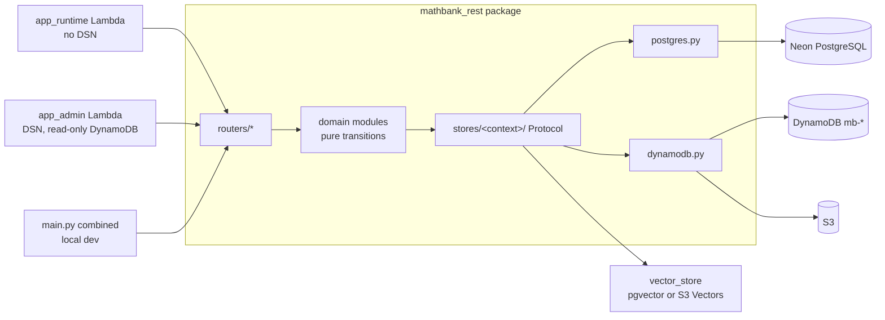

# 71. REST integration with the DynamoDB / S3 / S3 Vectors data plane — plan

**Status: WP0 (foundations) implemented on the branch; WP1–WP11 planned.** WP0 changes no route behaviour: every
store flag defaults to `postgres` and `main.py` is unchanged apart from three additive lines.
Branch: `feature/dynamo-integration-test`. Companion to
[requirement 70](70_DYNAMODB_AND_S3_VECTORS_ADOPTION_PLAN.md), which designed the data plane and copied the
Neon data into it (`dev`). This document plans the **`mathbank-rest` changes** that make the service use
those stores, and makes sure **every REST change suggested in the
[per-schema documents](../database/schemas/)** is carried out. Those documents were written against
PostgreSQL; their findings (§4 of each) and endpoints-to-build (§5.3) are re-targeted here to the new
stores.

Related: [database README](../database/README.md) · [REST CRUD design guide](../database/REST_CRUD_DESIGN_GUIDE.md) ·
[findings register (CSV)](../database/findings_register.csv) ·
[migration toolkit](../../mathbank-db/aws/README.md) · [executed runs](../../mathbank-db/aws/runs/README.md).

## 0. Summary

| Question | Decision |
|---|---|
| How does REST reach the new stores? | A **store layer**: one `Protocol` per bounded context with a `postgres` and a `dynamodb` implementation, chosen per context by a flag. Routers and domain modules stop containing SQL and never import boto3 (guide §2). |
| One service or two? | **One codebase, two apps.** `app_runtime` (no PostgreSQL credentials) serves learners, agents and live traffic. `app_admin` (PostgreSQL) serves authoring, import and review. A combined `main.py` stays for local dev. |
| What changes first? | **WP1**: the security and contract findings that are wrong today (answer-key exposure, GET with side effects, client-supplied grading, no account status check). They are fixed on the PostgreSQL stores so the content copied to DynamoDB is correct. |
| How is "all findings addressed" enforced? | [findings_register.csv](../database/findings_register.csv): 760 IDs, each routed to a work package with a status. A CI check fails a PR that closes a work package while any of its IDs is not `DONE` or `DECLINED` with a test or reason. |
| How is it tested? | Three levels: moto unit tests, dual-backend contract parity (same test, both stores), and integration tests against a real **`test`** environment of the data plane. Never against the migrated `dev` data. |
| Effort | About **36 engineer-weeks** on the REST side, in 12 work packages (§3). Some overlap the phases M0–M10 of requirement 70. |

## 1. What the REST service looks like today

Measured on this branch from `mathbank-rest/src/mathbank_rest/` and the generated static route trace
(`documentation/database/generated/endpoints.json`).

| Fact | Value |
|---|---|
| Size | 35,700 lines of Python; 28 routers registered in `main.py`; **401 routes** in the static trace |
| Database access | One SQLAlchemy engine in `db/postgres.py` (`settings.postgres_dsn`). 66 modules name a registered table. The 90 modules listed in Appendix B contain about **1,900 SQL call sites** (`text(` or `conn.execute(`); `text(` alone appears 1,070 times across the package. |
| Of those modules | Of the 66, 25 touch tables that move to DynamoDB. 19 of those also touch tables that stay in PostgreSQL or the read model, so they must be split |
| Tests | 87 test files. Many are "live" tests that run only when an env flag points at a real database (`MATHBANK_LIVE_STEP_RUNTIME_TEST`, `SOCRATIC_DB_TESTS`, `ROUTE_DB_TESTS`) and roll back |
| Auth | `security.py`: bcrypt + 7-day JWT with no account-status check; one shared `X-Admin-Api-Key`; Socratic staff cookie in `socratic_auth.py` |
| Deployment | `lambda_handler.py` (Mangum) for the API, `socratic_lambda.py` for Socratic, `outbox_worker.py` as a CLI |

### 1.1 Route classification against the placement register

Each route's tables (from the static trace) were classified with the placement in
[requirement 70 Appendix A](70_DYNAMODB_AND_S3_VECTORS_ADOPTION_PLAN.md#appendix-a--placement-register-all-229-tables).
The full per-router table is in [Appendix A](#appendix-a--route-classification-by-router).

| Class | Routes | Meaning for REST |
|---|---:|---|
| **RUNTIME** | 144 | Learner/staff runtime on DynamoDB tables. Moves to `app_runtime` behind a store. |
| **AUTHORING** | 112 | Reads or writes authoring tables that stay in PostgreSQL. Stay in `app_admin`. |
| **CONTENT-READ** | 63 | Public or learner reads of authored content. Served from the `mb-content` read model. |
| **MIXED** | 46 | Touch both planes. Analysed below. |
| **VECTOR** | 8 | Search and similarity. Move to the S3 Vectors adapter. |
| **NO-TABLE** | 28 | The static trace found no table (geometry, notifications, health, some tutor routes). **They need a manual check**, not an assumption of "no database". |

**The 46 MIXED routes are not 46 problems:**

| Why mixed | Routes | Resolution |
|---|---:|---|
| Only write `pipeline.outbox_event` or `audit.action_log` besides DynamoDB tables | 21 | The outbox producers become DynamoDB Streams consumers; audit rows go to `mb-audit` in the same transaction (§2.6). Not mixed after WP5–WP9. |
| Read a table labelled "PG only" in the register that the C6 design already projects into the read model (`pedagogy.solution_step_technique`, `problem_enrichment`, `taxonomy_edge`, `search.embedding_model`, `search.representation`) | 9 | Register correction (Appendix C), then served from `mb-content`. |
| Live-session routes that INSERT into `activity.definition` for inline activities | 16 | The C3 design keeps inline definitions as `ACTDEF` items in `mb-live`. A real change in `live_runtime`, not a split. |

## 2. Target architecture in REST

### 2.1 Two apps, one codebase



- `mathbank_rest/profiles.py` declares which routers each profile mounts. `main.py` keeps working and
  mounts everything. `app_runtime.py` and `app_admin.py` mount their own sets. The runtime profile
  **fails to start if a PostgreSQL DSN is configured**, which is how WP11 proves the runtime does not use it.
- Routers that mix planes are split by route, not by file: the learner-facing half moves to the runtime
  profile and the staff half to admin (counts in Appendix A).
- `lambda_handler.py` selects the profile from `MB_APP_PROFILE`; `socratic_lambda.py` stays separate.

### 2.2 Store layer

Layout (from the C1–C6 designs, one package per context):

```
mathbank_rest/stores/
  __init__.py        get_store(ctx) -> picks postgres|dynamodb|frozen from settings / SSM
  ddb.py             shared DynamoDB toolkit (§2.3)
  content/ learner/ exam/ live/ media/ artifacts/ geometry/ jobs/ notify/ socratic/ agent_sessions/ audit/
     protocol.py     typing.Protocol per aggregate + dataclasses for inputs/outputs
     postgres.py     today's SQL moved here verbatim from routers/services
     dynamodb.py     item mappers + transactions from the context design
     uow.py          unit of work where a request commits several items atomically
```

- **Domain modules become "load → pure transition → commit".** `step_runtime`, `quiz_runtime`,
  `live_runtime`, etc. keep their business rules and lose their SQL. This is also what makes the 19
  mixed modules tractable.
- **Flags**: `<CONTEXT>_STORE=postgres|dynamodb|frozen` read at cold start and refreshed every 60 s from SSM
  (`/mathbank/<env>/stores/<ctx>`). `frozen` rejects writes with `503 Retry-After` for the cutover window
  (requirement 70 §7). `readonly` (learner design) serves reads from DynamoDB while writes still go to PostgreSQL
  during a rehearsal.
- **No dual writes.** A store instance writes to exactly one backend. Parity is checked by tests and
  reconciliation jobs, not by writing twice.

### 2.3 Shared DynamoDB toolkit (`stores/ddb.py`)

| Helper | Purpose |
|---|---|
| `table(ctx)` / key builders | Table names `mb-<ctx>-<env>`; `student_pk()`, `unique_key()`, GSI key helpers; one place for key prefixes |
| `cas_update()` | `UpdateItem` with `version = :expected`, bumps `version` and `updated_at`; maps `ConditionalCheckFailed` to `409 {"detail":"revision_conflict","current_revision":n}` |
| `transact()` | `TransactWriteItems` with cancellation-reason mapping: sentinel clash → 409 with the field name, condition on a version → 409, validation → 422. No `IntegrityError`-style 500s. |
| `sentinel_put()` | `UNIQUE#<field>#<value>` item with `attribute_not_exists` for UNIQUE constraints |
| `idempotent()` | Standard `Idempotency-Key` handling: receipt item written **in the same transaction** as the effect, bound to the caller, replaying the stored response |
| `sign_token()` / `verify_token()` | HMAC-signed opaque `next_token` for pagination (never raw `LastEvaluatedKey`) |
| `s3_ref` | Resolves `<attr>_ref = {bucket,key,sha256,bytes}`: fetch with size and SHA-256 check, or presign. Student-owned writes use `offload/<table>/students/<sid>/…` exactly as the migration does. |
| Retries and metrics | Adaptive retry config, jitter on throttling, structured logs per call (`ctx`, operation, consumed capacity) |
| Guards | A lint test fails on `scan(` in `stores/**` request paths; runtime IAM denies `Scan` and `BatchWriteItem` (requirement 70 §13 C1) |

### 2.4 Content read model

`stores/content` reads the `mb-content` items and S3 snapshots that the migration populated and that the
publisher will keep current. Learner-safe and server-only halves are separate items, so a learner
serializer cannot reach an answer key by accident. Frequently read items (catalogue, competition lists) are
cached in Lambda memory with the item `revision` as the cache key.

### 2.5 Vector store adapter

`mathbank_rest/vector_store.py` defines one protocol (`query(index, vector, k, filter)`, `get(keys)`,
`put(batch)`, `delete(keys)`), with `pgvector` and `s3vectors` implementations (flag `VECTOR_STORE`).
`db/vector_search.py`, `db/step_search.py`, `db/hybrid_search.py` call it instead of SQL. Step search keeps
exact scoring for small eligible sets and uses filtered ANN with oversampling otherwise (C6 design).
Index names come from [aws/s3/vector_indexes.py](../../mathbank-db/aws/s3/vector_indexes.py), the same
catalog the migration used.

### 2.6 Events: stream consumers replace outbox producers

Runtime routes stop writing `pipeline.outbox_event`. The consumers move to `mathbank_rest/workers/`
(DynamoDB Streams → Lambda, idempotent by event id): `learner_analytics`, `notifications`, `usage_counters`,
`mastery_cohort`, `mastery_repair`, `audit_export`, `abandon_stale`, `learner_erasure`. The authoring side
keeps `pipeline.outbox_event`; `outbox_worker.py` becomes the **relay** that feeds the publisher (C6/C7).

### 2.7 Cross-cutting security and contract changes

| Change | Where | Source finding groups |
|---|---|---|
| Account status and `token_version` checked on every learner request (cached 30 s); Cognito email-link requires a verified email | `security.py`, `IdentityStore` | LRN (account takeover, no disable) |
| Staff login as the admin identity: legacy `/v1/admin/*` routes accept the staff session (cookie + CSRF + capability) and record the real actor; the shared admin key becomes a service credential audited as `service:admin-key` | `security.py`, `socratic_auth.py` | AUD, LIV, ORC (audit identity), C7 |
| **Separate learner and admin response models.** Answer keys, solutions, teacher evidence and confidence never appear in a learner model. A snapshot test fails if a forbidden field appears before entitlement. | every learner-facing router | QUZ, ACT, PMC, PSF, LRN, VIS |
| GET is side-effect free. Enrichment moves behind an authenticated `POST` or a queue. | `routers/pedagogy.py`, `tutor.py`, hints | KNP, PSF |
| Server-side grading: clients cannot send `is_correct`, `hint_count`, `source` | `routers/learner.py` | LRN |
| Standard `Idempotency-Key` on learner and staff writes, bound to the actor | `stores/ddb.idempotent`, `routers/*` | LRN, LIV, QUZ |
| Paid calls (embeddings, hints) require auth and a per-learner rate limit | `vector_store`, `step_tutor` | SRC, ART, PSF |
| Uniform pagination `{items, limit, next_token}`; `total` only where a counter item exists | list endpoints | all E items |
| `GET /v1/problems*` stops returning `official_answer` to anonymous callers (flag `CONTENT_PUBLIC_ANSWERS`, recommended off) | `routers/v1.py` | open decision 7 of requirement 70 |

### 2.8 Configuration

New settings in `config.py` (all with safe defaults that keep today's behaviour):
`APP_PROFILE`, `<CTX>_STORE` for each context, `VECTOR_STORE`, `DDB_ENV`, `DDB_TABLE_<CTX>`,
`DATA_BUCKET`, `CONTENT_BUCKET`, `VECTOR_BUCKET`, `NEXT_TOKEN_KEY_PARAM`, `IDEMPOTENCY_TTL_DAYS=7`,
`AUTH_STATUS_CACHE_SECONDS=30`, `CONTENT_PUBLIC_ANSWERS`, plus the per-context options named in the C1–C6
designs. `postgres_dsn` becomes optional at import time.

### 2.9 Local development (UI + backend, real DynamoDB)

Local runs must use real AWS, not emulators. The `dev` environment holds the migrated data; `test` is empty and used only by the integration suite.

1. `aws login --profile aws-sutanu-admin` (any profile with access to account 848941468793, us-east-2).
2. In `mathbank-rest/.env`: `MB_AWS_PROFILE=<profile>`, `DDB_ENV=dev`, and `<CTX>_STORE=dynamodb` for each context to exercise (e.g. `LEARNER_STORE=dynamodb`); `VECTOR_STORE=s3vectors` once WP2 lands.
3. `make aws-check` (add `WRITE=1` for a write/read/delete round trip, `CTX="learner exam"` to narrow). It verifies credentials, every table ACTIVE, both buckets and the S3 Vectors bucket, and prints the exact `aws login` command if credentials are missing or expired.
4. `make run` (combined app), `make run-runtime` (no Postgres engine) or `make run-admin`; then the web/live apps as usual.

Guard rails: a context set to `dynamodb` makes startup fail fast with an actionable message when AWS is unreachable (`DDB_STARTUP_CHECK=false` disables it); `GET /health/stores?deep=true` re-runs the check (503 on failure); `python -m mathbank_rest.stores.doctor` is the same check as a CLI; the doctor warns when `DDB_ENV=prod`. With every store on `postgres` (today's default) nothing calls AWS. Integration tests always target `test` (`make test-ddb-integration`), never `dev`.

### 2.10 Pydantic models for DynamoDB items and JSON content

Every DynamoDB item and every S3 JSON document the service touches has a pydantic model; stores never pass raw dicts.

| Piece | Where | What it guarantees |
|---|---|---|
| `DdbItem` base, `S3Ref`, `UtcDateTime`, `JsonDoc` | `models/base.py` | `PK`/`SK`/`type`/`version`/`ttl`/`updated_at`/GSI keys; one registry keyed by `(context, type)`; `from_item` (lenient: unknown attributes kept) and `to_item` (strict: undeclared attributes rejected, canonical UTC timestamps, lossless); an attribute is inline **or** `<attr>_ref`, never both; `resolve(attr)` returns the offloaded JSON typed, with size and SHA-256 verified |
| Item models (generated) | `models/ddb/<ctx>.py`: 98 types in 8 contexts | Strict scalars (`StrictStr/Int/Bool/Float`), `UUID`, `UtcDateTime`, nested `JsonDoc` records for structured JSON, PK/SK key-shape regexes, a discriminated union per context |
| Item models (hand-written) | `models/manual/{media,artifacts,jobs,notify}.py`: 22 types | Contexts that were empty in `dev`; written from the migration specs and the doc 70 designs |
| S3 JSON documents (generated) | `models/docs/{content,offload}.py`, `registry.DOC_MODELS` | Release snapshot, six catalogue snapshots, and the JSON of every offloaded attribute |
| Refinements | `models/overrides.py` | Stricter contracts (e.g. status `Literal`s) added by a work package; replace the generated model of the same `(ctx, type)` |
| Typed store layer | `stores/typed.py` | `get/require/batch_get/query/put/put_new/tx_put/update`: reads validate into models (drift raises `ItemSchemaError`, 500), writes are strict, large attributes are offloaded then re-validated, updates validate each changed attribute before the conditional write |

Rules: (1) `stores/<ctx>/dynamodb*.py` use `stores.typed` only (`tests/stores/test_typed_only_lint.py`); (2) request and response bodies stay separate pydantic models from item models, so an item model is never returned to a client (answer keys, `password_hash`); (3) a work package that adds an item type adds or refines its model in the same commit.

Generation and proof: `make ddb-models` profiles the live environment (every item grouped by `type`, S3 documents by family, PK/SK shapes) and regenerates the modules. `make ddb-models-validate` reads **every** item and a sample of every S3 document and requires `from_item` to succeed and `to_item()` to reproduce the stored item exactly. The migration can gate its own writes with `MB_VALIDATE_MODELS=1|warn` (`mathbank-db/aws/dynamo/models_gate.py`).

**Result on `dev`:** 394,574 items (98 types) and the 17 S3 document families validate with 0 failures and a lossless round trip (content 391,545; learner 1,079; exam 1,055; live 344; socratic 93; agent-sessions 445; geometry 9; audit 4; 300 release snapshots sampled). Validation found and fixed four generator gaps before it passed: nested nulls inside lists, depth-capped maps losing `null`, list types inferred from too small a sample, and lax coercion (`"yes"` became `True`; scalars are now strict). It also found that `LearnerProfile` never declared `updated_at`, which `cas_update` always writes, so `updated_at` is a base attribute.

Limits: generated models are the contract of the **migrated** data, so a required attribute the migration always wrote (e.g. `legacy_source` on `OUTCOME`) may not exist on items new code creates; the store that writes the type refines the model in `overrides.py`. Enumerations are `str` with an `# observed:` comment, not `Literal`, until a refinement adds the CHECK-backed set.

## 3. Work packages

Sizes are from the module inventory in [Appendix B](#appendix-b--module-inventory-per-work-package).
"Phase" is the matching phase of requirement 70 §6. Each work package is one or more PRs; all flags default
to today's behaviour until the cutover step of that work package.

| WP | Scope | Modules / lines / SQL sites | Findings (primary) | Depends on | Phase | Effort |
|---|---|---|---:|---|---|---:|
| **WP0** Foundations | Store layer skeleton, `ddb.py`, flags, app profiles, config, test harness, `make` targets, findings check | new | — | — | M0 | 3 EW |
| **WP1** Pre-copy fixes | Security/contract findings on the PostgreSQL stores | 8 / 1,614 / 8 | 20 | WP0 | M1 | 2 EW |
| **WP2** Vectors | `vector_store` adapter; vector/step/hybrid search; similarity rebuild; embedding sync | 4 / 830 / 22 | 24 | WP0, WP1 | M2 | 2 EW |
| **WP3** Jobs, notifications | Studio queue client, notification store and consumer | 2 / 226 / 2 (+ manim-studio) | 27 | WP0 | M3 | 1.5 EW |
| **WP4** Content read model | `stores/content`, public/content reads, publisher client, caches | 12 / 2,576 / 129 | secondary on 200+ | WP1, WP2 | M4 | 4 EW |
| **WP5** Learner runtime | Identity, attempts, mastery, step runtime, diagnosis, recovery, micro-course runtime | 9 / 3,774 / 274 | 71 | WP4 | M5 | 5 EW |
| **WP6** Exams | Quizzes, mock exams, exam-agent routes, question pool | 4 / 2,239 / 147 | 32 | WP4, WP5 | M6 | 2.5 EW |
| **WP7** Live and lessons | Live sessions, activities, widgets, presentation plans, gateway cursor | 6 / 2,928 / 208 | 74 | WP4, WP5 | M7 | 3 EW |
| **WP8** Media, artifacts, geometry | Attempt media, artifacts, geometry scenes, presigned URLs | 11 / 4,243 / 178 | 78 | WP4, WP5 | M8 | 3 EW |
| **WP9** Socratic, ADK, audit | Socratic Studio store, DynamoDB ADK session service, `mb-audit` | 8 / 2,032 / 86 | 29 | WP5 | M9 | 2.5 EW |
| **WP10** Authoring plane | Admin app split, publish-path outbox+audit, C7 findings and endpoints | 28 / 13,666 / 868 | 405 | WP0 (starts early), feeds WP4 | M1, M4 | 8 EW |
| **WP11** Decommission | Remove runtime PostgreSQL code and DSN, drop moved tables, regenerate docs | — | — | all | M10 | 1 EW |

WP6–WP9 run in parallel after WP5. WP10 starts with WP1 because the admin split and publish-path fixes are
prerequisites of the publisher.

### WP0 Foundations

- Create `stores/` with `get_store()`, the `Protocol` skeletons and `ddb.py` (§2.3), with moto tests.
- Add `profiles.py`, `app_runtime.py`, `app_admin.py`; teach `lambda_handler.py` the profile switch; the
  runtime profile refuses a DSN.
- Settings (§2.8) and `Makefile` targets: `test-ddb`, `test-ddb-integration`, `findings-check`.
- Parity harness (§5) and the findings CSV check.
- **Gate:** existing tests unchanged and green; runtime app starts with stub stores and no DSN.

**WP0 delivered (all under `mathbank-rest/`):**

| Deliverable | Files |
|---|---|
| Store registry, per-context flags (`<CTX>_STORE`, optional SSM override), `frozen[:backend]` proxy that serves reads and returns 503 `Retry-After` for writes, `override_store()` for tests, `/health/stores` | `stores/__init__.py` |
| Domain errors and their HTTP mapping (404, 409 `revision_conflict` / `unique_violation` / `condition_failed`, 422 `idempotency_key_reused`, 400 `invalid_next_token`, 501, 503) | `stores/errors.py` |
| DynamoDB toolkit: `cas_update`, `transact` with cancellation-reason mapping, `sentinel_put`, `query_page` with signed pagination tokens, `batch_get`, `run_idempotent`, S3 `offload` / `load_attr` / `resolve_ref` / `presign`, `uuid7`. No scan helper. | `stores/ddb.py` |
| App profiles: router partition (every router in exactly one group), `app_runtime.py`, `app_admin.py`, Lambda profile switch, runtime guard that makes `db.postgres.engine` raise, shared `OPENAPI_TAGS`; `main.py` still mounts everything | `profiles.py`, `app_runtime.py`, `app_admin.py`, `openapi_tags.py`, `db/postgres.py`, `lambda_handler.py`, `main.py` |
| Settings (§2.8) | `config.py` |
| Dual-backend parity harness | `tests/parity/` |
| Findings ledger check | `scripts/findings_check.py` |
| Make targets `test-ddb`, `test-ddb-integration`, `findings-check`, `findings-gate`; `moto` dev dependency; `ddb_integration` marker | `Makefile`, `pyproject.toml` |

**WP0 gate results.** The full existing suite: 965 passed, 0 failed (158 live-database tests skipped as before).
`make test-ddb`: 97 passed (toolkit on moto including concurrent-writer and idempotency races, flags, error mapping, profiles,
parity harness, findings check, no-scan lint). `make test-ddb-integration` against the real `test` environment: 6 passed
(the environment was provisioned with `make aws-provision AWS_ENV=test`, 12 tables, 2 buckets, 12 vector indexes, no data;
tests clean up after themselves and left 0 items and 0 objects).

The integration run found a defect that moto did not: botocore presigns S3 URLs against the global host
`bucket.s3.amazonaws.com`, which answers `307` for a bucket outside us-east-1. The S3 client now uses SigV4 with virtual-hosted
addressing, giving the regional host; a moto test now asserts it.

### WP1 Pre-copy fixes (on PostgreSQL)

Must land first, because the read model and `mb-exam`/`mb-learner` should not inherit these defects.
- Learner serializers without answer keys for micro-course pages, runtime and activities; hints leak-checked
  (level 4); learner event feed filtered; widget-spec reads owner-scoped.
- `GET /v1/tutor/learning-context` and coach no longer enrich or call paid models; enrichment is
  `POST`-only and authenticated.
- `POST /v1/learner/attempts` ignores client-sent grading fields (deprecated, then 410).
- `get_current_student_id` checks account `status`; Cognito linking requires a verified email.
- **WP1a Staff login for admin routes (decision 2).** A `require_admin` dependency accepts either the staff
  session (cookie + CSRF + capability, from `socratic_auth`) or the legacy `X-Admin-Api-Key`. It returns an
  `Actor(kind="staff"|"service", id)`; routers pass the actor to the store, and audit rows carry it. The
  Socratic capabilities map to admin scopes (`manage_users` → user/students admin, `publish` → release
  publish, `author` → authoring writes). Routes that mutate content require a staff actor once WP10 lands;
  the shared key keeps read-only and service use.
- `CONTENT_PUBLIC_ANSWERS` flag introduced (default as decided).
- **Gate:** the WP1 IDs `DONE`; serializer snapshot tests pass.

**Delivered (commit `914fdc2`, 16 IDs DONE, `make findings-check WP=WP1` passes):**
- Answer keys: anonymous micro-course reader/runtime no longer select keys or per-option explanations (explanation only after answering); theorem assets are `VALID`-only with no raw `uri`; the web course player grades through the server.
- Side effects/paid calls: learning-context GET never enriches (`POST .../enrich` is authenticated and rate limited); anonymous search is lexical-only (`semantic_requires_sign_in`); per-caller search bucket; cohort floor `cohort_min_students=10`; REJECTED concept/technique tags excluded from public reads and mastery.
- Identity: `student_profile.status` enforced on every learner request (migration `055_student_status.sql`, admin disable/enable with audit); Cognito onboarding no longer links by email unless `email_verified`.
- Actor attribution: template/scene/artifact/widget/pedagogy-governance mutations record `staff:<id>` or `service:admin-key` and write audit rows; widget specs are owner-scoped.
- Behaviour changes needing sign-off: `weak-concepts` returns `{results, suppressed, cohort_min_students}`; learners no longer see the correct option after a wrong (non-give-up) answer; learner `GET /v1/widgets/specs/{id}` is 403 outside the learner's sessions; default-semantic anonymous search downgrades to lexical rather than 401; status cache is per process (up to 30 s stale after a disable).
- Follow-ups: clients must send `email_verified=true` after real verification (`mathbank-exam-agent` sign-up, `cognitoBridge.js` in web/live) and handle 409 `EMAIL_ALREADY_REGISTERED`; `micro_course_assist` still passes the key to the LLM prompt; `topic_pedagogy.resolve_feedback` has no actor/audit; PMC-F21 remainder (unrouted writer, release detail) moved to WP10.

### WP2 Vectors

- `vector_store.py` plus `pgvector` and `s3vectors` implementations; `VECTOR_STORE` flag.
- `db/vector_search.py`, `db/step_search.py`, `db/hybrid_search.py` use the adapter; problem search is
  semantic with a `canonical_code` key lookup first; step search exact-or-ANN per C6.
- `scripts/generate_similarity_embeddings.py` rebuilds from S3 Vectors and writes the PG similarity tables.
- Embedding sync worker (publisher events → `PutVectors` ≤ 500, `DeleteVectors` on withdraw).
- **Gate:** the migration's recall gates (≥ 0.95, tie-aware) re-run through the adapter; zero ineligible results.

**Delivered (commits `9361e60`, `f8c85fe`, `5e45a9b`, `02a05d8`):**
- `vector_catalog.py` (12 families, pydantic metadata models, drift test against the migration catalogue), `vector_store.py` (protocol, `S3VectorsStore`, exact `MemoryVectorStore`, `vf` filters; limits verified live: topK <= 100, GetVectors <= 100 keys, list metadata matches any element, non-filterable keys rejected), `embeddings.py` (LRU, then shared `QEMB` item in `mb-content`, then OpenAI; rate-limit gate unchanged), `content_lookup.py` (typed eligibility re-check: published and the hit's vector is one of the item's current `vector_state` keys; consistent for all sampled vectors in `dev`).
- Callers behind `VECTOR_STORE=s3vectors`, Postgres paths untouched when off (the flag is the rollback): problem and hybrid search (canonical-code lookup first), step / learning-item / taxonomy search with FACET-based exact-or-ANN (`EXACT_MAX` 300), `search_concepts`, artifact index/search/similar plus `POST /v1/admin/artifacts/bundles/reindex`.
- `vector_sync.py` (stream-record to idempotent upsert/withdraw, `batchItemFailures` handler), `vector_bulk.py` (optional Bodo engine; `pip install 'mathbank-rest[bulk]'`), `scripts/generate_similarity_embeddings.py --source s3vectors`, `scripts/vector_gate.py` (`make vector-gate`).
- Decisions: embeddings stay OpenAI `text-embedding-3-small` 1536 (existing vectors reused; Bedrock Knowledge Bases cannot adopt an external index or embedding model, so they are not used for retrieval); search is vector-only with S3 Vectors (lexical lived in Postgres and is reported as not applied); `generate_embedding=true` is staff-only; artifact reindex is synchronous; `index_bundle` dual-writes Postgres until WP8.
- Findings closed here: ART-F05, ART-F16, ART-S06, ART-E07, ART-E08. The Postgres-side search findings (SRC-F02..F11, S01..S07, E02..E07) are not closed: most are superseded by removing pgvector and need an explicit DONE/DECLINED decision at WP11.
- **Gate status: not yet passed.** The gate ran against `dev` for taxonomy-search only (recall@8 0.9992, 0/2700 ineligible); the AWS session expired before the other families ran. Run `make vector-gate ARGS="--sample 150"` after `aws login`.

### WP3 Jobs and notifications

- `stores/jobs` client for Studio (SQS + DynamoDB, conditional claims) used by `mathbank-manim-studio`; the
  EventBridge poll is removed there.
- `stores/notify` replaces `notifications.py`; `routers/notifications.py` rewritten; admin list and ack routes.
- **Gate:** owner-scoping tests (another student's id → 404); idempotent redelivery; Neon can suspend while idle.

### WP4 Content read model

- `stores/content` and the public/content reads: `routers/v1.py`, `pedagogy.py`, `tutor.py`, student
  micro-course and theorem reads, `route_runtime.load_program`, interaction catalogue, activity definitions.
- Publisher client contract and reconciliation endpoint for admin.
- Register corrections (Appendix C) applied to doc 70.
- **Gate:** a runtime route set with **zero PostgreSQL queries** (the runtime profile has no DSN); reconciliation shows 0 diffs.

### WP5 Learner runtime

Per the C1 design: `IdentityStore`, `OutcomeStore`, `SolveRuntimeStore`, `DiagnosisStore`, `RecoveryStore`,
`MicroCourseRuntimeStore`, `RouteAttemptStore`, `FeedbackStore`, `AgentLinkStore`.
- `db/learner.py`, `step_runtime.py`, `step_diagnosis.py`, `step_recovery.py`, `step_tutor.py`, `mastery.py`
  lose their SQL (about 274 sites) and use a `LearnerUnitOfWork` (one `TransactWriteItems`).
- New routes of the C1 design (admin learner list/detail/events, erasure, account disable, token version).
- **Gate:** parity on every learner-runtime route (RUNTIME class in Appendix A for `learner`, `step_runtime`, `micro_courses`, `tutoring_routes`, `agent_sessions`); mastery equals the PostgreSQL computation on replayed
  fixtures (the 28-row tag dedupe documented in the run records is an accepted, listed difference).

### WP6 Exams · WP7 Live · WP8 Media · WP9 Socratic

Follow the C2, C3, C4 and C5 designs. Common acceptance: no SQL left in the touched modules, answer-key
non-disclosure snapshot tests, idempotency and owner-scoping tests, the design's new routes, and the
design's behaviour changes behind their flags (requirement 70 §12 items 10–23).
- **WP7** also changes `mathbank-live/server.mjs` from a 700 ms `/events` poll to a cursor read.
- **WP9** adds `DynamoDBSessionService` in `mathbank-agent` (ADK pinned) and the `mb-audit` writer.

### WP10 Authoring plane (largest)

- Split the admin routers into `app_admin`: 112 AUTHORING routes plus the staff halves of mixed routers.
- Every publish, approve, withdraw and deactivate path writes outbox + audit in one transaction (C7
  migration 056 makes the database reject one that does not).
- Fix the C7-owned findings (405 routed here), each as a constraint, trigger, endpoint or guard. The
  `inline SQL in routers` drift listed in guide §2 is cleaned up as each module is touched.
- **Gate:** C7 §4 "before the publisher" list done; every admin route has auth + audit tests.

### WP11 Decommission

Remove `db/postgres.py` from the runtime path and the DSN from the runtime Lambda; drop moved tables after
the recovery window; regenerate `documentation/database/` and the mathbank-db skill indexes.

## 4. Findings traceability

[`documentation/database/findings_register.csv`](../database/findings_register.csv) lists all 760 IDs from the
schema documents (254 endpoints-to-build, the rest findings and schema improvements). Columns: `id`,
`schema_doc`, `kind` (F finding, S schema improvement, E endpoint), `priority`, `design_owner` (C1–C7),
`primary_wp`, `secondary_wps`, `rest_impact`, `item_abridged`, `status`, `pr`, `tests`, `routing_note`.

| WP | IDs | F | S | E | With REST impact |
|---|---:|---:|---:|---:|---:|
| WP1 | 20 | 20 | 0 | 0 | 17 |
| WP2 | 24 | 10 | 7 | 7 | 17 |
| WP3 | 27 | 3 | 13 | 11 | 20 |
| WP5 | 71 | 23 | 21 | 27 | 42 |
| WP6 | 32 | 10 | 12 | 10 | 18 |
| WP7 | 74 | 22 | 26 | 26 | 53 |
| WP8 | 78 | 32 | 25 | 21 | 43 |
| WP9 | 29 | 6 | 13 | 10 | 19 |
| WP10 | 405 | 165 | 98 | 142 | 237 |
| **Total** | **760** | **301** | **215** | **254** | **466** |

(WP4 has no primary IDs; it is the secondary work package for the content-serving part of the C6/C7-owned items.)

Rules:
1. **Routing is by schema document**, with security findings routed to WP1. `routing_note` records why. A reviewer may move an ID; the change is a CSV edit in the PR.
2. An ID is `DONE` only with a PR and a test reference (`tests` column), or `DECLINED` with the reason and the replacement, as the four declined items in requirement 70 (PSF-E17, KNC-S06, PMC-S08, PMC-F06).
3. `rest_impact = N` items (pure PostgreSQL schema changes, e.g. a CHECK) are done in WP10/migrations and need no REST code, but are still listed so none is lost.
4. [`scripts/findings_check.py`](../../mathbank-rest/scripts/findings_check.py) validates the ledger and gates closure:
   - `make findings-check` reports per-work-package counts and fails on an **invalid row**: unknown status, `DONE` without both `pr` and `tests`, `DECLINED` without a reason, a duplicate ID.
   - `make findings-check WP=WP5` additionally fails (exit 2) while any ID routed to WP5 is not `DONE` or `DECLINED`. Use it as the exit check of a work package.
   - `make findings-gate` (`--strict`) is the **merge gate for `main`**: every one of the 760 IDs must be `DONE` or `DECLINED`. Today it exits 2, as it should.
5. Resolutions for each ID (the DynamoDB equivalent of a PostgreSQL fix) are in requirement 70 Appendix B and the C1–C7 designs; the CSV is the status ledger, requirement 70 is the design.

## 5. Test strategy for this branch

| Level | What | Backend | When |
|---|---|---|---|
| **Unit** | Every conditional write, transaction, sentinel, idempotent replay, TTL/expiry, token tamper | `moto` (DynamoDB, S3, SQS) and an in-memory S3 Vectors stub | Every PR, no AWS |
| **Contract parity** | The same API test runs against `store_backend ∈ {postgres, dynamodb-moto}`; responses compared structurally, volatile fields ignored; allowed differences are an explicit list from the designs | PostgreSQL live opt-in + moto | Every PR touching a context |
| **Integration** | The real stores: DynamoDB tables, S3 buckets and S3 Vectors indexes of environment **`test`** | AWS, profile `aws-sutanu-admin` | Before each cutover and nightly on the branch |
| **Authorization / disclosure** | 401/404 for another owner; serializer snapshots fail on any answer-key field | moto | Every PR |
| **Search quality** | Recall and eligibility through the adapter | real `test` index with a loaded sample | WP2 |
| **Migration rehearsal** | `mathbank-migrate` reverse copy round trip on a Neon branch | Neon branch + `test` tables | Each cutover |

**Environment `test`.** `make aws-provision AWS_ENV=test` in `mathbank-db` creates `mb-*-test`, the `test`
buckets and `mathbank-vectors-test` with the same definitions as `dev` and **no data**. Integration tests
load their own fixtures, use fresh `student_id`s, and clean up by deleting the `STUDENT#<id>` partition and
the `offload/*/students/<id>/` prefix. They are marked `@pytest.mark.ddb_integration` and are skipped unless
`MB_DDB_ENV=test` is set, which matches the repo's opt-in pattern for live tests. **They never run
against `dev`**, which holds the migrated copy of real data.

New commands (WP0):
```bash
make test-ddb                 # unit + parity with moto; no AWS, no database
make test-ddb-integration     # MB_DDB_ENV=test, real AWS; needs `make -C ../mathbank-db aws-provision AWS_ENV=test`
make findings-check           # per-WP report + ledger validation (WP=WP5 also requires that WP closed)
make findings-gate            # merge gate for main: all 760 IDs DONE or DECLINED
```

## 6. Branch and delivery plan

All work happens directly on `feature/dynamo-integration-test` (decision 3): each work package lands as one
or more commits on the branch, with its tests, and the flags still default to `postgres` until that
context's cutover step. **The branch merges to `main` once, when the REST DynamoDB migration is complete**
(all work packages through WP11, `make findings-check` clean, integration tests green on the `test`
environment).

| Order | Commits (work packages) | Notes |
|---|---|---|
| 1 | WP0, WP10 (admin split), WP1 | Foundations and pre-copy fixes. No behaviour change except the fixes. |
| 2 | WP2, WP3 in parallel | Vectors and jobs/notifications are independent of the learner path. |
| 3 | WP4 | Content read model, publisher contract, register corrections. |
| 4 | WP5 | Learner runtime, the largest runtime change. |
| 5 | WP6, WP7, WP8, WP9 in parallel | Four teams or four passes. |
| 6 | WP10 (C7 findings), WP11 | Authoring-plane fixes continue throughout; decommission last. |

Each cutover follows requirement 70 §7: dark deploy with the flag at `postgres`, parity in CI, rehearsal on a
Neon branch, freeze, copy, switch, observe, retire.

## 7. Risks and open decisions

| Risk | Mitigation |
|---|---|
| 19 modules mix planes; a naive split duplicates logic | "Load → pure transition → commit" refactor first (per module), then swap the store |
| Static route trace misses dynamic SQL and leaves 28 routes "no table" | Manual review of those routes in WP0; the runtime-no-DSN profile is the real test |
| About 1,900 SQL call sites is a large diff | Move SQL verbatim to `postgres.py` first (mechanical, parity-tested), implement `dynamodb.py` second |
| Cutover state spans two apps | Flags per context in SSM; `frozen` state; runbook per context |
| Behaviour changes listed in requirement 70 §12 need sign-off before the named work package | Each is behind a flag; WP entry checks the decision is recorded |
| Integration tests cost and flakiness against real AWS | Small fixtures, `test` environment only, nightly rather than per-PR |

### Decisions (2026-11-03, product owner)

| # | Question | Decision | Consequence for this plan |
|---|---|---|---|
| 1 | Keep `main.py` as the combined dev app? | **Yes.** `main.py` stays the combined app that mounts every router. | `app_runtime.py` and `app_admin.py` are additions built from the same router groups (`profiles.py`). `main.py` is never removed and keeps passing the existing tests. |
| 2 | Per-admin API keys or staff login? | **Staff login first.** | Admin identity comes from the existing staff login (Cognito, or the loopback `local` mode for development) used by Socratic Studio, not from a new per-admin key store. Legacy `/v1/admin/*` routes accept the staff session (cookie + CSRF + capability) as their primary credential. The shared `X-Admin-Api-Key` stays only as a **service credential with no actor identity** (ETL, CI, agents) until WP11, and every mutation it performs is audited as `actor = service:admin-key`. See WP1a. |
| 3 | Does the findings check block merges to the branch? | **No.** Work happens directly on `feature/dynamo-integration-test`; it merges to `main` only when the REST DynamoDB migration is complete. | `make findings-check` reports progress on the branch and **gates the merge to `main`**: every ID must be `DONE` or `DECLINED`. No per-work-package branches; each work package lands as commits on this branch. |

## Appendix A — route classification by router

From the static trace; "NO-TABLE" means the trace found no table, which needs a manual check.

| Router | Routes | RUNTIME | AUTHORING | CONTENT-READ | MIXED | VECTOR | NO-TABLE |
|---|---:|---:|---:|---:|---:|---:|---:|
| socratic | 52 | 22 | 20 | 2 | 4 | — | 4 |
| micro_courses | 32 | 6 | 11 | 13 | 2 | — | — |
| step_runtime | 30 | 15 | 4 | 2 | 8 | 1 | — |
| live | 28 | 9 | 1 | — | 18 | — | — |
| exam_integration | 24 | 23 | — | 1 | — | — | — |
| fluid | 22 | 19 | — | 1 | — | — | 2 |
| attempt_media | 20 | 10 | — | — | 10 | — | — |
| artifacts | 20 | 16 | — | — | — | — | 4 |
| theorems | 20 | — | 10 | 10 | — | — | — |
| interaction_templates | 16 | — | 8 | 8 | — | — | — |
| admin_imports | 15 | — | 14 | — | — | 1 | — |
| v1 | 12 | 1 | — | 9 | — | 2 | — |
| admin_activities | 12 | — | 9 | 3 | — | — | — |
| pedagogy_admin | 11 | 3 | 8 | — | — | — | — |
| pedagogy | 10 | — | 2 | 5 | 2 | — | 1 |
| admin_corpus | 9 | — | 7 | 2 | — | — | — |
| tutoring_routes | 9 | 3 | 4 | 2 | — | — | — |
| learner | 8 | 7 | — | — | 1 | — | — |
| admin_taxonomy | 8 | — | 5 | 3 | — | — | — |
| admin | 7 | — | 6 | — | — | 1 | — |
| admin_textbooks | 7 | — | 3 | 1 | — | 3 | — |
| geometry (engine API) | 7 | — | — | — | — | — | 7 |
| agent_sessions | 5 | 5 | — | — | — | — | — |
| quiz_runtime | 5 | 4 | — | — | 1 | — | — |
| geometry_scenes | 3 | — | — | — | — | — | 3 |
| tutor, notifications, geometry_interpretation, main, socratic_app | 9 | 1 | — | 1 | — | — | 7 |
| **Total** | **401** | **144** | **112** | **63** | **46** | **8** | **28** |

## Appendix B — module inventory per work package

Lines and SQL call sites (`text(` or `conn.execute(`) counted on this branch.

| Work package | Modules | Lines | SQL sites |
|---|---:|---:|---:|
| WP1 pre-copy fixes | 8 | 1,614 | 8 |
| WP2 vectors | 4 | 830 | 22 |
| WP3 jobs/notify | 2 | 226 | 2 |
| WP4 content read model | 12 | 2,576 | 129 |
| WP5 learner runtime | 9 | 3,774 | 274 |
| WP6 exams | 4 | 2,239 | 147 |
| WP7 live/lessons | 6 | 2,928 | 208 |
| WP8 media/artifacts/geometry | 11 | 4,243 | 178 |
| WP9 socratic/ADK/audit | 8 | 2,032 | 86 |
| WP10 authoring plane | 28 | 13,666 | 868 |
| **Total** | **90** | **34,128** | **1,922** |

Modules by work package (under `mathbank_rest/`):
- **WP1:** `routers/pedagogy.py`, `routers/tutor.py`, `routers/v1.py`, `routers/learner.py`, `routers/live.py`, `routers/fluid.py`, `routers/theorems.py`, `security.py`.
- **WP2:** `db/vector_search.py`, `db/step_search.py`, `db/hybrid_search.py`, `db/retrieval_audit.py`.
- **WP3:** `notifications.py`, `routers/notifications.py`.
- **WP4:** `db/queries.py`, `db/problem_images.py`, `db/problem_sources.py`, `db/topic_pedagogy.py`, `route_runtime.py`, `interaction_catalog.py`, `interaction_runtime.py`, `pedagogy.py`, `guided_orientation.py`, `guided_visuals.py`, `solution_guidance.py`, `practice_selection.py`.
- **WP5:** `db/learner.py`, `mastery.py`, `step_runtime.py`, `step_diagnosis.py`, `step_recovery.py`, `step_tutor.py`, `routers/step_runtime.py`, `tutor.py`, `micro_course_assist.py`.
- **WP6:** `quiz_runtime.py`, `quiz_service.py`, `routers/quiz_runtime.py`, `routers/exam_integration.py`.
- **WP7:** `live_runtime.py`, `routers/live.py`, `routers/fluid.py`, `widgets.py`, `authoring.py`, `activity_scoring.py`.
- **WP8:** `attempt_media.py`, `media_processing.py`, `routers/attempt_media.py`, `artifact_runtime.py`, `routers/artifacts.py`, `geometry_storage.py`, `geometry_orchestration.py`, `routers/geometry_scenes.py`, `routers/geometry_interpretation.py`, `object_store.py`, `scene_spec_promotion.py`.
- **WP9:** `socratic_service.py`, `socratic_preview.py`, `socratic_auth.py`, `socratic_users.py`, `socratic_app.py`, `routers/socratic.py`, `agent_transcripts.py`, `routers/agent_sessions.py`.
- **WP10:** `micro_course_service.py` (admin and release parts), `routers/micro_courses.py`, `taxonomy_service.py`, `theorem_service.py`, `routers/admin_*.py`, `routers/pedagogy_admin.py`, `routers/interaction_templates.py`, `routers/tutoring_routes.py`, `db/pedagogy_admin.py`, `db/textbook_admin.py`, `db/import_admin.py`, `db/pipeline_jobs.py`, `db/admin.py`, `interaction_template_projection.py`, `interaction_validators.py`, `corpus_authoring.py`, `enrichment.py`, `relationship_enrichment.py`, `route_compiler.py`, `route_batch.py`, `route_projection.py`, `outbox_worker.py`, `publication.py`.
- **Not assigned (no data-plane change):** `main.py` (profiles, WP0), `db/postgres.py` (WP11), `route_resources.py`, `route_critic.py`, `interactions_cli.py`, `math_format.py`.

`micro_course_service.py` (3,055 lines, 359 SQL sites) is shared: its reader and runtime functions move to WP4/WP5
stores, and its authoring and release functions stay in WP10.

## Appendix C — placement register corrections

Found while classifying routes. To be applied to requirement 70 Appendix A when WP4 starts.

| Table | Register says | Correct | Why |
|---|---|---|---|
| `pedagogy.solution_step_technique` | PG | PG + read model | Read by 6 runtime routes; already inside the C6 `SOLDAG` item |
| `pedagogy.problem_enrichment` | PG | PG + read model | Read by recovery and topic practice; embedded in the C6 `PROBLEM` item |
| `pedagogy.taxonomy_edge` | PG | PG + read model | Read by topic practice; embedded in the C6 `TAXNODE` item |
| `search.embedding_model`, `search.representation` | PG | PG + read model | Read by `POST /v1/quiz/generate`; needed by the vector adapter for eligibility |
| `activity.definition` (inline rows written by live routes) | PG + read model | PG + read model **and** `ACTDEF` items in `mb-live` | 16 live routes insert inline definitions (C3) |
