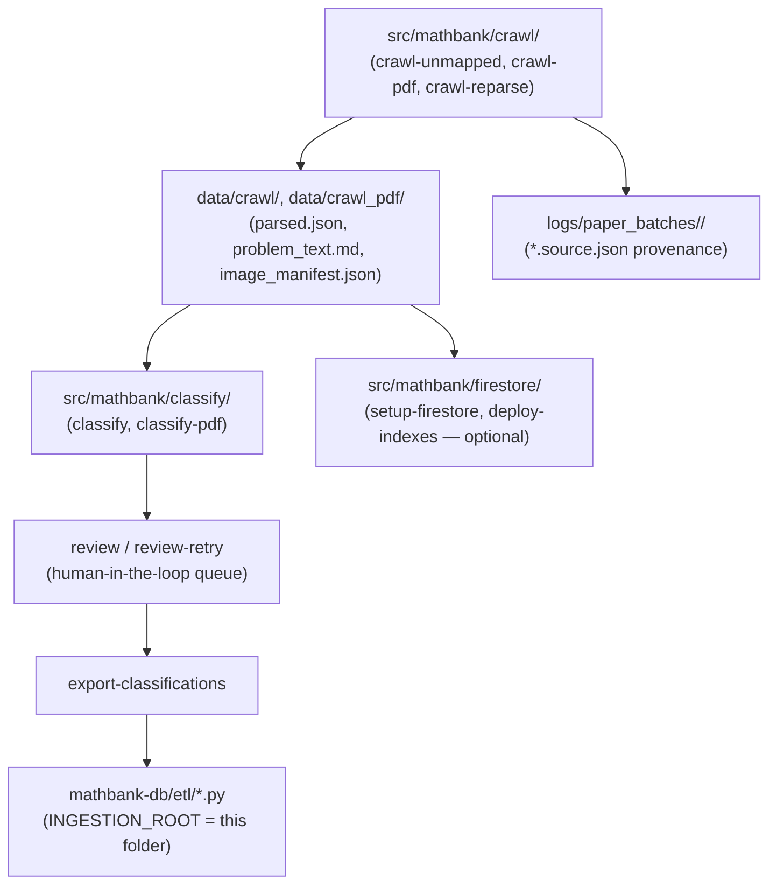
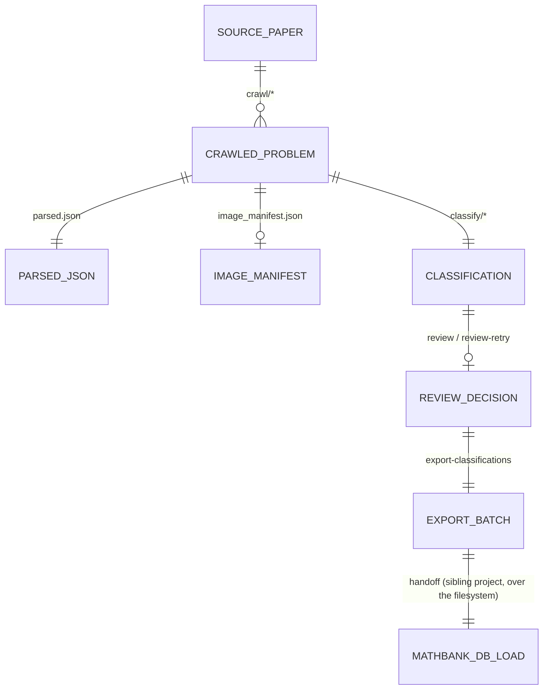

# mathbank-data-ingestion

Corpus acquisition and classification pipeline: crawl competition-math source pages, parse
PDFs/HTML into structured problem/solution text, classify them against the taxonomy, and export
reviewed classifications for `mathbank-db` to load into Postgres. This project never talks to
Postgres/Neo4j directly — it writes local files (`data/crawl*/`, `logs/`) that `mathbank-db`'s ETL
scripts read (see `INGESTION_ROOT`/`REPO_ROOT` conventions in `mathbank-db/etl/*.py`).

(Renamed from `mathbank_data_ingestion` to `mathbank-data-ingestion` for naming consistency with
every other service in this repo — see `documentation/GOTCHAS.md` if you find an old reference to
the underscored name anywhere.)

## Quick start

```bash
cd mathbank-data-ingestion
make venv && make install     # .venv + package + dev deps
make crawl-dry                # see what would be crawled, no network calls
make crawl-unmapped LIMIT=20  # bounded, real crawl
make classify-dry             # see what would be classified
make classify LIMIT=20
make export-classifications   # hand off to mathbank-db
make progress                 # where the corpus currently stands
```

## Architecture flow



The `src/mathbank/db/tracking.py` module (flagged in `documentation/GOTCHAS.md`) owns
crawl/classify/export progress tracking, surfaced through `make progress`/`make show_progress`-style
commands — read that module before changing any pipeline stage's completion semantics.

## Data model

This project's own persistence is local files, not a database — the closest thing to a schema is:



Module layout: `src/mathbank/crawl/`, `classify/`, `firestore/`, `db/` (local progress tracking,
not a database driver), plus `src/mathbank/data/` for static taxonomy/config.

## Tests

```bash
make test         # pytest, 5 test_*.py files
make test-cov     # pytest with coverage (note: the coverage target name is stale, see Gotchas)
make lint         # configured linter
make typecheck    # configured type checker
make audit        # combined check target
```

## Deployment strategy

**Today:** run on demand (locally or from CI) as a batch pipeline — there is no long-running
service here, only `make crawl-*`/`make classify-*`/`make export-*` invocations.

**Independence:** this project's own crawl/classify/export logic has no sibling-folder dependency
— it only writes to its own `data/`/`logs/` directories. The *consumer* side of the relationship
(`mathbank-db`'s ETL scripts reading `mathbank-data-ingestion/data/...` via hardcoded relative
paths) is the sibling dependency, and it points the other way — this project can run and produce
output with no other service present at all.

## Roadmap / TODO

- See [documentation/requirements/03_INGESTION_PIPELINE_REQUIREMENTS.md](../documentation/requirements/03_INGESTION_PIPELINE_REQUIREMENTS.md)
  and [18_PRASOLOV_IMPORT_AND_V2_RUNTIME_TRACKER.md](../documentation/requirements/18_PRASOLOV_IMPORT_AND_V2_RUNTIME_TRACKER.md)
  for the authoritative, regularly-updated progress tracker.
- The optional Firestore integration (`setup-firestore`, `deploy-indexes`) is present but not the
  primary path — the primary path hands off to `mathbank-db`/Postgres.

## Gotchas (mathbank-data-ingestion-specific)

See [documentation/GOTCHAS.md](../documentation/GOTCHAS.md) for the full catalog — this project
is one of its largest sources of entries (PDF splitter first-occurrence behavior, progress-tracking
edge cases). Specific to this project's Makefile:
- `make test-cov`'s `--cov=tika_corpus` flag references a package name that doesn't match this
  project (`mathbank`) — a pre-existing copy-paste artifact from a template Makefile, not something
  this reorganization introduced or has fixed; coverage numbers from that target should be treated
  with suspicion until it's corrected.
- `mathbank-db`'s ETL scripts hardcode this project's folder name in `sys.path.insert(...)` calls
  and `INGESTION_ROOT`/`REPO_ROOT` path joins — if you ever rename this folder again, grep
  `mathbank-db/etl/*.py` and `mathbank-db/tests/*.py` for the literal string `mathbank-data-ingestion`
  first.
