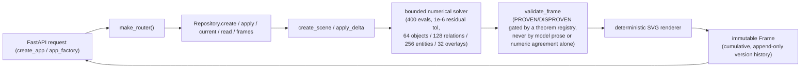

# Geometry Scene Engine

Independent deterministic geometry tools with a separate model-backed reasoning,
presentation and review loop. The complete capability is **semi-deterministic**.
See [requirement 37](../documentation/requirements/37_GEOMETRY_SCENE_ENGINE.md) and the
[runtime cross-impact](../documentation/requirements/26_GEOMETRY_RUNTIME_COMPLETION_PLAN.md).

## Install and verify

```bash
make -C mathbank-geometry-engine install
make -C mathbank-geometry-engine test lint gallery
open mathbank-geometry-engine/output/gallery/index.html
```

The gallery contains all ten executable scenarios and 32 cumulative SVG frames,
three separate state files, deltas, validation and replay bundles.
No model, application database or tutor is needed.

```bash
geometry-scene render fixtures/05_circumcenter_chain.json --output output/circumcenters
geometry-scene apply output/circumcenters/bundle_000.json delta.json --output output/next
geometry-scene validate output/circumcenters
```

`failure.json` and invalid candidate bundles retain debugging evidence. Failed model
attempts additionally retain prior state, request, plan, presentation, validation,
provider usage and review outcomes in protected run evidence.

## Contracts

- `SceneInput` / `StateDelta` → `create_scene` / `apply_delta` → immutable `Frame`.
- `Frame` contains MathState, SceneState, VisualState, SVG and numerical/visual validation.
- IDs are `[A-Za-z][A-Za-z0-9_]{0,63}`. Typical IDs: `point_A1`, `triangle_BCD`,
  `quadrilateral_ABCD`, `segment_AB`, `circle_relationId`.
- Established facts: GIVEN, PROVEN, ASSUMED_FOR_CONSTRUCTION. Unknown, target and
  disproven facts do not produce assertion markers.
- Supported relations: triangle, quadrilateral, concyclic, collinear, midpoint,
  circumcenter, tangent, parallel, perpendicular, equal length/angle, similar,
  angle measure, extension, altitude and intersection.
- `VisualDelta` accepts show/hide/highlight/dim/focus/styles/caption and cumulative
  `overlays` (`id`, existing semantic `targets`, `caption`). Overlay references are checked.
- Existing points stay fixed. Seed/mode/minimum-angle changes require `relayout=true`.
  SCHEMATIC retains every supplied explicit relation; it is not an invalid-image fallback.
- Bounded numerical solve: at most 400 evaluations, residual tolerance `1e-6`, 64 objects,
  128 relations, 256 entities and 32 overlays. Invalid/ambiguous input fails explicitly.

JSON/YAML supports typed DSL and a documented restricted fact grammar in
[parser.py](src/geometry_scene/parser.py). It does **not** interpret arbitrary prose.
The configured-model wrapper does that separately.

## Agentic wrapper

`GeometryRequest` → reasoning `GeometryPlan` → presentation `VisualDelta` →
deterministic candidate → independent semantic review → accept or bounded revision.
Three logical roles can use the same configured model. Rendering never calls a model.

Claims need exact source quotations, trusted established facts or an executable theorem.
PROVEN cannot be authorized by model prose/numerical agreement. The versioned
[theorem registry](src/geometry_scene/theorems.py) checks tangent-radius, midpoint,
straight-angle and AA prerequisites; unsupported theorems fail explicitly.
Source extraction is reviewed for meaning as well as syntax. No general-purpose theorem
prover is claimed. Use explicit structured input for unsupported construction vocabulary.

Defaults: 3 attempts, 9 model calls, 120 seconds, provider request timeout ≤45 seconds,
no hidden provider retries. `GEOMETRY_AGENT_MODEL` defaults to the existing tutor model
or the geometry-specific default `gpt-4.1-mini`. Limits are configurable through `GEOMETRY_MAX_ATTEMPTS`,
`GEOMETRY_MAX_CALLS` and `GEOMETRY_DEADLINE_SECONDS`.

## Two test layers

1. Offline tests and seeded fixture replay; CI publishes the image/state gallery.
2. Paid interpretation evaluation, using the configured model and semantic invariants:

```bash
# Requires configured OPENAI_API_KEY; opt-in real calls, not mocked acceptance.
make -C mathbank-geometry-engine eval-paid
# Or use the existing REST project key/model:
cd mathbank-rest
.venv/bin/python -c 'from pathlib import Path; from geometry_scene.evaluation import evaluate; from mathbank_rest.geometry_orchestration import make_provider; print(evaluate(Path("../mathbank-geometry-engine/fixtures"), Path("../mathbank-geometry-engine/output/agent-eval"), make_provider))'
```

Model plans need not be byte-identical. The harness records per-case invariants,
calls, usage, attempts, validation and accepted images, including the exact A1/BCD
regression. Skipped tests are not passed acceptance. See the requirement tracker for
actual measured results, not a promise that any configured model always succeeds.

## REST, tutor and UI

MathBank mounts the independent seven-path API under `/v1/geometry-scenes`, plus
`POST /interpret`. Learners use their existing bearer token; staff use the existing
admin key. `Idempotency-Key` replays an accepted interpretation without another paid call.

```json
{
  "problem_text": "ABCD is a convex quadrilateral. A1 is the circumcenter of BCD.",
  "goal": "Help the student understand A1.",
  "required_entities": ["quadrilateral_ABCD", "triangle_BCD", "point_A1"],
  "forbidden_entities": ["point_B1", "point_C1", "point_D1"],
  "seed": 17
}
```

Update requests additionally supply `scene_id` and `expected_version`. Attempt-bound
requests use `solve_attempt_id` and the current `solution_step_id`; ownership and current
step are checked server-side. Geometry does not mutate grading, mastery or solution steps.
Learners cannot submit authoritative `trusted_facts`.
Raw learner mutations cannot assert PROVEN/DISPROVEN, and accepted givens cannot be demoted.

Acceptance gates: every canonical and paraphrased scenario must produce a valid,
goal-relevant accepted image within its configured budget; initial A1 creation and
its paraphrase must preserve ABCD and exactly BCD/A1; ambiguous/unsupported/unsupported-proof
probes must reject without publication. Leakage, changed givens and wrong-object
acceptance are hard failures, never averaged away. Repeated evaluations report
availability, calls and semantic outcomes separately; provider timeouts are explicit
failed requests, not successful interpretation samples.

Tutor tool `generate_geometry_scene` returns a safe `geometry-scene` fence with only
scene ID, pinned version, caption and step. The web fetches private SVG through the
authenticated same-origin proxy, never raw HTML/SVG injection or credentials in URLs.
Navigation cannot reveal versions later than the pinned tutor response.

Staff inspect protected run evidence at `/admin/geometry-scenes?run=RUN_ID&owner=OWNER`.
Backend staff paths: `/v1/geometry-scenes/debug/runs?owner=OWNER`,
`/debug/runs/{run_id}?owner=OWNER` and POST `/debug/runs/{run_id}/review?owner=OWNER`.

## Persistence

Production uses PostgreSQL CAS/idempotency/immutable metadata and existing private object
storage with content hashes. Local standalone SQLite remains a development adapter,
not a production fallback.

```bash
cd mathbank-rest
make install
make migrate-geometry-scenes  # explicit additive packaged migration 026, configured DB
```

Object-storage configuration is the existing MathBank private adapter; storage failures
return explicit errors. No automatic schema creation, paid vector indexing or graph
publication occurs. Rejected candidates remain private; only validated reviewed candidates
are published. Asset ownership is checked on every read. General Manim animation and
vector discovery remain outside this scene-system acceptance scope.

## Architecture flow



Endpoints (`src/geometry_scene/api.py`): `POST /v1/geometry-scenes`,
`POST /v1/geometry-scenes/{scene_id}/deltas`, `GET /v1/geometry-scenes/{scene_id}[/versions/{v}]`,
`GET .../render` (private SVG), `POST .../validate`, `GET .../frames`. `create_app(repository, token)`
requires a bearer token ≥16 characters; `app_factory()` reads `GEOMETRY_SCENE_TOKEN`/
`GEOMETRY_SCENE_DB` from the environment. Standalone persistence is SQLite — production
persistence/auth goes through `mathbank-rest`.

## Data model

```mermaid
erDiagram
    SCENE_INPUT ||--|| FRAME : "create_scene"
    STATE_DELTA ||--|| FRAME : "apply_delta (cumulative)"
    FRAME ||--|| MATH_STATE : "contains"
    FRAME ||--|| SCENE_STATE : "contains"
    FRAME ||--|| VISUAL_STATE : "contains"
    MATH_STATE ||--o{ MATH_OBJECT : "owns"
    MATH_STATE ||--o{ RELATION : "owns"
    RELATION }o--o{ MATH_OBJECT : "references"
    SCENE_STATE ||--o{ ENTITY : "owns"
    VISUAL_STATE ||--o{ STYLE : "owns"
    VISUAL_STATE ||--o{ OVERLAY : "owns"
```

`RelationType` covers `TRIANGLE`/`QUADRILATERAL`/`CONCYCLIC`/`COLLINEAR`/`MIDPOINT`/
`CIRCUMCENTER`/`TANGENT`/`PARALLEL`/`PERPENDICULAR`/`EQUAL_LENGTH`/`EQUAL_ANGLE`/`SIMILAR`/
`ANGLE_MEASURE`/`EXTENSION`/`ALTITUDE`/`INTERSECTION`. `RelationStatus` covers `GIVEN`/
`ASSUMED_FOR_CONSTRUCTION`/`PROVEN`/`UNKNOWN`/`TARGET_TO_PROVE`/`DISPROVEN` — see
`src/geometry_scene/schemas.py` for the authoritative Pydantic definitions.

## Tests

```bash
make test        # .venv/bin/pytest tests -q — 8 test files
make lint        # Ruff + mypy
make gallery     # generate the fixture SVG/state gallery
make eval-paid   # opt-in paid model-backed evaluation (requires OPENAI_API_KEY)
```

## Deployment strategy

**Today:** no standalone deployment — used either as a library (`create_app`/`app_factory`)
mounted inside `mathbank-rest`, or run locally against SQLite for development/testing.

**Independence:** the core engine (`src/geometry_scene/`) declares no sibling-package dependency
in `pyproject.toml` and can run fully standalone with its SQLite adapter. The *paid evaluation*
example specifically imports `mathbank_rest.geometry_orchestration` and assumes `cd mathbank-rest`
— that's an intentional, clearly-scoped integration test, not a hidden runtime coupling of the
engine itself.

## Roadmap / TODO

Explicitly out of scope per the README (not a gap to silently close, a stated boundary):
general theorem proving, arbitrary-prose interpretation, general Manim animation/vector discovery,
automatic schema creation, paid vector indexing, graph publication, and any mutation of grading/
mastery/solution-step state from this engine.

## Gotchas (mathbank-geometry-engine-specific)

- `SCHEMATIC` is a deliberate rendering mode, not a fallback for an invalid image — don't treat it
  as an error condition.
- Existing points stay fixed across deltas; changing seed/mode/minimum-angle requires an explicit
  `relayout=True` — it will not happen implicitly.
- `PROVEN` can only be asserted through the theorem registry + trusted evidence gates — never from
  model prose or numerical agreement alone, and never from a raw learner mutation.
- SVG is served privately with `no-store` and restrictive CSP — don't relax this when integrating
  a new consumer without re-reading why.
