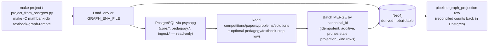
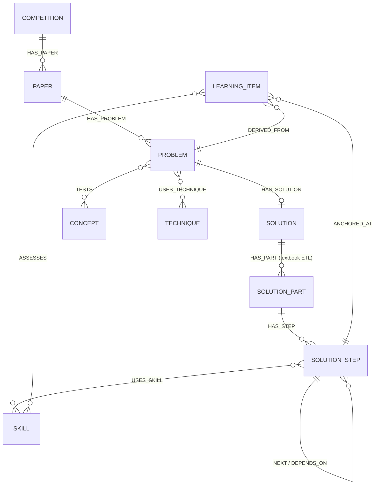

# mathbank-graph

Local Neo4j Community server (data stored on the external APFS drive) holding the
graph projection of the mathbank corpus. See the `Makefile` for lifecycle targets
(`install`, `configure`, `set-password`, `start`, `stop`, `status`, `project`).
The canonical source-derived inventory is the
[graph schema reference](../documentation/requirements/reference/GRAPH_SCHEMA.md), linked
from the [implementation-reference index](../documentation/requirements/reference/README.md).
It describes projector support. The separately dated
[live graph metadata appendix](../documentation/requirements/reference/GRAPH_LIVE_CATALOG.md)
records 11 labels, 23 relationship types and 36 directed endpoint label-set
combinations on the user's selected REST-configured target (2026-10-07 UTC),
with every observed property/type, constraint and index. It is not a row-content
or graph-publication acceptance check, nor necessarily this local server.
See [step generation/authoring and attachments](../documentation/requirements/36_STEP_GENERATOR_AND_AUTHORING.md)
for the SQL-to-graph lifecycle and implemented-versus-proposed boundaries.

## Connecting / viewing the graph

- **Neo4j Browser**: http://localhost:7474
- **Bolt URL** (enter this in the Browser's connect field, not the http:// address):
  `bolt://localhost:7687`
- **Username**: `neo4j`
- **Password**: value of `NEO4J_PASSWORD` in this directory's `.env` (gitignored;
  see `.env.example` for the key name)

### Login troubleshooting

- Make sure the connect URL field uses `bolt://localhost:7687`, not
  `http://localhost:7474` — the browser UI is served over HTTP but auth happens
  over the bolt connection.
- Check for trailing whitespace/newline if the password was copied from `.env`.
- If Neo4j Browser previously cached an older password in local storage, clear
  the saved connection and re-enter credentials.
- To verify the credentials work independently of the browser, use cypher-shell:
  ```bash
  echo "RETURN 1;" | $(brew --prefix cypher-shell)/bin/cypher-shell \
    -a bolt://localhost:7687 -u neo4j -p "$(grep NEO4J_PASSWORD .env | cut -d= -f2)"
  ```

### Viewing the full graph

Neo4j Browser caps visual results by default. To see everything:

```cypher
MATCH (n) RETURN n;
MATCH (n)-[r]->(m) RETURN n, r, m;
```

Raise the "Initial Node Display" limit in Browser settings (gear icon) if the
graph is large, or check sizes first:

```cypher
MATCH (n) RETURN labels(n) AS label, count(*) AS n ORDER BY n DESC;
MATCH ()-[r]->() RETURN type(r) AS rel, count(*) AS n ORDER BY n DESC;
```
# P0 skills and semantic projection

The existing `make project` / `make project-remote` behavior remains usable before
pedagogy migration. Explicitly opt in with
`.venv/bin/python etl/project_from_postgres.py --pedagogy`, or from the repo root
`make -C mathbank-db project-pedagogy`. Apply PostgreSQL
`mathbank-db/sql/006_pedagogy.sql` first; missing tables produce an actionable
error before projection tracking/graph writes, not swallowed database exceptions.
Use `GRAPH_ENV_FILE` as in the existing projector. These are operator write
commands. The authorized remote rollout was completed on 2026-10-04; use
`make -C mathbank-db project-pedagogy-remote` for the matching Neon/Aura pair.
The projector honors `NEO4J_DATABASE` for every projection session.

Skill nodes MERGE by PostgreSQL UUID `canonical_id`, not generated names, and
retain `slug`, `name`, `objective`, nullable `level`, `source`, `confidence`,
`review_status`. Problem-skill edges use `REQUIRES`, `PRACTICES`, `TESTS`
and preserve lowercase `role`, nullable `required_level`, `importance` and
provenance. Skill-concept edges are Skill `PART_OF` Concept; skill-skill
edges allow `PREREQUISITE_OF` (prior -> dependent), `PART_OF` (child -> parent),
and `BUILDS_ON` (authored direction).

Original Concept `CONCEPT_RELATION` edges remain generic for every relation
type. Only the exact whitelist above creates additional semantic Concept
edges. The explicitly named `HAS_SUBCONCEPT` reverses parent -> child to child
`PART_OF` parent. No synonyms, case folding, or direction guessing are used.
Original problem-Concept `TESTS`, `USES_TECHNIQUE`, and generic concept edges
retain snake_case `source`, `confidence`, uppercase `review_status`;
concept confidence is the existing SQL `strength`, which also stays projected.

Pedagogy dimensions are optional properties on Problem nodes; their provenance
is namespaced as `pedagogy_source`, `pedagogy_confidence`, `pedagogy_review_status`
to avoid overwriting corpus provenance. Managed semantic edges carry
`projection_kind: pedagogy`; each opt-in run reconciles these edges and dimensions
so deleted/downgraded assertions cannot retain an old approved edge after a
successful run. Removed owned skills are marked REJECTED rather than deleting
unrelated graph references. The graph is a rebuildable projection, not the
authoring store. Repeated runs cannot duplicate Skill nodes/role edges.

All PENDING, REVIEWED, and REJECTED assertions are projected for inspection.
Tutoring and the graph's default **Reviewed only** filter require reviewed
nodes/relationships; unchecking it exposes the inventory with an explicit
warning. Confidence does not override review status.

The owned pedagogical edges and difficulty properties are reconciled atomically
in one Neo4j transaction, with batched statements inside that transaction.
A failure rolls back the replacement. The surrounding corpus projection and
Postgres run log are not a cross-database atomic transaction; retry failed runs
and verify source/projection consistency before certifying teaching coverage.

### Live audit

The 2026-10-04 rollout produced 6 PENDING Skill nodes, 83 owned pedagogical
relationships, and 3 PENDING problem-difficulty assessments:

| Projected metadata | Count |
|---|---:|
| Existing Concept hierarchy projected as PART_OF | 65 |
| Skill PART_OF Concept | 6 |
| Skill PREREQUISITE_OF Skill | 5 |
| Skill BUILDS_ON Skill | 1 |
| Problem REQUIRES Skill | 3 |
| Problem PRACTICES Skill | 2 |
| Problem TESTS Skill | 1 |

The initial rollout left all 83 PENDING. After explicit operator approval and
publication through `/admin/pedagogy`, the 18 skill-related edges are REVIEWED,
the 65 legacy concept-hierarchy edges remain PENDING, and the 6 skills and
3 difficulty assessments are REVIEWED. No skill-skill hierarchy or concept prerequisite assertions
have been authored in this starter set; their supported views are correctly
empty. Inventory endpoints return all source/confidence/review/role/level
metadata; Problem inspection also shows dimensions and namespaced provenance.
No official answers or solution bodies are exposed by graph metadata APIs.

The live graph contains 20,942 nodes and 35,529 relationships. These are dated
audit counts, not guarantees about future ingestion. Overview/sample APIs cache
for five minutes. Repeated projection retained 6 Skill nodes and 83 owned edges.
The integration suite also verified that a deliberate failure after deleting
owned edges rolled back completely. Review/publication is an admin-authorized
operation, not inferred from confidence or successful projection.
Student attempts, multimodal evidence and generated artifact content are not
projected into Neo4j. The textbook solution-step metadata layer is implemented
as described below; learner evidence projection, calibrated adaptive
inference and a complete course model remain outside this graph contract.

# Textbook solution-step layer (Graph Projection v2)

`etl/project_textbook_steps.py` projects the imported textbook packages (migration 010;
see `documentation/requirements/18_PRASOLOV_IMPORT_AND_V2_RUNTIME_TRACKER.md`) as metadata-only nodes:
`(Solution)-[:HAS_PART]->(SolutionPart)-[:HAS_STEP]->(SolutionStep)`. Steps link to
`Skill` with `USES_SKILL`, to `Concept` with `USES_CONCEPT`, and to `Concept:Subconcept`
with `USES_SUBCONCEPT`. Step-to-step `NEXT`/`DEPENDS_ON` edges carry confidence, source_type
and review_status. Approved, student-visible learning items become
`LearningItem` nodes with `DERIVED_FROM`/`ANCHORED_AT`/`ASSESSES` edges, plus
`TARGETS_CONCEPT`/`TARGETS_SUBCONCEPT` to the item's target concept and subconcept
(see `documentation/requirements/25_LEARNING_ITEM_CONCEPT_EDGES.md`).

Step text stays in PostgreSQL. Every write is tagged `projection_kind='solution_steps'`,
so the `--pedagogy` replacement never removes it. Stale nodes and edges of that kind are
pruned. Each run reconciles graph counts against Postgres and records a
`pipeline.graph_projection` row with `graph_name='textbook_step_graph'`.

```bash
make -C mathbank-db textbook-graph-dry-run-remote   # planned counts, no writes
make -C mathbank-db textbook-graph-remote           # --pedagogy base layer, then the step layer
make -C mathbank-db textbook-graph-status-remote    # read-only reconciliation
mathbank-rest/.venv/bin/python -m pytest -q mathbank-graph/tests
```

Pitfalls: `documentation/requirements/19_GOTCHAS_AND_OPERATIONAL_PITFALLS.md` (GOT-GR-*).

## Architecture flow



`mathbank-rest`'s `db/graph.py` reads from the same Neo4j instance this project writes into, but
never writes to it directly for structural projections — all writes to Neo4j go through this
project's ETL scripts, keeping "who's allowed to mutate the graph" to one place.

## Data model (projected entities)



Every node uses a PostgreSQL-sourced UUID as its Neo4j `canonical_id` — this is what makes the
projection idempotent (re-running `project_from_postgres.py` MERGEs, never duplicates).

## Tests

```bash
make test                                              # one-shot Neo4j connectivity check (not pytest)
mathbank-rest/.venv/bin/python -m pytest -q mathbank-graph/tests   # the actual Python test (1 file today)
```

## Deployment strategy

**Today:** this is a local/CI-run ETL tool, not a long-running service — there's no server process
to deploy, only `make project`/`make project-remote` invocations run on demand (or on a schedule)
against production Neon Postgres + AuraDB. The local Neo4j Community install (`make setup`) exists
purely for local development/inspection, not production serving.

**Independence:** the ETL scripts only need PostgreSQL read access and Neo4j write access via
`.env`/`GRAPH_ENV_FILE` — no sibling-folder runtime dependency. It is naturally "independently
deployable" already, in the sense that it's a standalone batch job with its own venv
(`make etl-venv`), not something requiring colocation with `mathbank-rest` or any other service.

## Roadmap / TODO

- `SolutionStep-[:USES_TECHNIQUE]->Technique` is explicitly marked not-yet-implemented
  (`NYI-3`, migration 017) in the textbook ETL.
- `LearningItem-[:TARGETS_CONCEPT]`/`TARGETS_SUBCONCEPT` are marked `NYI-ATB-7`.
- Learner-specific evidence, calibrated adaptive inference, and a complete course-graph model are
  explicitly out of scope for this graph (and must stay out — see the normative correction in
  [doc 44](../documentation/requirements/44_MICRO_COURSE_MOBILE_AI_ANALYTICS_PLATFORM.md): learner
  misconception/mastery evidence is private PostgreSQL state and must never be projected here).

## Gotchas (mathbank-graph-specific)

See [documentation/GOTCHAS.md](../documentation/GOTCHAS.md) (GOT-GR-*) for the full catalog.
Specific highlights:
- Homebrew Neo4j upgrades/reinstalls regenerate `neo4j.conf` and reset the external-drive data
  paths — rerun `make configure` after any Neo4j package upgrade.
- Browser auth uses `bolt://localhost:7687`, not the HTTP Browser URL shown in a browser tab.
- `make project --pedagogy` requires `mathbank-db/sql/006_pedagogy.sql` to already be applied.
- The graph is a rebuildable projection, never the authoring store — if Postgres and Neo4j ever
  disagree, Postgres wins and the graph should be re-projected, not hand-edited.
- The pedagogy-layer replacement is atomic inside Neo4j, but the surrounding PostgreSQL run-log
  write and the Neo4j write are **not** one cross-database transaction — a crash between them can
  leave a `pipeline.graph_projection` row that doesn't yet match graph reality; `textbook-graph-status-remote`
  is the read-only reconciliation check to run after any interrupted run.
