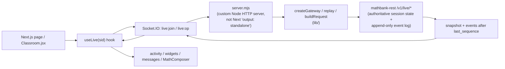
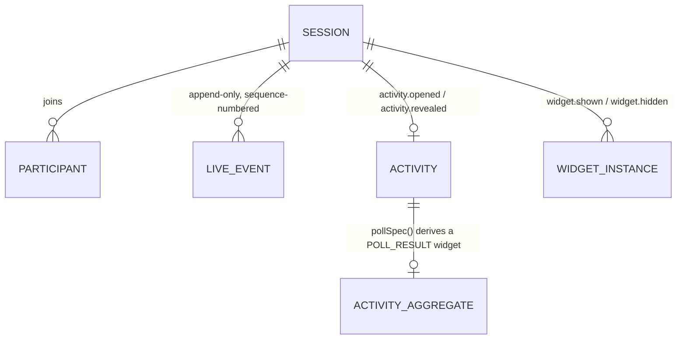

# mathbank-live

Separately deployable Next.js + Socket.IO realtime classroom (port `5174`). It is a presentation
and relay layer only — `mathbank-rest`'s `/v1/live/*` endpoints own all classroom state
(sessions, participants, activities, event log); this app's custom Node server (`server.mjs`)
joins Socket.IO rooms, replays missed events by sequence number, and forwards an allowlisted set
of student/instructor commands back to REST. It never persists anything itself.

See [documentation/requirements/28_DISTRIBUTED_LIVE_PLATFORM.md](../documentation/requirements/28_DISTRIBUTED_LIVE_PLATFORM.md).

## Quick start

```bash
cd mathbank-live
make install       # npm install + sync-widgets (copies ../mathbank-widgets in)
make dev           # foreground dev server
# or
make start         # background, via mathbank-scripts/start-service.sh; make status / make stop
make test          # node --test tests/*.test.mjs
make smoke         # two-socket realtime integration smoke test (needs REST + this running)
```

Requires `mathbank-rest` already running and reachable (configured via this folder's `.env`).

## Architecture flow



Flow, concretely: `live:join` validates the session through REST, joins Socket.IO rooms, replays
any events missed since the client's `last_sequence`, and returns state + replayed events.
`live:op` builds an allowlisted REST request for commands like `state`, `respond`, `ask_tutor`,
and `command`. Reconnection correctness depends entirely on the client passing its true
`last_sequence` back into `live:join` — see `lib/events.mjs`'s `mergeEvents()`, which deduplicates
by `sequence` and caps the retained client-side list at 400 events.

## Data model (client-side, not persisted here)



All of this is relayed from `mathbank-rest`'s real schema, not owned here — see that project's
README for the actual table names.

## Tests

```bash
make test     # node --test tests/*.test.mjs — gateway.test.mjs, attemptEvents.test.mjs
```

## Deployment strategy

**Today:** `make start` runs the custom server in the background (PID file,
`mathbank-scripts/start-service.sh`), same pattern as every other service.

**Independence:** this is the one project in the repo with a genuine, necessary build-time
dependency on a sibling folder — `mathbank-widgets` is copied into `node_modules/mathbank-widgets`
via `make sync-widgets` (not installed from a registry, since it's a private, unpublished shared
package). A standalone deployment of `mathbank-live` needs `mathbank-widgets`' source available at
build time; it is otherwise independent (everything else is reached over HTTP against
`mathbank-rest`, a network dependency not a filesystem one).

## Roadmap / TODO

No explicit TODO/FIXME markers exist in this project's source today — its code comments instead
state fixed design constraints (gateway must stay stateless; never use Next's
`output: "standalone"`; reconnect must rejoin via `last_sequence`; tutor operations are rate-limited
to 6 requests via `createOpLimiter`). Treat any change to those constraints as a deliberate
architecture decision, not a quick fix.

## Gotchas (mathbank-live-specific)

See [documentation/GOTCHAS.md](../documentation/GOTCHAS.md) for repo-wide pitfalls. Specific to
this app:
- `server.mjs` is a **custom** Next.js server — do not set `output: "standalone"` in
  `next.config.js`; it is incompatible with the way this project installs the Socket.IO gateway.
- A socket must successfully `live:join` before sending any `live:op`; unauthenticated sockets get
  `UNAUTHENTICATED`.
- `make sync-widgets` must be re-run (via `make install`) after any change to `mathbank-widgets` —
  it's a file copy, not a symlink, so edits there don't automatically show up here.
- Tutor-facing operations are paid/rate-limited; expect a paused-tutor or takeover-related response
  under load, by design, not as a bug.
