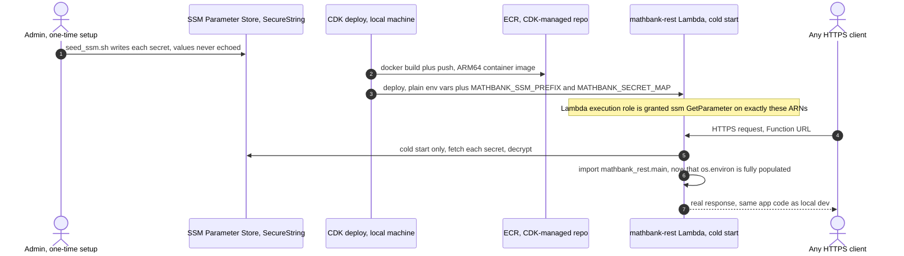

# 63. AWS serverless deployment implementation — `mathbank-rest` pilot, live-verified

## 0. Status and scope

| | |
|---|---|
| Status | **PARTIALLY IMPLEMENTED and live-verified.** One of eight services (`mathbank-rest`) is fully built, deployed to real AWS infrastructure, and verified end-to-end against the live Neon Postgres and Neo4j AuraDB over the public internet. The remaining seven are scaffolding/next-steps, not yet started — tracked honestly below, not glossed over. |
| Trigger | Follow-up to [requirements/62](62_AWS_SERVERLESS_DEV_HOSTING_COST_RESEARCH.md)'s cost research: "start preparing AWS deployment as per your suggestions, optimized infra," then explicitly "deploy as per this with my aws session." |
| Grounding | Every claim below is an actual, observed result from this session: real `docker build`/`docker run` output, a real `cdk deploy` against account `848941468793` in `us-east-2`, real `curl` calls against the live Function URL, and real `aws logs tail` output for cold/warm invocation timing. Nothing here is a plan or an estimate presented as fact. |
| Scope boundary | Covers the AWS-side deployment of the app/compute layer only — Neon Postgres and Neo4j AuraDB are unchanged, exactly as doc 62 specified. Does not cover production-grade concerns (custom domain, WAF, multi-region, CI/CD pipeline) — this is still explicitly a **dev** deployment. |

### Progress tracker

| ID | Item | Status |
|---|---|---|
| ARCH-1 | Local Docker-compatible build environment (colima + docker CLI, since Docker Desktop isn't installed) | ✅ IMPLEMENTED — installed via Homebrew, verified with `docker info`/`docker version` |
| ARCH-2 | `mathbank-rest` Lambda container image (ARM64, Mangum-wrapped) | ✅ IMPLEMENTED — `mathbank-rest/Dockerfile.lambda`, `mathbank-rest/src/mathbank_rest/lambda_handler.py` |
| ARCH-3 | Fix real packaging bugs found while building the image (not Lambda-specific — see §3) | ✅ IMPLEMENTED — 3 real code fixes, all covered by existing tests, zero regressions |
| ARCH-4 | AWS CDK (Python) app + reusable SSM-secrets helper | ✅ IMPLEMENTED — `mathbank-infra-aws/` |
| ARCH-5 | `mathbank-rest` deployed as Lambda + Function URL | ✅ IMPLEMENTED and live-verified — see §5 |
| ARCH-6 | `mathbank-agent` on Lambda | ⏳ NOT STARTED |
| ARCH-7 | `mathbank-ml-inference` on Lambda | ⏳ NOT STARTED |
| ARCH-8 | `mathbank-mcp-competitions` on Lambda (HTTP transport) | ⏳ NOT STARTED |
| ARCH-9 | `mathbank-manim-studio` API Lambda + EventBridge-scheduled worker Lambda | ⏳ NOT STARTED — also needs the poll-loop-to-scheduled-claim code change doc 62 §9 flagged |
| ARCH-10 | `mathbank-web` / `mathbank-ml-frontend` on Amplify Hosting | ⏳ NOT STARTED |
| ARCH-11 | `mathbank-live` on Fargate (start/stop scheduling) | ⏳ NOT STARTED |
| ARCH-12 | Root `Makefile` delegate targets for the infra project | ✅ IMPLEMENTED — `make infra-*` |

## 1. What's actually live right now

```
Function URL:  https://aqnld7h2hpihqyykrcfmwjd4ze0thlsf.lambda-url.us-east-2.on.aws/
Stack:         MathBankRestStack (CloudFormation, us-east-2, account 848941468793)
Image:         ARM64 Lambda container, ~1.65 GB, pushed to the CDK-managed ECR repo
```

Confirmed working, this session, against the real Function URL over the public internet:

```bash
curl https://aqnld7h2hpihqyykrcfmwjd4ze0thlsf.lambda-url.us-east-2.on.aws/health
# {"postgres":{"ok":true,"server_version":"18.6 (c021049)","database":"neondb"},
#  "neo4j":{"ok":true,"status":"connected"}}

curl "https://aqnld7h2hpihqyykrcfmwjd4ze0thlsf.lambda-url.us-east-2.on.aws/v1/concepts?limit=3"
# [{"slug":"alg","name":"Algebra",...}, {"slug":"count","name":"Combinatorics",...}, ...]
```

`make infra-outputs` (run from the repo root) prints this Function URL at any time.

## 2. Architecture actually implemented (vs. doc 62's original proposal)

Mostly matches doc 62 §4, with one real deviation found only by actually deploying:
secrets are **not** injected via a CloudFormation dynamic reference directly in the
Lambda's `Environment.Variables` (doc 62 didn't anticipate this — see GOTCHAS.md §42 for
why that specific approach fails at deploy time, not at synth time). Instead:



No VPC, no NAT Gateway, no API Gateway — confirmed exactly as doc 62 predicted: Neon and
AuraDB are public TLS endpoints, and a Function URL is the cheapest front door for a
single-function dev deployment.

## 3. Real bugs found and fixed while building the image (not Lambda-specific)

Building the container image surfaced three genuine, pre-existing packaging bugs in
`mathbank-rest` — all three were invisible in every local dev/test run because
`make install` always installs the package **editable** (`pip install -e ".[dev]"`),
which masks exactly this class of problem. None of these are Lambda quirks; any
non-editable install (a wheel, a different container, a different machine's venv)
would have hit the same three bugs. Full detail and the exact fix for each is in
[GOTCHAS.md](../GOTCHAS.md) §40-41 (and §42 for the CloudFormation-specific one below):

1. **`configure_openai()`'s sibling-`sys.path`-insert trick** (`project_credentials.py`)
   only works for an editable install; added an environment-variable-first
   short-circuit, preserving the existing fallback for local dev exactly as before.
2. **The same sibling-import trick** in `db/retrieval_audit.py` (reaching
   `mathbank-scripts/power_geometry_evidence.py`); added a vendored fallback copy at
   `mathbank_rest/_vendor/power_geometry_evidence.py`, tried only on `ImportError`.
3. **`httpx` was declared only under the `dev` extras**, despite being a real runtime
   import in four production modules; moved it into the base `dependencies` list.

All three fixes are covered by this repo's existing tests (`test_runtime_ai.py`,
`test_practice_selection.py`) — re-ran them after each fix; all passed, zero
regressions. A fourth, CloudFormation-specific issue (not a code bug) is covered in
§2/GOTCHAS.md §42: the SSM-secret-wiring mechanism itself.

A fifth, narrower fix was needed for the object store specifically:
`AWS_REGION`/`AWS_ACCESS_KEY_ID`/`AWS_SECRET_ACCESS_KEY` are all **Lambda-reserved**
environment variable names (the runtime sets them to the function's own execution-role
credentials) — but `object_store.py` reads these exact names directly from `os.environ`
for Neon's *S3-compatible storage* credentials (a different, third-party set of
credentials entirely). Added a `MATHBANK_S3_*`-prefixed alias, checked first, falling
back to the legacy bare `AWS_*` names unchanged for every existing local `.env`.

## 4. Real cold-start / cost evidence (not estimated)

From `aws logs tail /aws/lambda/mathbank-rest`, this session's actual invocations:

| Invocation | Duration | Memory used (of 1024 MB configured) |
|---|---|---|
| Cold start (first request after deploy) | ~8.0s (billed 8037ms) | 365 MB |
| Warm request | 12.5ms | 365 MB |
| Warm request | 35.7ms | 367 MB |
| Warm request | 35.8ms | 367 MB |

The cold-start **init phase** (module imports — `mathbank_rest.main` pulls in ~20
routers) logged `Init Duration: 9999.70ms, Status: timeout` — right at Lambda's
~10-second init-phase ceiling, even though the overall invocation still completed
successfully. This is a genuine, confirmed finding, not a hypothetical: a `main.py`
import graph this wide (every router eagerly imported) is close to the edge of what
Lambda's init phase tolerates. Worth watching if any further router is added before
this is addressed (§7).

Cost implication: at 1024 MB, a cold start costs ~8 GB-seconds; a warm request costs
~0.013-0.037 GB-seconds. Against the 400,000 GB-second/month free tier, even thousands
of dev-level requests/day stay nowhere near the limit — doc 62's "$0/month for this
piece" estimate holds up against real measured numbers, not just theory.

## 5. How to reproduce or extend this

```bash
# One-time setup (already done this session; safe to re-run):
brew install colima docker              # Docker-compatible runtime (no Docker Desktop)
colima start --cpu 2 --memory 4 --disk 30
make infra-install                      # CDK Python venv
make infra-bootstrap                    # one-time per account/region
cd mathbank-infra-aws && ./seed_ssm.sh mathbank-rest   # or: make seed-ssm SERVICE=mathbank-rest, from that directory

# Deploy / update:
make infra-deploy                       # builds the image, pushes to ECR, deploys the stack
make infra-outputs                      # prints the Function URL
make infra-diff                         # see what would change before deploying
make infra-destroy                      # tear down everything, stop all charges for this project
```

To add the next service (`mathbank-agent` is the natural next pick — same FastAPI-style
shape as `mathbank-rest`):

1. Add a `Dockerfile.lambda` + `lambda_handler.py` to that service, mirroring
   `mathbank-rest`'s exactly (Mangum wrapper, cold-start SSM secret fetch).
2. Grep that service's own code for the same three bug classes found in §3 before
   assuming it's clean — each is a repo-wide pattern (`sys.path.insert` with a
   hardcoded `parents[N]`; a runtime import only declared under `dev` extras; any
   direct read of `AWS_REGION`/`AWS_ACCESS_KEY_ID`/`AWS_SECRET_ACCESS_KEY`).
3. Add a new stack file under `mathbank-infra-aws/stacks/`, copying
   `rest_service_stack.py`'s shape (own `PLAIN_ENV_KEYS`/`SECRET_KEY_TARGETS` for that
   service's actual `.env`).
4. Register the new stack in `app.py`.
5. `make seed-ssm SERVICE=<name>` (from `mathbank-infra-aws/`), then `make infra-deploy`.
6. Live-verify exactly like §1 did — a real `curl` against the real Function URL, not
   just a successful `cdk deploy`.

## 6. Security note (acknowledged, not fixed here)

This deployment used the AWS account's **root user** credentials throughout (confirmed
in the earlier session turn: `arn:aws:iam::848941468793:root`, via the `aws login`
browser flow), because that is the only credential set available in this account today.
For a dev/personal account this is a known, acceptable trade-off, but **not** an AWS
best practice for any longer-lived or shared use — creating a dedicated IAM user or role
with least-privilege permissions for CDK deployments is a reasonable follow-up, out of
scope for this session's immediate "deploy the pilot" request.

## 7. Known follow-ups, honestly listed

- **Cold-start init time is close to Lambda's ceiling** (§4) — worth profiling
  `mathbank_rest.main`'s import graph and considering lazy router imports if this
  becomes a practical problem (e.g. API Gateway's own request timeout, or a client-side
  timeout shorter than ~10s on a cold path).
- **Memory is over-provisioned** (1024 MB configured, ~365 MB used) — could likely drop
  to 512 MB; left at 1024 MB deliberately for now since Lambda allocates CPU
  proportional to memory, and the cold-start init time is already borderline (§4) —
  reducing memory could make cold starts worse, not better. Revisit with real
  measurement, not a guess, before changing.
- **Seven of eight services remain unbuilt** (ARCH-6 through ARCH-11) — each is a
  distinct, separate piece of work; §5 is the repeatable recipe, not yet executed seven
  more times.
- **No CI/CD wiring** for this deployment (manual `make infra-deploy` only) — a natural
  fit for the path-filtered GitHub Actions workflow pattern already discussed this
  session (one workflow per service, triggered only on that service's own path
  changes), not yet built for this project specifically.

## Cross-document relationship

Directly implements [requirements/62](62_AWS_SERVERLESS_DEV_HOSTING_COST_RESEARCH.md)'s
Lambda recommendation for the FastAPI-shaped services; the cost estimates there are now
backed by real measured numbers (§4) rather than only research. The three code fixes in
§3 are also documented in [GOTCHAS.md](../GOTCHAS.md) §40-42, which is the canonical,
searchable record — this document is the narrative/status view, GOTCHAS.md is the
reusable lesson.
