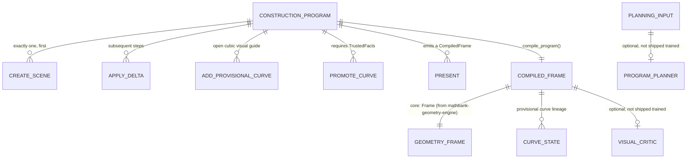

# Neural Geometry Engine

Independent **Neural-Symbolic Geometry Compiler** research project. This is not a
text-to-image generator or a replacement for the Geometry Scene Engine.

See [requirement 38](../documentation/requirements/38_NEURAL_GEOMETRY_ENGINE.md) for the complete
architecture, phased model/training roadmap, safety gates and progress.

## Delivered foundation

- Typed construction programs and cumulative, versioned execution.
- Reused Geometry Scene Engine mathematical states, constraint solver, policy,
  deterministic SVG renderer and validation; no copied solver.
- Separate mathematical-variable declarations and bounded layout-only angles.
- Open, dashed, explicitly labelled provisional cubic curves through existing points.
- Trusted concyclicity promotion: provisional guide disappears and an exact constrained
  circle appears. Prior frames remain unchanged.
- Provider-neutral planner/critic interfaces, feedback/retry budget and accepted-prefix
  preservation. Every frame is reviewed before the loop accepts a program.
- Explicitly approved local training-record export with source/license metadata.
- Original synthetic examples, offline safety/replay tests and a persistent image gallery.

**Not delivered:** a trained neural model, an actual configured-model implementation of
the new planner/critic interfaces, arbitrary-language acceptance, LoRA/fine-tuning,
general theorem proving, Manim animation, database deployment or tutor/UI integration.
Mock roles verify orchestration, not neural-model quality.

## Run independently

From the repository root:

```bash
make -C mathbank-neural-geometry install
make -C mathbank-neural-geometry test lint gallery
open mathbank-neural-geometry/output/gallery/index.html
```

Installation creates this project's own environment and installs its declared local
dependency from `../mathbank-geometry-engine`. Once both distributions are installed,
imports use packages rather than sibling-file paths. Nothing starts MathBank services,
accesses a database, calls a paid provider or initiates training.

The gallery produces **3 cases / 8 SVG frames** with programs, frame/state bundles,
validation, normalized program hashes and trusted fixture evidence:

1. Two intersecting lines: bounded readable layout angle, no given angle.
2. Provisional curve: concyclicity remains TARGET_TO_PROVE.
3. Trusted promotion: explicit relayout and exact circle after external proof evidence.

Verified locally: **38 offline tests passed**, Ruff clean, mypy clean across
**8 source files**, and all eight gallery images loaded at desktop/mobile widths.
The reused Geometry Scene Engine's **72 tests** also passed independently.

Replay a generated program:

```bash
mathbank-neural-geometry/.venv/bin/neural-geometry compile \
  mathbank-neural-geometry/output/gallery/02_provisional_curve/program.json \
  --output mathbank-neural-geometry/output/replay
```

The promotion example requires the fixture's separate host-evidence file:

```bash
mathbank-neural-geometry/.venv/bin/neural-geometry compile \
  mathbank-neural-geometry/output/gallery/03_trusted_circle_promotion/program.json \
  --trusted-facts mathbank-neural-geometry/output/gallery/03_trusted_circle_promotion/trusted_facts.json \
  --output mathbank-neural-geometry/output/promotion-replay
```

`--trusted-facts` is a **local trusted-host input**, not verification by file existence.
Never pass unverified planner output, model prose or student claims as trusted facts.
The example proof is an authored test fixture, not a theorem proved by this engine.

## Program boundary

`ConstructionProgram.steps` is a discriminated union:

| Operation | Meaning |
|---|---|
| `CREATE_SCENE` | One initial `SceneInput`, optional math declarations and layout parameters |
| `APPLY_DELTA` | Existing typed `StateDelta`; expected-version and proof checks remain enforced |
| `ADD_PROVISIONAL_CURVE` | Visual-only guide through already visible points, never a math relation |
| `PROMOTE_CURVE` | Exact point-set concyclicity from separate trusted evidence; optional explicit relayout |
| `PRESENT` | Existing `VisualDelta`, cannot mutate mathematical truth |

`compile_program(program, trusted_facts)` returns immutable frame records with separate
core state, provisional visuals, layout values, replacement lineage and SVG. Failure
raises `CompileError` with step/code; no partial sequence is returned as accepted.
The CLI emits a typed JSON error and exits nonzero on invalid IR or compilation.

Layout angle bounds are supported only for disjoint unconstrained point triples.
They cannot overwrite explicit coordinates or points participating in established
relations. New mathematical constraints may require **explicit** relayout; stale
layout-angle records are cleared after relayout rather than reported as current facts.
The bounded optimizer chooses a readable representative, not necessarily the preferred
angle exactly. Mathematical-variable declarations are metadata, not a symbolic algebra engine.

`planning.plan_and_compile` accepts injected `ProgramPlanner` and `VisualCritic` roles.
Provider exceptions propagate; adapter-level timeouts/token budgets are required before
a real provider is enabled. There is no hidden fallback or automatic model call.

`traces.training_record` requires explicit approval, complete validated frames,
source/license identifiers and a matching program fingerprint. Its input text still
requires host-side privacy/licensing review. It writes nothing or uploads nothing by itself.

## Isolation and limits

The existing core's bounded solver and proof-leakage checks remain authoritative.
The new compiler adds at most 64 program operations and 32 provisional curves,
each with 3-16 distinct visible points. Provisional paths are open cubic interpolants,
not exact circle primitives, and are labelled as non-proof visual guides.
This is a semantic safeguard, not certification that no viewer can ever infer a conjecture
from a suggestive sketch; perceptual critic evaluation remains a later acceptance gate.

Production scene storage, auth and tutor contracts are deliberately unchanged. Future
REST exposure must authorize trusted evidence server-side and preserve owner/CAS/reveal
boundaries. Do not expose the local CLI trust file as an untrusted HTTP input.

## Architecture flow

```mermaid
flowchart LR
    CLI["neural-geometry CLI\n(neural_geometry.cli:main)"] --> Parse["Pydantic ConstructionProgram"]
    Parse --> Compile["compile_program(program, trusted_facts)"]
    Compile --> Layout["bounded layout parameters\n(readability only, cannot override\nexplicit coordinates/relations)"]
    Layout --> Core["mathbank_geometry_engine\ncreate_scene / apply_delta"]
    Core --> Curves["provisional curves + trusted promotion\n(PROMOTE_CURVE requires a trusted\nCONCYCLIC/proof relation)"]
    Curves --> Render["render_curves"]
    Render --> Frames["tuple[CompiledFrame, ...]"]
    Frames --> Output["JSON / SVG / gallery / replay / training-record export"]
```



A `ConstructionProgram` must start with exactly one `CREATE_SCENE`; nothing later can reset the
scene. This project reuses `mathbank-geometry-engine`'s mathematical state, constraint solver,
policy, deterministic SVG renderer, and validation wholesale — it does not reimplement any of
that, it only adds the construction-program IR, provisional curves, and planner/critic interfaces
on top.

## Data model



## Tests

```bash
make test        # .venv/bin/pytest tests -q — test_compiler.py, test_planning.py, test_traces.py
make lint        # Ruff + mypy
make gallery     # python -m neural_geometry.cli gallery --output output/gallery
```

## Deployment strategy

**Today:** a CLI/library foundation, not a deployed service — no REST exposure exists yet (listed
explicitly as future work below).

**Independence:** `pyproject.toml` declares a real local dependency:
`mathbank-geometry-engine>=0.1.0,<0.2`, installed via `make install`'s
`pip install -e ../mathbank-geometry-engine`. This project is **not** standalone at install time —
it structurally requires its sibling engine, by design (it reuses that engine's math/render/
validation rather than duplicating it). This is the one case in the repo where a build-time
sibling dependency is the intended architecture, not something to "fix" for independence.

## Roadmap / TODO

Explicitly listed as not-yet-delivered in the README (a real roadmap, not silently-missing work):
a trained neural model; a configured planner/critic implementation (mocks today verify
orchestration, not neural-model quality); arbitrary-language acceptance; LoRA/fine-tuning; general
theorem proving; Manim animation; database deployment; tutor/UI integration; future REST exposure
with server-side trusted-evidence authorization; later perceptual-critic evaluation.

## Gotchas (mathbank-neural-geometry-specific)

- `--trusted-facts` is a **trusted host input** — never pass unverified planner output, model
  prose, or a student's own claim as a trusted fact; the compiler has no way to detect that misuse.
- `compile_program` either returns a fully valid compiled sequence or raises `CompileError` — there
  is no partial/best-effort accepted-prefix result on invalid IR.
- Mathematical-variable declarations are metadata only — this is not a symbolic algebra engine.
- Training-record export requires explicit approval, complete validated frames, a source/license
  identifier, and a matching program fingerprint — host-side privacy/licensing review is still the
  integrator's responsibility, not automated here.

## Nested tool: `mathbank-prasolov-dataset-audit/`

A separate, standalone dataset/annotation experiment (not part of the compiler itself) for turning
a 100-problem Prasolov candidate workbook into reviewable annotation stages — entity/figure/
relation/target extraction, epistemic classification, drawability analysis, leakage checking, and
solution-step bridging — with CSV/JSON exports and a debug-only SVG preview renderer (explicitly
**not** a production, leakage-safe tutor renderer). See its own
[README.md](mathbank-prasolov-dataset-audit/README.md) and
[PROJECT_REPORT.md](mathbank-prasolov-dataset-audit/PROJECT_REPORT.md). It was nested here (rather
than kept as a confusingly-named top-level `neural-geometry-engine-v1/` sibling) because it reuses
this project's/its sibling engine's deterministic rendering as an inspection aid, not because it is
architecturally part of the compiler.
