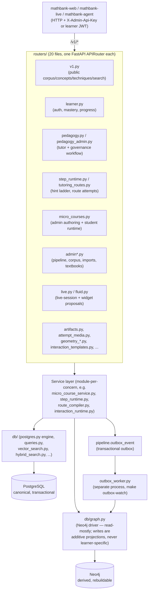
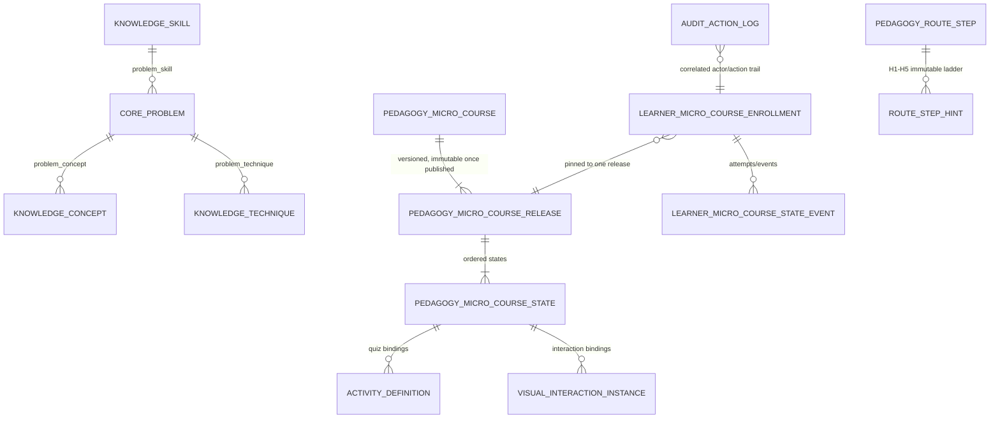

# mathbank-rest

FastAPI service (port `8000`) and the **only** component in this repository that talks to
PostgreSQL (Neon, or a local instance) and Neo4j (AuraDB, or local) directly. Every other
service — `mathbank-web`, `mathbank-live`, `mathbank-agent`, the CLIs in `mathbank-db` and
`mathbank-data-ingestion` — reaches the databases exclusively through this REST API. It owns
hybrid (semantic + lexical + graph) search, learner auth/mastery, the micro-course and
interaction-template runtimes, tutoring-route compilation/serving, and all admin authoring/review/
publication endpoints.

See [documentation/requirements/45_REST_API_DOCUMENTATION_AND_ADMIN_CRUD_GAPS.md](../documentation/requirements/45_REST_API_DOCUMENTATION_AND_ADMIN_CRUD_GAPS.md)
for a grounded audit of this API's current documentation/CRUD completeness, and
[documentation/requirements/reference/REST_API.md](../documentation/requirements/reference/REST_API.md)
for the source-derived endpoint reference.

## Quick start

```bash
cd mathbank-rest
make install      # creates .venv, installs the package + dev deps
make run          # uvicorn --reload on :8000 (foreground)
# or
make start        # background, writes a PID file; make status / make stop / make restart
make test         # pytest; ROUTE_DB_TESTS=1 pytest -q for the live-database tests
```

Configuration is a single `.env` in this folder (`POSTGRES_HOST`/`NEO4J_URI`/`OPENAI_API_KEY`/
`ADMIN_API_KEY`/...). From the repo root, `make sync-openai-key`/`make sync-neon-env` populate it;
see the root [README.md](../README.md) and [documentation/DATABASES.md](../documentation/DATABASES.md).

## Architecture flow



Every router delegates to a service module; no router embeds raw SQL. `main.py` is purely
wiring — it constructs `FastAPI()` and calls `app.include_router(...)` once per router, nothing else.

## Data model (how the layers map to storage)



This is illustrative, not exhaustive — the authoritative, generated schema reference is
[documentation/requirements/reference/POSTGRES_SCHEMA.md](../documentation/requirements/reference/POSTGRES_SCHEMA.md)
and [GRAPH_SCHEMA.md](../documentation/requirements/reference/GRAPH_SCHEMA.md) in the same folder.

## API surface (by router group)

| Group | Routers | Auth |
|---|---|---|
| Public corpus/search | `v1.py` | anonymous |
| Learner | `learner.py`, `agent_sessions.py` | learner JWT |
| Tutor/pedagogy | `pedagogy.py`, `tutor.py`, `step_runtime.py`, `tutoring_routes.py` | anonymous read / learner JWT for attempts |
| Micro-courses | `micro_courses.py` (two routers: admin + student) | `X-Admin-Api-Key` (admin) / anonymous or JWT (student) |
| Interaction templates | `interaction_templates.py`, `geometry_scenes.py`, `geometry_interpretation.py` | mixed |
| Live platform | `live.py`, `fluid.py` | session-scoped |
| Admin authoring/review | `admin.py`, `admin_corpus.py`, `admin_imports.py`, `admin_textbooks.py`, `pedagogy_admin.py` | `X-Admin-Api-Key` |
| Multimodal | `attempt_media.py`, `artifacts.py` | learner JWT |

See doc 45 (linked above) for the exact documentation/tagging gaps in this surface.

## Tests

```bash
make test                       # fast tests only (no live DB required)
ROUTE_DB_TESTS=1 make test      # full suite incl. live-database integration tests, 68 test_*.py files
make test-geometry              # geometry-scene-specific subset
make test-connectivity          # smoke-test Postgres/Neo4j connectivity against the configured .env
```

## Deployment strategy

**Today:** started locally/by CI via `make start` (background uvicorn + PID file,
`mathbank-scripts/start-service.sh`) against managed Neon Postgres + Neo4j AuraDB — nothing is
containerized or deployed to a hosting platform yet.

**Independence status:** this folder's own code (`src/`, `tests/`, `scripts/`) has no relative-path
dependency on any sibling project — it only needs its own `.env` (Postgres/Neo4j/OpenAI/admin-key
credentials) to run standalone. The one shared dependency is `mathbank-scripts/project_env.py`
(the credential loader `project_credentials.py` imports via `sys.path.insert`), which is a
deliberate repo-root convention shared by every service, not a mathbank-rest-specific coupling.

**If/when containerized:** `mathbank-rest/` is the natural single build context for a Docker image
(the `src/`, `pyproject.toml`, and `data/` seed-catalog files are entirely self-contained); the one
thing a Dockerfile would need to special-case is either vendoring `mathbank-scripts/project_env.py`
into the image or replacing `project_credentials.py`'s import with a plain environment-variable
read, since a container build context does not include the repo root by default. Not built yet —
tracked as future work, not assumed done.

## Roadmap / TODO

- Register `X-Admin-Api-Key` as a real OpenAPI security scheme instead of a plain optional-looking
  header parameter, add `openapi_tags` metadata, and backfill per-operation descriptions — see
  [doc 45](../documentation/requirements/45_REST_API_DOCUMENTATION_AND_ADMIN_CRUD_GAPS.md) (APID-1–11).
- Taxonomy admin CRUD (concept/technique/skill/misconception update, alias, activate/deactivate) —
  see doc 45 §5.
- Quiz/activity admin authoring endpoints (`attach_activity`/`attach_learning_item` already exist
  as service functions but have no REST endpoint) — see
  [doc 46](../documentation/requirements/46_MICRO_COURSE_QUIZ_AUTHORING_API_GAPS.md) (QZA-1–8).
- Per-item micro-course sequencing (`sequence_position` across asset/interaction/learning_item/
  activity) and a scoped "Help me?"/"Give up" tutor endpoint — see
  [doc 47](../documentation/requirements/47_MICRO_COURSE_STUDENT_NAVIGATION_V2_AND_AI_ASSIST.md).
- The `pipeline.outbox_event` consumer that would evaluate interaction-event evidence rules and
  project confirmed evidence is not yet built (only the write+enqueue side exists) — doc 44 §4.2.
- `correctness_policy` (the answer key) is still returned in full before a student answers on
  several endpoints — a known, explicitly tracked gap, not silently ignored (doc 43 §7.1).

## Gotchas (mathbank-rest-specific)

See [documentation/GOTCHAS.md](../documentation/GOTCHAS.md) for repo-wide pitfalls. Specific to
this service:
- SQLAlchemy `text()` with a literal JSON string like `'{"correct_index":0}'` inline gets
  misparsed — `:0` reads as a named bind parameter. Always pass JSON as a bound parameter
  (`CAST(:policy AS jsonb)`), never inline.
- FastAPI/Starlette route ordering: single-segment `/{canonical_code}`-style routes and
  multi-segment ones (`/enrollments/{id}`, `/{code}/activity`) don't shadow each other regardless
  of declaration order — don't reorder routes defensively, it isn't necessary.
- The admin API key env var is `ADMIN_API_KEY` here, but `mathbank-web`'s proxy calls it
  `MATHBANK_ADMIN_API_KEY` for the same value — easy to typo when testing with curl directly
  against this service.
