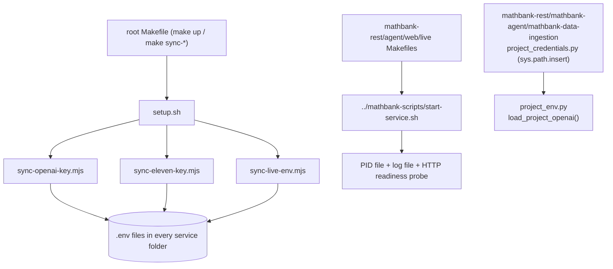

# mathbank-scripts

Shared, root-level developer/ops tooling used by every service in this repo — not a service
itself (no port, no `.env` of its own). It exists so that credential-syncing, service start/stop,
and connectivity checks aren't duplicated eight times across `mathbank-rest`/`mathbank-web`/
`mathbank-agent`/`mathbank-live`/`mathbank-db`/`mathbank-graph`/`mathbank-data-ingestion`.

(Renamed from `scripts/` to `mathbank-scripts/` for naming consistency with every other folder in
this repo.)

## What's here

| File | Purpose |
|---|---|
| `setup.sh` | One-shot environment bootstrap — installs/configures every service's venv/node_modules |
| `sync-openai-key.mjs`, `sync-eleven-key.mjs`, `sync-live-env.mjs`, `sync-neon-env.mjs` | Push root `.env` credentials out to each service's own `.env`, never the reverse |
| `check-openai.py`, `check-eleven.mjs` | Read-only connectivity/credential-sync verification |
| `start-service.sh` | Generic background-process launcher (PID file + log file + HTTP readiness probe) used by every `make start` target across the repo |
| `project_env.py` | File-only OpenAI credential loader — deliberately ignores shell-exported `OPENAI_API_KEY` (see `documentation/GOTCHAS.md` GOT-ENV-1) |
| `power_geometry_evidence.py` | One-off geometry evidence utility |

## Architecture flow



`project_credentials.py` in `mathbank-rest`, `mathbank-agent`, and `mathbank-data-ingestion` each
do `sys.path.insert(0, str(SERVICE_ROOT.parent / "mathbank-scripts"))` then
`from project_env import load_project_openai` — this is the one real, intentional cross-project
filesystem dependency every Python service has on this folder.

## Tests

```bash
cd mathbank-scripts
node --test *.test.mjs   # 15 tests: sync-openai-key, sync-live-env, sync-neon-env, start-service
```

No Python tests are wired into a single command yet; `test_project_env.py` exists and can be run
directly (`python -m pytest test_project_env.py`).

## Deployment strategy

Not deployed — this is developer/CI tooling invoked locally or in CI before/around starting the
actual services. It has no deployment story of its own because it never runs as a persistent
process.

## Roadmap / TODO

- No `README.md`/`Makefile` existed for this folder before this reorganization pass. A `Makefile`
  wasn't added here since every target in this folder is already invoked by name from the root
  `Makefile` or a sibling service's `Makefile` — adding a second entry point risks drifting out of
  sync with those callers rather than adding real value.

## Gotchas (mathbank-scripts-specific)

- Every Python service's `project_credentials.py` hardcodes the literal string
  `"mathbank-scripts"` in a `sys.path.insert` call — if this folder is ever renamed again, grep
  for `"mathbank-scripts"` (bare quoted string, no trailing slash) across `mathbank-rest`,
  `mathbank-agent`, `mathbank-data-ingestion`, and `mathbank-db` first. This exact blind spot (a
  bare quoted string with no trailing slash) is what broke during this session's own reorganization
  and had to be found via a real `import` smoke test, not just a text search for `"scripts/"`.
- `project_env.py` only ever reads the root `.env` — setting `OPENAI_API_KEY` in your shell
  profile has no effect and is a deliberately ignored, not a bug.
