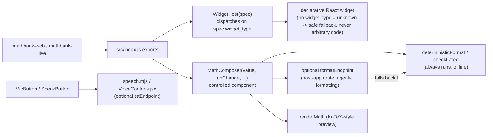

# mathbank-widgets

Private, shared React package (not a standalone service — no port, nothing to "start") used by
`mathbank-web` and `mathbank-live`: the declarative widget renderer, the LaTeX math composer, and
speech/voice helpers. It is distributed by file-copy (`make sync-widgets` in the consuming
projects), not published to a registry — see "Deployment strategy" below for why.

## Quick start

```bash
cd mathbank-widgets
npm install     # peer dependency: react >=18, provided by the consuming app
make test       # node --test tests/*.test.mjs
```

Consumers import it as `mathbank-widgets`, `mathbank-widgets/format`, `mathbank-widgets/speech`,
or `mathbank-widgets/server` (see `exports` in `package.json`) — never reach into `src/` directly.

## Architecture flow



`MathComposer` always runs `deterministicFormat`/`checkLatex` locally first; the optional
`formatEndpoint` (agentic/AI-assisted formatting, provided by the host app) is a pure enhancement
that falls back to the deterministic path on any failure — this package itself never calls an AI
provider directly.

## Data model

The central domain object is a **widget spec** (`{widget_type, config, ...}`) consumed by
`WidgetHost` — a declarative, whitelisted-by-`widget_type` structure, not executable code. This
mirrors `mathbank-agent`'s `propose_widget` tool, which is the only thing that should be
constructing specs for this host to render.

## Tests

```bash
make test   # node --test tests/*.test.mjs: format.test.mjs, speech.test.mjs, server.test.mjs
```

## Deployment strategy

This package is never deployed on its own — it has no entry point of its own, only exports
consumed at build time by `mathbank-web`/`mathbank-live`. It is intentionally **not** published to
an npm registry (private, single-repo, shared-by-copy) because its API is still moving in lockstep
with its two consumers; `make sync-widgets` (in each consumer) copies `src/`/`fixtures`/`README.md`
into that consumer's `node_modules/mathbank-widgets` at install/build time. If/when this package's
API stabilizes, workspace-based linking (npm/pnpm workspaces) would be a more conventional
alternative to the current copy step — not done yet, tracked below.

## Roadmap / TODO

- No `TODO`/`FIXME` markers exist in the current source. The one documented, deliberate
  non-goal: this package never calls an AI provider itself — `formatEndpoint`/`sttEndpoint` are
  always host-app-provided routes, keeping provider credentials out of a package copied into two
  different apps.
- Consider workspace-based linking instead of file-copy distribution (see "Deployment strategy").

## Gotchas (mathbank-widgets-specific)

- There was no `README.md` or `Makefile` for this package before this reorganization pass — its
  behavior had to be inferred from `package.json` and source; this file is the first consolidated
  description of it.
- `MathComposer` is a fully controlled component — consumers must own `value` and update it via
  `onChange`; it does not manage its own text state internally.
- `"sideEffects": false` is declared — always import through the documented `exports` entries
  above, never a deep path like `mathbank-widgets/src/WidgetHost.jsx`, or bundler tree-shaking
  assumptions in consuming apps may not hold.
- Voice input (`MicButton`) is fully optional and silently no-ops without a configured
  `sttEndpoint` — don't assume it's always available when testing.
